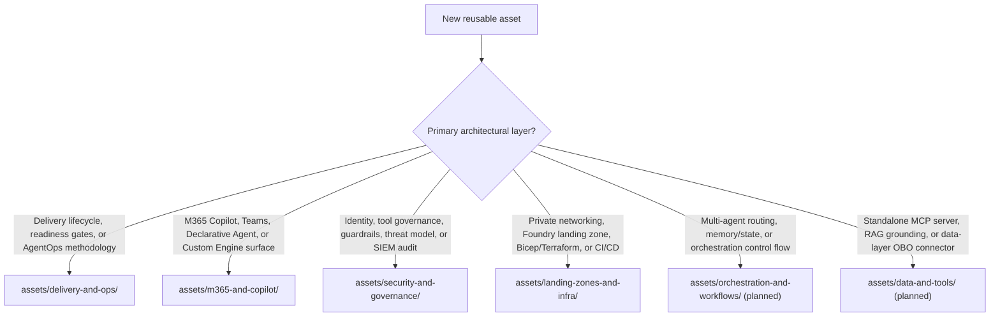

# Assets & Category Taxonomy

Assets in this repository are organized by architectural category under `assets/<category>/<asset-id>/`. Four categories are published today and two more are planned. Each published category folder has its own `README.md` with a decision guide comparing the patterns in that domain, while each asset folder (`<asset-id>/`) carries a machine-readable `manifest.yaml` validated by [`scripts/assets.py`](../scripts/assets.py).

Categories describe *what kind of architecture* an asset covers. Pillars describe *which path-to-production capability* it supports. See [Path to production](../docs/path-to-production.md) for the pillar map.

## Category Directory

| Category Folder | Scope & Typical Assets | Decision Guide |
|---|---|---|
| [`delivery-and-ops/`](delivery-and-ops/README.md) | End-to-end delivery playbooks, readiness gates, AgentOps lifecycles, evaluation harnesses, and operating models | [Browse `delivery-and-ops`](delivery-and-ops/README.md) |
| [`m365-and-copilot/`](m365-and-copilot/README.md) | Microsoft 365 Copilot, Microsoft Teams, Declarative Agents, Custom Engine Agents, MCP plug-ins, MCP Apps (`ui://`), and Cowork surfaces | [Browse `m365-and-copilot`](m365-and-copilot/README.md) |
| [`security-and-governance/`](security-and-governance/README.md) | Defense-in-depth agent security, Entra Agent ID, Foundry Toolbox allow-lists, runtime guardrails, Purview DSPM for AI, and Sentinel audit | [Browse `security-and-governance`](security-and-governance/README.md) |
| [`landing-zones-and-infra/`](landing-zones-and-infra/README.md) | Network-isolated Microsoft Foundry landing zones, Private Link/DNS topologies, Bicep/Terraform IaC, and multi-stage CI/CD pipelines | [Browse `landing-zones-and-infra`](landing-zones-and-infra/README.md) |
| `orchestration-and-workflows/` *(planned)* | Multi-agent planner/specialist routers, structured handoff protocols, durable state and caching, and deterministic vs. dynamic workflows | Planned — created with the first asset; see [where to look today](../docs/path-to-production.md#planned-categories-where-to-look-today) |
| `data-and-tools/` *(planned)* | Governed Model Context Protocol (MCP) server architectures, On-Behalf-Of (OBO) data connectors, Foundry IQ / RAG grounding, and action safety gates | Planned — created with the first asset; see [where to look today](../docs/path-to-production.md#planned-categories-where-to-look-today) |

## How to choose a category for a new contribution



To scaffold a new asset in the right category, run:

```bash
python scripts/assets.py new --category <category> --id <asset-id> --kind <kind> --title "<Title>" [--with-infra] [--with-src]
```

If the category is still planned, `new` creates the category folder and its `README.md` from [`templates/category/`](../templates/category/README.md). See [`scripts/README.md`](../scripts/README.md) for every command.

See [CONTRIBUTING.md](../CONTRIBUTING.md) and the [Contribution & Standardization Guide](../docs/contribution-guide.md) for the full authoring and review bar.

