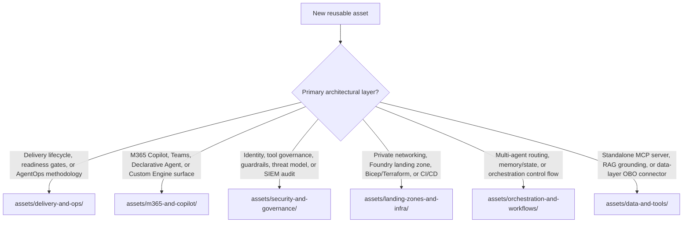

# Assets & Category Taxonomy

Assets in this repository are organized into **six architectural categories** under `assets/<category>/<asset-id>/`. Each category folder has its own `README.md` with a decision guide comparing the patterns in that domain, while each asset folder (`<asset-id>/`) carries a machine-readable `manifest.yaml` validated by [`tools/assets.py`](../tools/assets.py).

## Category Directory

| Category Folder | Scope & Typical Assets | Decision Guide |
|---|---|---|
| [`delivery-and-ops/`](delivery-and-ops/README.md) | End-to-end delivery playbooks, readiness gates, AgentOps lifecycles, evaluation harnesses, and operating models | [Browse `delivery-and-ops`](delivery-and-ops/README.md) |
| [`m365-and-copilot/`](m365-and-copilot/README.md) | Microsoft 365 Copilot, Microsoft Teams, Declarative Agents, Custom Engine Agents, MCP plug-ins, MCP Apps (`ui://`), and Cowork surfaces | [Browse `m365-and-copilot`](m365-and-copilot/README.md) |
| [`security-and-governance/`](security-and-governance/README.md) | Defense-in-depth agent security, Entra Agent ID, Foundry Toolbox allow-lists, runtime guardrails, Purview DSPM for AI, and Sentinel audit | [Browse `security-and-governance`](security-and-governance/README.md) |
| [`landing-zones-and-infra/`](landing-zones-and-infra/README.md) | Network-isolated Microsoft Foundry landing zones, Private Link/DNS topologies, Bicep/Terraform IaC, and multi-stage CI/CD pipelines | [Browse `landing-zones-and-infra`](landing-zones-and-infra/README.md) |
| [`orchestration-and-workflows/`](orchestration-and-workflows/README.md) | Multi-agent planner/specialist routers, structured handoff protocols, durable Cosmos DB state/caching, and deterministic vs. dynamic workflows | [Browse `orchestration-and-workflows`](orchestration-and-workflows/README.md) |
| [`data-and-tools/`](data-and-tools/README.md) | Governed Model Context Protocol (MCP) server architectures, On-Behalf-Of (OBO) data connectors, Foundry IQ / RAG grounding, and action safety gates | [Browse `data-and-tools`](data-and-tools/README.md) |

## How to choose a category for a new contribution



To scaffold a new asset in the right category, run:

```bash
python tools/assets.py new --category <category> --id <asset-id> --kind <kind> --title "<Title>"
```

See [CONTRIBUTING.md](../CONTRIBUTING.md) and the [Contribution & Standardization Guide](../docs/contribution-guide.md) for the full authoring and review bar.

