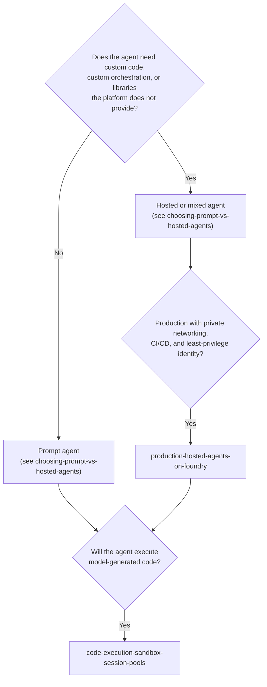

# Agent Runtime and Hosting (`agent-runtime`)

Patterns for deciding **where an agent's loop runs** and how to operate that runtime in production on Microsoft Foundry and Azure. Browse this category when you are choosing between Foundry prompt agents and hosted (containerized) agents, hardening a hosted agent for private networking and in-network CI/CD, or giving an agent a safe place to execute model-generated code.

## When to browse this category

- You need to decide whether an agent should be a **declarative prompt agent**, a **hosted agent** running your own Agent Framework code, or a **mixed** design where one calls the other.
- You are moving a hosted agent from a public proof of concept to a **private, identity-scoped, CI/CD-deployed** production runtime.
- Your agent writes and runs code (data analysis, charting, file transformation) and you must keep that code **outside the agent's own identity and network boundary**.

## Choosing between patterns in this category

| Decision Dimension | Choosing Prompt vs Hosted Agents (`choosing-prompt-vs-hosted-agents`) | Production Hosted Agents on Foundry (`production-hosted-agents-on-foundry`) | Code-Execution Sandbox (`code-execution-sandbox-session-pools`) |
|---|---|---|---|
| **Primary question** | Which runtime model fits this agent? | How do I run a hosted agent privately and repeatably? | Where does model-generated code execute? |
| **Asset kind** | Design pattern (decision framework) | Reference architecture | Design pattern |
| **Identity & trust boundary** | Platform-managed (prompt) vs your container's agent identity (hosted) | Agent identity with least-privilege data-plane roles; deployment identity inside the VNet | Sandbox session has **no** agent credentials and an isolated network |
| **Operational overhead** | Drives the overhead decision | Container build, private CI/CD runner, session and token management | A managed session pool and a narrow execution tool contract |
| **Combine when** | Start here, then follow the hosted branch | After choosing hosted or mixed | Any hosted or prompt agent that runs generated code |

## Assets in this category

<!-- category-catalog:start -->
| Asset | Kind | Maturity | Summary |
|-------|------|----------|---------|
| [Choosing Prompt Agents vs Hosted Agents in Microsoft Foundry](choosing-prompt-vs-hosted-agents/README.md) | `design-pattern` | preview | A decision pattern for choosing between Foundry prompt agents (declarative model, instructions, and platform-managed tools), hosted agents (your own containerized Agent Framework, LangGraph, or custom code run by Foundry), or a mixed design, per scenario. Covers control, tools and protocols, state, identity, network isolation, observability, operations, and migration, with a runnable rubric-based runtime selector. |
| [Code Execution Sandboxes with Session Pools](code-execution-sandbox-session-pools/README.md) | `design-pattern` | preview | Design pattern for agents that write and run code. Never execute model-generated code in the agent's process. Run it in Azure Container Apps dynamic sessions (session pools): one isolated session per user and conversation, egress off by default, explicit lifecycle, file I/O through the session API and a least-privilege executor role. Includes a decision matrix, threat model, ADRs and an offline simulator. |
| [Production Hosted Agents on Microsoft Foundry](production-hosted-agents-on-foundry/README.md) | `reference-architecture` | preview | Reference architecture for running containerized hosted agents on Microsoft Foundry Agent Service in production, on top of the secured Foundry landing zone. Covers private networking, a managed identity with least-privilege data-plane roles, CI/CD from a runner inside the VNet, an explicit session lifecycle (pin, heartbeat, cleanup), per-audience token caching, OpenTelemetry observability and a governed rollout with version pinning and rollback, plus ADRs and an offline simulator. |
<!-- category-catalog:end -->

## Complementary assets in other categories

- **Private-by-default Foundry foundation that hosted agents deploy into:** [`landing-zones-and-infra/secured-foundry-landing-zone`](../landing-zones-and-infra/secured-foundry-landing-zone/README.md)
- **Governed tool access for agents through a gateway:** [`ai-gateway/multi-tenant-mcp-gateway`](../ai-gateway/multi-tenant-mcp-gateway/README.md)
- **Runtime governance and Entra Agent ID controls:** [`security-and-governance/agent-security-and-governance`](../security-and-governance/agent-security-and-governance/README.md)
- **Publishing a hosted agent to Microsoft Teams and Microsoft 365 Copilot:** [`m365-and-copilot/m365-azure-custom-agent`](../m365-and-copilot/m365-azure-custom-agent/README.md)
- **The control loop that runs inside a hosted agent:** [`orchestration-and-workflows/governed-context-aware-agent-harness`](../orchestration-and-workflows/governed-context-aware-agent-harness/README.md)
