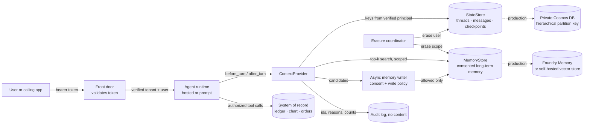

# Agent State and Memory: Private Cosmos DB vs Foundry Memory

> **Maturity:** preview · **Kind:** design-pattern · **Category:** `agent-runtime` · **Version:** 0.1.0

Teams say "agent memory" and mean three different things. The first is **thread state**: the messages of one conversation and the checkpoints of a run, which must survive a container restart and resume exactly once. The second is **long-term user memory**: preferences, facts and summaries that the agent learned in earlier sessions and should recall by relevance in a new one. The third is **system-of-record data**: balances, orders, prescriptions, contracts. That data is never memory. The agent reads it through authorized tools every time it needs it.

When the three are mixed in one store, predictable failures follow. Thread history leaks across tenants because the partition key came from a header. Prompts grow without limit because every old message is "memory". A customer's account balance is recalled from a summary written last month instead of read from the ledger. A deletion request removes the chat but not the extracted facts. A store that must stay inside a private network is replaced by a managed service that cannot be reached privately.

This design pattern separates the three kinds of state behind a small, pluggable interface. A **`StateStore`** holds threads, messages and checkpoints. A **`MemoryStore`** holds consented long-term memories. A **`ContextProvider`** wraps both: before a turn it returns bounded history and the top-k relevant memories, and after a turn it checkpoints and queues memory candidates for an asynchronous, policy-checked write. Every partition key and memory scope is computed from the **verified** tenant and user, never from a request hint. With that interface in place, the same agent can keep thread state in **private Azure Cosmos DB** and long-term memory in **Foundry Memory** or a **self-hosted vector store**, and swap either backend without touching agent logic.

> **Core thesis:** *Thread state, user memory and system-of-record data have different owners, lifetimes and access rules. Store them separately, scope every key from the verified user and tenant, let memory hold only consented, non-authoritative facts, and make erasure one verifiable operation across every store.*

This asset is a **preview** design pattern. Foundry Memory is a preview feature at the time of writing. Statements about its behavior, its API surface and how hosted agents bind to it are marked "observed in preview; verify against current docs". Every statement is qualitative on purpose: this asset contains no performance, capacity or cost figures.

## Architecture and implementation map

| Layer / concern | Deep-dive documentation | Executable or illustrative reference |
|---|---|---|
| **Three kinds of state, invariants, interfaces, decision matrix** | [`docs/architecture.md`](docs/architecture.md) sections 1 to 5 · [ADR 0001](docs/decisions/0001-separate-conversation-state-from-long-term-memory.md) | [`samples/agent_state_store.py`](samples/agent_state_store.py): `StateStore`, `MemoryStore`, `ContextProvider` protocols |
| **Cosmos DB data model, ETag concurrency, idempotency, time to live** | [`docs/architecture.md`](docs/architecture.md) sections 6, 9 and 10 | `InMemoryStateStore`, `SqliteStateStore` and the documented `CosmosStateStore` stub |
| **Foundry Memory and self-hosted memory, write policy, reflection** | [`docs/architecture.md`](docs/architecture.md) sections 7 and 8 | `InMemoryMemoryStore`, `MemoryWritePolicy`, `MemoryWriter`, `Reflector`, `FoundryMemoryStore` and `VectorMemoryStore` stubs |
| **Scope from verified identity, consent, retention, erasure, audit** | [`docs/authentication-and-governance.md`](docs/authentication-and-governance.md) · [ADR 0002](docs/decisions/0002-scope-memory-to-verified-user-and-tenant.md) | `Principal`, `FakeTokenVerifier`, `ConsentRegistry`, `ErasureCoordinator`, `AuditLog` |
| **Isolation tests, memory quality, resume correctness, troubleshooting** | [`docs/evaluation-and-troubleshooting.md`](docs/evaluation-and-troubleshooting.md) | [`samples/README.md`](samples/README.md): 16 core scenarios and 9 domain scenarios |

## Domain Packs

The split is the same in every industry. What changes is which facts may become memory, which must stay in the system of record, and how long each may live.

| Domain Pack | Thread state (`StateStore`) | Long-term memory (`MemoryStore`) | System of record (tools only) | Retention rule of thumb |
|---|---|---|---|---|
| **Financial services (Contoso)** | An open card-dispute conversation and its checkpoints | Statement delivery and contact-channel preferences | Balances, transactions, dispute outcomes, card numbers | Thread state ends with the case; memory only with consent; card data never leaves the ledger |
| **Healthcare (Fabrikam)** | A scheduling conversation with a patient | Reminder channel and language preferences | Diagnoses, medications, results, chart notes | Clinical details are never memorized; patients can erase themselves and get a receipt |
| **Retail and multi-tenant SaaS (Northwind)** | A shopper's order-help conversation per merchant tenant | Size, pickup and contact preferences per merchant tenant | Orders, payments, loyalty balances, refunds | The same user object id in two merchant tenants is two separate scopes |
| **Public sector** | A case-intake conversation | Accessibility and language preferences | Case records, eligibility decisions, identifiers | Records rules decide thread retention; memory holds no case facts |
| **Manufacturing** | A maintenance troubleshooting session | A technician's preferred units and report format | Work orders, asset history, safety lockouts | Safety state is always read live, never recalled |

The sample ships three of these as runnable packs (`--domain contoso-finance`, `fabrikam-health`, `northwind-retail`).

## When to use

- An agent has **multi-turn conversations** that must survive restarts, scale-out or redeployments, and resume without duplicating side effects.
- You want the agent to **remember users across sessions**, and you need consent, scoping and erasure for what it remembers.
- The workload is **multi-tenant**, or one agent serves many users whose state must never mix.
- A security or compliance review requires that **conversation data stays in a private network** and inside a data boundary you own.
- You are choosing between **private Cosmos DB, Foundry Memory, a vector store you run, or local storage**, and want one interface that lets you change that choice later.
- A **right-to-be-forgotten** request must remove a user's data from every store the agent writes to, with proof.

## When not to use

- **You need the hosted-agent runtime itself**: container lifecycle, private networking, CI/CD and session affinity. See [Production Hosted Agents on Microsoft Foundry](../production-hosted-agents-on-foundry/README.md). This asset covers only the state those agents keep.
- **You need to decide who may read a thread or memory.** Authorization comes from verified identity; see [Request Context Is Not Authorization](../request-context-is-not-authorization/README.md). This asset applies that rule to keys and scopes.
- **You need the private network, DNS and BYO Cosmos DB wiring for a Foundry project.** See [Secured Foundry Landing Zone](../../landing-zones-and-infra/secured-foundry-landing-zone/README.md).
- **You need within-episode context hygiene, evidence ledgers and compaction.** See [Governed Context-Aware Agent Harness](../../orchestration-and-workflows/governed-context-aware-agent-harness/README.md), which governs what enters the context window during one episode.
- **A stateless, single-shot agent.** If each request is independent and nothing should be remembered, keep no state. The safest memory is none.
- **Retrieval over documents or knowledge bases.** That is retrieval-augmented generation over shared content, not per-user memory. Keep it in a search index with its own security trimming.

## Architecture



The agent never talks to a store directly. The `ContextProvider` is the only path to thread state and memory. It computes every key from the verified principal, bounds what it returns, and writes memory through a policy gate rather than inline. System-of-record data is reached only through authorized tools, and the write policy refuses to copy it into memory.

### Which store for which kind of state

| Kind of state | Typical production store | Access pattern | Lifetime | Who owns erasure |
|---|---|---|---|---|
| **Thread messages and checkpoints** | Private Cosmos DB with partition key `[tenantId, threadId]` | Point reads and single-partition queries; ETag-guarded writes | Time to live per item type, aligned to the conversation's retention rule | The agent team, through `StateStore.erase_user` |
| **Long-term user memory** | Foundry Memory, or a self-hosted vector store such as Azure AI Search | Top-k search by relevance within one user scope | Time to live per memory, consent-bound | The agent team, through `MemoryStore.erase_user` and the platform's scope delete |
| **System-of-record data** | The line-of-business system | Tool calls authorized at the resource | Owned by the business system | The business system, under its own records policy |
| **Local development** | SQLite or in-memory fakes | Same interfaces | Process or file lifetime | The developer |

## Key design decisions

| Decision | Choice | Why | Trade-off |
|---|---|---|---|
| Kinds of state | Separate `StateStore` and `MemoryStore`, never one "memory" bucket ([ADR 0001](docs/decisions/0001-separate-conversation-state-from-long-term-memory.md)) | Different access patterns, lifetimes, networking needs and erasure paths | Two stores to operate and two backends to choose |
| Keys and scopes | Derived only from the verified tenant and user ([ADR 0002](docs/decisions/0002-scope-memory-to-verified-user-and-tenant.md)) | Headers such as `x-memory-user-id` are hints that a caller or model can forge | The front door must validate tokens and hand the principal down |
| Thread store | Private Cosmos DB, hierarchical partition key `[/tenantId, /threadId]`, ETag concurrency, time to live | Private endpoint, data-plane RBAC, point reads, transactional batch within a thread | You own partition design, throughput mode and data-plane roles |
| Memory store | Foundry Memory where its networking and preview status are acceptable; otherwise a self-hosted vector store behind the same interface | Managed extraction and consolidation versus private networking and full control | Preview risk on one side; you build extraction and consolidation on the other |
| Memory writes | Asynchronous, after the checkpoint, through consent and a content policy | Keeps the turn fast and refuses system-of-record and sensitive categories | Memory is eventually consistent with the conversation |
| Recall | Top-k, minimum score, character budget, bounded history | Prevents prompt bloat and irrelevant recall | Some useful facts are not recalled; tune with evaluation |
| Erasure | One coordinator: drop queued candidates, erase memory, erase state, revoke consent, verify, return a receipt | Right-to-be-forgotten must cover every store and be provable | Each backend needs an erase-by-user path and a verification count |

## Getting started

1. **Run the sample offline.** It needs Python 3.10 or later and no packages:

   ```powershell
   python assets/agent-runtime/agent-state-cosmos-vs-foundry-memory/samples/agent_state_store.py --self-test
   python assets/agent-runtime/agent-state-cosmos-vs-foundry-memory/samples/agent_state_store.py --domain all
   python assets/agent-runtime/agent-state-cosmos-vs-foundry-memory/samples/agent_state_store.py --demo
   ```

   The self-test runs tenant and user isolation, forged tenant hints, idempotent checkpoints and resume, stale ETags, time-to-live expiry, erasure with a receipt, write-policy blocks, bounded context, contradiction handling, a SQLite backend swap and a memory outage. It prints PASS or FAIL per scenario and exits non-zero on any failure.
2. **Classify your state.** For every value your agent keeps, decide whether it is thread state, long-term memory or system-of-record data, using the table in [`docs/architecture.md`](docs/architecture.md) section 1. Anything recalled from memory that a tool should read live is a finding.
3. **Choose backends per kind of state.** Use the decision matrix in [`docs/architecture.md`](docs/architecture.md) section 5. Keep the interface even if you start with one backend.
4. **Wire identity first.** Compute partition keys and memory scopes only from the verified principal, and apply the controls in [`docs/authentication-and-governance.md`](docs/authentication-and-governance.md).
5. **Implement the production adapters.** Replace the `CosmosStateStore` and `FoundryMemoryStore` stubs using their docstrings, then run the same scenarios against them in a non-production environment.
6. **Gate releases with the evaluation suite.** Add the isolation, resume and erasure tests from [`docs/evaluation-and-troubleshooting.md`](docs/evaluation-and-troubleshooting.md) to CI. The release gate is zero cross-scope reads.

## File map

| Path | Purpose |
|---|---|
| [`docs/architecture.md`](docs/architecture.md) | Three kinds of state, invariants, interfaces, decision matrix, Cosmos DB and Foundry Memory models, turn lifecycle, wire contracts, resume, erasure, Domain Packs, failure modes, anti-patterns, checklist |
| [`docs/authentication-and-governance.md`](docs/authentication-and-governance.md) | Managed identity and data-plane RBAC, private endpoints, Foundry project identity, scope derivation, consent, retention, erasure workflow, encryption, logging |
| [`docs/evaluation-and-troubleshooting.md`](docs/evaluation-and-troubleshooting.md) | Evaluation dimensions, test matrix, memory-quality checks, CI gating, troubleshooting |
| [`docs/decisions/`](docs/decisions/) | ADR 0001 (separate conversation state from long-term memory) and ADR 0002 (scope memory to the verified user and tenant) |
| [`samples/README.md`](samples/README.md) · [`samples/agent_state_store.py`](samples/agent_state_store.py) | Standard-library reference implementation with `--self-test`, `--domain` and `--demo` |

## Related assets

| Asset | Relationship |
|---|---|
| [Production Hosted Agents on Microsoft Foundry](../production-hosted-agents-on-foundry/README.md) | The runtime that keeps this state; its guidance to rehydrate from Cosmos DB and treat the sandbox disk as a cache is implemented here |
| [Request Context Is Not Authorization](../request-context-is-not-authorization/README.md) | Why `x-memory-user-id` and similar hints are partition hints, not authorization; this asset derives every key from the verified principal |
| [Choosing Prompt Agents vs Hosted Agents](../choosing-prompt-vs-hosted-agents/README.md) | Prompt agents and hosted agents bind to memory differently; choose the agent type first |
| [Secured Foundry Landing Zone](../../landing-zones-and-infra/secured-foundry-landing-zone/README.md) | Private Cosmos DB, private endpoints, DNS and BYO thread storage for a Foundry project |
| [Governed Context-Aware Agent Harness](../../orchestration-and-workflows/governed-context-aware-agent-harness/README.md) | Within-episode context hygiene; validates memory on read and treats summaries as narration, not evidence |
| [Enterprise Agent Security and Tool Governance](../../security-and-governance/agent-security-and-governance/README.md) | The broader security program; memory poisoning and data leakage controls apply here |

## Production-readiness pillar mapping

| Pillar | How this asset contributes |
|---|---|
| **Agent architecture patterns** | A reusable `StateStore` / `MemoryStore` / `ContextProvider` shape with a decision matrix for backends and wire contracts for each item |
| **Security and observability** | Keys from verified identity only, private networking for thread state, a memory write policy, content-free audit and an isolation test suite |
| **AI CoE and governance** | Consent, retention by item type, an erasure workflow with receipts, and ADRs that make the state split a reviewable standard |

## Security and responsible AI

- **Memory is not a permission or a fact of record.** A recalled memory is a hint about the user. It never grants access, and it never replaces a live read from the system of record.
- **Scope from verified identity only.** A tenant or user identifier in a header, payload or tool argument never selects a partition or memory scope.
- **Consent before memory.** No long-term memory is written for a user who has not opted in, and opting out stops new writes immediately.
- **Refuse sensitive categories.** Payment cards, government identifiers, clinical details, credentials and instruction-like text are refused by the write policy. Extend the rules for your domain and evaluate them.
- **Memory content is data, not instructions.** Recalled text is placed in a clearly delimited context block and is never executed as a directive.
- **Log decisions, not contents.** Audit records carry ids, reasons and counts. They never carry message text or memory text.

## Limitations

- **Foundry Memory is preview.** Its API names, retrieval behavior, consolidation, time-to-live handling and networking were observed in preview. Verify against current Microsoft Learn documentation before you depend on them.
- The sample's memory store uses simple bag-of-words scoring and supersedes older memories by topic. Real memory services use embeddings and model-based consolidation. The sample shows the control flow, not memory quality.
- `CosmosStateStore`, `FoundryMemoryStore` and `VectorMemoryStore` are documented stubs that raise `NotImplementedError`. Their docstrings describe the intended calls; verify SDK parameter names against current documentation.
- The write policy is rule-based and illustrative. It is not a data-loss-prevention classifier.
- This asset contains no latency, throughput, capacity or cost figures. Measure in your own environment.

## References

- [Architecture deep dive](docs/architecture.md)
- [Authentication and governance](docs/authentication-and-governance.md)
- [Evaluation and troubleshooting](docs/evaluation-and-troubleshooting.md)
- [Samples guide](samples/README.md)
- [Memory in Foundry Agent Service (preview)](https://learn.microsoft.com/azure/foundry/agents/concepts/what-is-memory)
- [Use memory in Foundry Agent Service](https://learn.microsoft.com/azure/foundry/agents/how-to/memory-usage)
- [Quickstart: memory with a hosted agent](https://learn.microsoft.com/azure/foundry/agents/quickstarts/quickstart-memory-hosted-agent)
- [Hierarchical partition keys in Azure Cosmos DB](https://learn.microsoft.com/azure/cosmos-db/hierarchical-partition-keys)
- [Time to live in Azure Cosmos DB](https://learn.microsoft.com/azure/cosmos-db/time-to-live)
- [Optimistic concurrency control in Azure Cosmos DB](https://learn.microsoft.com/azure/cosmos-db/database-transactions-optimistic-concurrency)
- [Data-plane role-based access control for Azure Cosmos DB for NoSQL](https://learn.microsoft.com/azure/cosmos-db/nosql/security/how-to-grant-data-plane-role-based-access)
- [Configure Azure Private Link for Azure Cosmos DB](https://learn.microsoft.com/azure/cosmos-db/how-to-configure-private-endpoints)
- [Contribution and Standardization Guide](../../../docs/contribution-guide.md)
