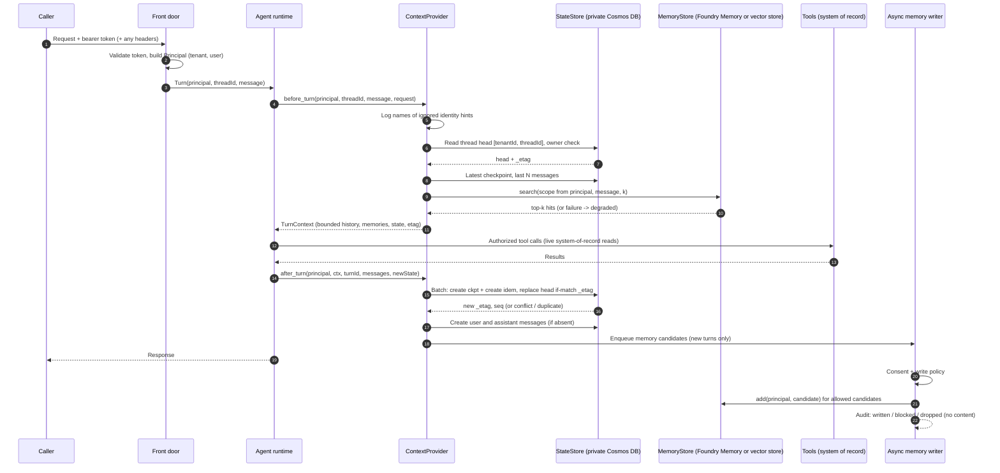
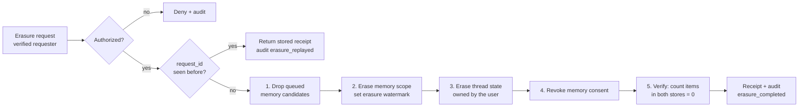

# Architecture: Agent State and Memory

> Part of [Agent State and Memory: Private Cosmos DB vs Foundry Memory](../README.md). Companion documents: [Authentication and governance](authentication-and-governance.md) · [Evaluation and troubleshooting](evaluation-and-troubleshooting.md) · [ADR 0001](decisions/0001-separate-conversation-state-from-long-term-memory.md) · [ADR 0002](decisions/0002-scope-memory-to-verified-user-and-tenant.md)

This document explains how to keep an agent's conversation state, long-term user memory and business data apart. It describes a small interface that hides the storage backend, compares the backends you are likely to choose between, and gives the data model, wire contracts and lifecycle for each. The reference implementation is [`samples/agent_state_store.py`](../samples/agent_state_store.py). Class names in this document match the sample.

Foundry Memory is a preview feature at the time of writing. Statements about its behavior are marked **observed in preview; verify against current docs**. This document is qualitative on purpose. It contains no latency, throughput, capacity or cost figures.

## Contents

1. [Three kinds of state](#1-three-kinds-of-state)
2. [Why conflating them fails](#2-why-conflating-them-fails)
3. [Invariants](#3-invariants)
4. [The pluggable interface](#4-the-pluggable-interface)
5. [Decision matrix](#5-decision-matrix)
6. [Cosmos DB data model for thread state](#6-cosmos-db-data-model-for-thread-state)
7. [Foundry Memory model](#7-foundry-memory-model)
8. [Self-hosted memory, write policy and reflection](#8-self-hosted-memory-write-policy-and-reflection)
9. [Turn lifecycle, resume and idempotency](#9-turn-lifecycle-resume-and-idempotency)
10. [Wire contracts](#10-wire-contracts)
11. [Erasure across both stores](#11-erasure-across-both-stores)
12. [Domain Packs](#12-domain-packs)
13. [Failure modes](#13-failure-modes)
14. [Anti-patterns](#14-anti-patterns)
15. [When not to use this pattern](#15-when-not-to-use-this-pattern)
16. [Production checklist](#16-production-checklist)
17. [Preview caveats](#17-preview-caveats)
18. [Related assets](#18-related-assets)

## 1. Three kinds of state

An agent keeps at least three kinds of state. They look similar because they are all text that ends up in a prompt. They differ in who owns them, how long they live, how they are read and who may erase them.

| Kind | What it holds | Read pattern | Lifetime | Source of truth? | Store behind |
|---|---|---|---|---|---|
| **Thread state** | Messages of one conversation, run checkpoints (workflow step, pending approval, tool-call ledger), idempotency records | Point read of the thread head, latest checkpoint, last N messages | Short to medium; ends with the conversation or case retention rule | Yes, for the conversation itself | `StateStore` |
| **Long-term user memory** | Preferences, profile facts, procedural instructions and summaries the user stated or agreed to, extracted across sessions | Top-k search by relevance within one user's scope | Medium to long; consent-bound; decays or is superseded | No. A hint about the user, possibly outdated | `MemoryStore` |
| **System-of-record data** | Balances, transactions, orders, prescriptions, contracts, case decisions | Tool call authorized at the resource, every time | Owned by the business system and its records policy | Yes | Line-of-business system, reached by tools |

Use this classification test for every value the agent keeps:

| Question | If yes |
|---|---|
| Would a wrong or stale value cause a wrong business outcome (money, care, entitlement)? | System of record. Read it through a tool. Never memorize it. |
| Is it needed only to continue this conversation or resume this run? | Thread state. It expires with the thread. |
| Did the user state it about themselves, and would they expect the agent to remember it next time? | Memory candidate. Write it only with consent and after the write policy. |
| Is it a credential, payment card, government identifier or clinical detail? | Never memory. Keep it in the system that is authorized to hold it. |
| Is it shared knowledge that every user can read (manuals, policies)? | Neither. It belongs in a search index with its own security trimming. |

Two clarifications prevent common confusion:

- **Thread transcripts are not automatically safe.** A transcript can contain anything the user typed, including sensitive data. Redacting transcripts is a separate control from the memory write policy. The write policy decides what is *promoted* to long-term memory; it does not clean thread state.
- **"Memory" in a hosted-agent definition is not long-term memory.** A memory setting on a container definition sizes the container's RAM. A sandbox filesystem is scoped to a conversation or session and is a cache. Neither is a durable, scoped memory store (observed in preview; verify against current docs). See [Production Hosted Agents on Microsoft Foundry](../../production-hosted-agents-on-foundry/docs/architecture.md#66-container-restart-and-session-expiry).

## 2. Why conflating them fails

| Conflation | Mechanism | What goes wrong | Control in this pattern |
|---|---|---|---|
| **One store keyed by a request value** | The partition key or memory scope comes from `x-tenant-id`, `x-memory-user-id` or a payload field | A caller or a prompt-injected tool call reads another tenant's thread or another user's memory | Keys and scopes are computed only from `Principal` (section 3, invariant I1) |
| **Every message is "memory"** | The whole history is replayed into every prompt | Prompts grow without limit, cost and quality degrade, old instructions resurface | Bounded history plus top-k memory within a character budget (section 4) |
| **Memory holds system-of-record data** | A summary records "balance is ..." or "order shipped" | The agent answers from a stale copy instead of the ledger; the copy escapes the system's access controls | Write policy refuses system-of-record patterns; tools read live (section 8) |
| **No erasure path for derived data** | Deleting a thread does not touch extracted facts, embeddings or summaries | A right-to-be-forgotten request is only partly honored | One `ErasureCoordinator` over every store, with verification (section 11) |
| **Managed memory where private networking is required** | A memory service with no virtual network integration holds conversation-derived text | A security review fails, or data leaves the boundary you promised | Thread state in private Cosmos DB; memory backend chosen per networking requirement (section 5) |
| **Checkpoint without concurrency control** | Two replicas resume the same thread and both write | Lost updates, duplicated tool calls, a workflow that skips or repeats a step | ETag-guarded checkpoint plus idempotency key (section 9) |
| **Memory written inline in the turn** | Extraction and embedding run before the response | Slow turns; a memory outage fails the conversation | Asynchronous writer after the checkpoint; memory failures degrade the turn (section 9) |

## 3. Invariants

These invariants hold for every backend. The self-test checks each one.

| # | Invariant | Enforced by | Sample scenario |
|---|---|---|---|
| I1 | Every partition key and memory scope is derived from the verified tenant and user only. Request hints are logged by name and ignored. | `Principal`, `ignored_hints()` | `02 forged_tenant_hint_ignored` |
| I2 | A thread is readable only by its owner in its tenant. Missing, expired and not-yours return the same error. | `NotFoundOrDenied` | `01 thread_isolation_across_tenants` |
| I3 | A memory scope belongs to exactly one verified user in one tenant. The same user id in two tenants is two scopes. | `memory_scope_for()` | `04 memory_scoped_per_user`, Northwind pack |
| I4 | A checkpoint is written only against the ETag the turn read, and a retried turn with the same idempotency key is a no-op. | `save_checkpoint(expected_etag=..., idempotency_key=...)` | `05 idempotent_checkpoint_and_resume` |
| I5 | Nothing is written to long-term memory without consent and a passing write policy. | `ConsentRegistry`, `MemoryWritePolicy` | `09 write_policy_blocks_sor_and_sensitive` |
| I6 | Context injected into a turn is bounded: last N messages, top-k memories above a minimum score, within a character budget. | `MemoryContextProvider.before_turn` | `10 context_provider_bounds` |
| I7 | Erasure covers queued candidates, memory, thread state and consent, and is verified by a zero count. | `ErasureCoordinator` | `07 erasure_removes_state_and_memory` |
| I8 | Audit records contain identifiers, reasons and counts, never message or memory text. | `AuditLog` field allow-list | `13 audit_has_no_content` |
| I9 | Memory is optional context. A memory outage degrades the turn; it never fails it or blocks the checkpoint. | `before_turn` degraded path | `15 memory_outage_degrades_not_fails` |

## 4. The pluggable interface

The agent never calls a store. It calls a `ContextProvider`, which owns a `StateStore` and a `MemoryStore`. Each store is a `typing.Protocol`, so any class with the right methods is a backend.

```python
class StateStore(Protocol):                     # thread state; logical partition = (tenant_id, thread_id)
    def create_thread(self, principal) -> ThreadItem: ...
    def get_thread(self, principal, thread_id) -> ThreadItem: ...
    def append_message(self, principal, thread_id, turn_id, role, content) -> MessageItem: ...
    def recent_messages(self, principal, thread_id, limit) -> list[MessageItem]: ...
    def save_checkpoint(self, principal, thread_id, state, *, turn_id,
                        expected_etag, idempotency_key) -> CheckpointResult: ...
    def load_latest_checkpoint(self, principal, thread_id) -> CheckpointItem | None: ...
    def delete_thread(self, principal, thread_id) -> int: ...
    def erase_user(self, tenant_id, user_id) -> int: ...          # administrative; coordinator only
    def count_user_items(self, tenant_id, user_id) -> int: ...    # erasure verification

class MemoryStore(Protocol):                    # long-term memory; one scope per verified (tenant, user)
    def add(self, principal, candidate) -> MemoryRecord: ...
    def search(self, principal, query, k) -> list[MemoryHit]: ...
    def erase_user(self, tenant_id, user_id, *, erased_at) -> int: ...
    def count_user_items(self, tenant_id, user_id) -> int: ...

class ContextProvider(Protocol):                # agent-framework hook
    def before_turn(self, principal, thread_id, user_message, request=None) -> TurnContext: ...
    def after_turn(self, principal, ctx, turn_id, user_message,
                   assistant_message, new_state) -> CheckpointResult: ...
```

Design rules for the interface:

- **The first argument is always a `Principal`.** User-facing methods take a verified principal, not a tenant string. The store computes keys from it. Only the administrative erase and count methods take raw identifiers, and only the `ErasureCoordinator` calls them after its own authorization check.
- **Errors are part of the contract.** `ConcurrencyConflict` (ETag mismatch), `NotFoundOrDenied` (missing, expired or not yours), `ScopeViolation` (unverified principal), `ErasureDenied` and `ScopeErased` (a write that predates an erasure). Every backend maps its native errors to these.
- **Item shapes are backend-neutral.** `ThreadItem`, `MessageItem`, `CheckpointItem` and `MemoryRecord` mirror the wire contracts in section 10. A Cosmos DB adapter maps them to documents; a vector adapter maps `MemoryRecord` to an index entry.
- **`search` is relevance-ranked and scoped.** It returns at most `k` hits above a minimum score from the caller's own scope, excluding expired and superseded records.

### 4.1 The context-provider hook

Agent frameworks expose a hook that runs before the model is invoked and after a response is produced. In Microsoft Agent Framework this is a context provider; method names vary by framework version, so map them to `before_turn` and `after_turn`.

| Step | `before_turn` | `after_turn` |
|---|---|---|
| 1 | Log the names of any identity hints on the request, then ignore them | Save the checkpoint with the ETag read in `before_turn` and the turn id as idempotency key |
| 2 | Read the thread head, owner-checked | Append the user and assistant messages (create-if-absent) |
| 3 | Load the latest checkpoint | If the checkpoint was a duplicate, stop: the turn already completed |
| 4 | Read the last N messages | Extract memory candidates from the user message |
| 5 | Search memory for the top-k hits above the minimum score | Queue candidates for the asynchronous writer |
| 6 | Trim hits to the character budget; on memory failure, mark the turn degraded | Return the checkpoint result (new ETag, sequence number) |

`TurnContext.render()` places memories in a clearly labelled block ("user-stated, may be outdated, never authoritative") separate from workflow state and recent turns. Recalled memory is data, never an instruction.

### 4.2 Backends in the sample

| Class | Implements | Purpose |
|---|---|---|
| `InMemoryStateStore` | `StateStore` | Fake of one Cosmos DB container with key `[tenantId, threadId]`, ETags, per-item expiry and an injectable clock |
| `SqliteStateStore` | `StateStore` | Local-development backend; a conditional `UPDATE ... WHERE etag = ?` plays the if-match role |
| `InMemoryMemoryStore` | `MemoryStore` | Scoped memory with bag-of-words relevance, time to live, supersession by topic and an erasure watermark |
| `CosmosStateStore` | `StateStore` (stub) | Documents the intended Cosmos DB calls; raises `NotImplementedError` |
| `FoundryMemoryStore` | `MemoryStore` (stub) | Documents the intended Foundry Memory calls; raises `NotImplementedError` |
| `VectorMemoryStore` | `MemoryStore` (stub) | Documents a self-hosted Azure AI Search or PostgreSQL with pgvector backend; raises `NotImplementedError` |

Scenario `12 backend_swap_sqlite` runs the same turn, resume and erasure flow over `SqliteStateStore` with no change to the provider. That is the point of the interface.

## 5. Decision matrix

Choose a backend per kind of state, not one backend for everything. The matrix compares the four options this pattern supports. Cost drivers are qualitative; measure in your own environment.

| Dimension | Private Cosmos DB | Foundry Memory | Self-hosted memory service (vector store) | Local SQLite or file |
|---|---|---|---|---|
| **Best fit for** | Thread state, checkpoints, idempotency records; optionally structured memory you query by key | Long-term user memory: profile, preferences, chat summaries, procedural memory | Long-term memory when you need private networking, custom extraction or full control | Local development, tests, single-user demos |
| **Poor fit for** | Relevance search over free text unless you add vector search | Thread transcripts, checkpoints, anything that must be read exactly | Thread state and checkpoints (no transactional ETag semantics across items) | Anything shared, multi-replica or production |
| **Private networking and data residency** | Private endpoint, public access disabled, region you choose; can be BYO thread storage for a Foundry project | No virtual network integration for memory stores (observed in preview; verify against current docs); data stays in the Foundry project's region | Private endpoint on Azure AI Search or PostgreSQL; region you choose | On the developer's machine |
| **Partitioning and isolation model** | Hierarchical partition key `[/tenantId, /threadId]`; owner check on every read | A `scope` per memory store; isolation is only as good as the scope value you pass | Mandatory server-side filter on `scope`; PostgreSQL row-level security as a second line | Table columns and a `WHERE` clause; no network isolation |
| **Retrieval** | Point reads and single-partition queries; vector search is available but not used here | Static retrieval of profile memories at conversation start and contextual retrieval by the latest messages (observed in preview; verify against current docs) | Vector or hybrid top-k search with filters | Exact queries; simple scoring in the sample |
| **Time to live and erasure** | Container time to live with per-item `ttl`; erase by querying the tenant prefix and deleting each thread partition | Store-level default time to live; scope delete (observed in preview; verify the operation name) | Your own expiry field and purge job; delete by scope filter | Delete rows or the file |
| **Consistency and idempotency** | ETag if-match on replace; transactional batch within a logical partition; create-if-absent for messages | Updates are asynchronous and consolidated by the service; treat writes as eventually visible | Upserts by id; consolidation is your asynchronous job | Transactions within one file |
| **Operational ownership** | You own account, partition design, throughput mode, indexing policy, data-plane roles, backup | Platform owns extraction, consolidation and storage; you own scope, consent, write policy and erasure calls | You own everything: index, embeddings, extraction, consolidation, purge | The developer |
| **Cost driver (qualitative)** | Request units for reads, writes and queries; storage; indexing breadth | Model calls for extraction, consolidation and embeddings; stored memories | Index size and replicas; embedding calls; your compute for consolidation | None that matters |
| **Maturity and preview risk** | Generally available core features; some operations such as delete by partition key may be preview (verify) | Preview: API names, retrieval behavior, quotas and networking can change | Generally available building blocks; the memory logic is yours to test | Not a production option |

### 5.1 Recommended combinations

| Situation | Thread state | Long-term memory |
|---|---|---|
| Regulated workload, conversation text must stay on a private network | Private Cosmos DB | Self-hosted vector store with private endpoint, or no long-term memory |
| Foundry agents, memory may live in the Foundry project and preview is acceptable | Private Cosmos DB (BYO thread storage) | Foundry Memory, scoped from the verified principal |
| Many tenants, each with strict separation and per-tenant retention | Private Cosmos DB with hierarchical keys; optionally a container per tenant tier | Foundry Memory or vector store; scope includes the tenant |
| Early prototype | SQLite or in-memory | In-memory; keep the interface so you can swap later |
| No user should be remembered | Private Cosmos DB | None. Do not implement `MemoryStore` |

The interface makes the choice reversible. Scenario `12 backend_swap_sqlite` and the stubs show that the provider, write policy, erasure coordinator and tests do not change when a backend does.

## 6. Cosmos DB data model for thread state

`CosmosStateStore` in the sample documents the intended calls. This section explains the design behind them.

### 6.1 Account and container

- **Account:** Azure Cosmos DB for NoSQL, public network access disabled, private endpoint in the agent's virtual network, local (key) authentication disabled. Network and DNS wiring are covered by [Secured Foundry Landing Zone](../../../landing-zones-and-infra/secured-foundry-landing-zone/README.md); identity and roles by [Authentication and governance](authentication-and-governance.md).
- **Container:** one container named `agent_state` holds every item type for thread state. A `type` field distinguishes `thread`, `message`, `checkpoint` and `idempotency`.
- **Time to live:** enabled on the container with no default expiry, so each item sets its own `ttl` by type (section 6.3).
- **Foundry projects:** if the project uses bring-your-own thread storage, the platform's own thread data also lands in your private Cosmos DB account. This asset's container sits beside it and holds the agent's application-level state and checkpoints.

### 6.2 Partition key choice

| Option | Isolation | Thread reads | Tenant-wide queries (erasure, export) | Risk |
|---|---|---|---|---|
| `/tenantId` | Good | Single partition | Single partition | A large tenant becomes a hot partition and can reach the logical partition storage limit |
| `/threadId` | Weak: tenant is only a filter | Single partition | Cross-partition fan-out | A missing tenant filter is a cross-tenant read |
| `/tenantId` + `/threadId` (hierarchical) | Good: tenant is the first level of every key | Single partition | Prefix query on `[tenantId]` is routed to that tenant's physical partitions | Requires the full key for transactional batch, which a thread always has |
| Synthetic `tenantId_threadId` string | Good | Single partition | Cross-partition fan-out with a string prefix filter | Harder to query by tenant; no prefix routing |

This pattern uses the **hierarchical partition key `["/tenantId", "/threadId"]`**. Every thread is its own logical partition, so no single tenant creates a hot logical partition, and the tenant prefix still allows efficient tenant-scoped queries for erasure and export. Both values come from `Principal.state_partition_key(thread_id)`; the tenant level is never taken from a request.

If tenants need separate throughput, keys or regions, add a container (or account) per tenant tier above this design. The item model does not change.

### 6.3 Item types and time to live

| `type` | `id` | Written by | Write semantics | `ttl` source |
|---|---|---|---|---|
| `thread` | `<threadId>` | `create_thread`, `save_checkpoint` | Create, then replace with if-match on `_etag` | Thread retention; refreshed on each checkpoint so active threads stay alive |
| `message` | `<turnId>:<role>` | `append_message` | Create-if-absent; a conflict on create means already written | Thread retention from creation |
| `checkpoint` | `ckpt:<seq:08d>` | `save_checkpoint` | Created in the same transactional batch as the head replace | Thread retention from creation |
| `idempotency` | `idem:<idempotencyKey>` | `save_checkpoint` | Created in the same batch; point-read before each save | A short replay window, shorter than thread retention |

Time to live in Cosmos DB counts from an item's last modification. Expired items stop being returned by reads and queries, and are deleted in the background (verify current behavior). Time to live is a **retention backstop**, not an erasure mechanism. A right-to-be-forgotten request is explicit, immediate and verified (section 11).

### 6.4 Optimistic concurrency and the checkpoint batch

The thread head's system `_etag` is the concurrency token for the whole thread.

1. `before_turn` reads the head and remembers its `_etag`.
2. `after_turn` calls `save_checkpoint(expected_etag=..., idempotency_key=turn_id)`.
3. The adapter point-reads `idem:<key>`. If it exists, it returns the stored result marked `duplicate`.
4. Otherwise it runs one **transactional batch** in the logical partition `[tenantId, threadId]`: create `ckpt:<seq>`, create `idem:<key>`, replace the head with `if-match: <expected_etag>`, incrementing `lastSeq`.
5. The batch is all-or-nothing. A precondition failure on the replace maps to `ConcurrencyConflict`, and neither the checkpoint nor the idempotency record exists afterwards. A conflict on creating `idem:<key>` means a concurrent retry won; re-read and return it as a duplicate.

Messages are written after the checkpoint with create-if-absent ids, so a retried turn finishes a partial write without duplicates. The sample's `InMemoryStateStore` and `SqliteStateStore` implement the same semantics; the SQLite backend uses `UPDATE ... WHERE etag = ?` inside a transaction as the if-match.

### 6.5 Indexing, throughput and hot spots

- **Indexing policy:** include only the paths you filter or sort on (`type`, `ownerOid`, `seq`, `createdAt`). Exclude `content` and `state`. Transcript text and checkpoint payloads are never queried by value, and indexing them adds cost with no benefit.
- **Throughput mode:** autoscale or serverless suits bursty conversational traffic; provisioned throughput suits steady load. Choose by measured load; this asset gives no figures.
- **Hot partitions:** with a thread-level key, a hot partition means one very busy thread, usually a retry loop or a runaway agent. Check retries and idempotency before raising throughput.
- **Throttling:** a rate-limited request returns a retry-after hint. Let the SDK retry with backoff, keep the turn's idempotency key, and do not retry outside the SDK in a tight loop.
- **Change feed (optional):** instead of an in-process queue, a change-feed consumer on `message` items can feed the memory writer. If you do this, the consumer must apply the same consent check, write policy and erasure watermark.

## 7. Foundry Memory model

Foundry Memory is a managed long-term memory service in Foundry Agent Service. Everything in this section is **observed in preview; verify against current docs**.

### 7.1 Concepts

| Concept | Behavior | How this pattern uses it |
|---|---|---|
| **Memory store** | A named store in a Foundry project, configured with a chat model deployment and an embedding deployment | One store per agent or per data classification; never one store shared by unrelated agents |
| **Scope** | A string that partitions memories inside a store, typically one per user | Always `Principal.memory_scope`: an opaque hash of the verified tenant and user |
| **Memory types** | User profile memories (stable facts and preferences), chat summary memories, and procedural memories | Profile and preference memories are the main use; summaries pass the same write policy |
| **Extraction** | A model extracts candidate memories from the messages you submit | You submit only messages that passed consent and the write policy |
| **Consolidation** | A model merges new memories with existing ones and resolves contradictions | Replaces the sample's simple supersede-by-topic rule |
| **Retrieval** | Static retrieval (no input items) returns profile memories for the start of a conversation; contextual retrieval uses the latest messages | `before_turn` calls search with the current user message and a top-k limit |
| **Profile guidance** | Optional store-level instructions steer which profile details to extract | State what *not* to extract too: identifiers, clinical details, financial figures |
| **Time to live** | A store-level default time to live for memories | Set from your retention policy; consolidation can refresh a memory's age, so erasure still needs an explicit delete |

### 7.2 Calls behind `FoundryMemoryStore`

The stub's docstring lists the intended calls on the Foundry projects SDK's beta surface. Names and parameters can change while the feature is in preview.

| `MemoryStore` method | Intended Foundry call | Notes |
|---|---|---|
| `add` | Write policy first; then an update-memories call with the scope and the candidate as a user message item | Returns a long-running poller; extraction and consolidation are asynchronous |
| `search` | A search-memories call with the scope, the latest user message as an item, and a maximum number of memories | With no items it returns static profile memories |
| `erase_user` | The memory store's scope-deletion operation, then a search that must return nothing | Verify the operation name against current docs |
| `count_user_items` | A static search for the scope | Used only for erasure verification |

### 7.3 Binding memory to agents

- **Prompt agents** can attach a memory search tool that names the memory store and a scope. The scope can be a literal or a user-id template that the service resolves per request.
- **Hosted agents** built on Microsoft Agent Framework can use a Foundry memory context provider, which plays the `MemoryStore` side of this pattern's `ContextProvider`.
- **Treat the resolved user id as a hint until you have proven its source.** In some topologies the per-request user id can be supplied by a header such as `x-memory-user-id`. If a caller can set that header, it can select another user's memories. Pass an explicit scope computed from the verified principal, or make sure a gateway strips and re-sets the header from a validated token. See [Request Context Is Not Authorization](../../request-context-is-not-authorization/docs/architecture.md#64-memory-threads-and-retrieval-are-resources-too).
- **Container memory is not long-term memory.** A memory size on a hosted-agent definition is the container's RAM. The sandbox filesystem is scoped to a conversation or session and disappears with it.

### 7.4 Requirements and constraints

- **Identity:** the calling identity needs the Foundry User role on the project. The identity used for extraction also needs access to the chat and embedding deployments (for example Cognitive Services OpenAI User). Without it, updates fail and the store stays empty, which looks like "memory does not work".
- **Networking:** memory stores do not support virtual network integration. If memory text must stay on a private network, use a self-hosted store (section 8) and keep thread state in private Cosmos DB.
- **Quotas:** stores, scopes and memories per scope are limited. Check current limits; this asset does not quote them.
- **What goes in:** only candidates that passed consent and the write policy. Never submit the raw transcript, tool outputs or system-of-record data for extraction.

## 8. Self-hosted memory, write policy and reflection

### 8.1 A self-hosted memory service

`VectorMemoryStore` documents a memory backend on Azure AI Search or on PostgreSQL with pgvector, reached over a private endpoint with key authentication disabled.

| Concern | Design |
|---|---|
| **Index fields** | `id`, `scope` (filterable), `tenantId`, `text`, `category`, `topic`, `createdAt`, `expiresAt`, `supersededBy`, `embedding` |
| **Search** | Vector or hybrid top-k with a **mandatory server-side filter**: `scope eq '<principal.memory_scope>' and expiresAt gt <now> and supersededBy eq null`, built only from the principal |
| **Second line of defense** | On PostgreSQL, row-level security keyed on a session setting that the adapter sets from the verified principal |
| **Writes** | Write policy, then embed with your embedding deployment using managed identity, then upsert |
| **Consolidation** | Your asynchronous job: supersede contradicted memories, merge duplicates, decay unused ones |
| **Expiry and erasure** | A purge job deletes expired memories; erasure deletes by scope filter and confirms a zero count |

The sample's `InMemoryMemoryStore` stands in for this. Its scoring is a bag-of-words cosine with topic keywords, and a newer memory with the same topic and category supersedes older ones. That shows the control flow, not memory quality.

### 8.2 Memory write policy

`MemoryWritePolicy.evaluate` runs before any backend write. The first matching rule is recorded as the reason in an audit event that contains no content.

| Order | Reason | Blocks |
|---|---|---|
| 1 | `no_consent` | Any write for a user who has not opted in, or who opted out |
| 2 | `unsupported_category` | Categories other than `preference`, `profile`, `procedural`, `summary` |
| 3 | `too_long` | Candidates over a maximum length (long text is usually a transcript, not a fact) |
| 4 | `credential` | Passwords, PINs, API keys, tokens, one-time codes |
| 5 | `sensitive_category:payment_card` | Card numbers and verification codes |
| 6 | `sensitive_category:government_id` | National identifiers, passports, tax identifiers, licence numbers |
| 7 | `sensitive_category:health` | Diagnoses, medications, dosages, allergies, symptoms, treatments |
| 8 | `system_of_record_data` | Balances, invoices, account numbers, transactions, order numbers, currency amounts |
| 9 | `instruction_like_content` | Text that tries to change the agent's behavior ("ignore previous", "always approve") |

The rules are regular expressions and are illustrative. A production policy adds a classifier, domain-specific rules, evaluation sets and human review of what it blocks.

### 8.3 Extraction, consolidation and reflection

- **Extraction** turns a user message into candidates. The sample's `MemoryExtractor` uses phrase rules ("I prefer ...", "remember that ...", "please always ..."). Foundry Memory and production services use a model.
- **Consolidation** decides what happens when a new memory contradicts an old one. The sample supersedes by topic and category, keeping the old record for audit but excluding it from search. Scenario `11 contradiction_supersedes_older_memory` checks that only the newer preference is recalled.
- **Reflection** is optional, asynchronous summarization. The sample's `Reflector` condenses a thread's user turns into one `summary` candidate. The summary goes through the same writer and policy as every other candidate; scenario `16 reflection_summary_passes_policy` checks that a summary containing system-of-record data is blocked.
- **Memory poisoning:** a user, a document or a tool result can try to plant instructions in memory. Extract only from user turns, refuse instruction-like content, label recalled memory as non-authoritative data, and evaluate with adversarial inputs.

## 9. Turn lifecycle, resume and idempotency



Memory writes happen after the response path, so a slow or failed memory backend never delays or fails a turn. Memory is eventually consistent with the conversation.

### 9.1 Resume and retry semantics

The turn id is the idempotency key. A client or orchestrator that retries a turn must reuse it.

| Failure point | State after failure | What a retry with the same turn id does |
|---|---|---|
| Before the checkpoint batch | Nothing written | Re-runs the turn from the same checkpoint. Tool side effects must be idempotent on their own; see [idempotency and retries](../../production-hosted-agents-on-foundry/docs/architecture.md#67-idempotency-and-retries) |
| After the checkpoint, before messages | Checkpoint and idempotency record exist | `save_checkpoint` returns the stored result as a duplicate; messages are created; memory extraction is skipped |
| After messages, before enqueue | Checkpoint and messages exist | Duplicate checkpoint; messages already exist; extraction skipped. The candidate is lost, by design |
| Another replica already advanced the thread | Head `_etag` changed | `ConcurrencyConflict`; nothing is written. Reload the thread and re-run, or return a conflict to the caller |
| Retry after the idempotency window expired | Idempotency record gone | The retry's ETag is stale, so it fails with `ConcurrencyConflict` instead of writing twice |

Two properties follow:

- **Checkpoints are exactly-once per turn id.** The batch is atomic, and a replay returns the original result.
- **Memory extraction is at-most-once per turn.** Losing a preference is acceptable; writing it twice or writing it for a rejected turn is not. Memory is an enhancement, never the source of truth.

After a container restart, a new replica resumes by reading the thread head and latest checkpoint from the store. Nothing about the conversation lives only in process memory or the sandbox disk. Scenario `05 idempotent_checkpoint_and_resume` and the Contoso pack's `dispute_resumes_after_replica_restart` check this.

## 10. Wire contracts

These are the logical shapes. The Cosmos DB adapter stores them as documents in `agent_state`; other backends map them to their own storage. Identifiers below are synthetic.

**Thread head**

```json
{
  "id": "thr-0001",
  "type": "thread",
  "tenantId": "00000000-0000-0000-0000-00000000c001",
  "threadId": "thr-0001",
  "ownerOid": "00000000-0000-0000-0000-0000000000a1",
  "lastSeq": 3,
  "createdAt": "2026-01-15T09:00:00Z",
  "updatedAt": "2026-01-15T09:12:00Z",
  "ttl": 1209600,
  "_etag": "\"e-000007\""
}
```

**Message**

```json
{
  "id": "turn-0003:user",
  "type": "message",
  "tenantId": "00000000-0000-0000-0000-00000000c001",
  "threadId": "thr-0001",
  "turnId": "turn-0003",
  "role": "user",
  "content": "I'd prefer email for statement notices.",
  "createdAt": "2026-01-15T09:12:00Z",
  "ttl": 1209600
}
```

**Checkpoint**

```json
{
  "id": "ckpt:00000003",
  "type": "checkpoint",
  "tenantId": "00000000-0000-0000-0000-00000000c001",
  "threadId": "thr-0001",
  "seq": 3,
  "turnId": "turn-0003",
  "state": { "workflow": "card_dispute", "step": "awaiting_documents", "pendingApproval": false },
  "createdAt": "2026-01-15T09:12:00Z",
  "ttl": 1209600
}
```

**Idempotency record**

```json
{
  "id": "idem:turn-0003",
  "type": "idempotency",
  "tenantId": "00000000-0000-0000-0000-00000000c001",
  "threadId": "thr-0001",
  "checkpointId": "ckpt:00000003",
  "resultEtag": "\"e-000007\"",
  "createdAt": "2026-01-15T09:12:00Z",
  "ttl": 172800
}
```

The `ttl` values are illustrative retention settings (in seconds), not recommendations. Set them from your retention policy.

**Memory record**

```json
{
  "memoryId": "m-00042",
  "scope": "mem-<opaque hash of verified tenant and user>",
  "category": "preference",
  "topic": "contact_channel",
  "text": "Prefers email for statement notices",
  "source": { "threadId": "thr-0001", "turnId": "turn-0003" },
  "createdAt": "2026-01-15T09:12:05Z",
  "expiresAt": "2026-07-14T09:12:05Z",
  "supersededBy": null
}
```

**Memory search request and response** (internal API between the provider and a memory service)

```json
{
  "scope": "derived server-side from the verified principal; never accepted from the caller",
  "query": "How will I get my statement?",
  "k": 3,
  "minScore": 0.15,
  "includeSuperseded": false
}
```

```json
{
  "hits": [
    { "memoryId": "m-00042", "text": "Prefers email for statement notices", "category": "preference",
      "topic": "contact_channel", "score": 0.61, "createdAt": "2026-01-15T09:12:05Z" }
  ]
}
```

Scores are relative relevance values from the sample's scoring function, not quality metrics. The service returns hits already filtered by scope, expiry and supersession; the provider then applies the minimum score, top-k and character budget. If the call fails, the provider records `degraded: ["memory_unavailable"]` on the turn context instead of failing the turn.

**Erasure request and receipt**

```json
{
  "requestId": "erase-0001",
  "target": { "userId": "00000000-0000-0000-0000-0000000000a1" },
  "reason": "data_subject_request"
}
```

The target tenant is always the requester's verified tenant. A request naming another tenant is denied.

```json
{
  "requestId": "erase-0001",
  "tenantId": "00000000-0000-0000-0000-00000000c001",
  "subjectRef": "sub-<pseudonymous hash>",
  "requestedBy": "sub-<pseudonymous hash>",
  "stateItemsDeleted": 9,
  "memoriesDeleted": 2,
  "queuedCandidatesDropped": 1,
  "verified": true,
  "completedAt": "2026-01-16T10:00:00Z"
}
```

**Audit event** (allow-listed fields only)

```json
{
  "event": "memory_write_blocked",
  "at": "2026-01-15T09:12:05Z",
  "tenant_id": "00000000-0000-0000-0000-00000000c001",
  "subject_ref": "sub-<pseudonymous hash>",
  "thread_id": "thr-0001",
  "turn_id": "turn-0004",
  "category": "preference",
  "topic": "general",
  "reason": "system_of_record_data"
}
```

## 11. Erasure across both stores

A right-to-be-forgotten request has to reach every place the user's data went: thread state, extracted memories, candidates still waiting in the writer's queue, and every copy downstream. Deleting the thread alone leaves the derived memories behind, and deleting memories alone leaves the transcript they came from. `ErasureCoordinator` in the sample shows the order and the checks.

### 11.1 Authorization

| Requester | Target | Outcome |
|---|---|---|
| A verified user | Themselves (no target given) | Allowed |
| A verified user with the privacy role (`privacy-officer` in the sample) | Another user in the **same** verified tenant | Allowed and audited with both pseudonymous references |
| A verified user without the privacy role | Another user | Denied: `erasure_not_authorized` / `not_self_or_privacy_role` |
| Anyone | A user in another tenant | Denied: `cross_tenant`. The target tenant is always the requester's verified tenant |
| Anyone | A malformed user id (an email address, a free-text name) | Denied: `invalid_target`. Erasure keys are directory object ids, not display attributes |

Denials are audited without the target's identifier. Scenario `08 erasure_authorization` covers each row.

### 11.2 Order of operations



1. **Drop queued candidates first.** Otherwise the asynchronous writer can recreate a memory seconds after it was erased.
2. **Erase memory and set a watermark.** The watermark is the erasure time for the scope. Any write for that scope whose source turn is older than the watermark is rejected with `erased_scope_watermark`, which covers a candidate already in flight inside the backend call.
3. **Erase thread state** for every thread the user owns: heads, messages, checkpoints and idempotency records. With the hierarchical key this is a query on the tenant prefix filtered by `ownerOid`, followed by deletes per thread partition.
4. **Revoke consent** so new turns do not start writing memory again until the user opts in.
5. **Verify.** Count the user's items in both stores. The receipt records the counts and `verified`. An unverified result is an incident, not a success.

Erasure is **idempotent by `request_id`**. A replay returns the stored receipt and records `erasure_replayed`; it does not run a second erasure with different counts. Scenarios `07 erasure_removes_state_and_memory` and the Fabrikam pack's `patient_self_erasure_verified` check the whole sequence.

### 11.3 Copies the coordinator does not reach

| Copy | What to do |
|---|---|
| Cosmos DB continuous backup or periodic backup | Document that backups age out under the backup retention policy. Do not restore a backup into production without replaying the erasure log |
| Cosmos DB analytical store or a mirrored copy in an analytics platform | Include in the erasure job, or keep personal content out of it |
| Change-feed consumers that copied messages elsewhere | Each consumer subscribes to erasure events and deletes its own copy |
| Search indexes or embeddings built from transcripts | Delete by scope or owner, then verify like the primary stores |
| Logs and traces | Keep content out of them in the first place (see [Authentication and governance](authentication-and-governance.md#9-logging-without-leaking-memory)); the pseudonymous subject reference is not reversible without the tenant and user ids |
| Foundry-managed thread storage | If the platform keeps its own copy of conversations, delete those conversations through the platform as well |

## 12. Domain Packs

The same split applies in every industry, but the boundary between the three kinds moves. Each pack lists what goes where and which scenarios prove it. Retention entries are examples of policy decisions, not recommendations.

### 12.1 Contoso Financial Services (`--domain contoso-finance`)

| Kind | Examples | Store and rule |
|---|---|---|
| Thread state | A card-dispute conversation, its checkpoint (`case`, `step`, pending documents), idempotency records | Private Cosmos DB; retained for the dispute's working life, then removed by time to live |
| Long-term memory | "Prefers statements as PDF attachments", "Prefers email for notices", preferred language | Foundry Memory or a private vector store, behind consent |
| System of record | Balances, transactions, card numbers, dispute decisions, credit limits | Core banking and card systems, read by tools authorized per call; never written to memory |
| Retention | Case records follow the records policy of the dispute system, not the agent's thread retention | Thread time to live is shorter than the case record; the case system is the archive |

| Scenario | Proves |
|---|---|
| `dispute_resumes_after_replica_restart` | A new replica reloads the checkpoint and history from durable state; a client retry after a timeout does not duplicate the turn |
| `balance_comes_from_ledger_not_memory` | "Remember that my balance is ..." is blocked as `system_of_record_data`; the ledger tool returns the current value; another tenant cannot read it |
| `statement_preference_recalled_in_new_thread` | A stated preference follows the user into a new conversation |

### 12.2 Fabrikam Health (`--domain fabrikam-health`)

| Kind | Examples | Store and rule |
|---|---|---|
| Thread state | An appointment-scheduling conversation, including anything clinical the patient typed | Private Cosmos DB inside the regulated boundary, under the thread retention policy, with customer-managed keys if required |
| Long-term memory | "Prefers text message reminders", preferred language, preferred clinic location | Only non-clinical preferences; a self-hosted private store if memory text must stay on the private network |
| System of record | Diagnoses, medications, allergies, appointments, lab results | The clinical record system, reached by authorized tools; never memory |
| Retention | Clinical content in a transcript is governed by the health-records policy; memory holds none of it | Erasure must be verifiable and auditable |

| Scenario | Proves |
|---|---|
| `clinical_details_never_memorized` | Dosage and allergy statements are blocked as `sensitive_category:health`; the transcript remains in thread state under its own policy |
| `reminder_preference_recalled` | The contact preference is recalled for the patient and never for another patient in the same tenant |
| `patient_self_erasure_verified` | Self-service erasure removes state and memory, a replay returns the same receipt, and the audit shows `verified` |

### 12.3 Northwind Traders (`--domain northwind-retail`)

| Kind | Examples | Store and rule |
|---|---|---|
| Thread state | A product question, a basket in progress, a return conversation | Cosmos DB, short retention; a basket that matters belongs in the commerce system |
| Long-term memory | Preferred size, preferred pickup store, reply language | Foundry Memory is often a good fit when the data classification allows it |
| System of record | Orders, payments, cards, loyalty balance, addresses on file | Commerce, payment and loyalty systems through tools; never memory |
| Retention | Marketing-style personalization requires its own consent and may differ by market | Memory consent separate from marketing consent |

| Scenario | Proves |
|---|---|
| `order_and_card_details_blocked` | An order number is blocked as `system_of_record_data` and a card number as `sensitive_category:payment_card` |
| `size_and_pickup_recalled` | Only the relevant memories (size, pickup) are recalled for a sizing question; the language preference is not |
| `same_user_id_separate_across_tenants` | The same user object id in two tenants yields different partition keys and memory scopes, and no recall crosses them |

## 13. Failure modes

| Failure | Effect without this pattern | Behavior with this pattern |
|---|---|---|
| Memory backend unavailable or throttled | The turn fails | `before_turn` returns no memories, sets `degraded` to `["memory_unavailable"]` and audits `memory_degraded`; the turn continues (scenario 15) |
| Two replicas run the same thread | Lost update or interleaved transcript | The second checkpoint fails with `ConcurrencyConflict`; nothing partial is written |
| Client retries after a timeout | Duplicate messages and duplicate memories | Duplicate checkpoint returned; messages created only if absent; extraction skipped |
| Replica restarts mid-conversation | Conversation lost with process memory or sandbox disk | Resume from the thread head and latest checkpoint |
| Writer queue lost on restart | Some memory candidates lost | Accepted: memory writes are at most once and non-critical. Use a durable queue or change feed if loss is not acceptable |
| Erasure races an in-flight memory write | Erased memory reappears | Queue dropped first; watermark rejects older writes |
| Model extracts a wrong fact | Wrong preference recalled indefinitely | Supersession on contradiction, time to live, user-visible "what do you remember" and delete |
| Preview memory API changes | Build or runtime breaks | Only `FoundryMemoryStore` changes; agent logic depends on the `MemoryStore` protocol |
| Identity token missing or invalid | Fallback to a request hint, cross-user access | `ScopeViolation`; no key is computed without a verified principal (scenario 03) |

## 14. Anti-patterns

- **Using the transcript as memory.** Searching every past message for "relevant memory" grows the prompt without bound and recalls things the user never asked you to keep.
- **Storing business facts in memory.** A remembered balance or order status is stale the moment the system of record changes. Read it through a tool every time.
- **Taking the scope from the request.** A tenant or user id from a header, body field or URL selects data for whoever sets it. Hints are logged by name and ignored.
- **One memory scope per tenant.** Users in the same tenant see each other's preferences. Scope memory per verified user and tenant.
- **Using the user's email or display name as the key.** These change and are reassigned. Use the directory object id and tenant id.
- **Partitioning only by thread id.** Isolation then depends on remembering a tenant filter in every query.
- **Synchronous memory writes on the response path.** Memory latency and failures become user-visible, and a rejected turn can still write memory.
- **Memory without consent or a policy.** Credentials, card numbers and clinical details end up in a store designed for preferences.
- **Erasing one store.** Deleting threads but not memories (or the reverse) leaves personal data behind and cannot be verified.
- **Treating time to live as erasure.** Time to live is retention; an erasure request needs an immediate, verified delete.
- **Logging memory text for debugging.** The log becomes an unmanaged memory store with a different retention policy.
- **Confusing container RAM or the session sandbox with memory.** Neither survives the session; neither is per-user.
- **Treating recalled memory as instructions.** Memory is user-provided data. Label it as such in the prompt and never let it change policy.

## 15. When not to use this pattern

- **Stateless, single-turn tools.** If nothing needs to survive the request, keep no state.
- **A prompt agent where the platform-managed conversation is enough** and you need no custom checkpoints, private storage or cross-session memory. Use the platform's conversations and its memory tool directly, still with a verified scope.
- **Shared organizational knowledge.** Policies, product catalogs and procedures belong in a retrieval index with document-level permissions, not in per-user memory.
- **Workflow engines that already own durable state.** If a durable orchestration framework checkpoints the workflow, keep its state there and use this pattern only for conversation and memory.
- **Analytics on conversations.** Build that as a separate, consented pipeline with its own governance; do not mine the memory store.
- **Regulated content you are not permitted to retain at all.** Then do not persist the transcript; keep only the minimum checkpoint and no memory.

## 16. Production checklist

**Identity and keys**

- [ ] Every partition key and memory scope is computed from a validated token's tenant and object id.
- [ ] Request headers and body fields that carry tenant or user ids are logged by name and ignored.
- [ ] Missing or invalid identity fails closed before any store call.

**Thread state**

- [ ] Cosmos DB account has public access disabled, a private endpoint, and local authentication disabled.
- [ ] Container uses the hierarchical key `["/tenantId", "/threadId"]`; the owner is checked on every thread read.
- [ ] Checkpoints use if-match on the head `_etag`, a transactional batch and an idempotency record keyed by turn id.
- [ ] Time to live is set per item type from the retention policy; content paths are excluded from indexing.

**Memory**

- [ ] Memory scope is per verified user and tenant; the backend applies the scope filter server-side.
- [ ] Consent is recorded per user; no consent means no memory writes.
- [ ] Write policy blocks credentials, sensitive categories, system-of-record data and instruction-like text, and the blocks are evaluated.
- [ ] Memory writes are asynchronous and at most once per turn; a memory outage degrades instead of failing turns.
- [ ] Recalled memory is bounded (top-k, minimum score, character budget) and labelled as non-authoritative in the prompt.

**Erasure and audit**

- [ ] Erasure covers queued candidates, memory, thread state, consent and downstream copies, and verifies zero remaining items.
- [ ] Erasure is idempotent by request id and audited with pseudonymous references.
- [ ] Audit and logs use an allow-list of fields and never contain message or memory text.

**Operations**

- [ ] Isolation, recall, erasure and resume tests run in CI against each backend adapter.
- [ ] Throttling, conflicts, degraded memory and blocked writes are monitored.
- [ ] Preview dependencies are pinned and re-verified on upgrade.

## 17. Preview caveats

- Foundry Memory, its SDK surface, its agent bindings and its limits are **observed in preview; verify against current docs**. The method names in `FoundryMemoryStore` are documentation, not a tested integration.
- Memory extraction and consolidation are model-driven. Results vary with the models you configure and with the instructions you give. Evaluate with your own data (see [Evaluation and troubleshooting](evaluation-and-troubleshooting.md)).
- How a per-request user id reaches the memory service differs between prompt agents, hosted agents and direct SDK calls. Confirm which value the service actually used, and do not rely on a header you have not proven is set by a trusted component.
- Network isolation options for memory stores may change. Re-check before deciding that memory text must go to a self-hosted store.
- Hosted-agent runtime caveats (session lifetime, restarts, sandbox storage) are in [Production Hosted Agents on Microsoft Foundry](../../production-hosted-agents-on-foundry/docs/architecture.md#19-preview-caveats).

## 18. Related assets

| Asset | Relationship |
|---|---|
| [Production Hosted Agents on Microsoft Foundry](../../production-hosted-agents-on-foundry/README.md) | The runtime that keeps this state; see its [container restart and session expiry](../../production-hosted-agents-on-foundry/docs/architecture.md#66-container-restart-and-session-expiry) and [idempotency record](../../production-hosted-agents-on-foundry/docs/architecture.md#146-idempotency-record-in-cosmos-db) sections |
| [Request Context Is Not Authorization](../../request-context-is-not-authorization/README.md) | The rule this asset applies to partition keys and memory scopes |
| [Choosing Prompt Agents vs Hosted Agents](../../choosing-prompt-vs-hosted-agents/README.md) | Decides which memory binding is available to you |
| [Secured Foundry Landing Zone](../../../landing-zones-and-infra/secured-foundry-landing-zone/README.md) | Private Cosmos DB, private endpoints, DNS and bring-your-own thread storage |
| [Governed Context-Aware Agent Harness](../../../orchestration-and-workflows/governed-context-aware-agent-harness/README.md) | Within-episode context hygiene; its [memory record](../../../orchestration-and-workflows/governed-context-aware-agent-harness/docs/architecture.md#86-memory-record) and [scoped memory](../../../orchestration-and-workflows/governed-context-aware-agent-harness/docs/architecture.md#93-scoped-memory-across-episodes) sections complement this one |
| [Enterprise Agent Security and Tool Governance](../../../security-and-governance/agent-security-and-governance/README.md) | Memory poisoning, data leakage and tool governance controls |
