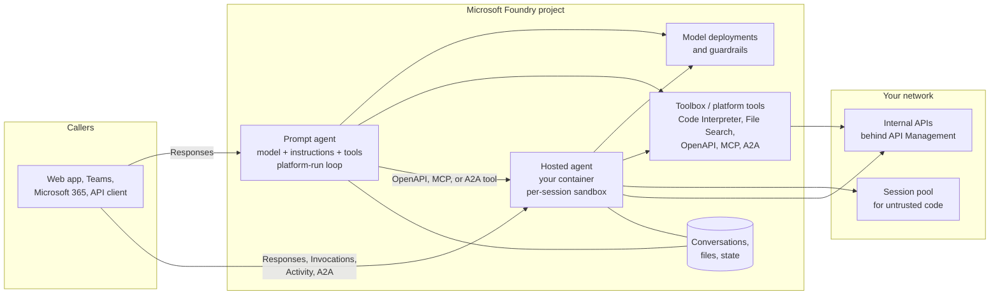
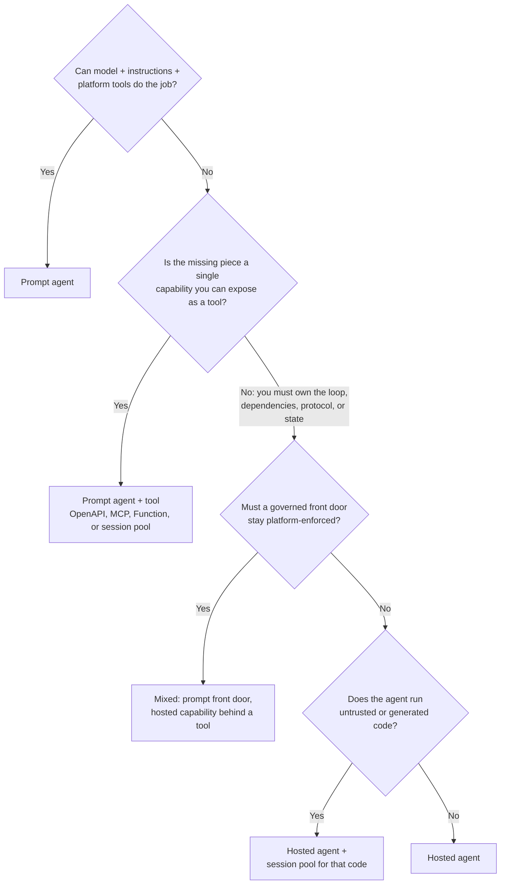

# Choosing Prompt Agents vs Hosted Agents in Microsoft Foundry

> **Maturity:** preview · **Kind:** design-pattern · **Category:** `agent-runtime` · **Version:** 0.1.0

Microsoft Foundry Agent Service runs two kinds of agent. A **prompt agent** is declarative: you choose a model, write instructions, and attach platform-managed tools, and Foundry runs the agent loop for you. A **hosted agent** is your own code (Microsoft Agent Framework, LangGraph, Semantic Kernel, or a custom loop) packaged as a container image that Foundry deploys, scales, and runs in isolated per-session sandboxes. Many production systems need both: a **mixed** design that uses a prompt agent as the governed front door and a hosted agent behind a tool boundary, or a hosted orchestrator that calls focused prompt agents.

This asset is a decision pattern for platform engineers, solution architects, security reviewers, and agent developers. It explains the forces that separate the runtimes, gives a decision matrix and flowchart, documents the wire contracts and identity boundaries that matter, lists the failure modes and anti-patterns we see in practice, and describes how to migrate in either direction. A stdlib-only [runtime selector](samples/runtime_selector.py) turns the rubric into a repeatable, reviewable recommendation.

> **Core thesis:** *Default to a prompt agent. Escalate to a hosted agent only for control you can name and need. Mix the two per scenario, not once per estate.*

Several capabilities described here, including hosted agents, some tools, memory, and some protocols, are in preview and change frequently. Every statement is qualitative on purpose. Check the current Microsoft Learn documentation before you commit to a design.

## Architecture and implementation map

| Layer / concern | Deep-dive documentation | Executable reference |
|---|---|---|
| **Forces, decision matrix, runtimes, and wire contracts** | [`docs/architecture.md`](docs/architecture.md) · [ADR 0001](docs/decisions/0001-default-to-prompt-agents-escalate-to-hosted.md) | [`samples/runtime_selector.py`](samples/runtime_selector.py): rubric-based selector with an offline `--self-test` |
| **Identities, RBAC, secrets, network, and policy** | [`docs/authentication-and-governance.md`](docs/authentication-and-governance.md) | Identity and egress checklists, plus negative tests to prove isolation |
| **Evaluation, release gates, and troubleshooting** | [`docs/evaluation-and-troubleshooting.md`](docs/evaluation-and-troubleshooting.md) | [`samples/README.md`](samples/README.md): how to run the selector and feed it your own workload profiles |

## Domain Packs

The decision criteria are domain-agnostic. What changes per domain is the workload profile: which steps must be deterministic, which libraries are proprietary, where the users are, and which data must stay on a private network.

| Domain Pack | Prompt agent fits | Hosted agent fits | Typical mixed shape |
|---|---|---|---|
| **Manufacturing** | Standard operating procedure and safety Q&A over approved documents | Maintenance work-order planning that calls a proprietary scheduling optimizer | Teams front door (prompt) calling a hosted diagnostics agent that correlates sensor history |
| **Financial services** | Product and policy FAQ grounded on approved content | Know-your-customer document pipeline with deterministic steps and in-house scoring libraries | Advisor assistant (prompt, gateway enforced) calling hosted portfolio analytics |
| **Healthcare** | Benefits and coverage questions over curated, non-patient content | Prior-authorization packet assembly with a fixed checklist, private data, and audit requirements | Care-team assistant (prompt) calling a hosted summarizer that runs on a private network |
| **Retail** | Product catalog and store policy Q&A | Webhook-driven returns and fraud triage exposed through the Invocations protocol | Store-associate assistant (prompt) calling hosted inventory reconciliation |
| **Public sector** | Citizen service FAQ with strict content safety | Case processing with records-retention rules and custom state handling | Caseworker assistant (prompt) calling a hosted case-history agent |

[Architecture section 15](docs/architecture.md#15-domain-packs) expands each row with the deciding force and the governance constraint.

## When to use

- You are about to build an agent on Microsoft Foundry and need to decide, and defend, which runtime it should run on.
- A team proposes a hosted agent (or a container platform of its own) and you need to check that the control it buys is actually required.
- A prompt agent is struggling: steps get skipped, a required library cannot run, or a protocol is not supported. You need to know whether to escalate, and how.
- You are designing a front door for Microsoft 365, Teams, or a web app and need to decide where orchestration, identity, and network enforcement should live.
- You are writing platform guidance for many teams and want one rubric that architects, security reviewers, and developers can apply consistently.

## When not to use

- The decision is already made and you need a deployment blueprint for hosted agents. Use [Production Hosted Agents on Foundry](../production-hosted-agents-on-foundry/README.md).
- You need to run untrusted or model-generated code safely. That is a separate decision; use [Code Execution Sandboxes with Session Pools](../code-execution-sandbox-session-pools/README.md).
- You are designing the network, private endpoints, and landing zone that both runtimes sit in. Use [Secured Foundry Landing Zone](../../landing-zones-and-infra/secured-foundry-landing-zone/README.md).
- The agent lives entirely inside Microsoft 365 Copilot with no Foundry runtime (a declarative agent with plug-ins). Use [M365 MCP Plug-in Integration](../../m365-and-copilot/m365-mcp-plugin-integration/README.md).
- You are choosing a model, not a runtime. Model selection is orthogonal; both runtimes use Foundry model deployments.

## Architecture



- **Prompt agent.** Foundry owns the loop, the conversation store, tool execution, credential injection for connections, and the trace spans. You own the definition: model, instructions, tool list, and connections. You cannot run arbitrary libraries inside the loop; you expose them as tools.
- **Hosted agent.** You own the loop, dependencies, protocol handling, custom telemetry, and anything your code does. Foundry owns the container runtime, session sandboxes, scale-to-zero, the agent's Microsoft Entra identity, the endpoint, and protocol bridging. Your code runs with the agent identity and can reach whatever the network allows.
- **Mixed.** A prompt agent calls a hosted agent through a tool boundary, or a hosted orchestrator calls prompt agents. Both run in the same project and share its connections, private endpoints, model deployments, and observability.

See [docs/architecture.md](docs/architecture.md) for the forces, sequence diagrams, wire contracts, failure modes, and migration paths.

### Decision flowchart



### Pattern selection matrix

| Criterion | Prompt agent | Hosted agent | Mixed |
|---|---|---|---|
| **Best for** | Grounded Q&A, retrieval, single-turn and light multi-turn tool use | Custom orchestration, proprietary libraries, deterministic workflows, custom protocols | Governed user-facing front door plus a heavy or custom back end |
| **Who runs the loop** | Foundry | Your code | Foundry at the front, your code behind the tool boundary |
| **Identity at tools** | Connection credentials, managed identity, or per-user OAuth through MCP or Toolbox connections | Agent identity by default; per-user delegation through Toolbox or channel OBO | Each layer uses its own model; keep user identity in a server-side context store |
| **Observability** | Platform spans you cannot extend inside the loop | Platform spans plus your own OpenTelemetry spans and metrics | Both, joined by trace context |
| **Operational footprint** | Definition and connections only | Image, registry, CI/CD, sizing, dependency patching, egress control | Sum of both, plus the contract between them |
| **Failure / blast radius** | Bounded by tools and connections | Whatever the agent identity and network can reach | Front door limits what reaches the hosted capability |

## Key design decisions

| Decision | Choice | Why | Trade-off |
|---|---|---|---|
| Default runtime | Prompt agent | Least code, least operations, platform-enforced tool and credential handling | Less control; some orchestration styles do not fit |
| Escalation trigger | A named, required control (loop, library, protocol, state, telemetry) | Prevents hosting code that only wraps a prompt | Requires a short written justification per agent |
| Granularity | Decide per scenario | Different scenarios in one product have different needs | More than one runtime to operate |
| Untrusted code | Never in-process; use a session pool | In-process code shares the agent identity, network, and environment | Extra hop and another resource to run |
| User identity | Server-side context store or token broker, not headers or prompts | Headers, baggage, and metadata are correlation hints, not authorization | More plumbing |
| Hosted protocol | Responses unless you need arbitrary payloads, real-time, or agent-to-agent | Clients and evaluations stay portable between runtimes | Invocations requires you to own session handling |
| Release | Immutable versions, evaluation gate, smoke turn in CI | Neither runtime validates every setting at creation time | Slower but safer releases |

Significant decisions are recorded in [ADR 0001: Default to prompt agents, escalate to hosted](docs/decisions/0001-default-to-prompt-agents-escalate-to-hosted.md).

## Getting started

1. **Describe the workload.** Copy one of the example profiles from [samples/README.md](samples/README.md) and answer each field honestly (does the agent need its own loop, proprietary libraries, a custom protocol, untrusted code, per-user delegation, an enforced gateway?).
2. **Run the selector offline.** It needs Python 3.10 or later and no packages:

   ```powershell
   python assets/agent-runtime/choosing-prompt-vs-hosted-agents/samples/runtime_selector.py --self-test
   python assets/agent-runtime/choosing-prompt-vs-hosted-agents/samples/runtime_selector.py --profile my-workload.json
   ```

3. **Review the recommendation with the matrix.** Read the rationale and warnings, then check them against the [decision matrix](docs/architecture.md#7-decision-matrix) and [anti-patterns](docs/architecture.md#17-anti-patterns). Record the outcome as an ADR in your own repository.
4. **Design identity and network first.** Follow [authentication-and-governance.md](docs/authentication-and-governance.md) for the identities each runtime uses, the RBAC each needs, and how to restrict egress.
5. **Build the smallest thing.** Start with a prompt agent, even if you expect to escalate. It becomes your evaluation baseline and your fallback.
6. **Gate the release.** Use the evaluation scenarios and negative tests in [evaluation-and-troubleshooting.md](docs/evaluation-and-troubleshooting.md), then follow the [Agent Production Readiness Guide](../../agentops-and-readiness/agent-production-readiness/README.md).

## Related assets

| Asset | Relationship |
|---|---|
| [Production Hosted Agents on Foundry](../production-hosted-agents-on-foundry/README.md) | What to do after this pattern says "hosted": packaging, identity, private networking, deployment, and operations |
| [Code Execution Sandboxes with Session Pools](../code-execution-sandbox-session-pools/README.md) | Where untrusted or model-generated code runs, for either runtime |
| [Secured Foundry Landing Zone](../../landing-zones-and-infra/secured-foundry-landing-zone/README.md) | The private network, DNS, and egress controls both runtimes depend on |
| [Agent Security and Governance](../../security-and-governance/agent-security-and-governance/README.md) | Agent identity, guardrails, and governance controls that apply to both runtimes |
| [M365 and Azure Custom Agent](../../m365-and-copilot/m365-azure-custom-agent/README.md) | Microsoft 365 front doors that call a Foundry agent |
| [Agent Production Readiness Guide](../../agentops-and-readiness/agent-production-readiness/README.md) | Release gates and operating model after the runtime is chosen |

## Production-readiness pillar mapping

| Pillar | How this asset contributes |
|---|---|
| **Agent architecture patterns** | The runtime decision, the mixed topologies, and the migration paths |
| **Agent ops** | Versioning, deployment, sizing, session reuse, and the operational cost of each runtime |
| **Security and observability** | What identity each runtime uses at tools, what crosses each boundary, egress control, and tracing |

## Security and responsible AI

- **Authorize at the tool and data layer.** Headers such as `traceparent`, W3C `baggage`, `x-client-*`, and request `metadata` are for routing and correlation. Never use them for authorization.
- **Keep credentials out of prompts, images, and environment variables.** Use managed identity first, OAuth on-behalf-of second, and keys stored in Foundry connections or Azure Key Vault last.
- **Do not run untrusted code in a hosted agent's process.** That code inherits the agent identity, network, and environment. Use a session pool with egress disabled.
- **Restrict hosted-agent egress at the network.** Account-level private access controls inbound traffic. Outbound traffic from your code is governed by the subnet, route tables, and firewall you attach.
- **Keep model calls governed.** A hosted agent can point its model client anywhere. Route model traffic through Foundry deployments or your approved gateway so guardrails, quotas, and logging apply.
- **Treat traces as sensitive.** Platform spans can include prompt and completion content. Apply retention, access control, and content-recording settings accordingly.
- **Accountable ownership.** Each agent needs a business owner, a technical owner, and an Entra agent identity sponsor, whichever runtime it uses.

## Limitations

- Hosted agents, the Toolbox, memory, some tools, and some protocols are in preview. Capabilities, regions, endpoint shapes, and limits change. Verify against current documentation before relying on any of them.
- Wire contracts in this asset are illustrative. Field names, header forwarding behavior, and API versions are not stable contracts; several behaviors described were observed during preview testing rather than documented.
- The runtime selector encodes a rubric, not product truth. It cannot see your compliance obligations, team skills, or regional constraints. Treat its output as an input to an architecture review.
- This asset intentionally contains no latency, throughput, or cost figures. Measure in your own environment with your own workload.

## References

- [Architecture deep dive](docs/architecture.md)
- [Authentication and governance](docs/authentication-and-governance.md)
- [Evaluation, release gates, and troubleshooting](docs/evaluation-and-troubleshooting.md)
- [ADR 0001: Default to prompt agents, escalate to hosted](docs/decisions/0001-default-to-prompt-agents-escalate-to-hosted.md)
- [Samples guide](samples/README.md)
- [What is Microsoft Foundry Agent Service?](https://learn.microsoft.com/azure/foundry/agents/overview)
- [Hosted agents in Foundry Agent Service](https://learn.microsoft.com/azure/foundry/agents/concepts/hosted-agents)
- [Agent development lifecycle in Microsoft Foundry](https://learn.microsoft.com/azure/foundry/agents/concepts/development-lifecycle)
- [Microsoft Agent Framework](https://learn.microsoft.com/agent-framework/)
- [Azure Container Apps dynamic sessions](https://learn.microsoft.com/azure/container-apps/sessions)
- [Contribution and Standardization Guide](../../../docs/contribution-guide.md)
