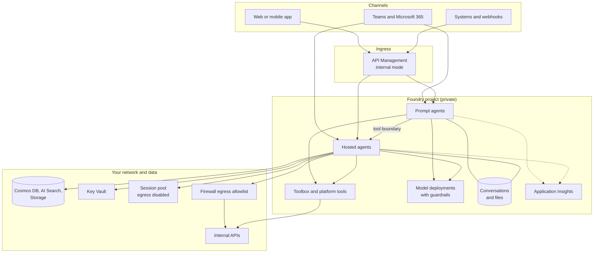
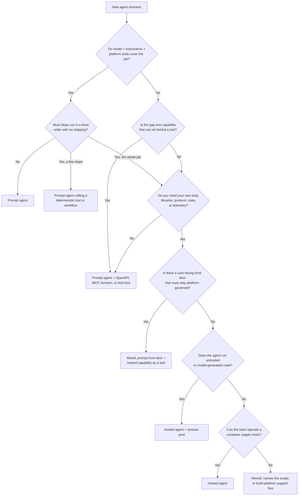
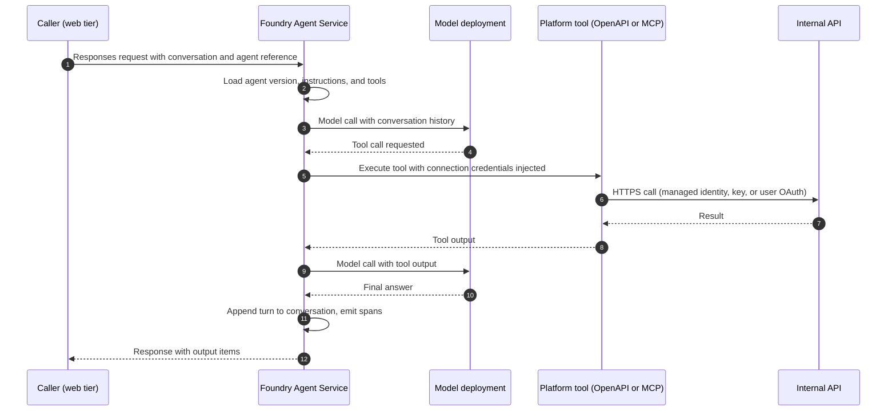
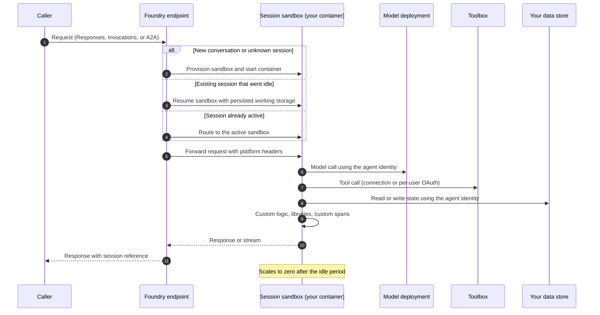
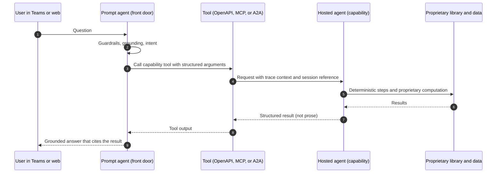
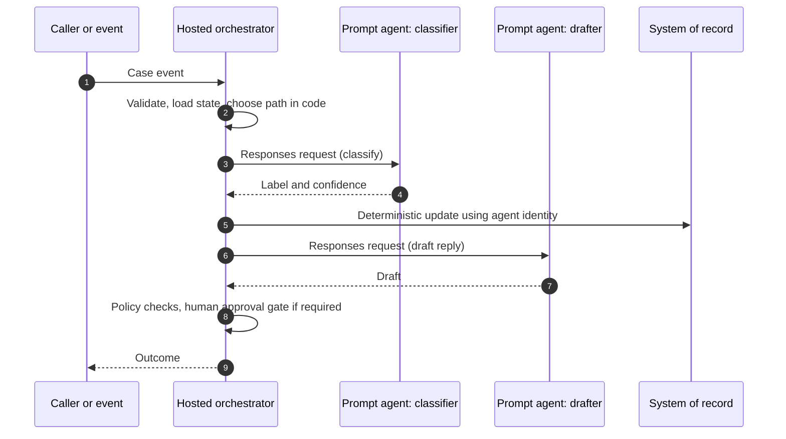

# Architecture: Choosing Prompt Agents vs Hosted Agents

This document is the deep dive behind the [asset README](../README.md). It explains the forces that separate the two Foundry agent runtimes, gives a decision matrix and flowchart, shows how a turn flows through each runtime, documents the wire contracts and identity boundaries that matter, and lists the failure modes, anti-patterns, migration paths, and production checks we recommend.

> Hosted agents, the Toolbox, memory, the bring-your-own model gateway, and several tools and protocols are in preview. Endpoint shapes, field names, and header behavior change. Everything here is qualitative and illustrative. Check current Microsoft Learn documentation before you depend on a detail.

## Contents

1. [Problem and context](#1-problem-and-context)
2. [Terminology](#2-terminology)
3. [Forces](#3-forces)
4. [Responsibility split](#4-responsibility-split)
5. [Reference architecture](#5-reference-architecture)
6. [Decision flowchart](#6-decision-flowchart)
7. [Decision matrix](#7-decision-matrix)
8. [Runtime sequences](#8-runtime-sequences)
9. [Wire contracts](#9-wire-contracts)
10. [Hosted protocol selection](#10-hosted-protocol-selection)
11. [State and session model](#11-state-and-session-model)
12. [Identity summary](#12-identity-summary)
13. [Network: what runs where](#13-network-what-runs-where)
14. [Observability, versioning, warmth, and cost](#14-observability-versioning-warmth-and-cost)
15. [Domain Packs](#15-domain-packs)
16. [Failure modes](#16-failure-modes)
17. [Anti-patterns](#17-anti-patterns)
18. [Migration paths](#18-migration-paths)
19. [Production checklist](#19-production-checklist)
20. [References](#20-references)

## 1. Problem and context

Teams building on Microsoft Foundry Agent Service face the same early question: should this agent be a **prompt agent** or a **hosted agent**? The question is often answered by habit. Developers who already write LangGraph or Agent Framework code choose hosted because it feels familiar. Platform teams choose prompt because it is easy to govern. Both habits produce poor outcomes:

- Hosted agents that only wrap one prompt add an image, a registry, a pipeline, dependency patching, sizing, and egress control, with no capability in return.
- Prompt agents asked to run deterministic multi-step workflows skip steps, reorder them, or call tools in ways that a code path would never allow.
- Single-runtime estates ("everything is hosted" or "everything is prompt") force every scenario into a shape that suits only some of them.

The pattern in this asset is simple: **default to a prompt agent, escalate to a hosted agent only for a control you can name and need, and decide per scenario.** The rest of this document explains how to apply that rule and what each choice commits you to.

## 2. Terminology

| Term | Meaning in this asset |
|---|---|
| **Prompt agent** | A declarative Foundry agent: a model deployment, instructions, and a list of tools. Foundry runs the agent loop, stores the conversation, executes platform tools, and injects connection credentials. |
| **Hosted agent** | Your own agent code (Agent Framework, LangGraph, Semantic Kernel, or a custom loop) packaged as a container image or code bundle. Foundry deploys it, gives it an endpoint and an Entra agent identity, and runs it in isolated per-session sandboxes. Preview. |
| **Mixed design** | A scenario that uses both runtimes: a prompt agent calling a hosted agent through a tool boundary, or a hosted orchestrator calling prompt agents. |
| **Agent loop** | The plan, call tool, observe, respond cycle. In a prompt agent Foundry owns it. In a hosted agent your code owns it. |
| **Platform tools** | Tools Foundry executes on the agent's behalf, such as Code Interpreter, File Search, Azure AI Search, web grounding, OpenAPI, MCP, and agent-to-agent tools. The catalog changes; check current docs. |
| **Function tools** | Tools the model asks the *caller* to run. The caller executes them in its own process and returns the output. Foundry never runs function tool code. |
| **Toolbox** | A preview Foundry capability that exposes a curated set of tools and connections, including per-user OAuth, to agents. Hosted agents consume it through Agent Framework integrations. |
| **Conversation** | A durable, server-side record of turns that a caller references to continue a dialog. |
| **Session (hosted)** | An isolated sandbox that runs your container for one conversation context. It has persistent working storage, scales to zero when idle, and resumes on the next request. |
| **Session pool** | Azure Container Apps dynamic sessions: an isolated, disposable sandbox for running untrusted or model-generated code, separate from either agent runtime. |
| **Agent version** | An immutable snapshot of an agent definition (prompt) or image, resources, environment, and protocols (hosted). |

## 3. Forces

Each force below pushes the decision toward one runtime. Most agents feel several forces at once; the [decision matrix](#7-decision-matrix) weighs them together.

| Force | Pushes toward | Why |
|---|---|---|
| **Control over orchestration** | Hosted | If steps must run in a fixed order, with explicit branching, retries, compensation, or human approval at specific points, code is the right place to express it. A model-driven loop decides its own order. |
| **Custom dependencies** | Hosted | Proprietary scoring libraries, native binaries, licensed SDKs, or a specific framework version can only run in your own process. |
| **Tool and protocol needs** | Prompt, unless the protocol is custom | Platform tools, OpenAPI, MCP, and agent-to-agent tools cover most integration needs with managed credentials. Arbitrary JSON payloads, webhooks, or real-time streams push toward the hosted Invocations protocol. |
| **State and session model** | Prompt for conversational state, hosted for custom state | Prompt agents store conversations for you. If you need working files across turns, a custom state machine, or a specific store with its own retention, you need code. |
| **Identity model** | Depends on who must be authorized | Prompt agents authenticate tools with connection credentials, managed identity, or per-user OAuth on MCP. Hosted agents call with their own Entra agent identity and need explicit RBAC; per-user delegation needs Toolbox or channel on-behalf-of support. |
| **Network isolation** | Either, with different work | Both run inside a private project. For hosted agents, *your code's* outbound traffic is your responsibility to restrict. For prompt agents, the platform makes tool calls and you restrict what those tools can reach. |
| **Observability** | Hosted if you need custom spans or dimensions | Prompt agents emit platform spans you cannot extend inside the loop. Hosted agents emit platform spans plus your own OpenTelemetry spans, metrics, and attributes. |
| **Cost and operations burden** | Prompt | A prompt agent is a definition and some connections. A hosted agent adds an image, a registry, CI/CD, sizing, patching, egress control, and on-call ownership. |
| **Versioning and deployment** | Prompt for speed, hosted for full artifact control | Both use immutable versions. A hosted version is a build artifact with its own supply chain. |
| **Warmth and first-turn experience** | Prompt | Prompt agents have no customer-visible container layer. Hosted sessions scale to zero and must be provisioned or resumed, so a first turn can be noticeably slower. Session reuse matters. |
| **Governance and guardrails** | Prompt for model calls | Guardrails apply to Foundry model deployments in both runtimes. A hosted agent can point its model client anywhere, so the gateway must be enforced by policy and network, not by convention. |
| **Evaluation** | Neutral | Both runtimes can be evaluated with the same datasets if they speak the same protocol. Keeping hosted agents on the Responses protocol keeps evaluations portable. |
| **Untrusted code** | Neither in-process | Model-generated or user-supplied code belongs in a session pool, never inside a hosted agent's process. |

## 4. Responsibility split

| Concern | Prompt agent: Foundry owns | Prompt agent: you own | Hosted agent: Foundry owns | Hosted agent: you own |
|---|---|---|---|---|
| Agent loop | Planning, tool selection, retries inside the loop | Instructions and tool descriptions | Nothing inside the loop | The loop, its framework, and its failure handling |
| Runtime | Everything | Nothing | Container runtime, sandboxes, scale-to-zero, endpoint | Image, dependencies, entry point, resource sizing |
| Tools | Execution of platform tools, credential injection | Connections, tool definitions, function tool execution in the caller | Toolbox and platform tools you call | Tool code, clients, timeouts, and error handling |
| State | Conversation store (or your store with Standard Agent Setup) | Retention and data residency choices | Session sandbox and its working storage | Durable state, schema, and retention |
| Identity | Agent identity and connection credentials | Which connections exist and their scope | Agent identity issuance | Every RBAC grant the agent identity needs |
| Network | Platform tool egress | What tool endpoints can reach | Inbound private access, subnet injection | Outbound restrictions for your code |
| Observability | Platform spans and evaluations | Trace access and retention | Platform spans and the telemetry connection | Custom spans, metrics, logs, dashboards |
| Release | Version storage | Definition changes and evaluation gates | Version storage and rollout | Build, scan, sign, push, and promote |

## 5. Reference architecture



Both runtimes live in the same project and share model deployments, connections, private endpoints, conversation storage, and Application Insights. That sharing is what makes a mixed design cheap: the boundary between the two runtimes is a tool call, not a separate platform.

## 6. Decision flowchart

The README shows a compact flowchart. This one adds the checks that most often change the answer.



## 7. Decision matrix

Use this matrix in architecture reviews. A "Strong" fit means the runtime handles the criterion natively. "Possible" means it works with extra design. "Weak" means you are fighting the runtime.

| Criterion | Prompt agent | Hosted agent | Mixed |
|---|---|---|---|
| Grounded Q&A over approved content | Strong | Possible, but over-built | Strong at the front door |
| Light multi-turn tool use | Strong | Strong | Strong |
| Deterministic multi-step workflow | Weak | Strong | Strong (hosted step behind the tool) |
| Proprietary or native libraries in the loop | Weak (only behind a tool) | Strong | Strong |
| Custom framework (Agent Framework, LangGraph) | Not applicable | Strong | Strong |
| Arbitrary JSON, webhook, or real-time protocol | Weak | Strong (Invocations) | Strong |
| Agent-to-agent interoperability | Possible (A2A tool) | Strong (A2A protocol) | Strong |
| Managed connection credentials | Strong | Strong (through Toolbox) | Strong |
| Per-user delegated access to downstream APIs | Possible (MCP or Toolbox OAuth) | Possible (Toolbox or channel on-behalf-of) | Possible; design carefully |
| Custom durable state | Weak | Strong | Strong |
| Working files across turns | Possible (Code Interpreter files) | Strong (session storage) | Strong |
| Custom spans, metrics, and dimensions | Weak | Strong | Strong for the hosted part |
| Enforced model gateway | Strong | Possible (requires policy and egress control) | Strong at the front door |
| First-turn responsiveness | Strong | Possible (session reuse, sizing) | Depends on whether the hosted hop is on the hot path |
| Operational footprint | Smallest | Largest | Sum of both |
| Supply-chain control over code | Not applicable | Strong (your image, your pipeline) | Strong for the hosted part |
| Blast radius if compromised | Bounded by tools and connections | Whatever the identity and network allow | Front door constrains it |
| Evaluation portability | Strong | Strong if it speaks Responses | Strong |
| Running untrusted code | Use a session pool | Use a session pool | Use a session pool |

**Reading the matrix.** Count the rows where your scenario has a hard requirement. If every hard requirement is "Strong" for prompt, stop there. If one or two hard requirements are "Weak" for prompt and can be isolated behind a tool, choose mixed. If the loop itself must be code, choose hosted. The [runtime selector](../samples/runtime_selector.py) encodes this reasoning as a weighted rubric.

## 8. Runtime sequences

### 8.1 Prompt agent turn



Function tools change step 6: Foundry returns the function call to the caller, the caller runs the function in its own process, and the caller sends the output back in a new request.

### 8.2 Hosted agent turn with session provisioning or resume



The first turn of a new session pays for provisioning. A resumed session pays for resume. "Active" in the session list does not mean "warm"; plan for first-turn cost and maximize session reuse.

### 8.3 Mixed: prompt front door calling a hosted capability



Keep the boundary narrow: the hosted capability returns structured data and does not plan the conversation. The front door does the talking.

### 8.4 Mixed: hosted orchestrator calling prompt agents



Here the code owns the order and the prompt agents own focused, individually evaluable judgments. Each prompt agent can be versioned and evaluated on its own.

## 9. Wire contracts

These contracts are **illustrative**. Field names and endpoint shapes have changed during preview and will change again. Use the current SDKs, which resolve base URLs and API versions for you, and check current docs.

### 9.1 Prompt agent request (Responses)

The caller obtains an OpenAI-compatible client from the Foundry project client and sends a Responses request that references the agent by name. Tokens are Microsoft Entra tokens for the `https://ai.azure.com/.default` scope.

```http
POST {project-openai-base-url}/responses
Authorization: Bearer <entra-token>
Content-Type: application/json
traceparent: 00-<trace-id>-<span-id>-01
```

```json
{
  "conversation": "conv_<id>",
  "input": [
    { "role": "user", "content": "What is the return window for opened electronics?" }
  ],
  "agent_reference": { "type": "agent_reference", "name": "contoso-policy-assistant" },
  "metadata": { "channel": "web", "correlation_id": "c-0001" }
}
```

In the Python SDK, `agent_reference` is passed through `extra_body`. Older samples used a different key that is now deprecated.

### 9.2 Prompt agent response with a function tool call

```json
{
  "id": "resp_<id>",
  "object": "response",
  "status": "completed",
  "output": [
    {
      "type": "function_call",
      "call_id": "call_<id>",
      "name": "get_order_status",
      "arguments": "{\"order_id\": \"NW-1001\"}"
    }
  ]
}
```

The caller runs `get_order_status` itself and continues the turn with the same `conversation` (or with `previous_response_id`, if that is how you manage state):

```json
{
  "conversation": "conv_<id>",
  "input": [
    {
      "type": "function_call_output",
      "call_id": "call_<id>",
      "output": "{\"status\": \"shipped\", \"carrier\": \"Northwind Freight\"}"
    }
  ],
  "agent_reference": { "type": "agent_reference", "name": "contoso-policy-assistant" }
}
```

Function tools run in the caller's process, with the caller's identity and network. They are a good fit when the web tier already holds the user's session and must enforce its own authorization.

### 9.3 Hosted agent endpoints

A hosted agent that speaks the Responses protocol can be called the same way as a prompt agent, which keeps clients and evaluations portable. Hosted agents can also expose protocol-specific endpoints. The shapes below are illustrative of the preview:

| Protocol | Illustrative path | Payload |
|---|---|---|
| Responses | `{project-endpoint}/agents/{agent-name}/endpoint/protocols/openai/responses` | OpenAI Responses request and response |
| Invocations | `{project-endpoint}/agents/{agent-name}/endpoint/protocols/invocations` | Arbitrary JSON that your code defines |
| A2A | `{project-endpoint}/agents/{agent-name}/endpoint/protocols/a2a` | Agent-to-agent protocol messages |

An Invocations request carries whatever your code expects:

```json
{
  "event": "return.created",
  "return_id": "R-1001",
  "store_id": "fabrikam-0042",
  "reason_code": "damaged"
}
```

With Invocations you own the session contract: how the caller pins a session, what a missing session means, and what the response looks like. Check current docs for how the platform carries the session reference.

**Session pinning.** With the Responses protocol, continue a dialog by sending the same `conversation` or a `previous_response_id`. A request without either starts a new session, which pays the provisioning cost and loses the working storage of the previous one.

### 9.4 Headers and context that cross the boundary

Behavior in this table was **observed during preview testing**; it is not a documented contract. Treat every row as "verify in your environment".

| Context | Reaches prompt-agent tools? | Reaches hosted-agent code? | Guidance |
|---|---|---|---|
| Caller `Authorization` header | No | No (stripped; there is no generic on-behalf-of) | Use Toolbox, MCP OAuth, or a server-side token broker for user identity |
| `traceparent` | Yes | Yes | Use for correlation; join front-door and back-end traces |
| W3C `baggage` | Observed, not guaranteed; oversized entries dropped | Test it | Correlation only, never authorization |
| `x-client-*` custom headers | No | Observed on an allowlist | Correlation only |
| Request body `metadata` | No | Available to your code | Correlation and routing only |
| Platform-injected user header | Not applicable | Observed: identifies the *calling principal*, often the web tier's managed identity, not the end user | Never treat as the end user |
| Platform-injected call identifier | Not applicable | Observed | Forward verbatim for support; never parse |

### 9.5 Bring-your-own model gateway (preview)

A project can reference models behind your own gateway (for example, API Management) through a model-gateway connection, and an agent then names the model as `<connection-name>/<model-name>`. Observed requirements during preview:

- The gateway must speak OpenAI Chat Completions with server-sent events streaming. Non-streaming replies surface to the caller as an opaque server error.
- A streamed reply is a series of `data: {"object": "chat.completion.chunk", ...}` lines followed by `data: [DONE]`.
- The model name is not validated when the agent version is created, so a typo appears only on the first turn. Run a smoke turn in CI after every version.

## 10. Hosted protocol selection

| Protocol | Choose it when | You own | Notes |
|---|---|---|---|
| **Responses** | Default for conversational agents | The loop and tools | Portable with prompt agents, evaluation tooling, and OpenAI-compatible clients |
| **Invocations** | Webhooks, event processing, custom JSON contracts, long-running tasks | Payload schema, session contract, idempotency | A real-time variant exists in preview; check docs |
| **Activity** | Microsoft 365 and Teams channels | Channel-specific behavior | The platform can bridge channel activity to your agent when you publish; check how your framework integrates |
| **A2A** | Other agents call this agent as a peer | Agent card, task semantics | Useful when the hosted agent is a capability shared across teams |

Expose the fewest protocols you need. Each protocol is another contract to test, secure, and version.

## 11. State and session model

| State | Prompt agent | Hosted agent | Guidance |
|---|---|---|---|
| Conversation history | Platform conversation store; Standard Agent Setup can place it in your own Cosmos DB, Storage, and AI Search | Platform conversation for Responses; your own store for Invocations | Keep one source of truth per scenario |
| Working files | Code Interpreter and File Search files | Session working storage persists across idle and resume | Session storage is not a system of record |
| Durable business state | In systems behind tools | In your own store, accessed with the agent identity | Use Cosmos DB or a system of record with explicit RBAC |
| Long-term memory | Memory capability (preview) | Memory (preview) or your own store | Check network support before using preview memory in an isolated project |
| User context | Server-side, keyed by conversation | Server-side, keyed by conversation or session | Never pass user tokens through prompts, tool parameters, or headers |

In a mixed design, decide which layer owns which state. The usual split is: the front door owns the conversation, the hosted capability owns its working state, and both write durable state only to systems of record.

## 12. Identity summary

| Identity | Used by | For | Notes |
|---|---|---|---|
| Caller identity | Web tier, Teams, system | Calling the agent endpoint | Needs a data-plane role on the project |
| Agent identity (Entra agent ID) | Prompt and hosted agents | Tools and resources that accept agent identity | Check current docs for when agents share a project-level identity and when they get a distinct one |
| Hosted agent identity | Your container code | Model inference, session storage, and anything else you grant | Gets only defaults; every other resource needs an explicit RBAC grant |
| Project managed identity | Foundry | Pulling images from your registry, some connection types | Grant pull rights on the registry, nothing more |
| Connection credentials | Platform tools | OpenAPI, MCP, and search connections | Stored in the project; injected by a managed proxy |
| Per-user OAuth | MCP tools, Toolbox | Delegated access to user data | Consent per user; tokens never reach the prompt |
| Session pool identity | Code execution | Running untrusted code | Separate from the agent identity, with no data access |

Details, RBAC tables, and negative tests are in [authentication-and-governance.md](authentication-and-governance.md).

## 13. Network: what runs where

| Component | Where it runs | Inbound control | Outbound control |
|---|---|---|---|
| Prompt agent loop | Foundry service | Project private endpoint and public network access setting | Platform; restrict what tool endpoints accept |
| Platform tools | Foundry service | Not applicable | Target endpoints must be reachable from the platform; use private connectivity options where supported |
| Function tools | Caller's process | Caller's ingress | Caller's network |
| Hosted agent code | Per-session sandbox, optionally injected into your subnet | Project private endpoint | **Yours**: network security groups, route tables, and firewall on the delegated subnet |
| Session pool | Azure Container Apps | Pool endpoint with identity-based access | Disable egress for untrusted code |
| Deploy and invoke calls | Your CI and callers | Data-plane operations | With public access disabled they must run from inside the network (self-hosted runners) |

Two common surprises: private access on the account controls inbound traffic only, and a hosted agent's outbound traffic is open unless you restrict it. Also avoid TLS inspection on the agent path; it breaks managed identity token flows. See [Secured Foundry Landing Zone](../../../landing-zones-and-infra/secured-foundry-landing-zone/README.md).

## 14. Observability, versioning, warmth, and cost

### 14.1 Observability

- **Prompt agents** emit generative AI spans for model and tool calls, correlated by `traceparent`. You cannot add custom attributes inside the loop, so carry business context in your caller's spans and join on trace ID.
- **Hosted agents** receive the project's Application Insights connection. Add OpenTelemetry spans, metrics, and attributes for your own steps, and export directly to another OTLP backend if you need to.
- **Content in traces.** Spans can include prompts and completions. Decide on content recording, retention, and access before production.
- **Mixed designs** must propagate trace context across the tool boundary so one trace shows the front door, the tool call, and the hosted steps.

### 14.2 Versioning and deployment

- Both runtimes create immutable agent versions. A prompt version is a definition. A hosted version is an image plus resources, environment variables, and protocols.
- At the time of writing, a hosted endpoint serves one version and does not split traffic. Existing sessions may continue on the version they started with, so "deployed" and "everyone is on it" are different events.
- Neither runtime validates every setting at creation time (model names behind a gateway, entry points, missing RBAC). Run a smoke turn in CI after every new version.
- Container start failures, including a bad entry point, often appear only in container logs. Wire log access into your release runbook.

### 14.3 Warmth (qualitative)

- Prompt agents have no customer-visible container layer.
- Hosted sessions scale to zero after an idle period and are deleted after longer inactivity. There is no warm pool or replica count to size.
- The first turn of a new session pays for provisioning; a resumed session pays for resume. Reuse conversations and sessions, keep images lean, and avoid heavy work at import time.
- If the hosted hop is on a latency-sensitive path, put a prompt agent in front so users get an immediate response while the hosted capability works.

### 14.4 Cost and operations

- Prompt agent cost is mainly model tokens and tool usage.
- Hosted agent cost adds compute and memory for every active session, so per-session sizing multiplies by concurrency. Size from measured telemetry, not guesses.
- The larger cost of hosting is people: image builds, dependency patching, vulnerability response, registry management, egress rules, on-call, and capacity reviews. Count it before you choose hosted.

## 15. Domain Packs

| Domain Pack | Scenario and runtime | Deciding force | Governance constraint |
|---|---|---|---|
| **Manufacturing** | SOP and safety Q&A: prompt | Only grounding and citation needed | Answers must cite the approved revision of each document |
| | Maintenance work-order planning: hosted | Proprietary scheduling optimizer in the loop | Optimizer runs with the agent identity, scoped to planning data only |
| | Teams assistant + diagnostics: mixed | Front door for floor staff, heavy sensor correlation behind it | Diagnostic agent on a private network; front door enforces content safety |
| **Financial services** | Product and policy FAQ: prompt | Approved content only | Model calls through governed deployments with guardrails |
| | Know-your-customer pipeline: hosted | Deterministic steps and in-house scoring libraries | Each step audited; no step skipped; human approval for exceptions |
| | Advisor assistant + portfolio analytics: mixed | Gateway enforced at the front door, analytics in code | Client data accessed only through per-user delegation or entitlement checks |
| **Healthcare** | Benefits and coverage Q&A: prompt | Curated, non-patient content | No patient data in the prompt agent's tools |
| | Prior-authorization packet: hosted | Fixed checklist, private data, custom state | Private network, explicit RBAC, retention rules on session storage |
| | Care-team assistant + summarizer: mixed | Front door for clinicians, summarizer on a private network | Summaries reviewed by a clinician before use |
| **Retail** | Catalog and store policy Q&A: prompt | Grounding on catalog and policy | Content safety for public-facing use |
| | Returns and fraud triage: hosted (Invocations) | Webhook payloads and custom JSON | Idempotent processing; fraud signals never shown to customers |
| | Associate assistant + inventory reconciliation: mixed | Conversational front door, batch-style reconciliation behind it | Reconciliation writes only to the system of record |
| **Public sector** | Citizen service FAQ: prompt | Approved content and strict content safety | Accessibility and language coverage evaluated before release |
| | Case processing: hosted | Records-retention rules and custom state | Retention and audit enforced in code and storage |
| | Caseworker assistant + case history: mixed | Front door for staff, case history in code | Per-user entitlements enforced at the data layer |

## 16. Failure modes

| Symptom | Runtime | Likely cause | Mitigation |
|---|---|---|---|
| Opaque server error on every turn | Either, with a bring-your-own gateway | Gateway returns a non-streaming reply | Make the gateway stream server-sent events in Chat Completions format |
| Version created, first turn fails | Either | Model name or connection not validated at creation | CI smoke turn after every version |
| Agent forgets earlier turns | Hosted | Requests not pinned to a conversation or session | Send `conversation` or `previous_response_id` on every follow-up |
| First turn noticeably slow | Hosted | New session provisioning or resume | Reuse sessions, lean images, prompt front door for immediate feedback |
| `403` from a data store | Hosted | Agent identity lacks a data-plane role | Grant the specific data role (for example, a Cosmos DB data role), not a control-plane role |
| CI deploy fails after locking down the project | Hosted | Deploy and invoke are data-plane calls blocked from outside the network | Use self-hosted runners inside the network |
| Version never becomes ready | Hosted | Entry point or startup failure | Read container logs; test the image locally with the same entry point |
| Old behavior after a release | Hosted | Existing sessions continue on the previous version | Plan for session drain; communicate cutover |
| Data leaves the network unexpectedly | Hosted | Outbound traffic is open by default | Restrict egress on the delegated subnet with a firewall allowlist |
| Tool cannot tell which user is asking | Either | Caller token is not forwarded | Use Toolbox or MCP OAuth, or a server-side context store |
| Missing business context in traces | Prompt | No custom attributes inside the platform loop | Add context to caller spans and join on trace ID |
| Managed identity token errors through the firewall | Either | TLS inspection on the agent path | Exclude agent and identity traffic from TLS inspection |
| Preview memory unreachable | Either, in an isolated project | Preview feature without network integration | Use your own store until the feature supports your network design |
| Steps skipped or reordered | Prompt | Deterministic workflow expressed as instructions | Move the workflow into a tool or a hosted agent |

## 17. Anti-patterns

1. **Hosted agent that wraps a single prompt.** All of the operational cost and none of the capability. Use a prompt agent.
2. **Prompt agent forced to run a multi-step deterministic workflow.** Instructions are not a state machine. Put the workflow in code behind a tool, or host it.
3. **Running untrusted code in-process.** Model-generated or user-supplied code inherits the agent identity, network, and environment. Use a session pool with egress disabled.
4. **Headers, baggage, or metadata used for authorization.** They are correlation hints and can be dropped or spoofed. Authorize at the tool and data layer.
5. **User tokens in prompts or tool parameters.** Tokens end up in traces and model context. Use delegated tool connections or a server-side token broker.
6. **Ungoverned model calls from a hosted agent.** Pointing the model client at an arbitrary endpoint bypasses guardrails, quotas, and logging. Route through Foundry deployments or your approved gateway and enforce it with egress rules.
7. **Deciding once for the whole estate.** "We are a hosted shop" or "prompt only" forces bad fits. Decide per scenario.
8. **Treating "active" as warm, or never reusing sessions.** Each unpinned request starts a new session and pays its cost.
9. **Duplicate orchestration in a mixed design.** If the front door and the hosted agent both plan, they disagree. Let one layer plan and the other execute.
10. **Secrets in images or environment variables.** Use managed identity, Foundry connections, or Key Vault.

## 18. Migration paths

### 18.1 Prompt to hosted

1. Write down the control you need and why the prompt agent cannot provide it.
2. Re-implement with the same instructions and tools in Agent Framework (or your framework), consuming tools through Toolbox where possible.
3. Keep the Responses protocol so clients and evaluation datasets do not change.
4. Grant the hosted agent identity only the RBAC the scenario needs, and restrict egress.
5. Run a parity evaluation against the prompt agent's dataset, then shadow production traffic.
6. Cut over by changing the agent reference in callers. Keep the prompt agent as a fallback until the hosted version is stable.

### 18.2 Hosted to prompt

1. Identify which code exists only to call tools or format prompts.
2. Move remaining capabilities behind OpenAPI or MCP tools.
3. Rebuild as a prompt agent and run the same parity evaluation.
4. Retire the container, registry repository, pipeline, and RBAC grants.

### 18.3 Into a mixed design

- **From prompt:** keep the prompt agent as the front door and move the failing step into a hosted capability exposed as a tool.
- **From hosted:** extract the user-facing conversation into a prompt agent with guardrails, and keep the hosted agent as a capability that returns structured results.

Record each migration as an ADR, following [ADR 0001](decisions/0001-default-to-prompt-agents-escalate-to-hosted.md).

## 19. Production checklist

- [ ] The runtime decision is recorded per scenario, with the named control that justifies any hosted agent.
- [ ] The selector output and matrix review are attached to the ADR.
- [ ] Identities are listed, with every RBAC grant scoped to a resource and a data-plane role.
- [ ] Hosted agent egress is restricted by network controls and an allowlist that includes identity and platform endpoints.
- [ ] Model calls go only to governed deployments or an approved gateway.
- [ ] Untrusted or generated code runs only in a session pool.
- [ ] No secrets are in images, environment variables, prompts, or tool parameters.
- [ ] Callers pin conversations or sessions on every follow-up.
- [ ] Trace context propagates across every boundary, and trace content recording is configured.
- [ ] A CI smoke turn runs after every new version.
- [ ] Evaluation gates cover quality, safety, and the negative tests in [evaluation-and-troubleshooting.md](evaluation-and-troubleshooting.md).
- [ ] Rollback is defined: previous version, or fallback prompt agent.
- [ ] Owners are named: business owner, technical owner, and agent identity sponsor.
- [ ] Preview features in use are listed, with a plan if they change.

Hand off to [Production Hosted Agents on Foundry](../../production-hosted-agents-on-foundry/README.md) for hosted build and operations, [Agent Security and Governance](../../../security-and-governance/agent-security-and-governance/README.md) for controls, and the [Agent Production Readiness Guide](../../../agentops-and-readiness/agent-production-readiness/README.md) for release.

## 20. References

- [What is Microsoft Foundry Agent Service?](https://learn.microsoft.com/azure/foundry/agents/overview)
- [Hosted agents in Foundry Agent Service](https://learn.microsoft.com/azure/foundry/agents/concepts/hosted-agents)
- [Agent development lifecycle in Microsoft Foundry](https://learn.microsoft.com/azure/foundry/agents/concepts/development-lifecycle)
- [Microsoft Agent Framework](https://learn.microsoft.com/agent-framework/)
- [Azure Container Apps dynamic sessions](https://learn.microsoft.com/azure/container-apps/sessions)
- [OpenAI Responses API reference](https://platform.openai.com/docs/api-reference/responses)
- [W3C Trace Context](https://www.w3.org/TR/trace-context/)
- Related assets: [Code Execution Sandboxes with Session Pools](../../code-execution-sandbox-session-pools/README.md), [M365 and Azure Custom Agent](../../../m365-and-copilot/m365-azure-custom-agent/README.md)
