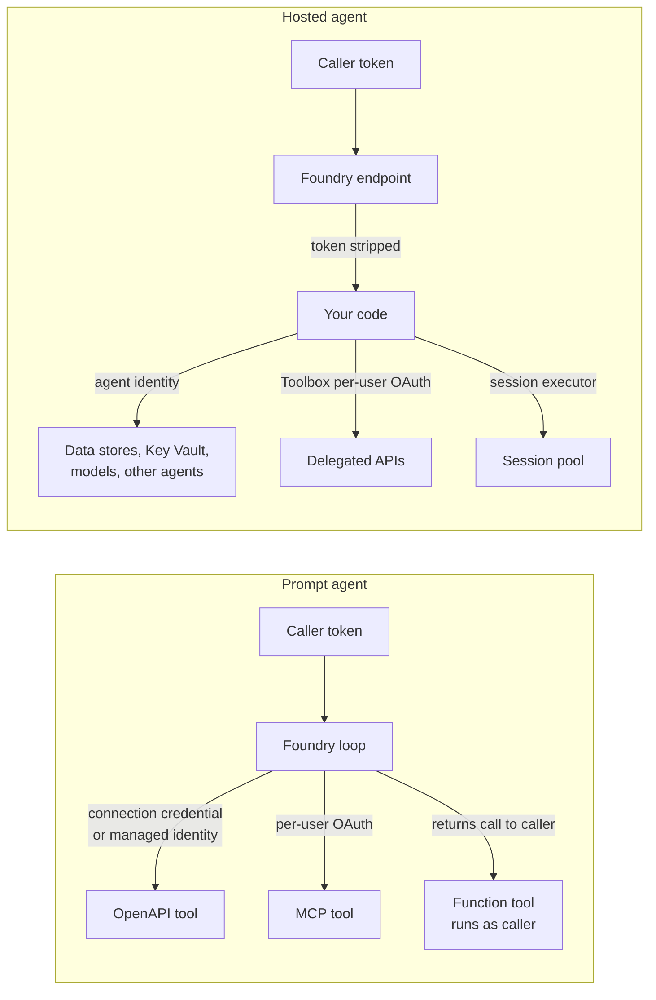

# Authentication and Governance by Runtime

The runtime you choose decides which identity calls your tools and data, what crosses each boundary, and who is responsible for restricting outbound traffic. This document lists the identities, RBAC, secrets, network controls, guardrails, audit, and negative tests for prompt, hosted, and mixed designs. Read it with [architecture.md](architecture.md) sections 12 and 13.

> Agent identity, hosted agents, Toolbox, and several authentication options are in preview. Role names and the minimum permissions for each operation change. Check current Microsoft Learn documentation before you finalize role assignments.

## 1. Principles

1. **Authorize at the tool and data layer.** The agent is not the security boundary. Each API and data store must check the identity that reaches it.
2. **Prefer managed identity, then OAuth on-behalf-of, then keys.** Keys belong only in Foundry connections or Azure Key Vault, never in images, environment variables, prompts, or tool parameters.
3. **Grant per agent, per resource, per data plane.** A hosted agent identity starts with only the permissions it needs to run. Every other grant is explicit and scoped.
4. **Correlation is not authorization.** `traceparent`, `baggage`, `x-client-*` headers, and request `metadata` help you join logs. They never decide access.
5. **Untrusted code gets its own identity and no data access.** Run it in a session pool, not in an agent process.
6. **Restrict egress where your code runs.** Account private access controls inbound traffic only.

## 2. Identity inventory

| Identity | Runtime | Used to | Typical grants | Owner |
|---|---|---|---|---|
| Caller (user or web tier managed identity) | All | Call the agent endpoint | Foundry data-plane role on the project | Application team |
| Agent identity (Entra agent ID) | Prompt and hosted | Authenticate to tools and resources that accept agent identity | Resource-specific roles | Agent owner, with an identity sponsor |
| Hosted agent identity | Hosted | Model inference, session storage, data stores, Key Vault, other agents | Defaults for inference and session storage; everything else explicit | Agent owner |
| Project managed identity | All | Pull hosted images from your registry; some connection types | Registry pull on the specific registry | Platform team |
| Connection credentials | Prompt (and hosted through Toolbox) | Authenticate platform tools to OpenAPI, MCP, and search endpoints | Whatever the target requires | Platform team |
| Per-user OAuth (MCP or Toolbox) | Prompt and hosted | Delegated access to user data | Per-user consent and API scopes | Application team |
| Session pool caller | Hosted, or the caller of a function tool | Execute code in a session pool | Session executor role on the pool | Platform team |
| CI/CD identity | Hosted | Build, push, and create agent versions | Registry push, Foundry agent management | Platform team |

Whether agents in a project share one agent identity or each get a distinct one depends on the runtime, publishing state, and current platform behavior. Confirm it before you design RBAC, because a shared identity means shared permissions.

## 3. Identity flow by runtime

Key consequences:

- **Prompt agents never pass the caller's token to tools.** Tools see connection credentials, a managed identity, or a per-user OAuth token obtained through the tool connection.
- **Hosted agents never receive the caller's token either.** Your code calls everything with the agent identity unless you use Toolbox delegation or a channel that provides an on-behalf-of user token.
- **Function tools run as the caller.** They are the simplest way to enforce user-level authorization when your web tier already holds the user's session.

## 4. RBAC baseline

Role names below are current at the time of writing; verify them and prefer the narrowest built-in or custom role. Foundry roles were renamed (for example, Foundry User was previously Azure AI User); role IDs did not change, so assign by ID in IaC.

| Principal | Scope | Role (example) | Runtime | Why |
|---|---|---|---|---|
| Caller or web tier identity | Foundry project | Foundry User | All | Invoke agents and use conversations |
| Developers and CI | Foundry project | Foundry User, or a broader Foundry role where agent management requires it | All | Create and update agent versions |
| CI identity | Container registry | AcrPush (or a repository-scoped writer role) | Hosted | Push images |
| Project managed identity | Container registry | AcrPull (or a repository-scoped reader role) | Hosted | Pull images for new versions |
| Hosted agent identity | Cosmos DB account | Cosmos DB Built-in Data Reader or Data Contributor (data-plane role) | Hosted | Read or write durable state |
| Hosted agent identity | Key Vault | Key Vault Secrets User | Hosted | Read secrets that are not available through connections |
| Hosted agent identity | AI Search index | Search Index Data Reader | Hosted | Retrieval outside platform tools |
| Hosted agent identity | Storage account or container | Storage Blob Data Reader or Contributor | Hosted | Documents and outputs |
| Hosted agent identity | Another Foundry project | Foundry User | Hosted | Call prompt agents in another project |
| Agent or caller identity | Session pool | Azure ContainerApps Session Executor | Hosted, or function tool caller | Run untrusted code |

Common mistakes:

- Granting a control-plane role (for example, a contributor role on the Cosmos DB account) and expecting data access. Data stores need data-plane roles.
- Granting roles to the project managed identity when the hosted agent identity is what calls the resource.
- Granting at subscription or resource-group scope "to make it work", and never narrowing.

## 5. Per-user delegation options

| Option | Runtime | How the user is represented | Use when | Watch for |
|---|---|---|---|---|
| MCP tool with OAuth identity passthrough | Prompt | Per-user OAuth token obtained by the platform | The MCP server enforces user permissions | Consent experience; tool server must validate tokens |
| Toolbox with per-user OAuth | Prompt and hosted (preview) | Per-user token managed by the platform | Delegated access from hosted code | Preview; check framework integration support |
| Channel on-behalf-of | Hosted in Microsoft 365 channels | User token from the channel exchanged on behalf of the user | Teams or Microsoft 365 front door | Only available when the channel provides a user token |
| Function tool in the caller | Prompt | The caller's own session | Web tier already authorizes the user | Function code runs outside Foundry; keep it small |
| Server-side context store or token broker | Hosted and mixed | Conversation ID maps to a server-side user context | Custom APIs that must know the user | Never pass tokens through prompts, parameters, or headers |

Do not rely on platform-injected user headers in hosted agents. They were observed to identify the calling principal, which is often the web tier's managed identity rather than the end user.

## 6. Secrets

- Store tool credentials as Foundry connections, so the platform injects them and code never handles them.
- Store anything else in Key Vault and read it with the agent identity at runtime.
- Never bake secrets into images or set them as plain environment variables on hosted agent versions; versions and images are long-lived artifacts.
- Scan images and repositories for secrets in CI, and fail the build if one is found.
- Rotate connection credentials on a schedule, and test that agents recover without redeployment.

## 7. Network and egress

| Control | Prompt agent | Hosted agent | Notes |
|---|---|---|---|
| Inbound private access | Project private endpoint | Same | Disabling public access affects deploy and invoke calls too |
| Ingress for external callers | API Management in internal mode | Same | Single policy point for authentication and quotas |
| Outbound from the loop | Platform-managed | **Your code; open unless restricted** | Attach a delegated subnet and route through a firewall |
| Egress allowlist | Tool targets | Tool targets, Entra ID, Foundry, registry, telemetry endpoints | Missing identity endpoints cause confusing token failures |
| TLS inspection | Avoid on agent paths | Avoid on agent paths | Breaks managed identity token flows |
| CI/CD | Can run from anywhere with access | Must run inside the network when public access is off | Use self-hosted runners |
| Untrusted code | Session pool, egress disabled | Session pool, egress disabled | Never in-process |
| Preview features | Check network support | Check network support | Some preview capabilities do not support private networking yet |

Use the [Secured Foundry Landing Zone](../../../landing-zones-and-infra/secured-foundry-landing-zone/README.md) for the network baseline.

## 8. Guardrails and model governance

- **Guardrails are attached to model deployments.** Both runtimes benefit when model calls go through Foundry deployments with content filters configured.
- **Hosted agents can bypass governance.** Nothing in a container stops code from pointing its model client at a different endpoint. Enforce the approved endpoints with egress rules and code review, and alert on unexpected destinations.
- **A bring-your-own model gateway (preview)** keeps model calls on your gateway's policies while agents still reference the model by connection. Test streaming support before relying on it.
- **Prompt shields and tool output.** Treat tool output as untrusted input to the model, especially from web grounding, documents, and third-party MCP servers.
- **Human approval.** For consequential actions, put the approval step in code (hosted) or in the tool server, not only in instructions.

## 9. Audit and traces

- Log who called which agent version, through which channel, with which conversation or session ID.
- Join front-door and back-end traces with `traceparent`. Prompt agents cannot add custom attributes in the loop, so log business context in the caller.
- Platform spans can contain prompts and completions. Set content recording, retention, and access control on Application Insights deliberately.
- Keep the platform call identifier (where provided) in support logs verbatim; do not parse it.
- Record role assignments as code and review them with each agent version.

## 10. Negative tests

Run these before go-live and after any network or identity change.

| Test | Expected result | Runtime |
|---|---|---|
| Call the agent endpoint without a token | Unauthorized | All |
| Call with a valid token for a principal without a project role | Forbidden | All |
| Resolve the project endpoint from a public network | No public resolution, or access denied | All, isolated projects |
| Create an agent version or invoke from outside the network with public access disabled | Forbidden | All, isolated projects |
| From hosted code, call an endpoint not on the allowlist | Blocked by the network | Hosted |
| From a session pool, make any outbound call | Blocked | Session pool |
| Hosted agent reads a store it has no data role on | Forbidden | Hosted |
| Send forged user headers or baggage claiming another user | No change in authorization | All |
| Attempt prompt injection that asks a tool to act for another user | Tool rejects; authorization is not in the prompt | All |

## 11. Governance checklist

- [ ] Business owner, technical owner, and agent identity sponsor named for every agent.
- [ ] Identity inventory and RBAC table committed with the agent definition.
- [ ] No secrets in images, environment variables, prompts, or tool parameters.
- [ ] Egress restricted for hosted agents; allowlist reviewed.
- [ ] Model calls only to governed deployments or an approved gateway.
- [ ] Per-user delegation mechanism documented for every tool that touches user data.
- [ ] Negative tests automated and passing.
- [ ] Preview features listed with an owner tracking their changes.

See also [Agent Security and Governance](../../../security-and-governance/agent-security-and-governance/README.md) and [Code Execution Sandboxes with Session Pools](../../code-execution-sandbox-session-pools/README.md).

## 12. References

- [Hosted agents in Foundry Agent Service](https://learn.microsoft.com/azure/foundry/agents/concepts/hosted-agents)
- [Microsoft Entra Agent ID](https://learn.microsoft.com/entra/agent-id/)
- [Azure built-in roles](https://learn.microsoft.com/azure/role-based-access-control/built-in-roles)
- [Azure Container Apps dynamic sessions](https://learn.microsoft.com/azure/container-apps/sessions)
- [Azure API Management](https://learn.microsoft.com/azure/api-management/api-management-key-concepts)
