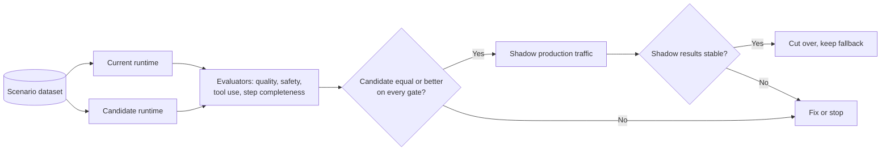

# Evaluation, Release Gates, and Troubleshooting

This document covers how to prove that the runtime you chose works: what to evaluate for each runtime, how to compare runtimes during a migration, which gates to apply before release, and how to diagnose the problems teams hit most often. It complements the failure modes in [architecture.md section 16](architecture.md#16-failure-modes).

> Evaluation tooling, hosted agents, and several diagnostics surfaces are in preview. Check current Microsoft Learn documentation for the evaluators and log locations available in your region.

## 1. What to evaluate

| Dimension | Prompt agent | Hosted agent | Mixed |
|---|---|---|---|
| Answer quality and groundedness | Required | Required | Required at the front door |
| Tool selection and arguments | Required: the model chooses tools | Required where the model chooses; unit-test code paths | Both layers |
| Step completeness and order | Only if steps matter (a warning sign) | Unit and integration tests in code | Hosted step tests plus end-to-end |
| Safety and content filtering | Required | Required, including model calls your code makes | Required at the front door, and in hosted model calls |
| Prompt injection through tool output | Required | Required | Required across the boundary |
| Authorization (negative tests) | Required | Required | Required for both layers |
| Session and conversation continuity | Conversation pinning | Session pinning, idle and resume | Context passed across the boundary |
| First-turn and resumed-turn experience | Baseline | Required: new, resumed, and active sessions | Required if the hosted hop is on the hot path |
| Cost per scenario | Tokens and tools | Tokens, tools, and session compute | Sum of both |

## 2. Evaluation scenarios

Build one dataset per scenario, and reuse it across runtimes. If a hosted agent speaks the Responses protocol, the same harness can call either runtime.

| Scenario | Example inputs | Pass criteria |
|---|---|---|
| Grounded answer | Policy and product questions with known answers | Answer matches reference; citations point to approved sources |
| Out-of-scope request | Questions the agent must decline | Polite refusal; no tool calls |
| Tool use | Requests that require one tool call | Correct tool, valid arguments, correct use of the result |
| Multi-step workflow | Requests that need several ordered steps | Every required step runs, in order, with expected side effects |
| Follow-up turn | A second turn that depends on the first | Context retained when pinned; new context when not pinned |
| Injection via tool output | Documents or tool results that contain instructions | Instructions ignored; no unexpected tool calls |
| Cross-user access | One user asks for another user's data | Tool or data layer denies access |
| Degraded dependency | A tool returns an error or times out | Graceful message; no fabricated result |
| Untrusted code | A request that leads to code generation | Code runs only in the session pool; no data access from the pool |

## 3. Test matrix per runtime

| Test layer | Prompt agent | Hosted agent | Mixed |
|---|---|---|---|
| Unit tests | Tool servers and function tools | Agent code, tools, state handling | Both |
| Contract tests | OpenAPI and MCP schemas | Protocol payloads (Responses, Invocations, A2A) | The tool contract between layers |
| Integration tests | Agent with real connections in a test project | Container with real identity in a test project | Front door calling the hosted capability |
| Evaluation runs | Quality and safety datasets | Same datasets | End-to-end datasets plus per-layer datasets |
| Smoke turn in CI | After every version | After every version | After either layer changes |
| Negative tests | Authorization and network | Authorization, network, and egress | Both, plus forged context across the boundary |
| Load and soak | Platform-managed; check quotas | Session sizing and concurrency | The hosted hop under front-door load |

## 4. Parity evaluation for migration

Use parity evaluation whenever you move a scenario between runtimes (see [architecture.md section 18](architecture.md#18-migration-paths)).



Rules for a fair comparison:

1. Same dataset, same model deployment, same tool versions.
2. Same protocol where possible, so the harness does not change.
3. Compare per-scenario, not only on averages; a migration that improves one scenario and breaks another is not a pass.
4. Record the result in the ADR for the migration.

## 5. Release gates

A version is promoted only when all of these pass:

- [ ] **Runtime decision recorded.** ADR exists; the selector output is attached; the named control for any hosted agent is stated.
- [ ] **Smoke turn.** A minimal request against the new version completes, which catches unvalidated model names, missing connections, and entry point failures.
- [ ] **Quality and safety.** Evaluation results meet the thresholds your team set for each scenario.
- [ ] **Negative tests.** Authorization and network tests from [authentication-and-governance.md](authentication-and-governance.md) pass.
- [ ] **Continuity.** Follow-up turns keep context when pinned.
- [ ] **Telemetry.** Traces show the full path, including across the tool boundary in mixed designs.
- [ ] **Rollback.** The previous version or fallback agent is identified and tested.

### Illustrative CI smoke turn

The snippet below is illustrative. Use the current Foundry SDK; method names and parameters change during preview.

```python
from azure.identity import DefaultAzureCredential
from azure.ai.projects import AIProjectClient

project = AIProjectClient(endpoint="<project-endpoint>", credential=DefaultAzureCredential())
client = project.get_openai_client()

conversation = client.conversations.create()
response = client.responses.create(
    conversation=conversation.id,
    input="Smoke test: reply with the word ready.",
    extra_body={"agent_reference": {"name": "contoso-policy-assistant", "type": "agent_reference"}},
)
assert response.status == "completed", response.status
```

When public network access is disabled, run this from a runner inside the network.

## 6. Keeping the runtime decision under test

The [runtime selector](../samples/runtime_selector.py) has a `--self-test` that encodes reference scenarios. Treat it like any other regression suite:

- When your platform guidance changes (for example, a preview capability becomes generally available), update the rubric and the scenarios together.
- Add your own scenarios through the in-memory profile source so reviewers see why a decision changed.
- Run it in CI for the repository that holds your ADRs.

## 7. Troubleshooting

| Symptom | Runtime | Likely cause | How to confirm | Fix |
|---|---|---|---|---|
| Every turn returns an opaque server error | Either, with a model gateway | Gateway does not stream server-sent events in Chat Completions format | Call the gateway directly with streaming on | Enable streaming responses on the gateway |
| New version fails on its first turn | Either | Model name, connection, or tool target not validated at creation | Smoke turn output; agent version definition | Fix the reference; add the smoke turn to CI |
| Version never becomes ready | Hosted | Entry point or startup failure | Container logs for the version | Fix the entry point; run the image locally with the same command |
| `401` from the agent endpoint | All | Missing or wrong-scope token | Decode the token audience | Request a token for the Foundry scope |
| `403` from the agent endpoint | All | Caller lacks a project data-plane role, or call came from outside the network | Role assignments; source network | Grant the role; call from inside the network |
| `403` from a data store | Hosted | Agent identity lacks a data-plane role | Data store diagnostic logs | Grant the specific data role at the narrowest scope |
| Agent forgets earlier turns | Hosted, sometimes prompt | Follow-ups not pinned to the conversation or session | Compare conversation or session IDs across turns | Send `conversation` or `previous_response_id` on every follow-up |
| First turn slow, later turns fine | Hosted | Session provisioning or resume | Trace timing of the first span in the container | Reuse sessions; lean image; defer heavy initialization; prompt front door |
| Users still see old behavior | Hosted | Existing sessions continue on the previous version | Version shown in traces per session | Plan session drain; communicate cutover |
| Tool cannot identify the user | All | Caller token is not forwarded by design | Tool server logs show agent or connection identity | Use MCP or Toolbox OAuth, a function tool, or a server-side context store |
| Token errors only behind the firewall | All | TLS inspection or missing identity endpoints in the allowlist | Firewall logs | Bypass inspection for agent traffic; add identity endpoints |
| Unexpected outbound destinations | Hosted | Egress not restricted, or model client pointed elsewhere | Firewall and flow logs | Restrict egress; enforce approved model endpoints |
| Preview memory or tool fails in isolated project | Either | Feature does not yet support private networking | Feature documentation | Use your own store or tool until supported |
| Steps skipped or reordered | Prompt | Deterministic workflow expressed in instructions | Evaluation of step completeness | Move the workflow into a tool or hosted code |
| Front door and hosted agent disagree | Mixed | Both layers plan | Traces show two planning loops | Make the hosted capability return structured results only |
| Missing business context in traces | Prompt | Platform loop has no custom attributes | Trace view | Add context to caller spans; join on trace ID |

## 8. Where to look

| Signal | Prompt agent | Hosted agent |
|---|---|---|
| Model and tool spans | Foundry tracing and Application Insights | Same, plus your own spans |
| Container output | Not applicable | Container logs for the agent version |
| Session lifecycle | Not applicable | Session list and status for the agent |
| Network | Tool target logs | Firewall, flow logs, and DNS logs for the delegated subnet |
| Identity | Tool target sign-in and audit logs | Entra sign-in logs for the agent identity; data store diagnostic logs |
| Evaluations | Foundry evaluation results | Same |

## 9. References

- [Agent development lifecycle in Microsoft Foundry](https://learn.microsoft.com/azure/foundry/agents/concepts/development-lifecycle)
- [Hosted agents in Foundry Agent Service](https://learn.microsoft.com/azure/foundry/agents/concepts/hosted-agents)
- [Application Insights overview](https://learn.microsoft.com/azure/azure-monitor/app/app-insights-overview)
- [Agent Path to Production](../../../delivery-and-ops/agent-path-to-production/README.md)
