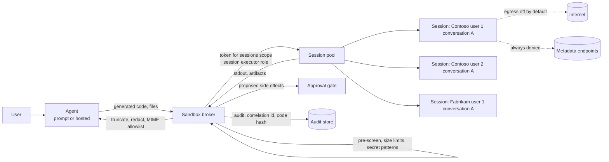
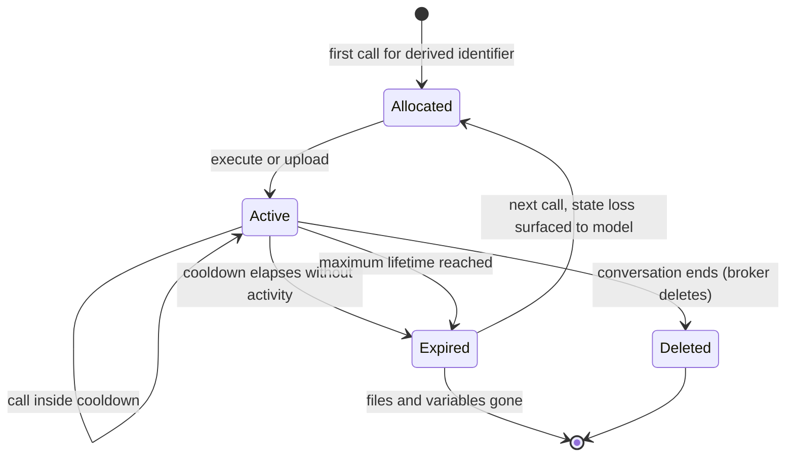

# Code Execution Sandboxes with Session Pools

> **Maturity:** preview · **Kind:** design-pattern · **Category:** `agent-runtime` · **Version:** 0.1.0

Agents that analyze data, transform files, draw charts or check arithmetic do it by writing
code and running it. That code comes from a model. The model read a user prompt, a retrieved
document, a tool result or an uploaded file, and any of those can carry instructions an
attacker planted. So treat generated code as untrusted input that happens to be executable.

This asset shows how to run that code somewhere it cannot hurt the agent. It uses Azure
Container Apps dynamic sessions (session pools): each user conversation gets its own
short-lived sandbox, outbound network is off unless you open it, files move only through the
session API, and the agent calls the pool with a narrow data-plane role. A broker in front of
the pool derives session identifiers, applies policy, sanitizes output and writes audit.

> **Core thesis:** *Never run model-generated code in the agent's process. The agent's
> process holds its identity, its secrets, its network reach and other users' data. Send the
> code to an isolated session that holds none of those, pinned to one user conversation, with
> egress off by default.*

Dynamic sessions, the session executor role, pool types, MCP support on pools, warm-instance
settings and the data-plane API were in preview when this asset was written. Behaviour marked
"observed in preview" came from hands-on testing, not from a documented contract. Verify every
role name, API path, API version, setting name and isolation claim against current Microsoft
Learn documentation before you build on it.

## Architecture and implementation map

| Layer / concern | Deep-dive documentation | Executable or illustrative reference |
| --- | --- | --- |
| Threat model and forces | [architecture.md](docs/architecture.md) sections 2 and 3 | Scenarios 2, 7, 9, 15, 16, 26 and 29 |
| Where code runs (the main decision) | [architecture.md](docs/architecture.md) section 7, [ADR 0001](docs/decisions/0001-never-execute-generated-code-in-process.md) | `InProcessExecutor` (refused), `in_process_exposure()` |
| Session identifier derivation | [architecture.md](docs/architecture.md) section 8.1, [ADR 0002](docs/decisions/0002-one-session-per-user-conversation-egress-off-by-default.md) | `SandboxBroker.session_identifier_for`, scenarios 1 to 5 |
| Execute, files and errors | [architecture.md](docs/architecture.md) sections 8.2 to 8.4 | `ExecuteRequest`, `ExecuteResponse`, `upload`, `download`, error classes |
| Session lifecycle | [architecture.md](docs/architecture.md) section 9 | `InMemorySessionPool`, scenarios 17 to 20 |
| Pool selection and the MCP gap | [architecture.md](docs/architecture.md) section 10, [ADR 0003](docs/decisions/0003-built-in-pool-for-mcp-custom-container-for-packages.md) | `select_pool`, `FakeResourceProvider`, scenarios 21 to 25 |
| Egress policy | [architecture.md](docs/architecture.md) section 11 | `EgressPolicy`, scenarios 7 to 9 |
| Output handling | [architecture.md](docs/architecture.md) section 12 | `sanitize_stdout`, `classify_artifact`, scenarios 12 to 14 |
| Identity, RBAC and tenancy | [authentication-and-governance.md](docs/authentication-and-governance.md) | `RoleAssignments`, `StaticTokenProvider`, scenarios 3, 6 and 29 |
| Side effects and approval | [architecture.md](docs/architecture.md) section 14 | `InMemoryApprovalGate`, scenario 30 |
| Audit and observability | [architecture.md](docs/architecture.md) section 18 | `AuditLog`, scenario 31 |
| Red team, evals and troubleshooting | [evaluation-and-troubleshooting.md](docs/evaluation-and-troubleshooting.md) | `evaluate_answer`, scenario 32 |

## Domain Packs

The pattern is the same everywhere. What changes is what the code touches and how much
egress you can tolerate. [architecture.md](docs/architecture.md) section 15 has the full table.

| Industry | Example agent | What the generated code does | Typical posture |
| --- | --- | --- | --- |
| Financial services | Contoso Bank portfolio analyst | Risk and exposure calculations on uploaded positions | Egress off, built-in pool, outputs that change limits go to approval |
| Healthcare | Fabrikam Health cohort assistant | Aggregates de-identified extracts, produces charts | Egress off, per-tenant pool, small-cell suppression before output leaves the broker |
| Manufacturing | Northwind Manufacturing quality agent | Statistical process control on sensor exports | Custom-container pool for domain packages, allowlist to one internal data host if needed |
| Retail | Contoso Retail merchandising agent | Forecasts and price-elasticity what-ifs on sales extracts | Built-in pool with MCP, egress off, price changes proposed, never applied |

## When to use

- **Your agent writes code and something must run it.** Data analysis, CSV and spreadsheet
  transforms, charting, unit conversions, numeric checks of a model's own answer.
- **Users upload files that the agent must process.** The sandbox is where untrusted files
  meet untrusted code, away from your agent host.
- **You need per-user isolation for that execution.** Multi-user or multi-tenant agents must
  not let one conversation see another's variables or files.
- **You need more control than a built-in tool gives.** Custom packages, an egress allowlist,
  your own audit, or a hosted agent that calls the sandbox from its own identity.

## When not to use

- **The agent never runs code.** Tool calls against fixed APIs need API governance, not a
  sandbox. See [Enterprise Agent Security and Tool Governance](../../security-and-governance/agent-security-and-governance/README.md).
- **The built-in Foundry code interpreter tool already meets your needs.** For a prompt agent
  with standard packages and no egress needs, the platform tool is simpler. Choose it and keep
  the threat model and evals from this asset.
- **You need long-running jobs or a system of record.** Sessions are short-lived caches. Use
  Container Apps jobs, Azure Batch or a pipeline for batch work, and durable storage for
  results.
- **The code is trusted and reviewed.** Code your team wrote and shipped is a normal workload.
  This pattern is for code produced at run time by a model.

## Architecture



The agent never runs generated code itself. It hands code and files to a broker. The broker
derives the session identifier from tenant, user and conversation with a keyed hash, so the
model and the caller can never choose or guess one. It rejects code that is too large or
carries credential-shaped strings, and calls the pool with a managed identity that holds only
the session executor role. Each session is a separate sandbox with no agent credentials and
no outbound network by default. Results come back through the broker, which caps size,
redacts credential-shaped text, quarantines artifact types it does not allow, and routes any
proposed side effect to an approval gate instead of applying it.

### Session lifecycle at a glance



### Pattern selection matrix

| Decision | Option | Choose when | Avoid when |
| --- | --- | --- | --- |
| Where code runs | Foundry built-in code interpreter tool | Prompt agent, standard packages, no egress, platform-managed lifecycle is fine | You need custom packages, egress control you own, or your own audit and identity |
| | Container Apps session pool, built-in Python type | You need per-conversation sessions you control, MCP access, standard packages | You need packages the built-in image lacks |
| | Container Apps session pool, custom container | You need specific packages, runtimes or tools baked into an image | You need the pool's built-in MCP endpoint (observed missing on custom pools in preview) |
| | Self-hosted container or job | Batch or long-running work, or full control of the runtime | Interactive per-conversation sessions; you would rebuild isolation and lifecycle yourself |
| | In-process `exec` on the agent host | Never | Always: it shares identity, secrets, network and memory with untrusted code |
| How the agent reaches the pool | Pool's built-in MCP endpoint | Prompt agents that call tools through MCP | Custom-container pools, or when you cannot pin the identifier outside the model |
| | Your own MCP or OpenAPI front | You need MCP or a function tool with custom packages, or extra policy in front | A direct call from code would do |
| | Direct data-plane calls from a broker | Hosted agents or app code that already owns the call | The model would need to construct the request itself |
| Egress | Disabled | Default for every pool | The workload truly needs a remote data source |
| | Allowlist through your own network and firewall | One or two named hosts are required and approved | You would allow wildcards, or any metadata or local address |

## Key design decisions

| Decision | Choice | Why | Trade-off |
| --- | --- | --- | --- |
| Execution boundary | Never execute generated code in the agent process; use a remote sandbox ([ADR 0001](docs/decisions/0001-never-execute-generated-code-in-process.md)) | In-process code can mint the agent's tokens, read its settings and reach its network | A network hop, a pool to operate, and state that lives outside the agent |
| Session scope and egress | One session per tenant, user and conversation, derived by keyed hash; egress off by default ([ADR 0002](docs/decisions/0002-one-session-per-user-conversation-egress-off-by-default.md)) | Prevents cross-user and cross-tenant bleed and blocks the cheapest exfiltration path | More sessions held at once; remote data must be uploaded by the broker |
| Pool type | Built-in Python pool when you need MCP; custom-container pool when you need packages ([ADR 0003](docs/decisions/0003-built-in-pool-for-mcp-custom-container-for-packages.md)) | MCP was observed only on the built-in type; packages need an image | Packages plus MCP means building your own tool front |
| Identifier ownership | Broker derives the identifier; caller and model never supply it | A model-chosen identifier is an injection target and breaks reuse | The broker must hold a derivation key and rotate it deliberately |
| Output trust | Treat stdout and artifacts as untrusted; cap, redact, allowlist MIME types, never auto-execute | Output flows back into the model and to users | Some legitimate large outputs need a separate download path |
| Side effects | Code may propose actions; only the approval gate applies them | Sandbox output is model-influenced and not authority | An extra approval step for write paths |

## Getting started

1. **Run the simulator self-test.** It needs only Python 3.10 or later.

   ```powershell
   python assets/agent-runtime/code-execution-sandbox-session-pools/samples/sandbox_session_sim.py --self-test
   python assets/agent-runtime/code-execution-sandbox-session-pools/samples/sandbox_session_sim.py --demo
   ```

   Expect `34/34 scenarios passed`. The simulator never runs submitted code on the host. It
   interprets a tiny mini-language with step, process and memory budgets.
2. **Read the threat model and decision matrix** in [architecture.md](docs/architecture.md)
   sections 3 and 7, then pick a pool type with section 10.
3. **Ask the resource provider which pool types exist in your region.** Do not rely on a list
   copied from documentation. See [architecture.md](docs/architecture.md) section 10.
4. **Create the pool with egress disabled** and grant the session executor role to the
   broker's managed identity at pool scope only. See
   [authentication-and-governance.md](docs/authentication-and-governance.md).
5. **Read the pool configuration back after deploy.** Confirm egress, MCP and warm-instance
   settings stuck. Some were observed to be dropped silently in preview.
6. **Port the scenarios to live tests** against a non-production pool and run the red-team
   catalogue in [evaluation-and-troubleshooting.md](docs/evaluation-and-troubleshooting.md).

## File map

| Path | Purpose |
| --- | --- |
| `README.md` | This overview |
| `manifest.yaml` | Catalog metadata |
| `CHANGELOG.md` | Version history |
| `docs/architecture.md` | Forces, threat model, decision matrix, wire contracts, lifecycle, pool selection, egress, output handling, integration, Domain Packs, anti-patterns, checklist, observability |
| `docs/authentication-and-governance.md` | Identities, RBAC, secrets, tenancy, residency, audit, approval, policy-as-code |
| `docs/evaluation-and-troubleshooting.md` | Red-team catalogue, functional evals, troubleshooting table |
| `docs/decisions/0001-never-execute-generated-code-in-process.md` | ADR: execution boundary |
| `docs/decisions/0002-one-session-per-user-conversation-egress-off-by-default.md` | ADR: session scope and egress default |
| `docs/decisions/0003-built-in-pool-for-mcp-custom-container-for-packages.md` | ADR: pool type selection |
| `samples/README.md` | How to run the simulator, scenario catalog, adapter seams |
| `samples/sandbox_session_sim.py` | Standard-library simulator with 34 self-test scenarios |

## Related assets

| Asset | Relationship |
| --- | --- |
| [Choosing Prompt Agents vs Hosted Agents in Microsoft Foundry](../choosing-prompt-vs-hosted-agents/README.md) | Decides the agent runtime; this asset decides where that agent's generated code runs |
| [Production Hosted Agents on Microsoft Foundry](../production-hosted-agents-on-foundry/README.md) | A hosted agent's sandbox isolates tenants from each other, not executed code from the agent's own credentials; call a session pool from the hosted agent instead |
| [Governed Context-Aware Agent Harness](../../orchestration-and-workflows/governed-context-aware-agent-harness/README.md) | The harness can host the broker as a governed tool with policy and audit |
| [Verify Before Approve](../../orchestration-and-workflows/verify-before-approve/README.md) | Side effects proposed by sandbox output go through deterministic checks and human approval |
| [Multi-Tenant MCP Gateway on Azure API Management](../../ai-gateway/multi-tenant-mcp-gateway/README.md) | Fronts your own MCP tool for custom-container pools with tenant-aware policy |
| [Backend Identity Propagation](../../ai-gateway/backend-identity-propagation/README.md) | How user identity reaches back ends; this asset deliberately keeps it out of the sandbox |
| [Enterprise Agent Security and Tool Governance](../../security-and-governance/agent-security-and-governance/README.md) | Governs this runtime as Gate 5: execution tiers, approval rules, threat catalog, isolation probe and audit queries in its [code-execution governance guide](../../security-and-governance/agent-security-and-governance/docs/code-execution-governance.md) |

## Production-readiness pillar mapping

| Pillar | How this asset contributes |
| --- | --- |
| **Agent ops** | Session lifecycle, capacity behaviour, pool selection, read-back checks and a troubleshooting table for operating code execution |
| **Security and observability** | Threat model, egress default, identity separation, output sanitization, audit with correlation IDs and a red-team catalogue |
| **Agent architecture patterns** | The broker-and-pool pattern, a decision matrix across five execution options, and integration with prompt and hosted agents |

## Security and responsible AI

- **Generated code is untrusted.** Prompt injection in a document or tool result can become
  code. Isolation, not a pre-screen, is the control.
- **No credentials in the sandbox.** Never pass tokens, keys or connection strings into a
  session. Upload the data instead.
- **Egress off by default.** Opening egress turns every injected instruction into a potential
  exfiltration path. Allowlist exact hosts only, and never metadata or local addresses.
- **Outputs are untrusted too.** Cap, redact and type-check them before the model or a user
  sees them, and never execute a returned artifact.
- **Side effects need approval.** Code can propose a change; a person or a deterministic gate
  applies it.
- **Audit without leaking.** Log hashes, sizes and decisions with correlation IDs. Do not log
  code bodies or raw identities.

## Limitations

- Dynamic sessions and related Foundry tool behaviour were in preview. Role names, API paths,
  API versions, pool types, MCP availability, warm-instance handling and isolation details may
  change. Verify against current Microsoft Learn documentation.
- The simulator uses a logical clock and abstract budgets. It makes no claim about cold start,
  latency, capacity or cost.
- The asset does not provide infrastructure as code. It describes the settings to check and
  the order to apply them.
- Isolation in a sandbox reduces blast radius. It does not make generated code correct. Pair
  it with the evals in [evaluation-and-troubleshooting.md](docs/evaluation-and-troubleshooting.md).

## References

- [Architecture](docs/architecture.md)
- [Authentication and governance](docs/authentication-and-governance.md)
- [Evaluation and troubleshooting](docs/evaluation-and-troubleshooting.md)
- [Samples](samples/README.md)
- [Azure Container Apps dynamic sessions](https://learn.microsoft.com/azure/container-apps/sessions)
- [Code interpreter sessions in Azure Container Apps](https://learn.microsoft.com/azure/container-apps/sessions-code-interpreter)
- [Custom container sessions in Azure Container Apps](https://learn.microsoft.com/azure/container-apps/sessions-custom-container)
- [Session pools in Azure Container Apps](https://learn.microsoft.com/azure/container-apps/session-pool)
- [Session usage in Azure Container Apps](https://learn.microsoft.com/azure/container-apps/sessions-usage)
- [Use Azure Firewall with Azure Container Apps](https://learn.microsoft.com/azure/container-apps/use-azure-firewall)
- [Azure built-in roles](https://learn.microsoft.com/azure/role-based-access-control/built-in-roles)
- [What is Microsoft Foundry Agent Service?](https://learn.microsoft.com/azure/foundry/agents/overview)
- [Hosted agents in Microsoft Foundry](https://learn.microsoft.com/azure/foundry/agents/concepts/hosted-agents)
- [Contribution and Standardization Guide](../../../docs/contribution-guide.md)
