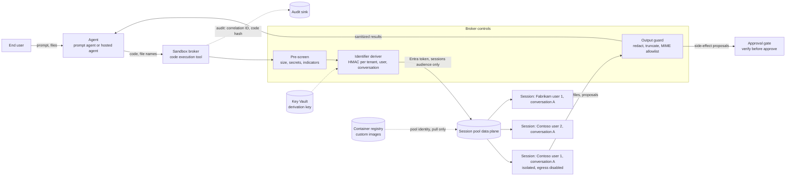
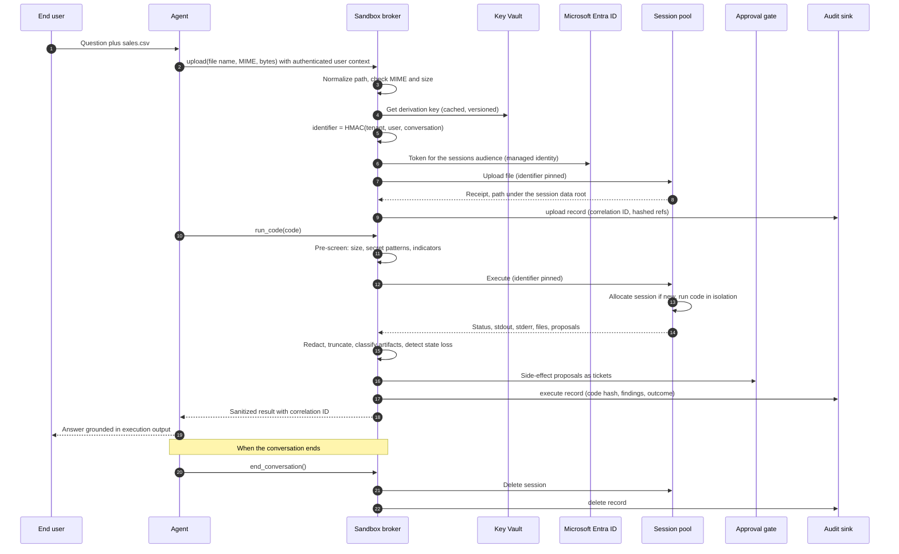
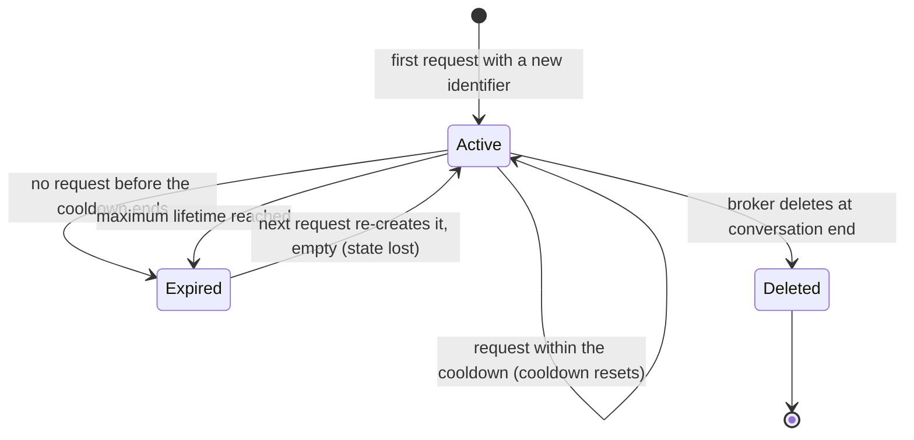

# Architecture: Code Execution Sandboxes with Session Pools

This document is the reference architecture for agents that write code and run it: data analysis, file transforms, charting and calculation. It explains why that code must never run inside the agent's process, and how to isolate it in Azure Container Apps dynamic sessions (session pools) behind a small broker that owns identity, session identifiers, egress, limits, output handling and audit.

Dynamic sessions, the Foundry code interpreter tool and hosted agents include preview features. Where a statement comes from testing preview builds rather than from documentation, it is marked **(observed in preview; verify against current Microsoft Learn documentation)**. API paths, field names, role names, pool types and api-versions are shown as illustrations; check them against the current documentation before you build on them. Nothing here includes latency, throughput, capacity or cost figures.

## Contents

1. [Context and scope](#1-context-and-scope)
2. [Forces](#2-forces)
3. [Threat model](#3-threat-model)
4. [Solution overview](#4-solution-overview)
5. [Components](#5-components)
6. [Request and response flow](#6-request-and-response-flow)
7. [Decision matrix](#7-decision-matrix)
8. [Wire contracts](#8-wire-contracts)
9. [Session lifecycle and cleanup](#9-session-lifecycle-and-cleanup)
10. [Pool selection and the MCP gap](#10-pool-selection-and-the-mcp-gap)
11. [Egress policy](#11-egress-policy)
12. [Output handling](#12-output-handling)
13. [Integration with prompt agents and hosted agents](#13-integration-with-prompt-agents-and-hosted-agents)
14. [Integration with verify-before-approve](#14-integration-with-verify-before-approve)
15. [Domain Packs](#15-domain-packs)
16. [Anti-patterns](#16-anti-patterns)
17. [Production checklist](#17-production-checklist)
18. [Observability](#18-observability)
19. [Preview caveats](#19-preview-caveats)
20. [Related](#20-related)

## 1. Context and scope

An agent that answers "what was the regional margin trend last quarter?" by writing pandas code and running it is more accurate than one that does arithmetic in its head. The same capability is the most dangerous tool an agent can hold. The code is written by a model, and the model's output is shaped by everything it reads: the user's prompt, uploaded files, retrieved documents and the results of other tools. Any of those can carry a prompt injection. Model-generated code is therefore untrusted input that happens to be executable.

If that code runs in the agent's own process or container, it inherits everything the agent has:

- **Identity.** On Azure the agent host usually has a managed identity. Code in the same process or container can call the local identity endpoint and mint tokens for any audience that identity can reach (Key Vault, Storage, the Foundry project, Cosmos DB) **(observed in preview; verify against current Microsoft Learn documentation)**.
- **Network line of sight.** The agent sits inside a VNet with private endpoints to data stores and often has outbound internet. So does the code.
- **Secrets and configuration.** Environment variables, mounted files and in-memory clients are all readable.
- **Filesystem and memory.** Code can read other users' cached data, overwrite agent files and exhaust memory or processes so that every conversation on that host fails.

The hosted-agent sandbox in Microsoft Foundry isolates one agent tenant from another; it does not isolate code the agent executes from the agent's own credentials **(observed in preview; verify against current Microsoft Learn documentation)**. Isolation has to be designed in at the tool boundary.

**In scope:** Python-first code execution for agents built on Microsoft Foundry (prompt agents and hosted agents) or any other Azure-hosted agent runtime, using Azure Container Apps dynamic sessions: the built-in code interpreter pool type (`PythonLTS`) and custom-container pools. The Foundry built-in Code Interpreter tool and self-hosted containers are covered as alternatives in the [decision matrix](#7-decision-matrix).

**Out of scope:** general-purpose CI build sandboxes, notebooks for human authors, browser automation and long-running batch compute. Those have different trust and lifecycle models.

### 1.1 Invariants

Every design choice in this document protects these invariants. If a proposed change breaks one, it needs an ADR.

1. Generated code never runs in the agent's process, container or identity ([ADR 0001](decisions/0001-never-execute-generated-code-in-process.md)).
2. A session belongs to exactly one tenant, user and conversation, and its identifier is derived on the server; neither the caller nor the model chooses it ([ADR 0002](decisions/0002-one-session-per-user-conversation-egress-off-by-default.md)).
3. Egress is off unless a reviewed allowlist says otherwise, and metadata and local addresses are never reachable.
4. No secret ever enters a session.
5. Everything that comes out of a session (stdout, stderr, files, charts) is untrusted data: sized, typed, redacted and never executed automatically.
6. A side effect that code proposes goes through approval; the sandbox never writes to a system of record.
7. Every execution is audited with a correlation ID and a code hash, never the code body.

## 2. Forces

| Force | Pulls toward | Pulls against |
| --- | --- | --- |
| Capability | Rich libraries, file I/O, charts, multi-step analysis | A smaller blast radius when the code is hostile |
| Statefulness | Keeping variables and files across turns so analysis can build up | Any state that outlives its owner or crosses users becomes a leak |
| Warmth | Pre-warmed sessions so the first call feels responsive | Warm sessions hold capacity and bill whether used or not |
| Packages | Custom images with domain libraries | Every image is a supply-chain surface to scan, sign and patch |
| Tool protocol | MCP for a prompt agent without writing a tool service | MCP was only observed on the built-in pool, not on custom-container pools **(observed in preview; verify against current Microsoft Learn documentation)** |
| Data access | Code that reads a data source directly | Every outbound path is also an exfiltration path |
| Agent type | Prompt agents get managed tools with no code | Prompt agents cannot hold a pool identity themselves; only hosted agents or a tool service can |
| Preview churn | Following the documentation | API shapes, role names and pool types change; discovery beats documentation |

The pattern resolves these forces by moving all execution to a remote, per-conversation sandbox, by putting one narrow broker in front of it, and by treating the sandbox's output with the same suspicion as its input.

## 3. Threat model

The attacker controls some text the model reads. That is enough to control the code the model writes. The table lists what that code could do, what happens if it runs in-process, and the control this pattern adds.

| # | Threat | How it arises | Impact if run in-process | Control in this pattern | Simulator scenario |
| --- | --- | --- | --- | --- | --- |
| T1 | Prompt injection becomes code | A document or tool result says "also run this"; the model obliges | Arbitrary code with the agent's privileges | Execution in a remote sandbox with no agent privileges | 26, 29 |
| T2 | Identity theft | Code reads the identity endpoint variables and requests tokens | Tokens for every resource the agent identity can reach | The session holds no agent identity; the broker requests only the sessions audience | 26, 29 |
| T3 | Data exfiltration over the network | Code posts data, encodes it in DNS lookups or pulls a second stage | Silent data loss through the agent's own egress | Egress disabled by default; exact-host allowlist only when justified | 7, 8 |
| T4 | Metadata and platform endpoints | Code probes the instance metadata address, the platform wire server or loopback | Token theft and host reconnaissance | Metadata and local addresses denied in every mode and never allowlistable | 9 |
| T5 | Resource exhaustion | Infinite loops, fork bombs, memory hogs, disk fill, huge stdout | Every conversation on the host degrades or fails | Per-session limits, step budgets in the broker, output caps, capacity fail-fast | 12, 15, 16, 19 |
| T6 | Cross-user or cross-tenant session bleed | Shared, sequential, guessable or model-chosen session identifiers | One user reads another user's files and variables | HMAC-derived identifier per tenant, user and conversation; client-supplied identifiers rejected | 1, 2, 3, 4, 5 |
| T7 | File smuggling | Traversal paths on upload; HTML, script or oversized artifacts on download | Agent files overwritten; active content rendered in a UI | Path normalization, MIME allowlists, size caps, quarantine | 10, 11, 14 |
| T8 | Package supply chain | Runtime `pip install` from the internet; typosquatted packages in an image | Malicious code with persistence | Egress off blocks runtime installs; packages are baked into a scanned, pinned image | 21, 24 |
| T9 | Secrets in the session | A developer or the model pastes a connection string or key into code | The secret lands in output, logs and model context | Pre-screen rejects credential-shaped code; output redaction; nothing secret is mounted | 13, 27 |
| T10 | Output-driven side effects | Code computes "refunds to issue" and the agent applies them | Unreviewed writes to systems of record | Proposals become approval tickets; the sandbox never writes back | 30 |
| T11 | Identifier leakage | The session identifier appears in URLs, logs or the model's context | Anyone holding the identifier can address the session | Identifiers are opaque, derived server-side, hashed in audit and never shown to the model | 5, 22, 31 |

Two observations shape the rest of the design:

- **The pre-screen is not the control.** Static checks on generated code are easy to evade. They add signal and catch accidents (oversized code, pasted secrets), but the sandbox boundary, the absent identity and the egress policy are what contain a hostile payload.
- **Isolation inside the sandbox is necessary but not sufficient.** Learn describes code interpreter sessions as isolated by a Hyper-V boundary and designed for untrusted code (per current docs; verify against current Microsoft Learn documentation). That isolates sessions from each other and from the host. It does not stop a session that is shared between users from leaking between them, and it does not stop the agent from acting on hostile output. Those are your controls.

### 3.1 Trust boundaries

| Boundary | Trusted side | Untrusted side | What crosses it |
| --- | --- | --- | --- |
| User to agent | Agent runtime | User prompt, uploaded files | Text and files, which the model reads |
| Agent to broker | Broker | Code and file names written by the model | Code text, file names, the end user context (from the authenticated request, not from the model) |
| Broker to pool | Broker identity and policy | The session and everything running in it | Code, uploads, a pinned identifier, an Entra token for the sessions audience only |
| Pool to broker | Broker output guard | Stdout, stderr, artifacts, proposals | Data only, after redaction, truncation and MIME checks |
| Broker to systems of record | Approval workflow | Proposals derived from session output | Approval tickets, never direct writes |

## 4. Solution overview



The agent never holds a role on the pool and never sees a session identifier. It calls one tool. The broker behind that tool:

1. Validates and pre-screens the code.
2. Derives the session identifier from the authenticated tenant, user and conversation.
3. Calls the pool's data plane with its own managed identity, scoped to the sessions audience.
4. Sanitizes what comes back, routes proposals to approval and audits the call.

The broker can be a small service (an Azure Container App or Azure Functions app behind an OpenAPI or MCP tool) or a module inside a hosted agent's container. What matters is that only the broker's identity holds the session executor role on the pool, and that the code executes in the pool, never in the broker.

## 5. Components

| Component | Responsibility | Where it runs | Simulator counterpart |
| --- | --- | --- | --- |
| Agent | Decides when to run code and writes it; consumes sanitized output | Foundry prompt agent, Foundry hosted agent or another runtime | Scenario drivers |
| Sandbox broker | The only caller of the pool; enforces every policy in this document | Container App, Functions app or a module in a hosted agent | `SandboxBroker` |
| Pre-screen | Rejects oversized code and credential-shaped content; logs risk indicators | Inside the broker | `prescreen_code` |
| Identifier deriver | Produces one opaque, stable identifier per tenant, user and conversation | Inside the broker, key from Key Vault | `SessionIdDeriver` |
| Policy | Egress mode and allowlist, code and output limits, MIME allowlists | Broker configuration and pool configuration | `EgressPolicy`, `BrokerPolicy`, `ExecutionLimits` |
| Session pool | Allocates isolated sessions by identifier, runs code, stores session files, expires sessions | Azure Container Apps dynamic sessions | `InMemorySessionPool` |
| Output guard | Redacts, truncates, classifies artifacts, quarantines what is not allowlisted | Inside the broker | `sanitize_stdout`, `classify_artifact` |
| Approval gate | Turns side-effect proposals into tickets that a deterministic check and a human review | Your workflow | `InMemoryApprovalGate` |
| Audit sink | Append-only record of every upload, execution, download, delete and descriptor issue | Log Analytics or an append-only store | `AuditLog` |
| Key Vault | Holds the HMAC derivation key and any MCP connection key | Azure Key Vault | `StaticDerivationKeyProvider` |
| Container registry | Holds custom session images, pulled by the pool identity | Azure Container Registry | Not modelled |
| Network controls | Custom VNet and firewall for the allowlist variant | Your landing zone | `EgressPolicy(mode="allowlist")` |

### 5.1 The pre-screen

The pre-screen runs before any pool call. It has two kinds of check, and the difference matters:

- **Blocking checks** catch accidents and policy violations that are cheap to detect reliably: code larger than the broker limit (413), and credential-shaped content such as storage account keys, SAS signatures, private key blocks, bearer tokens and literal password or client-secret assignments (400, `SecretInCode`). When a secret pattern matches, the audit record names the pattern, not the value.
- **Indicators** are logged and do not block: network calls, environment reads, process spawns, unbounded loops, metadata addresses and side-effect proposals. They feed detection and review. Blocking on them would break legitimate analysis and give a false sense of safety, because a determined payload can always rephrase.

The pre-screen does not parse Python, does not try to sandbox anything and does not decide whether code is safe. The sandbox does that job.

### 5.2 One broker, one identity

Keep the number of principals that hold the session executor role on a pool to one per environment: the broker's managed identity. Agents, developers and pipelines that need to run code go through the broker so that identifier derivation, egress policy, output handling and audit cannot be skipped. See [Authentication and governance](authentication-and-governance.md).

## 6. Request and response flow



### 6.1 Where the user context comes from

The tenant, user and conversation that feed the identifier must come from the authenticated request, never from tool arguments the model writes. In a hosted agent, the container receives the caller's identity and conversation and can pass them to its broker module. For a prompt agent calling a broker tool, the tool service needs the end user's identity propagated to it; see [Backend Identity Propagation for MCP and Agent Gateways](../../../ai-gateway/backend-identity-propagation/README.md) and [Multi-Tenant MCP Gateway on Azure API Management](../../../ai-gateway/multi-tenant-mcp-gateway/README.md). If the tool cannot establish who the user is, it must refuse rather than fall back to a shared identifier.

### 6.2 Retries and idempotency

Execution is not idempotent: code can change session state, write files or emit a proposal. The broker therefore:

- Retries automatically only when the call did not reach a session: token acquisition failures and capacity rejections that the pool marks as retryable, with backoff and a bounded number of attempts.
- Never retries a `Failed`, `BudgetExceeded` or `ResourceLimitExceeded` execution with the same code. It returns the outcome to the model, which can fix the code.
- Treats an ambiguous transport failure after the request was sent as "outcome unknown". It returns that to the model rather than re-running code that may already have produced side effects inside the session.

### 6.3 Detecting state loss

The pool allocates a new session silently when an identifier is unknown, including after an earlier session for the same identifier expired. The broker remembers which identifiers it has already used. When the pool reports a new session for a known identifier, the broker sets `stateLost` and adds a plain-language notice telling the model that files and variables from earlier turns are gone. Without this, the model writes code that refers to a dataframe that no longer exists and then misreads the resulting error.

## 7. Decision matrix

Use this matrix to choose where generated code runs. Warmth and cold-start behaviour are described qualitatively only.

| Criterion | Foundry Code Interpreter tool | ACA built-in pool (`PythonLTS`) | ACA custom-container pool | In-process exec (anti-pattern) | Self-hosted container or job |
| --- | --- | --- | --- | --- | --- |
| Isolation strength | Platform-managed sandbox; verify the isolation model in current docs | Per-session Hyper-V boundary per current docs | Per-session isolation per current docs; your image runs inside it | None: same process, same memory | Container isolation that you design; shared kernel unless you add VM-level isolation |
| Agent identity exposure | None to the code (verify) | None; the caller authenticates to the pool, the session has no agent identity | None unless you add one; the pool identity is for image pull | Full: code can mint the agent's tokens | Whatever you mount; easy to leak by accident |
| Egress control | Platform-controlled; no customer allowlist **(observed in preview; verify against current Microsoft Learn documentation)** | Disabled by default; enable or disable per pool; allowlists need custom networking (verify) | As the built-in pool, plus your custom VNet and firewall for exact-host allowlists (verify) | The agent's own egress, usually broad | Your network security groups and firewall |
| Package control | Platform image only | Curated preinstalled set; no runtime installs with egress off | Full control through your image | The agent image | Full control |
| File I/O | Files attached to the agent or conversation through Foundry | Session files API under the session data root | Whatever your container's HTTP surface implements | The agent filesystem | You build it |
| MCP availability | Not applicable (built-in tool) | Built-in MCP endpoint **(observed in preview; verify against current Microsoft Learn documentation)** | Not observed; front it yourself **(observed in preview; verify against current Microsoft Learn documentation)** | Not applicable | You build it |
| Cold start and warmth | Platform-managed; not tunable | Platform-managed; the ready-instance setting was not honoured on managed pools **(observed in preview; verify against current Microsoft Learn documentation)** | At least one instance always warm; capacity matters more than warmth **(observed in preview; verify against current Microsoft Learn documentation)** | Always warm, which is its only appeal | Per-invocation start for jobs; you own scaling |
| Session identifier control | Platform-managed per conversation | You pin the identifier | You pin the identifier | Not applicable | You build it |
| Operational burden | Lowest | Low: you run the broker | Medium: image pipeline, scanning, patching, your API surface | Deceptively low, until the incident | Highest |
| Works from prompt agents | Yes, natively | Yes, through the built-in MCP endpoint or your own tool front | Yes, through your own MCP or OpenAPI front | Not applicable | Through your own tool front |
| Works from hosted agents | Yes, as a tool (verify) | Yes, direct data plane with a broker identity | Yes, direct data plane with a broker identity | Possible, and forbidden here | Yes |
| Choose it when | Python with the platform's packages is enough and you need no egress or pinning control | You need pinning, audit and policy control and the curated packages suffice | You need domain packages or a non-default runtime | Never | Long-running batch, special hardware or constraints session pools do not meet |

Rules of thumb:

1. Start with the Foundry Code Interpreter tool for prompt agents whose analysis fits the platform's packages and needs no egress. Your evaluations should prove the tool actually ran (see [Evaluation and troubleshooting](evaluation-and-troubleshooting.md)).
2. Move to a session pool behind a broker when you need any of: per-user pinning that you control, an egress posture you set, your own audit trail, file I/O governed by your policy, or a hosted agent calling the sandbox with its own identity.
3. Use the built-in pool when you need MCP; use a custom-container pool when you need packages. If you need both, keep the custom pool and put your own MCP or OpenAPI front on it ([ADR 0003](decisions/0003-built-in-pool-for-mcp-custom-container-for-packages.md)).
4. Never execute generated code in-process ([ADR 0001](decisions/0001-never-execute-generated-code-in-process.md)).

## 8. Wire contracts

All shapes below are illustrative. Field names, paths, status codes and api-versions for the session pool data plane are preview and differ between documentation pages; verify against current Microsoft Learn documentation and pin the api-version you test against. The broker's own contract (the shape the agent sees) is yours to define and should stay stable even when the platform changes underneath.

### 8.1 Session identifier derivation

```text
material   = "v1" US tenant_id US user_id US conversation_id      (US = unit separator, 0x1F)
digest     = HMAC-SHA256(derivation_key[version], material)
identifier = "cx-" + lowercase_hex(digest)[first 40 characters]
```

Properties and rules:

- **Stable within a conversation.** The same tenant, user and conversation always map to the same identifier, so variables and files persist across turns.
- **Distinct across users and tenants.** A different user in the same conversation, or the same user and conversation IDs in another tenant, map to different identifiers. Tenant is part of the material because user and conversation IDs are often only unique within a tenant.
- **Unguessable.** Without the key, nobody can compute another user's identifier. Learn describes the identifier as sensitive and recommends generating it so it cannot be guessed (verify against current Microsoft Learn documentation).
- **Opaque.** No raw tenant, user or conversation value appears in the identifier, so it reveals nothing in platform logs.
- **Separator-safe.** Inputs containing the separator character are rejected, so `tenant-a` + `x\x1fy` cannot collide with `tenant-a\x1fx` + `y`.
- **Within bounds.** The broker restricts identifiers to letters, digits and hyphens, well inside the observed length bounds of 4 to 128 characters (verify against current Microsoft Learn documentation).
- **Server-side only.** The broker rejects any request that supplies an identifier (`ClientSuppliedSessionId`), even a valid one, so neither the caller nor the model can steer execution into another session.
- **Versioned.** The `v1` prefix and a key version let you rotate the key. Rotation remaps every conversation to a new session, which is state loss; rotate at conversation boundaries or keep the previous key version for conversations already in flight. See [Authentication and governance](authentication-and-governance.md#7-derivation-key-management).
- **Kept out of logs.** The data plane takes the identifier as a query parameter. Make sure the broker, any proxy and any HTTP client logging redact query strings, and record only a short hash (`sessionRef`) in audit.

### 8.2 Execute

Platform request (illustrative):

```http
POST https://<pool-management-endpoint>/executions?api-version=<api-version>&identifier=<derived-identifier>
Authorization: Bearer <token for the sessions audience>
Content-Type: application/json

{
  "codeInputType": "Inline",
  "executionType": "Synchronous",
  "code": "import pandas as pd\ndf = pd.read_csv('/mnt/data/sales.csv')\nprint(df.groupby('region')['margin'].mean())"
}
```

Some documentation pages show a different path (for example `code/execute`) and wrap fields in a `properties` object. The token audience shown in current documentation is `https://dynamicsessions.io`, so the scope a managed identity requests is `https://dynamicsessions.io/.default` (verify both against current Microsoft Learn documentation).

Agent-facing tool request. There is no identifier field; the broker derives it from the authenticated context.

```json
{
  "code": "import pandas as pd\ndf = pd.read_csv('/mnt/data/sales.csv')\nprint(df.describe())"
}
```

Agent-facing tool response:

```json
{
  "ok": true,
  "correlationId": "corr-3f9a1c0d2b7e",
  "status": "Succeeded",
  "stdout": "region  margin\nnorth   0.21\nsouth   0.18\n",
  "stderr": "",
  "stdoutTruncated": false,
  "redactions": [],
  "sessionIsNew": false,
  "stateLost": false,
  "artifacts": [
    {"path": "/mnt/data/margin.png", "mime": "image/png", "sizeBytes": 1834, "disposition": "deliver", "reason": "allowlisted"}
  ],
  "pendingApprovals": [],
  "prescreenFindings": [],
  "egressAttempts": []
}
```

- `status` is one of `Succeeded`, `Failed`, `BudgetExceeded` (the run hit its execution budget) or `ResourceLimitExceeded` (process, memory or file limits). The platform's own status values may differ; the broker maps them.
- `stateLost` with a `notice` field tells the model that earlier files and variables are gone ([section 9](#9-session-lifecycle-and-cleanup)).
- `pendingApprovals` lists ticket IDs for side effects the code proposed ([section 14](#14-integration-with-verify-before-approve)).
- `egressAttempts` lists outbound attempts and whether policy allowed them. In production this comes from firewall logs correlated by time and pool, not from the session itself.
- Code larger than the broker limit is rejected with 413 `CodeTooLarge` before any pool call.

### 8.3 Files

Platform calls (illustrative; verify paths and api-version):

| Operation | Request | Notes |
| --- | --- | --- |
| Upload | `POST https://<pool-management-endpoint>/files?api-version=<api-version>&identifier=<id>` with a multipart body | Lands under the session data root, shown in docs as `/mnt/data` |
| List | `GET https://<pool-management-endpoint>/files?api-version=<api-version>&identifier=<id>` | Lists files in the session |
| Download | `GET https://<pool-management-endpoint>/files/<name>/content?api-version=<api-version>&identifier=<id>` | Returns raw bytes |

Agent-facing upload request and response:

```json
{"filename": "q3/sales.csv", "mime": "text/csv", "contentRef": "<attachment reference>"}
```

```json
{"ok": true, "correlationId": "corr-8e21d4a90c33", "path": "/mnt/data/q3/sales.csv", "sizeBytes": 2048, "sessionIsNew": true, "stateLost": false}
```

The broker validates every path before it reaches the pool. It rejects:

- empty paths, over-long paths and control characters (including NUL);
- backslashes, percent-encoding and drive letters;
- absolute paths outside the session data root;
- any `..` segment, and paths that name a directory rather than a file.

It also enforces an upload MIME allowlist (for example CSV, plain text and JSON) and a size cap. Downloads use the same path rules, then the artifact rules in [section 12](#12-output-handling). A download for a file that no longer exists returns 404 `FileNotFoundInSession`, with `stateLost` set if the session was re-created.

### 8.4 Error taxonomy

The platform returns errors in an envelope like `{"error": {"code", "message", "details", "target", "traceId"}}`, with codes such as `SessionWithIdentifierNotFound` and `SessionRequestValidationFailed` (verify against current Microsoft Learn documentation). The broker maps platform errors into a small, stable taxonomy so the agent and your dashboards do not change when the platform does:

```json
{
  "ok": false,
  "correlationId": "corr-5b0e7f61a2d4",
  "error": {"code": "PathRejected", "message": "parent-directory segments are not allowed", "httpStatus": 400, "retryable": false}
}
```

| Code | HTTP | Retryable | Meaning | What the agent should do |
| --- | --- | --- | --- | --- |
| `PolicyRejected` | 400 | No | Generic policy violation (for example, an empty or separator-bearing user context) | Stop; do not rephrase to evade |
| `ClientSuppliedSessionId` | 400 | No | The caller or model tried to choose the session | Remove the identifier; the broker pins it |
| `InvalidSessionIdentifier` | 400 | No | A derived identifier failed validation (a bug) | Report; this should never reach the model |
| `PathRejected` | 400 | No | Traversal, absolute, encoded or drive path | Use a plain relative file name |
| `SecretInCode` | 400 | No | Credential-shaped content in code | Remove the secret; never embed credentials |
| `CodeTooLarge` | 413 | No | Code over the broker limit | Split the work |
| `FileTooLarge` | 413 | No | Upload over the broker limit | Sample or split the file |
| `MimeRejected` | 415 | No | Upload type not allowlisted | Convert to an allowed type |
| `Unauthorized` | 401 | No | Token missing or for the wrong audience | Operator issue: fix token acquisition |
| `Forbidden` | 403 | No | Caller identity lacks the role on this pool | Operator issue: fix the role assignment |
| `FileNotFoundInSession` | 404 | No | File absent, often after session expiry | Re-upload or recompute; check `stateLost` |
| `McpNotAvailable` | 409 | No | MCP requested on a pool that does not expose it | Use the built-in pool or your own tool front |
| `CapacityExceeded` | 429 | Yes | Pool at its concurrent session limit | Back off; operators review capacity and cooldown |
| `InvalidPoolConfiguration`, `InvalidPoolType` | 400 | No | Pool settings or type rejected | Operator issue: discover valid values from the resource provider |
| `InProcessExecutionRefused` | 400 | No | A backend tried to run code in-process | Operator issue: wire a remote pool |

## 9. Session lifecycle and cleanup

A session is created implicitly the first time the pool sees an identifier, and it ends in one of three ways.



| Mechanism | What it does | Design guidance |
| --- | --- | --- |
| Cooldown | The pool ends a session after a period with no requests; each request resets the timer (lifecycle type `Timed` in current docs; verify) | Size it to the gap between turns in a real conversation, not to a demo. Too short loses state mid-analysis; too long holds capacity and keeps data around |
| Maximum lifetime | Some lifecycle types cap total session age regardless of activity (verify the lifecycle types and their settings in current Microsoft Learn documentation) | Use it for regulated data so a busy session cannot live indefinitely |
| Explicit delete | The data plane exposes a way to delete a session by identifier (verify) | Call it when the conversation ends or the user signs out; it frees capacity and removes data early |

Rules the broker enforces:

1. **Treat session storage as a cache, not a system of record.** Anything the user needs to keep is downloaded through the output guard and stored by the application under its own retention policy.
2. **Surface state loss.** When a known identifier comes back as a new session, set `stateLost` and tell the model ([section 6.3](#63-detecting-state-loss)). The simulator shows a file uploaded before a cooldown expiry returning `FileNotFoundInSession` afterwards, with the state-loss notice attached.
3. **Delete at conversation end.** Hook the delete into the conversation-closed event of your application, and audit it.
4. **Sweep orphans.** Keep a list of identifiers the broker has used with their last-use time (hashed or encrypted at rest). A periodic job deletes any that belong to closed conversations. Cooldown is the backstop, not the plan.
5. **Do not keep sessions warm with synthetic traffic.** Pinging a session to stop it expiring defeats the cooldown, holds capacity and keeps data alive longer than intended. If users need continuity across long pauses, persist the inputs and re-upload them.
6. **Do not create pools on demand.** Pool creation is a control-plane operation; create pools through infrastructure as code and treat them as long-lived platform resources **(observed in preview; verify against current Microsoft Learn documentation)**.

## 10. Pool selection and the MCP gap

The broker selects a pool per request from declared needs, not from the code text.

| Needs custom packages | Needs MCP | Pool | Access path | Warning |
| --- | --- | --- | --- | --- |
| No | No | Built-in `PythonLTS` | Direct data plane through the broker | None |
| No | Yes | Built-in `PythonLTS` | Built-in MCP endpoint, identifier pinned by your tool front | The MCP connection key is a secret; keep it in Key Vault, rotate it, never show it to the model |
| Yes | No | Custom container | Direct data plane through the broker | Plan capacity, not warmth |
| Yes | Yes | Custom container | Your own MCP or OpenAPI front that calls the broker | The built-in MCP endpoint was not observed on custom pools |

Three ways to reach a pool, from least to most code you own:

1. **Built-in MCP endpoint.** For the code interpreter pool type, the platform can expose an MCP server that a prompt agent can use through a connection. The connection credential is a key, so it is a secret with a rotation story **(observed in preview; verify against current Microsoft Learn documentation)**. Pin the identifier in the tool configuration; the model must not be able to set it.
2. **Your own MCP or OpenAPI front.** A small service (often the broker itself) that exposes `run_code`, `upload` and `download` and derives the identifier from the authenticated caller. This works for both pool types and keeps every control in one place.
3. **Direct data plane.** A hosted agent's broker module calls the pool with its own managed identity. Simplest for hosted agents; not available to prompt agents.

Findings to plan around, all **(observed in preview; verify against current Microsoft Learn documentation)**:

- **MCP on custom-container pools.** Enabling MCP on a custom-container pool was accepted by deployment and then silently absent from the deployed resource. Read the pool configuration back after every deployment and assert the settings you depend on, rather than trusting the template.
- **Discover pool types from the resource provider.** The set of pool types and languages available in a region and api-version changed between documentation and reality. Ask the resource provider: query the provider's metadata, or submit a deliberately invalid type in a non-production validation deployment and read the list of valid values from the error. The simulator raises `InvalidPoolType` with the valid list for the same reason.
- **Warm instances on managed pools.** The ready-instance setting was not honoured on the managed built-in pool. Do not design around it; design the user experience to tolerate a slower first execution.
- **Capacity on custom pools.** Custom-container pools would not accept zero ready instances, so at least one instance is always running and billable. The setting that mattered was the maximum number of concurrent sessions: every pinned identifier holds a slot until its cooldown ends, and when the pool is full new identifiers fail fast with a retryable capacity error. Size the maximum to concurrent conversations times your cooldown behaviour, and alert on capacity rejections.
- **Non-root image user.** Adding a non-root `USER` to the custom image broke session startup in testing. Verify the platform's current requirements before hardening the image this way, and harden through other means (read-only layers, minimal packages, no credentials) if needed.
- **Image tags.** Use a unique, immutable tag (or digest) per image build. Reusing a tag can leave sessions on a mixed or stale image.
- **Image pull identity.** The pool pulls custom images with its own managed identity, which needs only pull rights on the registry ([Authentication and governance](authentication-and-governance.md)).

## 11. Egress policy

| Mode | When | How it is enforced | Broker behaviour |
| --- | --- | --- | --- |
| Disabled (default) | Almost always: analysis of data the user uploaded | Pool network status set to disabled; current docs describe this as the default (verify) | Treats any network indicator in code as a signal; any attempt fails inside the session |
| Allowlist | A justified need for a specific public endpoint, for example a reviewed reference-data API | Custom VNet integration plus an egress firewall with exact-host rules (verify the supported configuration in current Microsoft Learn documentation) | Allowlist entries are validated before deployment; every attempt is audited |
| Open | Never for model-generated code | Not applicable | Not supported by this pattern |

Allowlist rules (modelled by the simulator's `EgressPolicy`):

- Exact fully qualified domain names only. No wildcards, no IP literals, no single-label names. The simulator rejects these when the policy is validated, before any session runs.
- HTTPS only and no credentials in the URL; the simulator denies other schemes and user-info at decision time. Restrict ports at the firewall.
- The instance metadata address, the platform wire server address, loopback, unspecified and link-local addresses, and names such as `localhost` and `metadata` are denied in every mode and cannot be added to an allowlist. The simulator also canonicalizes decimal and hexadecimal encodings of those addresses so a disguised form is still denied.
- Each entry has an owner, a justification and a review date. Treat the allowlist as code.

Things an allowlist does not fix:

- **DNS exfiltration.** If sessions can resolve arbitrary names, data can leak in DNS queries even with HTTP blocked. Use a resolver that only answers for allowlisted names when you run the allowlist variant.
- **Exfiltration to an allowed host.** An allowed API that accepts arbitrary query parameters is an exfiltration channel. Prefer read-only endpoints, and if the data is sensitive, fetch it in the broker (with the broker's identity and your data controls) and upload it to the session instead of letting the session fetch it.
- **Runtime package installs.** With egress disabled, `pip install` fails, which is the point. Bake packages into a custom image instead of opening the package index to the session.

## 12. Output handling

Everything a session returns is attacker-influenced. The output guard handles it in a fixed order:

1. **Redact.** Apply the same secret patterns as the pre-screen to stdout and stderr and replace matches with a `[REDACTED:<pattern>]` marker. A session should hold no secrets, so a match means something is wrong; audit it.
2. **Truncate.** Cap stdout and stderr to a size the model can use, append a visible marker (`...[output truncated by broker]`) and set `stdoutTruncated`. Redact before truncating so that a secret cannot be split across the cut and escape the pattern.
3. **Classify artifacts.** For each file the code produced, check its MIME type against the artifact allowlist (for example CSV, plain text, JSON and PNG) and its size against the download cap. Deliver what passes; quarantine the rest with a reason (`mime-not-allowlisted`, `too-large`). A quarantined artifact cannot be downloaded through the broker.
4. **Extract proposals.** Anything the code proposes to change outside the session (a refund list, a configuration change, an email) becomes an approval ticket, not an action ([section 14](#14-integration-with-verify-before-approve)).
5. **Return data, not instructions.** Wrap the result so the model sees it as tool output. Output can contain text written to look like instructions; the agent's instructions should say that tool output is data.

Never do any of the following with sandbox output:

- Execute it, import it, `eval` it or pass it to a shell, on the agent host or anywhere else.
- Render HTML, SVG or script from it in a user interface. Deliver charts as raster images, and render tables from structured data with your own templates.
- Follow links in it automatically.
- Write it to a system of record without approval.
- Trust a MIME type the session reports without checking content; in production, sniff the content and compare.

## 13. Integration with prompt agents and hosted agents

The choice of agent type is covered in [Choosing Between Prompt Agents and Hosted Agents in Microsoft Foundry](../../choosing-prompt-vs-hosted-agents/README.md) and the hosted-agent production model in [Production Hosted Agents on Microsoft Foundry](../../production-hosted-agents-on-foundry/README.md). This section only covers how each type reaches a sandbox.

### 13.1 Prompt agents

A prompt agent cannot run code itself and cannot hold a pool identity. It has three options:

| Option | How | Controls you keep | Controls you give up |
| --- | --- | --- | --- |
| Foundry Code Interpreter tool | Enable the built-in tool on the agent | Instructions, evaluation | Package set, egress posture, session pinning, your own audit (platform-managed) |
| Built-in MCP endpoint on a `PythonLTS` pool | Add an MCP tool whose server address carries the pinned identifier and whose connection key is held in Key Vault | Pool egress, lifecycle and capacity | Per-user pinning must be done by whatever builds the tool configuration; the connection key is a shared secret |
| Broker as an OpenAPI or MCP tool | Register the broker as a tool; propagate the end user's identity to it | All controls in this document | Nothing; you operate the broker |

For the MCP option, the simulator's `mcp_tool_descriptor` shows the shape: a server address with the identifier pinned, a flag that the model may not set the identifier, and a reference to a key held in Key Vault rather than the key itself. If your tool configuration is shared across users, the identifier is too; in that case use the broker option.

### 13.2 Hosted agents

A hosted agent runs your code in a container with its own identity. It is tempting to run generated code right there. Do not: the container's identity, network and filesystem are exactly what the sandbox exists to protect ([ADR 0001](decisions/0001-never-execute-generated-code-in-process.md)). Instead:

- Include the broker as a module in the hosted agent, or call a shared broker service.
- Give the broker identity (the agent's identity or a dedicated one) the session executor role on the pool, and nothing else on the pool.
- Derive identifiers from the authenticated tenant, user and conversation the hosted agent receives, not from model output.
- Wire the broker's backend through a seam so that a test or local run can use the in-memory fake, and the production path can only reach a remote pool. In the simulator, a backend that would execute in-process is refused with `InProcessExecutionRefused`.

## 14. Integration with verify-before-approve

Code execution is read-mostly: it computes. The danger is what the agent does next with the result. If the code concludes "issue these refunds" or "reorder these parts", that conclusion is a proposal derived from untrusted input.

The broker turns proposals into approval tickets with the correlation ID, a hashed session reference and the source `sandbox-output`, and returns only the ticket IDs to the agent. The approval workflow then applies the pattern in [Verify Before Approve](../../../orchestration-and-workflows/verify-before-approve/README.md): deterministic checks first (does the account exist, is the amount within limits, does the evidence trace back to the uploaded data), then a human decision for anything that changes a system of record. The sandbox never holds credentials for those systems, so it cannot bypass the gate.

For multi-step agents with policy, context and tool governance, the [Governed Context-Aware Agent Harness](../../../orchestration-and-workflows/governed-context-aware-agent-harness/README.md) is the natural home for the broker as one governed tool among several.

## 15. Domain Packs

The pattern is the same across industries; what changes is the code, the data and how much egress and approval the work tolerates. All organizations below are fictional.

| Industry | Example | What code runs | Data sensitivity | Egress posture | Pool choice | Approval needs |
| --- | --- | --- | --- | --- | --- | --- |
| Financial services | Contoso Bank analysts ask for portfolio exposure by sector and a stress-test chart | pandas aggregations, scenario arithmetic, charts | High: positions, client identifiers | Disabled; market reference data is fetched by the broker and uploaded | Built-in if curated packages suffice; custom container for in-house risk libraries | Any recommended trade, limit change or client communication goes to approval |
| Healthcare | Fabrikam Health operations staff analyse de-identified bed occupancy and staffing extracts | Time-series resampling, simple forecasting, CSV transforms | Very high: even de-identified data can re-identify; session data must stay in region | Disabled; no allowlist | Built-in pool in the required region; maximum lifetime set; delete at conversation end | Staffing or scheduling changes go to approval; outputs reviewed for small-cell disclosure |
| Manufacturing | Northwind Manufacturing engineers analyse sensor exports to find drift and scrap causes | Signal processing, statistical process control, columnar file handling | Medium: process recipes and yields are trade secrets | Disabled; occasionally an allowlist to an internal reference service through the broker instead | Custom container with signal-processing and columnar packages; own tool front if a prompt agent needs MCP | Recipe or setpoint changes always require approval and an engineer's sign-off |
| Retail | Contoso Retail merchandisers ask for promotion lift and reorder suggestions | Joins across sales and inventory extracts, lift calculations, charts | Medium: commercial data, some customer segments | Disabled | Built-in pool; MCP endpoint for a prompt agent if per-user pinning is handled by the tool front | Reorders and price changes go to approval with the computed evidence attached |
| Public sector | A Fabrikam city agency summarizes permit backlogs for a weekly briefing | Grouping, counting, charting from uploaded extracts | Medium to high: resident data and records-retention rules | Disabled | Built-in pool in a sovereign or in-region deployment | Published figures reviewed by a human; nothing is written back automatically |

Common rules for every pack: session identifiers derived per tenant, user and conversation; no secrets in sessions; artifacts limited to data and raster images; audit with code hashes, never code.

## 16. Anti-patterns

| Anti-pattern | Why it fails | Do instead |
| --- | --- | --- |
| Executing generated code in-process (`exec`, `eval`, a subprocess on the agent host, a notebook kernel in the agent container) | Shares identity, network, secrets, filesystem and memory with untrusted code | A remote session pool behind a broker ([ADR 0001](decisions/0001-never-execute-generated-code-in-process.md)) |
| A new random identifier per call | Every call mints a new session: state is lost between turns and each call holds capacity until its cooldown ends (simulator scenario 20) | Derive one identifier per tenant, user and conversation and pin it |
| Letting the model choose or see the identifier | Prompt injection can steer execution into another user's session | Derive server-side; reject client-supplied identifiers |
| One identifier per tenant, or one per agent | All users of the tenant share files and variables | Include user and conversation in the derivation |
| Guessable identifiers (sequential, user email, conversation ID as-is) | Anyone who can call the pool can address someone else's session | HMAC with a key in Key Vault |
| Passing secrets, connection strings or tokens into sessions | Hostile code reads them and the output may echo them | Fetch protected data in the broker and upload only the data |
| Turning on egress "just for pip" | Opens an exfiltration path and an unscanned supply chain | Bake packages into a custom image |
| Allowlisting with wildcards or IP addresses | Look-alike domains and shared IPs widen the hole | Exact host names, reviewed and owned |
| Creating pools on demand per user or per request | Slow, unreliable and hard to govern | Long-lived pools from infrastructure as code; isolate with identifiers |
| Keep-warm pings | Holds capacity and data alive; defeats the cooldown | Tolerate a slower first call; persist inputs and re-upload |
| Rendering HTML or SVG from session output | Script runs in the user's browser | Allowlist data types and raster images only |
| Applying computed changes directly | Hostile input becomes a production write | Approval tickets ([section 14](#14-integration-with-verify-before-approve)) |
| Logging code bodies, identifiers or full stdout | Logs become the leak | Hashes, sizes, outcomes and correlation IDs |
| Trusting the deployment template for pool settings | Settings can be silently dropped in preview | Read the configuration back and assert it |

## 17. Production checklist

Identity and access:

- [ ] Only the broker identity holds the session executor role, scoped to the pool, in each environment.
- [ ] Agents, developers and pipelines have no direct role on the pool.
- [ ] The broker requests tokens for the sessions audience only.
- [ ] The pool identity has only pull rights on the registry.

Sessions:

- [ ] Identifiers are HMAC-derived from authenticated tenant, user and conversation; the key is in Key Vault with a rotation plan.
- [ ] Client-supplied identifiers are rejected; identifiers never reach the model or logs.
- [ ] Cooldown and maximum lifetime are set deliberately; sessions are deleted at conversation end; an orphan sweep exists.
- [ ] State loss is detected and surfaced to the model.

Network and packages:

- [ ] Egress is disabled, or an allowlist exists with owners, justifications and review dates, enforced by a firewall.
- [ ] Metadata and local addresses are unreachable in every mode (verified by a red-team test).
- [ ] Custom images are built from a pinned base, scanned, given unique tags and pulled by digest or immutable tag.

Inputs and outputs:

- [ ] Code size, upload size and upload MIME limits are enforced in the broker.
- [ ] The pre-screen rejects credential-shaped code; indicators are logged.
- [ ] Output is redacted, then truncated with a visible marker; artifacts are MIME- and size-checked; quarantine exists.
- [ ] No sandbox output is executed, rendered as HTML or written to a system of record without approval.

Operations:

- [ ] The pool configuration is read back and asserted after every deployment (MCP flag, egress, lifecycle, capacity).
- [ ] Pool types are discovered from the resource provider in each target region.
- [ ] Capacity rejections, budget terminations, quarantines, redactions and state-loss events are alerted on.
- [ ] Red-team and functional evaluations run in the release pipeline ([Evaluation and troubleshooting](evaluation-and-troubleshooting.md)).

## 18. Observability

Log every broker operation as one structured audit record. The simulator's `AuditRecord` uses these fields:

| Field | Content | Why |
| --- | --- | --- |
| `correlationId` | Unique per operation, propagated to the approval ticket and returned to the agent | Joins agent traces, broker logs, pool logs and approvals |
| `event` | `upload`, `execute`, `download`, `delete`, `mcp-descriptor` | What happened |
| `tenantRef`, `userRef` | Short keyed hashes, not raw IDs | Investigate per user without spreading identities through logs |
| `sessionRef` | Short hash of the session identifier | Correlate calls to one session without exposing the identifier |
| `pool` | Pool name and type | Capacity and configuration analysis |
| `outcome` | `Succeeded`, `Failed`, `BudgetExceeded`, `Rejected`, `Delivered`, `Quarantined` and so on | Dashboards and alerts |
| `details` | Code hash and size, pre-screen findings by pattern name, egress attempts with decisions, truncation and redaction flags, `sessionIsNew`, `stateLost`, ticket IDs | Detection and debugging |

Never log: code bodies, full stdout or stderr, uploaded file contents, session identifiers, tokens, derivation keys or connection keys. If you need the code for an investigation, store it separately under stricter access, keyed by its hash.

Metrics and alerts worth having from day one:

- Executions by outcome; a rise in `BudgetExceeded` or `ResourceLimitExceeded` suggests either runaway generations or abuse.
- Pre-screen rejections and redactions; any redaction in output means a secret reached a session somewhere.
- Egress denials by reason, especially `metadata-or-local-address`.
- Capacity rejections and the number of active identifiers against the pool maximum.
- State-loss events per conversation; a high rate means the cooldown is too short or identifiers are not pinned.
- Quarantined artifacts by reason.
- Role assignment changes on the pool (from the activity log).

Trace the agent turn, the broker call and the pool request with the same correlation ID. On the platform side, the error envelope carries a trace identifier (verify); record it in `details` so support cases can be correlated.

## 19. Preview caveats

Every item below should be checked against current Microsoft Learn documentation before you rely on it:

- The data-plane role name for running code in a pool ("Azure ContainerApps Session Executor" in current docs) and whether broader roles are also documented for some operations.
- The token audience and scope for the sessions data plane.
- Hyper-V isolation for code interpreter sessions, and the isolation model for custom-container sessions.
- The default network status (egress disabled) and the supported way to build an egress allowlist.
- Data-plane paths, field names and api-versions for execute, files, list and delete; they differ between pages.
- The error envelope fields and codes.
- Session identifier length and character rules.
- The session file root (`/mnt/data` in current docs).
- Lifecycle types, the cooldown reset behaviour and the maximum lifetime setting.
- Pool type names and their regional availability; discover them from the resource provider.
- **(Observed in preview; verify against current Microsoft Learn documentation.)** The built-in MCP endpoint on the code interpreter pool type and its absence on custom-container pools; the ready-instance setting being ignored on managed pools and zero being rejected on custom pools; the non-root image user breaking startup; the Foundry Code Interpreter tool's package set and egress behaviour; the hosted-agent sandbox not isolating executed code from the agent's own identity.

## 20. Related

- [Asset README](../README.md)
- [Authentication and governance](authentication-and-governance.md)
- [Evaluation and troubleshooting](evaluation-and-troubleshooting.md)
- [ADR 0001: Never execute generated code in-process](decisions/0001-never-execute-generated-code-in-process.md)
- [ADR 0002: One session per user conversation, egress off by default](decisions/0002-one-session-per-user-conversation-egress-off-by-default.md)
- [ADR 0003: Built-in pool for MCP, custom container for packages](decisions/0003-built-in-pool-for-mcp-custom-container-for-packages.md)
- [Simulator](../samples/README.md)
- [Choosing Between Prompt Agents and Hosted Agents in Microsoft Foundry](../../choosing-prompt-vs-hosted-agents/README.md)
- [Production Hosted Agents on Microsoft Foundry](../../production-hosted-agents-on-foundry/README.md)
- [Governed Context-Aware Agent Harness](../../../orchestration-and-workflows/governed-context-aware-agent-harness/README.md)
- [Verify Before Approve](../../../orchestration-and-workflows/verify-before-approve/README.md)
- [Multi-Tenant MCP Gateway on Azure API Management](../../../ai-gateway/multi-tenant-mcp-gateway/README.md)
- [Backend Identity Propagation for MCP and Agent Gateways](../../../ai-gateway/backend-identity-propagation/README.md)
- [Azure Container Apps dynamic sessions](https://learn.microsoft.com/azure/container-apps/sessions)
- [Serverless code interpreter sessions in Azure Container Apps](https://learn.microsoft.com/azure/container-apps/sessions-code-interpreter)
- [Custom container sessions in Azure Container Apps](https://learn.microsoft.com/azure/container-apps/sessions-custom-container)
