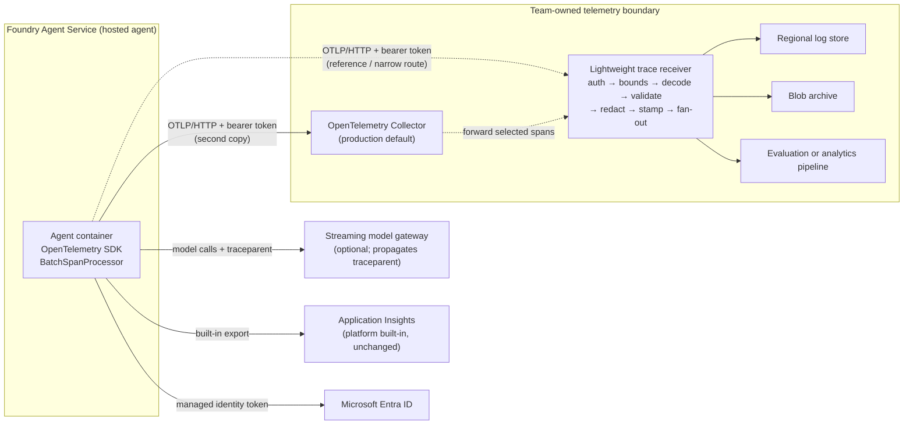

# Custom OpenTelemetry export from hosted agents with a lightweight trace receiver

> **Maturity:** preview · **Kind:** sample · **Category:** `agent-runtime` · **Version:** 0.1.0

A Foundry hosted agent already sends traces to the Application Insights resource connected to its Foundry project, and those traces appear in Foundry's own tracing views. Some teams also need a **second, team-owned copy** of the same spans. Typical reasons:

- One tenant's traces must go to a store in a specific region.
- A retention rule differs from the platform default.
- An evaluation pipeline needs spans in its own format.
- Finance wants token usage attributed per agent identity.
- Someone needs to prove that an export configuration works.

The hosted-agent runtime supports this. Set an OTLP endpoint and the runtime exports to it **in parallel with** Application Insights. It does not replace Application Insights.

This sample is an add-on to [Production Hosted Agents on Foundry](../production-hosted-agents-on-foundry/README.md). It shows what the **receiving end** of that second export must do. For each request, the receiver:

1. Authenticates the exporter with an Entra token from the agent's managed identity.
2. Bounds and validates the OTLP/HTTP payload.
3. Redacts attributes against an allowlist: prompt and completion content is off by default, and identifiers are hashed.
4. Stamps a trusted route taken from the token, never from span attributes.
5. Fans the batch out to a destination.
6. Answers in the shape OTLP exporters expect, including partial success and `Retry-After`.

A fictional company, **Contoso**, runs it for three agent teams.

> **Core thesis:** *Export a second copy, never the only copy; authenticate the exporter, not the attributes; and store only what an allowlist names.*

Hosted agents, their telemetry configuration and the OpenTelemetry GenAI semantic conventions are **preview** or **in development** and change often. Statements about the platform are qualitative and are marked where they were observed in preview; verify against current docs. The reference is offline and has not been deployed as-is. This asset contains no latency, throughput, capacity or cost figures.

## Architecture and implementation map

| Layer / concern | Deep-dive documentation | Executable reference |
|---|---|---|
| **Topology, sequence, OTLP wire contracts, payload bounds, redaction, correlation, failure modes** | [`docs/architecture.md`](docs/architecture.md) · [ADR 0001](docs/decisions/0001-dual-export-not-replace-platform-tracing.md) · [ADR 0002](docs/decisions/0002-redact-at-receiver-allowlist-attributes.md) | [`samples/otlp_trace_receiver.py`](samples/otlp_trace_receiver.py): offline receiver core and fake exporter with `--self-test`, `--domain` and `--demo` |
| **Exporter authentication, trust boundaries, telemetry data governance** | [`docs/authentication-and-governance.md`](docs/authentication-and-governance.md) | `FakeEntraTokenValidator`, `TrustConfig`, `SharedHeaderAuthenticator` (dev only) and the `EntraTokenValidator` stub in the sample |
| **Collector versus lightweight receiver** | [ADR 0003](docs/decisions/0003-collector-first-receiver-as-reference.md) | `ProtobufTraceDecoder` stub, and the `415` scenario that points protobuf traffic at a decoder or a Collector |
| **Evaluation, dual-export checks, troubleshooting** | [`docs/evaluation-and-troubleshooting.md`](docs/evaluation-and-troubleshooting.md) | [`samples/README.md`](samples/README.md): scenario list, `--serve`/`--send` loopback check and how to extend it |

## Domain Packs

The receiver is domain-agnostic. Three things change per domain: which attributes are allowlisted, which are hashed, and where an exporter identity's spans are routed.

| Domain Pack | Exporter (hosted agent identity) | Redaction emphasis | Routing emphasis |
|---|---|---|---|
| **Contoso Retail** | Shopping assistant | Customer and order ids are hashed; store region is kept for reporting; a debug payload attribute is dropped | One route for the team's analytics store |
| **Fabrikam Health** | Care navigator | Content capture is **locked off** by policy. Patient-like identifiers (fictional), the conversation id and the end-user id are hashed with a domain key. Error text is dropped; the status code and exception type are kept. | One route to a store in the required region |
| **Northwind Logistics** | Dispatch agent and planner agent | Shipment and depot ids are kept as operational data | Two identities route to two regional stores; spoofed `service.name` and tenant attributes are ignored |

Run `--domain all` in the sample to see each pack's checks.

## When to use

- You must keep a **copy of agent traces under rules the platform default does not meet**: a per-tenant destination, a region, a retention period, or a restricted reader group.
- An **evaluation or analytics pipeline** needs GenAI spans (agent, model and tool operations; token counts; finish reasons) in a store you control.
- You need **cost or usage attribution** per agent identity from the `gen_ai.usage.*` attributes, alongside your other cost data.
- You are **debugging an export configuration** and want to see exactly what a hosted agent sends, on a loopback receiver, before a Collector or vendor backend is involved.
- You are writing the **specification for an OpenTelemetry Collector processor** and want an executable reference for the auth, bounds and redaction rules it must enforce.

## When not to use

- **Built-in tracing already meets the need.** If Foundry tracing plus the connected Application Insights resource covers retention, residency and readers, stop there. A second export is another copy of sensitive data to govern.
- **You would be duplicating content outside a governed store.** If the destination cannot meet the same classification, access and retention controls as the primary store, do not export content-bearing spans to it. Prefer counts and identifiers.
- **A standard OpenTelemetry Collector fits.** For production fan-out, protobuf and gRPC support, batching, queueing, retry and the vendor exporters, the Collector is the default recommendation. Use this receiver as a reference, for local verification, or for one narrow custom route that the Collector's processors cannot express. See [ADR 0003](docs/decisions/0003-collector-first-receiver-as-reference.md).
- **You want to replace platform tracing.** Do not. The platform reserves its Application Insights connection setting (observed in preview; verify against current docs), and Foundry's own trace views depend on that path. See [ADR 0001](docs/decisions/0001-dual-export-not-replace-platform-tracing.md).
- **The agent is a prompt agent.** Prompt agents have no container in which to configure an exporter. Use Foundry tracing. See [Choosing Prompt Agents vs Hosted Agents](../choosing-prompt-vs-hosted-agents/README.md).

## Architecture



The agent exports every span twice. The platform path to Application Insights does not change. The second path goes to a boundary the team owns: normally an OpenTelemetry Collector, sometimes this lightweight receiver, or a Collector that forwards a subset to it. The [architecture deep dive](docs/architecture.md) has the sequence diagram, the JSON wire contracts and the failure modes.

### Decision matrix

| Need | Built-in only | OpenTelemetry Collector | Lightweight receiver (this sample) |
|---|---|---|---|
| Foundry tracing views and Application Insights | Yes | Yes (kept; second copy) | Yes (kept; second copy) |
| OTLP protobuf and gRPC from standard SDK exporters | n/a | Yes | Only with a protobuf decoder you add |
| Fan-out to many backends with queueing and retry | No | Yes | Only what you write |
| Attribute allowlist, hashing and content drop | Limited to what you instrument | Yes, with processors you configure and test | Yes, as code you own and test |
| Route by authenticated exporter identity | No | With an auth extension and routing configuration; verify for your version | Yes; the route comes from the token |
| Operational burden | None beyond the platform | Run, patch and scale a Collector | Run, patch, scale **and** maintain protocol code |
| Best for | Most teams | Production second-copy export | Verification, development, a narrow custom route, or a reference for Collector rules |

## Key design decisions

| Decision | Choice | Why | Trade-off |
|---|---|---|---|
| Relationship to platform tracing | Dual export; never replace ([ADR 0001](docs/decisions/0001-dual-export-not-replace-platform-tracing.md)) | Foundry views and platform support depend on the built-in path | Two copies to govern; the second copy needs its own retention and readers |
| Where redaction happens | At the receiver, by allowlist, with content off by default ([ADR 0002](docs/decisions/0002-redact-at-receiver-allowlist-attributes.md)) | The agent's instrumentation and the semantic conventions change; the receiver is the one place every span crosses | New attributes are dropped until someone allowlists them |
| Collector or custom receiver | Collector first; this receiver as reference and for narrow routes ([ADR 0003](docs/decisions/0003-collector-first-receiver-as-reference.md)) | The Collector already handles protobuf, gRPC, queueing and exporters | Custom rules in a Collector need configuration testing; this sample gives you the test cases |
| Exporter authentication | Entra token from the agent's managed identity; a shared header only for local development | No secret to rotate or leak; identity is the routing key | Needs an app registration, an app role and a token-aware exporter |
| Routing and tenancy | From the validated token's client id, never from `service.name` or resource attributes | Attributes are caller-controlled data | Each exporter identity must be registered with the receiver |

## Getting started

1. **Run the offline sample.** It needs Python 3.10 or later and has no dependencies:

   ```powershell
   python assets/agent-runtime/hosted-agent-otel-trace-receiver/samples/otlp_trace_receiver.py --self-test
   python assets/agent-runtime/hosted-agent-otel-trace-receiver/samples/otlp_trace_receiver.py --domain all
   python assets/agent-runtime/hosted-agent-otel-trace-receiver/samples/otlp_trace_receiver.py --demo
   ```

   `--self-test` runs the named scenarios and exits non-zero on any failure. `--demo` narrates one batch end to end: the redaction report, the trusted stamps, a `429` honoured with `Retry-After`, and an OTLP partial success.
2. **Read the contracts.** [`docs/architecture.md`](docs/architecture.md) defines the request subset, the responses, the receiver policy and the redaction report.
3. **Decide Collector or receiver.** Use the [decision matrix](#decision-matrix) and [ADR 0003](docs/decisions/0003-collector-first-receiver-as-reference.md). If you choose a Collector, use the sample's scenarios as acceptance tests for its configuration.
4. **Register the receiver in Entra.** Create an app registration with an app ID URI and a `Traces.Write` app role, and assign the role to each hosted agent identity. See [`docs/authentication-and-governance.md`](docs/authentication-and-governance.md).
5. **Wire the hosted agent.** Follow [Wiring a hosted agent](#wiring-a-hosted-agent).
6. **Prove dual export.** Run the checks in [`docs/evaluation-and-troubleshooting.md`](docs/evaluation-and-troubleshooting.md). The same trace id must appear in Application Insights and in your destination.

## Wiring a hosted agent

There are two ways to make a hosted agent send the second copy. Both were observed in preview; verify the variable names and behaviour against [Configure telemetry for hosted agents](https://learn.microsoft.com/azure/foundry/agents/how-to/configure-hosted-agent-telemetry) and the SDK version you pin.

**Path 1: runtime environment variables (simplest; best for development and for a Collector).** Set these on the hosted agent version:

| Variable | Purpose |
|---|---|
| `OTEL_EXPORTER_OTLP_ENDPOINT` | Base URL of your Collector or receiver. HTTP exporters append `/v1/traces`, `/v1/metrics` and `/v1/logs`. |
| `OTEL_EXPORTER_OTLP_PROTOCOL` | `http/protobuf` is the documented recommendation; `grpc` is also supported. |
| `OTEL_EXPORTER_OTLP_HEADERS` or `OTEL_EXPORTER_OTLP_TRACES_HEADERS` | A static header for the exporter. Put the secret in a Foundry connection and reference it with `${{connections.<connection>.credentials.<field>}}`. Never write it into the version definition. |
| `OTEL_TRACES_SAMPLER`, `OTEL_TRACES_SAMPLER_ARG` | Sampling for the exported traces |

Known behaviour, observed in preview:

- This path exports **all signals**, so the endpoint also receives metrics and logs.
- Environment variables are fixed per agent version.
- `service.name` is set to the agent name, and `OTEL_SERVICE_NAME` is ignored.
- `APPLICATIONINSIGHTS_CONNECTION_STRING` is reserved by the platform.
- The per-signal endpoint `OTEL_EXPORTER_OTLP_TRACES_ENDPOINT` is a standard OpenTelemetry variable, but it is not documented for hosted agents. Unlike the base endpoint, its value is used as-is, with no `/v1/traces` appended. Verify before relying on it.
- A static header is a shared secret. Treat it as development-grade authentication.

**Path 2: an extra span processor in the agent code (recommended for a team-owned receiver).** In the agent's startup code:

- Add a second `BatchSpanProcessor` with an OTLP/HTTP span exporter that points at an application setting such as `TRACE_RECEIVER_ENDPOINT`.
- Have the exporter's HTTP session attach a fresh managed-identity token for `TRACE_RECEIVER_SCOPE` (for example `api://<receiver-app-id>/.default`) on each request.
- The exporter then sends traces only, and every request carries an Entra token that the receiver can validate.
- Call `force_flush()` and `shutdown()` on the tracer provider when the agent stops. Otherwise the last batch is lost.

Whether the exporter accepts a custom session depends on the SDK version; verify. The [authentication guide](docs/authentication-and-governance.md#exporter-authentication-options) compares both paths.

## File map

| Path | Purpose |
|---|---|
| [`docs/architecture.md`](docs/architecture.md) | Topology, sequence diagram, OTLP wire contracts, receiver policy, payload bounds, redaction design, correlation, anti-patterns, failure modes |
| [`docs/authentication-and-governance.md`](docs/authentication-and-governance.md) | Exporter authentication options, claim checks, trust boundaries, telemetry data classification, retention, residency, readers, threat model |
| [`docs/evaluation-and-troubleshooting.md`](docs/evaluation-and-troubleshooting.md) | Test matrix, dual-export confirmation, common failures, runbook |
| [`docs/decisions/`](docs/decisions/) | Architecture decision records 0001 to 0003 |
| [`samples/README.md`](samples/README.md) · [`samples/otlp_trace_receiver.py`](samples/otlp_trace_receiver.py) | Offline receiver reference with 37 named scenarios, three Domain Packs, a demo and a loopback-only `--serve` mode |

## Related assets

| Asset | Relationship |
|---|---|
| [Production Hosted Agents on Foundry](../production-hosted-agents-on-foundry/README.md) | The primary asset. Its [observability section](../production-hosted-agents-on-foundry/docs/architecture.md#11-observability) covers what the platform records; this asset adds a governed second copy. |
| [Hosted agent behind a streaming model gateway](../hosted-agent-streaming-model-gateway/README.md) | Propagates `traceparent` so gateway and agent spans share one trace id that this receiver preserves |
| [Request Context Is Not Authorization](../request-context-is-not-authorization/README.md) | Why `service.name`, tenant attributes and forwarded headers never decide routing or access |
| [Choosing Prompt Agents vs Hosted Agents](../choosing-prompt-vs-hosted-agents/README.md) | Custom export needs a hosted agent; prompt agents rely on Foundry tracing |
| [Agent State: Cosmos DB vs Foundry Memory](../agent-state-cosmos-vs-foundry-memory/README.md) | Conversation ids in spans correlate with the state store; hash them when policy requires |
| [Secured Foundry Landing Zone](../../landing-zones-and-infra/secured-foundry-landing-zone/README.md) | Private networking and egress control for the agent-to-receiver path |
| [Agent Security and Governance](../../security-and-governance/agent-security-and-governance/README.md) | The wider governance model that telemetry classification and retention plug into |
| [Evidence Ledger and Run Certificate](../../orchestration-and-workflows/evidence-ledger-and-run-certificate/README.md) | Traces are operational telemetry that may be sampled; the ledger is tamper-evident run evidence. Use both, and correlate them by trace id |
| [Agent Production Readiness Guide](../../agentops-and-readiness/agent-production-readiness/README.md) | Release gates in which the dual-export checks belong |

## Production-readiness pillar mapping

| Pillar | How this asset contributes |
|---|---|
| **Security and observability** | Second-copy export without losing platform tracing, Entra-authenticated exporters, allowlist redaction with content off by default, keyed hashing of identifiers, trusted routing from the token |
| **Agent ops** | Dual-export verification, OTLP retry and partial-success semantics, flush-at-shutdown and content-capture checks, a runbook for silent export failures |

## Security and responsible AI

- **Telemetry is data.** GenAI spans can carry prompts, completions, tool arguments and tool results. Classify the destination as at least as sensitive as the conversation itself, or do not send content to it.
- **Content off by default.** The receiver drops content attributes unless a policy explicitly allows capture. A policy can lock capture off, as the Fabrikam Health pack does.
- **Identifiers are hashed, not stored.** User, conversation and domain identifiers are replaced with a keyed HMAC so they still correlate but cannot be read back. Keep the key in Key Vault and rotate it deliberately.
- **No secrets in agents.** Exporters authenticate with the agent's managed identity. A shared header is for local development only, and the sample refuses to use one outside `dev`.
- **Attributes are not authorization.** Routing and tenancy come from the validated token, never from `service.name`, tenant attributes or anything else the exporter sends.
- **Fail visible, not silent.** The receiver reports what it dropped in a redaction report that contains counts and keys only, never values.

## Limitations

- Hosted agents and their telemetry configuration are **preview**. Variable names, the signals sent and header handling were observed in preview; verify against current docs.
- The OpenTelemetry **GenAI semantic conventions are in Development status**. Attribute names (for example `gen_ai.provider.name` and `gen_ai.input.messages`) have changed before and may change again. Review the allowlist when you upgrade instrumentation.
- The sample decodes OTLP/JSON only. Standard SDK exporters usually send protobuf, so production needs a protobuf decoder or a Collector in front.
- Rate-limit state and sinks in the sample are in memory and work for one replica only. Real sinks must be idempotent on `(traceId, spanId)` because exporters retry.
- Tokens in the sample are unsigned fakes. Real Entra tokens must be validated against the tenant's signing keys.
- This asset contains no latency, throughput, capacity or cost figures. Measure in your own environment.

## References

- [Architecture deep dive](docs/architecture.md)
- [Authentication and governance](docs/authentication-and-governance.md)
- [Evaluation and troubleshooting](docs/evaluation-and-troubleshooting.md)
- [Samples guide](samples/README.md)
- [Configure telemetry for hosted agents](https://learn.microsoft.com/azure/foundry/agents/how-to/configure-hosted-agent-telemetry)
- [Hosted agents in Foundry Agent Service](https://learn.microsoft.com/azure/foundry/agents/concepts/hosted-agents)
- [Azure Monitor OpenTelemetry overview](https://learn.microsoft.com/azure/azure-monitor/app/opentelemetry-overview)
- [Logs Ingestion API in Azure Monitor](https://learn.microsoft.com/azure/azure-monitor/logs/logs-ingestion-api-overview)
- [Microsoft identity platform access tokens](https://learn.microsoft.com/entra/identity-platform/access-tokens)
- [OTLP specification](https://opentelemetry.io/docs/specs/otlp/)
- [OpenTelemetry semantic conventions for generative AI](https://opentelemetry.io/docs/specs/semconv/gen-ai/)
- [OpenTelemetry Collector](https://opentelemetry.io/docs/collector/)
- [OTLP exporter configuration](https://opentelemetry.io/docs/languages/sdk-configuration/otlp-exporter/)
- [Contribution and Standardization Guide](../../../docs/contribution-guide.md)
