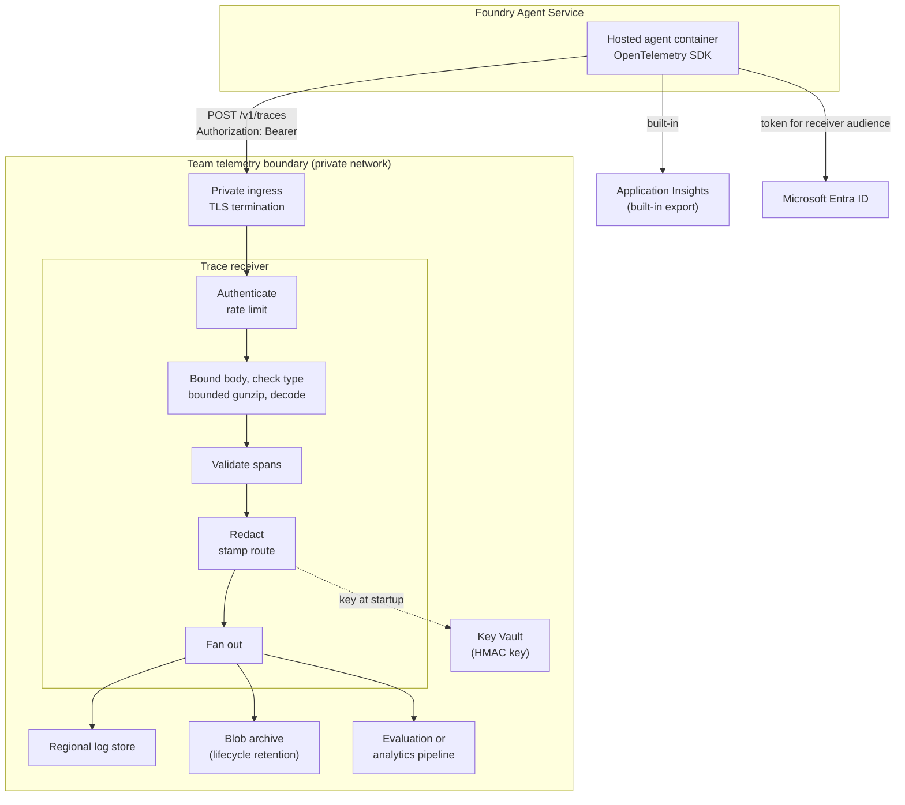
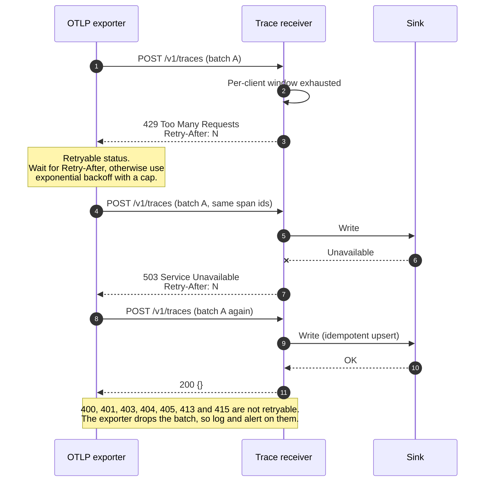

# Architecture: a lightweight OTLP trace receiver for hosted agents

This document describes the receiving end of a second OpenTelemetry export from a Foundry hosted agent:

- what each component does
- the order in which the receiver handles a request
- the OTLP/HTTP wire contracts it speaks
- how it bounds payloads, redacts attributes and preserves correlation
- how it fails

It extends the [observability section](../../production-hosted-agents-on-foundry/docs/architecture.md#11-observability) of Production Hosted Agents on Foundry. Read that first for what the platform records on its own.

The OTLP shapes follow the [OTLP specification](https://opentelemetry.io/docs/specs/otlp/). The `gen_ai.*` attributes follow the [OpenTelemetry semantic conventions for generative AI](https://opentelemetry.io/docs/specs/semconv/gen-ai/), which are in **Development** status: names can change between releases. Hosted-agent telemetry behaviour is marked where it was observed in preview; verify against current docs. Every bound in this document is a configurable parameter, not a recommendation.

## Components and responsibilities

| Component | Responsibility | Does not |
|---|---|---|
| **Hosted agent** (OpenTelemetry SDK) | Creates `invoke_agent`, `chat` and `execute_tool` spans and batches them in a `BatchSpanProcessor`. Exports to the platform's Application Insights **and** to the team endpoint. Attaches a managed-identity token to the second export. | Decide what the receiver stores; that is the receiver's policy |
| **Application Insights** (platform) | Receives the built-in export and backs Foundry's tracing views | Change when you add the second export |
| **OpenTelemetry Collector** (optional, production default) | Terminates OTLP protobuf and gRPC; batches, queues, retries and fans out with standard exporters; can forward a subset to the receiver | Know your routing rules unless you configure and test them |
| **Lightweight trace receiver** | Authenticates the exporter, bounds and decodes the payload, validates spans, redacts attributes, stamps a trusted route, fans out to sinks, and answers in OTLP shape | Trust any attribute for routing or access; store prompt or completion content by default |
| **Sinks** | Store accepted spans: a regional log store, a blob archive, or an evaluation or analytics pipeline. Upsert on `(traceId, spanId)`. | Receive anything the receiver has not redacted |
| **Microsoft Entra ID** | Issues the agent's managed-identity token for the receiver's audience | Decide routing; the receiver maps the validated client id to a route |
| **Key Vault** | Holds the HMAC key used to hash identifiers, and any sink secrets that cannot use a managed identity | Hold tokens; tokens are fetched per request |

## Topology



Two placement rules:

- **Keep the receiver private.** Hosted-agent egress was observed in preview to be open by default. Use the [landing zone's egress controls](../../production-hosted-agents-on-foundry/docs/architecture.md#82-egress) so that the agent can reach the receiver and nothing else it should not reach. Do not expose the receiver publicly to make the export work.
- **Put a Collector in front when you need protobuf, gRPC or durable queueing.** The Collector terminates OTLP and forwards a JSON or protobuf subset to the receiver. See [ADR 0003](decisions/0003-collector-first-receiver-as-reference.md).

## Request lifecycle

The receiver handles every request in a fixed order. Each step answers with the status shown before any later step runs, so an unauthenticated or oversized request costs as little as possible.

| Step | Check | Failure response |
|---|---|---|
| 1 | The path is `/v1/traces` (or `/v1/logs` or `/v1/metrics`, which are handled by policy) | `404` naming the traces path |
| 2 | The method is `POST` | `405` with `Allow: POST` |
| 3 | The exporter is authenticated: a bearer token, or a shared header in `dev` only | `401` with `WWW-Authenticate`; `403` for an unlisted client or a missing role |
| 4 | The per-client rate limit | `429` with `Retry-After` |
| 5 | `Content-Length` is at most `max_body_bytes`. The HTTP layer checks this before reading the body. | `411` without a length; `413` when too large |
| 6 | `Content-Type` has a registered decoder | `415`. For `application/x-protobuf`, the message says to register a decoder or use a Collector. |
| 7 | `Content-Encoding` is `gzip` or absent, and the decompressed size is at most `max_decompressed_bytes` | `415` for other encodings; `413` when too large; `400` for a truncated stream |
| 8 | The body decodes to an `ExportTraceServiceRequest` | `400` |
| 9 | Each span is valid and within `max_spans_per_request` | The span is rejected and counted for partial success |
| 10 | Each attribute passes redaction | It is dropped, hashed or truncated, and counted in the redaction report |
| 11 | The validated client id maps to a route with sinks | `403` |
| 12 | Every sink accepts the batch | `503` with `Retry-After` when a sink is unavailable |
| 13 | The response | `200 {}`, or `200` with `partialSuccess` when any span was rejected |

## Sequence diagrams

### Export, happy path and partial success

```mermaid
sequenceDiagram
    autonumber
    participant SDK as Hosted agent<br/>(BatchSpanProcessor + OTLP exporter)
    participant ENTRA as Microsoft Entra ID
    participant RX as Trace receiver
    participant RED as Redactor
    participant SINK as Sinks

    SDK->>SDK: Batch spans (invoke_agent, chat, execute_tool)
    SDK->>ENTRA: Managed identity token for api://receiver/.default
    ENTRA-->>SDK: Access token (aud, tid, appid or azp, roles)
    SDK->>RX: POST /v1/traces<br/>Content-Type: application/json<br/>Authorization: Bearer token
    RX->>RX: Validate signature, iss, tid, aud, exp and nbf
    RX->>RX: Client allowlisted? Role Traces.Write present?
    RX->>RX: Rate limit, body bound, content type, decompression bound
    RX->>RX: Decode ExportTraceServiceRequest
    loop each span
        RX->>RX: Validate ids, name and timestamps; enforce span limit
        RX->>RED: Attributes, events, status
        RED-->>RX: Allowlisted, hashed or truncated attributes; counts only
    end
    RX->>RX: Stamp trace_receiver.route and client_id from the token
    RX->>SINK: Write the redacted batch (upsert on traceId, spanId)
    SINK-->>RX: OK
    alt every span accepted
        RX-->>SDK: 200 {}
    else some spans rejected
        RX-->>SDK: 200 {"partialSuccess": {"rejectedSpans": "1", "errorMessage": "..."}}
        Note over SDK: Partial success is final.<br/>The exporter must not retry it.
    end
```

### Back-pressure: 429 and 503 with Retry-After



Exporters retry `429`, `502`, `503` and `504`, and must honour `Retry-After` when present. Every other `4xx` makes the exporter drop the batch. The sample's `exporter_backoff_seconds` and `export_with_retry` show this contract. An exporter also gives up when its own timeout or retry budget runs out, and it usually logs at a level nobody reads. That is why a dropped export looks like silence; see [evaluation and troubleshooting](evaluation-and-troubleshooting.md#spans-stop-arriving-with-no-error).

## Wire contracts

All shapes follow OTLP/HTTP with the JSON encoding. Trace and span ids are lowercase hex strings (32 and 16 characters), not base64. Enum fields such as `kind` and `status.code` are integers. Field names are lowerCamelCase. 64-bit integers (`startTimeUnixNano`, `intValue`) are strings. The protobuf encoding carries the same fields; the sample only decodes JSON, and production should use a protobuf decoder or a Collector.

### Export request (OTLP/JSON subset)

`POST /v1/traces` with `Content-Type: application/json` (optionally `Content-Encoding: gzip`). This is one agent turn: an `invoke_agent` span parented to the gateway span, with `chat` and `execute_tool` children. Ids come from the W3C Trace Context examples and are illustrative.

```json
{
  "resourceSpans": [{
    "resource": {
      "attributes": [
        {"key": "service.name", "value": {"stringValue": "contoso-shopping-assistant"}},
        {"key": "service.version", "value": {"stringValue": "3"}},
        {"key": "telemetry.sdk.language", "value": {"stringValue": "python"}},
        {"key": "deployment.environment.name", "value": {"stringValue": "dev"}}
      ]
    },
    "scopeSpans": [{
      "scope": {"name": "demo.agent.instrumentation", "version": "0.1.0"},
      "spans": [
        {
          "traceId": "4bf92f3577b34da6a3ce929d0e0e4736",
          "spanId": "1111111111111111",
          "parentSpanId": "00f067aa0ba902b7",
          "name": "invoke_agent contoso-shopping-assistant",
          "kind": 2,
          "startTimeUnixNano": "1800000000000000000",
          "endTimeUnixNano": "1800000000900000000",
          "attributes": [
            {"key": "gen_ai.operation.name", "value": {"stringValue": "invoke_agent"}},
            {"key": "gen_ai.agent.name", "value": {"stringValue": "contoso-shopping-assistant"}},
            {"key": "gen_ai.conversation.id", "value": {"stringValue": "conv-demo-0001"}},
            {"key": "enduser.id", "value": {"stringValue": "user-demo-0001"}},
            {"key": "gen_ai.input.messages", "value": {"stringValue": "[{\"role\":\"user\",...}]"}}
          ],
          "status": {"code": 1}
        },
        {
          "traceId": "4bf92f3577b34da6a3ce929d0e0e4736",
          "spanId": "2222222222222222",
          "parentSpanId": "1111111111111111",
          "name": "chat example-chat-model",
          "kind": 3,
          "startTimeUnixNano": "1800000000010000000",
          "endTimeUnixNano": "1800000000400000000",
          "attributes": [
            {"key": "gen_ai.operation.name", "value": {"stringValue": "chat"}},
            {"key": "gen_ai.request.model", "value": {"stringValue": "example-chat-model"}},
            {"key": "gen_ai.response.id", "value": {"stringValue": "resp-demo-0001"}},
            {"key": "gen_ai.usage.input_tokens", "value": {"intValue": "42"}},
            {"key": "gen_ai.response.finish_reasons",
             "value": {"arrayValue": {"values": [{"stringValue": "tool_calls"}]}}}
          ]
        },
        {
          "traceId": "4bf92f3577b34da6a3ce929d0e0e4736",
          "spanId": "3333333333333333",
          "parentSpanId": "1111111111111111",
          "name": "execute_tool lookup_order",
          "kind": 1,
          "startTimeUnixNano": "1800000000410000000",
          "endTimeUnixNano": "1800000000500000000",
          "attributes": [
            {"key": "gen_ai.operation.name", "value": {"stringValue": "execute_tool"}},
            {"key": "gen_ai.tool.name", "value": {"stringValue": "lookup_order"}},
            {"key": "gen_ai.tool.call.id", "value": {"stringValue": "call-demo-0001"}},
            {"key": "gen_ai.tool.call.arguments", "value": {"stringValue": "{\"order_id\":\"1234\"}"}}
          ]
        }
      ]
    }]
  }]
}
```

The token counts are fixture values, not measurements. Span `kind` values are `1` internal, `2` server, `3` client. Which spans and attributes a hosted agent emits depends on the framework and instrumentation version, so treat this as a shape, not a guarantee.

### Success and partial-success responses

The response uses the request's content type. Full success is an `ExportTraceServiceResponse` with no fields set:

```json
{}
```

When the receiver accepts the request but rejects some spans, it still answers `200` and sets `partialSuccess`. `rejectedSpans` is an int64, so it is a string in JSON:

```json
{
  "partialSuccess": {
    "rejectedSpans": "1",
    "errorMessage": "rejected spans: invalid_trace_id=1"
  }
}
```

The exporter must not retry a partial success. The rejected spans are gone, so the error message names reasons and counts for whoever reads exporter logs. It never echoes span content.

For a request to `/v1/logs` or `/v1/metrics` under the `discard` policy, the receiver answers the same way with `rejectedLogRecords` or `rejectedDataPoints`.

### Error body

Every non-`200` response carries a `google.rpc.Status`-shaped body. The sample always answers in JSON; a receiver that also accepts protobuf answers in the request's content type.

```json
{
  "code": 16,
  "message": "missing bearer token"
}
```

| HTTP status | `code` (google.rpc) | Retryable by the exporter | Extra header |
|---|---|---|---|
| `400` | `3` INVALID_ARGUMENT | No | |
| `401` | `16` UNAUTHENTICATED | No | `WWW-Authenticate: Bearer` |
| `403` | `7` PERMISSION_DENIED | No | |
| `404` | `5` NOT_FOUND | No | |
| `405` | `12` UNIMPLEMENTED | No | `Allow: POST` |
| `411`, `413`, `415` | `3` INVALID_ARGUMENT | No | |
| `429` | `8` RESOURCE_EXHAUSTED | Yes | `Retry-After` |
| `503` | `14` UNAVAILABLE | Yes | `Retry-After` |

Messages are short and fixed. They never include token claims, attribute values or the request body.

### Receiver policy

One policy per environment and route. It is a reviewed document deployed with the receiver, not something an exporter can change. Values shown as `"<configurable>"` are deliberate: pick bounds from your own exporter batch settings and test them. This asset does not recommend numbers.

```json
{
  "name": "contoso-retail",
  "environment": "prod",
  "bounds": {
    "max_body_bytes": "<configurable>",
    "max_decompressed_bytes": "<configurable>",
    "max_spans_per_request": "<configurable>",
    "max_attributes_per_span": "<configurable>",
    "max_value_chars": "<configurable>",
    "max_events_per_span": "<configurable>"
  },
  "span_allowlist": [
    "gen_ai.operation.name", "gen_ai.provider.name",
    "gen_ai.agent.id", "gen_ai.agent.name", "gen_ai.agent.version",
    "gen_ai.conversation.id", "gen_ai.request.model", "gen_ai.response.model",
    "gen_ai.response.id", "gen_ai.response.finish_reasons",
    "gen_ai.usage.input_tokens", "gen_ai.usage.output_tokens",
    "gen_ai.tool.name", "gen_ai.tool.type", "gen_ai.tool.call.id",
    "error.type", "exception.type", "server.address", "server.port",
    "contoso.store.region"
  ],
  "resource_allowlist": [
    "service.name", "service.version", "telemetry.sdk.*",
    "deployment.environment.name", "cloud.provider", "cloud.region"
  ],
  "content_attributes": [
    "gen_ai.input.messages", "gen_ai.output.messages", "gen_ai.system_instructions",
    "gen_ai.tool.definitions", "gen_ai.tool.call.arguments", "gen_ai.tool.call.result",
    "gen_ai.prompt", "gen_ai.completion"
  ],
  "hashed_attributes": ["enduser.id", "user.id", "contoso.customer.id"],
  "capture_content": false,
  "content_capture_allowed": true,
  "hmac_key_ref": "<key vault secret reference>",
  "other_signals": "discard",
  "rate_limit": {
    "requests_per_window": "<configurable>",
    "window_seconds": "<configurable>",
    "retry_after_seconds": "<configurable>"
  },
  "clients": {
    "<agent managed identity client id>": "contoso-retail"
  }
}
```

Rules the receiver enforces when it loads a policy (the sample's `ReceiverPolicy.__post_init__` shows them):

- `capture_content: true` is refused when `content_capture_allowed` is `false`. A regulated route cannot be switched to capture content by a configuration change alone.
- Every bound must be positive. An unbounded receiver is a denial-of-service and cost risk.
- An HMAC key must be present. Production keys come from Key Vault, never from source.
- `other_signals` is either `discard` or `reject`.

A key ending in `.*` is a prefix wildcard, so `telemetry.sdk.*` allows `telemetry.sdk.name` and `telemetry.sdk.language`. Keep wildcards rare and never use them for `gen_ai.*`: that would let new content attributes through when the conventions change.

### Redaction report

The receiver produces one report per request. It holds counts and attribute **keys** only, never values, so it is safe to log and to alert on. This is the report from the sample's `--demo` run:

```json
{
  "spansReceived": 3,
  "spansAccepted": 3,
  "spansRejected": {},
  "attributes": {
    "contentDropped": 5,
    "hashed": 2,
    "notAllowlisted": 1,
    "unsupportedValue": 0,
    "truncated": 0,
    "overAttributeLimit": 0,
    "namespaceStripped": 0
  },
  "statusMessagesDropped": 0,
  "eventsDropped": 0,
  "droppedKeys": [
    "contoso.debug.payload",
    "gen_ai.input.messages",
    "gen_ai.output.messages",
    "gen_ai.system_instructions",
    "gen_ai.tool.call.arguments",
    "gen_ai.tool.call.result"
  ]
}
```

A sudden rise in `contentDropped` usually means someone turned content capture on in the agent. A new key in `droppedKeys` usually means new instrumentation or a semantic-conventions upgrade. Both are worth an alert, not a silent allowlist change.

## Payload bounds

The receiver bounds every dimension an exporter controls. All of these are policy parameters:

| Parameter | Enforced at | When exceeded |
|---|---|---|
| `max_body_bytes` | The HTTP layer, from `Content-Length`, before the body is read | `413` (and `411` when there is no length) |
| `max_decompressed_bytes` | Streaming gunzip, which stops reading at the limit | `413`, so a small compressed body cannot expand without limit |
| `max_spans_per_request` | Span loop | Extra spans are rejected as `over_span_limit` and reported as partial success |
| `max_attributes_per_span` | After redaction | Extra attributes are dropped and counted as `overAttributeLimit`. The same bound caps array length. |
| `max_value_chars` | Each string value, span name and scope field | Truncated and counted as `truncated` |
| `max_events_per_span` | Events and links | Extra events are dropped and counted as `eventsDropped`; extra links are dropped |
| `requests_per_window` per client | After authentication | `429` with `Retry-After` |

Align the exporter with the receiver: set the batch processor's maximum export batch size (for example `OTEL_BSP_MAX_EXPORT_BATCH_SIZE`; verify the name for your SDK) to no more than `max_spans_per_request`. Otherwise every large batch ends in partial success and loses spans.

## Redaction design

1. **Allowlist, not denylist.** An attribute is stored only when its key is on the route's allowlist. New instrumentation, a framework upgrade or a renamed convention adds keys you have not reviewed, and a denylist would pass them. See [ADR 0002](decisions/0002-redact-at-receiver-allowlist-attributes.md).
2. **Content capture is off by default.** Message, instruction, tool-definition and tool-argument or tool-result attributes are dropped unless the route turns capture on. A regulated route sets `content_capture_allowed: false`, so it cannot be turned on. Dropping at the receiver is a second layer. Also keep capture off in the agent (`OTEL_INSTRUMENTATION_GENAI_CAPTURE_MESSAGE_CONTENT` and related settings; the names and values are in Development, so verify them for your instrumentation).
3. **Hash identifiers, do not drop them.** User, patient-like or customer identifiers listed in `hashed_attributes` are replaced with `hmac-sha256:` plus a truncated keyed digest. The same input gives the same output under one key, so you can still group and join without storing the raw value. Use a keyed HMAC, not a plain hash: low-entropy identifiers are easy to reverse from an unkeyed hash.
4. **Strip the receiver's namespace.** Any incoming attribute starting with `trace_receiver.` is removed before the receiver stamps its own. An exporter cannot pre-set its route.
5. **Drop free text that tends to carry data.** Status messages and `exception.message` are dropped; `status.code`, `error.type` and `exception.type` are kept. Exception messages often quote inputs, file paths or connection details.
6. **Drop structured value types you cannot bound.** `kvlistValue` and `bytesValue` are dropped; arrays are bounded and must contain scalars. Nested maps and bytes are an easy way to smuggle a payload past a key-based allowlist.
7. **Report keys, never values.** The redaction report and the receiver's own logs list which keys were dropped and how many, never what they contained.

The same redactor runs on resource attributes (with `resource_allowlist`), span attributes and event attributes.

## Correlation

| Identifier | Where it comes from | How to use it |
|---|---|---|
| `traceId` | Created by the first service in the request. When a [streaming model gateway](../../hosted-agent-streaming-model-gateway/docs/architecture.md#trace-propagation) sits in front, the agent continues the gateway's `traceparent`. | The join key across the receiver's sinks, Application Insights and the gateway's logs. In Application Insights, the trace id appears as `operation_Id` (observed in preview; verify against current docs). |
| `spanId`, `parentSpanId` | Each span | Rebuild the tree. Sinks upsert on `(traceId, spanId)`. |
| `gen_ai.conversation.id` | The agent framework or the Responses API conversation | Group turns into a conversation. Hash it on routes where it can identify a person. |
| `gen_ai.response.id` | The model response | Join to model-side logs or evaluation records |
| `gen_ai.tool.call.id` | The tool call | Join the tool span to the tool's own logs |
| `trace_receiver.route`, `trace_receiver.client_id` | Stamped by the receiver from the validated token | Partition, retain and authorize reads by route. Never use payload attributes for this. |

The receiver validates ids and normalizes them to lowercase hex, but never replaces them. It must not start a new trace or re-parent spans, or the second export stops matching the built-in one.

## Non-trace signals

A hosted agent configured with a base `OTEL_EXPORTER_OTLP_ENDPOINT` may also send logs and metrics to `/v1/logs` and `/v1/metrics` (observed in preview; verify against current docs). This receiver is trace-only and offers two behaviours:

- **`discard`** (default) answers `200` with `partialSuccess.rejectedLogRecords` or `rejectedDataPoints`. Exporters stop retrying, the agent's logs stay clean, and the counts tell operators what is being thrown away.
- **`reject`** answers `404`. The exporter drops the data and usually logs an error. Use it when you would rather see the misconfiguration.

The better fix is on the exporter: use the per-signal traces endpoint, or point logs and metrics somewhere that wants them.

## Sink contract

- A sink implements `name` and `write(batch, principal)`. It receives only the redacted batch and the authenticated principal.
- **Idempotent writes.** Exporters retry `429` and `503` with the same span ids, so a sink must upsert on `(traceId, spanId)` or use deterministic object names. The sample's blob stub names objects by route, date, trace id and span id.
- **Fail as retryable.** A sink that cannot write raises `SinkUnavailable`, and the receiver answers `503` with `Retry-After`. Never answer `200` when nothing was stored.
- **All sinks or none.** The sample treats any sink failure as a failed request, so the exporter retries the whole batch and idempotency absorbs the repeat. If one sink is optional, put it behind a durable queue instead of letting it fail the request.
- **Per-route destinations.** Routes map to sinks in different regions or stores. Residency is decided by the route from the token, not by a region attribute in the payload.

## Observability of the receiver itself

Instrument the receiver with the Azure Monitor OpenTelemetry distribution, but **do not** send its own spans back to itself. Emit:

| Signal | Why it matters |
|---|---|
| Requests by status and client | `401` or `403` spikes mean a misconfigured agent or a probe; `415` means a protobuf exporter; `404` means a wrong path |
| `partialSuccess` counts by reason | Exporter batch size above the receiver bound, or a broken instrumentation |
| `contentDropped` and new `droppedKeys` | Content capture turned on upstream, or new attributes to review |
| `429` and `503` counts | Rate limits too tight, or a sink outage |
| Sink write failures | The destination is down; exporters will retry and then drop |

## Anti-patterns

| Anti-pattern | What goes wrong | Do instead |
|---|---|---|
| Replacing the platform's Application Insights export with the custom one | Foundry's trace views go empty, and the reserved setting is not yours to change | Dual export ([ADR 0001](decisions/0001-dual-export-not-replace-platform-tracing.md)) |
| No authentication on the receiver | Anyone who can reach it can write spans into your stores | Managed-identity bearer token with audience, tenant, client and role checks |
| Routing or authorizing by `service.name`, a tenant attribute or a header | Any exporter can claim to be another agent or tenant | Route from the validated client id; strip `trace_receiver.*` from input |
| Answering `200 {}` regardless of what happened | Exporters think data was stored when it was not; failures are invisible | Real status codes, partial success and `503` with `Retry-After` |
| Accepting protobuf requests without decoding them | The receiver "works" in tests and stores nothing | Register a protobuf decoder, or use a Collector |
| Storing every attribute, including content | Prompts, answers and tool results end up in a less-governed store | Allowlist, content capture off, hashed identifiers |
| Unbounded body, decompression or attribute size | A single request can exhaust memory or storage | Bounds at every layer, enforced before work is done |
| In-memory storage on several replicas | Each replica holds a different subset, and a restart loses data | Durable sinks with idempotent writes |
| Debug endpoints that dump stored spans | Telemetry disclosure | No read endpoints on the receiver; read from the governed store |
| Shared-secret header in production | Secrets copied into agent configuration, no per-agent attribution, manual rotation | Managed identity; shared header for local development only |
| Exporting straight to the receiver from every agent at scale | No queueing, no protobuf, no standard processors | A Collector in front ([ADR 0003](decisions/0003-collector-first-receiver-as-reference.md)) |

## Failure modes

| Failure | What the exporter sees | Receiver outcome | Detection | Mitigation |
|---|---|---|---|---|
| Wrong path (base endpoint already includes `/v1/traces`, or a per-signal endpoint without it) | `404` | Request rejected | `404` count | Base endpoint without the path, or per-signal endpoint with it |
| Protobuf exporter, JSON-only receiver | `415` | Request rejected | `415` count | Protobuf decoder or Collector |
| Token for the wrong audience or tenant | `401` | Request rejected | Auth error metrics | Request a token for the receiver's app ID URI; check tenant |
| Client not allowlisted or role missing | `403` | Request rejected | Auth error metrics | Add the client id to the policy; assign `Traces.Write` |
| Batch bigger than the body bound | `413` | Batch dropped by the exporter | `413` count | Lower the exporter batch size or raise the bound deliberately |
| Batch with more spans than the span bound | `200` with partial success | Extra spans rejected | Partial-success counts | Align exporter batch size with `max_spans_per_request` |
| Malformed span | `200` with partial success | That span rejected | Partial-success reasons | Fix the instrumentation |
| Rate limit exceeded | `429` with `Retry-After` | Retried by the exporter | `429` count | Raise the limit or reduce batch frequency |
| Sink down | `503` with `Retry-After` | Retried, then dropped if the outage outlasts the exporter's budget | Sink failure metric | Restore the sink; consider a durable queue |
| Exporter timeout | Nothing visible to the agent | Spans lost | Gap in the receiver's data while Application Insights still has the trace | Shorter receiver path, Collector in front, check exporter logs |
| Agent exits without flushing | Nothing | Last batch lost | Missing final spans | `force_flush()` and `shutdown()` on the tracer provider at exit |
| Content capture turned on upstream | `200` | Content dropped by policy | `contentDropped` rises | Turn capture off in the agent; keep the receiver policy as the backstop |

## Related

- [Authentication and governance](authentication-and-governance.md)
- [Evaluation and troubleshooting](evaluation-and-troubleshooting.md)
- [Sample README](../samples/README.md)
- [Production Hosted Agents on Foundry: observability](../../production-hosted-agents-on-foundry/docs/architecture.md#11-observability)
- [Hosted-agent streaming model gateway: trace propagation](../../hosted-agent-streaming-model-gateway/docs/architecture.md#trace-propagation)
- [OTLP specification](https://opentelemetry.io/docs/specs/otlp/)
- [OpenTelemetry semantic conventions for generative AI](https://opentelemetry.io/docs/specs/semconv/gen-ai/)
- [W3C Trace Context](https://www.w3.org/TR/trace-context/)