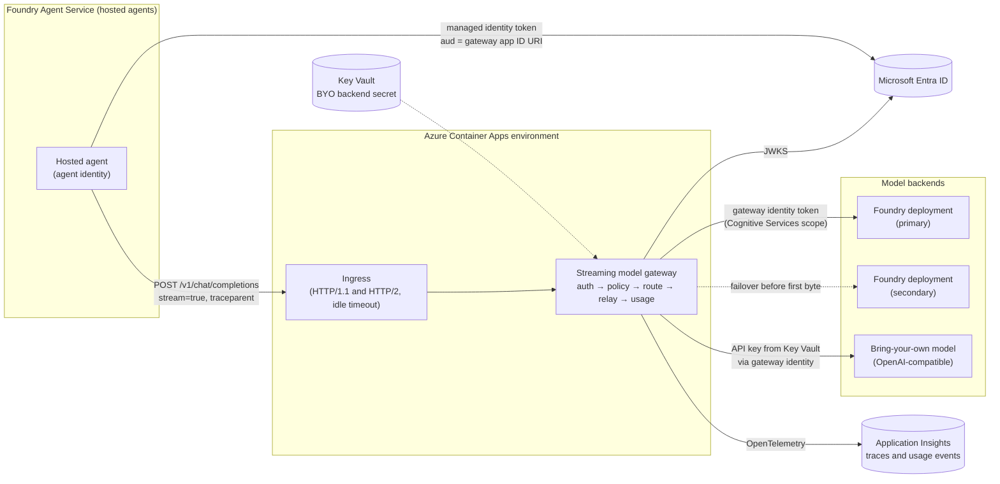

# Hosted agent behind a streaming model gateway (bring your own model)

> **Maturity:** preview · **Kind:** solution-accelerator · **Category:** `agent-runtime` · **Version:** 0.1.0

A Foundry hosted agent is a container you own, running on the Foundry Agent Service hosted-agent runtime. Because it owns its model client, it can call any OpenAI-compatible endpoint, not only a Foundry model deployment. Teams use that freedom to put a **team-owned streaming model gateway** between the agent and its models. They do it to bring a model that is not in the Foundry catalog, to apply one policy to many agents, to hide model names behind stable aliases, to fail over between backends, and to attribute token usage to the agent that spent it.

That gateway sits in the hottest path the agent has. It must authenticate every caller, choose a backend, and relay server-sent events (SSE) chunk by chunk without buffering, through every proxy in between. It must cancel upstream work when the agent goes away and must never replay a half-delivered answer. This accelerator shows how to build one on Azure Container Apps that does those things and fails closed. A fictional company, **Contoso**, runs it for three agent teams.

> **Core thesis:** *The caller comes from the Entra token, the gateway chooses the backend credential, and a stream is retried only before its first byte.*

Hosted agents, model gateway connections in Foundry, and parts of the Container Apps ingress behaviour described here are **preview** or change often. Every capability statement is qualitative and marked where it was observed in preview; verify against current docs. The infrastructure and code are illustrative and undeployed. This asset contains no latency, throughput, capacity or cost figures.

## Architecture and implementation map

| Layer / concern | Deep-dive documentation | Executable reference |
|---|---|---|
| **Topology, sequences, wire contracts, streaming rules, routing, policy, observability, failure modes** | [`docs/architecture.md`](docs/architecture.md) · [ADR 0001](docs/decisions/0001-custom-streaming-gateway-vs-apim-ai-gateway.md) · [ADR 0002](docs/decisions/0002-retry-only-before-first-byte.md) | [`samples/streaming_gateway_sim.py`](samples/streaming_gateway_sim.py): offline simulation with `--self-test`, `--domain` and `--demo` |
| **Identities, token validation, backend credentials, governance** | [`docs/authentication-and-governance.md`](docs/authentication-and-governance.md) · [ADR 0003](docs/decisions/0003-gateway-auth-entra-mi-only.md) | [`src/gateway/app.py`](src/gateway/app.py) (token validation) and [`src/agent/main.py`](src/agent/main.py) (managed identity token on every call) |
| **Evaluation, buffering checks, troubleshooting** | [`docs/evaluation-and-troubleshooting.md`](docs/evaluation-and-troubleshooting.md) | [`samples/README.md`](samples/README.md): scenario list and how to extend it |
| **Provisioning, rollout, teardown, cost attribution** | [`docs/deployment-and-operations.md`](docs/deployment-and-operations.md) | [`infra/main.bicep`](infra/main.bicep), [`infra/pipelines/gateway-deploy.yml`](infra/pipelines/gateway-deploy.yml) and [`infra/README.md`](infra/README.md) (illustrative) |

## Domain Packs

The gateway is domain-agnostic. What changes per domain is which models a caller may use, what the content-safety hook blocks before a prompt leaves the boundary, and how long a stream may be silent.

| Domain Pack | Caller (hosted agent) | Models and backends | Policy emphasis | Streaming emphasis |
|---|---|---|---|---|
| **Contoso Retail** | Shopping assistant | `gpt-4o-mini` and `gpt-4o` on two Foundry deployments | Payment terms blocked at the gateway; an unlisted bring-your-own model is denied | Hold the headers until the first token so a down primary fails over invisibly |
| **Fabrikam Health** | Care coordination assistant | `gpt-4o` on Foundry deployments only | No bring-your-own route by policy (data boundary); patient identifiers blocked | A slow primary is cancelled at the first-byte deadline and the request moves on |
| **Northwind Logistics** | Dispatch planner | `byo-chat` on a bring-your-own endpoint, `gpt-4o-mini` on Foundry | Small token budget per window; spend is attributed per caller | Commit headers early and send keepalive comments while a slow model thinks |

Run `--domain all` in the simulator to see each pack's four requests and expected outcomes.

## When to use

- A **hosted agent** needs a model that is **not in the Foundry catalog**: a provider not in the Foundry catalog, a fine-tuned model you serve yourself, or a model in another environment.
- **Several agents** must share **one policy**: allowed models per agent, a token budget per window, a content-safety check before the prompt leaves, and one audit stream.
- Agents should call **stable model aliases** (for example `byo-chat`) so you can move the backend without rebuilding agent images.
- You need **failover across backends** (two Foundry deployments, or Foundry plus a bring-your-own model) without the agent seeing a failure.
- Finance or a platform team needs **usage attributed per agent identity**, including partial streams and cancelled requests.
- You need streaming behaviour that a managed gateway in your estate cannot give you today, and you have a team that can run a service on the hot path.

## When not to use

- **The agent only uses Foundry deployments.** Call the deployment directly with the agent's managed identity. Foundry already gives you content filters, usage views and per-model spans.
- **An Azure API Management AI gateway already covers you.** If APIM's token limits, token metrics, load balancing, content safety and Entra validation meet the need, use it. Hosted agents can point at APIM the same way they point at this gateway. See [ADR 0001](docs/decisions/0001-custom-streaming-gateway-vs-apim-ai-gateway.md).
- **The agents are prompt agents.** A Foundry model gateway connection (category `ModelGateway` or `ApiManagement`) is the supported way for prompt agents to use a bring-your-own model. Observed in preview: Chat Completions only, prompt agents only; verify against current docs.
- **You cannot own an extra hop.** The gateway adds a network hop, a deployment, an on-call rotation and a security boundary. If nobody owns it, it will become the weakest link.
- **You need Foundry features that a bypassed deployment loses**: Foundry content filters on the bring-your-own route, portal cost views, Model Router, provisioned throughput or Foundry's own per-model spans. Rebuild what you need in the gateway or keep that traffic on Foundry.

## Architecture



The agent never holds a model key and never gets a role on the model account. The gateway's user-assigned managed identity is the only principal with model access, so every model call passes through one policy point. See [`docs/architecture.md`](docs/architecture.md) for the sequence diagrams and wire contracts.

### Decision matrix

| | Direct Foundry deployment | APIM AI gateway | Foundry model gateway connection | Custom streaming gateway (this asset) |
|---|---|---|---|---|
| **Who can use it** | Prompt and hosted agents | Prompt agents (through a connection) and hosted agents (by URL) | Prompt agents (observed in preview) | Hosted agents and any OpenAI-compatible client |
| **Bring-your-own model** | No | Yes, as an APIM backend | Yes (static or dynamic model discovery) | Yes, as a route |
| **Central policy across agents** | Per deployment only | Yes, as APIM policies | Whatever the gateway behind the connection enforces | Yes, in your code |
| **Failover across backends** | No | Yes (backend pools, circuit breaker) | Whatever the gateway behind it does | Yes, before the first byte |
| **Streaming control** | Native | Supported with policy constraints; verify which policies work with streaming | Foundry always streams to the gateway (observed in preview) | Full control: flush, keepalive, cancel, error frames |
| **Usage attribution per agent** | Per deployment | Token metric policies with custom dimensions | Not by itself | Per caller identity, including cancelled and partial streams |
| **Foundry content filters on the model** | Yes | Yes for Foundry backends | Not on a bring-your-own model | Not on a bring-your-own route; add a hook |
| **Operational burden** | Lowest | Managed service, policy authoring | Low in Foundry, plus the gateway you point at | Highest: you run, patch and page for it |
| **Choose when** | One agent, catalog models | You already run APIM, or policy needs fit its built-ins | Prompt agents need a bring-your-own model | The other three do not cover a hosted agent's needs |

## Key design decisions

| Decision | Choice | Why | Trade-off |
|---|---|---|---|
| Build or buy the gateway | Custom gateway only when APIM and a Foundry connection fall short ([ADR 0001](docs/decisions/0001-custom-streaming-gateway-vs-apim-ai-gateway.md)) | Full control over streaming and per-caller policy | You own an on-call service in the hot path |
| Retry semantics | Retry and fail over only before the first `data:` frame reaches the agent ([ADR 0002](docs/decisions/0002-retry-only-before-first-byte.md)) | A replay after the first byte duplicates output and double-bills | A mid-stream failure surfaces to the agent as an error frame |
| Caller authentication | Entra tokens from managed identities only; no API keys for callers ([ADR 0003](docs/decisions/0003-gateway-auth-entra-mi-only.md)) | No shared secret in any agent container; caller identity comes from a signed claim | Every caller needs an app role assignment |
| Backend credentials | Gateway managed identity for Foundry; Key Vault secret read by the gateway identity for a bring-your-own model | Keys live in one place, never in the agent | The gateway identity is high-value; scope and monitor it |
| Response start | Hold headers until the first token by default; early-commit with keepalives for slow models | Clean JSON errors and invisible failover by default; long thinking survives idle timeouts when needed | Early-commit errors must be SSE error frames |
| Budget | Reserve before the call, settle on reported usage | A caller cannot overspend with parallel requests | Needs a shared store once there is more than one replica |
| Telemetry | One usage event per request with caller, model, backend, attempts and outcome; no prompt or completion text | Cost attribution and debugging without collecting content | Content debugging needs a separate, governed path |

## Getting started

1. **Confirm the decision.** Use [Choosing Prompt Agents vs Hosted Agents](../choosing-prompt-vs-hosted-agents/README.md) and the decision matrix above. If a direct deployment, APIM or a Foundry connection covers you, stop here.
2. **Run the simulator offline.** It needs Python 3.10 or later and no packages:

   ```powershell
   python assets/agent-runtime/hosted-agent-streaming-model-gateway/samples/streaming_gateway_sim.py --self-test
   python assets/agent-runtime/hosted-agent-streaming-model-gateway/samples/streaming_gateway_sim.py --domain all
   python assets/agent-runtime/hosted-agent-streaming-model-gateway/samples/streaming_gateway_sim.py --demo
   ```

   The self-test walks through token validation, policy, failover before the first byte, mid-stream failures, keepalives, client cancellation, buffering detection, idempotency, trace propagation and usage attribution.
3. **Read the contracts.** [`docs/architecture.md`](docs/architecture.md) defines the request, SSE frames, usage event, error envelope and policy configuration your gateway and agents agree on.
4. **Register the gateway in Entra.** Create the app registration, app ID URI and `Gateway.Invoke` app role, and assign the role to each hosted agent identity. See [`docs/authentication-and-governance.md`](docs/authentication-and-governance.md).
5. **Deploy the infrastructure.** Follow the phases in [`docs/deployment-and-operations.md`](docs/deployment-and-operations.md) and [`infra/README.md`](infra/README.md), starting from the [Secured Foundry Landing Zone](../../landing-zones-and-infra/secured-foundry-landing-zone/README.md) if you do not have one.
6. **Build and ship the gateway image.** Follow [`src/README.md`](src/README.md), then wire [`infra/pipelines/gateway-deploy.yml`](infra/pipelines/gateway-deploy.yml) to your registry and environment.
7. **Point the agent at the gateway.** Use [`src/agent/main.py`](src/agent/main.py) as the pattern, then deploy the agent with [Production Hosted Agents on Foundry](../production-hosted-agents-on-foundry/README.md).
8. **Prove streaming end to end.** Run the checks in [`docs/evaluation-and-troubleshooting.md`](docs/evaluation-and-troubleshooting.md) before any agent depends on the gateway.

## File map

| Path | Purpose |
|---|---|
| [`docs/architecture.md`](docs/architecture.md) | Topology, sequence diagrams, wire contracts, streaming rules, routing, policy, observability, anti-patterns, failure modes |
| [`docs/authentication-and-governance.md`](docs/authentication-and-governance.md) | Caller and backend identities, token validation, Key Vault, governance gaps, threat model |
| [`docs/evaluation-and-troubleshooting.md`](docs/evaluation-and-troubleshooting.md) | Test matrix, buffering checks, common failures, runbook |
| [`docs/deployment-and-operations.md`](docs/deployment-and-operations.md) | Phased provisioning and teardown, rollout and rollback, scaling, cost attribution |
| [`docs/decisions/`](docs/decisions/) | Architecture decision records 0001 to 0003 |
| [`infra/README.md`](infra/README.md) · [`infra/main.bicep`](infra/main.bicep) · [`infra/parameters.example.json`](infra/parameters.example.json) | Container Apps, identity, Key Vault, telemetry and role assignments (illustrative) |
| [`infra/pipelines/gateway-deploy.yml`](infra/pipelines/gateway-deploy.yml) | Build, what-if, image build and push, deploy and smoke test with OIDC |
| [`src/README.md`](src/README.md) · [`src/gateway/`](src/gateway/app.py) · [`src/agent/`](src/agent/main.py) | Gateway service, its Dockerfile, and the hosted agent model-client snippet |
| [`samples/README.md`](samples/README.md) · [`samples/streaming_gateway_sim.py`](samples/streaming_gateway_sim.py) | Offline simulator with 25 named scenarios and three Domain Packs |

## Related assets

| Asset | Relationship |
|---|---|
| [Production Hosted Agents on Foundry](../production-hosted-agents-on-foundry/README.md) | How the hosted agent itself is built, identified, released and operated |
| [Choosing Prompt Agents vs Hosted Agents](../choosing-prompt-vs-hosted-agents/README.md) | Whether you need a hosted agent at all; prompt agents use a Foundry connection instead |
| [Secured Foundry Landing Zone](../../landing-zones-and-infra/secured-foundry-landing-zone/README.md) | Private networking, DNS and the private runner this gateway deploys into |
| [Request Context Is Not Authorization](../request-context-is-not-authorization/README.md) | Why forwarded headers and request metadata never decide what a caller may do |
| [Agent State: Cosmos DB vs Foundry Memory](../agent-state-cosmos-vs-foundry-memory/README.md) | Where conversation state lives; the gateway is stateless apart from budgets |
| [Multi-Tenant MCP Gateway](../../ai-gateway/multi-tenant-mcp-gateway/README.md) | The same front-door ideas applied to tool calls instead of model calls |
| [Backend Identity Propagation](../../ai-gateway/backend-identity-propagation/README.md) | How a user's identity reaches backends when the gateway must act for the user, not the agent |
| [Hosted Agent OTel Trace Receiver](../hosted-agent-otel-trace-receiver/README.md) | Receives the agent spans that share this gateway's `traceparent`, so one trace id spans gateway and agent |
| [Multi-Team Model Gateway](../../ai-gateway/multi-team-model-gateway/README.md) | The shared, multi-team version of the model front door: per-team keys, quotas and chargeback across many consumers |
| [Agent Production Readiness Guide](../../agentops-and-readiness/agent-production-readiness/README.md) | Release gates and the operating model around the gateway |

## Production-readiness pillar mapping

| Pillar | How this asset contributes |
|---|---|
| **Agent architecture patterns** | Model abstraction behind aliases, retry-before-first-byte failover, hold-headers versus early-commit streaming |
| **Security and observability** | Entra-only callers, no keys in agents, Key Vault for backend secrets, traceparent propagation, per-caller usage events without content |
| **Agent ops** | Phased deployment, revision-based rollout and rollback, buffering and idle-timeout runbooks, cost attribution |

## Security and responsible AI

- **No keys in agents.** Agents authenticate with their managed identity. The gateway rejects anything that is not a valid Entra token for its audience, tenant and app role.
- **The gateway identity is the model boundary.** Only the gateway's identity has a model role or can read the bring-your-own secret. Do not also grant agent identities direct model access, or agents can bypass the gateway.
- **Bring-your-own models are your responsibility.** A model outside the Foundry catalog does not get Foundry content filters, and its data handling is governed by its provider's terms. Decide on content safety, data residency and responsible AI review before you add the route.
- **No content in telemetry by default.** The usage event carries identities, model, backend, counts and outcome, never prompt or completion text.
- **Fail closed.** Missing configuration stops the gateway from starting; an unknown caller, model or route is denied.
- **Headers are not authorization.** Foundry and the agent may forward identifiers such as an agent ID or a request ID. Log them for correlation; never use them to pick a policy. See [Request Context Is Not Authorization](../request-context-is-not-authorization/README.md).

## Limitations

- Hosted agents, Foundry model gateway connections and their header and protocol details are **preview**. Observed in preview; verify against current docs before you rely on them.
- The infrastructure, pipeline and service code are illustrative and have not been deployed as-is. Adapt names, scopes, role definitions and network placement to your environment.
- The in-memory budget store in the gateway works for one replica only. Use a shared store before you scale out.
- The simulator uses a logical clock and fake tokens. It does not call Azure and says nothing about real latency, capacity or cost.
- This asset contains no latency, throughput, capacity or cost figures. Measure in your own environment.

## References

- [Architecture deep dive](docs/architecture.md)
- [Authentication and governance](docs/authentication-and-governance.md)
- [Evaluation and troubleshooting](docs/evaluation-and-troubleshooting.md)
- [Deployment and operations](docs/deployment-and-operations.md)
- [Samples guide](samples/README.md)
- [Hosted agents in Foundry Agent Service](https://learn.microsoft.com/azure/foundry/agents/concepts/hosted-agents)
- [Bring your own model with an AI gateway in Foundry Agent Service](https://learn.microsoft.com/azure/foundry/agents/how-to/ai-gateway)
- [AI gateway capabilities in Azure API Management](https://learn.microsoft.com/azure/api-management/genai-gateway-capabilities)
- [Ingress in Azure Container Apps](https://learn.microsoft.com/azure/container-apps/ingress-overview)
- [Managed identities in Azure Container Apps](https://learn.microsoft.com/azure/container-apps/managed-identity)
- [Microsoft identity platform access tokens](https://learn.microsoft.com/entra/identity-platform/access-tokens)
- [Contribution and Standardization Guide](../../../docs/contribution-guide.md)
