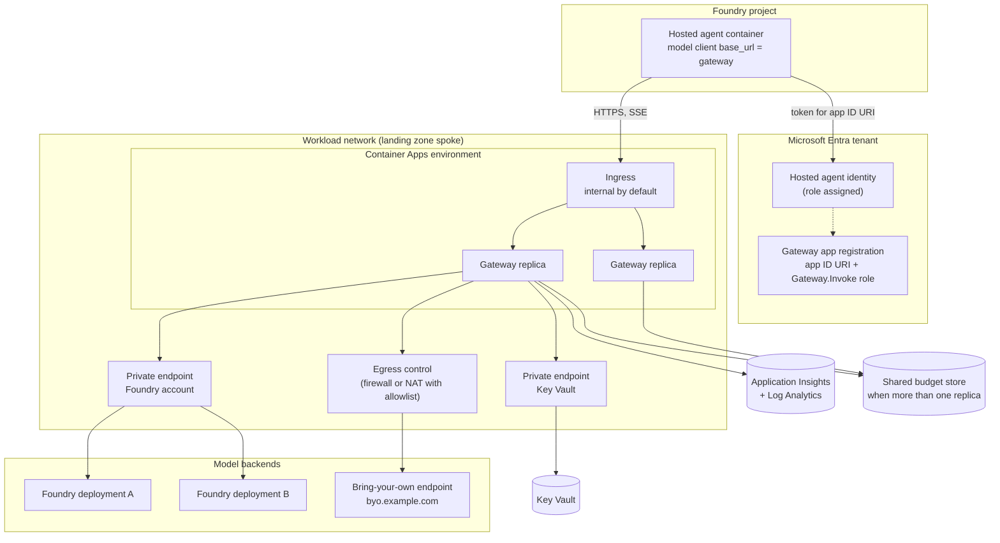
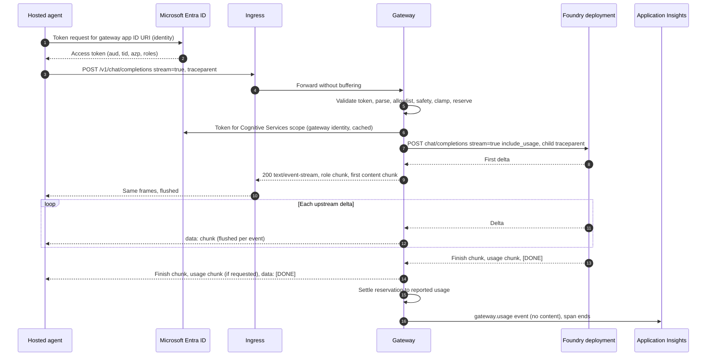
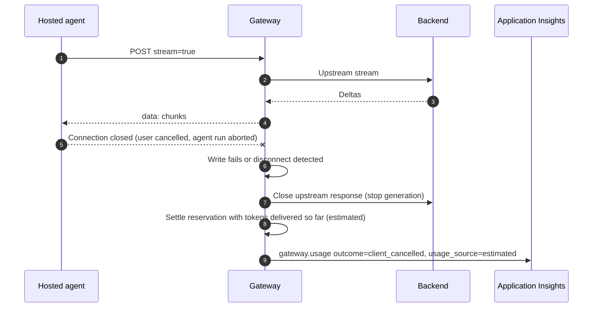
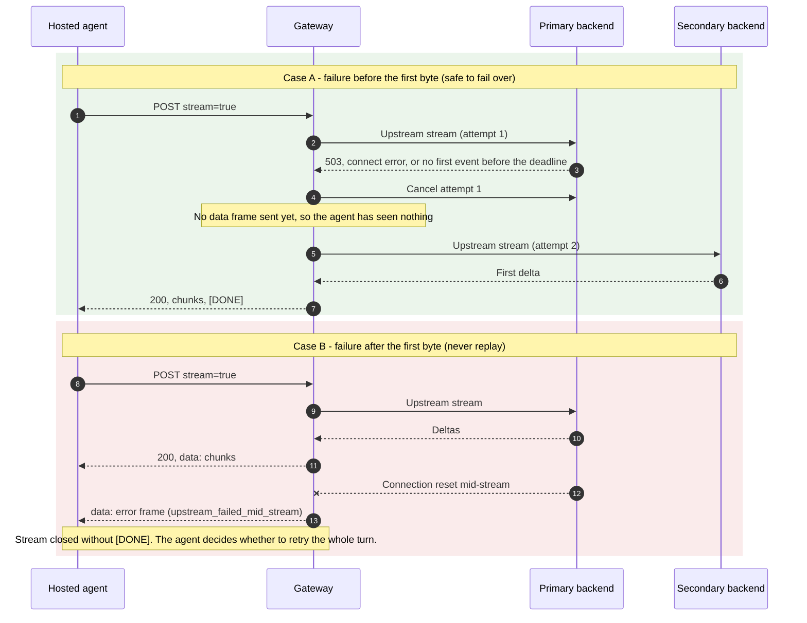
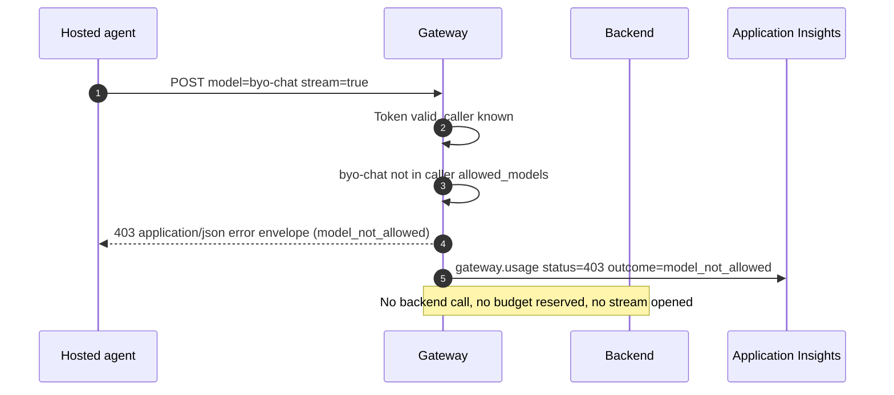

# Architecture: hosted agent behind a streaming model gateway

This document describes the parts of the pattern, how a streamed model call flows through them, the wire contracts the agent and gateway agree on, and the rules that keep a stream correct when proxies, backends and clients misbehave. The executable version of these rules is [`samples/streaming_gateway_sim.py`](../samples/streaming_gateway_sim.py). Each rule below names the scenario that proves it.

> **Preview.** Hosted agents, Foundry model gateway connections, the headers Foundry forwards, and parts of the Container Apps ingress behaviour are preview or change often. Statements about them are marked "observed in preview; verify against current docs". No latency, throughput, capacity or cost figures appear here. Timeouts and intervals are configuration you set and measure in your own environment.

## Components and responsibilities

| Component | Owns | Does not own |
|---|---|---|
| **Hosted agent** (container on the Foundry hosted-agent runtime) | Orchestration, tools, conversation state, its own model client. Gets an Entra token for the gateway's audience from its identity and sends it on every call. | Model keys, model role assignments, backend selection, budget decisions |
| **Ingress** (Container Apps ingress and any proxy, firewall or load balancer in front of it) | TLS termination, routing to a healthy replica, its own request and idle timeouts | Buffering decisions (it must not buffer), retries of streamed calls |
| **Streaming model gateway** (this asset's service) | Caller authentication, per-caller policy, model alias to backend routing, the SSE relay, keepalives, cancellation, failover before the first byte, usage and trace telemetry | Agent logic, prompt construction, conversation memory |
| **Gateway identity** (user-assigned managed identity) | The only principal with a model role on the Foundry account and read access to the bring-your-own secret | Anything outside the model boundary |
| **Foundry deployments** | Catalog models, Foundry content filters, deployment-level quotas | Per-agent policy across deployments |
| **Bring-your-own backend** | A model outside the Foundry catalog behind an OpenAI-compatible API | Foundry content filters (it has none from Foundry), Foundry usage views |
| **Key Vault** (RBAC mode) | The bring-your-own backend credential | Caller credentials (there are none) |
| **Application Insights and Log Analytics** | Traces, gateway logs, the per-request usage event | Prompt or completion text (never sent) |
| **Microsoft Entra ID** | Token issuance for the agent identity, the gateway app registration and its `Gateway.Invoke` app role, signing keys | Policy (lives in the gateway) |

## Topology



Placement notes:

- **Ingress is internal by default.** Make it external only if the hosted-agent runtime cannot reach a private address in your network. In that case, add IP restrictions where possible. Entra validation in the gateway still applies either way. Network isolation options for hosted agents were observed in preview; verify against current docs.
- **Private endpoints for Foundry and Key Vault.** The gateway reaches both through private endpoints in the spoke. The [Secured Foundry Landing Zone](../../../landing-zones-and-infra/secured-foundry-landing-zone/README.md) provides the network, DNS zones and private runner.
- **The bring-your-own endpoint leaves through egress control.** Allow only that endpoint's host name. The same egress control should stop agent containers from reaching model endpoints directly (see [Authentication and governance](authentication-and-governance.md#closing-the-bypass)).
- **Budgets need a shared store once you scale out.** The in-memory store in [`src/gateway/app.py`](../src/gateway/app.py) is labelled single-replica for a reason.

## Request lifecycle

Every request goes through the same ordered steps. The order matters: cheap, local denials happen before any backend is touched, and nothing irreversible happens before the policy has passed.

1. **Assign identifiers.** Create a gateway request ID. Read `traceparent` if present and create a child span that keeps the incoming trace ID. Read the optional `Idempotency-Key`.
2. **Authenticate.** Validate the bearer token: signature against the tenant's signing keys, issuer, audience, tenant (`tid`), `nbf` and `exp`, the `Gateway.Invoke` app role in `roles`, and the caller (`azp`, or `appid` in v1 tokens) on the allowlist. Any failure is a `401` or `403` JSON error.
3. **Parse.** Require `model` and a non-empty `messages` list. Accept `max_completion_tokens` and fall back to `max_tokens`. Relay `tools`, `tool_choice` and other fields the gateway does not interpret, unchanged.
4. **Idempotency.** If the same caller already used this key and that request produced output, return `409`.
5. **Model allowlist.** The requested alias must be in the caller's `allowed_models`, otherwise `403`.
6. **Content-safety hook.** Check the input before it leaves your boundary, otherwise `400 content_filtered`.
7. **Clamp.** Reduce the requested completion tokens to the caller's cap.
8. **Reserve budget.** Reserve the estimated prompt tokens plus the clamped completion tokens against the caller's window, otherwise `429`.
9. **Route.** Take the ordered backend list for the alias, up to the configured number of attempts.
10. **Relay.** Open the upstream stream with the gateway's own credential for that backend. Wait for the first event within the first-byte deadline. Fail over only while no `data:` frame has reached the agent. Relay each event as soon as it arrives.
11. **Finish.** On success send the finish chunk, the usage chunk if the caller asked for it, then `data: [DONE]`. On failure before headers send a JSON error. After headers, send an SSE error frame and close **without** `[DONE]`.
12. **Settle and emit.** Settle the reservation to actual (or estimated) usage, record the idempotency key if output was delivered, and emit one usage event. This step runs in a `finally` block, so cancelled and failed requests are counted too.

## Sequence diagrams

### Streaming happy path



### Client disconnect and cancellation



Cancellation is not optional. A backend that keeps generating after the agent has gone burns budget and capacity for nobody. Proven by `client_disconnect_cancels_upstream`.

### Failover before the first byte versus failure mid-stream



Proven by `failover_before_first_byte`, `first_byte_deadline_cancels_and_fails_over`, `mid_stream_failure_error_frame_no_retry` and `anti_pattern_retry_after_first_byte_shows_harm`. The reasoning is in [ADR 0002](decisions/0002-retry-only-before-first-byte.md).

### Policy deny



Denials are always JSON with a real status code, because no stream has started. Proven by `policy_denies_model_not_allowed`, `policy_enforces_token_budget`, `content_safety_hook_blocks_input` and `auth_rejects_bad_tokens_fail_closed`.

## Wire contracts

The gateway speaks the OpenAI Chat Completions format on `POST /v1/chat/completions`, so standard OpenAI-compatible clients work against it. These shapes are what the simulator asserts and what [`src/gateway/app.py`](../src/gateway/app.py) emits. They follow the streaming format as observed in preview; verify against current docs and the SDK version you pin.

### Request to the gateway

```http
POST /v1/chat/completions HTTP/1.1
Host: model-gateway.example.com
Authorization: Bearer <access-token-for-gateway-app-id-uri>
Content-Type: application/json
Accept: text/event-stream
traceparent: 00-<32-hex-trace-id>-<16-hex-parent-id>-01
Idempotency-Key: <caller-generated-unique-key>
```

```json
{
  "model": "gpt-4o-mini",
  "messages": [
    {"role": "system", "content": "You are the Contoso shopping assistant."},
    {"role": "user", "content": "Where is order 1042?"}
  ],
  "stream": true,
  "stream_options": {"include_usage": true},
  "max_completion_tokens": 256,
  "tools": [],
  "tool_choice": "auto"
}
```

- `stream` must be `true`. The gateway serves streaming only; a non-streaming request gets `400 invalid_request`.
- `model` is a **gateway alias**, not a deployment name. The route table maps it to backends.
- `max_completion_tokens` wins over `max_tokens` if both are present. The gateway clamps it to the caller's cap.
- `tools`, `tool_choice` and any field the gateway does not interpret are relayed unchanged. Tool-call deltas are relayed unchanged too.
- The gateway always asks the upstream for usage (`include_usage`) so it can settle budgets. It only forwards the usage chunk to the agent if the agent asked for it.

### Response headers

```http
HTTP/1.1 200 OK
Content-Type: text/event-stream; charset=utf-8
Cache-Control: no-cache
X-Accel-Buffering: no
X-Request-Id: <gateway-request-id>
```

`X-Accel-Buffering: no` asks proxies that honour it not to buffer. It is a hint, not a guarantee. You still have to verify every layer (see [Evaluation and troubleshooting](evaluation-and-troubleshooting.md#prove-the-stream-is-not-buffered)). Proven by `sse_framing_and_streaming_headers`.

### SSE event frames

Each event is one `data:` line followed by a blank line. The order is fixed: a role chunk, content deltas, a finish chunk, an optional usage chunk, and the `[DONE]` sentinel.

```text
data: {"id":"chatcmpl-req-0001","object":"chat.completion.chunk","created":1700000000,"model":"gpt-4o-mini","choices":[{"index":0,"delta":{"role":"assistant","content":""},"finish_reason":null}]}

data: {"id":"chatcmpl-req-0001","object":"chat.completion.chunk","created":1700000000,"model":"gpt-4o-mini","choices":[{"index":0,"delta":{"content":"Order 1042 "},"finish_reason":null}]}

: keepalive

data: {"id":"chatcmpl-req-0001","object":"chat.completion.chunk","created":1700000000,"model":"gpt-4o-mini","choices":[{"index":0,"delta":{"content":"shipped today."},"finish_reason":null}]}

data: {"id":"chatcmpl-req-0001","object":"chat.completion.chunk","created":1700000000,"model":"gpt-4o-mini","choices":[{"index":0,"delta":{},"finish_reason":"stop"}]}

data: {"id":"chatcmpl-req-0001","object":"chat.completion.chunk","created":1700000000,"model":"gpt-4o-mini","choices":[],"usage":{"prompt_tokens":31,"completion_tokens":7,"total_tokens":38}}

data: [DONE]

```

- **Keepalive frames** are SSE comments (`: keepalive`). Clients ignore them, but they reset idle timers in every proxy on the path.
- **The usage chunk** has an empty `choices` list. Clients that index `choices[0]` without checking will break on it. That is why it is only sent when requested (proven by `usage_chunk_only_when_requested`).
- **After the first byte, an error is a frame, not a status.** The status is already `200`, so the gateway sends the error envelope as a `data:` frame and closes the stream **without** `[DONE]`. A client that sees the stream end without `[DONE]` must treat the answer as incomplete.

```text
data: {"error":{"message":"model backend failed after streaming began","type":"upstream_error","code":"upstream_failed_mid_stream","param":null,"request_id":"req-0007","retryable":false}}

```

### Error envelope

Errors before the first byte are JSON bodies with a real status code. Errors after it are the same envelope inside a `data:` frame.

```json
{
  "error": {
    "message": "model 'byo-chat' is not allowed for this caller",
    "type": "permission_error",
    "code": "model_not_allowed",
    "param": null,
    "request_id": "req-0003",
    "retryable": false
  }
}
```

| Status | `type` | `code` values | Retryable |
|---|---|---|---|
| 400 | `invalid_request_error` | `invalid_request`, `content_filtered` | No |
| 401 | `authentication_error` | `missing_token`, `invalid_token`, `invalid_issuer`, `invalid_audience`, `invalid_tenant`, `token_expired` | Only after getting a new token |
| 403 | `permission_error` | `missing_app_role`, `caller_not_allowed`, `model_not_allowed` | No |
| 409 | `conflict_error` | `duplicate_request` | No: the earlier request already produced output |
| 429 | `rate_limit_error` | `token_budget_exceeded` | Yes, after the budget window resets |
| 502 | `upstream_error` | `upstream_failed` (JSON or frame), `upstream_failed_mid_stream` (frame only) | `upstream_failed` only when no data frame was sent |
| 503 | `service_unavailable` | Gateway not ready (startup, configuration error) | Yes |

`retryable: true` means the same call can be resent automatically, with a new `Idempotency-Key` and backoff. `retryable: false` means it must not be resent automatically. After a mid-stream failure, re-running the turn is a deliberate agent decision that accounts for tool calls already made ([ADR 0002](decisions/0002-retry-only-before-first-byte.md)).

Error messages never echo the token, the prompt, the backend URL or the backend's own error text. Those go to logs, keyed by `request_id`.

### Usage and telemetry event

The gateway emits exactly one usage event per request, including denied, failed and cancelled requests.

```json
{
  "event": "gateway.usage",
  "request_id": "req-0001",
  "trace_id": "<32-hex-trace-id>",
  "caller_id": "<agent-identity-client-id>",
  "tenant_id": "<tenant-id>",
  "model": "gpt-4o-mini",
  "backend": "foundry-secondary",
  "attempts": [["foundry-primary", "failed_before_first_byte"], ["foundry-secondary", "completed"]],
  "status": 200,
  "outcome": "completed",
  "prompt_tokens": 31,
  "completion_tokens": 7,
  "usage_source": "upstream"
}
```

| Field | Meaning |
|---|---|
| `caller_id` | The validated `azp` or `appid` claim. Never a header value. |
| `attempts` | Each backend tried and its result, in order. This is how you see failover. |
| `outcome` | `completed`, `failed_before_first_byte`, `first_byte_timeout`, `failed_after_first_byte`, `client_cancelled`, `ingress_idle_cut`, `no_backend`, or the error code of a denial |
| `usage_source` | `upstream` when the backend reported usage, `estimated` for partial or cancelled streams, `none` for denials |

The event never contains prompt text, completion text or tokens. Proven by `usage_attributed_per_caller_without_content`.

### Policy configuration

The gateway loads one policy document at startup (from the `GATEWAY_POLICY_JSON` setting). It refuses to start if the document is missing or inconsistent. Placeholders in angle brackets are values you choose per environment.

```json
{
  "budget_window_seconds": "<integer>",
  "callers": {
    "<agent-identity-client-id>": {
      "display_name": "Contoso shopping assistant",
      "allowed_models": ["gpt-4o-mini", "gpt-4o"],
      "token_budget_per_window": "<integer>",
      "max_tokens_cap": "<integer>",
      "blocked_terms": ["card number"]
    }
  },
  "routes": {
    "gpt-4o-mini": [
      {"name": "foundry-primary", "kind": "azure-openai", "base_url_env": "BACKEND_FOUNDRY_URL", "upstream_model": "<model-deployment>"},
      {"name": "foundry-secondary", "kind": "azure-openai", "base_url_env": "BACKEND_FOUNDRY_SECONDARY_URL", "upstream_model": "<model-deployment>"}
    ],
    "byo-chat": [
      {"name": "byo-partner", "kind": "openai-compatible", "base_url_env": "BACKEND_BYO_URL", "upstream_model": "<byo-model-name>", "api_key_env": "BYO_BACKEND_API_KEY"}
    ]
  }
}
```

- **Callers are keyed by the identity's client ID**, the value that appears in `azp` (v2 tokens) or `appid` (v1 tokens). A caller that is not in the document is denied, even with a valid token and the app role.
- **Routes name environment variables, not URLs or keys.** `base_url_env` and `api_key_env` point at settings that the platform injects. The key itself is a Container Apps secret that references Key Vault (see [Authentication and governance](authentication-and-governance.md#bring-your-own-backend-credentials)).
- **`kind`** decides how the gateway authenticates upstream: `azure-openai` uses the gateway's managed identity token, `openai-compatible` uses the API key from `api_key_env`.
- **Startup checks fail closed.** The gateway refuses to start if:
  - a caller allows a model that has no route;
  - a route points at an unset environment variable;
  - the keepalive interval is not shorter than the shortest ingress idle timeout;
  - in hold-headers mode, the total first-byte wait across attempts could exceed that idle timeout.

  Proven by `config_fails_closed`.

## Streaming correctness rules

A streaming proxy can look correct in a unit test and still be broken in production. It may deliver the whole answer at once, cut long answers, or keep billing after the user left. These rules prevent that.

### No buffering anywhere

- **Gateway.** Write each upstream event as soon as it arrives and do not collect a response before writing. Use a streaming response type and an async generator. Do not add compression middleware to the streaming route: compressors buffer until they have enough bytes.
- **ASGI server.** Run with an HTTP implementation that writes chunks as they are yielded. Do not add response-buffering middleware.
- **Ingress and proxies.** Container Apps ingress streams responses, but any extra layer can buffer: an application gateway, a firewall doing TLS inspection, a corporate proxy, or a CDN. Send `Cache-Control: no-cache` and `X-Accel-Buffering: no`, and test through every layer.
- **Agent client.** Read the response as a stream (`stream=True` in the SDK, `iter_lines`, or `aiter_lines`), not with a call that reads the whole body.

Proven by `buffering_detector`. It shows that a buffering layer delivers the same bytes in one burst at the end, which is why you have to measure first-chunk arrival, not only correctness.

### Flush per event

One upstream event becomes one SSE frame written and flushed on its own. Do not batch deltas to "save writes". Batching adds latency and the agent's user interface will look frozen.

### Keepalive comments

When there is nothing to send, write an SSE comment (`: keepalive`) at an interval shorter than the **shortest idle timeout on the path**. Comments are ignored by SSE parsers and by the OpenAI SDKs, but they count as traffic for proxies. Two cases need them:

- **Early-commit mode**, while waiting for a slow backend's first token. This applies to bring-your-own and reasoning models.
- **Long pauses mid-stream**, for example while the model is producing a tool call.

Proven by `keepalive_survives_idle_gaps` and `no_keepalive_ingress_cuts_stream`.

### Idle timeouts across ingress layers

Every hop has its own idle or request timeout: the agent's HTTP client, any proxy, Container Apps ingress, the gateway's upstream client and the backend. The stream is cut by the **shortest** one. Write them down in one table per environment, check the current Container Apps ingress limits in the [ingress documentation](https://learn.microsoft.com/azure/container-apps/ingress-overview), and set:

- the keepalive interval below the shortest idle timeout;
- in hold-headers mode, the first-byte deadline multiplied by the attempts below that timeout too;
- the agent's read timeout above the gateway's longest expected silence.

The gateway takes these as required settings with no defaults, so nobody inherits a value that only worked somewhere else.

### Backpressure

If the agent reads slowly, writes to it block. The gateway must not compensate by reading the upstream into an unbounded queue. Let the async generator's `await` on the client write slow the upstream read. With an async server and HTTP client this happens naturally. A background task that drains the upstream into memory breaks it.

### Cancellation

When the client disconnects, the write fails or the server signals disconnect. The gateway must then:

1. close the upstream response, which stops the backend generating;
2. settle the budget with what was delivered;
3. emit the usage event with `outcome=client_cancelled`.

Do this in `finally` blocks, so it also runs when the server cancels the task. Proven by `client_disconnect_cancels_upstream`.

### Retries only before the first byte

A retry or failover is safe only while **no `data:` frame has been sent to the agent**. Keepalive comments do not count, because they carry no content. After the first data frame:

- a retry would make the agent see the start of the answer twice, or two different answers spliced together;
- both attempts are billed;
- tool-call arguments could be corrupted.

The gateway therefore sends an error frame and stops. Only the agent, which knows the conversation, can decide to retry the whole turn. See [ADR 0002](decisions/0002-retry-only-before-first-byte.md).

What counts as retryable before the first byte: connection errors, timeouts (including the first-byte deadline), `408`, `429` and `5xx` from the upstream. A `400` or `401` from the upstream is a configuration problem, and retrying it elsewhere hides the fault.

### Idempotency

The agent's own retry layer, or the hosted-agent runtime, may resend a request after a network blip. If the first request delivered output, the second would be billed again. The agent sends an `Idempotency-Key` per logical model call. The gateway remembers which keys produced output for each caller and returns `409 duplicate_request` for a repeat. Keys that never produced output (failed before the first byte) stay reusable. Proven by `idempotency_key_blocks_double_billing`. With more than one replica, the key store must be shared, like the budget store.

## Hold-headers mode and early-commit mode

The gateway has two ways to start a response. Set the mode per deployment, or per route if you extend the code.

| | Hold-headers (default) | Early-commit |
|---|---|---|
| **When headers are sent** | When the first upstream delta arrives | Immediately after policy passes |
| **Failure before any content** | Clean JSON `502` with `retryable: true` | SSE error frame, status already `200` |
| **Failover before first byte** | Invisible to the agent | Still allowed: only comments have been sent |
| **Long first-token wait** | Risky: nothing crosses the ingress until the first token | Safe: keepalive comments keep every hop alive |
| **Config rule** | First-byte deadline × attempts must stay below the ingress idle timeout | Keepalive must be configured |
| **Use for** | Fast catalog models, chat user interfaces | Slow bring-your-own or reasoning models, long tool-call generation |

Proven by `early_commit_keepalive_then_failover`, `early_commit_exhausted_is_sse_error` and `all_backends_down_returns_json_502`.

## Routing and failover

- **Aliases, not deployments.** Agents ask for `gpt-4o-mini` or `byo-chat`. The route table maps each alias to an ordered list of backends. Moving a model to a new deployment or provider is a policy change, not an agent rebuild.
- **Ordered failover, bounded attempts.** The gateway tries backends in order, up to the configured number of attempts, and only before the first byte. It does not do weighted load balancing. If you need that, put it in the backend (for example a Foundry deployment with its own scaling) or use APIM backend pools ([ADR 0001](decisions/0001-custom-streaming-gateway-vs-apim-ai-gateway.md)).
- **First-byte deadline per attempt.** A backend that accepts the connection but does not produce a first event in time is cancelled and the next one is tried. Without a deadline, a hung backend holds the request until the ingress cuts it.
- **Circuit breaking.** The reference code does not include a circuit breaker. If a backend fails repeatedly, every request pays the first-byte deadline before failing over. Add a breaker that skips a backend for a cool-down period once you have real traffic.
- **Same alias, comparable models.** Only put backends behind one alias if their outputs are acceptable for the same tasks. Failover from a catalog model to a bring-your-own model changes data handling and content safety, so it is a policy decision, not just a routing one. The Fabrikam Health pack forbids it.
- **Model name rewrite.** The gateway replaces the alias with the backend's `upstream_model` on the way out and puts the alias back in the chunks it relays. The agent never learns deployment names.

## Policy enforcement points

| Point | Check | Failure | Where |
|---|---|---|---|
| Ingress | TLS, optional IP restrictions | Connection refused | Container Apps ingress |
| Authentication | Signature, issuer, audience, tenant, lifetime | `401` | Gateway, before parsing |
| Authorization | `Gateway.Invoke` role, caller on allowlist | `403` | Gateway |
| Model allowlist | Alias allowed for caller | `403 model_not_allowed` | Gateway |
| Input safety | Content-safety hook on input | `400 content_filtered` | Gateway, before any backend call |
| Size | Completion tokens clamped to cap | Silent clamp | Gateway |
| Budget | Reservation fits the window | `429 token_budget_exceeded` | Gateway, shared store |
| Backend | Foundry content filters, deployment quota | Upstream error relayed as `502` | Foundry deployment only, not bring-your-own |
| Output safety | Optional streaming output check | Error frame | Gateway, if you add it (see anti-patterns) |

Input checks are cheap and run before anything is spent. Output checks on a stream are harder: you can only stop a stream, not take back what was sent. If you need output moderation on a bring-your-own route, decide between checking each chunk window (adds latency per chunk) and buffering the whole answer, which gives up streaming for that route.

## Observability

### Trace propagation

- The gateway reads the W3C `traceparent` header sent by the agent, keeps the trace ID, and creates a child span for the gateway request. It sends a new `traceparent` with the same trace ID and the gateway span as parent to the backend. Proven by `traceparent_propagated`.
- If there is no incoming `traceparent`, the gateway starts a new trace and returns the request ID in `X-Request-Id`, so the agent can still log it.
- Foundry may forward its own correlation headers (for example `x-ms-client-request-id` and agent or project identifiers, observed in preview; verify against current docs). Log them as attributes for correlation. **Never** use them to decide policy (see [Authentication and governance](authentication-and-governance.md#what-request-context-does-not-authorize)).
- Use the Azure Monitor OpenTelemetry distribution in the gateway, so spans, logs and the usage event go to the same Application Insights resource as the hosted agent's traces.

### Usage attribution

- One `gateway.usage` event per request, keyed by `caller_id` (the identity's client ID) and `tenant_id`.
- Use `usage_source=upstream` numbers for billing where you have them. Treat `estimated` (cancelled or partial streams) as an approximation and label it as such in reports.
- Map caller IDs to teams and cost centres in the reporting layer, not in the gateway. See [Deployment and operations](deployment-and-operations.md#cost-attribution).

### What to alert on

| Signal | Why it matters |
|---|---|
| Rise in `failed_before_first_byte` or `first_byte_timeout` on one backend | Backend degradation. Failover is hiding it from agents but every request is slower. |
| Any `failed_after_first_byte` | Users saw a broken answer |
| Any `ingress_idle_cut` | Keepalive interval or timeouts are misconfigured |
| `401 invalid_audience` or `invalid_issuer` spikes | An agent is misconfigured, or someone is probing |
| `403 caller_not_allowed` | An identity has the app role but no policy, or the policy was not deployed |
| `429` for one caller | Budget too small or a runaway agent loop |
| Requests with `usage_source=estimated` growing | Cancellations or backends not reporting usage |

## Anti-patterns

| Anti-pattern | What goes wrong | Do instead |
|---|---|---|
| Retrying or failing over after the first byte | Duplicate or spliced output, double billing, corrupted tool-call arguments | Error frame, no `[DONE]`; let the agent retry the turn ([ADR 0002](decisions/0002-retry-only-before-first-byte.md)) |
| Buffering the response (compression, response logging middleware, `await response.read()`) | The agent gets the whole answer at the end, long answers hit timeouts | Stream with an async generator, no compression on the route, test first-chunk arrival |
| Static API key in the agent container | Key copied, rotated badly, no per-agent attribution | Agent managed identity token, Entra validation ([ADR 0003](decisions/0003-gateway-auth-entra-mi-only.md)) |
| Choosing policy from a header such as an agent ID | Any caller can claim to be another agent | Caller comes from the validated `azp` or `appid` claim |
| Giving the agent identity a model role "just in case" | Agents bypass the gateway and its policy | Only the gateway identity has model roles; egress control |
| In-memory budget or idempotency store with several replicas | Each replica has its own budget, so callers overspend | Shared store; the in-memory one is single-replica only |
| Returning `200` with a JSON body to a streaming request | Clients waiting for SSE fail with an opaque error. A Foundry model gateway connection surfaces it as a server error (observed in preview). | Always stream when `stream=true` |
| No keepalive while waiting for a slow model | An idle proxy cuts the connection | Keepalive comments below the shortest idle timeout |
| Unauthenticated debug or admin endpoints | Information disclosure, policy bypass | Only `/healthz` is anonymous, and it returns no configuration |
| Configuration or code injected through environment variables at runtime | Arbitrary behaviour change without a deployment | Policy as a reviewed document, deployed as a new revision |
| Logging prompts and completions by default | Sensitive data in telemetry | Usage event without content; a separate, governed debugging path if needed |

## Failure modes

| Failure | What the agent sees | Gateway outcome | Detection | Mitigation |
|---|---|---|---|---|
| Token for the wrong audience | `401 invalid_audience` | `invalid_audience` | Auth error metrics | Agent requests `<app-id-uri>/.default` |
| Identity lacks the app role | `403 missing_app_role` | `missing_app_role` | Auth error metrics | Assign `Gateway.Invoke` to the agent identity |
| Caller not in policy | `403 caller_not_allowed` | `caller_not_allowed` | Auth error metrics | Add the caller's client ID to policy and redeploy |
| Primary backend down | Nothing (invisible failover) | `completed` with two attempts | `attempts` field, backend error rate | Fix the backend; consider a circuit breaker |
| Primary backend slow to first token | Nothing in hold-headers mode, later first token | `completed` after `first_byte_timeout` | `attempts` field | Tune the deadline, or use early-commit for that route |
| All backends down before first byte | JSON `502 upstream_failed`, `retryable: true` (or an error frame in early-commit) | `failed_before_first_byte` | Error rate | Agent retries with backoff; incident on backends |
| Backend fails mid-stream | Partial answer, error frame, no `[DONE]` | `failed_after_first_byte` | Any occurrence | Agent discards the partial answer, then deliberately re-runs the turn or reports the failure |
| Proxy buffers the stream | Whole answer at the end, or a timeout on long answers | `completed` | First-chunk timing test | Remove the buffering layer or its setting |
| Idle timeout cuts the stream | Connection closed, no `[DONE]` | `ingress_idle_cut` or `client_cancelled` | Gateway logs | Keepalive below the shortest timeout |
| Agent disconnects | Not applicable | `client_cancelled` | Usage events | Upstream closed, budget settled with estimate |
| Budget exhausted | `429 token_budget_exceeded` | `token_budget_exceeded` | Per-caller `429` rate | Raise the budget or fix the agent loop |
| Duplicate request after output | `409 duplicate_request` | `duplicate_request` | Usage events | Agent treats it as already answered or uses a new key |
| Gateway managed identity misconfigured | Fast `502` from the gateway | `failed_before_first_byte` | Gateway logs show a credential error | Use the user-assigned identity's client ID; Container Apps has no instance metadata endpoint |
| Bring-your-own key expired or rotated | `502 upstream_failed` | `failed_before_first_byte` | Upstream `401` in logs | Update the Key Vault secret, restart the revision to pick it up |
| Policy document invalid | Gateway does not start; `503` from ingress | Startup failure | Revision fails health probes | Fix the document; the previous revision keeps serving |

## Serving prompt agents from the same gateway

The same gateway can sit behind a Foundry **model gateway connection** so prompt agents can use its aliases too. Observed in preview; verify against current docs:

- The connection category is `ModelGateway` (or `ApiManagement` for APIM). Model discovery can be static (a list in the connection) or dynamic (the gateway lists its models). Authentication is an API key or OAuth2 client credentials.
- The connection's base URL is the gateway's base path, and Foundry appends `chat/completions`. Agents reference models as `<connection-name>/<model>`.
- Only Chat Completions is used, and Foundry always calls with `stream=true` and `include_usage`. A non-streaming JSON reply surfaces in the agent run as an opaque server error.
- The gateway must be reachable from Foundry. A self-hosted gateway in a private network needs the Foundry network-isolation setup that allows it.
- Models reached this way are not Microsoft products. Responsible AI, content safety and data-boundary decisions are yours.

If you support both paths, the prompt-agent connection is just another caller. Give it its own identity, policy entry and budget. See [Bring your own model with an AI gateway](https://learn.microsoft.com/azure/foundry/agents/how-to/ai-gateway).

## Related

- [Authentication and governance](authentication-and-governance.md)
- [Evaluation and troubleshooting](evaluation-and-troubleshooting.md)
- [Deployment and operations](deployment-and-operations.md)
- [Production Hosted Agents on Foundry](../../production-hosted-agents-on-foundry/README.md)
- [Multi-Tenant MCP Gateway](../../../ai-gateway/multi-tenant-mcp-gateway/README.md)
- [W3C Trace Context](https://www.w3.org/TR/trace-context/)
- [AI gateway capabilities in Azure API Management](https://learn.microsoft.com/azure/api-management/genai-gateway-capabilities)
