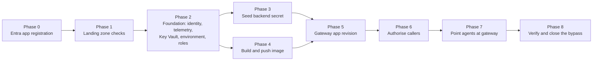

# Deployment and operations

This guide puts the streaming gateway in front of your models, step by step, on an existing [Secured Foundry Landing Zone](../../../landing-zones-and-infra/secured-foundry-landing-zone/README.md). It then covers teardown, rollout and rollback, scaling and cost attribution.

Every value is a placeholder. The infrastructure in [`infra/`](../infra/README.md) is illustrative and has not been deployed as-is. Hosted agent and Foundry connection details are preview: observed in preview; verify against current docs.

## Placeholders

| Placeholder | Meaning |
|---|---|
| `<subscription-id>` | Target subscription. Pin it at the top of every script |
| `<resource-group>` | Workload resource group from the landing zone |
| `<foundry-account>` | Existing Foundry account, with keys disabled |
| `<registry>` | Existing private container registry |
| `<gateway-name>` | Name prefix for the gateway resources, for example `contoso-model-gw` |
| `<gateway-app-id-uri>` | App ID URI of the gateway's Entra app registration, for example `api://<gateway-app-client-id>` |
| `<gateway-fqdn>` | Ingress host name of the gateway container app (a deployment output) |
| `<agent-principal-id>` | Object ID of a hosted agent's identity |
| `<agent-client-id>` | Client ID of the same identity; the key in the policy's `callers` |
| `<model-deployment>` | Foundry model deployment behind an alias, for example `gpt-4o-mini` |

## Prerequisites

- **Landing zone.** Private networking, private DNS, a Foundry account and project with keys disabled, a private registry, a Log Analytics workspace policy and an in-network runner. See the landing zone [deployment and CI/CD guide](../../../landing-zones-and-infra/secured-foundry-landing-zone/docs/deployment-and-cicd.md).
- **Subnet.** A subnet delegated to Container Apps in the spoke, if the gateway environment is joined to your network (recommended).
- **Model deployments.** Each alias in the policy maps to a deployment that exists. The gateway checks routes at startup, but not whether a deployment name is real.
- **Pipeline identity.** A workload identity with OIDC federation to your CI system and rights to deploy to `<resource-group>`. Granting roles needs a role that can create role assignments, scoped as narrowly as possible.
- **Identity administrator.** Someone who can create an app registration and assign app roles in your tenant.
- **Bring-your-own model (optional).** The provider's base URL, model name and a key, plus an egress rule that allows the provider's host name.
- **Decision recorded.** You have read [ADR 0001](decisions/0001-custom-streaming-gateway-vs-apim-ai-gateway.md) and confirmed that APIM or a Foundry connection does not already cover you.

## Provisioning phases

The order matters. Each phase creates something the next phase depends on, and doing them out of order causes failures that look unrelated (a revision that cannot pull its image, or a Key Vault reference that cannot be read).

### Phase 0: Entra app registration

Owner: identity administrator. Done once per environment, outside the pipeline.

1. Create an app registration for the gateway. Set the app ID URI to `<gateway-app-id-uri>`.
2. Set the access token version you want, and record it. The gateway accepts both v1 and v2 issuers, but its audience list must contain the form your tokens carry.
3. Create the app role `Gateway.Invoke`, allowed for applications.
4. On the enterprise application, set **Assignment required** so that unassigned identities cannot get a token at all.
5. Record the tenant ID and the audience values for `GATEWAY_TENANT_ID` and `GATEWAY_AUDIENCES`.

Details: [Register the gateway in Entra](authentication-and-governance.md#register-the-gateway-in-entra).

### Phase 1: Landing zone checks

1. Confirm the Foundry account has local authentication disabled and public network access disabled.
2. Confirm the model deployments for each planned alias exist.
3. Confirm private DNS resolves the Foundry account, Key Vault and registry to private addresses from the gateway subnet.
4. Look up the role definition ID for the model inference role you will grant the gateway, and put it in the parameters file. See [Model role on the Foundry account](authentication-and-governance.md#model-role-on-the-foundry-account).

### Phase 2: Foundation

Deploy [`infra/main.bicep`](../infra/main.bicep) with `deployGatewayApp` set to `false`. This creates:

- the user-assigned managed identity for the gateway;
- Log Analytics and workspace-based Application Insights;
- Key Vault in RBAC mode with purge protection;
- the Container Apps environment;
- role assignments: the gateway identity gets the model role on the Foundry account, Key Vault Secrets User on the vault and AcrPull on the registry. An optional secret seeder principal gets Key Vault Secrets Officer.

Deploying the identity and its roles before the app gives role assignments time to propagate, so the first revision can pull its image and read its secret.

Verify:

- `az deployment group what-if` shows only the expected resources.
- The identity's role assignments are visible at the expected scopes, and nowhere else.
- Key Vault public network access is disabled unless you deliberately chose otherwise.

### Phase 3: Seed the backend secret

Only if you use a bring-your-own route.

1. From inside the network, the secret seeder principal writes the provider key to Key Vault under the name in `byoBackendSecretName`.
2. Never put the key in the parameters file, the pipeline, or a container setting value.
3. Record the rotation owner and schedule. See [Bring-your-own backend credentials](authentication-and-governance.md#bring-your-own-backend-credentials).

### Phase 4: Build and push the image

1. On the in-network runner, build from [`src/gateway/Dockerfile`](../src/gateway/Dockerfile) with an approved base image pinned by digest.
2. Generate a software bill of materials and scan for vulnerabilities and secrets. Stop on unaccepted findings.
3. Push to `<registry>` and record the digest. Deploy by digest, never by tag.

The pipeline in [`infra/pipelines/gateway-deploy.yml`](../infra/pipelines/gateway-deploy.yml) automates this.

### Phase 5: Gateway app revision

Deploy `infra/main.bicep` again with `deployGatewayApp` set to `true`, the image digest, and the policy document.

1. The first revision starts with the policy you supply. The gateway refuses to start if the policy names an alias without a route, a route whose URL setting is missing, or timeouts in the wrong order.
2. Check the revision is healthy and that `GET /healthz` returns `200` from inside the network.
3. Confirm an unauthenticated `POST /v1/chat/completions` gets `401 missing_token`.

At this point no agent can use the gateway, because no identity has the app role and the policy has no callers yet, or only test callers.

### Phase 6: Authorise callers

For each hosted agent:

1. Assign the `Gateway.Invoke` app role to the agent's identity (`<agent-principal-id>`).
2. Add a caller entry keyed by `<agent-client-id>` to the policy, with its allowed aliases, budget, completion cap and input rules.
3. Deploy the policy change as a new revision (see [Rollout and rollback](#rollout-and-rollback)).

The two steps are deliberately separate: Entra decides who may call at all, and the policy decides what each caller may do. Both must agree.

### Phase 7: Point agents at the gateway

1. Change the agent's model client to the pattern in [`src/agent/main.py`](../src/agent/main.py): base URL `https://<gateway-fqdn>/v1`, token scope `<gateway-app-id-uri>/.default`, and a `traceparent` and `Idempotency-Key` per model call.
2. Set the agent's configuration: `GATEWAY_BASE_URL`, `GATEWAY_APP_ID_URI` and the model alias.
3. Create a new agent version and roll it out as described in [Production Hosted Agents on Foundry](../../production-hosted-agents-on-foundry/docs/deployment-and-operations.md).
4. For prompt agents, create a Foundry model gateway connection that targets the gateway instead. Observed in preview; verify against current docs.

### Phase 8: Verify and close the bypass

1. Run the smoke test, the negative authentication table and the streaming proof from [Evaluation and troubleshooting](evaluation-and-troubleshooting.md).
2. Remove any model role the agent identities still hold on the Foundry account. Until you do, an agent can skip the gateway and its policy. See [Closing the bypass](authentication-and-governance.md#closing-the-bypass).
3. Confirm usage events appear for each caller with the expected outcome.

## Teardown order

Tear down in reverse, and stop traffic before removing anything it depends on.

1. **Move agents off the gateway.** Deploy agent versions that use another model path, or retire the agents. If they go back to calling Foundry directly, grant their model role again first.
2. **Remove callers.** Remove the `Gateway.Invoke` assignments and the policy entries.
3. **Drain and deactivate.** Shift all traffic away from the gateway revisions, wait long enough for the longest expected stream to finish, then deactivate them.
4. **Delete the container app and its environment.** In-flight streams on a deleted revision are cut without `[DONE]`.
5. **Remove role assignments** for the gateway identity on the Foundry account, Key Vault and registry. Role assignments outlive their principal as orphans if you skip this step.
6. **Delete Key Vault.** Purge protection keeps it, and its name, in a soft-deleted state for the retention period. Plan names accordingly. Revoke the bring-your-own key at the provider as well.
7. **Delete the managed identity.**
8. **Delete telemetry resources** only after your log retention obligations are met; usage events are your cost and audit record.
9. **Delete the app registration** last, once nothing requests tokens for it.

## Rollout and rollback

The container app runs in multiple-revision mode, so every change (image, policy, routes, timeouts) becomes a new revision that you can test before it takes traffic.

1. **Create the revision with no traffic.** Give it a revision label so it has its own test address.
2. **Test the label.** Run the smoke test, negative authentication and one streaming proof against the label address from inside the network.
3. **Shift traffic gradually.** Move a small share of traffic, watch outcomes and denials by revision, then move the rest.
4. **Drain the old revision.** After shifting all traffic, leave the old revision active long enough for streams already in progress to finish, then deactivate it. Deactivating immediately cuts streams mid-answer.
5. **Roll back** by shifting traffic back to the previous revision. Keep the previous revision active until the new one has run cleanly through a full business cycle.

Practical points:

- **Policy is configuration, and configuration is a revision.** Changing a secret value does not create a new revision in Container Apps, and running replicas keep the old value. Create a new revision (or restart) to pick up a changed secret or policy. Verify against current Container Apps documentation.
- **Budgets reset with in-memory stores.** A new revision starts with empty in-memory budgets and idempotency keys. That is one more reason to use a shared store in production.
- **Change one thing per revision.** A revision that changes the image and the policy at once is harder to roll back cleanly.
- **Record the release.** Image digest, policy version, revision name, approver and rollback target, in one place.

## Scaling

This asset gives no capacity figures. Measure in your own environment with your own models and prompts.

- **The backends are usually the limit.** Gateway replicas are cheap; model deployment quota is not. Scale the gateway for concurrency, and manage model throughput with deployments, quota and routing.
- **Streams are long-lived connections.** Scale on concurrent requests, not CPU. A scale rule based on CPU barely moves while many open streams wait on tokens.
- **Keep a minimum replica count above zero.** Scaling from zero adds a cold start to the first request, which looks to agents like a slow first token.
- **Scale-in cuts streams.** When a replica is removed, its open streams end. Give replicas a termination grace period long enough for typical answers, and expect some `client_cancelled` or error outcomes during scale-in.
- **Use shared stores before scaling out.** The reference budget and idempotency stores are in memory and single-replica. With more than one replica, a caller can spend its budget once per replica and repeat an idempotency key on another replica. Move both to a shared store (for example Azure Cache for Redis or Cosmos DB) before raising the replica count.
- **Reuse upstream connections.** One shared HTTP client per process, not one per request.
- **Keepalives cost little but are not free.** Each open stream sends a comment per interval. Keep the interval just below your shortest idle timeout, not far below it.
- **Timeouts and replica limits are parameters.** The Bicep template takes the replica range, concurrency target and every timeout as required parameters with no defaults, so each environment states its own values.

## Cost attribution

The gateway makes cost attribution possible because it is the only place that sees caller, model, backend and token counts together.

### What the usage event gives you

One `gateway.usage` event per request, with `caller_id`, `tenant_id`, `model` (alias), `backend`, `attempts`, `outcome`, `prompt_tokens`, `completion_tokens` and `usage_source`. The [usage event contract](architecture.md#usage-and-telemetry-event) defines the fields.

### How to turn it into cost

1. **Map callers to owners outside the gateway.** Keep a table from `caller_id` (the agent's client ID) to team, product and cost centre in your reporting layer. Do not put cost centres in the gateway policy; they change on a different schedule.
2. **Map backends to price lists.** Each backend name maps to a Foundry deployment or a provider contract. Prices differ by model, deployment type and provider, so price at the backend level, not the alias level.
3. **Weight by usage source.** `upstream` counts come from the backend and are authoritative. `estimated` counts come from cancelled or failed streams and are approximate. `none` means no usage could be determined. Report them separately.
4. **Allocate the gateway's own cost.** The container app, environment, Key Vault and telemetry are shared platform cost. Allocate them by request count or token share, or carry them centrally.
5. **Reconcile monthly.** Compare gateway token totals per backend with the backend's own metrics and the provider's invoice. A persistent gap usually means something calls the backend without the gateway (the bypass is still open) or something retries after the first byte.

### Things that cost money without a successful answer

- **Cancelled streams.** The backend usually bills for tokens it generated before it noticed the cancellation.
- **Failed attempts before failover.** A backend that failed after starting to process the prompt may still bill prompt tokens. The `attempts` list shows which backends were tried.
- **Denied requests** cost nothing at the backend; they were stopped before routing.
- **Keepalives and health probes** cost only gateway compute.

### Budgets versus cost

Token budgets in the policy protect the backends and stop runaway agents. They are not a billing system. Cost reporting comes from usage events and invoices; budgets are an operational limit that you set from that reporting.

## Operate

| Cadence | Operation | Reference |
|---|---|---|
| Continuous | Alert on rising 401 and 403 rates, `failed_before_first_byte` on every attempt, `failed_after_first_byte`, `ingress_idle_cut`, and missing usage events | [Architecture: What to alert on](architecture.md#what-to-alert-on) |
| Every deployment | Smoke test, negative authentication, streaming proof after network changes | [Evaluation and troubleshooting](evaluation-and-troubleshooting.md) |
| Scheduled | Rotate the bring-your-own key | [Bring-your-own backend credentials](authentication-and-governance.md#bring-your-own-backend-credentials) |
| Scheduled | Review callers, app role assignments and policy entries; remove retired agents | [Review checklist](authentication-and-governance.md#review-checklist) |
| Scheduled | Rebuild on a refreshed base image | [Phase 4](#phase-4-build-and-push-the-image) |
| Scheduled | Failover and cancellation drills in non-production | [Failover and cancellation drills](evaluation-and-troubleshooting.md#failover-and-cancellation-drills) |
| Monthly | Reconcile usage events with backend metrics and invoices | [Cost attribution](#cost-attribution) |
| On incident | Shift traffic back to the previous revision | [Rollout and rollback](#rollout-and-rollback) |

## Practical notes

- Pin the subscription at the top of every script; runners are often shared.
- Run every data-plane step (secret seeding, smoke tests, streaming proof) from inside the network. A failure from outside proves nothing about the private path.
- Keep the policy document in source control next to the gateway code, reviewed like code. It is the authorisation model for every agent's model access.
- Exercise rollback in non-production on a schedule, including draining a revision with streams in progress.
