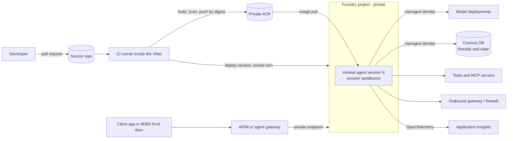
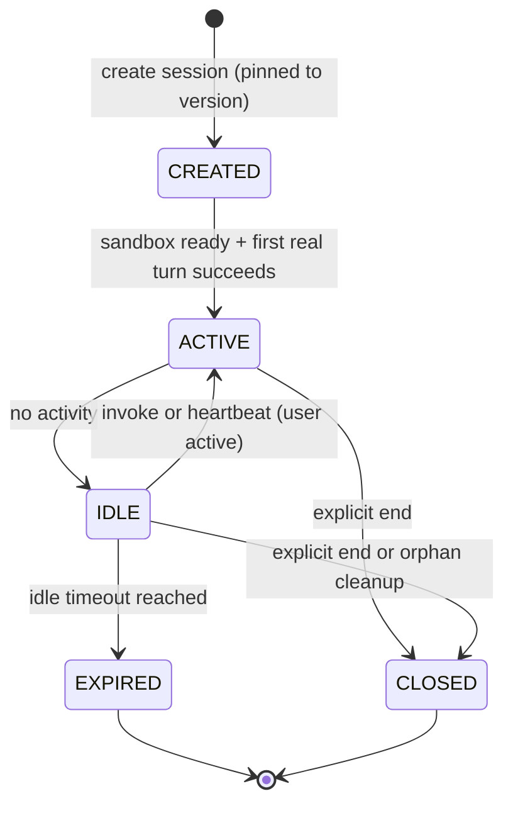

# Production Hosted Agents on Microsoft Foundry

> **Maturity:** preview · **Kind:** reference-architecture · **Category:** `agent-runtime` · **Version:** 0.1.0

A **hosted agent** is a container image you build. It runs your agent code (Microsoft Agent Framework, LangGraph, Semantic Kernel or a custom loop) inside Microsoft Foundry Agent Service, and clients invoke it through the Foundry agent APIs. Foundry provisions a sandbox per session, injects an identity and telemetry wiring, and routes requests to your code. You still own almost everything else: the image, its supply chain, the identity it runs as and the roles that identity holds, how and from where it is deployed, how sessions are created and ended, what it logs, and how a bad version is rolled back.

This reference architecture describes how to run hosted agents in production **on top of the [Secured Foundry Landing Zone](../../landing-zones-and-infra/secured-foundry-landing-zone/README.md)**. The landing zone provides the private network, DNS, private endpoints, operator access and the baseline release pipeline. This asset adds the runtime layer: the agent's identity and data-plane roles, a release pipeline that builds, deploys and smoke tests from inside the VNet, an explicit session lifecycle, token caching, OpenTelemetry from inside the container, and a governed rollout with version pinning and rollback. For the earlier question of *whether* a workload needs a hosted agent at all, see [Choosing Prompt Agents vs Hosted Agents](../choosing-prompt-vs-hosted-agents/README.md).

> **Core thesis:** *A hosted agent is a private, identity-bound workload, not a public web app. Deploy and test it from inside the network, give it only the data-plane roles it needs, own its sessions explicitly, and roll it out by immutable version.*

Hosted agents and several of the APIs and behaviours described here are in **preview**. Many statements in this asset were observed while testing preview builds rather than read from a documented contract; they are marked "observed in preview; verify against current docs". Every statement is qualitative on purpose. Check the current Microsoft Learn documentation before you rely on any of them.

## Architecture and implementation map

| Layer / concern | Deep-dive documentation | Executable or illustrative reference |
|---|---|---|
| **Runtime architecture, sessions, networking, release, observability** | [`docs/architecture.md`](docs/architecture.md) · ADRs [0001](docs/decisions/0001-deploy-and-invoke-from-inside-the-vnet.md), [0003](docs/decisions/0003-explicit-session-lifecycle-no-keep-warm.md) | [`samples/hosted_agent_ops_sim.py`](samples/hosted_agent_ops_sim.py): offline simulator with `--self-test` |
| **Identities, role assignments, supply chain, governance** | [`docs/authentication-and-governance.md`](docs/authentication-and-governance.md) · ADRs [0002](docs/decisions/0002-agent-identity-gets-least-privilege-data-plane-roles.md), [0004](docs/decisions/0004-cache-tokens-per-audience.md) | [`infra/main.bicep`](infra/main.bicep): illustrative identity, role and registry wiring |
| **Step-by-step deployment and day-2 operations** | [`docs/deployment-and-operations.md`](docs/deployment-and-operations.md) | [`infra/README.md`](infra/README.md): what this asset adds to the landing zone |
| **Smoke tests, evaluation gates, diagnostics, runbooks** | [`docs/evaluation-and-troubleshooting.md`](docs/evaluation-and-troubleshooting.md) | [`samples/README.md`](samples/README.md): scenario catalog mapped to the runbook |
| **Container layout** | [`src/README.md`](src/README.md) | [`src/Dockerfile`](src/Dockerfile) and [`src/app_skeleton.py`](src/app_skeleton.py): illustrative image and entrypoint |

## Domain Packs

The architecture is the same in every industry. What changes is why the workload needs your own code, which data it touches and which controls an auditor will ask for.

| Domain Pack | Example hosted agent | Why hosted (not prompt) | Controls that matter most |
|---|---|---|---|
| **Financial services** | Contoso research agent that assembles an investment research note from licensed market data and in-house models | Proprietary scoring libraries, deterministic multi-step workflow, licensed data that must stay on a private network | Image provenance and approval, no prompt or completion content in shared logs, egress allowlist to licensed data providers only, per-version evaluation gate |
| **Manufacturing** | Fabrikam maintenance copilot that correlates sensor history and work orders and proposes a maintenance plan | Calls a scheduling optimizer and plant historian over private connectivity; long-running, stateful sessions | Private path to plant systems, session cleanup after shift handover, explicit heartbeat only while a technician is active, rollback by version pin |
| **Public sector** | Northwind case assistant that drafts case summaries from records under retention rules | Custom state handling and records-retention logic; data residency; strict audit | Caller identity carried to tools by the gateway (not headers), audit trail tied to correlation IDs, separation of duties between deployer and operator, sovereign-region constraints verified |
| **Healthcare** | Contoso prior-authorization packet builder | Fixed checklist with deterministic steps over protected data | No PHI in telemetry, private Cosmos DB for state, egress denied by default, explicit session end after each packet |
| **Retail** | Fabrikam returns-triage agent triggered by webhooks | Event-driven invocation, custom protocol handling, burst traffic | Idempotency keys on invoke, orphan-session cleanup, cost review of session reuse versus new sessions |

## When to use

- You have already decided (for example with [Choosing Prompt Agents vs Hosted Agents](../choosing-prompt-vs-hosted-agents/README.md)) that a workload needs a **hosted agent**, and you now need to run it in production.
- The Foundry account and project are **private** (public network access disabled), or will be, and you need a release path that works under that constraint.
- The agent touches **customer data** (threads, memory, documents) that must stay in customer-controlled stores such as Azure Cosmos DB, reached through private endpoints and managed identity.
- You need **repeatable releases**: immutable images, immutable agent versions, a smoke turn in CI, promotion across environments and a one-step rollback.
- Security and operations teams need **least-privilege identities, telemetry and runbooks** before they sign off.

## When not to use

- **The workload fits a prompt agent.** Use a prompt agent and skip this operating burden; see [H1](../choosing-prompt-vs-hosted-agents/README.md).
- **You need the private network itself.** Build the [Secured Foundry Landing Zone](../../landing-zones-and-infra/secured-foundry-landing-zone/README.md) first. This asset assumes it exists and does not repeat it.
- **The agent must run model-generated or user-supplied code.** Do not run it inside the hosted agent's process. Use [Code Execution Sandboxes with Session Pools](../code-execution-sandbox-session-pools/README.md).
- **You only need to propagate the end user's identity to backends.** That is a gateway concern; see [Backend Identity Propagation](../../ai-gateway/backend-identity-propagation/README.md).
- **A quick prototype on a public project.** Use the Foundry quickstarts. Come back here when the prototype needs to become a private, governed workload.

## Architecture



The hosted agent lives in a private Foundry project. Everything that touches its data plane (deploy, list, invoke, session operations, log streaming) runs **inside** the network: the CI runner, the smoke test and the client path through a private endpoint or gateway. The image comes from a private Azure Container Registry, pinned by digest. At runtime the agent uses a managed identity with data-plane roles only, caches one token per audience, keeps durable state in customer-owned Cosmos DB, and emits OpenTelemetry to Application Insights. See [`docs/architecture.md`](docs/architecture.md) for the full component, lifecycle and failure-mode treatment.

### Session lifecycle at a glance



### Pattern selection matrix

| Decision | Option | Choose when | Avoid when |
|---|---|---|---|
| **Where deploy and smoke tests run** | Self-hosted runner VM in a peered operator VNet | You already run the landing zone's operator runner | You cannot operate a VM |
| | Container Apps job in a delegated subnet | Ephemeral, per-run execution with managed identity | You need long-lived build caches |
| | VNet-connected managed build pool | Your CI platform offers private networking | The pool cannot reach your private DNS zones |
| **How code reaches Foundry** | Container image from private ACR, pinned by digest | Production: provenance, scanning and IP stay in your registry | Never avoid for production |
| | Code package with platform build (preview) | Early development, no registry yet | You need auditable provenance or documented retention |
| **Durable state** | Customer Cosmos DB through private endpoint | Threads, memory or checkpoints must stay private | Never avoid when data is sensitive |
| | Platform-managed memory (preview) | Prototypes on public projects | The project is private; verify current VNet support |
| **Session strategy** | Pin per conversation, heartbeat while the user is active, explicit end | Interactive, multi-turn workloads | |
| | New session per request, ended immediately | Stateless webhook or batch work | Multi-turn context matters |

## Key design decisions

| Decision | Choice | Why | Trade-off |
|---|---|---|---|
| Deploy and invoke location | Inside the VNet, always | Data-plane calls from outside a private project are rejected ([ADR 0001](docs/decisions/0001-deploy-and-invoke-from-inside-the-vnet.md)) | Runner infrastructure to operate |
| Runtime identity | A dedicated managed identity per agent with data-plane roles only ([ADR 0002](docs/decisions/0002-agent-identity-gets-least-privilege-data-plane-roles.md)) | Least privilege; no keys anywhere | Role assignments per environment; propagation delay on first deploy |
| Credentials | Managed identity only; no key fallback | Keys leak and bypass audit | Every dependency must support Entra auth |
| Session lifecycle | Pin, heartbeat only while a user is active, explicit end, orphan sweep ([ADR 0003](docs/decisions/0003-explicit-session-lifecycle-no-keep-warm.md)) | Predictable cost and state; cold starts stay visible | Client code must own session IDs |
| Token handling | One cached token per audience with refresh skew ([ADR 0004](docs/decisions/0004-cache-tokens-per-audience.md)) | Avoids per-call token cost and audience mix-ups | Cache invalidation logic in the container |
| Artifact | Immutable image by digest, immutable agent version | Reproducible, auditable releases | More versions to clean up |
| Rollback | Re-activate the previous recorded version, drain sessions on the bad one | Fast, no rebuild | Old sessions may keep running old code until drained |
| Telemetry | OpenTelemetry from inside the container, content recording off by default | Correlated traces without leaking prompts | Less detail during debugging unless explicitly enabled |

## Getting started

1. **Confirm the decision.** Use [H1](../choosing-prompt-vs-hosted-agents/README.md) to confirm the workload needs a hosted agent.
2. **Confirm the foundation.** Deploy or reuse the [Secured Foundry Landing Zone](../../landing-zones-and-infra/secured-foundry-landing-zone/README.md), including its private operator runner and private DNS.
3. **Run the simulator offline.** It needs Python 3.10 or later and no packages:

   ```powershell
   python assets/agent-runtime/production-hosted-agents-on-foundry/samples/hosted_agent_ops_sim.py --self-test
   python assets/agent-runtime/production-hosted-agents-on-foundry/samples/hosted_agent_ops_sim.py --demo
   ```

   The self-test walks through network gating, role checks, token caching, the session state machine, idempotent retries, orphan cleanup, the release pipeline with rollback, correlation in spans and keep-warm detection.
4. **Add the runtime layer.** Read [`infra/README.md`](infra/README.md) and adapt [`infra/main.bicep`](infra/main.bicep): the agent identity, its role assignments, registry access and telemetry wiring.
5. **Build the image.** Follow [`src/README.md`](src/README.md) for the container layout: non-root, minimal base, token cache, OpenTelemetry and graceful shutdown.
6. **Wire the pipeline.** Follow [`docs/deployment-and-operations.md`](docs/deployment-and-operations.md) to build, scan, push, deploy a version and run a smoke turn from inside the VNet, then promote.
7. **Gate and operate.** Use the gates and runbooks in [`docs/evaluation-and-troubleshooting.md`](docs/evaluation-and-troubleshooting.md), then follow the [Agent Production Readiness Guide](../../agentops-and-readiness/agent-production-readiness/README.md).

## File map

| Path | Purpose |
|---|---|
| [`docs/architecture.md`](docs/architecture.md) | Full reference architecture: components, lifecycle, identity, networking, pipeline, observability, failure modes, checklist |
| [`docs/authentication-and-governance.md`](docs/authentication-and-governance.md) | Identities, role assignments, separation of duties, supply chain, governance, threat model |
| [`docs/evaluation-and-troubleshooting.md`](docs/evaluation-and-troubleshooting.md) | Smoke and evaluation gates, session diagnostics, troubleshooting and operational runbooks |
| [`docs/deployment-and-operations.md`](docs/deployment-and-operations.md) | Step-by-step deployment with placeholder values |
| [`docs/decisions/`](docs/decisions/) | Architecture decision records 0001 to 0004 |
| [`infra/README.md`](infra/README.md) · [`infra/main.bicep`](infra/main.bicep) | Infrastructure this asset adds on top of the landing zone (illustrative) |
| [`src/README.md`](src/README.md) · [`src/Dockerfile`](src/Dockerfile) · [`src/app_skeleton.py`](src/app_skeleton.py) | Container layout and illustrative entrypoint |
| [`samples/README.md`](samples/README.md) · [`samples/hosted_agent_ops_sim.py`](samples/hosted_agent_ops_sim.py) | Offline operations simulator |

## Related assets

| Asset | Relationship |
|---|---|
| [Choosing Prompt Agents vs Hosted Agents](../choosing-prompt-vs-hosted-agents/README.md) | The decision that precedes this asset: when a hosted agent is justified |
| [Secured Foundry Landing Zone](../../landing-zones-and-infra/secured-foundry-landing-zone/README.md) | The private network, DNS, operator runner and baseline release pipeline this asset builds on |
| [Code Execution Sandboxes with Session Pools](../code-execution-sandbox-session-pools/README.md) | Where untrusted or model-generated code runs instead of inside the hosted agent |
| [Multi-Tenant MCP Gateway](../../ai-gateway/multi-tenant-mcp-gateway/README.md) | Governed tool access for the hosted agent's MCP calls |
| [Backend Identity Propagation](../../ai-gateway/backend-identity-propagation/README.md) | How the caller's identity reaches tools and backends without passing tokens through |
| [Hosted Agent behind a Streaming Model Gateway](../hosted-agent-streaming-model-gateway/README.md) | Bring your own model endpoint through a streaming gateway with budgets and identity |
| [Hosted Agent OTel Trace Receiver](../hosted-agent-otel-trace-receiver/README.md) | A governed second copy of the agent's traces alongside the platform's own tracing |
| [Agent Production Readiness Guide](../../agentops-and-readiness/agent-production-readiness/README.md) | Release gates, evaluation and operating model around this runtime |

## Production-readiness pillar mapping

| Pillar | How this asset contributes |
|---|---|
| **Agent ops** | Release pipeline, version pinning and rollback, session lifecycle, orphan cleanup, runbooks |
| **Landing zones** | The runtime layer on top of the secured landing zone: runner placement, registry access, identity and telemetry wiring |
| **Security and observability** | Least-privilege data-plane roles, no keys, supply chain controls, OpenTelemetry with content controls, threat model |
| **Agent architecture patterns** | Hosted agent container layout, session ownership, idempotent invocation and token caching patterns |

## Security and responsible AI

- **No keys, anywhere.** The agent uses a managed identity for models, Cosmos DB and tools. Do not add a key-based fallback "just in case"; disable local auth on dependencies.
- **Least privilege per identity.** The runtime identity gets data-plane roles only. The pipeline identity deploys but cannot read data. Operators read telemetry and manage sessions but do not push images.
- **Private by default.** Deploy, invoke and diagnostics happen inside the network. Restrict egress at the subnet with a firewall or gateway; disabling public network access does not restrict outbound traffic.
- **Headers are not authorization.** Context the platform forwards to your container (client headers, metadata, trace context, injected caller IDs) is caller-asserted. Authorize at the tool and data layer; see [G3](../../ai-gateway/backend-identity-propagation/README.md).
- **Treat telemetry as data.** Tracing can capture prompts and completions. Keep content recording off by default, scope access to the telemetry store and apply retention.
- **Supply chain.** Approved base images, vulnerability scanning, digest pinning and optional signing; no secrets baked into images.
- **Accountable ownership.** Each hosted agent has a business owner, a technical owner and an identity sponsor.

## Limitations

- Hosted agents, their session APIs, protocols, platform-injected headers and some tracing conventions are **preview**. Field names, API versions, role names and behaviours change. Verify against current Microsoft Learn documentation.
- The infrastructure files are illustrative and have not been deployed as-is. Adapt names, scopes and role definitions to your environment.
- The simulator models behaviours and failure modes with a logical clock. It does not call Azure and says nothing about real latency, capacity or cost.
- This asset contains no latency, throughput, capacity or cost figures. Measure in your own environment.

## References

- [Architecture deep dive](docs/architecture.md)
- [Authentication and governance](docs/authentication-and-governance.md)
- [Evaluation and troubleshooting](docs/evaluation-and-troubleshooting.md)
- [Deployment and operations](docs/deployment-and-operations.md)
- [Samples guide](samples/README.md)
- [Hosted agents in Foundry Agent Service](https://learn.microsoft.com/azure/foundry/agents/concepts/hosted-agents)
- [What is Microsoft Foundry Agent Service?](https://learn.microsoft.com/azure/foundry/agents/overview)
- [Set up CI/CD for a hosted agent](https://learn.microsoft.com/azure/foundry/agents/quickstarts/set-up-cicd-hosted-agent)
- [Agent networking deep dive](https://learn.microsoft.com/azure/foundry/agents/concepts/agents-networking-deep-dive)
- [Agent development lifecycle](https://learn.microsoft.com/azure/foundry/agents/concepts/development-lifecycle)
- [Azure Monitor OpenTelemetry distro](https://learn.microsoft.com/azure/azure-monitor/app/opentelemetry-enable)
- [Contribution and Standardization Guide](../../../docs/contribution-guide.md)
