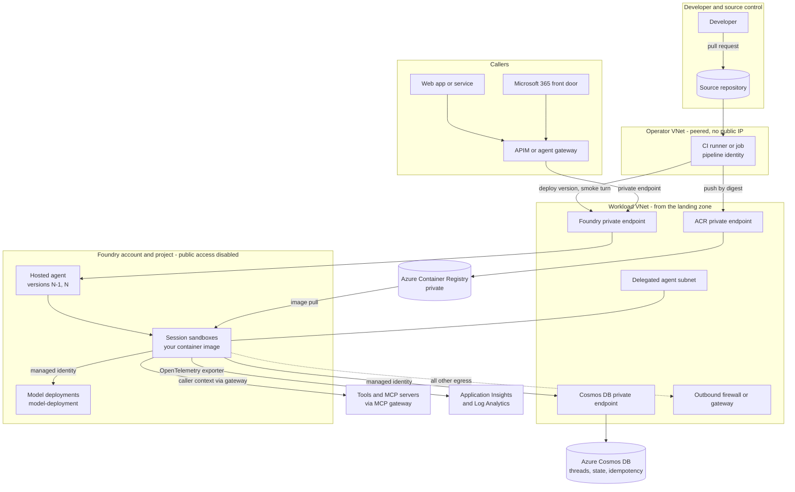
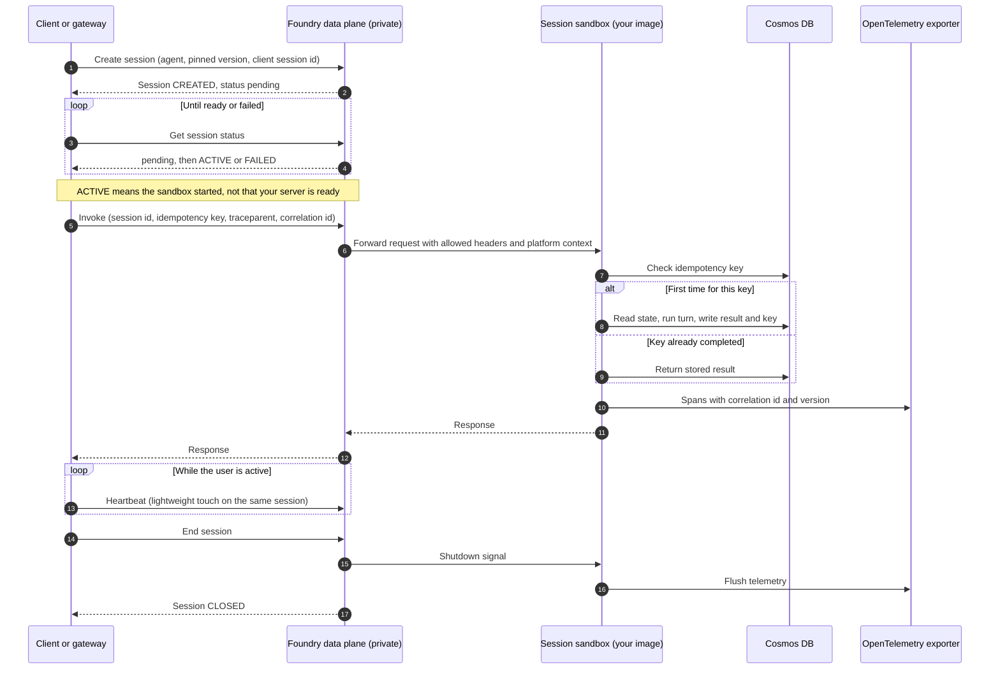
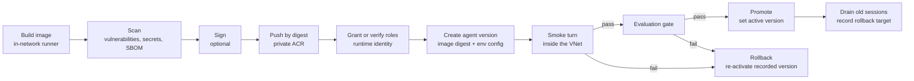

# Architecture: Production Hosted Agents on Microsoft Foundry

This document is the full reference architecture for running containerized hosted agents on Microsoft Foundry Agent Service in production. It covers the runtime components, the session lifecycle, identity, networking on top of the landing zone, the release pipeline, configuration, observability, scaling behaviour, failure modes and a production checklist.

Hosted agents and several APIs and behaviours described here are in preview. Where a statement comes from testing preview builds rather than from documentation, it is marked **(observed in preview; verify against current docs)**. Nothing here includes latency, throughput, capacity or cost figures.

## Contents

1. [Context and scope](#1-context-and-scope)
2. [Invariants](#2-invariants)
3. [Forces](#3-forces)
4. [Logical architecture](#4-logical-architecture)
5. [Component responsibilities](#5-component-responsibilities)
6. [Request and session lifecycle](#6-request-and-session-lifecycle)
7. [Identity model](#7-identity-model)
8. [Networking on top of the landing zone](#8-networking-on-top-of-the-landing-zone)
9. [Build and release pipeline](#9-build-and-release-pipeline)
10. [Configuration and secrets](#10-configuration-and-secrets)
11. [Observability](#11-observability)
12. [Scaling and cost behaviour](#12-scaling-and-cost-behaviour)
13. [Decision matrix](#13-decision-matrix)
14. [Wire contracts](#14-wire-contracts)
15. [Failure modes](#15-failure-modes)
16. [Anti-patterns](#16-anti-patterns)
17. [Production readiness checklist](#17-production-readiness-checklist)
18. [Domain Packs](#18-domain-packs)
19. [Preview caveats](#19-preview-caveats)
20. [Related](#20-related)

## 1. Context and scope

A **hosted agent** is a container image you build that runs your agent code inside Foundry Agent Service. Clients invoke it through the Foundry agent APIs, using a supported protocol such as the OpenAI-compatible Responses protocol or the Invocations protocol. For each session, Foundry starts an isolated sandbox from your image, routes requests to the HTTP server your code exposes through a hosting adapter, injects an identity and telemetry wiring, and tears the sandbox down when the session ends or expires.

Choosing a hosted agent is a decision about **control**: your own orchestration loop, proprietary libraries, custom protocols or custom state. That decision is covered in [Choosing Prompt Agents vs Hosted Agents](../../choosing-prompt-vs-hosted-agents/README.md) and is not repeated here. The private network, private DNS, private endpoints, operator VNet and baseline release pipeline are covered in the [Secured Foundry Landing Zone](../../../landing-zones-and-infra/secured-foundry-landing-zone/README.md) and are also not repeated.

**In scope:**

- The runtime layer you add on top of the landing zone: the agent's identity and roles, the image and registry path, the release pipeline from inside the network, sessions, token handling, telemetry and operations.
- Production behaviours that are easy to miss in a prototype: data-plane calls that fail from outside the network, sessions that outlive a deployment, retries that leak sessions, roles the instance identity does not have by default.

**Out of scope:**

- Network topology, DNS zones, firewall design and the operator VNet (see the [landing zone architecture](../../../landing-zones-and-infra/secured-foundry-landing-zone/docs/architecture.md)).
- Propagating the end user's identity to backends (see [Backend Identity Propagation](../../../ai-gateway/backend-identity-propagation/README.md)).
- Running untrusted or model-generated code (see [Code Execution Sandboxes with Session Pools](../../code-execution-sandbox-session-pools/README.md)).
- Evaluation methodology beyond release gates (see the [Agent Production Readiness Guide](../../../agentops-and-readiness/agent-production-readiness/README.md)).

## 2. Invariants

These hold in every environment, including development projects that mirror production.

1. **Every data-plane operation runs inside the network.** Deploy, list, inspect, invoke, session management and log streaming are data-plane calls against a private project.
2. **No keys.** The runtime, the pipeline and operators authenticate with Microsoft Entra ID. Dependencies have local (key) authentication disabled. There is no key-based fallback.
3. **One runtime identity per agent, data-plane roles only.** It never holds control-plane roles such as Contributor.
4. **Images are immutable and pinned by digest.** Tags are labels for humans; deployments reference digests.
5. **Agent versions are immutable.** Rollback means re-activating a previously recorded version, not editing the current one.
6. **Sessions are owned explicitly.** The caller pins a session, heartbeats only while a user is active, ends it when done, and a sweeper removes orphans.
7. **Durable state lives in customer-controlled stores.** The sandbox disk is a cache. Threads, checkpoints and memory live in Cosmos DB (or another private store) reached by managed identity.
8. **Context forwarded into the container is not authorization.** Headers, metadata, trace context and platform-injected caller identifiers are correlation hints.
9. **Telemetry is data.** Prompt and completion content is not recorded by default; when it is, the telemetry store is governed like the data it contains.

## 3. Forces

| Force | Pulls toward | Resolution in this architecture |
|---|---|---|
| Private project rejects outside data-plane calls | Running CI on public hosted runners anyway, opening public access "temporarily" | A runner or job inside the VNet runs every data-plane step ([ADR 0001](decisions/0001-deploy-and-invoke-from-inside-the-vnet.md)) |
| Instance identity starts with no data access | Granting broad roles to "make it work" | Explicit, minimal data-plane roles, verified by a smoke turn ([ADR 0002](decisions/0002-agent-identity-gets-least-privilege-data-plane-roles.md)) |
| Cold starts are visible to users | Keep-warm pings | Pin and reuse sessions while users are active; accept and measure cold starts ([ADR 0003](decisions/0003-explicit-session-lifecycle-no-keep-warm.md)) |
| Each unpinned request can create a session | Naive retries | Pinned sessions, idempotency keys, orphan sweeps |
| Token acquisition is a per-call cost | Fetching a token on every request | One cached token per audience, refreshed before expiry ([ADR 0004](decisions/0004-cache-tokens-per-audience.md)) |
| A new version does not evict running sessions | Assuming a deploy is instant everywhere | Drain sessions on rollout and verify the version in telemetry |
| Tracing can capture prompts | Turning on full content capture for debugging and leaving it on | Content capture off by default, enabled per environment with retention controls |
| Teams want fast iteration | Code-package deployment with platform build | Image from private registry for production; code packages only for early development |

## 4. Logical architecture



Read the diagram in three flows:

- **Release flow.** A pull request merges, the runner inside the network builds and scans the image, pushes it to the private registry by digest, creates a new immutable agent version that references the digest, runs a smoke turn against that version, and promotes it.
- **Request flow.** A client reaches the project's private endpoint directly from inside the network, or through API Management or an agent gateway. Foundry routes the request to a sandbox for the session and calls your container.
- **Runtime flow.** Your code calls model deployments, Cosmos DB and tools with the runtime identity, sends any other outbound traffic through the subnet's egress controls, and exports traces, metrics and logs with OpenTelemetry.

## 5. Component responsibilities

| Component | Owner | Responsibility | Not responsible for |
|---|---|---|---|
| Landing zone (VNet, DNS, private endpoints, operator VNet) | Platform team | Private connectivity, name resolution, baseline egress | Agent identity, sessions, release of agent versions |
| CI runner or Container Apps job inside the network | Platform team (infra), app team (pipeline) | Build, scan, push, deploy version, smoke turn, promote, rollback | Holding long-lived credentials; it uses workload identity federation or a managed identity |
| Azure Container Registry (private) | Platform team | Store approved images, enforce private access, retain digests used by recorded versions | Building images (the runner builds; see [failure modes](#15-failure-modes)) |
| Foundry project | Platform team | Host agent definitions and versions, run session sandboxes, inject identity and telemetry configuration | Your code's correctness, your session policy |
| Hosted agent version | App team | Immutable binding of image digest, protocol, environment configuration and resources | Being edited after creation |
| Session sandbox (your container) | App team | Agent loop, tool calls, state reads and writes, telemetry, graceful shutdown | Durable storage (disk is scoped to the session) |
| Runtime identity | Identity team (grants), app team (requests) | Authenticate to models, Cosmos DB, tools and telemetry ingestion | Control-plane changes |
| Azure Cosmos DB | App team (containers), platform team (account) | Threads, checkpoints, idempotency records, session registry | Holding secrets |
| MCP gateway and tools | Tool owners | Tool authorization, caller identity propagation | Trusting headers from the agent as identity |
| Outbound firewall or gateway | Network team | Allowlisted egress, logging | TLS inspection of identity traffic (see [section 8](#8-networking-on-top-of-the-landing-zone)) |
| Application Insights and Log Analytics | Operations | Traces, metrics, logs, alerts, retention | Storing content you chose not to record |
| Session sweeper (scheduled job) | Operations | Find and end orphaned sessions, report keep-warm patterns | Ending sessions that are in active use |

## 6. Request and session lifecycle

### 6.1 Sequence



### 6.2 States

| State | Meaning | Transitions |
|---|---|---|
| CREATED | The platform accepted the request and is provisioning a sandbox for the pinned version | ACTIVE when the sandbox is up; FAILED if the image cannot start |
| ACTIVE | The sandbox is running and recently used | IDLE after a period with no requests; CLOSED on explicit end |
| IDLE | The sandbox is still allocated but unused | ACTIVE on invoke or heartbeat; EXPIRED when the idle timeout passes; CLOSED on explicit end or sweep |
| EXPIRED | The platform reclaimed the sandbox | Terminal. A new session is needed; state must be reloaded from Cosmos DB |
| CLOSED | Ended explicitly by the caller or the sweeper | Terminal |

The simulator in [`samples/hosted_agent_ops_sim.py`](../samples/hosted_agent_ops_sim.py) implements these states with a logical clock. Platform state names and the exact idle and expiry rules are preview details; map them to whatever the current API reports.

### 6.3 Readiness is a real turn, not a status

The session status can report ACTIVE before your HTTP server inside the container accepts requests. Early invokes can fail with a dependency-style error (an HTTP 424 was observed) or stall until the server is ready **(observed in preview; verify against current docs)**. Treat readiness as "a real, minimal turn succeeded": poll the status, then send a cheap smoke turn with a bounded retry and backoff before routing user traffic to the session.

### 6.4 Pinning

Pin each session to an explicit agent version when you create it. Without a pin, the platform resolves the "current" version at creation time, which makes a rollout race with in-flight conversations. Also pin the **session** on every call: a request that does not carry a session identifier may create a new session **(observed in preview; verify against current docs)**. In the Responses protocol, conversation continuity is carried by response or conversation identifiers; in the Invocations protocol, by the session identifier. Do not mix the two: sending an Invocations-style session field on the Responses route was observed to hang in preview.

### 6.5 Heartbeat, idle and expiry

- A heartbeat is a lightweight call that keeps the **same** session alive while a human is still in the conversation, for example while the user is typing or reading a long answer.
- Heartbeats stop when the user leaves. The client ends the session explicitly or lets the idle timeout reclaim it.
- Never schedule synthetic traffic to keep sessions warm when no user is active. It hides cold-start behaviour, accumulates cost and keeps stale versions alive ([ADR 0003](decisions/0003-explicit-session-lifecycle-no-keep-warm.md)).

### 6.6 Container restart and session expiry

A sandbox can disappear: the session expires, the platform recycles it, or your process crashes. Design for it:

- **State.** Write conversation state, checkpoints and tool results to Cosmos DB at turn boundaries. On a new session, rehydrate from Cosmos DB using the conversation key. The sandbox's writable disk is scoped to the session and is a cache only; the application directory is read-only **(observed in preview; verify against current docs)**.
- **Client behaviour.** If an invoke returns "session not found" or an expired status, create a new session pinned to the same version (or to the current approved version if the old one was retired), rehydrate and retry the turn with the **same** idempotency key.
- **In-flight work.** Long tool calls should be resumable or idempotent at the tool. Do not assume a turn either completed or did not; check the idempotency record.

### 6.7 Idempotency and retries

Retries are necessary (transient network errors, readiness races, throttling), and dangerous (duplicate side effects, leaked sessions).

| Concern | Rule |
|---|---|
| Duplicate side effects | The caller sends an idempotency key per logical turn. The container records `key -> result` in Cosmos DB before acknowledging, and returns the stored result for a repeated key. Tools with side effects receive the same key |
| Header forwarding | Only some custom headers reach the container. A client header prefix (`x-client-`) and request `metadata` were observed to pass ingress; other custom headers were dropped **(observed in preview; verify against current docs)**. Carry the idempotency key in one of those |
| Leaked sessions | Retry against the **pinned** session. Never retry by creating a fresh unpinned request |
| Retry budget | Bounded attempts with exponential backoff and jitter; classify errors first ([section 15](#15-failure-modes)) |
| Non-retryable | 401 and 403 (identity, role or network problems), 400 (contract problems) |
| Retryable | 424 while warming, 429, 5xx, connection resets |

### 6.8 Version rollout and running sessions

Creating a new agent version, or switching the active version, does not evict sandboxes that are already running for existing sessions. Those sessions can keep running the old code **(observed in preview; verify against current docs)**. On rollout:

1. Pin new sessions to the new version.
2. Let existing sessions finish naturally, or end them after a drain window decided by the business.
3. Emit the agent version as a span attribute and a response field so you can prove which code served each turn.

## 7. Identity model

### 7.1 Control plane versus data plane

| Plane | What it manages | Example roles | Who holds them |
|---|---|---|---|
| Control plane (Azure Resource Manager) | Resources: accounts, projects, registries, role assignments, network | Owner, Contributor, Cognitive Services Contributor, User Access Administrator | Platform deployment identity, break-glass only. Never the runtime |
| Data plane | What happens inside a resource: deploy agent versions, invoke agents, call models, read and write documents, push and pull images | Foundry User, Cognitive Services OpenAI User, Cosmos DB Built-in Data Contributor, AcrPush, AcrPull | Runtime identity, pipeline identity, operators, each with the minimum set |

Hosted agent management is a data-plane surface. Azure Resource Manager does not expose agent versions as resources **(observed in preview; verify against current docs)**, so the pipeline needs a data-plane role on the project, and that is why it must run inside the network.

### 7.2 Identities

| Identity | Kind | Used for |
|---|---|---|
| Pipeline identity | User-assigned managed identity federated to the CI environment (or the runner's managed identity) | Push images, create agent versions, run smoke turns, switch the active version |
| Agent runtime identity | The agent's instance identity created by Foundry, or a customer-managed identity where supported | Call models, Cosmos DB, tools and telemetry ingestion from inside the sandbox |
| Image pull identity | The identity Foundry uses to pull your image (the project's managed identity in current docs; verify) | Pull from the private registry |
| Caller identity | The user or application that invokes the agent | Authorization at the gateway and tools; not a credential the container receives |
| Operator identity | Entra group | Read telemetry, inspect versions, list and end sessions |

When you inspect a hosted agent version, the platform reports an agent identity blueprint and an instance identity **(observed in preview; verify against current docs)**. The instance identity is the principal your code authenticates as, and it starts with **no** data access. Check whether that principal is stable across versions in your build. If it changes per version, the pipeline must grant roles to the new principal before the smoke turn and remove them when the version is retired.

Full role tables, separation of duties and the threat model are in [authentication-and-governance.md](authentication-and-governance.md).

### 7.3 Token acquisition in the container

- The platform exposes a managed identity endpoint to the sandbox. The Azure Identity libraries (`DefaultAzureCredential` or `ManagedIdentityCredential`) discover it; do not hand-roll the protocol. Some container platforms expose an identity endpoint and header through environment variables rather than the instance metadata service, which the libraries handle.
- Create **one** credential object per process and reuse it.
- Cache tokens **per audience** and refresh them before expiry with a skew ([ADR 0004](decisions/0004-cache-tokens-per-audience.md)). A token for the model endpoint is not valid for Cosmos DB, and vice versa.
- Reuse HTTP clients and connection pools. A large share of first-call cost is client-side token acquisition and TLS setup, not the model.
- No secrets in the image, in environment variables or in agent definitions.

| Dependency | Audience (scope) | Notes |
|---|---|---|
| Foundry project data plane | `https://ai.azure.com/.default` | Verify the current audience in the hosted agent docs |
| Model deployments | `https://cognitiveservices.azure.com/.default` | Used by OpenAI-compatible clients against the Foundry account |
| Cosmos DB | The account scope requested by the SDK, for example `https://<cosmos-account>.documents.azure.com/.default` | Data-plane RBAC; local auth disabled |
| Azure Monitor ingestion (Entra auth) | `https://monitor.azure.com/.default` | Only when telemetry ingestion uses Entra auth |
| MCP gateway | `api://<gateway-app-id>/.default` | The gateway validates audience and maps the caller |

### 7.4 Caller identity does not flow automatically

The client's `Authorization` header is not forwarded into the container, so the container cannot perform an on-behalf-of exchange with the caller's token. The platform injects a caller identifier header, but it identifies the **calling principal**, which is the web tier's managed identity when a web app calls the agent, not the end user **(observed in preview; verify against current docs)**. If tools need the end user, put a gateway in front that authenticates the user and propagates identity as described in [Backend Identity Propagation](../../../ai-gateway/backend-identity-propagation/README.md).

## 8. Networking on top of the landing zone

The [landing zone](../../../landing-zones-and-infra/secured-foundry-landing-zone/README.md) provides the VNet layout, the delegated agent subnet, private endpoints, private DNS zones and the peered operator VNet. This section lists only what the runtime layer depends on.

| Need | Provided by | What the runtime layer must do |
|---|---|---|
| Foundry data plane reachable privately | Landing zone private endpoint and DNS | Run every data-plane call from a network that resolves the private zone |
| Private registry | Landing zone registry with private endpoint | Push from the in-network runner; never enable public access to push |
| Cosmos DB private | Landing zone private endpoint | Use managed identity; keep local auth disabled |
| Delegated subnet for agent sandboxes | Landing zone | Attach egress controls to that subnet |
| Operator access | Landing zone operator VNet and runner | Use it for deploy, smoke tests, diagnostics and the session sweeper |

### 8.1 Why data-plane calls from outside fail

With public network access disabled, the Foundry data plane rejects requests that do not arrive through the private endpoint. Deploy, list, inspect and invoke calls from a laptop or a public hosted CI runner return **403** with a "public access is disabled" style message **(observed in preview; verify against current docs)**. Distinguish this from a 403 for a missing role, which arrives only once the network path works. The fix is placement, not an exception: run the call from a runner or job inside the network ([ADR 0001](decisions/0001-deploy-and-invoke-from-inside-the-vnet.md)).

### 8.2 Egress

- Disabling public network access controls **inbound** traffic only. Outbound traffic from your container is unrestricted unless the subnet enforces it with network security groups, route tables and a firewall.
- Build the allowlist under logging, tighten it iteratively, and keep the identity endpoints (Microsoft Entra sign-in and managed identity endpoints), the container image source and Azure DNS reachable. Missing identity egress shows up as token failures, not network errors.
- **Do not TLS-inspect identity traffic** on the agent path. It breaks managed-identity token acquisition.
- If you set a custom OpenTelemetry exporter endpoint, include it in the allowlist and treat it as part of the data boundary (see [section 11](#11-observability)).
- Platform-managed memory may not support VNet integration in preview. For a fully private path, keep memory and thread state in your own Cosmos DB.

For firewall rule design and DNS troubleshooting, see the landing zone's [network and DNS troubleshooting guide](../../../landing-zones-and-infra/secured-foundry-landing-zone/docs/network-and-dns-troubleshooting.md).

### 8.3 Negative tests

Run these in every environment and keep them in the pipeline:

| Test | Expected result |
|---|---|
| Invoke the agent from outside the network | 403, public access disabled |
| Invoke from inside the network without a token | 401 |
| Invoke from inside the network with an identity that has no project role | 403 for authorization |
| Resolve an arbitrary external name from inside the sandbox (diagnostic build only) | Blocked or not resolved |
| Reach a non-allowlisted host from inside the sandbox | Blocked by the firewall and logged |

## 9. Build and release pipeline

### 9.1 Stages



| Stage | Runs where | Identity | Output | Gate |
|---|---|---|---|---|
| Build | In-network runner | Runner identity | Image | Reproducible build from a pinned base image |
| Scan | In-network runner | None | Scan report, software bill of materials | No unaccepted critical findings; no secrets |
| Sign (optional) | In-network runner | Signing identity | Signature attached to the digest | Signature verifies |
| Push | In-network runner | Pipeline identity (AcrPush) | Digest | Push succeeds through private endpoint |
| Grant or verify roles | In-network runner | Role-assignment identity (separate, see [governance](authentication-and-governance.md#separation-of-duties)) | Role assignments on the runtime identity | All required roles present |
| Create agent version | In-network runner | Pipeline identity (project data-plane role) | Version id | Definition accepted |
| Smoke turn | In-network runner | Pipeline identity | Response with expected content and version | A real turn succeeds |
| Evaluation gate | In-network runner | Pipeline identity | Evaluation scores | Thresholds met |
| Promote | In-network runner | Pipeline identity | Active version, recorded rollback target | Manual approval in production |

### 9.2 Pipeline notes from practice

- **Build where the registry is reachable.** Registry-side build tasks could not reach a private registry even with the trusted-services bypass enabled **(observed in preview; verify against current docs)**. Build on the in-network runner or a build pool with private networking.
- **Creating a version does not validate everything.** The platform accepts definitions that reference model deployments or settings that will fail at runtime. Only a real turn proves the version works.
- **Pass every setting on every run.** When using a Container Apps job as the in-network runner, job environment variables were observed to persist between executions. Pass the complete environment on each run so a stale value from a previous run cannot leak in.
- **Pin the subscription explicitly** in every script. The Azure CLI's active subscription is global mutable state on a shared runner.
- **Classify deploy errors.** 403 with a public-access message is placement; 403 otherwise is a role; 401 is a token or audience problem; 400 and 404 are definition problems. Fail fast on all of them; none is fixed by retrying.
- **Entrypoint form.** If you use the code-package path, the entry point is a command vector (interpreter plus script), not a bare script name. A wrong form was observed to deploy successfully while sessions never became ready.

### 9.3 Image versus code package

| Path | How it works | Use for |
|---|---|---|
| Container image from your private registry | You build, scan and push the image; the version references the digest | Production. The artifact, its provenance and its retention stay in your registry |
| Code package with platform build (preview) | You upload source; the platform builds the image | Early development. Storage location and retention of uploaded code are not documented at the time of writing; verify before using with proprietary code |

A version definition takes one or the other, not both.

### 9.4 Promotion and rollback

- **Promote by digest, not by tag.** Each environment has its own registry (the landing zone pattern); import the same digest into the next environment's registry and create a version there.
- **Record the rollback target before switching.** The pipeline records the currently active version before it promotes the new one. The landing zone's [rollback procedures](../../../landing-zones-and-infra/secured-foundry-landing-zone/docs/deployment-and-cicd.md) use the same idea.
- **Rollback is a version switch.** Re-activate the recorded version, pin new sessions to it, and drain sessions running the bad version.
- **Retain images used by any non-retired version.** A registry retention policy that deletes a digest still referenced by a rollback target turns rollback into an image pull failure.

## 10. Configuration and secrets

| Kind of value | Where it lives | Example |
|---|---|---|
| Code and dependencies | Image (immutable, by digest) | Agent loop, tool clients, prompt templates under version control |
| Per-environment non-secret configuration | Agent version environment variables, set by the pipeline | Model deployment name `<model-deployment>`, Cosmos endpoint, gateway URL, log level, feature flags |
| Identity | Managed identity, no value at all | Token acquisition through Azure Identity |
| Secrets for systems without Entra support | Key Vault, read at runtime with the managed identity, or a Foundry connection | Third-party API credential, only when unavoidable |
| Telemetry wiring | Platform-injected environment variables | Application Insights connection string and service name |

Rules:

- The same image runs in every environment. Only configuration changes.
- Prefix your own environment variables (for example `AGENT_`) so they cannot collide with platform-injected variables, and validate them at startup. Fail fast with a clear message when a required value is missing.
- Never put a secret in an environment variable on the agent version. Version definitions are readable by anyone who can inspect the agent.
- Prefer Entra-authenticated dependencies so that Key Vault is not needed at all. If Key Vault is used, cache secrets with a short lifetime and handle rotation by re-reading, not by redeploying.

## 11. Observability

### 11.1 What the platform provides

The sandbox environment comes with an Application Insights connection string and a service name already set, so the Azure Monitor OpenTelemetry distribution works without extra configuration **(observed in preview; verify against current docs)**. Custom spans, metrics and log records with custom dimensions flow to the project's connected Application Insights.

### 11.2 What your container adds

- **Spans per turn and per tool call**, with the agent name, agent version, session identifier, a hash of the conversation key and the caller's correlation identifier.
- **Trace context.** The W3C `traceparent` from the caller reaches the container, and the trace identifier matches end to end **(observed in preview; verify against current docs)**. Continue the trace; do not start a new root span per request.
- **Platform call identifier.** The platform injects an opaque call identifier header. Forward it verbatim when calling Foundry services; never parse it.
- **Metrics:** turns, tool calls, retries by class, idempotent replays, cold-start indicator (first turn in a session), session end reason.
- **Logs:** structured, with the same correlation fields, at the configured level. Write to standard output with unbuffered output so platform log streaming shows them.
- **Flush on shutdown.** Call the exporter's flush on a shutdown signal so the last spans are not lost.

### 11.3 Semantic conventions

Use the OpenTelemetry generative AI semantic conventions for model and agent spans where your libraries support them. These conventions are still evolving; attribute names change between versions, so pin library versions and verify the attribute names your dashboards rely on.

### 11.4 What not to record

| Data | Default | Rationale |
|---|---|---|
| Prompt and completion content (`gen_ai.input.messages`, `gen_ai.output.messages` and similar) | Off | Content can include personal, regulated or licensed data |
| Tool arguments and results | Off, or redacted | Same as above |
| End-user identifiers | Hashed or pseudonymous | Correlation without exposure |
| Tokens, keys, connection strings | Never | Secrets |
| Platform call identifier, trace id, version, session id | On | Required for diagnostics |

Sample traces at a rate decided by operations; keep error traces unsampled where the tooling allows. If you redirect telemetry to your own OpenTelemetry collector with the standard exporter endpoint variable, platform telemetry (including model-call URLs) goes there too **(observed in preview; verify against current docs)**. That collector is then inside your data boundary and must be private, allowlisted and governed.

## 12. Scaling and cost behaviour

All statements are qualitative. Measure in your own environment.

- **Cold start.** The first turn in a new session pays for sandbox start, image pull (if not cached), your process start, credential creation and the first token. Reduce what you control: small images, lazy imports, one credential, cached tokens, reused HTTP clients.
- **Concurrency.** Each session runs in its own sandbox. Throughput scales with sessions, not with threads in one container. Design your process to handle the request pattern of a single conversation well.
- **Session reuse.** Reusing a pinned session for a multi-turn conversation avoids repeated cold starts and keeps cache locality. Creating a session per request is right for stateless, event-driven work.
- **Keep-warm is an anti-pattern.** There is no platform minimum-replica setting for hosted agent sessions at the time of writing **(observed in preview; verify against current docs)**. Synthetic pings keep sandboxes allocated and billed, mask the real cold-start experience in telemetry, and keep old versions alive after a rollout. Use heartbeats only while a user is active.
- **Orphans.** Sessions that were never ended linger until their idle timeout or rolling expiry. A scheduled sweeper inside the network lists sessions, ends those with no activity beyond your policy window, honours a keep list for sessions under investigation, and runs as a dry run by default.
- **Cost drivers.** Number of concurrently allocated sessions, how long they stay allocated, image size and model usage. The session policy is a cost policy.

## 13. Decision matrix

| Question | Option A | Option B | Option C | Recommendation |
|---|---|---|---|---|
| Where do data-plane steps run? | Self-hosted runner VM in the operator VNet | Container Apps job in a delegated subnet | Public hosted runner with temporary public access | A or B. Never C |
| How is the image delivered? | Private registry, by digest | Code package with platform build | Public registry | A for production; B only in early development |
| What identity does the runtime use? | Platform agent instance identity with explicit roles | Customer-managed identity (where supported) | Keys in environment variables | A or B. Never C |
| Where is durable state? | Customer Cosmos DB, private | Platform memory (preview) | Sandbox disk | A for private projects |
| How are sessions kept responsive? | Pin and heartbeat while the user is active | Accept cold start on each new conversation | Scheduled keep-warm pings | A or B. Never C |
| How is a bad version handled? | Re-activate the recorded version and drain | Hotfix forward with a new version | Edit the active version | A first, then B. C is not possible by design |
| How is telemetry exported? | Platform-wired Application Insights | Private OpenTelemetry collector | Public third-party endpoint | A, or B if governed |

## 14. Wire contracts

All examples are illustrative. Paths, field names and API versions are preview details; take the current values from Microsoft Learn.

### 14.1 Create a pinned session

```http
POST https://<foundry-account>.services.ai.azure.com/api/projects/<project>/agents/contoso-research-agent/sessions?api-version=<preview-api-version>
Authorization: Bearer <token for https://ai.azure.com>
Content-Type: application/json

{
  "agent_session_id": "conv-7f3a-0001",
  "version_indicator": { "type": "version_ref", "agent_version": "12" }
}
```

```json
{ "agent_session_id": "conv-7f3a-0001", "status": "pending", "agent_version": "12" }
```

### 14.2 Invoke through the Responses protocol

```http
POST https://<foundry-account>.services.ai.azure.com/api/projects/<project>/agents/contoso-research-agent/endpoint/protocols/openai/responses?api-version=<preview-api-version>
Authorization: Bearer <token for https://ai.azure.com>
Content-Type: application/json
traceparent: 00-4bf92f3577b34da6a3ce929d0e0e4736-00f067aa0ba902b7-01
x-client-correlation-id: corr-contoso-000123
x-client-idempotency-key: turn-conv-7f3a-0001-0004

{
  "input": "Summarize the latest filing for the Northwind portfolio holding.",
  "previous_response_id": "resp_000000000003",
  "metadata": { "conversation_key": "conv-7f3a-0001", "tenant": "contoso" }
}
```

### 14.3 What the container sees

```text
POST /responses                      (path depends on the hosting adapter)
traceparent: 00-4bf92f3577b34da6a3ce929d0e0e4736-<new-span-id>-01
x-client-correlation-id: corr-contoso-000123
x-client-idempotency-key: turn-conv-7f3a-0001-0004
x-agent-user-id: <object id of the calling principal>
x-agent-foundry-call-id: <opaque value, forward verbatim>
```

Not forwarded **(observed in preview; verify against current docs)**: `Authorization`, `Cookie`, `Host`, `x-forwarded-*` and custom headers without the client prefix. Large baggage entries were silently dropped.

### 14.4 Runtime identity token (decoded, illustrative)

```json
{
  "aud": "https://cognitiveservices.azure.com",
  "iss": "https://sts.windows.net/00000000-0000-0000-0000-000000000000/",
  "oid": "00000000-0000-0000-0000-000000000000",
  "tid": "00000000-0000-0000-0000-000000000000",
  "idtyp": "app",
  "exp": "<expiry>"
}
```

Check `aud` first when you see a 401: a token for the wrong audience is the most common cause.

### 14.5 Turn span (illustrative)

```json
{
  "name": "agent.turn",
  "trace_id": "4bf92f3577b34da6a3ce929d0e0e4736",
  "attributes": {
    "gen_ai.operation.name": "invoke_agent",
    "gen_ai.agent.name": "contoso-research-agent",
    "agent.version": "12",
    "agent.session_id": "conv-7f3a-0001",
    "client.correlation_id": "corr-contoso-000123",
    "idempotency.replayed": false,
    "session.first_turn": false
  }
}
```

### 14.6 Idempotency record in Cosmos DB

```json
{
  "id": "turn-conv-7f3a-0001-0004",
  "key": "turn-conv-7f3a-0001-0004",
  "conversation_key": "conv-7f3a-0001",
  "status": "completed",
  "agent_version": "12",
  "result_ref": "results/conv-7f3a-0001/0004",
  "ttl": "<seconds, set by policy>"
}
```

## 15. Failure modes

| Symptom | Likely cause | Fix |
|---|---|---|
| 403 "public access is disabled" on deploy, list or invoke | Call made from outside the private network | Run from the in-network runner or job ([ADR 0001](decisions/0001-deploy-and-invoke-from-inside-the-vnet.md)) |
| 403 from inside the network | Calling identity lacks a project data-plane role | Grant the documented project role to the pipeline or caller identity |
| Agent turn fails with 401 or an authentication error from the model or Cosmos DB, although the network path works | Runtime instance identity has no role on the dependency | Grant Cognitive Services OpenAI User or the Cosmos DB data role to the instance identity; wait for propagation; rerun the smoke turn |
| 401 with a valid identity | Token audience mismatch, for example a model-endpoint token sent to Cosmos DB | Cache and request tokens per audience; check `aud` |
| Session goes to FAILED, or never becomes ready | Image pull failure from the private registry, wrong entrypoint, server not listening on the expected port, crash at startup | Check the session log stream; verify the image pull identity has AcrPull; verify the digest exists; check the port and entrypoint |
| Image pull failure after a registry cleanup | Retention policy deleted a digest still used by a version | Exclude digests referenced by active and rollback versions from retention |
| Invoke returns 424 or stalls right after ACTIVE | Container still starting | Readiness probe with a real turn and bounded retry |
| "Session not found" or expired | Idle timeout or expiry; sandbox recycled | Create a new pinned session, rehydrate from Cosmos DB, retry with the same idempotency key |
| Request hangs on the Responses route | Invocations-style session field sent to the Responses protocol | Use response or conversation identifiers for Responses; session identifiers for Invocations |
| Duplicate side effects after a retry | No idempotency key, or the key was not forwarded | Send the key in a forwarded header or metadata; check the record before acting |
| Session count keeps rising | Unpinned retries create sessions; clients never end sessions | Pin, end explicitly, run the sweeper |
| Old behaviour after a rollout | Existing sessions still on the old version | Drain sessions; check `agent.version` in spans |
| No traces in Application Insights | Exporter blocked by egress, telemetry not flushed on shutdown, or Entra-auth ingestion missing a role | Allowlist ingestion endpoints, flush on shutdown, grant the ingestion role |
| Token acquisition fails inside the sandbox | Egress to identity endpoints blocked, or TLS inspection on the path | Allowlist identity endpoints; exempt identity traffic from inspection |
| Platform memory unavailable on a private project | Memory feature lacks VNet integration in preview | Store memory and threads in your own Cosmos DB |
| Deploy works but the wrong subscription was changed | Shared runner with a different active subscription | Pin the subscription in every script |
| Stale configuration in a job-based runner | Job environment variables persisted from a previous run | Pass the full environment on every execution |
| Registry-side build fails against the private registry | Build service cannot reach the private registry | Build on the in-network runner |

## 16. Anti-patterns

| Anti-pattern | Why it hurts | Instead |
|---|---|---|
| Temporarily enabling public network access to deploy | Opens the data plane; easy to forget; audit finding | Deploy from inside the network |
| Key-based fallback "in case managed identity fails" | Keys leak, bypass audit and hide role problems | Fix the role; disable local auth |
| Contributor or Owner on the runtime identity | Control-plane rights for a data workload | Data-plane roles only |
| Keep-warm cron pings | Hides cold starts, costs money, prolongs old versions | Pin and heartbeat while a user is active |
| Unpinned retries | Each retry may create a new session | Retry against the pinned session with an idempotency key |
| Writing durable state to the sandbox disk | Lost on expiry or recycle | Cosmos DB |
| Treating `x-agent-user-id` or metadata as the end user | It is the calling principal or caller-asserted data | Gateway-based identity propagation |
| Deploying by mutable tag | Non-reproducible, rollback ambiguity | Digest pinning |
| Recording prompts in production traces by default | Data exposure through the observability store | Content recording off by default |
| Running untrusted code inside the agent process | Inherits the agent identity and network | Session pools |
| One identity for pipeline, runtime and operators | No separation of duties | Separate identities with minimal roles |

## 17. Production readiness checklist

**Network**

- [ ] Every data-plane step (deploy, smoke, invoke, diagnostics, sweeper) runs inside the network.
- [ ] Negative tests from [section 8.3](#83-negative-tests) pass in every environment.
- [ ] Egress from the agent subnet is allowlisted and logged; identity endpoints are reachable and not TLS-inspected.

**Identity**

- [ ] Runtime identity has only the data-plane roles in [authentication-and-governance.md](authentication-and-governance.md).
- [ ] Local auth is disabled on Cosmos DB and other dependencies that support Entra auth; no keys anywhere.
- [ ] Pipeline, runtime, image pull and operator identities are separate.
- [ ] Tokens are cached per audience; one credential per process.

**Release**

- [ ] Images are built in-network, scanned, optionally signed, and pushed by digest.
- [ ] Each environment creates its own immutable agent version from the promoted digest.
- [ ] A real smoke turn and the evaluation gate run before promotion.
- [ ] The rollback target is recorded before every promotion, and its image digest is retained.

**Sessions**

- [ ] Sessions are pinned to a version; clients reuse them for a conversation and end them explicitly.
- [ ] Heartbeats are sent only while a user is active; no keep-warm.
- [ ] Idempotency keys are sent and honoured.
- [ ] The orphan sweeper runs on a schedule, dry run by default, with a keep list.
- [ ] Rollouts include a drain step for sessions on the previous version.

**Observability**

- [ ] Spans carry correlation id, agent version and session id; trace context is continued.
- [ ] Content recording is off by default; retention and access are set on the telemetry store.
- [ ] Alerts exist for 401 and 403 rates, session failures, rising session counts and missing telemetry.

**Ownership**

- [ ] Business owner, technical owner and identity sponsor are named.
- [ ] Runbooks in [evaluation-and-troubleshooting.md](evaluation-and-troubleshooting.md) are tested.

## 18. Domain Packs

| Domain Pack | Hosted agent | Why it needs a hosted agent | Specific controls |
|---|---|---|---|
| **Financial services: research agent** | Contoso research agent assembles research notes from licensed market data, filings and in-house valuation models | Proprietary valuation libraries; deterministic multi-step pipeline; licensed data must not leave the private network | Approved base images and signed digests; egress allowlist limited to licensed data providers; content recording off; evaluation gate on factual grounding; separation of duties between model risk reviewers (approve versions) and the pipeline |
| **Manufacturing: maintenance copilot** | Fabrikam maintenance copilot correlates sensor history, alarms and work orders and drafts a maintenance plan | Calls a scheduling optimizer and plant historian over private connectivity; long, stateful troubleshooting sessions | Private path to plant systems through the egress gateway; session pinned per work order; heartbeat while a technician is active; end sessions at shift handover; rollback drill before plant shutdowns |
| **Public sector: case assistant** | Northwind case assistant drafts case summaries and next steps from case records under retention rules | Custom state and records-retention handling; data residency; audit requirements | End-user identity carried by the gateway, not headers; correlation ids in every audit record; retention policies on Cosmos DB and telemetry; operator role separate from deployer; sovereign region and feature availability verified |
| **Healthcare: prior-authorization packet builder** | Contoso packet builder assembles a prior-authorization packet against a payer checklist | Fixed checklist, deterministic steps, protected data | No protected health information in telemetry; per-packet session ended explicitly; idempotent submission to the payer gateway |
| **Retail: returns triage** | Fabrikam returns-triage agent triggered by commerce webhooks | Event-driven invocation and burst traffic | Session per event, ended immediately; idempotency keys from the webhook id; orphan sweeper alerts on growth |

## 19. Preview caveats

The following are preview capabilities or behaviours observed while testing preview builds. Verify each against current Microsoft Learn documentation before relying on it.

| Area | Caveat |
|---|---|
| Hosted agents | The feature, its regions, resource limits and API versions are preview |
| Session APIs | Session creation, version pinning fields, status values, idle and expiry rules and log streaming are preview shapes |
| Readiness | ACTIVE status preceding server readiness, and the 424 response while warming, were observed, not documented |
| Version rollout | Running sessions continuing on the previous version was observed, not documented |
| Protocols | The split between Responses (response or conversation identifiers) and Invocations (session identifiers), and the hang when mixing them, were observed |
| Header forwarding | Which headers reach the container, the client header prefix, injected caller and call identifier headers, and dropped large baggage were observed |
| Identity | The blueprint and instance identities per version, and whether the instance principal is stable across versions, may change |
| Role names | Built-in role names for Foundry data-plane access have changed over time (for example Foundry User was formerly named Azure AI User); verify current names and scopes |
| Token audience | The Foundry data-plane audience shown here should be verified |
| Telemetry | Pre-set Application Insights wiring in the sandbox, and platform telemetry following a custom exporter endpoint, were observed |
| Semantic conventions | OpenTelemetry generative AI conventions are still evolving |
| Code packages | Storage and retention of uploaded code packages, and the entrypoint format, are preview details |
| Memory | Platform memory network integration is preview |
| Keep-warm | The absence of a minimum-replica or keep-warm setting reflects the time of writing |

## 20. Related

- [README](../README.md)
- [Authentication and governance](authentication-and-governance.md)
- [Evaluation and troubleshooting](evaluation-and-troubleshooting.md)
- [Deployment and operations](deployment-and-operations.md)
- [Choosing Prompt Agents vs Hosted Agents](../../choosing-prompt-vs-hosted-agents/README.md)
- [Secured Foundry Landing Zone](../../../landing-zones-and-infra/secured-foundry-landing-zone/README.md) and its [deployment and CI/CD guide](../../../landing-zones-and-infra/secured-foundry-landing-zone/docs/deployment-and-cicd.md)
- [Backend Identity Propagation](../../../ai-gateway/backend-identity-propagation/README.md)
- [Multi-Tenant MCP Gateway](../../../ai-gateway/multi-tenant-mcp-gateway/README.md)
- [Code Execution Sandboxes with Session Pools](../../code-execution-sandbox-session-pools/README.md)
- [Agent Production Readiness Guide](../../../agentops-and-readiness/agent-production-readiness/README.md)
- [Hosted agents in Foundry Agent Service](https://learn.microsoft.com/azure/foundry/agents/concepts/hosted-agents)
- [Agent networking deep dive](https://learn.microsoft.com/azure/foundry/agents/concepts/agents-networking-deep-dive)
- [Set up CI/CD for a hosted agent](https://learn.microsoft.com/azure/foundry/agents/quickstarts/set-up-cicd-hosted-agent)
- [Use Azure Firewall with Azure Container Apps](https://learn.microsoft.com/azure/container-apps/use-azure-firewall)
