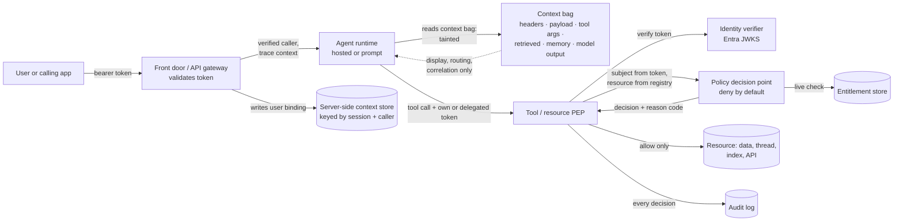

# Request Context Is Not Authorization

> **Maturity:** preview · **Kind:** design-pattern · **Category:** `agent-runtime` · **Version:** 0.1.0

An agent receives much more than a prompt. Its host forwards HTTP headers and metadata. Payloads carry tenant and user identifiers. The model writes tool arguments. Retrieval returns documents, memory returns earlier turns, and the model echoes all of it back. Every one of these is **request context**. None of it is an **authorization fact**. A header called `x-tenant-id` is a string someone typed. A `role: admin` in a retrieved document is a string someone wrote. A tool argument `tenant_id` is a string the model produced, possibly because a prompt injection told it to.

This design pattern separates the two. Authorization is derived only from a **cryptographically verified identity**: a validated Microsoft Entra token, or a workload identity the platform attests. A **deny-by-default policy decision point (PDP)** evaluates it, and **policy enforcement points (PEPs)** re-check it at every tool and resource boundary **at call time**, not from a snapshot taken when the session started. Everything else travels in a context bag marked as tainted. Code may read tainted values for display, routing and correlation, but the PDP refuses them as subject attributes. The model never decides who is allowed to do what.

> **Core thesis:** *Context is input, identity is evidence, policy is code. Verify identity cryptographically, decide with a deny-by-default PDP, enforce at the resource at call time, and never let the model or the request context stand in for any of the three.*

This asset is a **preview** design pattern. Statements about how Microsoft Foundry hosted agents and prompt agents forward context were observed while testing preview builds rather than read from a documented contract. They are marked "observed in preview; verify against current docs". Every statement is qualitative on purpose.

## Architecture and implementation map

| Layer / concern | Deep-dive documentation | Executable or illustrative reference |
|---|---|---|
| **Threat model, taint classes, components, hosted-agent context, wire contracts, failure modes** | [`docs/architecture.md`](docs/architecture.md) · [ADR 0001](docs/decisions/0001-derive-authorization-from-verified-identity-only.md) | [`samples/request_context_guard.py`](samples/request_context_guard.py): `IdentityVerifier`, `ContextBag`, `PolicyDecisionPoint` |
| **Enforcement at tools, memory and retrieval; revocation** | [`docs/architecture.md`](docs/architecture.md) sections 6 to 9 · [ADR 0002](docs/decisions/0002-reauthorize-at-the-resource-boundary.md) | `ToolPEP` and `InMemoryEntitlementStore` in the same sample |
| **Identities, OBO versus agent identity, token validation, policy as code, audit** | [`docs/authentication-and-governance.md`](docs/authentication-and-governance.md) | `EntraJwksVerifier` seam and `AuditLog` in the sample |
| **Adversarial suite, metrics, red-team prompts, troubleshooting** | [`docs/evaluation-and-troubleshooting.md`](docs/evaluation-and-troubleshooting.md) | [`samples/README.md`](samples/README.md): 11 scenarios with expected reason codes |

## Domain Packs

The pattern is the same in every industry. What changes is which resource attributes the policy reads and which failure an auditor fears most.

| Domain Pack | Example agent and resource | Resource attributes the policy reads | Rule that must never come from context |
|---|---|---|---|
| **Financial services (Contoso)** | Ledger assistant reading cost-center ledgers and drafting journal entries | Tenant, legal entity, cost center, data classification | Approval authority and cost-center scope; a "CFO approved" note in a document is not an approval |
| **Healthcare (Fabrikam)** | Care-team assistant summarizing patient charts | Tenant, facility, patient, care-team relationship, consent flags | Care-team membership and consent; a patient id in a tool argument does not grant access to that chart |
| **Retail and multi-tenant SaaS (Northwind)** | Merchant support agent querying orders and refunds for many merchant tenants | Tenant (merchant), store, order owner, refund limit | Merchant tenant; a `tenant_id` argument or header never selects a different merchant |
| **Public sector** | Case assistant drafting case summaries under records rules | Agency, case, clearance, retention label | Clearance and case assignment; a "supervisor override" phrase in chat is not an override |
| **Manufacturing** | Maintenance agent reading plant work orders and proposing changes | Site, line, work-order owner, safety-critical flag | Site scope and change authority for safety-critical assets |

The sample ships three of these as runnable packs (`--domain contoso-finance`, `fabrikam-health`, `northwind-retail`).

## When to use

- An agent calls tools, APIs, MCP servers, memory or retrieval that hold **data with owners**: per-user, per-tenant, per-case or per-record.
- The agent runs behind a **host or gateway that forwards context**, such as Foundry hosted agents receiving `x-client-*` headers, metadata and a caller id, and you need to know which parts you can trust.
- The workload is **multi-tenant**, or one agent serves users with different entitlements.
- You are **migrating an agent that authorizes from headers**, payload fields or a session-start permission snapshot.
- Security review asks: "What stops a prompt injection from making the agent act as someone else?"

## When not to use

- **You need to acquire or exchange tokens for MCP clients.** That is the OAuth front door; see [MCP OAuth Front Door](../../ai-gateway/mcp-oauth-front-door/README.md). This asset assumes a token exists and shows what to do with it.
- **You need the mechanics of carrying a user's identity to a backend** (OBO, signed assertions, tenant credential bridges). See [Backend Identity Propagation](../../ai-gateway/backend-identity-propagation/README.md). This asset tells you where to enforce; that one tells you how the identity gets there.
- **You need a gateway-level multi-tenant MCP design.** See [Multi-Tenant MCP Gateway](../../ai-gateway/multi-tenant-mcp-gateway/README.md), which applies this principle at the gateway with token-derived tenants and a `tools/call` entitlement re-check.
- **A single-user prototype with no shared data.** The principle still holds, but the PDP can be a few lines of code. Come back when a second tenant or user appears.

## Architecture



Identity enters at the front door as a token and is verified again wherever a resource is touched. The agent may read the context bag freely, but nothing in it can become a subject attribute. At the tool or resource, the PEP:

1. verifies the token;
2. resolves the resource from a server-side registry rather than from arguments;
3. rejects tenant-like arguments that disagree with the verified tenant;
4. asks the PDP, which reads live entitlements;
5. runs the handler only on `ALLOW`;
6. writes one audit record per decision.

See [`docs/architecture.md`](docs/architecture.md) for the threat model, taint classes, sequences and wire contracts.

### Where to enforce, and what to trust from each hop

| Hop | Enforces | Trusts | Never trusts |
|---|---|---|---|
| **Front door / API gateway** | Token validation, coarse audience and app checks, rate limits | The token it validated | Client-set identity headers; it should strip them |
| **Agent runtime** | Nothing authoritative; it may pre-filter tools for usability | Its own workload identity; the platform-injected caller id **for partitioning only** | Headers, metadata, retrieved content, memory, model output, or anything that "says" who the user is |
| **Tool / MCP server / API** | Full PDP decision per call | A token it validated itself, issued for its own audience | Tenant, user or role values in arguments or forwarded headers |
| **Resource (data store, index, thread store)** | Row, document or partition scoping derived from the verified subject | The subject handed down by the PEP after verification | Filters or keys supplied by the model |

## Key design decisions

| Decision | Choice | Why | Trade-off |
|---|---|---|---|
| Source of authorization facts | Verified token or attested workload identity only ([ADR 0001](docs/decisions/0001-derive-authorization-from-verified-identity-only.md)) | Headers, payloads and model output are attacker-influenced | Every tool needs token validation and an identity strategy for user context |
| Where to decide | At the resource or tool boundary, on every call, against live entitlements ([ADR 0002](docs/decisions/0002-reauthorize-at-the-resource-boundary.md)) | Session-start snapshots outlive revocations; upstream checks do not see the final resource | A policy and entitlement read per call; caching needs explicit invalidation |
| Default | Deny, with a reason code for every outcome | Missing identity, unknown resource or unmatched rule must never fail open | New tools fail closed until policy is written |
| The model's role | Proposes actions; never a policy decision point | Model output is steerable by prompt injection | Tool pre-filtering is a usability aid, not a control |
| Resource resolution | Server-side registry by selector; tenant from the token | Prevents argument-driven tenant hopping and hallucinated identifiers | A registry or naming convention to maintain |
| User context in hosted agents | Broker or server-side context store bound to the caller; never the user's bearer token in prompts or tool args | The platform does not forward the caller's `Authorization` header to the container (observed in preview; verify against current docs) | One more component in the path |
| Audit | One structured record per decision, keys and provenance only | Proves denials and allows; avoids logging attacker content | Audit volume to retain and protect |

## Getting started

1. **Run the sample offline.** It needs Python 3.10 or later and no packages:

   ```powershell
   python assets/agent-runtime/request-context-is-not-authorization/samples/request_context_guard.py --self-test --domain all
   python assets/agent-runtime/request-context-is-not-authorization/samples/request_context_guard.py --demo
   ```

   The self-test runs spoofed headers, injected tenant ids, model-echoed roles, revocation between turns, missing identity, tampered and misaddressed tokens, cross-tenant memory reads and a confused-deputy case. It prints PASS or FAIL per scenario and exits non-zero on any failure.
2. **Inventory your context.** List every value that reaches your agent and tools, and classify each one with the taint table in [`docs/architecture.md`](docs/architecture.md). Anything currently used for authorization that is not a verified claim is a finding.
3. **Choose the identity strategy per tool.** Delegated user (OBO or Toolbox/MCP connection auth), agent identity, or a broker. Use the decision guidance in [`docs/authentication-and-governance.md`](docs/authentication-and-governance.md) and the mechanics in [Backend Identity Propagation](../../ai-gateway/backend-identity-propagation/README.md).
4. **Put a PEP in every tool and resource.** Validate the token for the tool's own audience, resolve resources server-side, call a deny-by-default PDP, and audit. Port the `ToolPEP` shape from the sample.
5. **Gate with the adversarial suite.** Add the scenarios in [`docs/evaluation-and-troubleshooting.md`](docs/evaluation-and-troubleshooting.md) to CI. The release gate is zero false allows.
6. **Migrate header-trusting code.** Follow the migration path in [`docs/architecture.md`](docs/architecture.md): run shadow decisions first, then enforce, then delete the header path.

## File map

| Path | Purpose |
|---|---|
| [`docs/architecture.md`](docs/architecture.md) | Threat model, taint classes, components, sequences, hosted-agent context, decision matrix, wire contracts, Domain Packs, failure modes, anti-patterns, migration, checklist |
| [`docs/authentication-and-governance.md`](docs/authentication-and-governance.md) | Identity inventory, OBO versus agent identity versus broker, token validation, roles, policy as code, audit, separation of duties |
| [`docs/evaluation-and-troubleshooting.md`](docs/evaluation-and-troubleshooting.md) | Adversarial test matrix, metrics, red-team prompts, CI gating, troubleshooting |
| [`docs/decisions/`](docs/decisions/) | ADR 0001 (derive authorization from verified identity only) and ADR 0002 (re-authorize at the resource boundary) |
| [`samples/README.md`](samples/README.md) · [`samples/request_context_guard.py`](samples/request_context_guard.py) | Standard-library reference implementation with `--self-test`, `--demo` and `--domain` |

## Related assets

| Asset | Relationship |
|---|---|
| [Production Hosted Agents on Microsoft Foundry](../production-hosted-agents-on-foundry/README.md) | The runtime this pattern most often runs in; see its notes on what the container sees and why caller identity does not flow automatically |
| [Choosing Prompt Agents vs Hosted Agents](../choosing-prompt-vs-hosted-agents/README.md) | The two agent types forward different context to tools; this asset covers both |
| [Backend Identity Propagation](../../ai-gateway/backend-identity-propagation/README.md) | How a verified identity reaches backends (OBO, signed assertions, tenant credentials) |
| [MCP OAuth Front Door](../../ai-gateway/mcp-oauth-front-door/README.md) | How MCP clients obtain the tokens this pattern verifies |
| [Multi-Tenant MCP Gateway](../../ai-gateway/multi-tenant-mcp-gateway/README.md) | This principle applied at an MCP gateway: token-derived tenant and per-call entitlement checks |
| [Entitlement-Aware Tool Catalog](../../ai-gateway/entitlement-aware-tool-catalog/README.md) | Filters which tools the agent sees; complementary to, not a replacement for, call-time enforcement |
| [Progressive Tool Loading](../../orchestration-and-workflows/progressive-tool-loading/README.md) | Loads tools on demand; each loaded tool still enforces at its own boundary |
| [Enterprise Agent Security and Tool Governance](../../security-and-governance/agent-security-and-governance/README.md) | Defense-in-depth program; this asset implements its confused-deputy and stale-entitlement controls |

## Production-readiness pillar mapping

| Pillar | How this asset contributes |
|---|---|
| **Security and observability** | Taint model, deny-by-default PDP, call-time PEPs, adversarial test suite, per-decision audit records with reason codes |
| **Agent architecture patterns** | A reusable verifier → context bag → PDP → PEP → audit shape for any agent, tool or MCP server |
| **AI CoE and governance** | Policy as code, a stable reason-code catalog, separation of duties between policy authors and tool owners, and a release gate of zero false allows |

## Security and responsible AI

- **Nothing in the prompt is a permission.** Text that claims a role, an approval or an identity is data. Treat it as such even when it comes from your own memory store or a trusted document library.
- **Never put user tokens where the model can see them.** Not in prompts, tool arguments, memory or traces. Use connection-level auth, a broker or a server-side context store.
- **Fail closed and say why.** Every deny carries a reason code that operators can act on. Never return a partial result after a deny.
- **Do not log attacker content.** Audit records carry keys, provenance and decisions, not the tainted values themselves.
- **Revocation must bite on the next call.** If you cache entitlements, invalidate on revocation and record which entitlement version a decision used.
- **Human approval is also a resource.** If a workflow needs approval, record the approval in a store the PDP reads, bound to a verified approver. A model's statement that approval was given does not count.

## Limitations

- Context forwarding by Foundry hosted agents and prompt agents (headers, metadata, trace context, injected caller ids) is **preview** behavior and was observed in testing rather than taken from a documented contract. Verify against current Microsoft Learn documentation before you depend on it.
- The sample uses an HMAC test token and in-memory stores. It shows the control flow, not a production token validator or policy engine. `EntraJwksVerifier` is a documented seam that raises `NotImplementedError`.
- This asset does not prescribe a specific policy engine, entitlement store or audit sink.
- This asset contains no latency, throughput, capacity or cost figures. Per-call authorization has a cost; measure it in your own environment.

## References

- [Architecture deep dive](docs/architecture.md)
- [Authentication and governance](docs/authentication-and-governance.md)
- [Evaluation and troubleshooting](docs/evaluation-and-troubleshooting.md)
- [Samples guide](samples/README.md)
- [Access tokens in the Microsoft identity platform](https://learn.microsoft.com/entra/identity-platform/access-tokens)
- [OAuth 2.0 on-behalf-of flow](https://learn.microsoft.com/entra/identity-platform/v2-oauth2-on-behalf-of-flow)
- [What is Microsoft Entra Agent ID?](https://learn.microsoft.com/entra/agent-id/identity-platform/what-is-agent-id)
- [Agent identity in Foundry Agent Service](https://learn.microsoft.com/azure/foundry/agents/concepts/agent-identity)
- [Hosted agents in Foundry Agent Service](https://learn.microsoft.com/azure/foundry/agents/concepts/hosted-agents)
- [Tool authentication in Foundry Agent Service](https://learn.microsoft.com/azure/foundry/agents/how-to/tools/tool-authentication)
- [Validate Microsoft Entra token policy in API Management](https://learn.microsoft.com/azure/api-management/validate-azure-ad-token-policy)
- [Workload identities overview](https://learn.microsoft.com/entra/workload-id/workload-identities-overview)
- [Contribution and Standardization Guide](../../../docs/contribution-guide.md)
