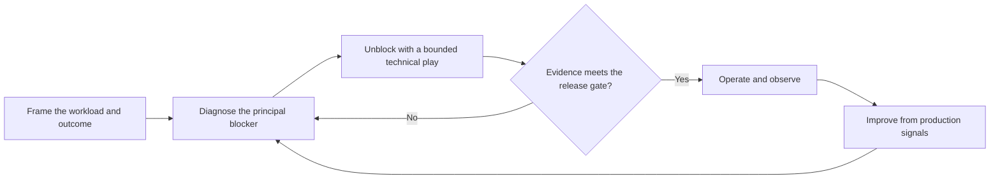

# Agent Production Readiness Guide

An evidence-led guide that application teams, architects, and platform engineers
can use to take an agentic application from early design or a pilot to an
operable production workload. It links the user outcome to a focused technical
intervention and to observable readiness evidence. It does not prescribe one
architecture, and it does not treat a successful demonstration as proof of
production readiness.

## When to use

- A team needs architectural direction before committing to an implementation.
- A pilot works in a demonstration but lacks the evaluation, identity, release,
  or operational evidence needed for production.
- The work crosses application, platform, data, identity, or security boundaries
  and needs one shared readiness plan.
- A deployed agent needs better quality, reliability, or cost efficiency.

## When not to use

- The only blocker is service capacity, quota, or an outage. Use the relevant
  support or capacity process; use this guide only for any remaining readiness
  gaps.
- A deterministic application or workflow meets the requirement more simply.
- An incident needs immediate containment. Follow the incident-response runbook
  first, then use this guide for follow-up improvements.
- A regulated workload requires a formal compliance assessment. This guide
  supports evidence gathering but does not replace that assessment.

## Architecture

This is a readiness-review method, not a deployable reference architecture:

A readiness lead from the workload team keeps the outcome, backlog, and
dependencies in one place. Engineers from the relevant disciplines contribute
where the evidence points; the readiness lead is not expected to implement every
technical area. The workload owner accepts operational responsibility and
release risk. Use the [readiness review](docs/readiness-review.md) to frame the
workload, choose a technical play, and apply production gates. Use the
[readiness record](docs/readiness-record.md) to capture evidence in the
workload's approved private system.

### Six readiness pillars

The pillars organize diagnosis and review. They are not six mandatory projects,
formal certifications, or substitutes for existing engineering processes. Each
pillar has a chapter, listed below.

| Pillar | Typical problem | First useful output |
|--------|-----------------|---------------------|
| [AI CoE & Governance](docs/pillars/01-ai-coe-and-governance.md) | Decision rights, acceptable use, or accountable ownership are unclear. | An agreed use boundary and decision/exception record. |
| [AI Landing Zones](docs/pillars/02-ai-landing-zones.md) | Identity, networking, environment separation, or platform controls prevent safe deployment. | A reviewed platform readiness and deployment plan. |
| [Agent Ops](docs/pillars/03-agent-ops.md) | Quality is anecdotal; changes cannot be evaluated or rolled back. | A versioned evaluation set and release/operation gates. |
| [AI Security & Observability](docs/pillars/04-ai-security-and-observability.md) | Tool permissions, data exposure, or action traceability are unclear. | A threat model, least-privilege tool contracts, and observable controls. |
| [Solution Optimization](docs/pillars/05-solution-optimization.md) | Quality, latency, reliability, and cost trade-offs are not measured. | A baseline and an evidence-based optimization experiment. |
| [Proven Patterns for Agent Architectures](docs/pillars/06-proven-patterns-for-agent-architectures.md) | Agent boundaries, orchestration, or integration choices do not fit the outcome. | An architecture decision and a minimal end-to-end design. |

### Pillar chapters

The [pillar chapters](docs/pillars/README.md) expand each pillar with the same
structure: definition, common signals, entry questions, an approach linked to
the technical plays, a readiness evidence and gate table, common pitfalls,
collaboration boundaries, and public references.

1. [AI CoE & Governance](docs/pillars/01-ai-coe-and-governance.md)
2. [AI Landing Zones](docs/pillars/02-ai-landing-zones.md)
3. [Agent Ops](docs/pillars/03-agent-ops.md)
4. [AI Security & Observability](docs/pillars/04-ai-security-and-observability.md)
5. [Solution Optimization](docs/pillars/05-solution-optimization.md)
6. [Proven Patterns for Agent Architectures](docs/pillars/06-proven-patterns-for-agent-architectures.md)

## Key design decisions

| Decision | Choice | Why | Trade-off |
|----------|--------|-----|-----------|
| Entry point | Allow early design as well as pilots and deployed workloads. | A readiness gap can be addressed before a project is committed. | Early reviews need explicit scope and stopping conditions. |
| Scope of work | Select the smallest play that removes the evidenced blocker. | Avoid a checklist turning into six parallel implementation projects. | Some risks need several disciplines and dependent work. |
| Readiness | Require workload-specific evidence and accountable acceptance. | A demo or training completion does not prove safe operation. | Teams must agree thresholds before testing. |
| Evidence handling | Keep workload evidence private; share only generic lessons. | Operational evidence and business context belong in approved systems. | Public guidance cannot reproduce any specific workload's history. |

## Getting started

1. Name a readiness lead from the workload team and confirm the workload owner.
   Record the desired user outcome, current stage, principal blocker, and
   applicable constraints.
2. Use the [framing questions](docs/readiness-review.md#1-frame-the-workload) to
   decide whether the request fits this guide or needs another process.
3. [Diagnose](docs/readiness-review.md#2-diagnose-the-principal-blocker) the
   evidence across the six pillars, using the
   [pillar chapters](docs/pillars/README.md) for entry questions. Select one
   primary technical play, the roles needed, and an explicit next decision.
4. Agree acceptance criteria before making changes. Run the bounded intervention
   and record results, including failed tests and residual risks.
5. Have the accountable owner decide whether to proceed, rework, or stop. Before
   production, complete the [release gate](docs/readiness-review.md#4-release-and-operate).
6. If the work produces a generic, reusable improvement, propose it through
   [CONTRIBUTING](../../../CONTRIBUTING.md) without publishing workload records.

No infrastructure, credentials, or deployment is required to use this guide.
Apply the guidance to the actual service versions and deployment environment;
consult their documentation before implementing product-specific controls.

## Security and responsible AI

Treat agent inputs, retrieved content, and tool responses as untrusted data.
Separate instructions from data, authorize each tool operation, and constrain
credentials and allowed actions. Use human approval for actions whose impact
requires it. Evaluate misuse and data leakage as well as task completion.

Traces and evaluation datasets can contain sensitive information. Keep them in
approved systems, apply access and retention controls, and publish only synthetic
examples or independently cleared material. Do not copy workload evidence into
a public issue or pull request.

## Limitations

- Version 0.2.0 is an experimental starting point, not certification of
  production readiness.
- This is a readiness guide, not an incident runbook, deployment accelerator,
  product-specific implementation, or service entitlement.
- Readiness thresholds, legal obligations, supported capabilities, and operating
  roles depend on the workload. The guide deliberately does not invent defaults.
- There are no implementation assets or automated workload tests in this asset.
  Evaluation and control evidence must come from the actual system.

## References

- [AI agent orchestration patterns](https://learn.microsoft.com/en-us/azure/architecture/ai-ml/guide/ai-agent-design-patterns)
- [Azure Well-Architected Framework](https://learn.microsoft.com/en-us/azure/well-architected/)
- [What is Microsoft Foundry?](https://learn.microsoft.com/en-us/azure/foundry/what-is-foundry)
- [Repository contribution and public-safety rules](../../../CONTRIBUTING.md)
