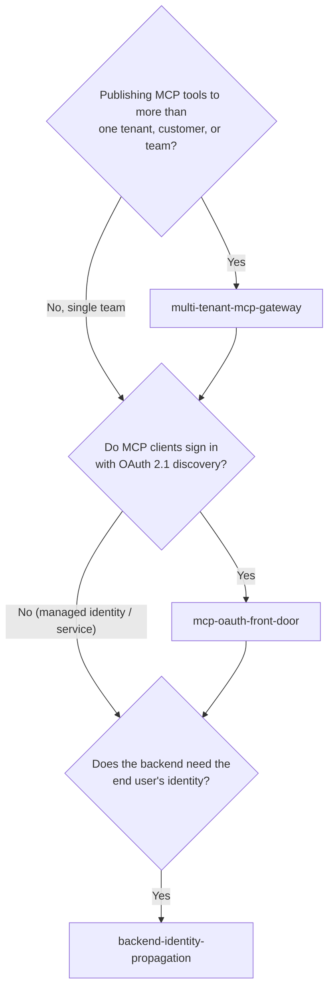

# AI Gateway (`ai-gateway`)

Patterns for putting **one governed control plane** in front of the model, tool (MCP) and agent-to-agent traffic that enterprise agents generate. Browse this category when you publish MCP servers to many tenants or teams, need standards-based OAuth sign-in for MCP clients on Microsoft Entra ID, or must carry a user's identity to a backend system without forwarding raw tokens. The reference implementation uses Azure API Management, but the contracts apply to any gateway.

## When to browse this category

- You are exposing MCP tools **as a product** to several customers, tenants or internal teams and need per-tenant entitlement, rate limits, quotas and usage metering.
- MCP clients must discover how to sign in (**RFC 9728 protected-resource metadata**, **RFC 8414 authorization-server metadata**, dynamic client registration) and your identity provider does not offer every piece natively.
- A backend API needs to know **which end user** is calling, but you do not want the gateway or agent to pass the user's access token through.

## Choosing between patterns in this category

| Decision Dimension | Multi-Tenant MCP Gateway (`multi-tenant-mcp-gateway`) | MCP OAuth Front Door (`mcp-oauth-front-door`) | Backend Identity Propagation (`backend-identity-propagation`) |
|---|---|---|---|
| **Primary question** | How do I publish MCP tools to many tenants safely? | How do MCP clients discover and complete OAuth sign-in? | How does the backend learn who the user is? |
| **Asset kind** | Reference architecture | Design pattern | Design pattern |
| **Where it sits** | Network edge plus the per-call gateway policy pipeline | Discovery and token-acquisition endpoints in front of the identity provider | Between the gateway and each backend system |
| **Key contracts** | Tenant lookup, entitlement-aware `tools/list`, rate and quota, metering events | Protected-resource metadata, authorization-server metadata shim, client-registration shim, scope mapping | Token exchange or OBO, signed user assertion, per-tenant service key, identity link |
| **Combine when** | Always the outer shell | Clients sign in interactively with OAuth 2.1 | Backend authorizes per user, not just per tenant |

## Assets in this category

<!-- category-catalog:start -->
| Asset | Kind | Maturity | Summary |
|-------|------|----------|---------|
| [Backend Identity Propagation for MCP and Agent Gateways (OBO, Signed Assertions, Tenant Credentials)](backend-identity-propagation/README.md) | `design-pattern` | preview | How an MCP server or agent gateway carries the end user's identity to a backend system of record without forwarding the client's token. Compares on-behalf-of token exchange (RFC 8693, Entra OBO), a gateway-signed user assertion with an identity link over mTLS, and a transitional per-tenant credential bridge, plus app-only calls and agent identity. Includes a decision matrix, wire contracts, caching and revocation rules, illustrative API Management policies, and an offline simulator. |
| [MCP OAuth Front Door (Protected Resource Metadata, Discovery and Client Registration Shims)](mcp-oauth-front-door/README.md) | `design-pattern` | preview | An OAuth front door on Azure API Management that lets MCP clients discover Microsoft Entra ID or Entra External ID and obtain correctly scoped tokens for remote MCP servers. Covers the 401 challenge, Protected Resource Metadata (RFC 9728), an RFC 8414 metadata shim, an optional governed registration shim, authorize and token facades that map resource to scope, token validation, security trade-offs, and an offline simulator. |
| [Multi-Tenant MCP Gateway on Azure API Management](multi-tenant-mcp-gateway/README.md) | `reference-architecture` | preview | A reference architecture for a SaaS provider (ISV) or platform team that exposes many backend APIs as MCP tools to many tenants' agents through one governed Azure API Management front door. Covers the WAF network path, token-derived tenant identity, a per-call policy pipeline (entitlement, per-tenant limits, backend credentials, cell routing, audit), tool checks on every tools/call, API Center as the catalog, and a runnable simulator. |
<!-- category-catalog:end -->

## Complementary assets in other categories

- **OAuth pass-through when publishing a Foundry agent to Microsoft 365 (different scope: agent channel, not tool gateway):** [`landing-zones-and-infra/secured-foundry-landing-zone/docs/oauth-passthrough-and-m365-publishing.md`](../landing-zones-and-infra/secured-foundry-landing-zone/docs/oauth-passthrough-and-m365-publishing.md)
- **Tool-level policy, approval and Entra Agent ID governance:** [`security-and-governance/agent-security-and-governance`](../security-and-governance/agent-security-and-governance/README.md)
- **Consuming MCP servers from Microsoft 365 Copilot plug-ins:** [`m365-and-copilot/m365-mcp-plugin-integration`](../m365-and-copilot/m365-mcp-plugin-integration/README.md)
- **Hosted agents that call tools through the gateway:** [`agent-runtime/production-hosted-agents-on-foundry`](../agent-runtime/production-hosted-agents-on-foundry/README.md)
