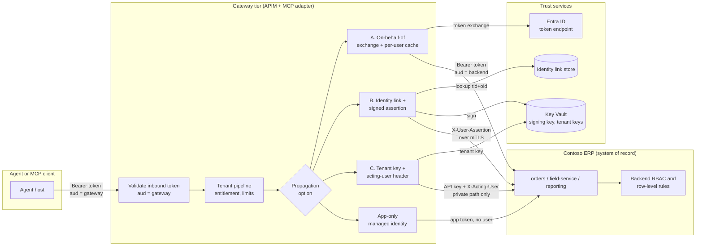
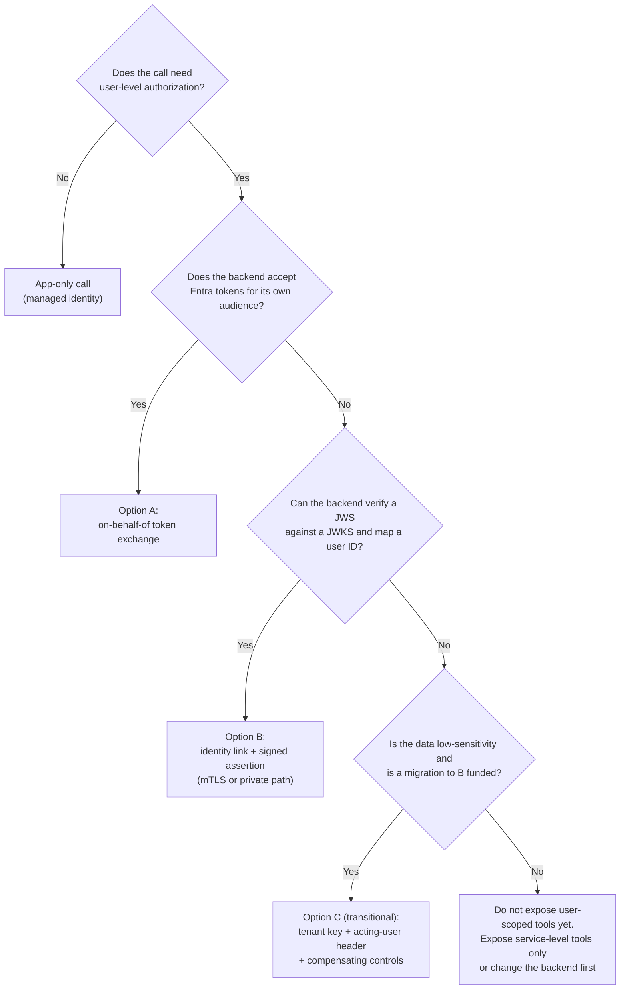

# Backend Identity Propagation for MCP and Agent Gateways (OBO, Signed Assertions, Tenant Credentials)

> **Maturity:** preview · **Kind:** design-pattern · **Category:** `ai-gateway` · **Version:** 0.1.0

An MCP server or agent gateway receives a request carrying the user's Microsoft Entra ID access token. That token's audience is the gateway (or the MCP resource behind it), not the system of record. The backend that actually owns the data, for example the REST APIs of a multi-tenant SaaS ERP, has its own identity model: its own user table and roles, per-tenant API keys, or its own identity provider. Its row-level authorization only works if it knows **which of its users** is asking.

The MCP authorization specification forbids the obvious shortcut: forwarding the client's token to the downstream API (**token passthrough**). That token was issued for a different audience, it lets the backend be used as a confused deputy, and it hides the gateway from the audit trail. So the gateway has to produce a **new credential for the backend** that still carries the user.

This design pattern describes three ways to do that, from strongest to weakest, using a fictional ISV, **Contoso ERP**, whose `orders`, `field-service` and `reporting` APIs sit behind a [multi-tenant MCP gateway](../multi-tenant-mcp-gateway/README.md):

- **Option A, on-behalf-of token exchange.** When the backend trusts the same identity provider, exchange the inbound token for a token whose audience is the backend (OAuth 2.0 Token Exchange, RFC 8693, conceptually; the Microsoft Entra on-behalf-of flow concretely).
- **Option B, signed user assertion with an identity link.** When the backend has its own users, look up the link from the Entra user to the backend user and mint a short-lived signed assertion (JWS, RFC 7515 and RFC 7519) for the backend, sent over mutual TLS (RFC 8705) or a private path.
- **Option C, per-tenant credential bridge (transitional).** When the backend only understands per-tenant API keys, use the tenant's key from Key Vault plus an acting-user header that the backend trusts only from the gateway. Weakest; use it only with compensating controls and a migration plan to Option B.

It also covers **app-only calls** for reference data that needs no user context, and **agent identity**: an agent acting on its own behalf versus on behalf of a user.

> **Core thesis:** *Validate the client's token at the gateway and stop it there. Give the backend a credential minted for the backend, bound to one user, one tenant and one audience, short-lived and auditable, and let the backend keep enforcing its own row-level authorization.*

Identity provider capabilities (including on-behalf-of support, managed identity federation and agent identities) and API Management policy features change frequently. Every statement here about product behavior is qualitative and must be **verified against current documentation** before you rely on it. The policies are illustrative and have not been deployed as published.

## Architecture and implementation map

| Layer / concern | Deep-dive documentation | Executable reference |
|---|---|---|
| **Invariants, options A to C, app-only, agent identity, decision matrix, wire contracts** | [`docs/architecture.md`](docs/architecture.md) · [ADR 0001](docs/decisions/0001-never-pass-through-client-tokens.md) · [ADR 0002](docs/decisions/0002-signed-assertion-over-shared-api-keys.md) | [`samples/identity_propagation_sim.py`](samples/identity_propagation_sim.py): offline simulation of all three options plus passthrough rejection, with `--self-test` and `--demo` |
| **Identities, role assignments, Key Vault layout, key rotation, identity link governance, audit** | [`docs/authentication-and-governance.md`](docs/authentication-and-governance.md) | Identity inventory, rotation runbook, two-user isolation tests |
| **Evaluation, release gates, troubleshooting** | [`docs/evaluation-and-troubleshooting.md`](docs/evaluation-and-troubleshooting.md) | Scenario catalog mapped to simulator tests, troubleshooting table, diagnostics queries |
| **Gateway policies** | [`docs/policies/`](docs/policies/README.md) | Illustrative APIM policy XML for on-behalf-of exchange with per-user caching, signed assertion minting, and the tenant credential bridge |

## Domain Packs

The mechanics are domain-agnostic. What changes per domain is how the backend models users, how much user-level authorization and audit the regulator expects, and how quickly access must be revoked.

| Domain Pack | Typical backend | Usual option | Emphasis |
|---|---|---|---|
| **Manufacturing or ERP ISV** | Multi-tenant SaaS ERP with its own user table and per-tenant API keys | B, with C as a time-boxed bridge | Identity link provisioning at scale, per-tenant key isolation, migration off shared keys |
| **Healthcare** | Clinical record APIs with patient-level access rules | A (same IdP) or B (record system has its own users) | User-level authorization is mandatory; no Option C for patient data; break-the-glass audit |
| **Financial services** | Core banking or trading APIs with entitlement systems | A or B with mTLS | Non-repudiation, `act` chain in every audit record, fast revocation, step-up authentication |
| **Public sector shared service** | Agency case-management systems | A across agency tenants, or B per agency | Per-agency key and tenant isolation, sovereign-cloud endpoints, records retention |

[Architecture section 15](docs/architecture.md#15-domain-packs) adds the failure-mode and audit emphasis for each domain.

## When to use

- An **MCP server or agent gateway calls a backend system of record** on behalf of signed-in users, and the backend must still enforce **user-level** (not only tenant-level) authorization.
- The gateway receives an **Entra ID or Entra External ID token** whose audience is the gateway or MCP resource, and you need a credential the backend will accept.
- The backend is a **multi-tenant SaaS** with its own identity model (its own user table, per-tenant keys, or its own identity provider) that you can't replace.
- You must show auditors **who did what through which agent**: the end user, the agent or client, the gateway request, and the backend user, correlated.
- You are **migrating off shared service accounts or tenant-wide API keys** and need a target architecture and a transitional step.

## When not to use

- **The data is not user-scoped.** Reference data, product catalogs and public lookups need only an app-only call with the gateway's managed identity ([section 7](docs/architecture.md#7-app-only-service-calls)).
- **The client calls the backend directly.** If there is no gateway or MCP server in the middle, the client should get a token for the backend's audience itself. There is nothing to propagate.
- **The MCP server is the system of record.** If the MCP server owns the data and validates the token itself, apply its own authorization; there is no downstream hop.
- **You are looking for client-to-MCP-server delegation.** How a Foundry agent passes the signed-in user's token to an Entra-protected MCP server, and M365 publishing, is covered by the landing zone's [OAuth identity passthrough guide](../../landing-zones-and-infra/secured-foundry-landing-zone/docs/oauth-passthrough-and-m365-publishing.md). This asset starts where that one ends: from the MCP server or gateway to the backend behind it.
- **You need the gateway to become the backend's identity provider for interactive sign-in.** Option B mints narrow, short-lived assertions for one hop. It is not a general token service with sessions, refresh tokens or consent.

## Architecture



The gateway tier does four things on every call, in this order:

1. **Validate and stop the client token.** `validate-jwt` checks issuer, audience (the gateway), scopes and tenant, then the `Authorization` header is deleted. The client token never leaves the gateway ([ADR 0001](docs/decisions/0001-never-pass-through-client-tokens.md)).
2. **Resolve the backend principal.** From the validated `tid` and `oid`: for Option A the principal is the same Entra user; for Option B it is the linked backend user from the identity link store; for Option C it is only the tenant ([sections 4 to 6](docs/architecture.md#4-option-a-on-behalf-of-token-exchange)).
3. **Mint or fetch a backend credential.** An on-behalf-of token from Entra, a gateway-signed assertion, or the tenant's key from Key Vault. Cached **per user, tenant, audience and scope**, never per tenant only ([section 12](docs/architecture.md#12-caching-rules)).
4. **Audit.** One record per call that correlates the gateway request ID, tenant, user object ID, backend user ID, tool name and propagation option, without any token or key material ([section 14](docs/architecture.md#14-audit)).

The backend keeps its own authorization. The gateway does coarse checks (valid token, entitled tenant, quota). The backend does fine-grained checks with its existing roles and row rules. The gateway must not copy backend roles; its job is to deliver a **trustworthy user identity**.

### Option selection flowchart



### Pattern selection matrix

| Criterion | **A. On-behalf-of** | **B. Signed assertion + identity link** | **C. Tenant credential bridge** | **App-only** |
|---|---|---|---|---|
| **Backend trusts** | The same IdP (Entra) | The gateway's signing key (JWKS) | The tenant key and the network path | The gateway's managed identity |
| **User-level authorization** | Yes, from token claims | Yes, from the linked backend user | Only if the backend trusts the header; not verifiable | No |
| **Cryptographic proof of user** | Yes, IdP-signed | Yes, gateway-signed | No | Not applicable |
| **Audit strength** | Strong; IdP sign-in logs plus gateway | Strong; `jti` and `act` correlate both sides | Weak; relies on gateway logs | Service-level only |
| **Implementation cost** | Low to moderate if the backend is already Entra-protected | Moderate: link store, signing key, backend verifier | Low | Lowest |
| **Blast radius of a leaked credential** | One user, one audience, short-lived | One user, one audience, very short-lived | Whole tenant until the key is rotated | Whatever the app role grants |
| **Revocation** | Follows the IdP (disable user, revoke sessions) plus cache lifetime | Unlink or disable the user; next assertion is refused | Rotate the tenant key; user-level revocation is gateway-only | Remove the role assignment |

## Key design decisions

| Decision | Choice | Why | Trade-off |
|---|---|---|---|
| Client token | Validated and deleted at the gateway; never forwarded | MCP specification; audience separation; no confused deputy | Every backend needs its own credential path |
| Preferred option | A when the backend trusts Entra, otherwise B | Both give the backend cryptographic proof of the user | B requires a link store and a backend-side verifier |
| Where on-behalf-of runs | In the MCP adapter with a token library, or APIM `send-request` when there is no adapter | APIM has no built-in on-behalf-of policy; libraries handle caching, claims challenges and retries | APIM implementation must hand-roll caching and error mapping |
| Gateway client credential | Managed identity with a federated identity credential; no client secrets | Nothing to leak or rotate by hand | Check current support for your tenant and cloud |
| Assertion lifetime | Short, single audience, unique `jti`, `act` names the agent | Limits replay and blast radius; records the delegation chain | Clock skew must be managed on both sides |
| Assertion transport | mTLS (RFC 8705) or Private Link, plus signature | Defense in depth: the backend accepts assertions only from the gateway | Certificate lifecycle on both sides |
| Identity link key | Issuer plus immutable subject (`tid` + `oid`), never email or UPN | Email and UPN change and can be reassigned | Requires a linking step per user |
| Unlinked user | Deny with a link-required error; never fall back to the tenant key | Fallback silently widens access to the whole tenant | First-use friction; mitigate with JIT linking or SCIM |
| Cache key | Hash of `tid`, `oid`, audience and scopes; expiry minus skew | Prevents cross-user leakage and use of nearly expired tokens | Lower hit rate than a tenant-wide cache |
| Option C | Transitional only, with compensating controls and an exit date | The backend can't verify the user | Audit relies entirely on the gateway |

These decisions are recorded in [ADR 0001: Never pass through client tokens](docs/decisions/0001-never-pass-through-client-tokens.md) and [ADR 0002: Signed assertion over shared API keys](docs/decisions/0002-signed-assertion-over-shared-api-keys.md).

## Getting started

1. **Run the simulator offline.** It needs Python 3.10 or later and no packages. The self-test proves the rules for all three options and for passthrough rejection; `--demo` walks one user through each option:

   ```powershell
   python assets/ai-gateway/backend-identity-propagation/samples/identity_propagation_sim.py --self-test
   python assets/ai-gateway/backend-identity-propagation/samples/identity_propagation_sim.py --demo
   ```

2. **Inventory each backend API.** For `orders`, `field-service`, `reporting` and so on, record which identity provider it trusts, whether it needs user-level authorization, and its audit requirements. Use the [decision matrix](docs/architecture.md#9-decision-matrix) to pick an option per API, not one option for everything.
3. **Set up the gateway identity.** A managed identity for the gateway or MCP adapter, a federated identity credential on the app registration for Option A, and Key Vault access for Options B and C ([authentication-and-governance.md](docs/authentication-and-governance.md)).
4. **Build the identity link (Option B).** Choose JIT linking, SCIM or admin mapping, key it on `tid` + `oid`, and define unlinking ([section 5.4](docs/architecture.md#54-identity-link-store)).
5. **Adapt the illustrative policies or adapter code.** Start from [`docs/policies/`](docs/policies/README.md), replace the named values, and keep the negative checks: wrong audience, expired or replayed assertion, unlinked user, spoofed acting-user header.
6. **Prove isolation, then release.** Run the two-user isolation tests and release gates in [evaluation-and-troubleshooting.md](docs/evaluation-and-troubleshooting.md), then follow [Agent Path to Production](../../delivery-and-ops/agent-path-to-production/README.md).

## Related assets

| Asset | Relationship |
|---|---|
| [Multi-Tenant MCP Gateway](../multi-tenant-mcp-gateway/README.md) | The per-call pipeline (tenant resolution, entitlement, limits, routing, audit) that runs before identity propagation; its backend credential options hand off to this asset |
| [MCP OAuth Front Door](../mcp-oauth-front-door/README.md) | How MCP clients discover the authorization server and obtain the inbound token this asset starts from |
| [Agent Security and Governance](../../security-and-governance/agent-security-and-governance/README.md) | Agent identity, least privilege and guardrails that complement the propagation options |
| [Secured Foundry Landing Zone](../../landing-zones-and-infra/secured-foundry-landing-zone/README.md) | The network and identity landing zone (private endpoints, Key Vault, managed identities) the gateway runs in; its OAuth passthrough guide covers the client-to-MCP-server hop |

## P2P pillar mapping

| Pillar | How this asset contributes |
|---|---|
| **Security and observability** | No token passthrough, audience-bound per-user credentials, signed assertions with replay protection, mTLS, per-user cache keys, revocation, and a correlated audit record without secrets |
| **Agent architecture patterns** | Options A to C, app-only and agent identity, with a decision flowchart and matrix for where identity propagation sits in an MCP gateway |
| **Landing zones** | Managed identities and federated credentials, Key Vault layout for signing and tenant keys, private network paths and certificates for mTLS |
