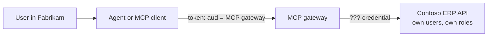
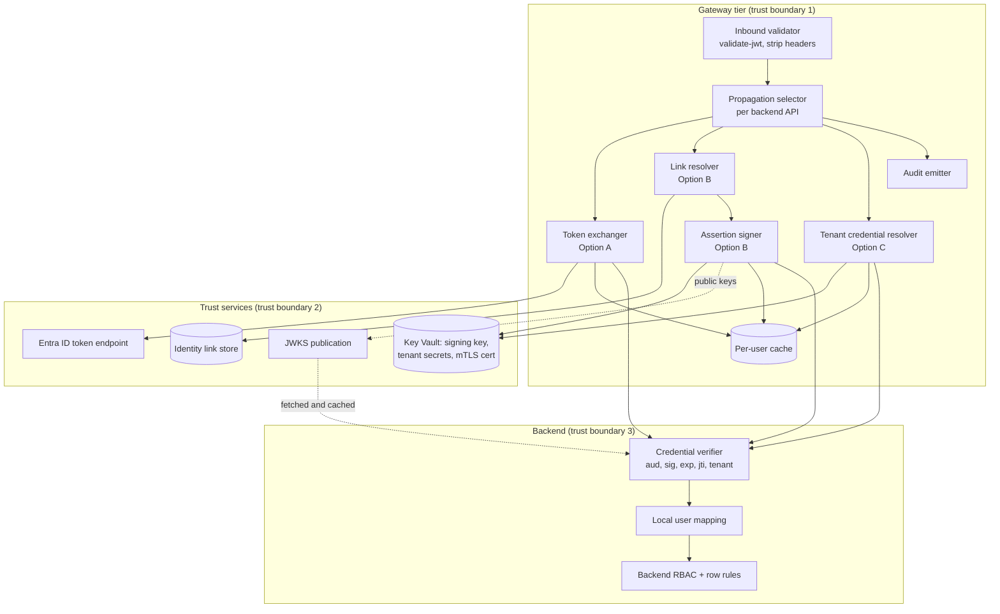

# Backend Identity Propagation: Architecture

This document is the deep dive for the [Backend Identity Propagation](../README.md) design pattern. It explains why the client's token must stop at the gateway, describes the three propagation options plus app-only calls and agent identity, and gives the wire contracts, caching, revocation and audit rules that make them safe.

The running example is **Contoso ERP**, a fictional multi-tenant SaaS ISV. Customer tenants such as **Fabrikam** and **Northwind** reach Contoso ERP's `orders`, `field-service` and `reporting` REST APIs through a [multi-tenant MCP gateway](../../multi-tenant-mcp-gateway/README.md) at `mcp.contoso.example`. Users sign in with Microsoft Entra ID through the [MCP OAuth front door](../../mcp-oauth-front-door/README.md). The backend lives at `erp.contoso.example`.

> Product behaviors described here (Entra on-behalf-of, managed identity federation, agent identities, API Management policies, Key Vault operations) are qualitative and change over time. Verify them against current documentation. The policy excerpts are illustrative and were written for this pattern, not exported from a deployment.

## Contents

1. [Thesis and invariants](#1-thesis-and-invariants)
2. [Context and forces](#2-context-and-forces)
3. [Components](#3-components)
4. [Option A: on-behalf-of token exchange](#4-option-a-on-behalf-of-token-exchange)
5. [Option B: signed user assertion with an identity link](#5-option-b-signed-user-assertion-with-an-identity-link)
6. [Option C: per-tenant credential bridge (transitional)](#6-option-c-per-tenant-credential-bridge-transitional)
7. [App-only service calls](#7-app-only-service-calls)
8. [Agent identity](#8-agent-identity)
9. [Decision matrix](#9-decision-matrix)
10. [Wire contracts](#10-wire-contracts)
11. [Implementing in API Management or in the MCP server](#11-implementing-in-api-management-or-in-the-mcp-server)
12. [Caching rules](#12-caching-rules)
13. [Revocation and offboarding](#13-revocation-and-offboarding)
14. [Audit](#14-audit)
15. [Domain Packs](#15-domain-packs)
16. [Failure modes](#16-failure-modes)
17. [Anti-patterns](#17-anti-patterns)
18. [Production checklist](#18-production-checklist)
19. [References](#19-references)

## 1. Thesis and invariants

*Validate the client's token at the gateway and stop it there. Give the backend a credential minted for the backend, bound to one user, one tenant and one audience, short-lived and auditable, and let the backend keep enforcing its own row-level authorization.*

Every option in this document must preserve these invariants. If a design breaks one, it is not a variant of this pattern.

| # | Invariant | Why |
|---|---|---|
| I1 | The client's access token is validated at the gateway and then **removed**. It is never sent to a backend. | The MCP specification forbids token passthrough; the token's audience is the gateway, not the backend. |
| I2 | Every backend credential has **exactly one audience**: the backend API it is sent to. | A credential that works at several APIs turns one compromise into many. |
| I3 | A user-scoped credential binds **one user and one tenant**, derived only from validated token claims (and the identity link), never from client-supplied headers, query strings or tool arguments. | Anything the client controls can be forged. |
| I4 | Backend credentials are **short-lived** and cached only under a key that includes the user, tenant, audience and scopes. | Limits replay and prevents one user's credential from serving another. |
| I5 | The **backend keeps its own authorization**. The gateway does coarse checks; it does not copy backend roles or row rules. | Two copies of authorization logic drift; the backend is the system of record. |
| I6 | Propagation **fails closed**. An unlinked user, a failed exchange or an unavailable signer means deny, never a fallback to a broader credential. | Silent fallback to a tenant-wide or service credential widens access. |
| I7 | Every backend call is **auditable end to end** without logging any token, assertion, key or client assertion. | Auditors need who, through which agent, as which backend user, and nothing that can be replayed. |
| I8 | The gateway-to-backend hop is **itself authenticated** (managed identity, mutual TLS or a private network path). | The user credential proves the user; the hop proves the caller is the gateway. |

## 2. Context and forces

### 2.1 The situation



The inbound token says: *Entra user `oid` in tenant `tid`, using client `azp`, may call the MCP gateway with scope `mcp.tools`.* The backend needs to know: *which Contoso ERP user in which Contoso ERP tenant is asking, so I can apply that user's roles and row rules.* Those are different statements, issued by different authorities, for different audiences.

Contoso ERP is typical of an established ISV:

- **`reporting`** is newer and already protected by Entra ID with its own app registration and scopes.
- **`field-service`** has its own user table (`fs-1001`, `fs-1002`) and roles (technician, dispatcher, supervisor). It can be extended to verify a signed token.
- **`orders`** predates both and accepts only a per-tenant API key. Every caller with the key sees every order in the tenant.
- Some lookups (units of measure, warehouse codes) are **reference data** with no user dimension.

### 2.2 Why token passthrough fails

Forwarding the inbound `Authorization` header to `erp.contoso.example` looks simple, and it is wrong:

- **Audience mismatch.** The token was issued for the gateway. A backend that accepts it is not validating audience, which means it would accept any token for any API from the same issuer.
- **Confused deputy.** The gateway's own privileges (network position, allow-listing, managed identity) get combined with a token the client chose. A malicious client can steer the gateway to backends the user never consented to.
- **Controls bypassed.** Rate limits, entitlement and audit at the gateway are meaningless if the same token also works directly against the backend.
- **Wrong identity model.** The backend doesn't know Entra `oid` values; its users are `fs-1001`. Passthrough doesn't solve the mapping anyway.
- **Attribution lost.** The backend can't tell that an agent, through the gateway, made the call.

The MCP authorization specification and its security best practices state that servers must not pass through tokens they received and must only accept tokens issued for themselves. [ADR 0001](decisions/0001-never-pass-through-client-tokens.md) records this decision.

### 2.3 Forces

| Force | Pulls toward | Pulls against |
|---|---|---|
| **Backend autonomy** | Keep the backend's own users, roles and row rules | Single identity provider and single sign-on everywhere |
| **Least privilege** | Per-user, per-audience, short-lived credentials | Simplicity of one service account or one key per tenant |
| **Implementation cost** | Reuse what the backend already accepts (keys) | Backend changes to verify tokens or assertions |
| **Revocation** | Short lifetimes, no caching, live link lookups | Load on the identity provider, Key Vault and link store |
| **Auditability** | Cryptographic proof of user and actor at the backend | Privacy: minimize identifiers that cross the boundary |
| **Multi-tenancy** | Per-tenant keys, per-tenant link scopes, strict tenant checks | Shared infrastructure and shared caches |
| **Agents** | Record the agent as actor alongside the user | Many backends have no concept of an actor |

## 3. Components



| Component | Responsibility | Typical host |
|---|---|---|
| **Inbound validator** | Validate issuer, audience, expiry, scopes and tenant; extract `tid`, `oid`, `azp`, `scp`; delete `Authorization` and any client-sent identity headers | API Management (`validate-jwt` or `validate-azure-ad-token`) |
| **Propagation selector** | Read per-API configuration and route to the right option; refuse if the API's option is unknown | API Management policy fragment or MCP adapter |
| **Token exchanger** (A) | On-behalf-of exchange with Entra, per-user cache, claims challenge mapping | MCP adapter with a token library (preferred) or API Management `send-request` |
| **Link resolver** (B) | Map (`iss`, `tid`, `oid`) to (backend tenant, backend user ID); deny if unlinked or suspended | Link service backed by a transactional store |
| **Assertion signer** (B) | Mint a short-lived JWS for one backend audience with a unique `jti` and `act` | Adapter or assertion service using a Key Vault or Managed HSM key |
| **JWKS publication** (B) | Publish current and next public keys with `kid` | Static document on the gateway or a private endpoint |
| **Tenant credential resolver** (C) | Read the tenant's secret by name from Key Vault with the gateway's managed identity | API Management `send-request` to Key Vault or adapter SDK |
| **Credential verifier** | Backend-side verification of whatever credential the option uses | Backend middleware or a sidecar |
| **Audit emitter** | One correlated record per backend call, with no secrets | API Management diagnostics, Event Hubs, Log Analytics, Microsoft Sentinel |

Each backend API declares its option in governed configuration, not in code paths:

```json
{
  "backends": {
    "reporting":      { "option": "obo",              "audience": "api://contoso-erp-reporting", "scopes": ["Reports.Read"] },
    "field-service":  { "option": "signed-assertion", "audience": "urn:contoso:erp:field-service", "transport": "mtls" },
    "orders":         { "option": "tenant-bridge",    "secretName": "tenant-{tenantId}-orders-api-key", "sunset": "2027-06-30", "toolsAllowed": ["get_order_status"] },
    "orders-reference": { "option": "app-only",       "audience": "api://contoso-erp-orders", "appRole": "Reference.Read" }
  }
}
```

The `sunset` on the bridge entry is deliberate: Option C is a risk exception with an end date ([section 6.5](#65-migration-path-to-option-b)).

## 4. Option A: on-behalf-of token exchange

### 4.1 When

The backend accepts Entra ID tokens for its **own** audience, and the user exists in the identity provider the backend trusts. Contoso ERP's `reporting` API qualifies. This is conceptually OAuth 2.0 Token Exchange (RFC 8693): a party holding a subject token exchanges it for a new token for a different audience. Microsoft Entra ID implements the same idea as the **on-behalf-of (OBO) flow**, which uses the JWT bearer grant rather than the RFC 8693 grant type. If your identity provider implements RFC 8693 directly, the request shape differs but the rules in this section are the same.

### 4.2 Sequence

```mermaid
sequenceDiagram
    autonumber
    participant C as MCP client
    participant G as Gateway / MCP adapter
    participant K as Per-user cache
    participant E as Entra ID token endpoint
    participant R as reporting API
    C->>G: tools/call (Bearer, aud = gateway)
    G->>G: validate-jwt (iss, aud, exp, scp, tid)
    G->>G: delete Authorization
    G->>K: lookup hash(tid, oid, aud, scopes)
    alt cache hit and not within skew of expiry
        K-->>G: downstream token
    else miss
        G->>E: OBO request (assertion = inbound token,<br/>client_assertion from managed identity,<br/>scope = reporting scope)
        alt success
            E-->>G: access token (aud = reporting)
            G->>K: store until expires_in minus skew
        else consent_required or interaction_required
            E-->>G: error (+ claims challenge)
            G-->>C: JSON-RPC error with reason (and WWW-Authenticate where supported)
        end
    end
    G->>R: GET /reports (Bearer, aud = reporting)
    R->>R: validate aud, iss, tid, scp; apply row rules for oid
    R-->>G: 200 rows for this user
    G-->>C: tool result
```

### 4.3 The exchange

The gateway (or adapter) is a **confidential client**: an app registration that is the audience of the inbound token and has permission to call the downstream API. The exchange request carries the inbound token as the `assertion`, the downstream scope, and the client's own authentication. [Section 10.2](#102-on-behalf-of-request-and-response) shows the wire format.

Rules:

- **Request only the scopes the tool needs.** Prefer named delegated scopes (`Reports.Read`) over `.default` when the downstream API defines granular ones, so the downstream token is no broader than the call.
- **Never request `offline_access`** for interactive tool calls. The gateway should not hold refresh tokens on the user's behalf ([section 8.3](#83-long-running-and-deferred-work)).
- **Use the user's tenant as the authority** for multi-tenant apps, so the exchange is evaluated against the customer tenant's consent and Conditional Access. Verify current guidance for your app type.
- **Validate the downstream response**: check that the returned token's audience is the backend you asked for before sending it there. A misconfigured scope can return a token for a different resource.

### 4.4 Client authentication without secrets

A common shortcut is a client secret in the exchange body. Avoid it. Prefer, in order:

1. **Managed identity as a federated identity credential** on the gateway app registration. The gateway's managed identity gets a token for the token exchange audience and presents it as `client_assertion`. There is no secret to store or rotate. Check current support for using a managed identity this way with multi-tenant app registrations in your cloud.
2. **Certificate credential** stored in Key Vault, with the private key non-exportable where your hosting allows, and a rotation runbook.
3. A **client secret** only as a documented, time-boxed exception, read from Key Vault and never placed in policy text or configuration files.

### 4.5 Consent, Conditional Access and step-up

- **Consent.** The downstream API permission must be consented in each customer tenant, usually by an administrator. A missing consent comes back as a consent error (for example `AADSTS65001`). Map it to `data.reason = "consent_required"` and send tenant administrators to an onboarding page. Don't cache it as a permanent failure.
- **Interaction required.** If Conditional Access for the downstream API demands something the inbound token doesn't carry (for example MFA, a compliant device or a fresh sign-in), the exchange returns `interaction_required` (for example `AADSTS50076`) with a `claims` value. The gateway can't satisfy it; only the client can, by signing the user in again with that claims challenge. Return it to the client: HTTP `401` with `WWW-Authenticate: Bearer error="insufficient_claims", claims="..."` where your clients support Entra claims challenges, and always a JSON-RPC error with `data.reason = "interaction_required"` so an agent host can at least prompt the user to sign in again. Many MCP clients don't yet handle claims challenges; verify client behavior.
- **Blocked.** Some Conditional Access outcomes are blocks that no re-authentication can satisfy (for example `AADSTS53003`). Map them to a plain deny.
- **Continuous access evaluation.** Entra can revoke tokens for CAE-capable resources before they expire. Custom backends usually don't participate. Treat revocation as bounded by token lifetimes plus your cache lifetime ([section 13](#13-revocation-and-offboarding)). Error codes above are examples; check the current Entra error reference.

### 4.6 Backend validation

The backend validates the downstream token as any Entra-protected API would: signature against the issuer's keys, `iss`, `aud` equal to its own App ID URI or client ID, `exp`, `tid` in its allow-list, and `scp` containing the scope the operation needs. Two checks are specific to this pattern:

- **Tenant-to-instance binding.** If the backend has per-tenant instances or paths (`/fabrikam/api/...`), check that the token's tenant maps to the instance being called. Return `403 wrong_instance` otherwise.
- **Actor awareness.** The OBO token's `azp` (or `appid`) identifies the gateway app, which tells the backend the call came through the gateway. Log it. Some backends require it to be the gateway's client ID, which is a cheap guard against tokens obtained by other middle tiers.

## 5. Option B: signed user assertion with an identity link

### 5.1 When

The backend has its **own identity store** and doesn't (or can't yet) accept Entra tokens, but it can be extended to verify a JWS (RFC 7515) and map a user ID it already knows. Contoso ERP's `field-service` qualifies. This is the recommended target for ISV backends ([ADR 0002](decisions/0002-signed-assertion-over-shared-api-keys.md)).

### 5.2 Sequence

```mermaid
sequenceDiagram
    autonumber
    participant C as MCP client
    participant G as Gateway / MCP adapter
    participant L as Identity link store
    participant S as Signer (Key Vault key)
    participant F as field-service API
    C->>G: tools/call (Bearer, aud = gateway)
    G->>G: validate-jwt; delete Authorization and X-User-Assertion
    G->>L: resolve (iss, tid, oid)
    alt no active link
        L-->>G: not linked
        G-->>C: JSON-RPC error reason identity_not_linked (+ link URL)
    else linked
        L-->>G: backend tenant fabrikam, backend user fs-1001
        G->>S: sign header.payload (aud, sub, tenant_id, act, jti, short exp)
        S-->>G: signature
        G->>F: mTLS (gateway client cert) + X-User-Assertion: compact JWS
        F->>F: verify cert, alg, kid, signature, iss, aud, exp, jti unseen, tenant_id
        F->>F: map fs-1001 to local user; apply roles and row rules
        F-->>G: 200 rows for fs-1001
        G-->>C: tool result
    end
```

### 5.3 The assertion

The assertion is a JWT (RFC 7519) signed as a JWS with an **asymmetric** key held in Key Vault or Managed HSM. It is narrower than an access token:

- `iss`: the gateway's assertion issuer, for example `https://mcp.contoso.example/assertions`.
- `sub`: the **backend** user ID from the identity link (`fs-1001`), not the Entra `oid`.
- `aud`: exactly one backend API identifier (`urn:contoso:erp:field-service`).
- `tenant_id`: the backend tenant (`fabrikam`).
- `act`: the actor, following RFC 8693 actor semantics. The outermost `act.sub` names the agent or MCP client application (from the validated `azp`, or the agent's own identity); nest prior actors if there is a chain.
- `jti`: unique per assertion; the backend rejects repeats.
- `iat`, `nbf`, `exp`: a **short** lifetime, just long enough for one backend call including retries.
- `scope` (optional): the operations the gateway allowed for this tool, so the backend can intersect them with the user's roles.
- `cnf` (optional): `x5t#S256` of the gateway's client certificate, binding the assertion to the mTLS connection (RFC 8705).
- `req_id`: the gateway request ID, for log correlation.

Use explicit typing in the header (`typ: "user-assertion+jwt"`) so the assertion can't be confused with an access token or an ID token, as recommended by the JWT best current practices (RFC 8725). [Section 10.4](#104-signed-assertion) shows a full example.

### 5.4 Identity link store

The identity link is the authoritative mapping from an identity provider subject to a backend user. It is security-critical data.

| Column | Example | Rules |
|---|---|---|
| `link_id` | `00000000-0000-0000-0000-000000000000` | Surrogate key |
| `idp_issuer` | `https://login.microsoftonline.com/{tid}/v2.0` | Part of the identity; links from different issuers never match |
| `idp_tenant_id` | `tid` claim | Immutable tenant ID, never a domain name |
| `idp_object_id` | `oid` claim | Immutable user ID, **never** email or UPN, which can change or be reassigned |
| `backend_tenant` | `fabrikam` | Must match the tenant the gateway resolved for the call |
| `backend_user_id` | `fs-1001` | The backend's own primary key for the user |
| `status` | `active`, `suspended`, `revoked` | Only `active` links produce assertions |
| `link_method` | `jit`, `scim`, `admin` | Recorded for audit and risk review |
| `created_at`, `created_by`, `verified_at`, `last_used_at` | timestamps and actor | Every change is audited |
| `revoked_at`, `revoked_reason` | timestamp, reason | Kept for audit; never hard-deleted while audit retention applies |

Constraints:

- Unique active link per (`idp_issuer`, `idp_tenant_id`, `idp_object_id`, `backend_tenant`).
- Unique active link per (`backend_tenant`, `backend_user_id`). Linking one backend account to a second identity returns `409 conflict` and raises an alert.
- An identity provider tenant can only link into the backend tenants it is entitled to (from the tenant directory used by the [multi-tenant gateway](../../multi-tenant-mcp-gateway/README.md)).

Provisioning methods, strongest first:

1. **SCIM provisioning.** The customer's Entra tenant provisions users into the backend, which stores the Entra `oid` as the external ID. Links are created and removed by the provisioning lifecycle. Best for large tenants and for offboarding.
2. **Admin mapping.** A tenant administrator maps Entra users to backend users in an admin console. Require approval for bulk changes and audit each mapping.
3. **Just-in-time linking.** On first use, an unlinked user gets `identity_not_linked` with a link URL. The link page signs the user in with Entra (proving `oid`), then has the user prove control of the backend account once through the backend's own sign-in or a one-time code. The service records the link and **discards** the backend credential. It never stores backend passwords.

Never auto-link by matching email addresses unless both sides treat email as verified and immutable, which is rare.

### 5.5 Transport: mTLS or a private path

The signature proves the user; the transport proves the caller. Use one or both:

- **Mutual TLS (RFC 8705).** The gateway presents a client certificate from Key Vault on the backend connection. The backend (or its ingress) requires a client certificate, validates the chain and checks the thumbprint or subject against an allow-list. If the assertion carries `cnf.x5t#S256`, the backend checks it matches the presented certificate, which makes a stolen assertion useless from another connection.
- **Private network path.** The backend is reachable only through a private endpoint from the gateway's subnet, with public access disabled. This reduces exposure but is not a substitute for authenticating the caller; combine it with mTLS or a managed identity token where you can.

### 5.6 Backend verification steps

The backend verifier runs, in order, and rejects on the first failure:

1. Connection is from the gateway (client certificate on the allow-list, or private path plus gateway managed identity token).
2. `X-User-Assertion` is present exactly once; any `X-Acting-User` header is ignored.
3. Header `alg` is on the backend's allow-list (for example `ES256` or `PS256`). Reject `none` and any symmetric algorithm.
4. `kid` resolves in the cached JWKS; on an unknown `kid`, refresh the JWKS once (rate-limited), then reject.
5. Signature verifies.
6. `iss` equals the configured gateway issuer; `aud` equals this API; `typ` is the expected type.
7. `nbf` and `exp` are valid within a small clock skew, and `exp - iat` does not exceed the configured maximum lifetime.
8. `jti` has not been seen within the maximum lifetime plus skew (replay cache).
9. `tenant_id` matches the tenant of the instance or path being called (`403 wrong_instance`).
10. `sub` maps to an active local user in that tenant (`403 unknown_local_user`).
11. If present, `cnf.x5t#S256` matches the client certificate.
12. Apply the backend's own roles and row rules for that user, intersected with `scope` if present. Log `jti`, `sub`, `act.sub` and `req_id`.

### 5.7 Signing keys and rotation

- Keep the signing key **non-exportable** in Key Vault or Managed HSM and sign with the key's sign operation, or load it into a dedicated assertion service that is treated as a tier-0 asset. Remote signing keeps the key inside the HSM boundary but adds a Key Vault call per assertion, so check the vault's throttling limits and partition vaults if needed. Local signing is faster but puts the key in process memory.
- Publish a JWKS (RFC 7517) containing the **current and next** public keys, each with a distinct `kid`.
- Rotation: add the next key to the JWKS; wait until backends have refreshed their cached JWKS; switch signing to the next key; remove the old key after the maximum assertion lifetime plus the JWKS cache lifetime.
- Emergency rotation: remove the compromised `kid` from the JWKS immediately and notify backends to refresh. Backends that refresh on unknown `kid` recover automatically.
- Never use a symmetric (HMAC) key shared between the gateway and backends in production. Any backend that can verify could also mint.

### 5.8 Variants

- **IdP-issued assertion.** If your identity provider can add a backend user ID to tokens for the backend's audience (for example through a custom claims provider or token issuance extension), the identity provider becomes the signer and Option B collapses into Option A with a claims mapping. Verify current capabilities and latency implications for your identity provider before choosing this.
- **Trusted identity headers over mTLS (B-lite).** The gateway strips all client-sent identity headers and sets `X-Contoso-User: fs-1001` and `X-Contoso-Tenant: fabrikam` on an mTLS connection that only the gateway can open. There is no signature, `jti` or `aud`, so there is no replay protection beyond TLS and no non-repudiation. Use it only when the backend accepts traffic **exclusively** from the gateway over mTLS, and plan to add the signature.

## 6. Option C: per-tenant credential bridge (transitional)

### 6.1 When

The backend only understands a **per-tenant API key** or a per-tenant service account, and can't be changed in the near term. Contoso ERP's `orders` API is in this state. This is the **weakest** option. The backend can't cryptographically verify which user is asking, and every request with the key carries the whole tenant's authority.

### 6.2 Sequence

```mermaid
sequenceDiagram
    autonumber
    participant C as MCP client
    participant G as Gateway
    participant V as Key Vault
    participant O as orders API (private endpoint)
    C->>G: tools/call get_order_status (Bearer, aud = gateway)
    G->>G: validate-jwt; delete Authorization, X-Api-Key, X-Acting-User
    G->>G: check tool is on the bridge allow-list for this tenant
    G->>V: GET secret tenant-fabrikam-orders-api-key (managed identity)
    V-->>G: tenant key (cached briefly per tenant)
    G->>O: private path, X-Api-Key, X-Acting-User: fs-1001, X-Request-Id
    O->>O: key valid for this tenant instance?<br/>header only trusted from gateway path
    O-->>G: 200 (tenant-wide authority)
    G->>G: audit acting user, tool, request ID
    G-->>C: tool result
```

### 6.3 Key Vault naming and access

- One secret per tenant per API: `tenant-{tenantId}-{api}-api-key` (for example `tenant-fabrikam-orders-api-key`). Key Vault secret names allow letters, digits and hyphens, so use tenant slugs or GUIDs.
- Resolve the name from the **validated** tenant, never from a client value. Don't hard-code a branch per tenant in policy.
- The gateway's managed identity has **Key Vault Secrets User** on that vault (or on the individual secrets). Nobody else in the request path does.
- API Management named values are static, so they don't fit a per-tenant lookup. Read the secret at request time (`send-request` to Key Vault with managed identity, or SDK in the adapter) and cache it per tenant and API in the gateway's internal cache for a short time ([section 12](#12-caching-rules)).
- Prefer **separate vaults** for tenant API keys and for the assertion signing key, so a role assignment mistake on one doesn't expose the other.

### 6.4 The acting-user header and compensating controls

The gateway adds `X-Acting-User` so the backend can log, and optionally filter by, the user. The value comes from the identity link if one exists (`fs-1001`), otherwise from validated claims. The backend must trust this header **only** on requests arriving over the gateway's network path (private endpoint, gateway mTLS certificate). On any other path it must ignore the header or reject the request.

Compensating controls, all required:

- **Strip** `X-Acting-User`, `X-Api-Key` and any `X-Contoso-*` identity headers from client requests before anything else runs.
- **Network lock-down**: the backend is reachable only from the gateway (private endpoint, public access disabled), ideally with mTLS.
- **Per-tenant keys**, never one key for all tenants; read-only keys where the backend supports them.
- **Tool restriction**: expose only tools whose effect is acceptable with tenant-wide authority (status lookups, not personnel or payroll data), via a per-API allow-list.
- **Gateway-side coarse authorization**: because the backend can't authorize the user, enforce per-user tool entitlement at the gateway (for example by app role or group).
- **Rotation and revocation**: rotate keys on a schedule and on any suspicion; revoke a tenant's key at offboarding.
- **Audit at the gateway** with the acting user, and send `X-Request-Id` so backend logs can be joined.
- **Risk exception** with an owner and a sunset date in configuration.

### 6.5 Migration path to Option B

1. **Link first.** Introduce the identity link while still on Option C, so `X-Acting-User` already carries the backend user ID.
2. **Shadow verification.** The backend adds JWS verification in log-only mode. The gateway sends both the key and `X-User-Assertion`; the backend compares `sub` with `X-Acting-User` and reports mismatches.
3. **Enforce.** The backend requires a valid assertion and applies user-level authorization; the tenant key becomes a secondary check of the hop.
4. **Retire the key.** Replace the key with mTLS or a managed identity token for the hop, then delete the tenant secrets.
5. **Widen the tool set** only after enforcement, since user-level authorization now protects sensitive operations.

## 7. App-only service calls

Some operations have no user dimension: reference data (units of measure, warehouse codes, product catalog), health checks, and tenant-level metadata. For those, the gateway calls the backend as **itself**:

- API Management `authentication-managed-identity` (or the adapter's managed identity) obtains a token for the backend's App ID URI with an **application role** such as `Reference.Read`.
- The tenant, if relevant, is passed in a gateway-set header such as `X-Contoso-Gateway-Tenant` that the backend trusts only from the gateway identity, as described in the [multi-tenant MCP gateway](../../multi-tenant-mcp-gateway/README.md).
- Classify each tool as **user-scoped** or **app-only** in the tool catalog. An app-only tool must not accept a user ID argument and filter by it; that turns the managed identity into a shared super-user ([section 17](#17-anti-patterns)).
- Grant app roles narrowly per backend and per operation class; the managed identity's permissions are the blast radius.

## 8. Agent identity

### 8.1 Delegated: the agent acts on behalf of a user

This is the common case and the one Options A to C address. The **user is the subject**; the **agent is the actor**. Effective authority is the intersection of three things: what the user may do in the backend, what the agent or client is allowed to do (its scopes and tool entitlement), and what the tool exposes. Record the agent wherever the option allows it. In a signed assertion it is `act.sub`. In an OBO token, `azp` names the gateway (the middle tier that performed the exchange), not the original client, so the original client or agent is visible only in the gateway's audit record. Write the agent to the audit record for every option.

### 8.2 Autonomous: the agent acts on its own behalf

Scheduled or event-driven agents (a nightly reconciliation agent, a dispatch optimizer) have no signed-in user. They need their **own** identity:

- A managed identity, or an agent identity in Microsoft Entra (Microsoft Entra Agent ID provides identities designed for agents, with sponsors and lifecycle governance; verify current capabilities and availability).
- App-only tokens with narrowly scoped application roles, or, for Option B backends, an identity link from the agent identity to a dedicated **service user** in the backend (for example `svc-dispatch-agent`) whose roles the backend owner controls.
- The audit record shows the agent as the subject, so its actions are never attributed to a person.

### 8.3 Long-running and deferred work

When an agent must finish work for a user after the user has left (an approval that completes later), don't keep the user's refresh token in the gateway. Either complete the work as the agent's own identity with explicit, recorded authorization from the user, or have the user re-authorize when the work resumes. Delegation that outlives the session should be explicit, consented, time-bound and visible to the user.

### 8.4 Chains

If an agent calls another agent that calls the gateway, carry the chain: the outermost `act` is the most recent actor and nested `act` claims record earlier ones (RFC 8693). Backends should authorize on the subject and the immediate actor, and log the whole chain.

## 9. Decision matrix

| Criterion | **A. On-behalf-of** | **B. Signed assertion + link** | **B-lite. Trusted headers over mTLS** | **C. Tenant credential bridge** | **App-only** |
|---|---|---|---|---|---|
| **Backend trusts** | Entra ID (same IdP) | Gateway JWKS | Gateway client certificate | Tenant key + network path | Gateway managed identity |
| **User-level authorization** | Yes | Yes | Yes, if the hop is exclusive | Weak: header not verifiable | None |
| **Backend user model** | Entra users | Own users via link | Own users via link | Tenant only | None |
| **Proof of user at backend** | IdP signature | Gateway signature, `jti`, `aud` | TLS channel only | None | Not applicable |
| **Records the agent** | Gateway in `azp`; original client in gateway logs | `act` | Header (unverified) | Gateway logs only | Agent is subject |
| **Audit strength** | Strong | Strong | Moderate | Weak | Service-level |
| **Implementation cost** | Low if the backend is already Entra-protected | Moderate (link store, signer, verifier) | Low to moderate | Low | Lowest |
| **Backend change** | Accept Entra tokens | Verify JWS, map users | Require mTLS, read headers | None | Accept app tokens |
| **Blast radius of a leaked credential** | One user, one audience, until expiry | One user, one audience, very short | Anything on that connection | Whole tenant until rotation | The app role |
| **Revocation (qualitative)** | IdP-driven; bounded by token and cache lifetimes | Link revocation; bounded by link cache and assertion lifetime | Link revocation at gateway | Key rotation; user revocation only at gateway | Role removal |
| **Main operational dependency** | Entra token endpoint | Link store, Key Vault signing | Certificates | Key Vault secrets | Entra token endpoint |

Choosing per API, Contoso ERP ends up with:

| API | Option | Reason |
|---|---|---|
| `reporting` | A | Already Entra-protected with delegated scopes |
| `field-service` | B over mTLS | Own user table and roles; team can add a JWS verifier |
| `orders` | C, sunset date set, migrating to B | Only per-tenant keys today; limited tool set exposed |
| `orders` reference lookups | App-only | No user dimension |

Mixing options across APIs is normal. Mixing options **within** one API (for example falling back from B to C for unlinked users) is not.

## 10. Wire contracts

### 10.1 Inbound token (validated at the gateway)

```json
{
  "iss": "https://login.microsoftonline.com/00000000-0000-0000-0000-000000000000/v2.0",
  "aud": "11111111-1111-1111-1111-111111111111",
  "tid": "00000000-0000-0000-0000-000000000000",
  "oid": "22222222-2222-2222-2222-222222222222",
  "azp": "33333333-3333-3333-3333-333333333333",
  "scp": "mcp.tools",
  "iat": 1792483200,
  "exp": 1792486800
}
```

After validation the gateway keeps `tid`, `oid`, `azp`, `scp` (and the token identifier for audit) in context variables and deletes the `Authorization` header.

### 10.2 On-behalf-of request and response

```http
POST /{tid}/oauth2/v2.0/token HTTP/1.1
Host: login.microsoftonline.com
Content-Type: application/x-www-form-urlencoded

grant_type=urn:ietf:params:oauth:grant-type:jwt-bearer
&requested_token_use=on_behalf_of
&client_id=11111111-1111-1111-1111-111111111111
&client_assertion_type=urn:ietf:params:oauth:client-assertion-type:jwt-bearer
&client_assertion=<managed identity token for the token exchange audience>
&assertion=<inbound access token>
&scope=api://contoso-erp-reporting/Reports.Read
```

```json
{
  "token_type": "Bearer",
  "scope": "api://contoso-erp-reporting/Reports.Read",
  "expires_in": "<seconds>",
  "access_token": "<downstream token, aud = reporting>"
}
```

Error responses carry `error`, `error_description` (with an `AADSTS` code), and for `interaction_required` a `claims` value to pass back to the client. The generic RFC 8693 equivalent uses `grant_type=urn:ietf:params:oauth:grant-type:token-exchange`, `subject_token`, `subject_token_type` and `audience` or `resource`.

### 10.3 Backend call with the downstream token

```http
GET /fabrikam/api/reporting/v1/reports?period=current HTTP/1.1
Host: erp.contoso.example
Authorization: Bearer <downstream token>
X-Request-Id: 9f1c2d3e-req
traceparent: 00-4bf92f3577b34da6a3ce929d0e0e4736-00f067aa0ba902b7-01
```

### 10.4 Signed assertion

```http
POST /fabrikam/api/field-service/v1/work-orders/search HTTP/1.1
Host: erp.contoso.example
X-User-Assertion: eyJhbGciOiJFUzI1NiIs...<header>.<payload>.<signature>
X-Request-Id: 9f1c2d3e-req
Content-Type: application/json
```

Decoded header and payload:

```json
{
  "alg": "ES256",
  "typ": "user-assertion+jwt",
  "kid": "gw-assert-2026-10"
}
```

```json
{
  "iss": "https://mcp.contoso.example/assertions",
  "sub": "fs-1001",
  "aud": "urn:contoso:erp:field-service",
  "tenant_id": "fabrikam",
  "act": { "sub": "client:33333333-3333-3333-3333-333333333333" },
  "scope": "work-orders.read",
  "jti": "a7d4e1c0-assert",
  "iat": 1792483260,
  "nbf": 1792483260,
  "exp": 1792483320,
  "req_id": "9f1c2d3e-req",
  "cnf": { "x5t#S256": "<base64url SHA-256 of the gateway client certificate>" }
}
```

The `exp` in the example is illustrative; choose the shortest lifetime that covers one call with retries.

### 10.5 Per-tenant credential bridge

```http
GET /fabrikam/api/orders/v2/orders/SO-1042/status HTTP/1.1
Host: erp-private.contoso.example
X-Api-Key: <tenant-fabrikam-orders-api-key from Key Vault>
X-Acting-User: fs-1001
X-Request-Id: 9f1c2d3e-req
```

### 10.6 Errors returned to the MCP client

| Situation | HTTP | JSON-RPC `error.data.reason` | Client guidance |
|---|---|---|---|
| Unlinked user (B) | 403 | `identity_not_linked` | Includes a link URL such as `https://mcp.contoso.example/link` |
| Consent missing (A) | 403 | `consent_required` | Tenant administrator must grant consent |
| Conditional Access needs interaction (A) | 401 | `interaction_required` | Re-sign-in, with a claims challenge where supported |
| Blocked by policy (A) | 403 | `access_blocked` | No retry |
| Backend rejected credential | 502 | `backend_auth_failed` | Operator issue; do not reveal backend detail |
| Backend denied the user | 403 | `backend_denied` | User lacks backend permission |

```json
{"jsonrpc": "2.0", "id": 7,
 "error": {"code": -32001, "message": "Forbidden",
           "data": {"reason": "identity_not_linked", "linkUrl": "https://mcp.contoso.example/link"}}}
```

`-32001` follows the convention of the [multi-tenant gateway](../../multi-tenant-mcp-gateway/README.md). Keep `data.reason` coarse; never include backend user IDs, key names or `AADSTS` descriptions in client-facing errors.

## 11. Implementing in API Management or in the MCP server

- **On-behalf-of.** API Management has no built-in on-behalf-of policy. Two workable placements:
  - **In the MCP adapter (preferred).** A thin MCP server on Azure Container Apps uses a token library (for example MSAL) for the exchange, with a token cache partitioned per user, claims challenge handling and retries. API Management still validates the inbound token and passes the adapter the validated token on the private hop. The adapter is the inbound token's audience, or the gateway validates it and the adapter re-validates it.
  - **In API Management.** `authentication-managed-identity` with `output-token-variable-name` gets the managed identity token used as `client_assertion`; `send-request` posts the exchange; `cache-lookup-value` and `cache-store-value` cache the result under a hashed per-user key. See [`policies/obo-exchange.xml`](policies/obo-exchange.xml). You must hand-roll error mapping and must not cache errors.
- **Signed assertion.** API Management has no policy that signs a JWT with an asymmetric Key Vault key. Either sign in the adapter or an assertion service, or have API Management call the Key Vault key sign operation with `send-request` and its managed identity, building the signing input in a policy expression. See [`policies/signed-assertion.xml`](policies/signed-assertion.xml) and verify that the types you use are allowed in policy expressions.
- **Tenant credential bridge.** `send-request` to Key Vault with `authentication-managed-identity`, cached per tenant and API. See [`policies/tenant-credential-bridge.xml`](policies/tenant-credential-bridge.xml).
- **mTLS to the backend.** Configure the backend entity with a client certificate from Key Vault, or use the `authentication-certificate` policy. On the backend side, Azure Container Apps and App Service can require client certificates at ingress; verify current options and forward the certificate details only from trusted ingress.
- **Header hygiene.** At the start of inbound processing, delete every identity header a client might send (`X-User-Assertion`, `X-Acting-User`, `X-Api-Key`, `X-Contoso-*`).
- **Fragments.** Put each option in its own policy fragment and include it after the tenant pipeline, so APIs opt in by configuration.
- **Diagnostics.** Exclude `Authorization`, `X-User-Assertion` and `X-Api-Key` from logged headers, and don't log request or response bodies on MCP routes.

## 12. Caching rules

| Item | Cache key | Lifetime | Never |
|---|---|---|---|
| On-behalf-of token | `SHA-256(tid + oid + audience + sorted scopes)`; optionally add a hash of the inbound token so entries die with it | `expires_in` minus a safety skew | Key by tenant or app only; share across audiences; cache error responses |
| Identity link (positive) | `tid + oid + backend tenant` | Short; invalidated on unlink events | Serve a link after a revocation event was received |
| Identity link (negative) | Same | Very short, so newly linked users aren't stuck | Treat "store unavailable" as "not linked" or as "linked" |
| Signed assertion | Not cached | One per backend call | Reuse an assertion across calls; it defeats `jti` replay detection |
| Tenant key (C) | `tenant + api` | Short; refresh on `401` from the backend once | Store in an external cache without encryption; log it |
| JWKS (backend) | Issuer | Moderate; refresh on unknown `kid`, rate-limited | Accept keys from an unconfigured URL |
| `jti` replay cache (backend) | `iss + jti` | Maximum assertion lifetime plus skew | Lose it silently on restart; use a shared cache across instances |

Additional rules:

- **Never cache across users.** The cache key must include the user's immutable ID and tenant. A tenant-keyed user token cache is the most common way one user's data reaches another.
- **Skew on expiry.** Treat a cached credential as expired a little before its `exp`, so it can't expire in flight.
- **Hash keys.** Cache keys must not contain raw tokens. Hash the inputs and keep any key prefix used in logs short.
- **Internal cache for secrets.** Prefer the gateway's internal cache for tenant keys and tokens; if you use an external cache, encrypt values and restrict access.

## 13. Revocation and offboarding

| Event | Option A | Option B | Option C | Action |
|---|---|---|---|---|
| User disabled in the customer tenant | New inbound tokens stop; existing tokens and cached OBO tokens live until expiry | Same for inbound tokens; link remains but is unusable without a token | Same | Keep inbound and cache lifetimes short; consider purging the user's cache entries on a provisioning event |
| User removed from the backend | Backend denies the user | Backend `unknown_local_user`; revoke the link | Gateway must revoke the link; backend can't tell | Drive both from SCIM deprovisioning |
| Link revoked (B) | Not applicable | Next call denied after link cache expiry | Acting-user header stops | Publish unlink events to invalidate caches |
| Tenant offboarded | Remove consent; disable tenant in directory | Revoke all links for the tenant | Delete and rotate the tenant key | Run the tenant offboarding runbook |
| Signing key compromised (B) | Not applicable | Remove `kid` from JWKS; rotate | Not applicable | Emergency rotation, incident review |
| Tenant key leaked (C) | Not applicable | Not applicable | Rotate the key in the backend and Key Vault | Invalidate gateway cache; review backend logs for non-gateway use |
| Agent identity disabled | Its tokens stop | Its link or service user disabled | Gateway refuses the agent | Remove role assignments and entitlement |

Revocation latency is qualitative here: Option A follows the identity provider and your cache lifetime; Option B follows the link cache plus the assertion lifetime; Option C can revoke a user only at the gateway, and the backend only at tenant granularity.

## 14. Audit

Emit one record per backend call. It extends the [multi-tenant gateway](../../multi-tenant-mcp-gateway/README.md) audit event with propagation fields:

```json
{
  "ts": "2026-10-20T14:03:11Z",
  "requestId": "9f1c2d3e-req",
  "traceparent": "00-4bf92f3577b34da6a3ce929d0e0e4736-00f067aa0ba902b7-01",
  "tenant": "fabrikam",
  "sub": "22222222-2222-2222-2222-222222222222",
  "azp": "33333333-3333-3333-3333-333333333333",
  "mcpServer": "field-service",
  "method": "tools/call",
  "tool": "search_work_orders",
  "propagationOption": "signed-assertion",
  "backendAudience": "urn:contoso:erp:field-service",
  "backendUserId": "fs-1001",
  "assertionJti": "a7d4e1c0-assert",
  "tokenHashPrefix": null,
  "cacheHit": false,
  "outcome": "allowed",
  "status": 200,
  "cell": "cell-eu-1"
}
```

- `tokenHashPrefix` is a short prefix of a hash of the downstream OBO token (Option A only), useful to correlate cache entries. It is not the token.
- The backend logs `jti`, `sub`, `act.sub` and `X-Request-Id`, so the two sides join on `requestId` and `assertionJti`.
- Link lifecycle events (created, verified, suspended, revoked, conflict) are separate audit events with the actor who made the change.
- **Never log** access tokens, OBO tokens, assertions, client assertions, API keys, link tickets or one-time codes. Mask query strings on link pages.
- Forward to Log Analytics and Microsoft Sentinel. Alert on: assertions rejected for signature or replay, `identity_not_linked` spikes, link conflicts, backend requests with an acting-user header that did not come through the gateway, and any use of a tenant key from outside the gateway.

## 15. Domain Packs

| Domain | Backend shape | Recommended option | Link provisioning | Audit and failure emphasis |
|---|---|---|---|---|
| **Manufacturing or ERP ISV** | Multi-tenant SaaS with its own user table, per-tenant keys, many customer IdPs | B for user-scoped modules; C only for legacy modules with a sunset; app-only for reference data | SCIM where customers support it; JIT linking otherwise | Cross-tenant leakage is the top risk: tenant-to-instance checks, per-tenant keys, two-user isolation tests per tenant |
| **Healthcare** | Clinical record APIs with patient-level and role-based access | A when the record system trusts Entra; B when it has its own clinician accounts | Admin mapping tied to credentialing; no JIT for clinical roles | No Option C for patient data; record the agent as actor; break-the-glass flows audited separately; fail closed on any link store outage |
| **Financial services** | Core banking, payments or trading APIs with an entitlement service | A or B, always with mTLS and certificate-bound assertions | SCIM with joiner-mover-leaver controls | Non-repudiation: retain `jti`, `act` and request IDs for the regulatory period; step-up via claims challenges for high-risk tools; rapid revocation drills |
| **Public sector shared service** | Case-management systems shared across agencies | A across agency tenants, or B per agency | Agency administrator mapping with approval | Per-agency vaults and keys, sovereign-cloud endpoints, records retention, no cross-agency cache sharing |
| **Retail and field operations** | Store and field-service systems with shared devices | B with short assertions; app-only for catalog | JIT linking with manager approval | Shared-device sign-out, rapid offboarding of seasonal staff, acting-user audit for refunds and price overrides |

## 16. Failure modes

| Failure | Symptom | Response |
|---|---|---|
| Entra token endpoint unavailable (A) | Exchange fails | Serve valid cached tokens until expiry; then fail closed. Never fall back to app-only for user-scoped tools |
| Consent missing (A) | `consent_required` for a whole tenant | Clear error to the client; alert onboarding; don't cache the error |
| Conditional Access interaction (A) | `interaction_required` for some users | Pass the claims challenge back; don't retry in a loop |
| Link store unavailable (B, C) | Can't resolve users | Serve positive cache entries until expiry; then fail closed with a retryable error |
| Key Vault signing unavailable or throttled (B) | Can't mint assertions | Fail closed; scale signing (more vaults, Managed HSM or a signing service); alert |
| JWKS unreachable at backend (B) | New `kid` unknown | Backend keeps using cached keys; rotation waits until backends have the next key |
| Clock skew (B) | Valid assertions rejected as not yet valid or expired | Time sync on both sides; small configured skew; alert on skew-related rejects |
| Replay cache lost (B) | Replays briefly possible | Shared replay cache; short lifetimes limit the window |
| Client certificate expiring (mTLS) | Backend connection failures | Certificate monitoring and auto-renewal; overlap old and new in the backend allow-list |
| Tenant key rotated, cache stale (C) | Backend `401` | Invalidate the cache entry and retry once; then fail |
| Tenant mismatch | Backend `403 wrong_instance` | Investigate: indicates misrouting or a tampering attempt |
| Duplicate link attempt | `409 conflict` | Alert; possible account takeover attempt |
| Link keyed on email after a rename | Wrong or missing user | Don't key on email; migrate links to `oid` |

## 17. Anti-patterns

- **Token passthrough.** Forwarding the client's token to a backend that isn't its audience. Forbidden by the MCP specification; enables confused deputy attacks ([ADR 0001](decisions/0001-never-pass-through-client-tokens.md)).
- **Shared service account with no user context.** The gateway calls the backend as one powerful account for everyone. The backend can't apply user-level rules, and every user effectively has the account's rights.
- **Trusting a client-supplied user header or tool argument.** `X-Acting-User`, `X-User-Id` or a `user_id` tool argument from the client is a request to impersonate. Strip such headers; ignore such arguments for authorization.
- **Long-lived or reusable assertions.** Assertions without `jti`, with long `exp`, or reused across calls are bearer tokens for the backend in disguise.
- **Caching tokens keyed only by tenant.** One user's downstream token gets served to another user in the same tenant.
- **Falling back to a broader credential.** Using the tenant key or app-only token when a user is unlinked, consent is missing or the exchange fails.
- **Linking by email or UPN.** Mutable and reassignable; leads to account takeover when an address is reused.
- **Storing backend passwords** to replay sign-in on the user's behalf.
- **Symmetric keys shared with backends.** Every verifier can also mint.
- **Copying backend roles into gateway policy.** Two sources of truth drift; the gateway's job is identity, not row rules.
- **Logging tokens, assertions or keys,** including in diagnostics headers or error bodies.
- **Requesting broad or offline scopes.** `offline_access` or wide `.default` grants for interactive tool calls.

## 18. Production checklist

- [ ] Every backend API has a recorded propagation option, owner and (for Option C) a sunset date.
- [ ] The inbound validator checks issuer, audience, expiry, scopes and tenant, then deletes `Authorization`.
- [ ] Client-sent identity headers (`X-User-Assertion`, `X-Acting-User`, `X-Api-Key`, `X-Contoso-*`) are stripped before any other policy.
- [ ] No backend accepts a token whose audience is the gateway (tested with a passthrough probe).
- [ ] The gateway's client credential is a managed identity with a federated identity credential, or a certificate in Key Vault; no client secrets in configuration.
- [ ] OBO requests use the least scopes needed and never `offline_access`.
- [ ] Consent and `interaction_required` errors are mapped to client-facing reasons and are not cached.
- [ ] Identity links are keyed on issuer, `tid` and `oid`, with uniqueness constraints and audited lifecycle events.
- [ ] On Option B routes, unlinked users are denied with `identity_not_linked`; there is no fallback credential.
- [ ] Assertion signing keys are asymmetric and non-exportable (or held only by a tier-0 signing service); JWKS publishes current and next keys.
- [ ] Assertions have one audience, a unique `jti`, `act`, and a short lifetime; the backend enforces all of them plus replay detection.
- [ ] mTLS or a private-only path protects the gateway-to-backend hop; certificate expiry is monitored.
- [ ] Tenant keys (Option C) are per tenant and per API, read by name from Key Vault with the gateway's managed identity, and rotated on a schedule.
- [ ] The backend trusts `X-Acting-User` only from the gateway path, and alerts on it from anywhere else.
- [ ] Caches are keyed by user, tenant, audience and scopes; no tenant-only keys for user credentials.
- [ ] Two-user isolation tests pass for every user-scoped tool in every option ([evaluation-and-troubleshooting.md](evaluation-and-troubleshooting.md)).
- [ ] The audit record correlates request ID, user, backend user, tool, option and `jti`; no secrets in any log.
- [ ] Revocation runbooks exist for user, link, tenant, signing key, tenant key and agent identity.
- [ ] Autonomous agents use their own identity, never a cached user credential.
- [ ] The decision is recorded in ADRs and reviewed when a backend gains Entra or JWS support.

## 19. References

- RFC 8693, OAuth 2.0 Token Exchange: <https://www.rfc-editor.org/rfc/rfc8693>
- RFC 7515, JSON Web Signature: <https://www.rfc-editor.org/rfc/rfc7515>
- RFC 7517, JSON Web Key: <https://www.rfc-editor.org/rfc/rfc7517>
- RFC 7519, JSON Web Token: <https://www.rfc-editor.org/rfc/rfc7519>
- RFC 8705, OAuth 2.0 Mutual-TLS Client Authentication and Certificate-Bound Access Tokens: <https://www.rfc-editor.org/rfc/rfc8705>
- RFC 8725, JSON Web Token Best Current Practices: <https://www.rfc-editor.org/rfc/rfc8725>
- MCP security best practices: <https://modelcontextprotocol.io/specification/latest/basic/security_best_practices>
- MCP authorization: <https://modelcontextprotocol.io/specification/latest/basic/authorization>
- Microsoft identity platform on-behalf-of flow: <https://learn.microsoft.com/entra/identity-platform/v2-oauth2-on-behalf-of-flow>
- Workload identity federation: <https://learn.microsoft.com/entra/workload-id/workload-identity-federation>
- Access tokens in the Microsoft identity platform: <https://learn.microsoft.com/entra/identity-platform/access-tokens>
- API Management policy reference: <https://learn.microsoft.com/azure/api-management/api-management-policies>
- API Management managed identity: <https://learn.microsoft.com/azure/api-management/api-management-howto-use-managed-service-identity>
- Azure Key Vault overview: <https://learn.microsoft.com/azure/key-vault/general/overview>
- Related: the landing zone's [OAuth identity passthrough and M365 publishing guide](../../../landing-zones-and-infra/secured-foundry-landing-zone/docs/oauth-passthrough-and-m365-publishing.md) covers how a Foundry agent passes the user's token to an Entra-protected MCP server (the client-to-server hop). This document covers the next hop, from the MCP server or gateway to the backend.
