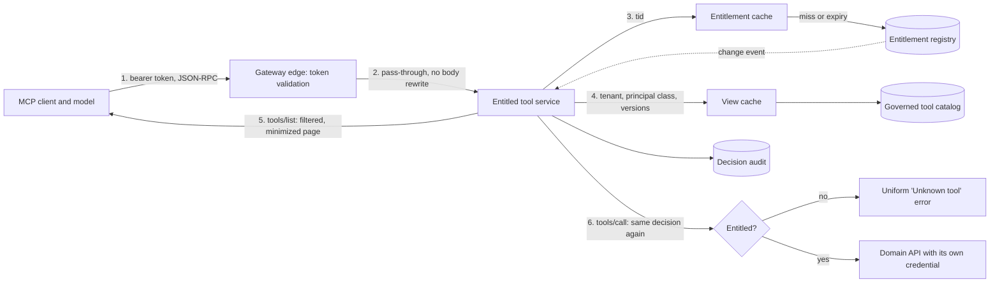

# Entitlement-Aware Tool Catalog

> **Maturity:** preview · **Kind:** design-pattern · **Category:** `ai-gateway` · **Version:** 0.1.0

A multi-tenant MCP server or tool gateway usually holds one catalog for every customer. Tenants license different modules, users hold different app roles, and some features sit behind per-tenant flags. If `tools/list` returns the whole catalog, the model sees tools its caller can never use. It spends tokens reading them, picks them, fails, and retries. A prompt injection gets a menu of every capability in the product. If the gateway filters the list but does not check `tools/call`, any caller who guesses a name can run a hidden tool.

This design pattern computes **one entitlement decision per caller and tool**, and applies it in two places. `tools/list` returns only the tools the caller is entitled to, with feature-gated input properties removed (**catalog filtering**). `tools/call` evaluates the same decision again from the same verified inputs, and a denied call is indistinguishable from a call to a tool that does not exist (**enforcement**). The decision is derived from the validated token and an authoritative entitlement registry, never from headers, arguments or the model. Filtered views are cached by entitlement set, not by user, so thousands of users with the same tenant and role mix share one view.

> **Core thesis:** *Decide once, apply twice. The caller's validated identity and the registry decide which tools exist for that caller. `tools/list` shows exactly that set, and `tools/call` re-checks it every time, so the model never sees a tool it cannot use and cannot reach one by guessing its name.*

This asset is a **preview** design pattern. The MCP behaviors it relies on (`tools/list` pagination, `notifications/tools/list_changed`, JSON-RPC errors) follow the MCP specification revision the sample declares. Check the current specification before you build on them. Every benefit stated here is qualitative on purpose.

## Architecture and implementation map

| Layer / concern | Deep-dive documentation | Executable or illustrative reference |
|---|---|---|
| **Problem, components, decision function, filtered views, wire contracts, failure modes** | [`docs/architecture.md`](docs/architecture.md) · [ADR 0001](docs/decisions/0001-filter-list-and-enforce-call-from-one-entitlement-decision.md) | [`samples/entitled_tool_catalog.py`](samples/entitled_tool_catalog.py): `denial_reason`, `build_view`, `EntitledToolGateway` |
| **Caching, staleness, revocation, change notifications, cursors** | [`docs/architecture.md`](docs/architecture.md) sections 7 to 10 · [ADR 0002](docs/decisions/0002-cache-views-by-entitlement-set-not-user.md) | `EntitlementCache`, `ViewCache`, `CursorCodec` and `_refresh_sessions` in the same sample |
| **Entitlement sources, identities, token validation, catalog governance, audit** | [`docs/authentication-and-governance.md`](docs/authentication-and-governance.md) | `EntraTokenValidator` and `HttpEntitlementRegistryClient` seams, `ToolCatalog` lint, `AuditLog` |
| **Scenario suite, test matrix, metrics, troubleshooting** | [`docs/evaluation-and-troubleshooting.md`](docs/evaluation-and-troubleshooting.md) | [`samples/README.md`](samples/README.md): 14 scenarios across 3 Domain Packs |

## Domain Packs

The mechanics are the same in every industry. What changes is which modules are licensed separately, which tools need a role, and how much staleness the operator accepts during a registry outage.

| Domain Pack | Operator and tenants | Licensed modules and gated features | Policy choice |
|---|---|---|---|
| **Manufacturing (Contoso)** | Contoso sells multi-plant production software to Adventure Works (all modules) and Tailspin Toys (production only) | Production, quality, maintenance. A cost-breakdown input is gated by a cost-analytics flag. Inspections need a maintenance-lead role and a predictive-maintenance flag. | Short stale window for read-only tools. Explicit "not available" errors allowed for discoverable tools. |
| **Healthcare (Fabrikam)** | Fabrikam runs a clinic operations platform for Lamna Healthcare (all modules) and Relecloud Clinics (scheduling only) | Scheduling, clinical summary, billing. Virtual-visit slots are gated by a telehealth flag. Visit summaries need a clinician role. | No stale window and no stale calls. Explicit disclosure forbidden, so every denial reads as "Unknown tool". |
| **Logistics (Northwind)** | Northwind Traders runs a freight platform for Wide World Importers (all modules) and Wingtip Toys (shipments only) | Shipments, customs, fleet. Hazmat detail is gated by a hazmat flag. Emissions reports need a fleet-manager role and a carbon-report flag. | Longer stale window for read-only tools. Explicit disclosure allowed for discoverable tools. |
| **Financial services** | A core-banking provider serving banks that license lending and treasury separately | Lending, treasury, payments. Large-value payment tools need a payments-approver role. | No stale window for write tools. Uniform errors only. |
| **Public sector** | A case-management platform for agencies with different program modules | Program modules, records retention, analytics. Export tools need a records-officer role. | No staleness. Catalog lint also blocks agency names and program codes. |

The sample ships the first three as runnable packs (`--domain contoso-manufacturing`, `fabrikam-health`, `northwind-logistics`).

## When to use

- One MCP server or tool gateway serves **many tenants or many roles from one tool catalog**, and callers are entitled to different subsets.
- Entitlements come from **licensed modules, feature flags or app roles** that you can derive from a validated token plus an authoritative registry.
- The catalog is large enough that **sending every tool to the model costs tokens and hurts tool selection**, or exposes capabilities you would rather not advertise.
- Entitlements **change while sessions are open** (upgrades, downgrades, revocations), and connected clients must learn about it through `notifications/tools/list_changed`.
- You already authenticate MCP callers, for example with [MCP OAuth Front Door](../mcp-oauth-front-door/README.md), and now need per-caller authorization at the tool level.

## When not to use

- **Every caller is entitled to every tool.** Authenticate and enforce at the backend. A filtered catalog adds a registry dependency for no gain.
- **You need record-level or row-level authorization.** This pattern decides which tools exist for a caller. Whether a caller may read work order `WO-10042` is the domain API's decision. See [Backend Identity Propagation](../backend-identity-propagation/README.md) and [Request Context Is Not Authorization](../../agent-runtime/request-context-is-not-authorization/README.md).
- **You want to decide when to expose tools to the model, not which ones are allowed.** That is [Progressive Tool Loading](../../orchestration-and-workflows/progressive-tool-loading/README.md). Use it on top of this pattern, never instead of it.
- **You are building the whole multi-tenant gateway.** Start with [Multi-Tenant MCP Gateway](../multi-tenant-mcp-gateway/README.md), which covers tenant resolution, routing and isolation. Its section 7 (tool-level authorization) points here for the catalog details.
- **The only control you plan is a system-prompt instruction** such as "do not use billing tools for this tenant". That is not a control. Either implement this pattern or remove the tools.

## Architecture



1. The client sends a JSON-RPC request with a bearer token. The gateway edge validates the token signature, issuer, audience, lifetime and allowed client application. It returns `401` with a `resource_metadata` challenge if any check fails.
2. The edge forwards the request unchanged to an SDK-based MCP service. It does not rewrite `tools/list` bodies in gateway policy.
3. The service reads the directory tenant ID (`tid`), object ID (`oid`) and `roles` from the validated token only. It resolves the internal tenant and its entitlements (modules, feature flags, description variants, version) through a cache in front of the registry. Client-supplied tenant headers are ignored and audited by name.
4. It normalizes the caller's roles to the roles the catalog actually uses (the **principal class**) and looks up the filtered view by `(tenant, principal class, entitlement version, catalog version)`.
5. `tools/list` returns a page of that view. Each tool has entitlement-gated input properties removed and a tenant-neutral description variant applied. The cursor is opaque and bound to the view.
6. `tools/call` looks the tool up in the full catalog and evaluates the same decision function again. It never trusts the cached view, the session or what the client listed earlier. Unknown and unentitled tools get the same error. Allowed calls run against the domain API with a backend credential, and every decision is audited.

### Where to enforce, and what to trust from each hop

| Hop | Enforces | Trusts | Never trusts |
|---|---|---|---|
| **Gateway edge (for example Azure API Management)** | Token signature, issuer, audience, lifetime, allowed client app, rate limits | The identity provider's signing keys | Tenant hint headers, request bodies as authorization input |
| **Entitled tool service: `tools/list`** | Catalog filtering, schema minimization, cursor binding | Validated `tid`, `oid`, `roles`; registry entitlements | Headers, arguments, session state as an entitlement source |
| **Entitled tool service: `tools/call`** | Entitlement re-check, stale-snapshot policy, argument shape against the minimized schema | Validated claims; registry entitlements at their version floor | The cached view, the client's earlier list, the model's choice of tool |
| **Entitlement registry** | Source of truth for modules, flags and versions | Its own onboarding and licensing records | Anything the caller sends |
| **Domain API** | Record-level authorization, tenant isolation in data | A backend credential and the resolved tenant passed by the service | The caller's MCP token (it is never forwarded) |

## Key design decisions

| Decision | Choice | Why | Trade-off |
|---|---|---|---|
| One decision for list and call ([ADR 0001](docs/decisions/0001-filter-list-and-enforce-call-from-one-entitlement-decision.md)) | A single `denial_reason(tool, entitlements, roles)` drives both `tools/list` and `tools/call` | List filtering alone is advisory. Call checks alone waste turns on tools the model cannot use. One function cannot drift. | The call path pays an entitlement lookup on every call, served from cache. |
| Cache key ([ADR 0002](docs/decisions/0002-cache-views-by-entitlement-set-not-user.md)) | `(tenant, principal class, entitlement version, catalog version)`, no user ID | Users with the same entitlement set share a view. Versions make stale views unreachable without a TTL. | Roles must be normalized to the ones the catalog uses, or the key fragments. |
| Error on denial | Uniform `-32602 Unknown tool` by default; explicit `-32001` only for tools marked discoverable, and only where policy allows | A denied call reveals nothing about which tools exist for other tenants. | Clients cannot tell "not licensed" from "typo" unless you opt in. |
| Entitlement source | Validated `tid` plus `roles`, then an authoritative registry for modules and flags | Licensing changes often and does not belong in tokens. Roles do. | The registry becomes a dependency with its own availability budget. |
| Outage behavior | Fail closed, with an explicit `max_staleness` window and a stale-call scope (`none`, `read-only`, `all`) | The operator decides, per domain, how long a stale snapshot is acceptable and for which tools. | Some legitimate calls fail during long outages. |
| Change propagation | Change events raise a per-tenant version floor; `list_changed` goes only to sessions whose view digest changed | Revocations take effect on the next call; clients are not spammed. | Missed events fall back to the entitlement TTL. |
| Shared metadata | Catalog lint blocks tenant names and directory tenant IDs in titles, descriptions, variants and schemas | One catalog is shown to every tenant. A tenant name in a description leaks across tenants. | Tool authors must use neutral variant IDs. |

## Getting started

1. Run the scenario suite from the repository root (Python 3.10 or later, standard library only, no network):

   ```powershell
   python assets\ai-gateway\entitlement-aware-tool-catalog\samples\entitled_tool_catalog.py --self-test
   ```

   Expect 42 `PASS` lines (14 scenarios × 3 Domain Packs) and `42/42 scenarios passed`. Add `--demo --domain northwind-logistics` to see the filtered lists, the uniform error and a change notification.
2. Read [`samples/README.md`](samples/README.md) for what each scenario proves, then [`docs/architecture.md`](docs/architecture.md) for the decision function, cache keys and wire contracts.
3. Inventory your tools. For each, record its module, any-of app roles, optional feature flag, read-only flag and whether it may ever be disclosed. Move tenant-specific wording into neutral description variants.
4. Define app roles on the MCP server's Entra app registration and decide where modules and flags live (registry, licensing service or tenant configuration). See [`docs/authentication-and-governance.md`](docs/authentication-and-governance.md).
5. Replace the seams: `EntraTokenValidator`, `HttpEntitlementRegistryClient`, `ForwardingToolBackend`, a shared cursor key and a full JSON Schema validator.
6. Set `CachePolicy` per domain with your risk owner: entitlement TTL, negative TTL, maximum staleness and stale-call scope.
7. Run the test matrix in [`docs/evaluation-and-troubleshooting.md`](docs/evaluation-and-troubleshooting.md) against your service, including the mutation check, before you expose it to agents.

## File map

| Path | Purpose |
|---|---|
| [`README.md`](README.md) | This overview |
| [`manifest.yaml`](manifest.yaml) | Asset metadata for the catalog |
| [`CHANGELOG.md`](CHANGELOG.md) | Version history |
| [`docs/architecture.md`](docs/architecture.md) | Problem, components, diagrams, decision matrix, wire contracts, failure modes, anti-patterns, production checklist |
| [`docs/authentication-and-governance.md`](docs/authentication-and-governance.md) | Entitlement sources, identities, token validation, RBAC, secrets, catalog governance, audit |
| [`docs/evaluation-and-troubleshooting.md`](docs/evaluation-and-troubleshooting.md) | Scenario suite, test matrix, metrics, symptom-to-fix table |
| [`docs/decisions/0001-filter-list-and-enforce-call-from-one-entitlement-decision.md`](docs/decisions/0001-filter-list-and-enforce-call-from-one-entitlement-decision.md) | ADR: one decision function for list and call |
| [`docs/decisions/0002-cache-views-by-entitlement-set-not-user.md`](docs/decisions/0002-cache-views-by-entitlement-set-not-user.md) | ADR: view cache keyed by entitlement set and versions |
| [`samples/README.md`](samples/README.md) | How to run the sample and what each scenario proves |
| [`samples/entitled_tool_catalog.py`](samples/entitled_tool_catalog.py) | Runnable reference implementation with `--self-test` and `--demo` |

## Related assets

| Asset | Relationship |
|---|---|
| [Multi-Tenant MCP Gateway](../multi-tenant-mcp-gateway/README.md) | The end-to-end gateway. Its section 7 (tool-level authorization) and section 13 (wire contracts) summarize what this asset details. |
| [MCP OAuth Front Door](../mcp-oauth-front-door/README.md) | Issues and validates the tokens this pattern reads. Authentication there, tool authorization here. |
| [Backend Identity Propagation](../backend-identity-propagation/README.md) | How the allowed call reaches the domain API with its own credential, and where record-level checks live. |
| [Request Context Is Not Authorization](../../agent-runtime/request-context-is-not-authorization/README.md) | The principle this pattern applies: tenant hints and tool arguments are context, not authorization; re-check at the resource boundary. |
| [Progressive Tool Loading](../../orchestration-and-workflows/progressive-tool-loading/README.md) | Decides **when** to expose tools to the model. This pattern decides **which** tools a caller may ever see. Load progressively from the entitled set only. |
| [Multi-Team Model Gateway](../multi-team-model-gateway/README.md) | The same entitlement idea applied to model deployments: each team sees and calls only the models it is entitled to |
| [Agent Security and Governance](../../security-and-governance/agent-security-and-governance/README.md) | Broader controls: identity, policy, audit and red-teaming for agents. |
| [Agent Production Readiness Guide](../../agentops-and-readiness/agent-production-readiness/README.md) | Readiness review this pattern feeds: authorization, observability and failure modes. |

## Production-readiness pillar mapping

| Pillar | How this asset contributes |
|---|---|
| **Security and observability** | Deny-by-default tool authorization derived from validated claims, uniform denials, schema minimization, fail-closed outage handling and a decision audit without arguments or tokens. |
| **Agent architecture patterns** | A reusable split between catalog filtering and call-time enforcement driven by one decision function, with versioned views and change notifications. |
| **Solution optimization** | Smaller tool lists per caller reduce prompt tokens and give the model fewer wrong choices. Views are shared across users with the same entitlement set. |
| **CoE and governance** | One governed catalog with lint for tenant data, explicit policy per domain for staleness and disclosure, and audit evidence of what each caller could see and do. |

## Security and responsible AI

- **Derive entitlements from verified identity.** Use `tid`, `oid` and `roles` from a validated token and the registry. Never use a tenant header, a tool argument or a session field as an entitlement source.
- **Enforce on every call.** Catalog filtering reduces exposure but is not a control on its own. A model, a script or an attacker can call any name.
- **Do not leak through errors.** By default an unentitled tool and a nonexistent tool return the same error. Enable explicit errors only for tools you are willing to advertise, and never in domains where module names are sensitive.
- **Reduce the prompt-injection blast radius.** A model can only be steered toward tools it can see and the caller is allowed to run. Hidden tools are not in its context at all.
- **Keep shared metadata neutral.** Descriptions and schemas are shown to every entitled tenant. Lint them for tenant names and identifiers.
- **Audit decisions, not content.** Record tenant, principal class, tool, versions, freshness and reason. Do not record argument values, results, tokens or the values of client hint headers.
- **Fail closed.** If the registry is unavailable and no usable snapshot exists, return `503`. Allow stale snapshots only within an explicit, reviewed window.

## Limitations

- Filtering decides tool visibility, not data access. Record-level authorization stays in the domain APIs.
- The sample models JSON-RPC over HTTP as method calls. It has no HTTP server, streaming transport or real token validation.
- Error codes `-32001` and `-32003` are implementation-defined codes in the JSON-RPC server-error range. Your clients must be told what they mean.
- Clients that ignore `notifications/tools/list_changed` keep an outdated list until they list again. Enforcement still protects calls.
- Azure API Management can expose REST APIs as MCP servers, but such a server returns one fixed tool list for every caller. Per-caller catalogs need an SDK-based MCP service behind the gateway.
- Group claims can overflow for users in many groups. Prefer app roles for tool authorization.

## References

- [`docs/architecture.md`](docs/architecture.md), [`docs/authentication-and-governance.md`](docs/authentication-and-governance.md), [`docs/evaluation-and-troubleshooting.md`](docs/evaluation-and-troubleshooting.md)
- [Microsoft identity platform access tokens](https://learn.microsoft.com/entra/identity-platform/access-tokens)
- [Add app roles to your application and receive them in the token](https://learn.microsoft.com/entra/identity-platform/howto-add-app-roles-in-apps)
- [Configure group claims for applications](https://learn.microsoft.com/entra/identity/hybrid/connect/how-to-connect-fed-group-claims)
- [Validate Microsoft Entra token policy in Azure API Management](https://learn.microsoft.com/azure/api-management/validate-azure-ad-token-policy)
- [Expose a REST API in API Management as an MCP server](https://learn.microsoft.com/azure/api-management/export-rest-mcp-server)
- [Azure Container Apps overview](https://learn.microsoft.com/azure/container-apps/overview)
- [Managed identities for Azure resources](https://learn.microsoft.com/entra/identity/managed-identities-azure-resources/overview)
- [Microsoft identity platform and OAuth 2.0 On-Behalf-Of flow](https://learn.microsoft.com/entra/identity-platform/v2-oauth2-on-behalf-of-flow)
- [Model Context Protocol specification](https://modelcontextprotocol.io/specification)
- [Contribution and Standardization Guide](../../../docs/contribution-guide.md)
