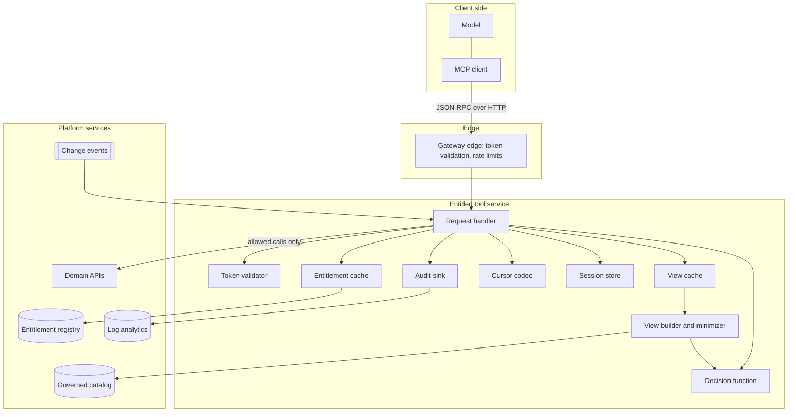
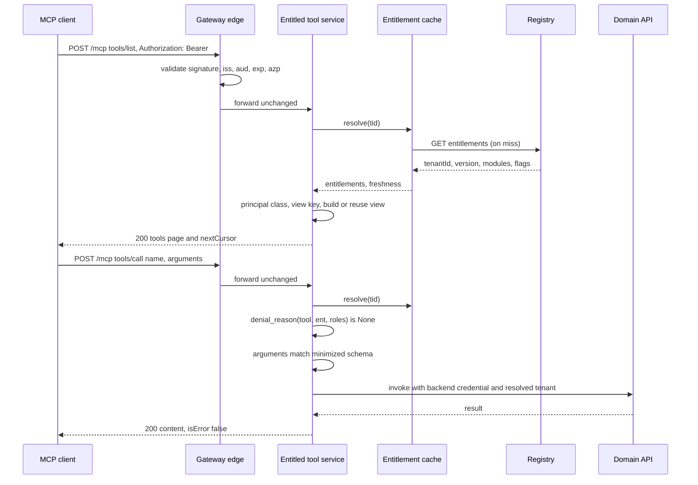
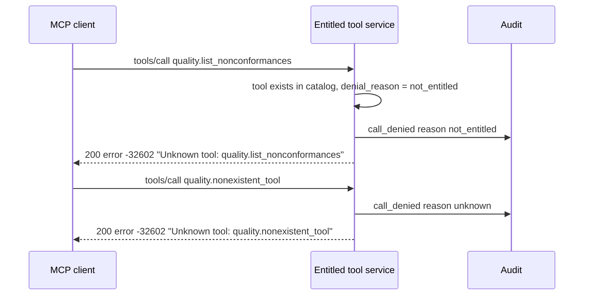
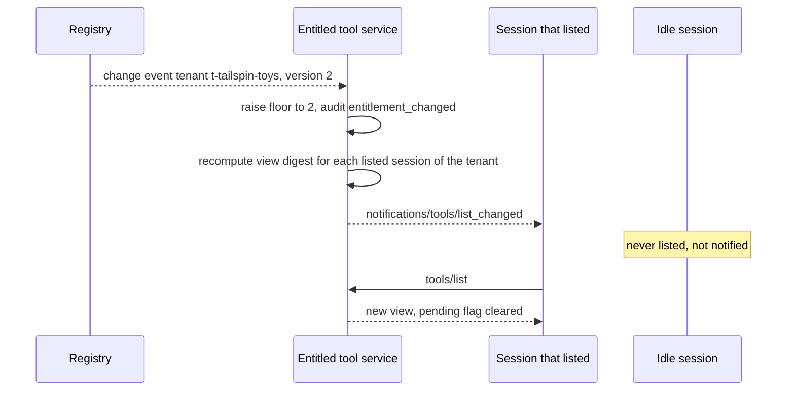

# Architecture: Entitlement-Aware Tool Catalog

This document describes how an MCP server or tool gateway computes, per caller, the tools that caller is entitled to, returns only that subset from `tools/list`, and enforces the same decision on every `tools/call`. Every behavior described here is implemented and tested in [`../samples/entitled_tool_catalog.py`](../samples/entitled_tool_catalog.py). Names in the text match the classes and functions in the sample.

The broader gateway (tenant resolution, routing, isolation, rate limits) is covered by [Multi-Tenant MCP Gateway](../../multi-tenant-mcp-gateway/README.md). Its section 7 (tool-level authorization) and section 13 (wire contracts) summarize the same idea in a few paragraphs. This document goes deeper on how the catalog is computed, cached, minimized, versioned, paginated and audited.

## 1. Problem and forces

A product team publishes one MCP server for all customers. The catalog grows with the product: tens or hundreds of tools across modules that customers license separately, some behind feature flags, some restricted to particular app roles. Three things go wrong when every caller sees the whole catalog.

- **Wasted turns and tokens.** The model reads every tool description on every turn. It picks a tool the caller is not licensed for, gets an error, and tries something else. Larger tool lists also make tool selection worse.
- **Prompt-injection blast radius.** An injected instruction can steer the model only toward tools that are in its context. A full catalog gives the attacker a menu of every capability in the product.
- **Disclosure.** Tool names, descriptions and input schemas reveal which modules exist, what other customers buy, and sometimes tenant-specific wording.

The obvious fixes each fail on their own:

| Approach | What goes wrong |
|---|---|
| Tell the model in the system prompt which tools to avoid | The model can ignore it, and an injection can override it. Nothing stops a direct call. |
| Filter `tools/list` only | Filtering is advisory. Any client can call a name it guessed or saw elsewhere. |
| Enforce at `tools/call` only | Safe, but the model keeps seeing and choosing tools it cannot use. Turns and tokens are wasted on every session. |
| Build a separate MCP server per tenant | Catalog drift, duplicated deployments, and the same problem again for roles inside a tenant. |

The forces this pattern balances:

- **Correctness.** List and call must never disagree about what a caller may use.
- **Freshness.** Entitlements change during open sessions. Revocations must bite quickly.
- **Availability.** The entitlement registry can be slow or down. The operator must choose between failing closed and serving a bounded stale snapshot.
- **Cost.** Computing a filtered view per user per request is wasteful. Many users share the same entitlement set.
- **Confidentiality.** Shared metadata must not carry tenant data, and errors must not reveal what other callers can see.

## 2. Scope and relationship to sibling assets

| Concern | Where it lives |
|---|---|
| Authenticating MCP clients, protected-resource metadata, token issuance | [MCP OAuth Front Door](../../mcp-oauth-front-door/README.md) |
| Tenant resolution, routing to backends, isolation, gateway policy | [Multi-Tenant MCP Gateway](../../multi-tenant-mcp-gateway/README.md) |
| **Which tools a caller may ever see and call** | **This asset** |
| When to expose entitled tools to the model (lazy loading, tool search) | [Progressive Tool Loading](../../../orchestration-and-workflows/progressive-tool-loading/README.md) |
| Calling the domain API with the right credential, record-level checks | [Backend Identity Propagation](../../backend-identity-propagation/README.md) |
| Why headers and arguments are context, not authorization | [Request Context Is Not Authorization](../../../agent-runtime/request-context-is-not-authorization/README.md) |

Progressive loading and this pattern compose: the entitled set is the upper bound, and progressive loading chooses which part of that set to put in front of the model at each step. Progressive loading must never widen the set.

## 3. Components

| Component | Sample class or function | Responsibility |
|---|---|---|
| Gateway edge | Not modeled (see section 12) | Validates the token, applies rate limits, forwards the request unchanged. |
| Token validator | `TokenValidator`, `FakeTokenValidator`, `EntraTokenValidator` seam | Turns a bearer token into a sealed `VerifiedPrincipal(directory_tenant_id, object_id, roles, client_app_id)`. Nothing else can create one. |
| Entitlement registry | `EntitlementRegistry`, `FakeEntitlementRegistry`, `HttpEntitlementRegistryClient` seam | Maps a directory tenant ID to an internal tenant ID and its `Entitlements(tenant_id, version, modules, feature_flags, description_variants)`. Publishes change events. |
| Entitlement cache | `EntitlementCache`, `CachePolicy` | Positive cache with TTL, negative cache for unknown tenants, per-tenant version floor, bounded stale window during outages. |
| Governed catalog | `ToolCatalog`, `ToolDefinition` | Holds every tool with its module, any-of roles, optional feature flag, read-only flag, discoverability and description variants. Each publish is linted and increments the catalog version. |
| Decision function | `denial_reason` | Returns `None` when the tool is allowed, otherwise `not_entitled` or `role_required`. Used by both list and call. |
| Principal class | `principal_class` | Normalizes the caller's roles to the roles the catalog references. Becomes part of the cache key. |
| View builder | `build_view`, `minimize_schema` | Builds the filtered, minimized, versioned view and its content digest. |
| View cache | `ViewCache`, `secure_view_key` | Caches views by `(tenant, principal class, entitlement version, catalog version)`. |
| Cursor codec | `CursorCodec` | Issues and verifies opaque, HMAC-protected pagination cursors bound to the view. |
| Session store | `Session` in `EntitledToolGateway.sessions` | Binds an MCP session to its owner and remembers the digest the client last listed. |
| Request handler | `EntitledToolGateway` | Orchestrates authentication, resolution, list, call, change propagation and audit. |
| Audit sink | `AuditLog` | One structured event per decision. No arguments, results or tokens. |
| Tool backend | `ToolBackend`, `FakeToolBackend`, `ForwardingToolBackend` seam | Calls the domain API with a backend credential and the resolved tenant. |

## 4. Component diagram



## 5. The entitlement decision

### 5.1 Inputs

The decision uses only three inputs, and each has exactly one trusted source.

| Input | Source | Never from |
|---|---|---|
| Tenant and its entitlements | `tid` claim of the validated token, mapped by the registry to an internal tenant with modules, flags and a version | `X-Tenant-Id`, `X-Org-Id`, `X-Customer-Id`, `X-Account-Id` headers; a `tenant_id` argument; session state |
| Caller roles | `roles` claim of the validated token (app roles) | Request body, arguments, retrieved content |
| Tool definition | The governed catalog, looked up by name | The client's earlier `tools/list` result, the cached view |

### 5.2 Decision order

`denial_reason(tool, entitlements, roles)` checks, in order:

1. The tool's module is in the tenant's licensed modules. Otherwise `not_entitled`.
2. If the tool has a feature flag, the tenant has that flag. Otherwise `not_entitled`.
3. If the tool lists roles, the caller holds at least one of them (any-of). Otherwise `role_required`.

A tool with no roles is available to any principal of an entitled tenant. Unknown tool names never reach this function: the call path returns reason `unknown` before it.

### 5.3 Principal class

Two users with roles `{Planner, Reader}` and `{Planner}` see the same catalog if no tool references `Reader`. `principal_class` intersects the caller's roles with `ToolCatalog.relevant_roles` and joins the result with `+` (for example `MaintenanceLead+Planner`), or uses `base` when nothing is left. This label, not the user, goes into the cache key. Users who differ only in irrelevant roles share a view.

When a newly published tool references a new role, `relevant_roles` grows and the catalog version changes, so all view keys change together.

## 6. Filtered views and schema minimization

`build_view` walks the catalog in name order and keeps each tool for which `denial_reason` returns `None`. For each kept tool it emits:

- `name` and `title` unchanged.
- `description`: the tenant's description variant for that tool if one exists, otherwise the shared description. Variant IDs are neutral (`multi-site`, `telehealth`, `multi-carrier`). The registry tells the service which variant applies to which tenant.
- `inputSchema`: the result of `minimize_schema`. A top-level property annotated with `x-entitlement-flag` is removed when the tenant lacks that flag. The annotation is always removed, so internal flag names never reach the client. Names in `required` that no longer exist are dropped.
- `annotations.readOnlyHint` from the tool's read-only flag.

The view also carries:

- `version`: `e<entitlement version>.c<catalog version>`, for audit and troubleshooting.
- `digest`: the first 16 hex characters of a SHA-256 over the emitted tools. Cursors and change notifications compare digests, not versions, because a version bump does not always change a given caller's view.

Minimization matters at call time too. The call path validates arguments against the **minimized** schema for the caller's tenant. A caller who sends a property that is hidden from it (for example `include_cost_breakdown` without the cost-analytics flag) gets a tool error, and the backend is not called.

## 7. Caching

There are two caches with different keys and different invalidation rules.

### 7.1 Entitlement cache

`EntitlementCache` is keyed by directory tenant ID. `resolve` follows this order:

1. **Fresh hit.** A snapshot exists, its version is at or above the tenant's floor, and its age is under `entitlement_ttl`. Freshness `hit`.
2. **Negative hit.** The tenant was recently found unregistered and `negative_ttl` has not ended. Raise `TenantNotOnboarded` without calling the registry.
3. **Registry call.** On `RegistryUnavailable`, serve the snapshot as `stale` only if it is usable and younger than `entitlement_ttl + max_staleness`. Otherwise raise `EntitlementUnavailable`.
4. **Not registered.** Store a negative entry and raise `TenantNotOnboarded`.
5. **Lagging replica.** If the registry returns a version below the floor, raise `EntitlementUnavailable`. Never accept an older version than a change event already announced.
6. **Store** the snapshot. Freshness `miss`.

`CachePolicy` validates its own values: TTLs and staleness are non-negative, and `stale_call_scope` is `none`, `read-only` or `all`.

### 7.2 View cache

`ViewCache` is keyed by `secure_view_key`: `("view", tenant_id, principal_class, entitlement_version, catalog_version)`. The key has no user ID, session ID or token hash. See [ADR 0002](decisions/0002-cache-views-by-entitlement-set-not-user.md).

A view is a pure function of its key, so the cache needs no TTL. When entitlements or the catalog change, the version in the key changes and old entries become unreachable. The sample uses a bounded FIFO. Each replica can keep its own view cache, or replicas can share one with the same key.

The sample also contains `insecure_view_key_without_tenant`, an anti-pattern baseline used only by scenario 5. Without the tenant in the key, two tenants at the same entitlement version and principal class share a view: after the full tenant lists first, the limited tenant is served the full tenant's tools. Enforcement still denies the call because the call path never reads the view, which is exactly why the call path must not trust it.

## 8. Freshness, staleness and revocation

| Situation | Behavior | Freshness in audit |
|---|---|---|
| Snapshot within TTL | Serve it | `hit` |
| Snapshot expired, registry healthy | Fetch and serve | `miss` |
| Registry down, snapshot within `ttl + max_staleness`, at or above floor | `tools/list` serves it. `tools/call` follows `stale_call_scope`. | `stale` |
| Registry down, no usable snapshot | `503`, `-32003` for every method that needs entitlements | n/a |
| Change event received | Floor raised to the event version. Older snapshots are unusable even in the stale window. | next resolve is `miss` |
| Registry replica returns version below floor | `503`, `-32003` until the replica catches up | n/a |
| Change event missed | Exposure lasts until `entitlement_ttl` ends, then the next resolve fetches the new version | `miss` |

`stale_call_scope` decides which calls may run on a stale snapshot:

- `none`: no calls. The list may still be served from the snapshot.
- `read-only`: only tools whose read-only flag is set. Write tools return `503` with audit reason `stale_entitlements`.
- `all`: every entitled tool. Use only where the risk owner accepts it.

Revocation latency is bounded by event delivery when events arrive, and by `entitlement_ttl` when they do not. Choose the TTL from the revocation latency your risk owner accepts, not from cache hit rates.

## 9. Versioned catalog and change notifications

The catalog version increments on every successful publish. The entitlement version increments on every licensing or flag change for a tenant. Together they name a view (`e2.c5`).

The service advertises `capabilities.tools.listChanged: true` in `initialize`. Two events trigger a check:

- **Entitlement change** for one tenant: `_on_entitlement_change` raises the floor, audits `entitlement_changed`, and checks that tenant's sessions.
- **Catalog publish**: `publish_tool` lints and publishes, audits `catalog_published`, and checks every session.

For each candidate session, `_refresh_sessions`:

1. Skips sessions that never listed tools (they have nothing to refresh) and sessions with a notification already pending.
2. Recomputes the view for the session's tenant, using the roles recorded at the session's last `tools/list` normalized against the current catalog.
3. Compares the new digest with the digest the session last listed. If resolution fails, it treats the digest as unknown and notifies, so the client's next `tools/list` gets an authoritative answer.
4. If the digest changed, sends `notifications/tools/list_changed`, marks the session pending and audits `list_changed_sent`.

The next `tools/list` on that session stores the new digest and clears the pending flag. A tool published in a module the limited tenant does not license does not change its view, so its sessions are not notified.

Notifications are an optimization for the model's context, not a security control. A client that ignores them still cannot call a revoked tool, because the call path re-checks.

## 10. Pagination cursors

MCP `tools/list` supports cursor-based pagination. The cursor must be opaque and must not let a caller page through someone else's view.

`CursorCodec` encodes `base64url(payload) "." base64url(HMAC-SHA256(key, payload)[:16])`, where the payload is `{"b": <binding>, "o": <offset>}` and the binding is the first 24 hex characters of `SHA-256(tenant_id | principal_class | view_digest)`. The payload contains nothing readable about the tenant or the catalog.

Decoding fails with a reason that is audited but not returned:

| Reason | Cause |
|---|---|
| `malformed` | Not a string, wrong number of parts, bad base64 |
| `signature` | MAC does not match (tampered or issued by another key) |
| `binding` | Issued for another tenant, another principal class, or a view that has since changed |
| `offset` | Negative, not an integer, or past the end of the view |

Every failure returns `-32602 Invalid cursor`. Because the binding includes the view digest, a cursor issued before an entitlement or catalog change is rejected after it, and the client starts again from the first page. The sample's key is generated per process. A multi-replica deployment shares a managed key and rotates it, accepting the previous key for a short overlap.

Filter first, then paginate. Paginating the full catalog and filtering each page gives uneven page sizes and lets page boundaries leak how many hidden tools exist.

## 11. Request sequences

### 11.1 List, then call an allowed tool



### 11.2 Call a hidden tool by name



The two responses have the same shape and no `data`. Only the audit shows the difference.

### 11.3 Entitlement change during a session



## 12. Hosting on Azure

| Role | Azure option | Notes |
|---|---|---|
| Gateway edge | Azure API Management | Validate the Entra token with the token-validation policy, apply rate limits, and pass the JSON-RPC body through. Do not rewrite `tools/list` responses in policy: it breaks streaming responses and duplicates the decision function in a second language. |
| Entitled tool service | An SDK-based MCP server on Azure Container Apps | Owns the decision function, caches, sessions and notifications. Runs with a managed identity. |
| Entitlement registry | Your licensing or tenant-configuration service | Reached with the service's managed identity. Change events through a message broker or an event-routing service. |
| Identity | Microsoft Entra ID | App registration for the MCP server with app roles; validated `tid`, `oid`, `roles`. |
| Agents | Microsoft Foundry agents or any MCP client | The agent sees only the filtered list. Its identity or the user's delegated token reaches the gateway. |
| Audit | Log analytics workspace | Decision events, joined to gateway logs by correlation ID. |

API Management can expose a REST API as an MCP server. That server's tool list is generated from the API definition and is the same for every caller, so it cannot implement per-caller catalogs. Use it for single-audience tools, and put per-caller catalogs in an SDK-based service behind a pass-through gateway.

## 13. Decision matrix

| Option | Model sees only usable tools | Hidden tools uncallable | Survives a cache bug | Turns wasted on unusable tools | Fits large catalogs |
|---|---|---|---|---|---|
| Prompt instruction only | No | No | No | Many | No |
| Filter `tools/list` only | Yes | No | No | Few | Yes |
| Enforce `tools/call` only | No | Yes | Yes | Many | No |
| Separate server per tenant | Per tenant only, not per role | Yes | Yes | Some | Poorly |
| **Filter and enforce from one decision (this pattern)** | **Yes** | **Yes** | **Yes** | **Few** | **Yes** |
| This pattern plus progressive loading | Yes, and only the relevant part | Yes | Yes | Fewest | Best |

| Choice | Option A | Option B | Pick A when | Pick B when |
|---|---|---|---|---|
| Denial error | Uniform `Unknown tool` | Explicit `-32001` with reason | Module names are sensitive or tenants compete | Discoverability helps users upgrade and module names are public |
| Entitlement source | Token claims only (roles, groups) | Token claims plus registry | Entitlements are roles and change rarely | Licensing and flags change often or are per tenant |
| Outage behavior | Fail closed (`max_staleness` 0) | Bounded stale window | Regulated or high-impact writes | Read-mostly tools where availability matters more |
| View cache scope | Per replica | Shared | Few replicas, cheap rebuilds | Many replicas, large catalogs |

## 14. Wire contracts

### 14.1 HTTP and headers

| Direction | Header | Rule |
|---|---|---|
| Request | `Authorization: Bearer <access-token>` | Required. Validated at the edge and again by the service, or by the service alone if there is no edge. |
| Request | `Mcp-Session-Id` | Optional after `initialize`. Must belong to the same `(tid, oid)` that created it, or the service returns `404`. |
| Request | `X-Tenant-Id`, `X-Org-Id`, `X-Customer-Id`, `X-Account-Id` | Ignored for authorization. Their names (never their values) are audited as `client_tenant_hint_ignored`. |
| Response | `Mcp-Session-Id` | Returned by `initialize`. |
| Response | `WWW-Authenticate: Bearer resource_metadata="https://mcp.contoso.example/.well-known/oauth-protected-resource/mcp"` | On every `401`. |

### 14.2 Token claims used

| Claim | Use |
|---|---|
| `iss`, `aud`, `exp`, `nbf`, signature | Validation only |
| `azp` or `appid` | Allowed client application check |
| `tid` | Directory tenant, mapped to the internal tenant by the registry |
| `oid` | Subject for session ownership and audit |
| `roles` | App roles, normalized to the principal class |
| `scp` | Delegated scopes, validated at the edge |

### 14.3 Registry response

```json
{
  "tenantId": "t-tailspin-toys",
  "entitlementVersion": 2,
  "modules": ["production", "quality"],
  "featureFlags": [],
  "descriptionVariants": {}
}
```

A change event carries at least `tenantId` and the new `entitlementVersion`. The service raises its floor to that version.

### 14.4 `initialize` result

```json
{
  "protocolVersion": "2025-11-25",
  "capabilities": { "tools": { "listChanged": true } },
  "serverInfo": { "name": "contoso-entitled-tool-gateway", "version": "0.1.0" }
}
```

### 14.5 `tools/list` result for the full manufacturing tenant (one tool shown)

```json
{
  "tools": [
    {
      "name": "production.get_work_order",
      "title": "Get work order",
      "description": "Return the status, quantities, due date and producing site of a production work order.",
      "inputSchema": {
        "type": "object",
        "properties": {
          "work_order_id": { "type": "string" },
          "include_cost_breakdown": { "type": "boolean" }
        },
        "required": ["work_order_id"],
        "additionalProperties": false
      },
      "annotations": { "readOnlyHint": true }
    }
  ],
  "nextCursor": "<opaque>"
}
```

The limited tenant gets the shared description and no `include_cost_breakdown` property. Neither tenant sees `x-entitlement-flag`.

### 14.6 Responses by outcome

| Outcome | HTTP | JSON-RPC | Message | `data` |
|---|---|---|---|---|
| Missing, invalid or expired token | 401 | none (empty body) | n/a | n/a |
| Malformed JSON-RPC envelope | 400 | `-32600` | `Invalid Request` | none |
| `params` not an object | 200 | `-32602` | `Invalid params` | none |
| Unknown session or session owned by another principal | 404 | `-32600` | `Session not found` | none |
| Tenant not registered | 403 | `-32001` | `Forbidden` | none |
| No usable entitlement snapshot | 503 | `-32003` | `Entitlements temporarily unavailable` | none |
| Bad or outdated cursor | 200 | `-32602` | `Invalid cursor` | none |
| Unknown or unentitled tool (uniform mode) | 200 | `-32602` | `Unknown tool: <name>` | none |
| Unentitled discoverable tool (explicit mode) | 200 | `-32001` | `Tool not available for this caller` | `{"reason": "not_entitled"}` or `role_required` |
| Call on a stale snapshot outside `stale_call_scope` | 503 | `-32003` | `Entitlements temporarily unavailable` | none |
| Arguments do not match the minimized schema | 200 | result | `isError: true`, text content | n/a |
| Unsupported method | 200 | `-32601` | `Method not found` | none |
| `notifications/*` from the client | 202 | none | n/a | n/a |

`-32001` and `-32003` are implementation-defined codes in the JSON-RPC server-error range (`-32000` to `-32099`). Document them for your clients and keep them stable. When the tool name is not a valid name, the error message is `Unknown tool` without the name.

### 14.7 Audit events

| Event | Fields (besides `t` and `event`) |
|---|---|
| `auth_failed` | `reason` |
| `client_tenant_hint_ignored` | `headers` (names), `subject`, `directory_tenant_id` |
| `session_started` | `tenant_id`, `subject` |
| `session_rejected` | `reason` (`unknown`, `principal_mismatch`), `subject`, `directory_tenant_id` |
| `tenant_not_onboarded` | `subject`, `directory_tenant_id` |
| `entitlements_unavailable` | `method`, `reason`, `subject`, `directory_tenant_id` |
| `list_filtered` | `tenant_id`, `principal_class`, `view_version`, `visible`, `hidden`, `freshness`, `subject` |
| `cursor_rejected` | `tenant_id`, `principal_class`, `reason`, `subject` |
| `call_allowed` | `tenant_id`, `principal_class`, `tool`, `entitlement_version`, `catalog_version`, `freshness`, `subject` |
| `call_denied` | the same, plus `reason` (`unknown`, `not_entitled`, `role_required`, `stale_entitlements`) |
| `call_rejected` | the same, plus `reason` `invalid_arguments` |
| `entitlement_changed` | `tenant_id`, `entitlement_version` |
| `catalog_published` | `tool`, `catalog_version` |
| `list_changed_sent` | `tenant_id`, `subject` |

A `tool` value that is not a valid tool name is recorded as `invalid:<12 hex characters of its hash>`, so an injected string never reaches the log as text.

Example:

```json
{"event": "list_filtered", "freshness": "hit", "hidden": 2, "principal_class": "MaintenanceLead+Planner", "subject": "user-2", "t": 0.0, "tenant_id": "t-tailspin-toys", "view_version": "e1.c4", "visible": 2}
```

## 15. Domain Packs

| Pack | Industry and operator | Full tenant | Limited tenant | Role-gated write tool | Feature-gated property | Policy |
|---|---|---|---|---|---|---|
| `contoso-manufacturing` | Manufacturing. Contoso, multi-plant production software. | Adventure Works: production, quality, maintenance; flags cost-analytics, predictive-maintenance; variant `multi-site` | Tailspin Toys: production | `production.update_work_order_status` (Planner) | `include_cost_breakdown` on `production.get_work_order` (cost-analytics) | Stale window, stale reads allowed, explicit disclosure allowed |
| `fabrikam-health` | Healthcare. Fabrikam, clinic operations platform. | Lamna Healthcare: scheduling, clinical-summary, billing; flag telehealth; variant `telehealth` | Relecloud Clinics: scheduling | `scheduling.book_appointment` (Scheduler) | `include_virtual` on `scheduling.find_open_slots` (telehealth) | No stale window, no stale calls, explicit disclosure forbidden |
| `northwind-logistics` | Logistics. Northwind Traders, freight platform. | Wide World Importers: shipments, customs, fleet; flags carbon-report, hazmat; variant `multi-carrier` | Wingtip Toys: shipments | `shipments.create_booking` (Dispatcher) | `include_hazmat_detail` on `shipments.track` (hazmat) | Longer stale window, stale reads allowed, explicit disclosure allowed |

Each pack also has a tool hidden from the limited tenant (`quality.list_nonconformances`, `clinical.get_visit_summary`, `customs.get_declaration_status`) and a tool published after sessions exist (`maintenance.get_asset_health`, `billing.get_remittance_status`, `fleet.list_vehicles`). The healthcare pack shows a stricter policy: an entitlement snapshot is never served stale, and the gateway refuses to start in explicit disclosure mode.

## 16. Failure modes

| Failure | Effect without the pattern | Effect with the pattern |
|---|---|---|
| Model guesses a hidden tool name | Hidden tool runs | Uniform `Unknown tool`; audited as `not_entitled` |
| Client sends `X-Tenant-Id` for another tenant | List or call for the wrong tenant | Header ignored; names audited |
| Model adds a `tenant_id` argument | Backend may honor it | Rejected by the minimized schema; backend not called |
| Session ID reused by another user or tenant | Session hijack | `404 Session not found`; audited |
| View cache keyed without tenant | Cross-tenant list leak | Not possible with `secure_view_key`; and calls are still denied |
| View cache keyed by user | Correct but no reuse; cache grows with users | Shared by principal class |
| Registry outage | Either fail open or full outage | Fail closed, or bounded stale snapshot per policy |
| Registry replica lag after a revocation | Revoked tool usable again | Version floor refuses the older snapshot |
| Missed change event | Revocation never applied | Bounded by the entitlement TTL |
| Cursor replayed across tenants or after a change | Pages from another view | `Invalid cursor`; audited with reason |
| Tenant name in a shared description | Every tenant learns of it | Publish rejected by catalog lint |
| Tool moved to another module under the same name | Entitlement silently changes | Publish rejected; version the name instead |
| Unentitled schema property sent | Feature used without a license | Tool error; backend not called |

## 17. Anti-patterns

- **Filtering in the agent prompt.** "Only use the scheduling tools" is a request to the model, not a control.
- **Enforcing only at call time.** Safe but wasteful: the model reads, picks and fails on tools it can never use, every session.
- **Filtering only the list.** A guessed or replayed name runs. Every call must re-check.
- **Trusting the cached view or the session on the call path.** A cache bug becomes an authorization bug. Recompute the decision from the catalog.
- **Requiring that a tool was listed before it can be called.** It adds state without adding safety, and fails clients that cache lists legitimately. Check entitlement, not history.
- **Keying the view cache by user.** No reuse, and the cache grows with the user base.
- **Keying the view cache by role without tenant.** Cross-tenant leak of tool names and descriptions.
- **Rewriting `tools/list` bodies in gateway policy.** Breaks streaming, duplicates the decision logic, and drifts from the call path.
- **Taking the tenant from a header, an argument or the model.** See [Request Context Is Not Authorization](../../../agent-runtime/request-context-is-not-authorization/README.md).
- **Paginating before filtering.** Uneven pages, and page boundaries reveal the number of hidden tools.
- **Putting tenant names in shared descriptions.** Use neutral variant IDs and let the registry map tenants to variants.
- **Accepting any registry version.** A lagging replica can undo a revocation. Keep a per-tenant floor.

## 18. Production checklist

- [ ] Tokens are validated for signature, issuer, audience, lifetime and allowed client application before any entitlement lookup.
- [ ] Tenant, subject and roles come only from validated claims. Tenant hint headers are ignored and audited by name.
- [ ] One decision function is used by `tools/list` and `tools/call`, and the call path never reads the cached view.
- [ ] Unknown and unentitled tools return the same error by default. Explicit disclosure is opt-in per domain and per tool.
- [ ] Input schemas are minimized per tenant, and call arguments are validated against the minimized schema with a full JSON Schema validator.
- [ ] View cache keys contain tenant, principal class, entitlement version and catalog version, and no user identifiers.
- [ ] Roles are normalized to the roles the catalog references.
- [ ] Entitlement TTL, negative TTL, maximum staleness and stale-call scope are set per domain and reviewed by the risk owner.
- [ ] Change events raise a per-tenant version floor. Lagging replicas are refused.
- [ ] `notifications/tools/list_changed` is sent only when a session's view digest changes.
- [ ] Cursors are opaque, MAC-protected, bound to tenant, principal class and view digest, and signed with a shared, rotated key.
- [ ] Catalog publishing runs lint for names, module moves and tenant-identifying terms.
- [ ] Audit records decisions with tenant, principal class, tool, versions, freshness and reason, and never arguments, results, tokens or hint values.
- [ ] Domain APIs are called with a backend credential, receive the resolved tenant, and enforce record-level authorization.
- [ ] The scenario suite and a mutation check run in CI against the real service.
