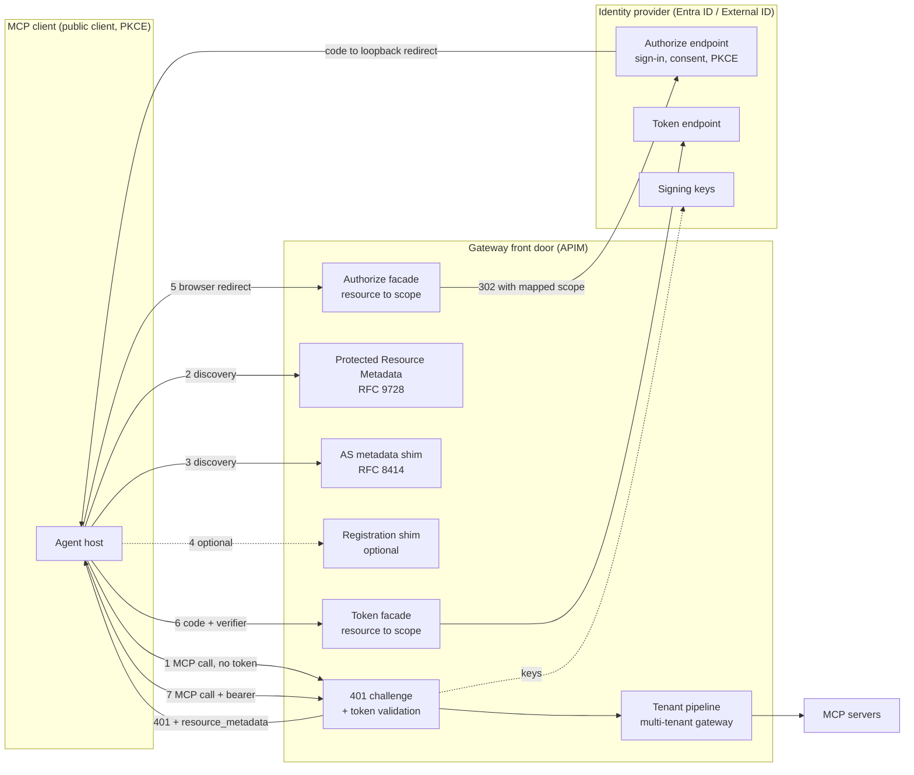
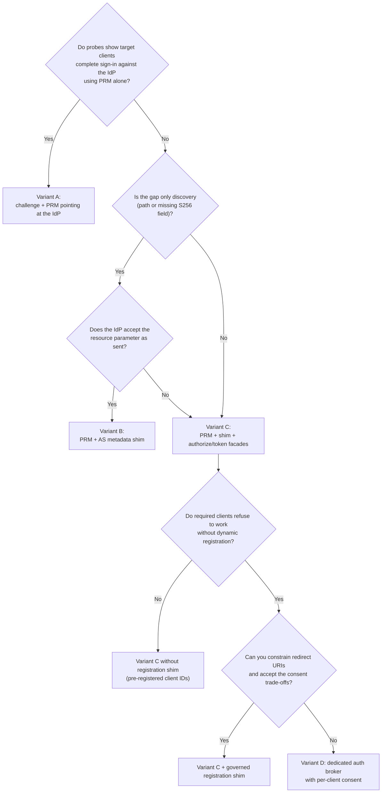

# MCP OAuth Front Door (Protected Resource Metadata, Discovery and Client Registration Shims)

> **Maturity:** preview · **Kind:** design-pattern · **Category:** `ai-gateway` · **Version:** 0.1.0

A remote Model Context Protocol (MCP) server protected by OAuth has to answer three questions before any client can call a tool. **Who protects this resource?** **How do I talk to that authorization server?** **Who am I as a client?** The MCP authorization specification answers them with a chain of open standards. The client gets a `401` with a `WWW-Authenticate` challenge. It fetches Protected Resource Metadata (RFC 9728). It reads Authorization Server Metadata (RFC 8414) or OpenID Connect discovery. It registers or identifies itself as a client. It runs the authorization code flow with PKCE (RFC 7636) and a resource indicator (RFC 8707).

Enterprise identity providers such as Microsoft Entra ID and Microsoft Entra External ID issue excellent tokens, but they were not built for this exact discovery chain. They don't offer open dynamic client registration. They use `scope` values such as `api://{app-id}/mcp.tools`, not `resource` URIs, to choose the token audience. And they publish discovery documents at a path and with a field set that some MCP clients don't expect.

This design pattern puts a small, standards-shaped **OAuth front door** in front of your MCP servers, at the gateway (Azure API Management in the examples). It covers:

- the `401` challenge
- the protected resource metadata
- an optional authorization server metadata shim
- an optional, governed client registration shim
- thin authorize and token façades that translate `resource` into `scope`

The identity provider still authenticates the user, enforces PKCE, enforces registered redirect URIs and issues the tokens. The gateway validates every token for the target resource before the [multi-tenant MCP gateway](../multi-tenant-mcp-gateway/README.md) pipeline runs.

> **Core thesis:** *The gateway answers every discovery question, the identity provider still authenticates the user and enforces PKCE and redirect URIs, and every token is validated for this resource before the pipeline runs.*

The MCP authorization specification, client support for it, and identity provider behaviors all change frequently. Every statement here about what a client or an identity provider does is qualitative and must be **verified against current documentation and your own probes** before you rely on it. The policies are illustrative and have not been deployed as published.

## Architecture and implementation map

| Layer / concern | Deep-dive documentation | Executable reference |
|---|---|---|
| **Client expectations, identity provider gaps, components, variants, wire contracts** | [`docs/architecture.md`](docs/architecture.md) · [ADR 0001](docs/decisions/0001-front-door-shims-at-the-gateway.md) · [ADR 0002](docs/decisions/0002-prefer-preregistered-clients-over-dcr-shim.md) | [`samples/oauth_front_door_sim.py`](samples/oauth_front_door_sim.py): offline simulation of the whole discovery and token flow with `--self-test`, `--emit` and `--demo` |
| **App registrations, allow-lists, redirect URIs, logging hygiene, lifecycle** | [`docs/authentication-and-governance.md`](docs/authentication-and-governance.md) | Identity inventory, registration baseline, negative tests |
| **Evaluation, client compatibility testing, troubleshooting** | [`docs/evaluation-and-troubleshooting.md`](docs/evaluation-and-troubleshooting.md) | Live probe checklist, release gates, troubleshooting table |
| **Gateway policies** | [`docs/policies/`](docs/policies/README.md) | Illustrative APIM policy XML for the challenge and validation, PRM, the metadata shim, the registration shim and both façades |

## Domain Packs

The front door is domain-agnostic. What changes per domain is the identity population, how much client compatibility you need, and how strict consent and registration must be.

| Domain Pack | Typical MCP clients | Identity population | Front door emphasis |
|---|---|---|---|
| **ERP or line-of-business ISV** | Customers' desktop AI assistants, IDE agents, low-code agent platforms | Customer users in Entra External ID, or customers' own Entra tenants | Maximum client compatibility (Variant C), per-server resources, a strict client allow-list |
| **Healthcare provider network** | Clinician assistants and approved desktop clients only | Workforce Entra ID with Conditional Access | Pre-registered clients only (no registration shim), user assignment required, no tokens or codes in logs |
| **Financial services** | Approved internal agents and a small set of vetted clients | Workforce Entra ID; B2B guests for partners | Per-server audiences, step-up Conditional Access, registration shim disabled, full audit of consent |
| **Public sector shared service** | Agency agent platforms and admin-configured connectors | Agency workforce tenants (multi-tenant app) | Issuer and tenant allow-lists, per-agency resources, sovereign-cloud endpoints |
| **Internal developer platform** | IDE agents and CLIs used by engineers | Workforce Entra ID | Variant B or C for IDE compatibility, loopback-only redirects, short token lifetimes |

[Architecture section 14](docs/architecture.md#14-domain-packs) adds the consent, logging and failure-mode emphasis for each row.

## When to use

- You publish **remote MCP servers over HTTP** and want standard MCP clients to sign users in on their own, without hand-configured client IDs and endpoints for every user.
- Your identity provider is **Microsoft Entra ID or Entra External ID** (or another enterprise IdP) and probes show that some target clients can't complete discovery, registration or token acquisition against it directly.
- You already front MCP servers with **Azure API Management** (or another gateway) and want discovery, challenge and validation to be governed policy, not code in every MCP server.
- You host **more than one MCP server** behind one gateway, and each needs its own resource identifier, audience and scopes.
- A security team needs a single place to own the **client allow-list, redirect URI rules and audit** for every MCP client that can obtain tokens.

## When not to use

- **Your clients are admin-configured connectors.** If every client is a platform connector where an administrator enters the client ID, secret and endpoints, you only need token validation. Skip the shims (see the [M365 MCP plug-in integration](../../m365-and-copilot/m365-mcp-plugin-integration/README.md) asset).
- **Your identity provider already satisfies the MCP discovery chain** for every client you support. Serve PRM pointing at it (Variant A) and stop there.
- **Local (stdio) MCP servers.** The MCP authorization flow applies to HTTP transports. Local servers take credentials from their environment.
- **You would need to open client registration to anyone.** If you can't constrain who registers and which redirect URIs they use, don't build a registration shim. Pre-register clients ([ADR 0002](docs/decisions/0002-prefer-preregistered-clients-over-dcr-shim.md)).
- **You need the gateway to mint its own tokens.** That makes the gateway an authorization server, with key management, consent and session obligations. Use a real authorization server or a dedicated broker (Variant D), not policy shims.

## Architecture



The front door is a set of small, stateless gateway operations:

- **Challenge and validation.** An unauthenticated MCP request gets `401` with `WWW-Authenticate: Bearer resource_metadata="..."`. Authenticated requests are validated for issuer, audience, scope and tenant, and the client's token is removed before the request moves on ([section 8.1](docs/architecture.md#81-challenge-and-token-validation)).
- **Protected Resource Metadata.** One document per MCP server, at `/.well-known/oauth-protected-resource/{server-path}`, naming the resource, its authorization server and its scopes ([section 8.2](docs/architecture.md#82-protected-resource-metadata)).
- **Authorization server metadata shim.** An RFC 8414 document, at a path clients actually try, that advertises `S256` and points at the façade endpoints ([section 8.3](docs/architecture.md#83-authorization-server-metadata-shim)).
- **Registration shim (optional).** Returns a pre-registered public client ID for an allow-listed redirect URI. It never creates real registrations ([section 8.4](docs/architecture.md#84-client-registration-shim), [ADR 0002](docs/decisions/0002-prefer-preregistered-clients-over-dcr-shim.md)).
- **Authorize and token façades.** Validate the request, map `resource` to the identity provider's scope, and pass PKCE through untouched. The user's browser goes to the identity provider directly; the front door never sees credentials ([sections 8.5 and 8.6](docs/architecture.md#85-authorize-facade)).

### Decision flowchart



### Pattern selection matrix

| Criterion | **A. PRM only** | **B. PRM + metadata shim** | **C. PRM + shim + façades (± registration shim)** | **D. Dedicated auth broker** |
|---|---|---|---|---|
| **Client compatibility** | Lenient or manually configured clients | Clients that need RFC 8414 discovery or an advertised `S256` | Widest, including clients that send `resource` or require registration | Widest, and can add newer registration methods |
| **Moving parts** | Two policies | Three policies | Five or six policies, allow-lists and scope maps | A separately deployed app with its own state |
| **Security exposure** | Lowest | Low: metadata only | Moderate: token path transits the gateway; registration shim adds consent risk | Depends on the broker: it becomes an authorization server |
| **Per-client consent** | IdP native | IdP native | Shared client ID: the IdP shows one app name for many clients | Possible: broker can show the real client and redirect URI |
| **Fits** | Workforce scenarios with vetted clients | Spec-current clients, when the IdP tolerates `resource` | Partner and customer-facing MCP servers with mixed clients | Large public client ecosystems, or strict per-client consent |

## Key design decisions

| Decision | Choice | Why | Trade-off |
|---|---|---|---|
| Where the shims live | Gateway policies next to the MCP routes | One owner for discovery, challenge and validation; no code in MCP servers | Policy logic is harder to unit test; the simulator and probes compensate |
| Resource identity | One resource URI per MCP server, path-specific PRM | Lets each server have its own audience and scopes | More app registrations or scope maps to manage |
| Audience | One API app registration (or one scope) per MCP server, validated at the gateway | Prevents a token for one server being replayed at another | Shared app registrations need a gateway-side scope check |
| Client identity | Pre-registered public client IDs on an allow-list | Keeps registration governed and auditable | Clients that insist on registration need the shim or a broker |
| Registration shim | Off by default; when on, returns a shared pre-registered client ID for loopback redirect URIs only | Compatibility without letting callers create real registrations | Shared client ID weakens per-client consent; see ADR 0002 |
| PKCE | Required, `S256` only, passed through untouched; the IdP verifies it | The gateway never needs the verifier to be secure | The gateway must reject requests without a challenge before redirecting |
| `resource` handling | Mapped to `api://{app-id}/{scope}` and removed before the IdP | Entra selects audience by scope; a mismatched `resource` can be rejected | The mapping table becomes security-relevant configuration |
| Token passthrough | Forbidden; the client token is deleted after validation | Audience separation; required by the MCP specification | Backends need their own credential (see Backend Identity Propagation) |
| Logging | Never log tokens, codes, verifiers or `client_assertion`; mask query strings | Codes and tokens are bearer credentials | Troubleshooting relies on structured fields and IdP sign-in logs |

These decisions are recorded in [ADR 0001: Front-door shims at the gateway](docs/decisions/0001-front-door-shims-at-the-gateway.md) and [ADR 0002: Prefer pre-registered clients over a registration shim](docs/decisions/0002-prefer-preregistered-clients-over-dcr-shim.md).

## Getting started

1. **Run the simulator offline.** It needs Python 3.10 or later and no packages. The self-test proves the discovery, PKCE and validation rules. `--emit` prints the documents the front door serves. `--demo` walks one client through the whole flow:

   ```powershell
   python assets/ai-gateway/mcp-oauth-front-door/samples/oauth_front_door_sim.py --self-test
   python assets/ai-gateway/mcp-oauth-front-door/samples/oauth_front_door_sim.py --emit
   python assets/ai-gateway/mcp-oauth-front-door/samples/oauth_front_door_sim.py --demo
   ```

2. **Probe your real clients before choosing a variant.** Use the live probe checklist in [evaluation-and-troubleshooting.md](docs/evaluation-and-troubleshooting.md#3-live-probe-checklist) against a sandbox gateway to record which discovery URLs, registration calls and parameters each client actually uses.
3. **Design the resource and audience model.** One resource URI per MCP server, one API app registration or scope per server, and the `resource` to scope map ([section 11](docs/architecture.md#11-audience-binding-and-the-resource-to-scope-map)).
4. **Register the clients.** Create the API and public client app registrations with the baseline in [authentication-and-governance.md](docs/authentication-and-governance.md), including exact loopback redirect URIs.
5. **Adapt the illustrative policies.** Start from [`docs/policies/`](docs/policies/README.md), replace the named values, and keep the negative checks (missing PKCE, unknown client, unknown resource, non-loopback redirect).
6. **Prove the negative cases, then hand off.** Run the release gates in the evaluation doc, then connect the validated route to the [multi-tenant MCP gateway](../multi-tenant-mcp-gateway/README.md) pipeline and follow the [Agent Production Readiness Guide](../../agentops-and-readiness/agent-production-readiness/README.md).

## Related assets

| Asset | Relationship |
|---|---|
| [Multi-Tenant MCP Gateway](../multi-tenant-mcp-gateway/README.md) | The per-call pipeline (tenant, entitlement, limits, routing, audit) that runs after this front door has validated the token |
| [Backend Identity Propagation](../backend-identity-propagation/README.md) | How the gateway reaches backends without forwarding the client token: on-behalf-of, managed identity, or trusted headers |
| [M365 MCP Plug-in Integration](../../m365-and-copilot/m365-mcp-plugin-integration/README.md) | Admin-configured connectors from Microsoft 365 Copilot and Copilot Studio, which use the validation half of this front door |
| [Agent Security and Governance](../../security-and-governance/agent-security-and-governance/README.md) | Agent identity, consent governance and guardrails that complement the client allow-list |
| [Secured Foundry Landing Zone](../../landing-zones-and-infra/secured-foundry-landing-zone/README.md) | The network and identity landing zone the gateway runs in |

## Production-readiness pillar mapping

| Pillar | How this asset contributes |
|---|---|
| **Security and observability** | Token validation for issuer, audience and scope; client and redirect allow-lists; PKCE enforcement; token passthrough prevention; logging hygiene for codes and tokens |
| **Agent architecture patterns** | The MCP discovery chain, the shim and façade components, and variants A to D with a decision flowchart |
| **Landing zones** | Where the front door sits in the gateway tier, app registration baseline, named values and Key Vault, workforce versus External ID versus multi-tenant identity populations |

## Security and responsible AI

- **The front door never sees user credentials.** Sign-in, MFA, Conditional Access and consent happen in the user's browser at the identity provider. Authorization codes, refresh tokens and access tokens do transit the token façade, so treat that path as sensitive, with no body logging and `Cache-Control: no-store`.
- **Never redirect on a bad request.** The authorize façade validates the client ID, redirect URI, response type and PKCE challenge, and returns an error page instead of redirecting when any of them is wrong. That prevents an open redirect.
- **Allow-list redirect URIs exactly.** Loopback URIs for native clients, and exact HTTPS URIs for hosted clients, registered both at the identity provider and in the gateway allow-list.
- **Require PKCE with `S256`.** Reject `plain` and missing challenges at the façade, and let the identity provider verify the verifier.
- **Validate the audience for this resource.** A token issued for another MCP server or API must be rejected, even when the issuer and signature are good.
- **Never pass the client's token downstream.** The MCP specification forbids token passthrough. Use [Backend Identity Propagation](../backend-identity-propagation/README.md) patterns.
- **Treat a registration shim as a consent risk.** A shared client ID means the consent screen names your app, not the real client. Prefer pre-registered clients, and constrain and rate-limit the shim if you need it ([ADR 0002](docs/decisions/0002-prefer-preregistered-clients-over-dcr-shim.md)).

## Limitations

- The MCP authorization specification evolves, and newer revisions change client registration guidance (for example, Client ID Metadata Documents as a preferred option, with dynamic registration kept for backward compatibility). Client support for each revision varies. Verify against the current specification and your own probes.
- Statements about Entra ID and Entra External ID behavior (discovery path, advertised fields, handling of `resource`, cross-origin token redemption) reflect observations at the time of writing. Verify against current Microsoft Learn documentation.
- If the identity provider returns an `iss` parameter in the authorization response (RFC 9207), a client that strictly compares it to the façade issuer can fail. Probe for this, and use Variant D if it applies.
- Policies are illustrative and use placeholder named values. They have not been deployed end to end as published.
- The simulator models protocol logic with an in-memory fake identity provider and HMAC-signed tokens. It is not a security test of a real identity provider or gateway.
- This asset intentionally contains no latency, throughput, capacity or cost figures.

## References

- [Architecture deep dive](docs/architecture.md)
- [Authentication and governance](docs/authentication-and-governance.md)
- [Evaluation, release gates, and troubleshooting](docs/evaluation-and-troubleshooting.md)
- [ADR 0001: Front-door shims at the gateway](docs/decisions/0001-front-door-shims-at-the-gateway.md)
- [ADR 0002: Prefer pre-registered clients over a registration shim](docs/decisions/0002-prefer-preregistered-clients-over-dcr-shim.md)
- [Illustrative policies](docs/policies/README.md)
- [Samples guide](samples/README.md)
- [MCP specification: Authorization](https://modelcontextprotocol.io/specification/latest/basic/authorization)
- [MCP specification: Security best practices](https://modelcontextprotocol.io/specification/latest/basic/security_best_practices)
- [Secure access to MCP servers in API Management](https://learn.microsoft.com/azure/api-management/secure-mcp-servers)
- [Validate Microsoft Entra token policy](https://learn.microsoft.com/azure/api-management/validate-azure-ad-token-policy)
- [Validate JWT policy](https://learn.microsoft.com/azure/api-management/validate-jwt-policy)
- [Microsoft identity platform access tokens](https://learn.microsoft.com/entra/identity-platform/access-tokens)
- [Microsoft identity platform and OAuth 2.0 authorization code flow](https://learn.microsoft.com/entra/identity-platform/v2-oauth2-auth-code-flow)
- [Redirect URI (reply URL) best practices and limitations](https://learn.microsoft.com/entra/identity-platform/reply-url)
- [Microsoft Entra External ID for customers](https://learn.microsoft.com/entra/external-id/customers/overview-customers-ciam)
- [RFC 9728: OAuth 2.0 Protected Resource Metadata](https://www.rfc-editor.org/rfc/rfc9728)
- [RFC 8414: OAuth 2.0 Authorization Server Metadata](https://www.rfc-editor.org/rfc/rfc8414)
- [RFC 7591: OAuth 2.0 Dynamic Client Registration](https://www.rfc-editor.org/rfc/rfc7591)
- [RFC 8707: Resource Indicators for OAuth 2.0](https://www.rfc-editor.org/rfc/rfc8707)
- [RFC 7636: Proof Key for Code Exchange](https://www.rfc-editor.org/rfc/rfc7636)
- [RFC 8252: OAuth 2.0 for Native Apps](https://www.rfc-editor.org/rfc/rfc8252)
- [RFC 9700: Best Current Practice for OAuth 2.0 Security](https://www.rfc-editor.org/rfc/rfc9700)
