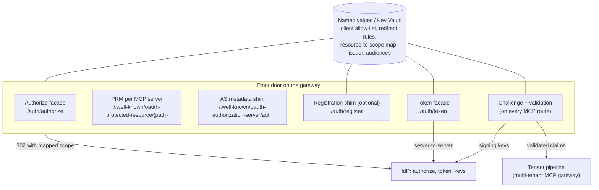

# MCP OAuth Front Door: Architecture

This document explains why remote MCP servers protected by an enterprise identity provider need a front door, what each part of that front door does, how the variants differ, and what the exact HTTP exchanges look like. It complements the [README](../README.md). It stops where the [multi-tenant MCP gateway](../../multi-tenant-mcp-gateway/docs/architecture.md) starts: once a token is validated, that asset's per-call pipeline resolves the tenant, enforces tool entitlement, applies limits and routes the call.

All hostnames, IDs and values are placeholders. `https://mcp.contoso.example` is the gateway, `https://login.example.com/00000000-0000-0000-0000-000000000000` stands for the identity provider (IdP) authority, and the GUIDs `11111111-...`, `22222222-...` and `33333333-...` stand for app registrations. Statements about client and IdP behavior are qualitative. **Verify them against current documentation and your own probes.**

## Contents

1. [Problem](#1-problem)
2. [Terminology](#2-terminology)
3. [Forces](#3-forces)
4. [What MCP clients expect](#4-what-mcp-clients-expect)
5. [Where enterprise identity providers differ](#5-where-enterprise-identity-providers-differ)
6. [Solution overview](#6-solution-overview)
7. [End-to-end sequence](#7-end-to-end-sequence)
8. [Component deep dives](#8-component-deep-dives)
9. [Variants and decision matrix](#9-variants-and-decision-matrix)
10. [Identity populations](#10-identity-populations)
11. [Audience binding and the resource-to-scope map](#11-audience-binding-and-the-resource-to-scope-map)
12. [Client compatibility](#12-client-compatibility)
13. [Wire contracts](#13-wire-contracts)
14. [Domain Packs](#14-domain-packs)
15. [Observability and logging hygiene](#15-observability-and-logging-hygiene)
16. [Failure modes](#16-failure-modes)
17. [Anti-patterns](#17-anti-patterns)
18. [Production checklist](#18-production-checklist)
19. [References](#19-references)

## 1. Problem

A remote MCP server that uses OAuth has to let a client it has never met work out, with no human configuration, three things: which authorization server protects the server, how to talk to that authorization server, and which client identity to use. The MCP authorization specification builds that chain from existing standards: a `401` challenge (RFC 6750 and RFC 9728), Protected Resource Metadata (RFC 9728), Authorization Server Metadata (RFC 8414) or OpenID Connect discovery, a client registration approach, the authorization code flow with PKCE (RFC 7636), and resource indicators (RFC 8707).

Enterprises want the tokens to come from the IdP they already govern: Microsoft Entra ID for the workforce, Entra External ID for customers and partners, sometimes customers' own Entra tenants. Those IdPs issue well-governed tokens with Conditional Access, MFA, consent and sign-in logs. But they were designed before this discovery chain. Some MCP clients stop at discovery, some refuse to continue without a field the IdP doesn't advertise, some insist on registering dynamically, and some send a `resource` parameter that the IdP interprets differently.

The result is a familiar failure: the MCP server works with a hand-configured client and fails with everyone else, and teams are tempted to "fix" it by disabling authentication, forwarding tokens they don't understand, or writing a home-grown authorization server.

## 2. Terminology

| Term | Meaning in this asset |
|---|---|
| **Resource** | One MCP server endpoint, identified by a canonical URI such as `https://mcp.contoso.example/orders/mcp` |
| **PRM** | Protected Resource Metadata (RFC 9728): a JSON document that names the resource and its authorization servers |
| **AS metadata** | Authorization Server Metadata (RFC 8414), or the OpenID Connect discovery document, that lists an authorization server's endpoints and capabilities |
| **Metadata shim** | An AS metadata document served by the gateway that describes the façade endpoints, not the IdP's own endpoints |
| **Registration shim** | A gateway endpoint that accepts RFC 7591 registration requests and returns a pre-registered client ID instead of creating a client |
| **Façade** | A thin gateway endpoint that validates and translates an OAuth request, then sends it on to the IdP (authorize façade, token façade) |
| **Front door** | The challenge, PRM, metadata shim, registration shim, façades and token validation together |
| **Public client** | A client that cannot keep a secret (desktop apps, CLIs, IDE extensions, browser apps); it authenticates with PKCE only |
| **Loopback redirect** | A redirect URI on `127.0.0.1`, `[::1]` or `localhost` that a native client listens on (RFC 8252) |
| **Resource-to-scope map** | Configuration that translates a resource URI into the IdP scope that produces a token with the right audience |

## 3. Forces

- **Standard clients, enterprise IdP.** You want unmodified MCP clients to work, and you want tokens from the IdP your security team already governs.
- **No secrets in public clients.** Most MCP clients are public clients. PKCE, exact redirect URIs and short-lived tokens carry the security, not client secrets.
- **The gateway should not become an authorization server.** Minting tokens, storing sessions and running consent are large obligations. The front door must translate, not issue.
- **Audience matters.** Each MCP server needs a token meant for it. A token for one server must not work at another.
- **Clients and specifications move.** Client behavior and the MCP specification change between releases. The design must be probe-driven and easy to switch off piece by piece.
- **Governance over convenience.** Every client that can obtain tokens should be known, allow-listed and auditable.

## 4. What MCP clients expect

The MCP authorization specification describes the client behavior below. Wording and requirements have changed between revisions, so treat this as a summary and check the [current specification](https://modelcontextprotocol.io/specification/latest/basic/authorization).

1. **Challenge.** The client sends an MCP request without a token. The server answers `401 Unauthorized` with `WWW-Authenticate: Bearer resource_metadata="<PRM URL>"`. Newer revisions also suggest a `scope` parameter in the challenge so the client knows what to request.
2. **Protected resource metadata.** The client fetches the PRM URL. If the challenge has no `resource_metadata`, the client falls back to well-known URLs: first the path-specific `/.well-known/oauth-protected-resource/{path}`, then the root `/.well-known/oauth-protected-resource`.
3. **Authorization server discovery.** The client picks an issuer from `authorization_servers` and looks for its metadata. For an issuer with a path, such as `https://idp.example/tenant/v2.0`, spec-current clients try, in order:
   - RFC 8414 path insertion: `https://idp.example/.well-known/oauth-authorization-server/tenant/v2.0`
   - OIDC path insertion: `https://idp.example/.well-known/openid-configuration/tenant/v2.0`
   - OIDC path append: `https://idp.example/tenant/v2.0/.well-known/openid-configuration`

   Older clients may try only one or two of these.
4. **PKCE capability check.** The client checks `code_challenge_methods_supported`. Current revisions say a client must refuse to continue if the field is absent, and must use `S256`.
5. **Client identity.** The client uses whichever registration approach the authorization server supports. Current revisions list Client ID Metadata Documents (a URL the client controls, used as its client ID) as a preferred option where the server advertises support, pre-registered client IDs, and RFC 7591 Dynamic Client Registration (DCR), which newer revisions keep mainly for backward compatibility. Some clients support only DCR.
6. **Authorization request.** The client opens the browser at `authorization_endpoint` with `response_type=code`, `client_id`, `redirect_uri`, `state`, `code_challenge`, `code_challenge_method=S256`, the scopes it chose, and `resource` set to the canonical resource URI (RFC 8707).
7. **Token request.** The client posts the code, the `code_verifier`, `redirect_uri`, `client_id` and again `resource` to `token_endpoint`.
8. **Use.** The client sends `Authorization: Bearer <token>` on every MCP request, and repeats the flow (or refreshes) on `401`. A `403` with `error="insufficient_scope"` tells it to request more scope.

## 5. Where enterprise identity providers differ

These are the gaps that make a front door necessary with Entra ID and Entra External ID. They are observations at the time of writing. **Verify each against current Microsoft Learn documentation and your own probes**, because the IdPs and the clients both change.

| Expectation | What to check on the IdP side | Effect on MCP clients |
|---|---|---|
| AS metadata at an RFC 8414 or OIDC path-insertion URL | Entra publishes OIDC discovery at `{authority}/v2.0/.well-known/openid-configuration` (path append) | Clients that never try path append don't find the IdP |
| `code_challenge_methods_supported` advertised | Entra supports PKCE with `S256`, but check whether its discovery document advertises the field | Spec-strict clients refuse to continue when the field is missing |
| A `registration_endpoint` for DCR | Entra doesn't offer open RFC 7591 registration; app registrations are created by administrators or privileged automation | Clients that require DCR stop before sign-in |
| Audience chosen by `resource` (RFC 8707) | The Entra v2 endpoint chooses the audience from fully qualified scopes such as `api://{app-id}/mcp.tools`. A `resource` value that doesn't match the requested scopes can be rejected | Spec-current clients that send `resource` can get an error instead of a code |
| Short scope names | Entra expects fully qualified scopes in requests; a bare `mcp.tools` isn't tied to your API | Clients that send PRM `scopes_supported` verbatim request the wrong thing |
| Audience value in the token | v2 access tokens carry the API's client ID GUID in `aud`; v1 tokens can carry the App ID URI | Validators must accept the right form, or pin the token version |
| Browser-based token redemption | Cross-origin token requests are accepted only for redirect URIs registered for the single-page application platform | Browser-based clients fail at the token step with a cross-origin error |
| Multi-tenant authorities | `organizations` and `common` metadata use a templated issuer containing `{tenantid}` | Strict issuer checks fail; a per-tenant authority or an issuer allow-list is needed |
| Refresh tokens | Issued only when `offline_access` is requested | Clients that don't request it re-prompt the user more often |

Entra External ID tenants follow the same v2 shape on the External ID tenant's authority host, with user flows for sign-up and sign-in, so the same gaps apply. Check the External ID documentation for features that differ from workforce tenants.

## 6. Solution overview

The front door is a set of small, mostly stateless gateway operations next to the MCP routes. Each closes one gap and can be switched on or off independently.



| Component | Closes which gap | State | Sees secrets? |
|---|---|---|---|
| Challenge and validation | Gives clients the PRM URL; protects every route | None (signing keys cached) | Access tokens, which are validated then removed |
| PRM | Names the resource, issuer and scopes | Static per server | No |
| AS metadata shim | Discovery path and missing `S256` field | Static | No |
| Registration shim | Clients that require DCR | None (returns a configured client ID) | No |
| Authorize façade | `resource` versus scope, request validation | None | No: the browser carries the request; credentials go to the IdP |
| Token façade | `resource` versus scope on the token request | None | Authorization codes, verifiers, access and refresh tokens transit it |

## 7. End-to-end sequence

```mermaid
sequenceDiagram
    autonumber
    participant U as User (browser)
    participant C as MCP client
    participant G as Gateway front door
    participant I as Identity provider
    participant S as MCP server (via tenant pipeline)

    C->>G: POST /orders/mcp (no token)
    G-->>C: 401 WWW-Authenticate: Bearer resource_metadata="...", scope="mcp.tools"
    C->>G: GET /.well-known/oauth-protected-resource/orders/mcp
    G-->>C: PRM: resource, authorization_servers=[gateway /auth], scopes
    C->>G: GET /.well-known/oauth-authorization-server/auth
    G-->>C: AS metadata shim (S256, facade endpoints)
    opt Client requires dynamic registration
        C->>G: POST /auth/register (loopback redirect_uris)
        G-->>C: 201 shared pre-registered client_id
    end
    C->>U: Open browser: /auth/authorize?...&resource=...&code_challenge=...
    U->>G: GET /auth/authorize
    G->>G: Validate client, redirect, PKCE; map resource to scope
    G-->>U: 302 to IdP authorize (scope=api://{app-id}/mcp.tools, PKCE unchanged)
    U->>I: Sign in, MFA, Conditional Access, consent
    I-->>U: 302 to loopback redirect with code and state
    U->>C: GET http://127.0.0.1:{port}/callback?code=...&state=...
    C->>G: POST /auth/token (code, code_verifier, resource)
    G->>I: POST token (code, code_verifier, mapped scope; resource removed)
    I->>I: Verify PKCE, redirect URI, client
    I-->>G: access_token (+ refresh_token)
    G-->>C: Token response (no-store)
    C->>G: POST /orders/mcp + Bearer token
    G->>G: Validate signature, issuer, audience, scope, tenant
    G->>G: Remove Authorization header
    G->>S: Tenant pipeline, then MCP server
    S-->>C: MCP response
```

Note what the gateway never does: it never renders a sign-in page, never sees a password or MFA response, never verifies PKCE itself, and never mints or re-signs a token. Steps 13 to 15 happen between the user's browser, the IdP and the client's loopback listener.

## 8. Component deep dives

### 8.1 Challenge and token validation

Every MCP route runs this first. The full illustrative policy is in [`policies/mcp-challenge-and-validate.xml`](policies/mcp-challenge-and-validate.xml).

- **No bearer token.** Return `401` with `WWW-Authenticate: Bearer resource_metadata="https://mcp.contoso.example/.well-known/oauth-protected-resource/orders/mcp", scope="mcp.tools"`. Add `Access-Control-Expose-Headers: WWW-Authenticate` so browser-based clients can read it. Don't include an `error` attribute when no token was sent (RFC 6750).
- **Bearer token present.** Validate with `validate-jwt` (or `validate-azure-ad-token` for Entra workforce tenants):
  - signature against the IdP's published keys (`openid-config`)
  - issuer: the exact tenant-specific issuer, or an explicit allow-list for multi-tenant designs
  - audience: this server's API app (GUID, and the App ID URI if you accept v1 tokens)
  - scope or role: the server's scope in `scp`, or an app role in `roles` for app-only callers
  - tenant: `tid` in the allow-list when more than one tenant can sign in
- **Failure.** Invalid token: `401` with `error="invalid_token"` and the same `resource_metadata`. Valid token with missing scope: `403` with `error="insufficient_scope"` and the required `scope`. Keep `error_description` generic.
- **Success.** Store the claims the pipeline needs in context variables, **delete the `Authorization` header**, then include the tenant pipeline fragment.

The validation half is all that admin-configured connectors need. The rest of the front door exists for clients that discover and register on their own.

### 8.2 Protected resource metadata

One document per MCP server, served without authentication, cacheable, and with permissive CORS so browser-based clients can read it. See [`policies/prm.xml`](policies/prm.xml).

- `resource` must be exactly the canonical URI the client uses: scheme and host in lowercase, no trailing slash, no fragment. Clients compare it with the URL they called.
- `authorization_servers` is the façade issuer (`https://mcp.contoso.example/auth`) in Variants B and C, and the IdP's v2 issuer in Variant A.
- `scopes_supported` lists what a client should ask for. With façades, use short names (`mcp.tools`) and let the façade map them. Without façades, list the fully qualified IdP scope (`api://11111111-1111-1111-1111-111111111111/mcp.tools`), because the client will send it verbatim. Don't list `offline_access` here; it belongs to the authorization server.
- `bearer_methods_supported` is `["header"]`. Never accept tokens in query strings.
- Serve the path-specific URL for every server. Serve the root URL only if there is a single obvious default resource, otherwise return `404` so clients don't bind to the wrong one.

### 8.3 Authorization server metadata shim

An RFC 8414 document whose `issuer` is the façade issuer, served at the RFC 8414 path-insertion URL for that issuer: issuer `https://mcp.contoso.example/auth` gives `https://mcp.contoso.example/.well-known/oauth-authorization-server/auth`. See [`policies/as-metadata-shim.xml`](policies/as-metadata-shim.xml).

- Advertise `code_challenge_methods_supported: ["S256"]` only. Never advertise `plain`.
- Point `authorization_endpoint` and `token_endpoint` at the façades (Variant C), or directly at the IdP (Variant B).
- Add `registration_endpoint` only when the registration shim is enabled.
- Advertise `token_endpoint_auth_methods_supported: ["none"]` for public clients, and `grant_types_supported: ["authorization_code", "refresh_token"]`.
- Leave out `jwks_uri`. The front door doesn't sign anything, and MCP clients treat access tokens as opaque.
- Keep the document static and generated from the same configuration as the policies, so it can't drift from what the façades accept.
- If probes show clients that try only OIDC discovery paths, you can also serve the document at the OIDC path-insertion URL. Be aware it isn't a complete OpenID Provider document.

Because the shim's issuer is the gateway, the `iss` claim in issued tokens (the IdP's issuer) differs from it. That's fine for clients that treat tokens as opaque. If the IdP adds an `iss` parameter to the authorization response (RFC 9207) and a client compares it with the shim issuer, the flow fails. Probe for this. Variant D is the fix if it happens.

### 8.4 Client registration shim

Some clients won't continue without a `registration_endpoint`. The shim accepts an RFC 7591 request and, if it passes the checks, returns the client ID of a **pre-registered public client** at the IdP. It never creates an app registration. See [`policies/register-shim.xml`](policies/register-shim.xml) and [ADR 0002](decisions/0002-prefer-preregistered-clients-over-dcr-shim.md).

Checks:

- Every `redirect_uris` entry matches the allow-list: loopback URIs with the exact paths registered on the shared client at the IdP, plus any exact HTTPS URIs for hosted clients you have vetted.
- `token_endpoint_auth_method` is `none` or absent. Refuse requests for confidential-client methods; the shim can't issue secrets.
- `grant_types` and `response_types` are within `authorization_code`, `refresh_token` and `code`.
- `client_name` is length-limited and only echoed in JSON.
- The endpoint is rate-limited per caller and logged.

Trade-offs to accept explicitly:

- **Shared identity.** Every client that registers gets the same client ID, so the IdP consent screen and sign-in logs show your shared app, not the real client. A malicious local app can present itself as any client. This is a consent-phishing risk.
- **No revocation per client.** You can't block one registrant without blocking all of them. Changing the allow-list is your only lever.
- **Redirect URIs are the boundary.** Because the IdP enforces the shared client's registered redirect URIs, codes can only go to loopback listeners or vetted HTTPS URIs. That limits, but doesn't remove, the risk from malware on the same machine.

When not to build it: regulated workloads, any design that would need non-loopback redirect URIs from unknown clients, or when every required client supports pre-registration or Client ID Metadata Documents.

### 8.5 Authorize facade

The browser arrives at `/auth/authorize`. The façade validates, maps and redirects. See [`policies/authorize-facade.xml`](policies/authorize-facade.xml).

1. **Validate before redirecting.** `client_id` in the allow-list, `redirect_uri` allowed for that client, `response_type=code`, `code_challenge_method=S256`, and a `code_challenge` of the right length (43 characters for a base64url-encoded SHA-256 hash). On any failure, return an error page with `400`. **Never redirect to an unvalidated `redirect_uri`**, because that makes the gateway an open redirector.
2. **Map `resource` to scope.** Look up the resource URI in the map and produce `api://{app-id}/{scope}` plus `offline_access`. An unknown resource returns `400 invalid_target` (RFC 8707). If the client sent no `resource`, use the scope it asked for when it's in the map, or a configured default.
3. **Translate the request.** Remove `resource`. Drop `openid` and `profile` unless the client needs an ID token. Pass `client_id`, `redirect_uri`, `state`, `code_challenge`, `code_challenge_method`, `response_type`, `prompt` and `login_hint` through unchanged, URL-encoding each value.
4. **Redirect** with `302` to the IdP's `authorization_endpoint`, with `Cache-Control: no-store`.

The façade never touches PKCE values beyond checking their shape. The IdP binds the challenge to the code and verifies the verifier later.

### 8.6 Token facade

The client posts to `/auth/token`. The façade validates, maps and forwards to the IdP server-to-server. See [`policies/token-facade.xml`](policies/token-facade.xml).

- Accept only `grant_type=authorization_code` (with `code`, `redirect_uri`, `code_verifier` and `client_id`) and `grant_type=refresh_token`, for allow-listed client IDs.
- Map `resource` to the same scope as in the authorize step, set `scope`, and remove `resource`. Pass `code` and `code_verifier` through byte for byte.
- Remove the `Cookie` header, and don't forward client headers the IdP doesn't need.
- Return the IdP response unchanged, with `Cache-Control: no-store` and `Pragma: no-cache`.
- **Never log the request or response body.** It contains codes, verifiers and tokens.
- Browser-based clients: the gateway answers CORS, but the IdP still sees an `Origin` header if the gateway forwards it. Register those clients' redirect URIs for the single-page application platform so cross-origin redemption is allowed. Some implementations delete `Origin` to make a browser client look like a native one. Treat that as a documented risk exception, because it changes how the IdP classifies the client (for example, refresh token handling).

The token façade is the most sensitive part of the front door. If you can avoid it (Variant B with an IdP that tolerates `resource`, or an App ID URI aligned with the resource URI), do.

### 8.7 Hand-off to the tenant pipeline

After validation the request carries only gateway-controlled context: tenant key, user object ID, client ID and scopes in context variables, and no client token. The [multi-tenant MCP gateway](../../multi-tenant-mcp-gateway/docs/architecture.md) pipeline takes over from there: tenant resolution, tool entitlement on `tools/list` and `tools/call`, limits, cell routing and audit. Reaching the backend uses its own credential, as described in [Backend Identity Propagation](../../backend-identity-propagation/README.md). Forwarding the client's token downstream (token passthrough) is forbidden by the MCP specification and breaks audience separation.

If you adapt Microsoft samples that forward the incoming `Authorization` header to a backend, check that the backend is the token's audience. If it isn't, that's token passthrough.

## 9. Variants and decision matrix

| | **A. PRM only** | **B. PRM + metadata shim** | **C. PRM + shim + façades** | **C+R. C with registration shim** | **D. Dedicated auth broker** |
|---|---|---|---|---|---|
| Challenge and validation | Yes | Yes | Yes | Yes | Yes |
| PRM `authorization_servers` | IdP issuer | Façade issuer | Façade issuer | Façade issuer | Broker issuer |
| Metadata shim | No | Yes, endpoints at IdP | Yes, endpoints at façades | Yes, plus `registration_endpoint` | Broker serves its own |
| Authorize and token façades | No | No | Yes | Yes | Broker endpoints |
| Registration | Pre-registered | Pre-registered | Pre-registered | Shim returns shared client ID | Per-client, can support Client ID Metadata Documents |
| Gateway sees codes and tokens | Access tokens only | Access tokens only | Yes, on the token path | Yes, on the token path | Broker sees them |
| Per-client consent | IdP native | IdP native | IdP native per pre-registered client | Shared app name | Broker can show the real client |
| Works with | Lenient or manually configured clients | Clients that need RFC 8414 or `S256` advertised, IdP tolerates `resource` | Spec-current clients that send `resource` | DCR-only clients | All, including strict `iss` checks |
| Operational weight | Lowest | Low | Moderate | Moderate, plus consent governance | Highest: a new authorization server |

Variant D runs as a small app (for example on Azure Container Apps) that is a real OAuth authorization server for MCP clients and a confidential client of the IdP. It can show its own consent screen naming the real client and redirect URI, support newer registration methods, and relay callbacks so the issuer seen by clients is consistent. In exchange it inherits every obligation the MCP security guidance places on proxies: per-client consent stored server-side, exact redirect URI matching, single-use `state`, secure storage of upstream tokens, and its own key management. Build it only when Variants A to C can't meet your client or consent requirements.

Start with the lowest variant that your probes show works for every client you must support, and add parts only when a probe fails.

## 10. Identity populations

| Population | Authority and issuer | App registrations | Front door specifics |
|---|---|---|---|
| **Workforce (single tenant)** | Tenant-specific Entra authority; one issuer | API app per MCP server (or per-server scopes) and one public client app per client family in your tenant | Simplest. Use Conditional Access and user assignment. `validate-azure-ad-token` fits |
| **Entra External ID (customers, partners)** | The External ID tenant's authority host; one issuer per External ID tenant | API and public client apps in the External ID tenant; user flows for sign-up and sign-in | PRM and façades point at the External ID authority. Validate the External ID issuer. Check which features differ from workforce tenants |
| **B2B guests in your tenant** | Your tenant's authority; tokens issued by your tenant | Same as workforce | Guests sign in with their home credentials, but tokens carry your tenant's `tid`. Govern guest access with access reviews and Conditional Access |
| **Customers' own Entra tenants** | Each customer tenant's authority | A multi-tenant API app and public client, admin-consented in each customer tenant | Per-customer resource paths whose PRM points at that customer's tenant-specific issuer, an issuer allow-list in `validate-jwt`, and a `tid` allow-list mapped to the tenant directory. Avoid `organizations` or `common` metadata with strict issuer checks |

Mixing populations on one MCP server multiplies the issuer and audience combinations you validate. Prefer one population per resource path.

## 11. Audience binding and the resource-to-scope map

The MCP specification asks clients to bind tokens to a resource with `resource`. Entra binds tokens to an API with the scope's App ID URI. The resource-to-scope map is the bridge, and it's security-relevant configuration:

| Resource (what the client sends) | IdP scope (what the façade sends) | Expected `aud` in the token | Expected `scp` |
|---|---|---|---|
| `https://mcp.contoso.example/orders/mcp` | `api://11111111-1111-1111-1111-111111111111/mcp.tools` | `11111111-1111-1111-1111-111111111111` | `mcp.tools` |
| `https://mcp.contoso.example/knowledge/mcp` | `api://33333333-3333-3333-3333-333333333333/mcp.tools` | `33333333-3333-3333-3333-333333333333` | `mcp.tools` |

Three ways to bind audience, strongest first:

1. **One API app registration per MCP server.** Each server validates its own `aud`. A token for `orders` can't be replayed at `knowledge`.
2. **One shared API app with per-server scopes** (`orders.tools`, `knowledge.tools`). The audience is shared, so each route must also check its own scope. Weaker: a token with both scopes works at both servers.
3. **App ID URI aligned with the resource URI.** If the API app's App ID URI is the MCP resource URI on a verified domain, a spec-current client's `resource` and scope may line up without a façade. Verify how the IdP treats `resource` with this setup before relying on it.

Whatever you choose, the gateway validates the audience on every call. The map is generated from the same source as PRM and the metadata shim, reviewed like code, and covered by negative tests (unknown resource, resource for another server, token for another server).

## 12. Client compatibility

Client behavior differs by product and version, and changes often. This asset deliberately describes client **types**, not named products. Build your own matrix from probes ([evaluation section 3](evaluation-and-troubleshooting.md#3-live-probe-checklist)).

| Client type | Typical behavior | Minimum variant |
|---|---|---|
| **A. Spec-current native client** | Reads the challenge and PRM, tries all discovery URLs, requires `S256` advertised, sends `resource`, supports pre-registered client IDs | B if the IdP accepts its `resource`, otherwise C |
| **B. Registration-dependent client** | Same discovery, but stops if there's no `registration_endpoint` | C+R, or D |
| **C. Older discovery client** | Tries only one discovery URL, may ignore `resource_metadata`, may not send `resource` | B or C, with a default scope in the façade |
| **D. Admin-configured connector** | An administrator enters client ID, secret and endpoints; ignores PRM; confidential client | Challenge and validation only |
| **E. Browser-based client** | Needs CORS on every front door endpoint and on the MCP route; reads `WWW-Authenticate` only if exposed | B or C, with SPA redirect URIs registered |

## 13. Wire contracts

All values are placeholders. Header folding is for readability.

### 13.1 Challenge

```http
POST /orders/mcp HTTP/1.1
Host: mcp.contoso.example
Content-Type: application/json
Accept: application/json, text/event-stream

{"jsonrpc":"2.0","id":1,"method":"initialize","params":{"protocolVersion":"<version>","capabilities":{},"clientInfo":{"name":"example-client","version":"1.0.0"}}}
```

```http
HTTP/1.1 401 Unauthorized
WWW-Authenticate: Bearer resource_metadata="https://mcp.contoso.example/.well-known/oauth-protected-resource/orders/mcp", scope="mcp.tools"
Access-Control-Expose-Headers: WWW-Authenticate
Cache-Control: no-store
Content-Type: application/json

{"message":"Authentication required."}
```

### 13.2 Protected resource metadata

```http
GET /.well-known/oauth-protected-resource/orders/mcp HTTP/1.1
Host: mcp.contoso.example
```

```json
{
  "resource": "https://mcp.contoso.example/orders/mcp",
  "authorization_servers": ["https://mcp.contoso.example/auth"],
  "scopes_supported": ["mcp.tools"],
  "bearer_methods_supported": ["header"],
  "resource_name": "Contoso Orders MCP server",
  "resource_documentation": "https://docs.contoso.example/mcp/orders"
}
```

Variant A points straight at the IdP and lists the fully qualified scope:

```json
{
  "resource": "https://mcp.contoso.example/orders/mcp",
  "authorization_servers": ["https://login.example.com/00000000-0000-0000-0000-000000000000/v2.0"],
  "scopes_supported": ["api://11111111-1111-1111-1111-111111111111/mcp.tools"],
  "bearer_methods_supported": ["header"]
}
```

### 13.3 Authorization server metadata shim

```http
GET /.well-known/oauth-authorization-server/auth HTTP/1.1
Host: mcp.contoso.example
```

```json
{
  "issuer": "https://mcp.contoso.example/auth",
  "authorization_endpoint": "https://mcp.contoso.example/auth/authorize",
  "token_endpoint": "https://mcp.contoso.example/auth/token",
  "registration_endpoint": "https://mcp.contoso.example/auth/register",
  "response_types_supported": ["code"],
  "response_modes_supported": ["query"],
  "grant_types_supported": ["authorization_code", "refresh_token"],
  "code_challenge_methods_supported": ["S256"],
  "token_endpoint_auth_methods_supported": ["none"],
  "scopes_supported": ["mcp.tools", "offline_access"],
  "service_documentation": "https://docs.contoso.example/mcp/auth"
}
```

### 13.4 Registration shim

```http
POST /auth/register HTTP/1.1
Host: mcp.contoso.example
Content-Type: application/json

{
  "client_name": "Example MCP Client",
  "redirect_uris": ["http://127.0.0.1:53682/callback"],
  "grant_types": ["authorization_code", "refresh_token"],
  "response_types": ["code"],
  "token_endpoint_auth_method": "none"
}
```

```http
HTTP/1.1 201 Created
Content-Type: application/json
Cache-Control: no-store

{
  "client_id": "22222222-2222-2222-2222-222222222222",
  "client_id_issued_at": 1792454400,
  "client_name": "Example MCP Client",
  "redirect_uris": ["http://127.0.0.1:53682/callback"],
  "grant_types": ["authorization_code", "refresh_token"],
  "response_types": ["code"],
  "token_endpoint_auth_method": "none"
}
```

A non-allow-listed redirect URI is refused, and nothing is registered:

```http
HTTP/1.1 400 Bad Request
Content-Type: application/json

{"error":"invalid_redirect_uri","error_description":"Redirect URI is not allowed."}
```

### 13.5 Authorization request through the façade

The client opens (line breaks added):

```http
GET /auth/authorize?response_type=code
  &client_id=22222222-2222-2222-2222-222222222222
  &redirect_uri=http%3A%2F%2F127.0.0.1%3A53682%2Fcallback
  &scope=mcp.tools
  &state=af0ifjsldkj
  &code_challenge=E9Melhoa2OwvFrEMTJguCHaoeK1t8URWbuGJSstw-cM
  &code_challenge_method=S256
  &resource=https%3A%2F%2Fmcp.contoso.example%2Forders%2Fmcp HTTP/1.1
Host: mcp.contoso.example
```

The façade answers (line breaks added):

```http
HTTP/1.1 302 Found
Cache-Control: no-store
Location: https://login.example.com/00000000-0000-0000-0000-000000000000/oauth2/v2.0/authorize
  ?client_id=22222222-2222-2222-2222-222222222222
  &response_type=code
  &redirect_uri=http%3A%2F%2F127.0.0.1%3A53682%2Fcallback
  &scope=api%3A%2F%2F11111111-1111-1111-1111-111111111111%2Fmcp.tools%20offline_access
  &state=af0ifjsldkj
  &code_challenge=E9Melhoa2OwvFrEMTJguCHaoeK1t8URWbuGJSstw-cM
  &code_challenge_method=S256
```

`resource` is gone, `scope` is mapped, and `state` and the PKCE values are unchanged.

### 13.6 IdP redirect to the client

```http
HTTP/1.1 302 Found
Location: http://127.0.0.1:53682/callback?code=<authorization-code>&state=af0ifjsldkj
```

The IdP may append parameters such as `session_state`. The gateway is not on this path.

### 13.7 Token request

From the client to the façade:

```http
POST /auth/token HTTP/1.1
Host: mcp.contoso.example
Content-Type: application/x-www-form-urlencoded

grant_type=authorization_code&code=<authorization-code>&redirect_uri=http%3A%2F%2F127.0.0.1%3A53682%2Fcallback&client_id=22222222-2222-2222-2222-222222222222&code_verifier=dBjftJeZ4CVP-mB92K27uhbUJU1p1r_wW1gFWFOEjXk&resource=https%3A%2F%2Fmcp.contoso.example%2Forders%2Fmcp
```

From the façade to the IdP:

```http
POST /00000000-0000-0000-0000-000000000000/oauth2/v2.0/token HTTP/1.1
Host: login.example.com
Content-Type: application/x-www-form-urlencoded

grant_type=authorization_code&code=<authorization-code>&redirect_uri=http%3A%2F%2F127.0.0.1%3A53682%2Fcallback&client_id=22222222-2222-2222-2222-222222222222&code_verifier=dBjftJeZ4CVP-mB92K27uhbUJU1p1r_wW1gFWFOEjXk&scope=api%3A%2F%2F11111111-1111-1111-1111-111111111111%2Fmcp.tools%20offline_access
```

The PKCE values in these examples are the public test vector from RFC 7636.

### 13.8 Token response

```http
HTTP/1.1 200 OK
Content-Type: application/json
Cache-Control: no-store
Pragma: no-cache

{
  "token_type": "Bearer",
  "scope": "api://11111111-1111-1111-1111-111111111111/mcp.tools",
  "expires_in": 3600,
  "access_token": "<jwt>",
  "refresh_token": "<opaque>"
}
```

### 13.9 Access token claims (decoded payload)

```json
{
  "aud": "11111111-1111-1111-1111-111111111111",
  "iss": "https://login.example.com/00000000-0000-0000-0000-000000000000/v2.0",
  "tid": "00000000-0000-0000-0000-000000000000",
  "azp": "22222222-2222-2222-2222-222222222222",
  "scp": "mcp.tools",
  "oid": "44444444-4444-4444-4444-444444444444",
  "sub": "<pairwise-subject>",
  "ver": "2.0",
  "iat": 1792454400,
  "nbf": 1792454400,
  "exp": 1792458000
}
```

### 13.10 Validation errors

```http
HTTP/1.1 401 Unauthorized
WWW-Authenticate: Bearer error="invalid_token", error_description="The access token is not valid for this resource.", resource_metadata="https://mcp.contoso.example/.well-known/oauth-protected-resource/orders/mcp"
```

```http
HTTP/1.1 403 Forbidden
WWW-Authenticate: Bearer error="insufficient_scope", scope="mcp.tools", resource_metadata="https://mcp.contoso.example/.well-known/oauth-protected-resource/orders/mcp"
```

## 14. Domain Packs

| Domain Pack | Recommended variant | Consent and registration | Logging and audit emphasis | Failure mode to rehearse |
|---|---|---|---|---|
| **ERP or line-of-business ISV** | C, registration shim only if a required client depends on it | Per-customer admin consent for customer-own tenants; client allow-list reviewed each release | Client ID, resource and outcome per sign-in; correlate with IdP sign-in logs per customer tenant | A customer tenant's admin consent revoked mid-session |
| **Healthcare provider network** | A or B with vetted clients | No registration shim; user assignment required; Conditional Access on compliant devices | No codes, tokens or query strings in logs; audit every consent grant | A client that sends `resource` the IdP rejects |
| **Financial services** | B or C without registration shim | Per-server API apps; step-up Conditional Access for write scopes | Consent and scope changes through change control; SIEM alerts on new client IDs | Token for one server replayed at another |
| **Public sector shared service** | C, multi-tenant app per agency | Admin consent per agency tenant; `tid` and issuer allow-lists | Per-agency sign-in correlation; residency-aware log destinations | Issuer from an unexpected tenant |
| **Internal developer platform** | B or C+R | Loopback-only redirects; shared client acceptable for internal IDE tools after review | Rate-limit and alert on registration bursts | A non-loopback redirect URI from an unknown tool |

## 15. Observability and logging hygiene

**Log, per front door operation:** operation name, outcome, rejection reason code (for example `unknown_client`, `redirect_not_allowed`, `pkce_missing`, `invalid_target`), client ID, redirect URI class (loopback or HTTPS host), resource, mapped scope, IdP error code on token failures, IdP correlation ID when returned, and the gateway request ID and `traceparent`.

**Never log:** access tokens, refresh tokens, ID tokens, authorization codes, `code_verifier`, client assertions, or full token request and response bodies. Configure diagnostic settings so request bodies aren't captured on `/auth/token`, and use the gateway's data masking for query parameters and headers such as `Authorization`. Treat `state` and `code_challenge` as low-sensitivity but don't log them by default either.

**Metrics and alerts:**

- Count of `401` challenges versus successful validations per resource (a sudden rise suggests a client or configuration regression)
- Authorize and registration rejections by reason (a spike in `redirect_not_allowed` can indicate probing)
- Token façade errors by IdP error code
- New client IDs seen in validated tokens (alert if not in the allow-list, which should be impossible)
- Validation failures by reason: issuer, audience, scope, expiry, signature

Correlate gateway logs with IdP sign-in logs through client ID, time and correlation ID. The IdP's sign-in logs are where you see Conditional Access results and consent.

## 16. Failure modes

| Failure mode | Effect | Detection | Mitigation |
|---|---|---|---|
| PRM `resource` differs from the URL the client called | Client refuses metadata | Client error; no authorize calls after PRM fetch | Generate PRM from the route definition; normalize case and trailing slash |
| Metadata shim drifts from façade behavior | Clients request things the façade rejects | Rejection spikes after a change | Generate shim, policies and map from one configuration; contract tests |
| Resource-to-scope map has a wrong entry | Tokens issued for the wrong API, rejected at validation | Audience failures for one resource | Negative tests per resource; review map changes like code |
| IdP signing key rollover | Validation fails if keys are pinned | Signature failures across all clients | Use `openid-config` discovery, never pinned keys |
| Redirect URI registered at the shim but not at the IdP | Sign-in ends at an IdP redirect mismatch page | IdP sign-in logs | Generate the shim allow-list from the IdP registration |
| Token façade forwards `Origin` for a non-SPA client | Cross-origin redemption error | IdP error code on token failures | Register SPA redirect URIs for browser clients |
| Registration shim abused | Many registrations from one source | Registration rate alerts | Rate-limit, loopback-only, disable if unused |
| Multi-tenant issuer accepted too broadly | Tokens from any tenant pass | Unknown `tid` in audit | Issuer and `tid` allow-lists; per-customer resource paths |
| Refresh tokens not issued | Users re-prompted often | Support tickets, sign-in volume | Add `offline_access` in the façade scope mapping |

The fuller symptom-driven table is in [evaluation-and-troubleshooting.md](evaluation-and-troubleshooting.md#5-troubleshooting).

## 17. Anti-patterns

- **Disabling authentication on the MCP route to "get clients working".** Every tool becomes anonymous. Use the challenge and the variants instead.
- **Token passthrough.** Forwarding the client's access token to a backend that isn't its audience. Forbidden by the MCP specification. Use [Backend Identity Propagation](../../backend-identity-propagation/README.md).
- **Open redirect in the authorize façade.** Redirecting to a `redirect_uri` before validating it, or redirecting errors to it.
- **Accepting `plain` PKCE or no PKCE.** Advertise and accept `S256` only.
- **A registration shim that creates real app registrations.** That gives anonymous callers the power to create identities in your directory.
- **Wildcard redirect URIs.** At the IdP or in the shim allow-list.
- **Validating only the signature.** Without issuer, audience and scope checks, any token from the IdP works, including tokens for other APIs.
- **One audience for every MCP server without scope checks.** Tokens move freely between servers.
- **Logging token request bodies or full URLs with codes.** Codes and tokens are bearer credentials.
- **Minting your own tokens in gateway policy.** The gateway becomes an unaudited authorization server. Use Variant D or a real authorization server.
- **Using `common` or `organizations` metadata with a single-issuer check.** Either everything fails or someone loosens issuer checks to make it work.

## 18. Production checklist

- [ ] Probe results recorded for every client you support, and the chosen variant is the lowest that works for all of them
- [ ] One canonical resource URI per MCP server; PRM served at the path-specific well-known URL
- [ ] Unauthenticated MCP requests return `401` with `resource_metadata` (and `scope`); the header is exposed to browsers
- [ ] AS metadata shim (if used) advertises `S256` only and is generated from the same configuration as the façades
- [ ] Client allow-list and redirect URI allow-list reviewed; redirect URIs match the IdP registrations exactly
- [ ] Registration shim disabled, or enabled with loopback-only redirects, rate limiting, logging and an ADR accepting the consent trade-offs
- [ ] Authorize façade rejects unknown clients, bad redirects, missing PKCE and unknown resources **without redirecting**
- [ ] Token façade forwards only the allowed grants, never logs bodies, and returns `no-store`
- [ ] `validate-jwt` or `validate-azure-ad-token` checks issuer, audience (all accepted forms), scope or role, and tenant
- [ ] The `Authorization` header is deleted before the tenant pipeline; backends use their own credentials
- [ ] Diagnostics don't capture bodies on `/auth/token`; data masking configured for sensitive query parameters and headers
- [ ] Alerts on rejection spikes, registration bursts and validation failures by reason
- [ ] Negative tests from the evaluation doc pass in the release pipeline
- [ ] Owners named for the app registrations, the allow-lists and the resource-to-scope map

## 19. References

- [MCP specification: Authorization](https://modelcontextprotocol.io/specification/latest/basic/authorization)
- [MCP specification: Security best practices](https://modelcontextprotocol.io/specification/latest/basic/security_best_practices)
- [Secure access to MCP servers in API Management](https://learn.microsoft.com/azure/api-management/secure-mcp-servers)
- [AI Gateway lab: MCP with protected resource metadata authorization](https://github.com/Azure-Samples/AI-Gateway/tree/main/labs/mcp-prm-oauth)
- [AI Gateway lab: MCP client authorization](https://github.com/Azure-Samples/AI-Gateway/tree/main/labs/mcp-client-authorization)
- [Validate JWT policy](https://learn.microsoft.com/azure/api-management/validate-jwt-policy)
- [Validate Microsoft Entra token policy](https://learn.microsoft.com/azure/api-management/validate-azure-ad-token-policy)
- [Microsoft identity platform access tokens](https://learn.microsoft.com/entra/identity-platform/access-tokens)
- [Microsoft identity platform and OAuth 2.0 authorization code flow](https://learn.microsoft.com/entra/identity-platform/v2-oauth2-auth-code-flow)
- [Redirect URI (reply URL) best practices and limitations](https://learn.microsoft.com/entra/identity-platform/reply-url)
- [Microsoft Entra External ID for customers](https://learn.microsoft.com/entra/external-id/customers/overview-customers-ciam)
- [RFC 6750: Bearer Token Usage](https://www.rfc-editor.org/rfc/rfc6750)
- [RFC 7591: Dynamic Client Registration](https://www.rfc-editor.org/rfc/rfc7591)
- [RFC 7636: Proof Key for Code Exchange](https://www.rfc-editor.org/rfc/rfc7636)
- [RFC 8252: OAuth 2.0 for Native Apps](https://www.rfc-editor.org/rfc/rfc8252)
- [RFC 8414: Authorization Server Metadata](https://www.rfc-editor.org/rfc/rfc8414)
- [RFC 8707: Resource Indicators](https://www.rfc-editor.org/rfc/rfc8707)
- [RFC 9207: Authorization Server Issuer Identification](https://www.rfc-editor.org/rfc/rfc9207)
- [RFC 9700: Best Current Practice for OAuth 2.0 Security](https://www.rfc-editor.org/rfc/rfc9700)
- [RFC 9728: Protected Resource Metadata](https://www.rfc-editor.org/rfc/rfc9728)
