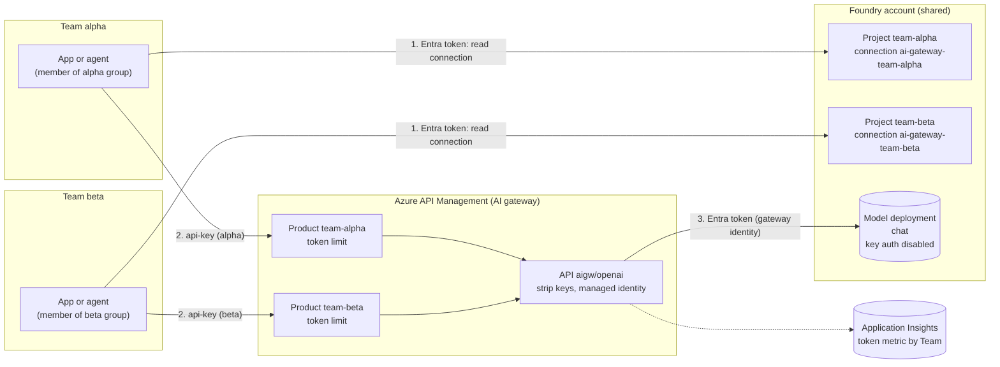

# Multi-Team Model Gateway with Per-Team Token Quotas

> **Maturity:** preview · **Kind:** solution-accelerator · **Category:** `ai-gateway` · **Version:** 0.1.0

Most organizations do not give every product team its own model deployment. They run one shared pool of Microsoft Foundry model deployments (Azure OpenAI in Foundry Models) and let several teams build on it. That saves capacity and keeps model governance in one place, but it raises four questions that the model endpoint cannot answer on its own:

1. How do you stop one busy team from using up the shared capacity and starving everyone else?
2. How do you attribute token usage to the team that spent it, for chargeback or showback?
3. How do you let teams call the model without handing out a model key that works for everyone?
4. How do you make sure team A cannot spend team B's budget?

This accelerator answers them by putting **Azure API Management (APIM) as an AI gateway** in front of the shared Foundry account. Every team gets an APIM **product** with its own token-per-minute budget, exactly one **subscription** (the team's gateway key), its own **Foundry project**, and a non-shared **project connection** that carries the gateway key. Team members get the Foundry User role on their own project only, so they can read their own team's key at run time and nobody else's. The gateway calls the model with its own managed identity, and key authentication on the model account is turned off. A fictional company, **Contoso**, runs it for two teams, `alpha` and `beta`.

It is written for platform engineers who run the shared model pool, solution architects who decide how teams consume it, security reviewers who own credential distribution, and application developers who call the model as a team.

> **Core thesis:** *The budget is keyed on the APIM product, the product is reachable only through one subscription key, and that key reaches a team only through a connection in that team's own Foundry project.*

The infrastructure in [infra/](infra/README.md) is illustrative and undeployed: it is validated with `az bicep build` only. Foundry projects and project connections use preview API versions. The design was proven in a proof of concept, but this asset contains no measured results and no latency, throughput, capacity or cost figures. Every budget value is placeholder configuration that you size from your own measurements.

## Architecture and implementation map

| Layer / concern | Deep-dive documentation | Executable reference / IaC |
|---|---|---|
| **Topology, request flow, quota model** | [docs/architecture.md](docs/architecture.md) · [ADR 0001](docs/decisions/0001-apim-product-per-team-as-quota-counter-key.md) · [ADR 0003](docs/decisions/0003-shared-deployment-with-gateway-quotas-vs-deployment-per-team.md) | [infra/main.bicep](infra/main.bicep), [infra/modules/apim-gateway.bicep](infra/modules/apim-gateway.bicep), [infra/policies/](infra/policies/api-gateway-policy.xml) |
| **Identity, key distribution, project isolation** | [docs/authentication-and-governance.md](docs/authentication-and-governance.md) · [ADR 0002](docs/decisions/0002-project-connection-as-gateway-key-distribution.md) | [infra/modules/team.bicep](infra/modules/team.bicep), [src/team_client.py](src/team_client.py) |
| **Isolation proof, telemetry, troubleshooting** | [docs/evaluation-and-troubleshooting.md](docs/evaluation-and-troubleshooting.md) | [samples/team_quota_gateway.py](samples/team_quota_gateway.py) (offline, 35 scenarios), [src/tpm_burst_test.py](src/tpm_burst_test.py) (live) |
| **Deployment and operations** | [infra/README.md](infra/README.md) | [infra/pipelines/multi-team-gateway-deploy.yml](infra/pipelines/multi-team-gateway-deploy.yml), [infra/parameters.example.json](infra/parameters.example.json) |

## Domain Packs

The gateway, the policies and the identity model do not change between domains. What changes is the list of teams, the size of each budget, and which deployments each team may reach.

| Domain Pack | Teams sharing the pool | What a team's budget protects | Chargeback unit | What changes in the parameters |
|---|---|---|---|---|
| **Contoso Retail** (`retail`) | Product search, customer service assistant, merchandising copilot | Customer-facing assistant traffic from batch catalog enrichment | Product line | `teams[]` with a larger budget for the customer-facing team; batch team on a smaller budget |
| **Fabrikam Health** (`health`) | Clinical documentation, patient messaging, internal research | Clinician-facing workloads from research experiments | Department | Separate groups per department in `memberPrincipalIds`; private networking via the secured landing zone |
| **Northwind Logistics** (`logistics`) | Route planning agent, dispatch assistant, document extraction | Dispatch traffic from overnight document runs | Business unit | `allowedModelDeployments` adds an embeddings deployment for extraction; budgets per unit |

## When to use

- Several teams, applications or agents share one Foundry account and one or a few model deployments, and you need each of them to have a **separate, enforced token budget**.
- You need **per-team usage attribution** for chargeback or showback, and you want it to come from the gateway rather than from each team's own logging.
- You do not want **model keys** in team configuration, and you want to turn off key authentication on the model account.
- Teams already work in **Foundry projects**, and you want each team's gateway credential to live in the team's own project, protected by project-scoped Entra role assignments.
- You want a single place to add later gateway controls such as content logging policy, semantic caching or load balancing across deployments.

## When not to use

- **One team, one application.** Use the deployment's own capacity and Entra authentication directly. A gateway adds cost and an extra hop for no isolation benefit.
- **Teams need guaranteed, contractual capacity.** A gateway budget is an upper limit, not a reservation. If a team needs capacity that no other team can ever touch, give it its own deployment; see [ADR 0003](docs/decisions/0003-shared-deployment-with-gateway-quotas-vs-deployment-per-team.md).
- **You must identify end users, not teams.** This pattern meters and authorizes at team level. For per-user identity on the backend, look at [Backend Identity Propagation](../backend-identity-propagation/README.md).
- **You are governing tool calls, not model calls.** For MCP servers behind a shared front door, use the [Multi-Tenant MCP Gateway](../multi-tenant-mcp-gateway/README.md).
- **A hosted agent needs bring-your-own models, failover or streaming-aware routing in its own code.** See [Hosted agent behind a streaming model gateway](../../agent-runtime/hosted-agent-streaming-model-gateway/README.md). It can sit in front of, or consume, this gateway.

## Architecture



1. An application signs in to its own team's Foundry project with Entra ID and reads the connection `ai-gateway-team-<team>` with credentials. That returns the gateway endpoint and the team's subscription key. It never returns a model key, because none exists in the design.
2. The application calls the gateway with that key, using a normal Azure OpenAI client. The key identifies one subscription, which belongs to one product. The product's `azure-openai-token-limit` policy is keyed on `context.Product.Name`, so the call draws on that team's budget only. An over-budget call gets 429 with a `retry-after` header and never reaches the model.
3. The API policy deletes every caller credential and calls the model deployment with the gateway's system-assigned managed identity, which holds a model inference role on the account. The token metric records usage with a `Team` dimension for chargeback.

The trust boundaries are the project (who can read a key), the product (which budget a key spends) and the gateway identity (the only principal that can call the model). See [docs/architecture.md](docs/architecture.md) for the sequence diagrams, the quota model, wire contracts and failure modes.

### Decision matrix

| Criterion | This pattern: shared deployment, gateway budget per team | Deployment per team | Shared deployment, direct Entra access |
|---|---|---|---|
| **Best for** | Many teams on one pool with fair-share limits and chargeback | Teams that need reserved capacity or a different model version | One trusted team or a small pilot |
| **Isolation between teams** | Enforced per product by the gateway; capacity is still shared | Strong: separate capacity | None: one noisy caller affects all |
| **Credentials teams hold** | A gateway key, read at run time from their own project | Entra role on their deployment, or a key | Entra role on the account |
| **Usage attribution** | Gateway metric with a `Team` dimension | Per deployment | Per caller identity in logs, if you build it |
| **Operational footprint** | APIM plus projects and connections | More deployments and capacity to manage | Lowest |
| **Blast radius of a leaked credential** | One team's budget, until the key is rotated | One team's deployment | The whole account |

## Key design decisions

| Decision | Choice | Why | Trade-off |
|---|---|---|---|
| Quota counter key | `@(context.Product.Name)`, one product per team ([ADR 0001](docs/decisions/0001-apim-product-per-team-as-quota-counter-key.md)) | The product is derived from the validated subscription key, not from anything the caller can set | Renaming a product starts a fresh counter; one subscription per product |
| Key distribution | Non-shared `ApiManagement` connection in each team's Foundry project ([ADR 0002](docs/decisions/0002-project-connection-as-gateway-key-distribution.md)) | Project-scoped Foundry User decides who can read the key; no key in files, pipelines or app settings | Anyone who can read the connection can read the key; rotate on member changes |
| Model authentication | Gateway managed identity, key auth disabled on the account | No model key exists to leak; teams cannot bypass the gateway with a key | Teams must not also get a model inference role on the account |
| Capacity model | One shared deployment, budgets per team ([ADR 0003](docs/decisions/0003-shared-deployment-with-gateway-quotas-vs-deployment-per-team.md)) | Fair share without fragmenting capacity | A budget is a ceiling, not a reservation |
| Bypass prevention | API policy returns 403 when there is no product | The built-in all-access subscription and API-scoped subscriptions would skip every team budget | Admin testing must also use a team product |
| Deployment allow-list | Named value `allowed-model-deployments`, checked before the budget | Teams cannot reach deployments the gateway does not expose, and a rejected call spends nothing | Add new deployments to the list on purpose |

## Getting started

1. **Run the offline simulator.** It needs Python 3.10 or later and nothing else. It models the products, budgets, connections and key handling and checks 35 scenarios.

   ```bash
   python assets/ai-gateway/multi-team-model-gateway/samples/team_quota_gateway.py --self-test
   python assets/ai-gateway/multi-team-model-gateway/samples/team_quota_gateway.py --demo
   ```

2. **Deploy to a sandbox resource group.** Follow [infra/README.md](infra/README.md): look up the model inference role definition ID in your tenant, create one Entra group per team, fill in the `teams` array and run `az deployment group create` with [infra/main.bicep](infra/main.bicep). The deployment creates the Foundry account and shared deployment (or reuses yours), APIM, one product, subscription, project and connection per team, and the observability resources.

3. **Call the model as a team.** Follow [src/README.md](src/README.md): copy [src/.env.sample](src/.env.sample) to `.env`, fill in the project endpoints from the deployment outputs, sign in as a member of the alpha group and run:

   ```bash
   cd assets/ai-gateway/multi-team-model-gateway/src
   pip install -r requirements.txt
   python run_team.py --team alpha
   ```

4. **Prove the isolation in your tenant.** As an operator who is a member of both projects, with a small alpha budget, run `python tpm_burst_test.py --burst-team alpha --control-team beta`. Team alpha receives 429 with `retry-after` once its budget is exhausted; team beta's call still succeeds. See [docs/evaluation-and-troubleshooting.md](docs/evaluation-and-troubleshooting.md).

5. **Wire up chargeback and release gates.** Query the per-team token metric, add the alerts from the troubleshooting guide, and apply the [Agent Production Readiness Guide](../../agentops-and-readiness/agent-production-readiness/README.md) before you onboard production teams.

## File map

| Path | Purpose |
|---|---|
| [infra/main.bicep](infra/main.bicep) | Orchestrator: Foundry account, gateway, gateway role assignment, one team module per entry in `teams` |
| [infra/modules/](infra/modules/team.bicep) | `foundry-account.bicep`, `apim-gateway.bicep`, `role-assignment.bicep`, `team.bicep` |
| [infra/policies/](infra/policies/team-token-limit.xml) | API policy, per-team token limit policy, token metric fragment |
| [infra/parameters.example.json](infra/parameters.example.json) | Contoso example parameters with placeholder IDs |
| [infra/pipelines/](infra/pipelines/multi-team-gateway-deploy.yml) | GitHub Actions workflow: build, self-test, what-if, gated deploy with OIDC |
| [src/](src/README.md) | Team client, single-call CLI, live isolation test |
| [samples/](samples/README.md) | Standard-library simulator with `--self-test` and `--demo` |
| [docs/](docs/architecture.md) | Architecture, authentication and governance, evaluation and troubleshooting, ADRs |

## Related assets

| Asset | Relationship |
|---|---|
| [Multi-Tenant MCP Gateway](../multi-tenant-mcp-gateway/README.md) | The tool-traffic counterpart: one front door for many MCP servers and tenants. This asset is the model-traffic side |
| [MCP OAuth Front Door](../mcp-oauth-front-door/README.md) | Entra-based caller authentication at the gateway, the direction to take if you replace subscription keys with tokens |
| [Backend Identity Propagation](../backend-identity-propagation/README.md) | When the backend must see the user rather than the gateway identity |
| [Entitlement-Aware Tool Catalog](../entitlement-aware-tool-catalog/README.md) | Per-principal entitlement for tools, complementary to per-team model budgets |
| [Hosted agent behind a streaming model gateway](../../agent-runtime/hosted-agent-streaming-model-gateway/README.md) | A hosted agent that streams through a model gateway; a natural consumer of this one |
| [Secured Foundry Landing Zone](../../landing-zones-and-infra/secured-foundry-landing-zone/README.md) | Private networking, DNS and policy for the Foundry account and a StandardV2 gateway |
| [Agent Production Readiness Guide](../../agentops-and-readiness/agent-production-readiness/README.md) | Release gates and the operating model around the shared pool |

## Production-readiness pillar mapping

This asset maps to the pillars in the [Agent Production Readiness Guide](../../agentops-and-readiness/agent-production-readiness/README.md).

| Pillar | How this asset contributes |
|---|---|
| **Solution optimization** | Fair-share token budgets on one shared deployment, deployment allow-list, per-team chargeback from a gateway metric |
| **Security and observability** | No model keys, key auth disabled on the account, project-scoped key distribution, caller credentials stripped, token metric and gateway logs without prompt or completion bodies |
| **Landing zones** | Bicep for the account, gateway, projects and connections; a path to private networking through the secured landing zone |

## Security and responsible AI

- **No model keys anywhere.** The model account has local (key) authentication disabled. Only the gateway's managed identity holds a model inference role. Do not also grant teams a model role on the account, or they can bypass their budget.
- **A gateway key is still a secret.** It lives only in the team's project connection, is read at run time, and must never be logged, copied into `.env` files or pipeline variables. Rotate it when team membership changes; see [infra/README.md](infra/README.md).
- **Authorization comes from the key, not headers.** The `x-team` header is for diagnostics only and is deleted by the gateway. The budget and the chargeback dimension come from the product that owns the validated key. See [docs/authentication-and-governance.md](docs/authentication-and-governance.md).
- **Close the bypasses.** The API policy rejects calls without a product, which blocks the built-in all-access subscription and API-scoped subscriptions. Disable the all-access subscription in production.
- **No content in telemetry.** API diagnostics log no request or response bodies and no client IP. The token metric carries team, subscription, API and deployment only.
- **Content safety still applies at the model.** The deployment's content filters run behind the gateway. A gateway budget does not replace responsible AI review of each team's use case.

## Limitations

- **Preview.** Foundry projects and project connections use preview API versions. Verify the API version and the connection schema before you deploy.
- **Undeployed infrastructure.** The Bicep, policies and pipeline are validated with `az bicep build` only. Deploy to a sandbox first and adapt names, roles and networking.
- **Policy names.** The policies use `azure-openai-token-limit` and `azure-openai-emit-token-metric`. Newer releases document `llm-token-limit` and `llm-emit-token-metric`; verify in your tenant which your gateway accepts.
- **A budget is not a reservation.** If the shared deployment runs out of capacity, every team receives model-side 429s regardless of its remaining budget. Keep the sum of budgets within the deployment's capacity.
- **Counters are per gateway region.** A multi-region APIM gives each region its own budget per team.
- **Estimates can overshoot.** Prompt tokens are estimated before the call, streaming always uses the estimate, and concurrent requests can briefly take a team past its budget.
- **Reading connection credentials as Foundry User** worked in the proof of concept behind this design; verify in your tenant.
- **No figures.** This asset contains no latency, throughput, capacity or cost figures. Measure in your own environment.

## References

- [Architecture deep dive](docs/architecture.md)
- [Authentication and governance](docs/authentication-and-governance.md)
- [Evaluation and troubleshooting](docs/evaluation-and-troubleshooting.md)
- [Infrastructure guide](infra/README.md)
- [Samples guide](samples/README.md)
- [AI gateway capabilities in Azure API Management](https://learn.microsoft.com/azure/api-management/genai-gateway-capabilities)
- [Limit Azure OpenAI API token usage](https://learn.microsoft.com/azure/api-management/azure-openai-token-limit-policy)
- [Emit metrics for consumption of Azure OpenAI tokens](https://learn.microsoft.com/azure/api-management/azure-openai-emit-token-metric-policy)
- [Connections in Microsoft Foundry](https://learn.microsoft.com/azure/ai-foundry/concepts/connections)
- [Role-based access control in Microsoft Foundry](https://learn.microsoft.com/azure/ai-foundry/concepts/rbac-azure-ai-foundry)
- [Contribution and Standardization Guide](../../../docs/contribution-guide.md)
