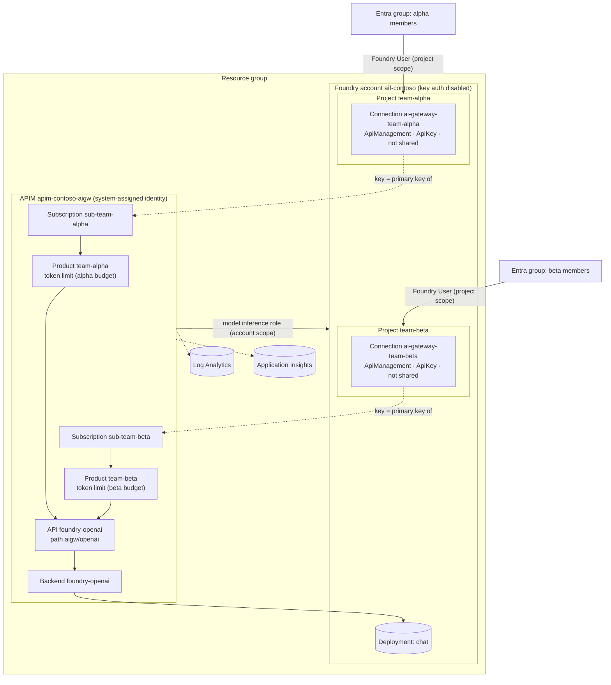
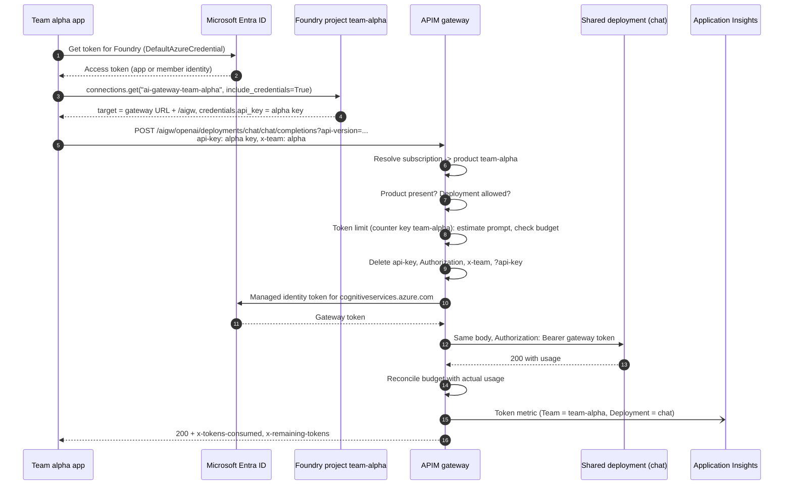
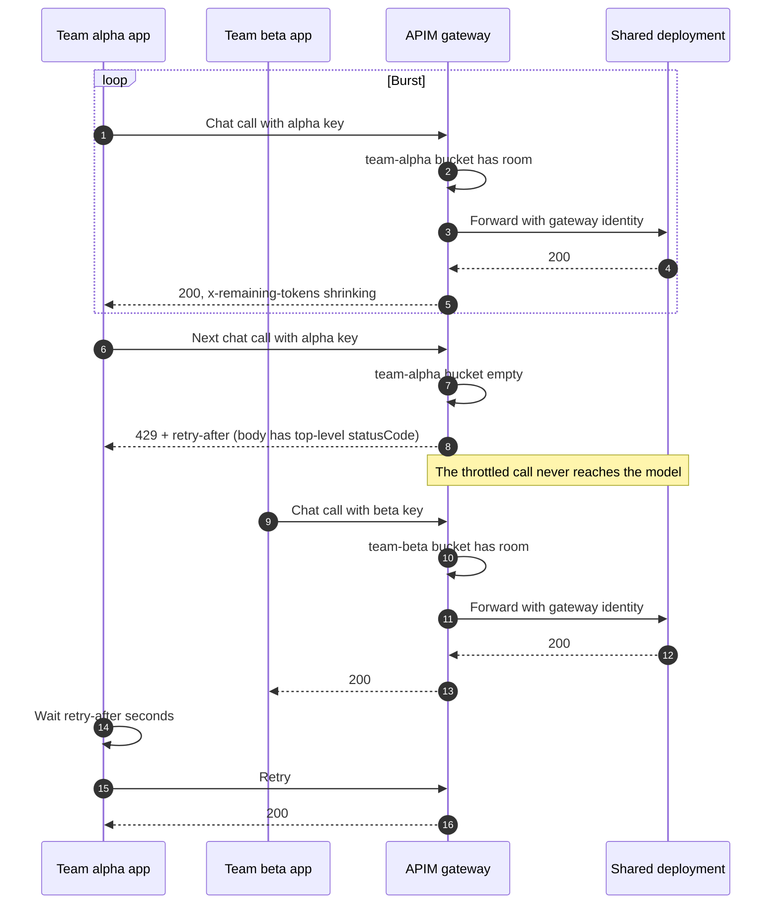
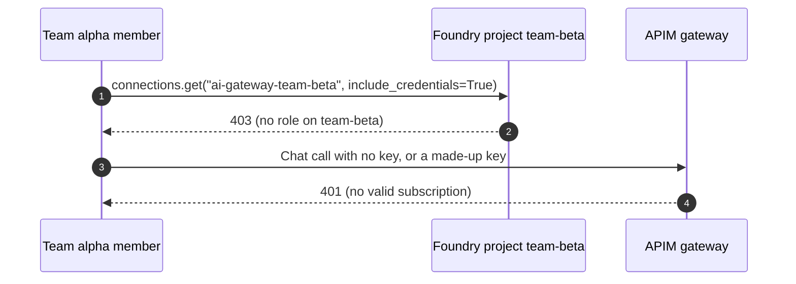
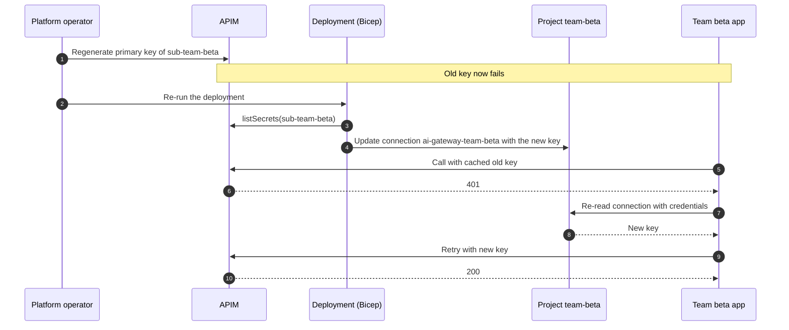

# Architecture: multi-team model gateway

This document explains how several teams share one Microsoft Foundry model deployment through Azure API Management (APIM) acting as an AI gateway, with a separate token budget, usage attribution and credential per team. It covers the forces behind the design, the components, the request flows, the identity and quota models, the wire contracts, the failure modes and the alternatives.

> **Status.** The infrastructure in [infra/](../infra/README.md) is illustrative and undeployed: it is validated with `az bicep build` only. Foundry projects and project connections use preview API versions. Statements about APIM policy behaviour follow the public documentation and the proof of concept behind this design; items marked **verify in your tenant** can differ by release or region. This document contains no latency, throughput, capacity or cost figures.

## 1. Problem and forces

A platform team runs one Foundry account with one or a few model deployments. Several product teams build on it. Each team wants enough capacity for its own work and does not care about the others. The platform team has to balance these forces:

| Force | Pressure |
|---|---|
| **Shared capacity** | A deployment's capacity is shared by every caller. Without a per-team limit, the busiest caller decides how much is left for everyone else. |
| **Fair share** | Teams need a predictable slice. A slice must be enforced by something the team cannot change. |
| **Attribution** | Finance wants token usage per team. Usage reported by each team's own code is neither complete nor trustworthy. |
| **Credential sprawl** | A model key works for anyone who has it, for every deployment on the account, and it ends up in `.env` files, pipeline variables and chat messages. |
| **Team boundaries** | Team A must not be able to spend team B's budget, read team B's credential or see team B's usage as its own. |
| **Developer experience** | Teams want the normal Azure OpenAI SDK and a normal endpoint, not a bespoke client. |
| **Operability** | Onboarding a team, rotating a key or changing a budget must be a parameter change, not a ticket chain. |

## 2. Invariants

The design holds these invariants. Every component and scenario in this asset exists to keep one of them true.

1. **The budget key is not caller-controlled.** The token limit is keyed on `context.Product.Name`. The product is resolved by APIM from the validated subscription key. No header, query parameter or body field can move a call to another team's budget.
2. **One key, one product, one team.** Each team product has exactly one subscription. Calls that do not arrive through a team product are rejected with 403 before they can spend anything.
3. **No model key exists.** Local (key) authentication is disabled on the Foundry account. The only principal with a model inference role on the account is the gateway's managed identity.
4. **Caller credentials stop at the gateway.** The API policy deletes `api-key`, `Authorization`, `x-team` and the `api-key` query parameter before it calls the model with its own token.
5. **A team's key lives only in its own project.** The key is stored in a non-shared `ApiManagement` connection in the team's Foundry project. Only principals with a role on that project can read it.
6. **Usage is attributed by the gateway.** The token metric's `Team` dimension comes from the same product name that keys the budget.
7. **Nothing in telemetry identifies content.** Diagnostics log no request or response bodies and no client IP.

## 3. Components and responsibilities

| Component | Resource | Responsibility | Defined in |
|---|---|---|---|
| Foundry account | `Microsoft.CognitiveServices/accounts` (kind `AIServices`) | Hosts the shared model deployment and the team projects. Key auth disabled. | [foundry-account.bicep](../infra/modules/foundry-account.bicep) |
| Shared model deployment | `accounts/deployments` | The model every team calls. Default name `chat`, example model `gpt-4.1-mini`. | [foundry-account.bicep](../infra/modules/foundry-account.bicep) |
| APIM service | `Microsoft.ApiManagement/service` (BasicV2 or StandardV2) | The AI gateway. System-assigned managed identity. | [apim-gateway.bicep](../infra/modules/apim-gateway.bicep) |
| Backend `foundry-openai` | `service/backends` | Points at the account's Azure OpenAI endpoint with TLS validation. | [apim-gateway.bicep](../infra/modules/apim-gateway.bicep) |
| API `foundry-openai` | `service/apis` | Azure OpenAI-compatible surface at `aigw/openai`. Subscription key named `api-key`. Chat completions and embeddings operations. | [apim-gateway.bicep](../infra/modules/apim-gateway.bicep) |
| API policy | `apis/policies` | Product check, deployment allow-list, `<base />`, credential stripping, managed identity, backend routing, token metric. | [api-gateway-policy.xml](../infra/policies/api-gateway-policy.xml) |
| Named value `allowed-model-deployments` | `service/namedValues` | Comma-separated deployments the gateway exposes. | [apim-gateway.bicep](../infra/modules/apim-gateway.bicep) |
| Team product `team-<name>` | `service/products` | The budget counter. Subscription and approval required. | [team.bicep](../infra/modules/team.bicep) |
| Product policy | `products/policies` | `azure-openai-token-limit` keyed on the product name. | [team-token-limit.xml](../infra/policies/team-token-limit.xml) |
| Team subscription `sub-team-<name>` | `service/subscriptions` | The team's gateway key, scoped to its product. | [team.bicep](../infra/modules/team.bicep) |
| Team project `team-<name>` | `accounts/projects` | The team's workspace and the boundary for reading its key. | [team.bicep](../infra/modules/team.bicep) |
| Team connection `ai-gateway-team-<name>` | `projects/connections` | Category `ApiManagement`, auth `ApiKey`, not shared. Holds the key and the gateway target. | [team.bicep](../infra/modules/team.bicep) |
| Project role assignments | `Microsoft.Authorization/roleAssignments` | Foundry User for the team's members, scoped to the team's project. | [team.bicep](../infra/modules/team.bicep) |
| Gateway role assignment | `Microsoft.Authorization/roleAssignments` | Model inference role for the gateway identity on the account. | [role-assignment.bicep](../infra/modules/role-assignment.bicep) |
| Observability | Log Analytics, Application Insights, APIM logger, API diagnostics, diagnostic setting | Per-team token metric, request telemetry without bodies, gateway logs. | [apim-gateway.bicep](../infra/modules/apim-gateway.bicep) |
| Team client | Python, `azure-ai-projects`, `openai` | Reads the connection with Entra ID and calls the gateway with the Azure OpenAI SDK. | [team_client.py](../src/team_client.py) |

## 4. Topology



## 5. Naming contract

Every per-team name is derived from the team's short name in the `teams` parameter. The client, the docs and the simulator all rely on these names.

| Item | Pattern | Example for `alpha` | Notes |
|---|---|---|---|
| APIM product | `team-<name>` | `team-alpha` | The token-limit counter key and the `Team` metric dimension. Treat as immutable once traffic flows. |
| APIM subscription | `sub-team-<name>` | `sub-team-alpha` | Scoped to the product. One per product. |
| Foundry project | `team-<name>` | `team-alpha` | Project endpoint: `https://<customSubDomain>.services.ai.azure.com/api/projects/team-alpha` |
| Project connection | `ai-gateway-team-<name>` | `ai-gateway-team-alpha` | Must be unique across all projects in the account, even when not shared, so the team name is part of it. |
| Connection target | `<gatewayUrl>/<apiPathPrefix>` | `https://apim-contoso-aigw.example.com/aigw` | `gatewayUrl` is read from `properties.gatewayUrl`. The SDK appends `/openai/deployments/...`. |
| API path | `<apiPathPrefix>/openai` | `aigw/openai` | Default prefix `aigw`. |
| Settings variables | `TEAM_<NAME>_PROJECT_ENDPOINT`, `TEAM_<NAME>_CONNECTION` | `TEAM_ALPHA_PROJECT_ENDPOINT` | Upper case, hyphens become underscores. No keys. |

## 6. Request flows

### 6.1 Happy path



The application reads the connection on startup and caches the client. It re-reads the connection only when the gateway returns 401, which is how a rotated key is picked up (section 6.4).

### 6.2 Budget exhausted



This is the behaviour [tpm_burst_test.py](../src/tpm_burst_test.py) proves in a live tenant and the simulator proves offline: team alpha receives 429 with `retry-after` once its budget is exhausted; team beta's calls continue to succeed.

### 6.3 Reading another team's key



A team member has Foundry User on their own project only. They cannot list or read another project's connections. The gateway accepts only real subscription keys, and every real key belongs to one product.

### 6.4 Key rotation



The window between regenerating the key and redeploying is a short outage for that team only. To avoid it, regenerate the secondary key, point the connection at it, then regenerate the primary later. The Bicep reads `primaryKey`; change it if you adopt the two-key routine. See [infra/README.md](../infra/README.md).

## 7. Identity model

There are three kinds of credential in the design, and each one stops at a defined boundary.

| Credential | Held by | Proves | Accepted by | Stops at |
|---|---|---|---|---|
| Entra token for Foundry | Team member or the team app's managed identity | Who the caller is | The Foundry project data plane | The project: it lets the caller read that project's connection |
| APIM subscription key | The team app, in memory only | Which team product the call belongs to | The APIM gateway | The gateway: deleted before the backend call |
| Gateway managed identity token | APIM | That the call comes from the gateway | The Foundry account | The model deployment |

Role assignments:

| Principal | Role | Scope | Why |
|---|---|---|---|
| Team members (one Entra group per team) | Foundry User | That team's project only | Use the project and read its connection, including the key |
| APIM system-assigned identity | Cognitive Services User, or the narrower Cognitive Services OpenAI User | The Foundry account | Call the model deployment. The role ID is a parameter you look up in your tenant. |
| Deployment identity (pipeline) | Contributor and Role Based Access Control Administrator, or Owner | The resource group | Create resources, read subscription keys with `listSecrets()`, create role assignments |
| Platform operators | As above, plus Foundry User on each project for testing | Resource group and projects | Run the isolation test |

Do **not** give team members or team apps a model inference role on the account. If you do, they can call the model directly with Entra ID and skip their budget. See [authentication-and-governance.md](authentication-and-governance.md) for the full model, and [ADR 0002](decisions/0002-project-connection-as-gateway-key-distribution.md) for why the key is distributed through the project.

## 8. Quota model

### 8.1 Counter key

The `azure-openai-token-limit` policy is attached to each team product and uses `counter-key="@(context.Product.Name)"`. The product name is fixed at deployment time and is resolved from the subscription key, so the counter key is outside the caller's control. One product per team means one counter per team. [ADR 0001](decisions/0001-apim-product-per-team-as-quota-counter-key.md) compares this with keying on the subscription ID, a header or an Entra claim.

### 8.2 How the limit behaves

These points follow the APIM documentation for the v2 tiers; verify them in your tenant.

- **Rolling budget.** The limit is expressed as tokens per minute and behaves like a token bucket that refills over time rather than resetting all at once at the start of each minute.
- **Estimate before, reconcile after.** With `estimate-prompt-tokens="true"`, the gateway counts the prompt's tokens before the call. If the estimate already exceeds what is left, the call gets 429 and never reaches the model. After the response, the gateway reconciles with the actual usage reported by the model.
- **Streaming.** For streamed responses the gateway relies on the estimate. Ask for usage in the stream (`stream_options.include_usage`) if you need accurate metrics.
- **Overdraft under concurrency.** Several calls can pass the check at the same time and then together use more than was left. The bucket goes negative and the team is throttled until it refills. A team can briefly exceed its budget; it cannot sustain it.
- **Response headers.** `x-remaining-tokens` reports what is left; `x-tokens-consumed` reports what the call used. `retry-after` on a 429 tells the client how long to wait.
- **Per gateway region.** Counters are kept per gateway region and not aggregated. A multi-region APIM gives each region a separate budget per team.

### 8.3 Optional period quota

The token limit protects shared capacity minute by minute. If you also need a hard monthly or daily allowance per team, add `token-quota` and `token-quota-period` to the same policy. When the period's quota is used up the gateway returns 403 rather than 429. The simulator models this; the Bicep does not enable it.

### 8.4 Sizing

- Size each team's budget from your own measurements of its workload.
- Keep the sum of team budgets within the deployment's capacity. If the sum is larger, teams can be within budget and still receive model-side 429s when the deployment is saturated.
- Leave headroom for retries and for teams you have not onboarded yet.
- Change a budget by changing `tokensPerMinute` for that team and redeploying. Other teams' counters are not touched.

## 9. Policy pipeline

The order of the inbound section is part of the contract.

| Step | Scope | Element | Outcome when it fails | Budget spent? |
|---|---|---|---|---|
| 1 | Built-in | Subscription key validation (`api-key` header or query) | 401, no valid subscription | No |
| 2 | API | `context.Product == null` check | 403 `team_product_required` | No |
| 3 | API | Deployment allow-list against `{{allowed-model-deployments}}` | 404 `deployment_not_allowed` | No |
| 4 | API | `<base />` runs the product policy | | |
| 5 | Product | `azure-openai-token-limit` keyed on the product name | 429 with `retry-after` | Estimate checked, nothing forwarded |
| 6 | API | Delete `api-key`, `Authorization`, `x-team` headers and the `api-key` query parameter | | |
| 7 | API | `authentication-managed-identity` for `https://cognitiveservices.azure.com` | 500 if the identity cannot get a token | Reconciled |
| 8 | API | `set-backend-service backend-id="foundry-openai"` | | |
| 9 | API | `azure-openai-emit-token-metric` (when observability is on) | Never blocks | |

Steps 2 and 3 run before `<base />` on purpose: a call that would be rejected for another reason never touches a team's budget.

## 10. Wire contracts

### 10.1 Project connection

What the team client reads from `connections.get(name, include_credentials=True)`. Values are placeholders.

```json
{
  "name": "ai-gateway-team-alpha",
  "type": "ApiManagement",
  "target": "https://apim-contoso-aigw.example.com/aigw",
  "isDefault": false,
  "credentials": {
    "type": "ApiKey",
    "api_key": "<team alpha subscription key>"
  },
  "metadata": {
    "ResourceId": "/subscriptions/00000000-0000-0000-0000-000000000000/resourceGroups/rg-contoso-aigw/providers/Microsoft.ApiManagement/service/apim-contoso-aigw",
    "type": "azure_api_management"
  }
}
```

The ARM definition sets `category: 'ApiManagement'`, `authType: 'ApiKey'`, `isSharedToAll: false` and `credentials.key` from the subscription's `listSecrets().primaryKey`. Field names in the SDK object can differ by SDK version; [team_client.py](../src/team_client.py) handles that.

### 10.2 Team to gateway

```http
POST {target}/openai/deployments/chat/chat/completions?api-version=2024-10-21
api-key: <team alpha subscription key>
x-team: alpha
Content-Type: application/json

{"messages":[{"role":"user","content":"..."}],"max_tokens":200}
```

`x-team` is a diagnostic hint only. The gateway logs it on the frontend request and deletes it before the backend call. It never selects a budget.

### 10.3 Gateway to model

```http
POST https://<customSubDomain>.openai.azure.com/openai/deployments/chat/chat/completions?api-version=2024-10-21
Authorization: Bearer <gateway managed identity token>
Content-Type: application/json
```

No `api-key`, no caller `Authorization`, no `x-team`.

### 10.4 Success response headers

| Header | Meaning |
|---|---|
| `x-tokens-consumed` | Tokens charged to the team for this call, after reconciliation |
| `x-remaining-tokens` | Tokens left in the team's budget |

### 10.5 Errors

| Status | Source | Body shape | Client action |
|---|---|---|---|
| 401 | Gateway, missing or invalid key | `{"statusCode": 401, "message": "..."}` | Re-read the connection once; if it still fails, the key was revoked or the app reads the wrong project |
| 403 `team_product_required` | API policy | `{"error": {"code": "team_product_required", "message": "..."}}` | Use the key from the team's project connection, not an all-access or API-scoped key |
| 403 | Gateway, period token quota used (optional) | `{"statusCode": 403, "message": "..."}` | Wait for the next period or ask the platform team |
| 404 `deployment_not_allowed` | API policy | `{"error": {"code": "deployment_not_allowed", "message": "..."}}` | Use a deployment the gateway exposes |
| 429, gateway throttle | Token limit policy | `{"statusCode": 429, "message": "Token limit is exceeded. ..."}` plus `retry-after` | Wait `retry-after` seconds; the call never reached the model |
| 429, model capacity | Model deployment, passed through | `{"error": {"code": "429", "message": "..."}}` | The shared deployment is saturated; back off and tell the platform team |

The body shape is how the client tells the two 429s apart: the gateway's own responses have a top-level `statusCode`, and the model's have an `error` envelope. [tpm_burst_test.py](../src/tpm_burst_test.py) and the simulator use the same rule.

### 10.6 Token metric

Emitted by `azure-openai-emit-token-metric` into the `multi-team-model-gateway` namespace in Application Insights.

| Field | Value |
|---|---|
| Metric names | `Total Tokens`, `Prompt Tokens`, `Completion Tokens` |
| `Team` | `context.Product.Name`, for example `team-alpha` |
| `Subscription ID` | The APIM subscription, for example `sub-team-alpha` |
| `API ID` | `foundry-openai` |
| `Deployment` | The deployment from the URL, for example `chat` |

Keep the number of dimensions small (the policy allows a limited number) and their values low-cardinality. Never add a dimension that carries a user ID, a prompt hash or a request ID.

## 11. Chargeback and telemetry

- **Source of truth.** The token metric is the chargeback source because it is emitted by the gateway with the same product name that keys the budget. Team-reported usage is not used.
- **Shares, not prices.** Compute each team's share of total tokens per period, then apply your own internal rate card outside this asset.
- **Gateway logs.** The diagnostic setting sends APIM resource logs to Log Analytics (resource-specific tables). Use them to count 429s per product and to confirm that a throttled call has no backend time.
- **Request telemetry.** API diagnostics send requests to Application Insights with the `x-team`, `retry-after`, `x-remaining-tokens` and `x-tokens-consumed` headers and no bodies.
- **What is never logged.** Prompts, completions, subscription keys, Entra tokens and client IP addresses.

Example queries are in [evaluation-and-troubleshooting.md](evaluation-and-troubleshooting.md).

## 12. Alternatives

### 12.1 One deployment per team

Give each team its own deployment and let the deployment's capacity be the limit. Isolation is stronger, because capacity is reserved rather than capped. The cost is fragmentation: unused capacity in one deployment cannot help another team, and you manage more deployments and model versions. Use it for teams with contractual capacity needs, and combine it with this gateway for everyone else. See [ADR 0003](decisions/0003-shared-deployment-with-gateway-quotas-vs-deployment-per-team.md).

### 12.2 Entra-based gateway authentication instead of subscription keys

The gateway can validate an Entra token (`validate-jwt` or `validate-azure-ad-token`) and key the budget on a claim such as the calling app's ID or an app role. That removes the shared secret entirely. It also changes the distribution story: teams need an app registration or managed identity with a role on a gateway app, and the Foundry connection would use an Entra auth type instead of `ApiKey`. **Verify in your tenant** which connection auth types your Foundry release supports for `ApiManagement` connections and how your SDK presents them. If you go this way, keep the counter key on a claim that the caller cannot choose, such as `appid` or `azp`, never on a header. The [MCP OAuth Front Door](../../mcp-oauth-front-door/README.md) asset shows Entra validation at a gateway.

### 12.3 Key Vault instead of project connections

Store each team's key in a Key Vault with per-team access. This works, but the team then needs a second resource, a second role and its own code to read the secret. The project connection keeps the key next to the team's other Foundry resources and uses the same role the team already has. See [ADR 0002](decisions/0002-project-connection-as-gateway-key-distribution.md).

### 12.4 One product, many subscriptions, subscription-keyed limit

Key the limit on `context.Subscription.Id` and put all teams' subscriptions in one product. It works, but the policy is shared, budgets cannot differ per team without conditional logic, and the chargeback dimension becomes a subscription ID rather than a team. One product per team keeps each team's policy and budget separate.

### 12.5 Header-based counter key (anti-pattern)

Keying on `x-team` or any other header lets a caller choose its budget. Every new header value is a fresh, full budget. The simulator's `anti_pattern_header_counter_key_is_spoofable` scenario shows it.

## 13. Domain Packs

The gateway, policies and identity model are domain-agnostic. Domains differ only in which teams share the pool, how budgets are sized, and which deployments are exposed.

| Domain Pack | Teams | Budget priority | Exposed deployments | Chargeback unit | Extra controls |
|---|---|---|---|---|---|
| **Contoso Retail** | Product search, customer service assistant, merchandising copilot | Customer service assistant first; catalog enrichment smaller | Chat | Product line | Disable the all-access subscription in every environment |
| **Fabrikam Health** | Clinical documentation, patient messaging, internal research | Clinical workloads first; research smallest | Chat | Department | Private networking with a StandardV2 gateway and the secured landing zone; separate Entra groups per department |
| **Northwind Logistics** | Route planning agent, dispatch assistant, document extraction | Dispatch first; overnight extraction on its own budget | Chat and an embeddings deployment | Business unit | Add the embeddings deployment to `allowedModelDeployments` |

## 14. Scaling and reliability

- **SKU.** BasicV2 is enough for a pilot. Use StandardV2 for VNet integration to reach a private Foundry account; BasicV2 cannot reach a private backend. Follow the [Secured Foundry Landing Zone](../../../landing-zones-and-infra/secured-foundry-landing-zone/README.md) for networking.
- **Multiple deployments.** To spread load across deployments or regions, add backends and a load-balanced pool in APIM. Budgets stay per product regardless of which backend serves the call.
- **Multiple gateway regions.** Counters are per region. Divide each team's budget across regions, or route each team to one region.
- **Statelessness.** Apart from the token counters, the gateway keeps no state. Clients can retry any failed call after `retry-after`.
- **Gateway as a dependency.** Every team now depends on the gateway. Monitor its health and capacity alongside the model deployment's.

## 15. Failure modes

| Failure | Symptom | Blast radius | Detection | Mitigation |
|---|---|---|---|---|
| A team exceeds its budget | 429 with `retry-after`, top-level `statusCode` | That team only | 429 count by product in gateway logs | Client honours `retry-after`; resize the budget if it is too small |
| Shared deployment saturated | 429 with an `error` envelope for several teams | All teams | Model-side 429s in the deployment's metrics | Keep the sum of budgets within capacity; add capacity or a second deployment |
| Gateway identity lost its role | 401 or 403 from the model for every team | All teams | Backend 401/403 in gateway logs | Restore the role assignment; it is in the Bicep |
| Key regenerated, connection not updated | 401 for one team | That team only | 401 count by product | Redeploy to refresh the connection; the client re-reads after a 401 |
| Member removed from the team group | Can no longer read the connection | One person | Access denied on `connections.get` | Expected. Rotate the team key if they may have copied it |
| Key leaked outside the team | Usage charged to the owning team from unexpected sources | That team's budget | Usage anomalies on the `Team` dimension | Rotate the key; review who can read the connection |
| All-access subscription used | 403 `team_product_required` | None | 403 count | Expected. Disable the all-access subscription |
| Product renamed | Team gets a fresh, full budget; metric history splits | That team | New `Team` value in metrics | Treat product names as immutable; see ADR 0001 |
| Connection name collision | Deployment fails for the second project | Onboarding only | Deployment error | Names include the team name by design |
| Preview API version withdrawn | Deployment fails on projects or connections | Deployments only | Deployment error | Move to a supported API version |
| Policy name not recognized | Policy save fails at deployment | Deployments only | Deployment error | Switch between `azure-openai-*` and `llm-*` policy names; verify in your tenant |
| Telemetry missing | No token metric | Chargeback only | Empty metric queries | Check the logger, custom metrics on the API diagnostics, and `stream_options.include_usage` for streaming |

## 16. Anti-patterns

- **Handing out the model key "just for testing".** It works for every deployment on the account and bypasses every budget. Keep key auth disabled.
- **Granting teams a model role on the account.** Same effect as a key: direct access that skips the gateway.
- **Keying the budget on a header.** The caller picks its own budget.
- **Copying the gateway key into `.env` or pipeline variables.** It escapes the project boundary and the rotation story. Read it from the connection at run time.
- **Sharing one subscription across teams.** You lose isolation and attribution.
- **Logging bodies to debug quotas.** Quota issues are visible from headers and counts. Bodies put prompts in logs.
- **Retrying 429s in a tight loop.** Honour `retry-after`; a gateway 429 means the team's budget, not the model, is the limit.
- **Treating the budget as a reservation.** It is a ceiling. Capacity is still shared.

## 17. Production checklist

- [ ] Key authentication is disabled on the Foundry account, and no team has a model inference role on it.
- [ ] The gateway identity's role is the narrowest that works (Cognitive Services OpenAI User if your deployments allow it).
- [ ] Each team has its own Entra group, product, subscription, project and connection.
- [ ] The built-in all-access subscription is disabled; the API policy's product check is in place.
- [ ] `allowedModelDeployments` lists only the deployments you intend to share.
- [ ] Each team's `tokensPerMinute` is sized from measurement, and the sum fits within the deployment's capacity.
- [ ] The isolation test passes in each environment: the burst team is throttled by the gateway and the control team is served.
- [ ] The token metric shows each team, and the chargeback query runs.
- [ ] Alerts exist for gateway 429s per team, model-side 429s and backend 401/403s.
- [ ] Diagnostics log no bodies and no client IP.
- [ ] A key rotation has been rehearsed, including client recovery after a 401.
- [ ] Private networking is in place where required (StandardV2 with VNet integration).
- [ ] The preview API version for projects and connections, and the policy names, have been confirmed in your tenant.
- [ ] Release gates from the [Agent Production Readiness Guide](../../../agentops-and-readiness/agent-production-readiness/README.md) are applied.

## Related

- [Authentication and governance](authentication-and-governance.md)
- [Evaluation and troubleshooting](evaluation-and-troubleshooting.md)
- [ADR 0001: APIM product per team as the quota counter key](decisions/0001-apim-product-per-team-as-quota-counter-key.md)
- [ADR 0002: Project connection as gateway key distribution](decisions/0002-project-connection-as-gateway-key-distribution.md)
- [ADR 0003: Shared deployment with gateway quotas versus a deployment per team](decisions/0003-shared-deployment-with-gateway-quotas-vs-deployment-per-team.md)
- [Infrastructure guide](../infra/README.md)
- [Samples guide](../samples/README.md)
- [Multi-Tenant MCP Gateway](../../multi-tenant-mcp-gateway/README.md)
- [Hosted agent behind a streaming model gateway](../../../agent-runtime/hosted-agent-streaming-model-gateway/README.md)
