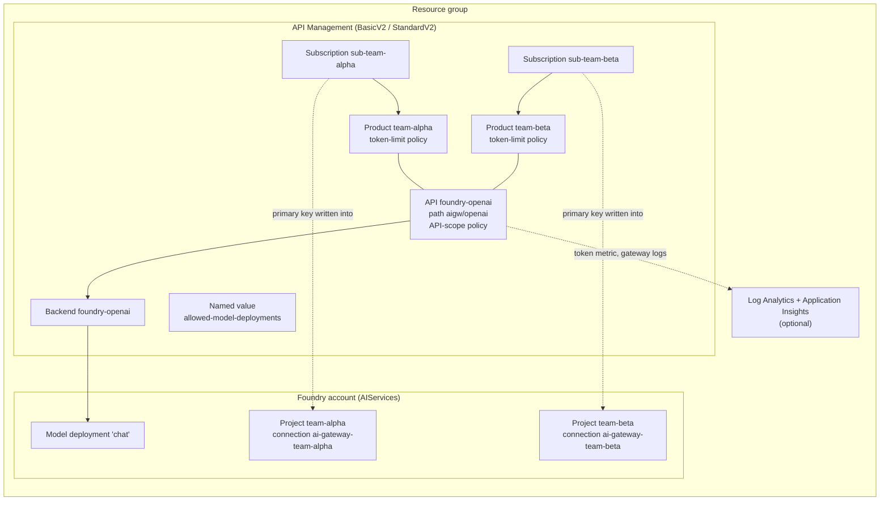

# Infrastructure: multi-team model gateway

> **Status: illustrative, validated with `az bicep build` and `az bicep lint` only; not deployed by this repository.** The templates encode the design in [../docs/architecture.md](../docs/architecture.md). Before you rely on them, deploy them into a sandbox subscription and run the verification steps below. Items that depend on preview resource types or on tenant behaviour are listed under [Verify in your tenant](#verify-in-your-tenant).

These Bicep templates put Azure API Management (APIM) in front of one shared Microsoft Foundry model deployment. Every team gets:

- its own APIM product and subscription, so it has its own token budget;
- its own Foundry project with a project-scoped role assignment;
- a project connection that holds that team's gateway key, which is the only way the key reaches the team.

No model key, account key or gateway key is written to an output, a parameter file or a pipeline variable.

## Files

| File | Purpose |
|---|---|
| `main.bicep` | Orchestrator. Declares the parameters and the `teamConfig` type, optionally creates the Foundry account, deploys the gateway, grants the APIM managed identity model access, then deploys one `team.bicep` per team. Team modules run one at a time (`@batchSize(1)`) because they all write to the same APIM service and Foundry account. |
| `modules/foundry-account.bicep` | Foundry (`AIServices`) account with `disableLocalAuth: true`, `allowProjectManagement: true` and a custom subdomain, plus the shared model deployment. Skipped when `createFoundryAccount` is `false`. |
| `modules/apim-gateway.bicep` | APIM v2 service with a system-assigned identity, the `foundry-openai` backend, the `allowed-model-deployments` named value, the Azure OpenAI-compatible API (`chat-completions` and `embeddings` operations) and the API-scope policy. When `enableObservability` is `true` it also adds Log Analytics, Application Insights, an APIM logger, API diagnostics with custom metrics, and diagnostic settings that send gateway logs to Log Analytics. |
| `modules/role-assignment.bicep` | Grants the APIM managed identity the model inference role (for example Cognitive Services User) on the Foundry account. |
| `modules/team.bicep` | Per team: APIM product, product–API link, product policy with the team's token budget, one subscription, one Foundry project, one project connection that carries the subscription key, and Foundry User role assignments on that project only. |
| `policies/api-gateway-policy.xml` | API-scope policy. Rejects calls that do not come through a team product, enforces the deployment allow-list, removes caller credentials, authenticates to the backend with the managed identity and routes to the backend. |
| `policies/team-token-limit.xml` | Product-scope policy template. `azure-openai-token-limit` keyed by `context.Product.Name`; `__TOKENS_PER_MINUTE__` is replaced per team. |
| `policies/token-metric-fragment.xml` | `azure-openai-emit-token-metric` with a `Team` dimension. Inserted into the API policy at the `<!-- TOKEN_METRIC_POLICY -->` marker when observability is on. |
| `parameters.example.json` | Example parameter set with Contoso values. It fails closed: the role ID is blank and each team budget is `0`, so validation fails until an operator supplies real values. |
| `pipelines/multi-team-gateway-deploy.yml` | GitHub Actions workflow: lint and guardrails → what-if → approval-gated deploy → post-deploy verification. It uses OpenID Connect federation and stores no secrets. |

## What gets deployed



| Resource | Type | Name pattern | Notes |
|---|---|---|---|
| Foundry account | `Microsoft.CognitiveServices/accounts` (`AIServices`) | `foundryAccountName` (default `aif-<prefix>-<hash>`) | Created only when `createFoundryAccount` is `true`. Local (key) auth is disabled, so only Microsoft Entra callers, including the APIM managed identity, can reach the model. |
| Model deployment | `Microsoft.CognitiveServices/accounts/deployments` | `modelDeploymentName` (default `chat`) | Shared by every team. Its capacity is the ceiling the team budgets divide up. |
| APIM service | `Microsoft.ApiManagement/service` | `apimName` (default `apim-<prefix>-aigw-<hash>`) | BasicV2 or StandardV2, with a system-assigned identity. |
| Backend | `.../backends` | `foundry-openai` | `https://<account-subdomain>.openai.azure.com/openai`. |
| API | `.../apis` | `foundry-openai`, path `<apiPathPrefix>/openai` | Requires a subscription. The key is accepted in the `api-key` header (or query parameter), matching the Azure OpenAI client convention. |
| Operations | `.../apis/operations` | `chat-completions`, `embeddings` | Only these routes are exposed. Add more operations deliberately. |
| Named value | `.../namedValues` | `allowed-model-deployments` | Comma-separated list from `allowedModelDeployments`. |
| Product per team | `.../products` | `team-<name>` | `subscriptionRequired`, `approvalRequired`, `subscriptionsLimit: 1`. The display name equals the product ID because it is the token counter key. |
| Product policy per team | `.../products/policies` | `policy` | Token limit with that team's `tokensPerMinute`. |
| Subscription per team | `.../subscriptions` | `sub-team-<name>` | Scoped to the team's product; `allowTracing: false`. |
| Project per team | `Microsoft.CognitiveServices/accounts/projects` | `team-<name>` | Team members get Foundry User on this scope only. |
| Connection per team | `.../projects/connections` | `ai-gateway-team-<name>` | Category `ApiManagement`, `authType: ApiKey`, `isSharedToAll: false`. Its target is the gateway endpoint; its key is the subscription's primary key, read at deploy time with `listSecrets()`. |
| Role assignment | `Microsoft.Authorization/roleAssignments` | deterministic `guid()` | APIM identity → model inference role on the account. |
| Role assignments per team | `Microsoft.Authorization/roleAssignments` | deterministic `guid()` | Each `memberPrincipalIds` entry → Foundry User on the team's project. |
| Observability (optional) | Log Analytics, Application Insights, APIM logger, API diagnostics, diagnostic settings | `log-…`, `appi-…`, `appinsights` | Request and response bodies are never logged. The `x-team` request header and the `retry-after`, `x-remaining-tokens` and `x-tokens-consumed` response headers are. |

## What is not deployed

- **Private networking.** BasicV2 cannot reach a private backend. For private endpoints, use StandardV2 with virtual network integration, set `foundryPublicNetworkAccess` to `Disabled`, and build the network from the [secured Foundry landing zone](../../../landing-zones-and-infra/secured-foundry-landing-zone/README.md).
- **Monthly or daily token quotas.** The `token-quota` attribute of the token limit policy is not set. The [sample](../samples/README.md) models it so you can see the 403 behaviour before you turn it on.
- **Key rotation automation.** See [Rotating a team key](#rotating-a-team-key).
- **Microsoft Entra token validation at the gateway.** Subscription keys are the team credential here. [../docs/architecture.md](../docs/architecture.md) describes the `validate-jwt` alternative.
- **Alerts and dashboards.** The metric and logs are in place; alert rules depend on your operating model. See [../docs/evaluation-and-troubleshooting.md](../docs/evaluation-and-troubleshooting.md).
- **Groups and identities.** `memberPrincipalIds` expects existing Microsoft Entra object IDs.

## Prerequisites

- Azure CLI with Bicep. These files were built with Bicep 0.39.
- A resource group in a region where APIM v2 tiers, Foundry projects and your chosen model are available.
- A deployment identity that holds:
  - **Contributor** on the resource group;
  - **Role Based Access Control Administrator** on the resource group, preferably with a condition that limits it to assigning the model inference role and Foundry User.

  The identity needs the second role because the templates create role assignments.
- Model capacity for `modelName` / `modelSkuName` in the region, or an existing account and deployment to reuse (see `createFoundryAccount`).
- One Microsoft Entra group per team (recommended) whose object ID goes into `memberPrincipalIds`.

### Look up the role definition IDs

The template takes role definition IDs as parameters instead of hard-coding them. Look them up in your tenant:

```bash
# Model inference role for the APIM managed identity (pick one)
az role definition list --name "Cognitive Services User" --query "[0].name" -o tsv
az role definition list --name "Cognitive Services OpenAI User" --query "[0].name" -o tsv

# Foundry User (the template default; confirm it matches your tenant)
az role definition list --name "Foundry User" --query "[0].name" -o tsv
```

Cognitive Services OpenAI User is the narrower choice when the gateway only calls Azure OpenAI-style routes. Cognitive Services User also covers other Foundry Tools data-plane APIs.

## Deploy

```bash
RG=rg-contoso-aigw
LOCATION=<region>

az group create -n "$RG" -l "$LOCATION"

# 1. Extract the parameters and keep the populated copy out of git.
mkdir -p .local
jq '.deployment' infra/parameters.example.json > .local/deployment.parameters.json

# 2. Fill in apimModelInferenceRoleDefinitionId, each team's tokensPerMinute
#    and memberPrincipalIds in .local/deployment.parameters.json.

# 3. Validate and preview.
az deployment group validate -g "$RG" -f infra/main.bicep -p @.local/deployment.parameters.json
az deployment group what-if  -g "$RG" -f infra/main.bicep -p @.local/deployment.parameters.json

# 4. Deploy.
az deployment group create -g "$RG" -n multi-team-model-gateway \
  -f infra/main.bicep -p @.local/deployment.parameters.json
```

Run these commands from the asset folder (`assets/ai-gateway/multi-team-model-gateway`). Creating an APIM v2 service can take a while. Re-running the deployment is safe: names and role assignment IDs are deterministic.

To run the same steps from CI, use [pipelines/multi-team-gateway-deploy.yml](pipelines/multi-team-gateway-deploy.yml). Copy it to `.github/workflows/` in your own repository and set these repository variables: `AZURE_TENANT_ID`, `AZURE_SUBSCRIPTION_ID`, `AZURE_MTMG_DEPLOY_CLIENT_ID`, `MTMG_RESOURCE_GROUP` and `MTMG_PARAMETERS`. Protect the `mtmg-<env>-deploy` environment with required reviewers.

## Parameters

| Parameter | Type | Default | Description |
|---|---|---|---|
| `location` | string | resource group location | Region for every resource. |
| `namePrefix` | string (3–12) | `contoso` | Prefix used to derive names. |
| `createFoundryAccount` | bool | `true` | `false` reuses an existing account (and its deployment) in the same resource group. The account must have a custom subdomain and `allowProjectManagement` enabled. |
| `foundryAccountName` | string | `aif-<prefix>-<hash>` | Account name; also the custom subdomain when created here. |
| `foundryPublicNetworkAccess` | `Enabled` \| `Disabled` | `Enabled` | Applies to a newly created account. `Disabled` requires private networking that BasicV2 cannot use. |
| `modelDeploymentName` | string | `chat` | Shared deployment name. Teams pass it as `model`. |
| `modelName` | string | `gpt-4.1-mini` | Model for a new deployment. |
| `modelVersion` | string | `2025-04-14` | Model version; check regional availability. |
| `modelSkuName` | string | `GlobalStandard` | Deployment SKU. |
| `modelCapacity` | int | `10` | Deployment capacity. Keep the sum of team budgets within it. |
| `apimName` | string | `apim-<prefix>-aigw-<hash>` | Globally unique APIM name. |
| `apimSku` | `BasicV2` \| `StandardV2` | `BasicV2` | v2 tiers support the token limit policy and managed identity. |
| `publisherEmail` | string | `platform-team@example.com` | Use a shared mailbox. |
| `publisherName` | string | `Contoso Platform Team` | Shown in APIM. |
| `apiPathPrefix` | string | `aigw` | Clients use `<gatewayUrl>/<apiPathPrefix>` as their Azure OpenAI endpoint. |
| `allowedModelDeployments` | string[] | `["chat"]` | Deployments the gateway forwards. Anything else gets 404 before the request is counted against the team's budget. |
| `teams` | `teamConfig[]` (min 1) | — | `{ name, tokensPerMinute, memberPrincipalIds, memberPrincipalType? }`. `name` is 2–20 lowercase characters; `tokensPerMinute` ≥ 1; `memberPrincipalType` defaults to `Group`. |
| `apimModelInferenceRoleDefinitionId` | string (36) | — | GUID of the role granted to APIM on the account. Required. |
| `foundryUserRoleDefinitionId` | string (36) | Foundry User | GUID of the role granted to team members on their project. |
| `enableObservability` | bool | `true` | Deploys the logging stack and the token metric policy. |
| `tags` | object | workload tag | Applied to every resource. |

## Outputs

| Output | Description |
|---|---|
| `apimName` | APIM service name. |
| `gatewayUrl` | APIM gateway base URL (`properties.gatewayUrl`). |
| `gatewayTarget` | `<gatewayUrl>/<apiPathPrefix>`. The Azure OpenAI-compatible endpoint that every team connection targets. |
| `foundryAccountName` | Account that hosts the deployment and the projects. |
| `modelDeploymentName` | Deployment exposed through the gateway. |
| `appInsightsName` | Application Insights resource (empty when observability is off). |
| `teams` | Per team: `team`, `productName`, `subscriptionName`, `projectName`, `projectEndpoint`, `connectionName`. No keys. |

`projectEndpoint` and `connectionName` are what [../src/.env.sample](../src/.env.sample) needs.

## Post-deploy verification

Run each check in order. The pipeline's verify stage automates checks 1–3.

1. **No secrets in outputs.**

   ```bash
   az deployment group show -g "$RG" -n multi-team-model-gateway --query properties.outputs -o json \
     | grep -Ei 'primaryKey|secondaryKey|"key"' && echo "FAIL" || echo "ok: no keys in outputs"
   ```

2. **Connections are private to their project.**

   ```bash
   SUB=$(az account show --query id -o tsv)
   ACCOUNT=$(az deployment group show -g "$RG" -n multi-team-model-gateway --query properties.outputs.foundryAccountName.value -o tsv)
   az rest --method get \
     --url "https://management.azure.com/subscriptions/$SUB/resourceGroups/$RG/providers/Microsoft.CognitiveServices/accounts/$ACCOUNT/projects/team-alpha/connections/ai-gateway-team-alpha?api-version=2025-04-01-preview" \
     --query "properties.{category:category, authType:authType, shared:isSharedToAll, target:target}"
   ```

   Expect `category` `ApiManagement`, `authType` `ApiKey` and `shared` `false`. The management API does not return the key on a plain GET.

3. **The gateway rejects anonymous callers.** A request to `<gatewayTarget>/openai/deployments/chat/chat/completions?api-version=2024-10-21` without an `api-key` header returns 401.

4. **A team member can call through the project.** Sign in as a member of the alpha group, then run `python src/run_team.py --team alpha` (see [../src/README.md](../src/README.md)). The response includes the `x-tokens-consumed` and `x-remaining-tokens` headers.

5. **Project isolation holds.** The same alpha user runs `python src/run_team.py --team beta`. Reading beta's connection fails with an authorization error, because alpha has no role on the beta project.

6. **Budget isolation holds.** `python src/tpm_burst_test.py` keeps calling as alpha until the gateway returns 429 with `retry-after`, then makes one beta call. Expect the beta call to succeed.

7. **The token metric arrives** (with observability on). In Application Insights, query `customMetrics` for the `multi-team-model-gateway` namespace and split by the `Team` dimension. Custom metrics can take a few minutes to appear.

8. **Model keys are disabled.** `az cognitiveservices account keys list -g "$RG" -n "$ACCOUNT"` should fail because local auth is disabled on the account.

## Onboarding a new team

1. Add an entry to `teams` with the team name, a budget and the team's group object ID.
2. Check that the new budget still fits inside `modelCapacity` alongside the existing budgets, or raise the capacity.
3. Run what-if. Expect only new resources: a product, product–API link, product policy, subscription, project, connection and role assignment. Existing teams should show no change.
4. Deploy, then repeat verification checks 4–6 for the new team.

Removing a team from `teams` does not delete its resources, because deployments are incremental. Delete its product, subscription, project and connection explicitly, in that order, and record the removal in your change log.

## Rotating a team key

The subscription key is copied into the connection at deploy time, so rotation is a two-step operation:

1. Regenerate the key that the connection does **not** currently use. The template reads the primary key, so regenerate the secondary key first:

   ```bash
   APIM=$(az deployment group show -g "$RG" -n multi-team-model-gateway --query properties.outputs.apimName.value -o tsv)
   az rest --method post \
     --url "https://management.azure.com/subscriptions/$SUB/resourceGroups/$RG/providers/Microsoft.ApiManagement/service/$APIM/subscriptions/sub-team-alpha/regenerateSecondaryKey?api-version=2024-05-01"
   ```

2. Regenerate the primary key, then redeploy right away so that `listSecrets()` writes the new primary key into the connection. Clients pick up the new key the next time they read the connection. Clients that cache the key for the life of a process see 401 until they read the connection again; [../src/team_client.py](../src/team_client.py) re-reads it once after a 401.

Expect a short window of 401s between regenerating the primary key and the redeploy finishing. To avoid it, change `team.bicep` to read `secondaryKey`, deploy, and only then regenerate the primary. Alternate between the two keys on each rotation.

## Teardown

```bash
az group delete -n "$RG" --yes
```

- **Foundry account:** soft-deleted. Purge it before you reuse the name: `az cognitiveservices account purge -g "$RG" -n "$ACCOUNT" -l "$LOCATION"`.
- **APIM service:** also soft-deleted. List soft-deleted services with `az apim deletedservice list`, then purge with `az apim deletedservice purge --service-name "$APIM" --location "$LOCATION"`.
- **Role assignments** are removed with their scopes.

## Security notes

- **Teams never receive a model key.** The account has `disableLocalAuth: true`, and only the APIM managed identity holds a model data-plane role.
- **Caller credentials stop at the gateway.** The API policy deletes the inbound `api-key` and `Authorization` headers and the `api-key` query parameter, then authenticates to the backend with the managed identity. A caller who sends a Microsoft Entra token cannot reach the backend with it.
- **No path around the products.** The API policy returns 403 for any request that did not arrive through a product, which blocks the built-in all-access subscription and API-scoped subscriptions. Only team products should include the API.
- **One key per team, one place to read it.** Each product allows one subscription. Each key is written into exactly one project connection with `isSharedToAll: false`, and only that team's group has a role on that project.
- **Unique connection names.** Connection names are suffixed with the team name. Names must be unique across every project in the account even when `isSharedToAll` is `false`.
- **The deployment identity is the most privileged principal.** It reads subscription keys through `listSecrets()` during deployment. Protect the deploy environment with required reviewers and constrain its role assignment rights.
- **Least-privilege variant for the gateway identity.** Prefer Cognitive Services OpenAI User over Cognitive Services User when only OpenAI-style routes are exposed.
- **Logging excludes bodies.** Prompts and completions are not logged; headers that identify the team are.
- **Tracing is off.** `allowTracing: false` on each subscription stops callers from requesting APIM trace output, which can contain backend details.

## Verify in your tenant

- **Preview resource types.** `Microsoft.CognitiveServices/accounts/projects` and `.../projects/connections` use API version `2025-04-01-preview`. The Bicep compiles without warnings on Bicep 0.39. Confirm the API version is still offered in your region and move to a GA version when one exists.
- **Policy names.** The policies use `azure-openai-token-limit` and `azure-openai-emit-token-metric`, which this design was proven with. Newer APIM releases also offer `llm-token-limit` and `llm-emit-token-metric`. Check which your gateway supports before you switch.
- **Counter scope.** In the v2 tiers, token counters are kept per gateway, not aggregated across regions. A multi-region deployment gives each region its own budget per team.
- **Prompt estimation.** With `estimate-prompt-tokens="true"`, the gateway counts an estimated prompt size before the call and reconciles afterwards. Streaming requests always use the estimate. Concurrent requests can briefly push a team past its budget.
- **Reading connection credentials.** Calling `connections.get(..., include_credentials=True)` as a Foundry User on the project worked in the proof of concept behind this design. Confirm the role grants that action in your tenant. If `memberPrincipalIds` is empty, only principals with Owner or Contributor on the resource group can read the key.
- **Model and SKU availability.** `gpt-4.1-mini` version `2025-04-14` on `GlobalStandard` is an example. Choose a model and version that exist in your region.
- **Reusing an existing account.** With `createFoundryAccount: false`, the template assumes the account and deployment already exist in the same resource group, and that the account has a custom subdomain and project management enabled.
