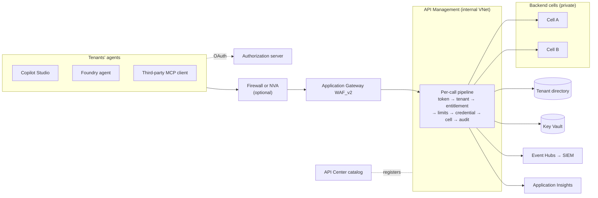
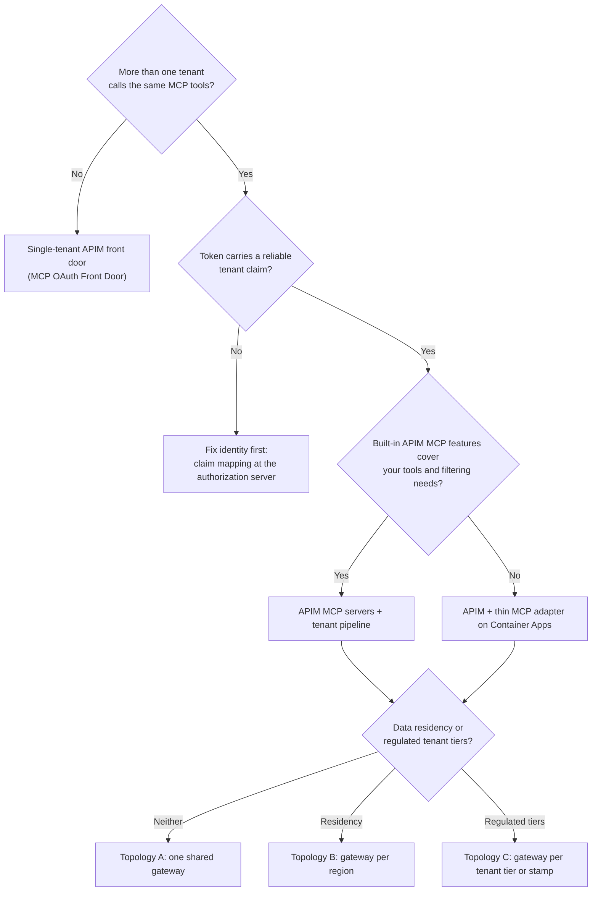

# Multi-Tenant MCP Gateway on Azure API Management

> **Maturity:** preview · **Kind:** reference-architecture · **Category:** `ai-gateway` · **Version:** 0.1.0

A multi-tenant SaaS provider, or an internal platform team, often wants to expose many backend APIs as Model Context Protocol (MCP) tools to many tenants' agents: Copilot Studio agents, Microsoft Foundry agents, and third-party MCP clients. Doing that safely needs more than an MCP server. It needs **one governed front door** that knows which tenant every call belongs to, exposes only the tools that tenant is entitled to, enforces per-tenant rate limits and quotas, picks the right backend cell and credential, and writes an audit trail a security team can use.

This reference architecture shows how to build that front door on Azure API Management (APIM), using a fictional ISV, **Contoso ERP**, that sells a multi-tenant ERP product with `orders`, `field-service`, and `reporting` APIs. It covers the network path (optional firewall or NVA, Application Gateway WAF_v2, internal APIM, private backends), the per-call policy pipeline, tool-level authorization on `tools/list` and `tools/call`, backend credentials and cell routing, the catalog in Azure API Center, topology options, observability, wire contracts, failure modes, and anti-patterns. A stdlib-only [pipeline simulator](samples/gateway_pipeline_sim.py) proves the isolation rules offline, and an illustrative [Bicep skeleton and policy set](infra/README.md) shows the deployable pieces.

> **Core thesis:** *The tenant comes from the token, entitlement is enforced on every call, and the gateway — not the client — chooses the backend credential and cell.*

MCP support in API Management, MCP server registration in API Center, and parts of the MCP specification are new and change frequently. Every capability statement here is qualitative, and the infrastructure is illustrative, not production-hardened. Check the current Microsoft Learn documentation before you commit to a design.

## Architecture and implementation map

| Layer / concern | Deep-dive documentation | Executable reference |
|---|---|---|
| **Network path, policy pipeline, tool authorization, topology, wire contracts** | [`docs/architecture.md`](docs/architecture.md) · [ADR 0001](docs/decisions/0001-token-derived-tenant-identity.md) · [ADR 0002](docs/decisions/0002-recheck-entitlement-on-tools-call.md) | [`samples/gateway_pipeline_sim.py`](samples/gateway_pipeline_sim.py): offline simulation of the pipeline with `--self-test` |
| **Identities, RBAC, secrets, tenant onboarding, and governance** | [`docs/authentication-and-governance.md`](docs/authentication-and-governance.md) | Onboarding and offboarding runbook, RBAC table, negative tests |
| **Evaluation, release gates, and troubleshooting** | [`docs/evaluation-and-troubleshooting.md`](docs/evaluation-and-troubleshooting.md) | [`samples/README.md`](samples/README.md): how to run and extend the simulator |
| **Deployable pieces** | [`infra/README.md`](infra/README.md) | [`infra/main.bicep`](infra/main.bicep) and [`infra/policies/`](infra/policies/mcp-tenant-pipeline.xml) (illustrative) |

## Domain Packs

The pipeline is domain-agnostic. What changes per domain is how tenants are keyed, what entitlement means, and what the audit trail must prove.

| Domain Pack | Example tools | Tenant and entitlement model | Isolation emphasis |
|---|---|---|---|
| **ERP or manufacturing ISV** | Orders, inventory, field-service work orders, production reports | Tenant = customer company; products = licensed modules; write tools need an extra scope | Shared cells for most tenants, dedicated cells for the largest |
| **Healthcare SaaS** | Appointment lookup, referral status, benefits checks | Tenant = provider organization; per-user scopes for clinical data | Regulated tenants on a dedicated tier; no bodies in logs |
| **Financial services platform** | Account summary, payment status, statement retrieval, case creation | Tenant = institution or business client; read and write tools in separate products | Strict per-tenant credentials; dedicated gateway for regulated tiers |
| **Retail or commerce platform** | Catalog search, order status, returns, store inventory | Tenant = merchant; products = commerce, fulfillment, analytics | Per-merchant quotas against seasonal noisy neighbors |
| **Public sector shared service** | Case lookup, permit status, appointment booking | Tenant = agency; entitlements by program | Per-region gateways for residency; private networking end to end |

[Architecture section 14](docs/architecture.md#14-domain-packs) adds the audit and governance emphasis for each row.

## When to use

- You expose backend APIs as MCP tools to **more than one tenant** (customer organizations, business units, or partner companies), and tenants must not see or affect each other.
- Different tenants are entitled to **different tools**, and the entitlement must hold even when a client never calls `tools/list`.
- You need **one front door** for many MCP servers and many client types, with one OAuth story, one network perimeter, and one audit stream.
- Your backends are deployed in **cells or stamps**, and each call must reach the cell that holds the tenant's data with an appropriate credential.
- Traffic crosses **firewalls, NAT, or a WAF**, so network addresses cannot identify the tenant.
- A security or CoE team needs a **catalog** of MCP servers and tools, with owners, versions, and lifecycle.

## When not to use

- **One tenant, one MCP server.** If only your own organization's agents call one server, a simpler APIM front door with `validate-jwt` (see [MCP OAuth Front Door](../mcp-oauth-front-door/README.md)) is enough.
- **Tenants do not share anything.** If every tenant already has its own isolated deployment and its own endpoint, a per-tenant MCP server inside that deployment avoids a shared tier.
- **You need MCP resources or prompts through the gateway.** APIM's MCP support focuses on tools. Use a thin MCP adapter behind APIM or serve those capabilities directly, and check current docs.
- **You cannot issue tokens with a reliable tenant claim.** Fix identity first. Without a token-derived tenant, this pattern has nothing safe to key on.
- **Consumer-scale anonymous access.** This design assumes authenticated callers acting for a known tenant.

## Architecture



- **Network path.** Clients reach a public host on Application Gateway WAF_v2, optionally behind Azure Firewall or a third-party NVA. API Management is private and reachable only from Application Gateway. Backends sit behind private endpoints. Each hop may translate addresses, so **no security control is keyed on source IP** ([section 5.2](docs/architecture.md#52-never-key-tenant-identity-on-source-ip)).
- **Per-call pipeline.** `validate-jwt` → tenant key from a token claim → tenant directory lookup (cached, fail closed) → product entitlement → tool re-check on `tools/call` → per-tenant `rate-limit-by-key` and `quota-by-key` → backend credential (managed identity or per-tenant Key Vault secret; never the client token) → `set-backend-service` to the tenant's cell → per-tenant metric and audit event ([section 6](docs/architecture.md#6-per-call-policy-pipeline)).
- **Tool-level authorization.** `tools/list` is filtered to the tenant's entitlements for usability, and **every `tools/call` is re-checked** for security. A denied tool looks exactly like an unknown tool ([section 7](docs/architecture.md#7-tool-level-authorization)).
- **Streaming.** WAF inspects request bodies; response buffering stays off and no policy reads the response body, so Streamable HTTP and server-sent events flow ([section 5.5](docs/architecture.md#55-waf-and-mcp-streamable-http)).
- **Catalog and commercial model.** API Center is the registry and discovery surface; APIM products mirror the commercial bundles; the tenant directory is the source of truth for entitlement ([section 10](docs/architecture.md#10-catalog-and-governance)).
- **Observability.** Per-tenant custom metrics with bounded dimensions, diagnostics without bodies, and a structured audit stream to Event Hubs and Microsoft Sentinel, correlated by `traceparent` and the APIM request ID ([section 12](docs/architecture.md#12-observability)).

### Decision flowchart



### Pattern selection matrix

| Criterion | MCP server per tenant, no shared gateway | Shared gateway, tenant by IP or header | **Shared gateway, token-derived tenant (this pattern)** | Gateway instance per tenant |
|---|---|---|---|---|
| **Tenant isolation** | Physical, but each team re-implements OAuth and limits | Weak: addresses and headers can be shared or forged | Strong logical isolation: token, directory, counters, credentials, routing | Physical |
| **Entitlement enforcement** | Per server, inconsistent | List filtering at best | Central, re-checked on every `tools/call` | Per instance, drifts over time |
| **Governance and catalog** | Fragmented | Central but untrustworthy | Central: one policy set, one catalog, one audit stream | Fragmented across instances |
| **Operational overhead** | High per tenant | Low | Moderate | Highest |
| **Fits** | A few large tenants with dedicated deployments | Not recommended | Most multi-tenant ISVs and platform teams | Contractual isolation only, automated as stamps |

## Key design decisions

| Decision | Choice | Why | Trade-off |
|---|---|---|---|
| Tenant identity | A validated token claim; client tenant headers deleted at edge and gateway | Source IPs are rewritten by every hop; headers and arguments can be forged | Requires a reliable tenant claim from the authorization server |
| Tool authorization | Filter `tools/list` and re-check every `tools/call` | Clients cache lists, skip them, or call tools directly | Entitlement logic runs on every call; needs a cached directory |
| Denial shape | Non-entitled tool returns the same error as an unknown tool | Avoids disclosing the catalog of tools a tenant has not bought | Support must use audit records, not error text, to diagnose |
| Directory failure | Fail closed with `503` | Failing open would serve suspended or unknown tenants | Directory availability becomes part of the gateway's availability |
| Limits | `rate-limit-by-key` and `quota-by-key` keyed on the tenant key, values from named values or tier | Noisy-neighbor protection without per-tenant policy copies | Distributed counters are approximate; use quotas and metering for billing |
| Backend credential | Gateway managed identity plus a gateway-set tenant header, or a per-tenant secret; never forward the client token | Keeps audiences separate and makes the gateway accountable | Backends must trust the header only from the gateway identity |
| Routing | Registered backends per cell, selected by ID from the tenant record | Prevents URL injection and makes cells observable | Cell changes require directory and backend updates together |
| Bodies | Never logged; response body never read in policy | Protects tool data and keeps streaming intact | Debugging relies on structured audit fields and correlation IDs |

Significant decisions are recorded in [ADR 0001: Token-derived tenant identity](docs/decisions/0001-token-derived-tenant-identity.md) and [ADR 0002: Re-check entitlement on tools/call](docs/decisions/0002-recheck-entitlement-on-tools-call.md).

## Getting started

1. **Run the simulator offline.** It needs Python 3.10 or later and no packages. The self-test proves the isolation rules; the demo prints each pipeline stage for a few calls:

   ```powershell
   python assets/ai-gateway/multi-tenant-mcp-gateway/samples/gateway_pipeline_sim.py --self-test
   python assets/ai-gateway/multi-tenant-mcp-gateway/samples/gateway_pipeline_sim.py --demo
   ```

2. **Read the pipeline and the anti-patterns.** Start with [section 6](docs/architecture.md#6-per-call-policy-pipeline), [section 7](docs/architecture.md#7-tool-level-authorization), and [section 16](docs/architecture.md#16-anti-patterns) of the architecture.
3. **Agree the tenant claim and directory schema.** Decide which token claim carries the tenant key and what a tenant record contains (status, cell, products, tools, tier, credential reference). Token issuance is covered in [MCP OAuth Front Door](../mcp-oauth-front-door/README.md).
4. **Deploy the illustrative infrastructure in a sandbox.** Follow [infra/README.md](infra/README.md), including the known gaps, and adapt [the policies](infra/policies/mcp-tenant-pipeline.xml) to your claim names and directory.
5. **Prove isolation before the first tenant.** Run the negative tests in [evaluation-and-troubleshooting.md](docs/evaluation-and-troubleshooting.md): spoofed tenant header, list-skipping `tools/call`, unknown and suspended tenants, rate limits, and missing tokens.
6. **Onboard tenants through governance.** Register servers in API Center and use the onboarding runbook in [authentication-and-governance.md](docs/authentication-and-governance.md). Then follow the [Agent Production Readiness Guide](../../agentops-and-readiness/agent-production-readiness/README.md).

## Related assets

| Asset | Relationship |
|---|---|
| [MCP OAuth Front Door](../mcp-oauth-front-door/README.md) | How MCP clients discover the authorization server and obtain tokens (protected resource metadata, client registration) for this gateway |
| [Backend Identity Propagation](../backend-identity-propagation/README.md) | How the user's identity, not only the tenant, reaches the backend behind the gateway |
| [Secured Foundry Landing Zone](../../landing-zones-and-infra/secured-foundry-landing-zone/README.md) | Hub network, DNS, private endpoints, and egress control the gateway depends on |
| [Agent Security and Governance](../../security-and-governance/agent-security-and-governance/README.md) | Agent identity, guardrails, and governance controls that complement gateway enforcement |
| [M365 MCP Plug-in Integration](../../m365-and-copilot/m365-mcp-plugin-integration/README.md) | Connecting Microsoft 365 Copilot and Copilot Studio agents to MCP servers such as this gateway |
| [Agent Production Readiness Guide](../../agentops-and-readiness/agent-production-readiness/README.md) | Release gates and operating model for the gateway and the agents that use it |

## Production-readiness pillar mapping

| Pillar | How this asset contributes |
|---|---|
| **Landing zones** | Network path through firewall, WAF, internal APIM, and private backends; private DNS; illustrative Bicep |
| **Security and observability** | Token-derived tenant identity, tool-level authorization, credential isolation, per-tenant metrics, and the audit stream to the SIEM |
| **Agent architecture patterns** | The multi-tenant MCP front door, cell routing, topology options, and when to add an MCP adapter |
| **CoE and governance** | API Center catalog, products as commercial bundles, tenant onboarding and offboarding, policy as code |

## Security and responsible AI

- **Derive the tenant only from a validated token.** Delete client-supplied tenant headers at the edge and again at the gateway. Never take the tenant from a source address, query string, tool argument, or anything the model fills in.
- **Authorize every call.** List filtering is a convenience. The `tools/call` re-check is the control. Backends still enforce tenant scope on the data they return.
- **Never forward the client's token.** The gateway's audience is not the backend's audience. Use managed identity or a per-tenant credential, and pass tenant context in a header the backend trusts only from the gateway identity.
- **Keep bodies out of logs and audit.** Tool arguments and results can contain business and personal data. Log tenant, tool, outcome, and correlation IDs only.
- **Fail closed.** Unknown tenants, suspended tenants, and directory outages are denied, not served.
- **Tune the WAF, do not bypass it.** Use Detection mode and narrow exclusions on the MCP route. Never disable body inspection to make streaming work.
- **Accountable ownership.** Every MCP server needs an owner and lifecycle in the catalog. Entitlement changes need separation of duties and an audit trail.

## Limitations

- MCP support in API Management, MCP server registration in API Center, and the MCP specification are evolving. At the time of writing, APIM's MCP support focuses on tools, policies apply per MCP server, and MCP servers are not supported in APIM workspaces. Check current docs.
- The infrastructure and policies are illustrative and have not been deployed end to end as published. The MCP server resource uses a preview API version with an unverified property shape. See [infra/README.md](infra/README.md#known-gaps).
- Wire contracts are illustrative. Claim names, header names, and error codes are conventions chosen for this asset, not product contracts.
- The simulator models the pipeline's logic, not APIM. It cannot show distributed-counter behavior, caching races, or streaming.
- This asset intentionally contains no latency, throughput, capacity, or cost figures. Measure in your own environment.

## References

- [Architecture deep dive](docs/architecture.md)
- [Authentication and governance](docs/authentication-and-governance.md)
- [Evaluation, release gates, and troubleshooting](docs/evaluation-and-troubleshooting.md)
- [ADR 0001: Token-derived tenant identity](docs/decisions/0001-token-derived-tenant-identity.md)
- [ADR 0002: Re-check entitlement on tools/call](docs/decisions/0002-recheck-entitlement-on-tools-call.md)
- [Infrastructure guide](infra/README.md)
- [Samples guide](samples/README.md)
- [About MCP servers in Azure API Management](https://learn.microsoft.com/azure/api-management/mcp-server-overview)
- [Expose a REST API in API Management as an MCP server](https://learn.microsoft.com/azure/api-management/export-rest-mcp-server)
- [Expose and govern an existing MCP server](https://learn.microsoft.com/azure/api-management/expose-existing-mcp-server)
- [Limit call rate by key](https://learn.microsoft.com/azure/api-management/rate-limit-by-key-policy)
- [Application Gateway request and response buffers](https://learn.microsoft.com/azure/application-gateway/proxy-buffers)
- [Azure API Center overview](https://learn.microsoft.com/azure/api-center/overview)
- [Model Context Protocol specification](https://modelcontextprotocol.io/specification)
- [Contribution and Standardization Guide](../../../docs/contribution-guide.md)
