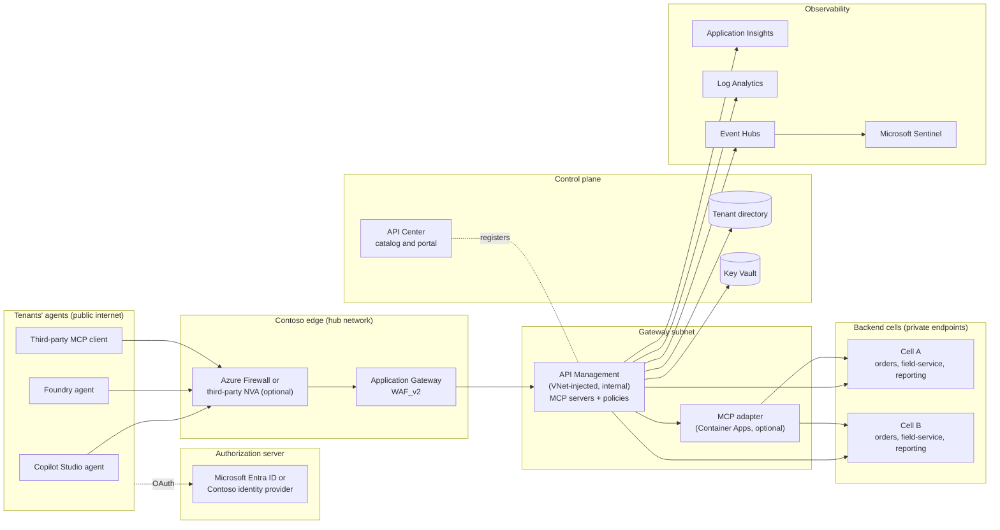
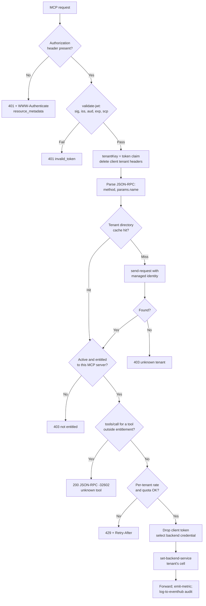
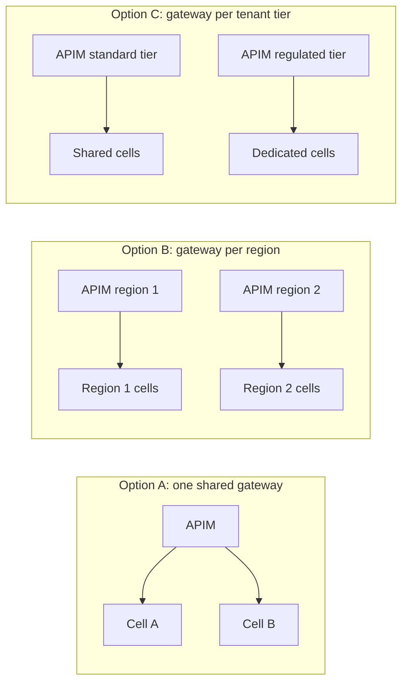

# Architecture: Multi-Tenant MCP Gateway on Azure API Management

This document is the deep dive behind the [asset README](../README.md). It describes how a multi-tenant SaaS provider, called **Contoso ERP** throughout, exposes many backend APIs as Model Context Protocol (MCP) tools to many tenants' agents through one governed front door built on Azure API Management (APIM). The same design applies to an internal platform team that serves many business units.

Every capability statement here is qualitative. Several of the features involved, including MCP support in API Management, MCP server registration in Azure API Center, and parts of the MCP specification itself, are new and still changing. Check the current Microsoft Learn documentation before you commit to a design.

## Contents

1. [Problem](#1-problem)
2. [Terminology](#2-terminology)
3. [Forces](#3-forces)
4. [Reference architecture](#4-reference-architecture)
5. [Network path](#5-network-path)
6. [Per-call policy pipeline](#6-per-call-policy-pipeline)
7. [Tool-level authorization](#7-tool-level-authorization)
8. [Backend credentials and identity](#8-backend-credentials-and-identity)
9. [API Management MCP capabilities and limits](#9-api-management-mcp-capabilities-and-limits)
10. [Catalog and governance](#10-catalog-and-governance)
11. [Topology options and decision matrix](#11-topology-options-and-decision-matrix)
12. [Observability](#12-observability)
13. [Wire contracts](#13-wire-contracts)
14. [Domain Packs](#14-domain-packs)
15. [Failure modes](#15-failure-modes)
16. [Anti-patterns](#16-anti-patterns)
17. [Production checklist](#17-production-checklist)
18. [Cost considerations](#18-cost-considerations)
19. [References](#19-references)

## 1. Problem

Contoso ERP sells a multi-tenant SaaS product. Its customers (tenants) now want their own agents to use that product: a Copilot Studio agent that looks up open orders, a Microsoft Foundry agent that schedules field-service visits, or a third-party MCP client that runs reports. Contoso ERP already has many REST APIs (`orders`, `field-service`, `reporting`, and more), owned by different teams and deployed across several regional **cells** (also called stamps or scale units). Each cell serves a subset of tenants.

Contoso ERP wants to expose those APIs as MCP tools without each product team building its own MCP server, its own OAuth integration, its own rate limiting, and its own audit trail. It needs:

- **One governed front door** that every MCP client uses, with one OAuth story and one network perimeter.
- **Per-tenant isolation.** Tenant A must never see, call, or affect tenant B's tools, data, quotas, or logs.
- **Entitlement.** A tenant sees and can call only the tools its subscription includes. A tenant that bought `orders` but not `reporting` must not be able to run reports, whether or not its client ever asked for the tool list.
- **Fair use.** Per-tenant rate limits and quotas, so that one tenant's runaway agent cannot starve everyone else.
- **Routing.** Each call reaches the cell that hosts that tenant's data, with a backend credential appropriate to that tenant.
- **Audit and observability.** Who called which tool, for which tenant, with which outcome, available to Contoso ERP's security operations and, where contracted, to the tenant.
- **A catalog.** Tenants' developers and makers can discover which MCP servers and tools exist, what they do, and which versions are current.

The naive approaches fail quickly. Putting a separate MCP server in front of each API multiplies OAuth integrations and policy drift. Identifying tenants by network address breaks as soon as traffic crosses a firewall or a NAT. Filtering the tool list and trusting the client to call only listed tools is not authorization. This architecture addresses each of these.

## 2. Terminology

| Term | Meaning in this document |
|---|---|
| **Tenant** | A Contoso ERP customer account. Identified by a stable **tenant key** (for example `fabrikam`). Not the same as a Microsoft Entra tenant, although one may map to the other. |
| **Tenant directory** | The authoritative store that maps a tenant key to its status, entitled products and tools, rate and quota tier, home cell, and backend credential reference. |
| **Product** | A commercial bundle of MCP tools (for example `orders`, `field-service`, `reporting`). Usually modeled both in the tenant directory and as an API Management product. |
| **Cell** | A deployment unit of the backend (a regional stamp) that hosts a subset of tenants. Also called a stamp or scale unit. |
| **MCP server (in APIM)** | An API Management API of the MCP type. It is either generated from a REST API (each operation becomes a tool) or a passthrough to an existing MCP server. |
| **MCP adapter** | An optional thin service (for example on Azure Container Apps) that speaks MCP to the gateway and REST to the backends. Used when the built-in APIM capabilities are not enough. |
| **MCP client** | The agent host that calls the gateway: Copilot Studio, Microsoft Foundry Agent Service, Visual Studio Code, or any third-party client. |
| **Entitlement** | The set of tools a tenant may list and call, derived from its products and, optionally, per-user scopes. |

## 3. Forces

| Force | Pulls toward | Pulls away from |
|---|---|---|
| **One front door** | A shared gateway with one hostname, one OAuth configuration, and one policy set | Product teams shipping their own MCP endpoints |
| **Tenant isolation** | Token-derived tenant identity, per-tenant counters, per-tenant credentials, per-tenant routing | Shared credentials, shared counters, client-supplied tenant hints |
| **Network hops** | Firewalls, WAF, and private networking for defense in depth | Using source IP addresses as identity, because each hop rewrites them |
| **Streaming protocol** | Gateways and WAFs that tolerate long-lived Streamable HTTP and Server-Sent Events (SSE) responses | Default buffering, aggressive idle timeouts, body-reading policies |
| **Catalog scale** | Many tools across many products, generated from existing REST APIs | Hand-written MCP servers per product |
| **Least privilege** | Re-checking entitlement on every `tools/call` | Trusting a filtered `tools/list` |
| **Blast radius** | Cells and per-tier stamps | A single global instance for everything |
| **Operational cost** | Fewer, shared gateway instances | One gateway per tenant |
| **Platform maturity** | Built-in APIM MCP features where they fit | Custom adapters, which you then own |

## 4. Reference architecture



| Component | Role | Notes |
|---|---|---|
| **Authorization server** | Issues access tokens whose audience is the gateway's MCP resource and which carry a tenant claim | Microsoft Entra ID (multi-tenant app or External ID) or Contoso's own identity provider. How clients obtain tokens is covered in [MCP OAuth Front Door](../../mcp-oauth-front-door/README.md). |
| **Azure Firewall or NVA** | Optional layer-3/4 inspection and egress control in the hub | Usually translates source addresses. Not a place to derive tenant identity. |
| **Application Gateway WAF_v2** | Public TLS termination, OWASP rule sets, bot protection, request normalization, path routing | Must be tuned for JSON-RPC bodies and long-lived streaming responses ([section 5.5](#55-waf-and-mcp-streamable-http)). |
| **API Management (internal VNet)** | The MCP front door: MCP servers, the per-call policy pipeline, products, named values, backends, loggers | Private only; reachable through Application Gateway. |
| **MCP adapter (optional)** | Thin MCP-to-REST service for capabilities APIM does not provide built in, such as per-tenant tool filtering in `tools/list` | Runs on Azure Container Apps with its own managed identity; APIM still fronts it. |
| **Tenant directory** | Authoritative tenant configuration | Any store with a private, authenticated read API (for example a small internal service backed by a database). APIM caches lookups. |
| **Key Vault** | Per-tenant backend secrets and certificates, where managed identity is not possible | Read by APIM through its managed identity; values are cached briefly. |
| **API Center** | Design-time registry and discovery portal for MCP servers and their tools | Inventory, versions, lifecycle, ownership, and documentation. |
| **Backend cells** | The product APIs, behind private endpoints | Each cell independently enforces tenant scoping on the data it returns. |
| **Application Insights, Log Analytics** | Gateway telemetry, custom metrics with tenant dimensions, diagnostics | Configure diagnostics so request and response bodies are not logged. |
| **Event Hubs, Microsoft Sentinel** | Structured audit stream and security analytics | One audit event per MCP request, partitioned by tenant. |

## 5. Network path

### 5.1 Hops

A request from a tenant's agent typically crosses these hops:

1. **MCP client** (Microsoft cloud, the tenant's network, or a developer workstation) resolves `mcp.contoso.com` and connects over TLS.
2. **Optional Azure Firewall or third-party network virtual appliance (NVA)** in the hub inspects the flow. Destination NAT and source NAT are common here.
3. **Application Gateway WAF_v2** terminates TLS, applies WAF rules, adds forwarding headers, and re-encrypts to the API Management private endpoint or internal virtual IP.
4. **API Management** (VNet-injected in internal mode, or a tier that supports private inbound access) runs the per-call policy pipeline.
5. **Backends** are reached through private endpoints or private networking, either directly or through an MCP adapter.

### 5.2 Never key tenant identity on source IP

Each hop may change the source address that the next hop sees. Source NAT on a firewall replaces the client address with the firewall's. Application Gateway opens a new connection to API Management from its own subnet. Microsoft-hosted MCP clients such as Copilot Studio and Foundry Agent Service call out from shared, platform-managed address ranges that many tenants share. By the time a request reaches API Management, the source address identifies the last hop, not the tenant.

The tenant must therefore come from the **validated access token**, which is the only input that is both bound to the caller and verifiable by the gateway. The rules that follow:

- Derive the tenant key from a claim in a validated token. See [ADR 0001](decisions/0001-token-derived-tenant-identity.md).
- Never accept a tenant key from a header, query string, path segment, cookie, or tool argument. Strip any such header at the gateway before it can reach a backend.
- Do not use `X-Forwarded-For` for authorization. The left-most value is supplied by the client and can be forged; the right-most values identify your own hops.
- Key per-tenant rate limits, quotas, metrics, and audit on the tenant key, never on the caller address.

### 5.3 Where IP controls still belong

Address-based controls are still useful as **defense in depth**, not as identity:

- Restrict API Management inbound traffic to the Application Gateway subnet (network security group and, where available, private inbound access only).
- Restrict backends so they accept traffic only from the API Management subnet or the adapter's environment.
- At the edge, use WAF geo-filtering, bot protection, and coarse per-client-address rate limiting to absorb abuse before it reaches the gateway. Accept that shared egress ranges of hosted MCP clients make these controls coarse.
- If a tenant contractually requires an allowlist of its own egress addresses, treat it as an additional per-tenant condition evaluated after the token, using the address Application Gateway observed (passed in a header that Application Gateway sets and API Management trusts only from the Application Gateway subnet). Never use it to choose the tenant.

### 5.4 Correlation across hops

Because addresses change at every hop, correlate on identifiers instead:

- Accept or start a W3C `traceparent` at the edge and propagate it through API Management to backends. Configure API Management diagnostics to use W3C correlation.
- Application Gateway v2 adds forwarding headers (`X-Forwarded-For`, `X-Forwarded-Proto`, `X-Forwarded-Port`, `X-Original-Host`) and a per-request trace identifier header (`x-appgw-trace-id`) on the way to the backend. Log the trace identifier in the gateway audit record so WAF logs and gateway logs can be joined.
- Log API Management's own request identifier and return it to clients, so that a tenant's support ticket can be traced end to end.

### 5.5 WAF and MCP Streamable HTTP

MCP over Streamable HTTP is a single endpoint (for example `POST /mcp`) that carries JSON-RPC messages in request bodies and returns either a JSON body or an SSE stream. Older clients may still use the deprecated HTTP+SSE transport. Several WAF and proxy behaviors need deliberate configuration:

- **Body inspection.** WAF rules inspect JSON request bodies. Tool arguments are free text written by a model or a user and can resemble SQL, script, or path traversal patterns. Expect false positives. Start the MCP route in detection mode, review the logs, and add narrowly scoped exclusions (per rule, per request-body field, or a per-listener or per-path WAF policy) instead of disabling rule groups for the whole gateway.
- **Request size.** Configure the maximum request body and inspection limits for the MCP route deliberately. Large tool arguments (documents, batch payloads) may exceed defaults. Prefer passing references (for example an upload URL) over very large inline payloads.
- **Request buffering.** On the WAF SKU, Application Gateway always buffers the full request for inspection. This is acceptable for MCP, because requests are JSON-RPC messages, not streams.
- **Response buffering.** Application Gateway buffers responses by default, which can delay or break SSE streams. Response buffering can be disabled at the gateway resource level (not per listener); test the effect on other routes before you change it.
- **Timeouts.** Long-running tool calls and SSE streams can outlive default backend request timeouts and idle timeouts at the firewall, Application Gateway, API Management, and the backend. Align the timeouts end to end for the MCP route, and prefer tool designs that return promptly and report progress or a job reference for long work.
- **Methods and headers.** Allow `POST` (messages), `GET` (optional server-to-client stream), and `DELETE` (session termination) on the MCP path. Do not strip `Mcp-Session-Id`, `MCP-Protocol-Version`, `Accept`, `Last-Event-ID`, or `WWW-Authenticate`.
- **Well-known metadata.** The OAuth protected resource metadata document (under `/.well-known/oauth-protected-resource`) must be reachable anonymously through the WAF and the gateway, or clients cannot discover the authorization server.

### 5.6 Edge options

| Option | Use when | Watch for |
|---|---|---|
| **Application Gateway WAF_v2 in front of internal API Management** (default) | Regional deployment, VNet-first landing zone, existing hub-and-spoke | Regional scope; global routing needs another layer |
| **Azure Front Door Premium with WAF, private link to API Management** | Global anycast entry, multi-region active-active, edge caching of static metadata | Streaming and timeout behavior differs from Application Gateway; verify SSE behavior with your clients |
| **Traffic Manager (DNS) over regional Application Gateways** | Simple regional failover without a global proxy | DNS caching delays failover; MCP sessions are not migrated |
| **Third-party NVA or firewall ahead of Application Gateway** | Corporate standard for inbound inspection | Source NAT hides client addresses; keep identity token-based and correlate with trace identifiers |

## 6. Per-call policy pipeline

Every MCP request passes through the same ordered pipeline in API Management. The order matters: nothing tenant-specific happens before the token has been validated, and nothing reaches a backend before entitlement and limits have been applied.

### 6.1 Stages

| # | Stage | APIM building blocks | Outcome on failure |
|---|---|---|---|
| 1 | **Challenge unauthenticated calls** | `choose` on a missing `Authorization` header, `return-response` | `401` with `WWW-Authenticate: Bearer resource_metadata="..."` |
| 2 | **Validate the token** | `validate-jwt` (any OpenID Connect issuer) or `validate-azure-ad-token` (Microsoft Entra ID) with audience, issuer, signature, lifetime, and required claims | `401` with `error="invalid_token"` |
| 3 | **Resolve the tenant from a claim** | `set-variable` reading the tenant claim from the validated token; `set-header ... exists-action="delete"` for any client-supplied tenant header | `401` if the claim is missing |
| 4 | **Parse the JSON-RPC envelope** | `set-variable` with `context.Request.Body.As<JObject>(preserveContent: true)` to read `method` and `params.name` | `400` or JSON-RPC parse error |
| 5 | **Look up the tenant directory** | Policy fragment with `cache-lookup-value`, `send-request` with managed identity on a miss, `cache-store-value` | `403` unknown tenant; `503` if the directory is unavailable (fail closed) |
| 6 | **Check product entitlement and status** | `choose` on the tenant configuration (status, products, allowed clients) | `403` with a JSON-RPC error body |
| 7 | **Check tool entitlement** | `choose` on `params.name` for `tools/call` against the tenant's allowed tools | `200` with JSON-RPC `-32602` (identical to an unknown tool) |
| 8 | **Apply per-tenant limits** | `rate-limit-by-key` and `quota-by-key` keyed on the tenant key, with values from named values or tenant tier | `429` with `Retry-After` |
| 9 | **Select the backend credential** | Delete the client `Authorization` header; `authentication-managed-identity`, a cached Key Vault secret, a credential manager connection, or token exchange | `500` or `502` (logged, generic message to the client) |
| 10 | **Route to the tenant's cell** | `set-backend-service backend-id="..."` chosen from the tenant's home cell | `502` or `503` with circuit breaker |
| 11 | **Emit telemetry and audit** | `emit-metric` with a tenant dimension; `log-to-eventhub` with a structured audit record | Never blocks the request |

### 6.2 Flow



### 6.3 Policy excerpts

The excerpts below are illustrative and simplified. Complete, generic files are in [infra/policies](../infra/policies/). Values in double braces are API Management named values.

Token validation and tenant resolution:

```xml
<validate-jwt header-name="Authorization" failed-validation-httpcode="401"
              require-scheme="Bearer" output-token-variable-name="jwt">
    <openid-config url="{{idp-openid-config-url}}" />
    <audiences>
        <audience>{{mcp-resource-uri}}</audience>
    </audiences>
    <issuers>
        <issuer>{{idp-issuer}}</issuer>
    </issuers>
    <required-claims>
        <claim name="scp" match="any" separator=" ">
            <value>mcp.tools</value>
        </claim>
        <claim name="tenant_id" />
    </required-claims>
</validate-jwt>
<set-variable name="tenantKey"
    value="@(((Jwt)context.Variables["jwt"]).Claims.GetValueOrDefault("tenant_id", ""))" />
<set-header name="X-Tenant-Id" exists-action="delete" />
<set-header name="X-Contoso-Gateway-Tenant" exists-action="delete" />
```

Tenant directory lookup through a policy fragment, then entitlement:

```xml
<include-fragment fragment-id="tenant-directory" />
<choose>
    <when condition="@(!context.Variables.ContainsKey("tenantConfig"))">
        <return-response>
            <set-status code="403" reason="Forbidden" />
            <set-header name="Content-Type" exists-action="override">
                <value>application/json</value>
            </set-header>
            <set-body>@(new JObject(
                new JProperty("jsonrpc", "2.0"),
                new JProperty("id", JToken.Parse(context.Variables.GetValueOrDefault<string>("rpcIdJson", "null"))),
                new JProperty("error", new JObject(
                    new JProperty("code", -32001),
                    new JProperty("message", "Forbidden"),
                    new JProperty("data", new JObject(new JProperty("reason", "unknown_tenant"))))))
                .ToString())</set-body>
        </return-response>
    </when>
</choose>
```

Per-tenant limits, credential selection, and routing:

```xml
<rate-limit-by-key calls="{{tenant-rate-calls}}" renewal-period="{{tenant-rate-period}}"
                   counter-key="@("mcp-erp:" + (string)context.Variables["tenantKey"])" />
<quota-by-key calls="{{tenant-quota-calls}}" renewal-period="{{tenant-quota-period}}"
              counter-key="@("mcp-erp:" + (string)context.Variables["tenantKey"])" />
<set-header name="Authorization" exists-action="delete" />
<authentication-managed-identity resource="{{backend-app-id-uri}}" />
<set-header name="X-Contoso-Gateway-Tenant" exists-action="override">
    <value>@((string)context.Variables["tenantKey"])</value>
</set-header>
<set-backend-service backend-id="@("cell-" + (string)context.Variables["tenantCell"])" />
```

Use registered API Management **backends** (one per cell) rather than building a URL from tenant data. A backend ID can only resolve to an address you registered, which removes a server-side request forgery path, and backends can carry circuit breakers, load-balanced pools, and client certificates.

### 6.4 Policy scopes

API Management evaluates policies at global, product, API (MCP server), and operation scope. For MCP servers, policies are configured per MCP server and apply to every tool in it; global policies run first.

- **Global scope:** strip untrusted headers, set correlation, enforce TLS and request-size checks, and run anything that must apply to every API, including non-MCP APIs.
- **MCP server scope:** token validation for that server's audience, tenant resolution, directory lookup, entitlement, limits, credential selection, routing, and audit.
- **Policy fragments:** shared logic (tenant directory lookup, error shaping, audit record) included from each MCP server, so that every server uses one implementation.
- **Rate-limit counter scope:** API Management uses one counter per key value across all scopes. Include the MCP server or product name in the counter key (`mcp-erp:fabrikam`) when you want separate budgets per server; omit it when the budget is per tenant across all servers.

## 7. Tool-level authorization

### 7.1 Why list filtering is not enough

`tools/list` is a discovery call. Nothing in the protocol prevents a client from calling `tools/call` with a tool name it never listed, a name it cached from an earlier session, or a name it guessed. A client might be a well-behaved host whose cache is stale after a downgrade, or a deliberately hostile script. Filtering the list improves the experience and reduces prompt size, but it is not a control.

The rule, recorded in [ADR 0002](decisions/0002-recheck-entitlement-on-tools-call.md): **filter `tools/list` for usability, and enforce entitlement on every `tools/call`.** The backend must also enforce tenant scope on the data it returns, as a third layer.

### 7.2 Where to enforce

| Layer | What it enforces | How |
|---|---|---|
| **Gateway, MCP server scope** | Tenant may use this MCP server at all (product entitlement, status, allowed client apps) | Tenant directory and `choose` before forwarding |
| **Gateway, per tool** | Tenant may call this tool name | Parse `params.name` on `tools/call` and check the tenant's allowed tools |
| **MCP adapter (if used)** | `tools/list` contains only entitled tools; `tools/call` re-checked | Adapter reads the tenant from the trusted gateway header and its own directory cache |
| **Backend** | Data returned belongs to the tenant; the caller may perform this action | Backend authorization on the tenant header plus the calling identity; row-level tenant scoping |

How you implement the list filter depends on how the MCP server is exposed in API Management:

- **REST API exposed as an MCP server.** API Management generates the tool list from the selected API operations. The list is the same for every caller of that MCP server. To give tenants different lists, either publish separate MCP servers per product (each with its own tool set, entitled per tenant), or front the REST APIs with an adapter that builds the list per tenant. Re-check on `tools/call` in either case.
- **Existing MCP server passed through.** The upstream MCP server (your adapter) builds the list, so it can filter per tenant using the trusted tenant header from the gateway. Keep a gateway-level `tools/call` check as defense in depth.
- **Do not rewrite `tools/list` responses in gateway policy.** Reading the response body in an MCP policy buffers the response and breaks streaming. Filter at the source instead.

### 7.3 Sequence

```mermaid
sequenceDiagram
    autonumber
    participant C as MCP client (tenant Fabrikam)
    participant G as API Management
    participant D as Tenant directory
    participant A as MCP adapter
    participant B as Cell B backend
    C->>G: POST /mcp initialize (Bearer token)
    G->>G: validate-jwt, tenantKey = tenant_id claim
    G->>D: GET tenant config (managed identity, cached)
    D-->>G: active, products [orders], cell b
    G->>A: initialize (X-Contoso-Gateway-Tenant: fabrikam)
    A-->>C: result + Mcp-Session-Id (via gateway)
    C->>G: tools/list
    G->>A: tools/list (trusted tenant header)
    A-->>C: orders_* tools only
    C->>G: tools/call reporting_run_report (never listed)
    G->>G: tool not in entitlement
    G-->>C: 200 JSON-RPC error -32602 Unknown tool
    C->>G: tools/call orders_get_order
    G->>G: entitled; rate-limit-by-key fabrikam
    G->>A: tools/call (managed identity, tenant header)
    A->>B: GET /orders/{id} (tenant-scoped credential)
    B-->>A: order JSON
    A-->>C: result content, isError false
    G->>G: emit-metric, log-to-eventhub (no bodies)
```

### 7.4 Adapter rules

If you build an MCP adapter, apply these rules:

- **Filter before pagination.** Apply entitlement before building `nextCursor` pages, so page boundaries do not leak the size or names of hidden tools.
- **Cache per tenant and entitlement version.** Cache keys for tool lists must include the tenant key and an entitlement version; a shared cache key leaks one tenant's catalog to another.
- **Signal changes.** Advertise `tools.listChanged` and send `notifications/tools/list_changed` on an open stream when a tenant's entitlement changes, so well-behaved clients refresh.
- **Make denial indistinguishable from absence.** Return the same JSON-RPC error for an unknown tool and a tool the tenant is not entitled to. Do not confirm that a hidden tool exists.
- **Map backend errors deliberately.** A backend business error (for example "order not found") is a tool result with `isError: true` and a safe message, which lets the model recover. A gateway or protocol failure is a JSON-RPC error. Never return stack traces or backend hostnames.
- **Never forward the client's access token** to the backend. MCP's authorization guidance forbids token passthrough. Use the adapter's own identity or a token exchange; see [section 8](#8-backend-credentials-and-identity).

## 8. Backend credentials and identity

The gateway receives a token whose audience is the gateway. It must not forward that token. It chooses a backend credential per tenant, in this order of preference:

| Option | When | Notes |
|---|---|---|
| **API Management managed identity** (`authentication-managed-identity`) plus a trusted tenant header | Backends are Contoso-owned and trust the gateway | The backend authorizes the gateway identity and scopes data by the tenant header. The backend must only accept that header from the gateway identity. |
| **Per-tenant secret or certificate from Key Vault** | A tenant's backend requires its own credential (for example a dedicated instance) | Read through the gateway's managed identity, cache briefly, never log. Reference by name from the tenant directory. |
| **API Management credential manager** | Backends that need OAuth tokens for a connection per tenant or per user | Check current docs for supported identity providers and grant types. |
| **Token exchange or on-behalf-of** | The backend must authorize the end user, not just the tenant | The user's identity is carried in a new token minted for the backend. See [Backend Identity Propagation](../../backend-identity-propagation/README.md). |

Whatever the option, the backend sees a credential that the gateway chose based on the validated tenant, never a credential the client supplied.

## 9. API Management MCP capabilities and limits

The statements below describe API Management's MCP support qualitatively at the time of writing. The feature is evolving; check the current documentation for tier availability, transports, and limits.

- **Two ways to expose MCP.** API Management can expose a managed REST API as an MCP server, turning selected operations into tools, and it can expose and govern an existing remote MCP server by passing MCP traffic through.
- **Tools first.** MCP servers generated from REST APIs expose tools only. Passthrough to an existing MCP server supports a broader set of capabilities; check the docs for which MCP capability types (resources, prompts) are passed through. Do not plan on MCP prompts or resources from REST-generated servers.
- **Protocol version.** Passthrough requires the upstream MCP server to support a recent MCP specification revision. Check the docs for the minimum version.
- **Transports.** Streamable HTTP is the primary transport; the older SSE transport may also be exposed for compatibility.
- **Workspaces.** MCP servers are not supported in API Management workspaces at the time of writing. If your operating model relies on workspaces for team isolation, plan to host MCP servers at the service level and govern them centrally.
- **Policy scope.** Policies are configured per MCP server and apply to all its tools. Per-tool logic requires inspecting the JSON-RPC body in policy (as shown in [section 6](#6-per-call-policy-pipeline)) or splitting tools across MCP servers.
- **Streaming.** Do not read `context.Response.Body` in policies on MCP servers; it buffers the response and breaks streaming. Avoid logging response bodies in diagnostics for the same reason.
- **Tier and networking.** MCP features are available on several classic and v2 tiers. Private inbound access and VNet injection depend on the tier. Confirm both before choosing a tier.

When these limits bite, put a **thin MCP adapter** on Azure Container Apps behind API Management. The adapter speaks MCP (Streamable HTTP) to the gateway, calls REST backends, and implements per-tenant `tools/list` filtering, richer argument schemas, `isError` mapping, and `list_changed` notifications. API Management still owns authentication, tenant resolution, entitlement, limits, routing, and audit. Keep the adapter stateless where you can, or make MCP sessions sticky to an instance.

## 10. Catalog and governance

### 10.1 API Center as the registry

Azure API Center is the design-time inventory for every MCP server and API that the gateway exposes. Use it to:

- Register each MCP server with its owner, lifecycle stage, version, environment, and documentation links.
- Synchronize API definitions from API Management where supported, so the catalog does not drift from what the gateway serves.
- Give tenants' developers and makers a discovery surface through the API Center portal, and give developer tools a private registry of approved MCP servers.
- Run governance checks (for example API linting and required metadata) before a server is promoted.

API Center describes what exists. It does not enforce access at run time; API Management and the tenant directory do.

### 10.2 Products and subscriptions

Use API Management **products** as the commercial unit (`orders`, `field-service`, `reporting`) and mirror them in the tenant directory. Products group MCP servers, make analytics readable, and can attach product-scope policies.

Subscription keys are a weak identifier for agent traffic: many MCP clients authenticate only with OAuth, keys are long-lived shared secrets, and a key identifies an application rather than a user. Treat the token as the primary identity. If you also require subscription keys, use them to identify the client integration, and check that the subscription's tenant matches the token's tenant.

### 10.3 Versioning

- Version MCP servers, not individual tools. Publish a new MCP server (for example `/mcp/v2`) for breaking changes to tool names or argument schemas, and keep the previous version available for a published deprecation period.
- Additive changes (new optional arguments, new tools) can ship in place; notify clients with `list_changed`.
- Record versions and deprecation dates in API Center, and emit the MCP server version as a metric dimension so you can see who still calls the old one.

## 11. Topology options and decision matrix



| Criterion | A. One shared gateway | B. Gateway per region | C. Gateway per tenant tier or stamp |
|---|---|---|---|
| **Best for** | Early stage, one geography, modest catalog | Data residency, regional latency, regional failure isolation | Regulated or premium tenants that need dedicated limits, keys, or networks |
| **Tenant isolation** | Logical (token, directory, counters, credentials) | Logical within a region; physical between regions | Physical between tiers; logical within a tier |
| **Blast radius of a bad policy deploy** | Every tenant | One region | One tier |
| **Operational overhead** | Lowest | Moderate: replicate policies, named values, and catalog per region | Highest: more instances, more pipelines |
| **Routing** | Directory chooses the cell | Global edge routes to the tenant's home region; directory chooses the cell | Edge or DNS routes by tier; directory confirms the tier |
| **Rate-limit accuracy** | One counter space | Counters per region; a tenant active in two regions gets two budgets | Counters per tier |
| **Typical API Management choice** | One instance, multiple gateway units as needed | Multi-region deployment of one instance, or one instance per region | Separate instances per tier |
| **Avoid when** | Residency or regulated isolation is required | Tenants need a global single budget with exact accuracy | You have few tenants per tier |

Per-tenant API Management instances are rarely justified. Reserve them for contractual isolation, and automate them like any other stamp.

Whatever the topology, keep MCP session affinity in mind: a stateful MCP server keyed on `Mcp-Session-Id` needs requests for a session to reach the same backend instance or a shared session store. Multi-region routing must not move a live session between regions.

## 12. Observability

| Signal | Source | Keys and dimensions | Use |
|---|---|---|---|
| **Per-tenant request metric** | `emit-metric` to Application Insights | `tenant`, `product`, `method`, `tool`, `outcome` | Usage by tenant, error rates, top tools, capacity planning |
| **Throttle and quota events** | `emit-metric` in `on-error` on `RateLimitExceeded` and `QuotaExceeded` | `tenant`, `limit` | Noisy-neighbor detection, tier upsell, limit tuning |
| **Gateway request logs** | API Management resource logs to Log Analytics | Request ID, API, operation, status, backend time | Troubleshooting, without bodies |
| **Distributed traces** | Application Insights with W3C correlation | `traceparent` | End-to-end latency analysis across gateway, adapter, and backend |
| **Audit events** | `log-to-eventhub` to Event Hubs, then to Microsoft Sentinel or a SIEM | `tenant`, `sub`, `azp`, `method`, `tool`, `status`, request IDs | Security investigations, tenant-facing audit exports |
| **WAF logs** | Application Gateway diagnostics to Log Analytics | `x-appgw-trace-id`, rule IDs | False-positive tuning, attack visibility |

Guidance:

- **Bound metric cardinality.** Tenant, product, method, tool, and outcome are bounded. User IDs, session IDs, and request IDs are not; keep them in logs and audit, not metric dimensions.
- **Custom metric dimensions must be enabled** in Application Insights for dimensions emitted by `emit-metric` to be queryable. Check the current docs for the setting and dimension limits.
- **Never log bodies by default.** Tool arguments and results can contain business data and personal data. Set API Management diagnostics to log no request or response body bytes for MCP servers; this also protects streaming.
- **Partition audit by tenant.** Use the tenant key as the Event Hubs partition key so per-tenant ordering and export are straightforward.
- **Alert per tenant** on sudden error-rate changes, repeated denied tool calls (probing), and quota exhaustion.

## 13. Wire contracts

All values are illustrative.

### 13.1 Access token claims

```json
{
  "iss": "https://login.contoso.com/",
  "aud": "https://mcp.contoso.com/mcp",
  "sub": "user-fabrikam-001",
  "azp": "00000000-0000-0000-0000-000000000000",
  "tid": "00000000-0000-0000-0000-000000000000",
  "tenant_id": "fabrikam",
  "scp": "mcp.tools orders.read",
  "iat": 1893452400,
  "exp": 1893456000
}
```

- `aud` is the gateway's MCP resource identifier. Reject tokens minted for any other audience.
- `tenant_id` is the Contoso ERP tenant key, issued by the authorization server after it has verified the user belongs to that tenant. If you use Microsoft Entra ID multi-tenant tokens, derive the tenant key by mapping `tid` through the tenant directory instead, and handle the case where one Entra tenant owns more than one Contoso ERP account explicitly.
- `scp` carries delegated scopes. Write tools can require an additional scope (for example `orders.write`).
- `azp` (or `appid`) identifies the MCP client application. Tenants can restrict which client applications may call on their behalf.

### 13.2 Client request headers

```http
POST /mcp HTTP/1.1
Host: mcp.contoso.com
Authorization: Bearer <access-token>
Content-Type: application/json
Accept: application/json, text/event-stream
MCP-Protocol-Version: 2025-06-18
Mcp-Session-Id: <session-id-from-initialize>
traceparent: 00-<trace-id>-<span-id>-01
X-Tenant-Id: contoso
```

The gateway deletes `X-Tenant-Id` (and any similar header) without reading it for authorization. It may record that a mismatching header was present, which is a useful probing signal.

### 13.3 Gateway to backend headers

```http
POST /mcp HTTP/1.1
Host: cell-b.erp.contoso.internal
Authorization: Bearer <token-for-gateway-managed-identity>
X-Contoso-Gateway-Tenant: fabrikam
traceparent: 00-<trace-id>-<span-id>-01
Mcp-Session-Id: <session-id-from-initialize>
```

The backend trusts `X-Contoso-Gateway-Tenant` only because the request is authenticated as the gateway's managed identity and arrives over the private network. For user-level authorization, use the patterns in [Backend Identity Propagation](../../backend-identity-propagation/README.md).

### 13.4 initialize

```json
{"jsonrpc": "2.0", "id": 1, "method": "initialize",
 "params": {"protocolVersion": "2025-06-18", "capabilities": {},
            "clientInfo": {"name": "example-client", "version": "1.0.0"}}}
```

```json
{"jsonrpc": "2.0", "id": 1,
 "result": {"protocolVersion": "2025-06-18",
            "capabilities": {"tools": {"listChanged": true}},
            "serverInfo": {"name": "contoso-erp-mcp", "version": "1.0.0"}}}
```

The response carries an `Mcp-Session-Id` header when the server is stateful. The client then sends `notifications/initialized`, which receives `202 Accepted` with no body.

### 13.5 tools/list (filtered for tenant Fabrikam)

```json
{"jsonrpc": "2.0", "id": 2, "method": "tools/list", "params": {}}
```

```json
{"jsonrpc": "2.0", "id": 2,
 "result": {"tools": [
   {"name": "orders_get_order", "description": "Get one sales order by number.",
    "inputSchema": {"type": "object", "properties": {"orderNumber": {"type": "string"}},
                    "required": ["orderNumber"]}},
   {"name": "orders_search_orders", "description": "Search sales orders by customer and status.",
    "inputSchema": {"type": "object", "properties": {"customerId": {"type": "string"},
                                                       "status": {"type": "string"}}}}]}}
```

### 13.6 tools/call: entitled, and not entitled

```json
{"jsonrpc": "2.0", "id": 3, "method": "tools/call",
 "params": {"name": "orders_get_order", "arguments": {"orderNumber": "SO-1001"}}}
```

```json
{"jsonrpc": "2.0", "id": 3,
 "result": {"content": [{"type": "text", "text": "{\"orderNumber\":\"SO-1001\",\"status\":\"Open\"}"}],
            "isError": false}}
```

A call to a tool outside the tenant's entitlement returns HTTP `200` with a JSON-RPC error that is identical to the response for a tool that does not exist:

```json
{"jsonrpc": "2.0", "id": 4,
 "error": {"code": -32602, "message": "Unknown tool: reporting_run_report"}}
```

### 13.7 Gateway rejections

```http
HTTP/1.1 401 Unauthorized
WWW-Authenticate: Bearer resource_metadata="https://mcp.contoso.com/.well-known/oauth-protected-resource/mcp"
```

```http
HTTP/1.1 403 Forbidden
Content-Type: application/json

{"jsonrpc": "2.0", "id": 5,
 "error": {"code": -32001, "message": "Forbidden", "data": {"reason": "not_entitled"}}}
```

```http
HTTP/1.1 429 Too Many Requests
Retry-After: <seconds>
Content-Type: application/json

{"jsonrpc": "2.0", "id": 6,
 "error": {"code": -32029, "message": "Too many requests", "data": {"reason": "tenant_rate_limit"}}}
```

JSON-RPC reserves `-32000` to `-32099` for implementation-defined server errors. The `-32001` and `-32029` codes above are this design's convention; document yours and keep them stable. Keep `data.reason` coarse so it does not reveal configuration.

### 13.8 Audit event

```json
{
  "ts": "2026-10-20T12:00:00Z",
  "requestId": "<apim-request-id>",
  "traceparent": "00-<trace-id>-<span-id>-01",
  "edgeTraceId": "<x-appgw-trace-id>",
  "tenant": "fabrikam",
  "sub": "user-fabrikam-001",
  "azp": "00000000-0000-0000-0000-000000000000",
  "mcpServer": "contoso-erp-mcp",
  "method": "tools/call",
  "tool": "orders_get_order",
  "outcome": "allowed",
  "status": 200,
  "cell": "b",
  "spoofedTenantHeader": false
}
```

The audit event never contains tool arguments, results, or tokens.

## 14. Domain Packs

The pipeline is domain-agnostic. What changes is how tenants are keyed, what entitlement means, and what audit must prove.

| Domain Pack | Example tools | Tenant and entitlement model | Isolation emphasis | Audit and governance emphasis |
|---|---|---|---|---|
| **ERP or manufacturing ISV** | Orders, inventory, field-service work orders, production reports | Tenant = customer company; products = licensed modules; write tools need an extra scope | Cell per region; shared cells for most tenants, dedicated cells for the largest | Who changed an order or work order, from which agent and client app |
| **Healthcare SaaS** | Appointment lookup, referral status, benefits checks | Tenant = provider organization; per-user scopes for clinical data | Regulated tenants on a dedicated tier and cells; no bodies in logs | Access logging for regulated health data; tenant-facing audit export |
| **Financial services platform** | Account summary, payment status, statement retrieval, case creation | Tenant = institution or business client; read and write tools split into separate products | Strict per-tenant credentials; dedicated gateway for regulated tiers | Immutable audit stream to the SIEM; separation of duties for entitlement changes |
| **Retail or commerce platform** | Catalog search, order status, returns, store inventory | Tenant = merchant; products = commerce, fulfillment, analytics | Noisy-neighbor protection during seasonal peaks; per-merchant quotas | Tool usage by merchant for billing and abuse detection |
| **Public sector shared service** | Case lookup, permit status, appointment booking | Tenant = agency; entitlements by program | Per-region gateways for residency; private networking end to end | Records retention and access reviews per agency |

## 15. Failure modes

| Failure | Symptom | Likely cause | Mitigation |
|---|---|---|---|
| **Tenant directory unavailable** | Unknown-tenant errors or timeouts for many tenants at once | Directory outage or throttling | Fail closed with `503`, not open. Cache configurations with a bounded lifetime. Alert on directory errors separately from unknown-tenant denials. |
| **Revoked tenant still served** | Calls succeed after offboarding | Cached tenant configuration has not expired | Keep cache lifetimes short; on offboarding, invalidate the cache entry and revoke at the authorization server. |
| **Shared rate-limit budget across servers** | A tenant is throttled on one MCP server because of traffic on another | Same counter key used across scopes | Include the server or product in the counter key when budgets should be separate. |
| **Rate limits not exact** | A tenant briefly exceeds its limit | Distributed counters are approximate by design | Treat rate limits as protection, not billing. Use quotas and backend metering for commercial limits. |
| **Wrong cell** | A tenant sees errors or, worse, another tenant's data | Stale or incorrect cell mapping | Backends verify the tenant header against their own tenant partition and reject mismatches. Monitor routing per tenant. |
| **Token for another audience accepted** | Tokens minted for other APIs work at the gateway | Audience check missing or too broad | Validate exactly one audience per MCP server. |
| **Stale client tool list** | Client keeps offering a tool after a downgrade | Client cached `tools/list` | Re-check on `tools/call`; send `list_changed`. |
| **Streams cut off** | SSE responses arrive all at once or are truncated | Response buffering, body-reading policies, or idle timeouts at a hop | Disable response buffering where appropriate, never read response bodies in MCP policies, align timeouts end to end. |
| **WAF blocks legitimate calls** | `403` from Application Gateway for some tool arguments | Rule false positives on JSON bodies | Detection mode first, then narrow exclusions on the MCP route. |
| **Audit gaps** | Missing audit events | Event Hubs throttling or logger misconfiguration | Size Event Hubs throughput, monitor logger failures, and reconcile audit counts with gateway logs. |
| **Session lost after failover** | Clients get errors on an existing `Mcp-Session-Id` | Session state pinned to a failed instance or region | Make the server stateless, or store sessions in a shared store; clients must re-initialize. |
| **Key Vault throttling** | Backend credential errors under load | Secret read per request | Cache secrets in API Management for a short period; prefer managed identity. |

## 16. Anti-patterns

- **Tenant identity from source IP.** Source addresses identify the last hop after SNAT, NAT, and WAF, and hosted MCP clients share egress ranges. Use the token.
- **Tenant ID in a client-controlled header, query string, or tool argument.** Anything the client sends can be forged. A header is only trustworthy when the gateway sets it after validating the token and the backend accepts it only from the gateway.
- **List-only filtering.** Hiding tools in `tools/list` without re-checking `tools/call` is not authorization.
- **Forwarding the client's token to the backend.** The token's audience is the gateway. Passing it through breaks audience separation and is explicitly discouraged by the MCP authorization guidance.
- **One shared backend credential for all tenants with no tenant binding.** If the backend cannot tell which tenant a call is for, one routing bug exposes every tenant.
- **Building backend URLs from tenant data.** Use registered backends selected by ID.
- **Rewriting MCP responses in gateway policy.** Reading response bodies breaks streaming and is fragile. Filter at the source.
- **Logging bodies "temporarily".** Tool arguments and results contain business and personal data. Keep bodies out of logs and audit.
- **High-cardinality metric dimensions.** User IDs and session IDs in metrics make dashboards slow and costly. Keep them in logs.
- **Subscription keys as the only tenant identity.** Keys are long-lived shared secrets that identify an integration, not a user.
- **Letting the model choose the tenant.** The tenant comes from the token, never from a prompt or a tool argument the model fills in.
- **Per-tenant gateway instances by default.** They multiply cost and drift. Use logical isolation and reserve physical isolation for tiers that require it.

## 17. Production checklist

**Identity and tenancy**

- [ ] Tenant key comes only from a validated token claim; client tenant headers are deleted at the gateway.
- [ ] Exactly one audience per MCP server; issuer, signature, lifetime, and required scopes validated.
- [ ] Unauthenticated calls receive `401` with `resource_metadata`; the protected resource metadata endpoint is reachable anonymously.
- [ ] Tenant directory lookups use managed identity, are cached briefly, and fail closed.
- [ ] Suspended and offboarded tenants are denied within the cache lifetime.

**Authorization**

- [ ] Product entitlement enforced before forwarding.
- [ ] Tool entitlement re-checked on every `tools/call`; denial is indistinguishable from an unknown tool.
- [ ] Write tools require an additional scope or role.
- [ ] Backends enforce tenant scope on data and accept the tenant header only from the gateway identity.

**Network**

- [ ] API Management is private; inbound only from Application Gateway.
- [ ] Backends reachable only from the gateway or adapter subnets.
- [ ] WAF tuned for JSON-RPC bodies with narrow exclusions; detection-mode results reviewed.
- [ ] Response buffering, timeouts, and allowed methods verified for Streamable HTTP and SSE end to end.

**Limits and routing**

- [ ] Per-tenant `rate-limit-by-key` and `quota-by-key` keyed on the tenant key, with values from named values or tenant tier.
- [ ] Backends registered per cell with circuit breakers; routing chosen by backend ID.

**Observability and audit**

- [ ] Per-tenant metrics with bounded dimensions; custom metric dimensions enabled in Application Insights.
- [ ] Diagnostics log no request or response bodies for MCP servers.
- [ ] Audit events to Event Hubs, partitioned by tenant, forwarded to the SIEM.
- [ ] Correlation via `traceparent`, API Management request ID, and the Application Gateway trace ID.

**Governance**

- [ ] Every MCP server registered in API Center with owner, version, and lifecycle.
- [ ] Policies, named values, and fragments deployed from source control through a pipeline.
- [ ] Negative tests from [evaluation-and-troubleshooting.md](evaluation-and-troubleshooting.md) run in every release.

## 18. Cost considerations

Costs here are described qualitatively; use the Azure pricing calculator for your own estimate.

- **API Management tier** is usually the largest fixed cost. VNet injection or private inbound access and multi-region deployment drive the tier choice. Prefer one shared instance with logical isolation over per-tenant instances.
- **Application Gateway WAF_v2** has a fixed component plus a usage-based component. WAF inspection adds cost relative to the standard SKU.
- **Event Hubs and Log Analytics** scale with audit and log volume. Not logging bodies, sampling traces, and keeping metric cardinality bounded keep these costs predictable.
- **Application Insights custom metrics** with dimensions have their own billing; keep dimensions bounded.
- **MCP adapter** on Container Apps can scale to zero for low-traffic products; consumption pricing suits bursty agent traffic.
- **API Center** has a free tier for basic inventory; check current plans for governance features.
- **Tenant directory** reads are cheap when cached; uncached per-request reads add load and cost to the directory.

## 19. References

- [Asset README](../README.md)
- [Authentication and governance](authentication-and-governance.md)
- [Evaluation and troubleshooting](evaluation-and-troubleshooting.md)
- [ADR 0001: Token-derived tenant identity](decisions/0001-token-derived-tenant-identity.md)
- [ADR 0002: Re-check entitlement on tools/call](decisions/0002-recheck-entitlement-on-tools-call.md)
- [Infrastructure guide](../infra/README.md)
- [Pipeline simulator](../samples/README.md)
- [MCP OAuth Front Door](../../mcp-oauth-front-door/README.md)
- [Backend Identity Propagation](../../backend-identity-propagation/README.md)
- [Secured Foundry Landing Zone](../../../landing-zones-and-infra/secured-foundry-landing-zone/README.md)
- [M365 MCP Plug-in Integration](../../../m365-and-copilot/m365-mcp-plugin-integration/README.md)
- [About MCP servers in Azure API Management](https://learn.microsoft.com/azure/api-management/mcp-server-overview)
- [Expose a REST API in API Management as an MCP server](https://learn.microsoft.com/azure/api-management/export-rest-mcp-server)
- [Expose and govern an existing MCP server](https://learn.microsoft.com/azure/api-management/expose-existing-mcp-server)
- [API Management policy reference](https://learn.microsoft.com/azure/api-management/api-management-policies)
- [Limit call rate by key](https://learn.microsoft.com/azure/api-management/rate-limit-by-key-policy)
- [Application Gateway request and response buffers](https://learn.microsoft.com/azure/application-gateway/proxy-buffers)
- [Azure API Center overview](https://learn.microsoft.com/azure/api-center/overview)
- [Model Context Protocol specification](https://modelcontextprotocol.io/specification)
