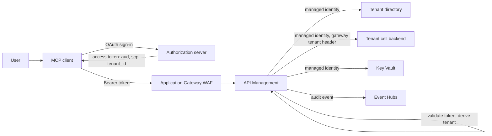

# Authentication and Governance for a Multi-Tenant MCP Gateway

A multi-tenant MCP gateway is a security boundary that many customers share. One mistake in how it derives the tenant, picks a backend credential, or filters tools can expose one tenant's data to another. This document lists the identities, RBAC, secrets, network trust boundaries, tenant lifecycle, entitlement governance, policy-as-code practice, audit, and negative tests for the design in [architecture.md](architecture.md). Read it with architecture sections [6](architecture.md#6-per-call-policy-pipeline), [7](architecture.md#7-tool-level-authorization), and [8](architecture.md#8-backend-credentials-and-identity).

> MCP server support in Azure API Management, Azure API Center MCP registration, and parts of the MCP authorization specification are new or in preview. Role names, supported scopes, and the minimum permissions for each operation change. Check current Microsoft Learn documentation before you finalize role assignments.

## 1. Principles

1. **The tenant comes from the validated token.** The gateway reads the tenant from a claim in a token it has just validated. It never takes the tenant from a header, query string, request body, subscription key, or source IP address. See [ADR 0001](decisions/0001-token-derived-tenant-identity.md).
2. **Authorize at the gateway and again at the backend.** The gateway enforces tenant status, product entitlement, and tool entitlement. Each backend still checks the tenant and user it receives. A gateway misconfiguration must not be enough on its own to cross tenants.
3. **Re-check on every `tools/call`.** Filtering `tools/list` is a convenience for the client, not a control. See [ADR 0002](decisions/0002-recheck-entitlement-on-tools-call.md).
4. **One audience per MCP server, and no token passthrough.** The gateway accepts only tokens minted for its own resource URI. It removes the client token and gets a new credential for each backend.
5. **Managed identity first; secrets only in Key Vault.** Per-tenant secrets, when a backend needs them, live in Azure Key Vault and reach API Management through Key Vault-backed named values.
6. **Fail closed.** If the tenant directory, token validation, or entitlement lookup fails, the request is denied. It is never forwarded with a default tenant.
7. **Correlation is not authorization.** `traceparent`, `X-Request-Id`, and edge trace headers help you join logs. They never decide access.
8. **Separate duties.** The people who approve a tenant's entitlements are not the people who change gateway policy, and neither group can delete audit records.

## 2. Identity inventory

| Identity | Used to | Typical grants | Owner |
|---|---|---|---|
| End user (through an MCP client) | Sign in and consent so the client can call tools | Delegated scopes such as `mcp.tools`, plus per-tool scopes such as `orders.write` | Customer tenant |
| MCP client application (`azp` or `appid` claim) | Request tokens for the gateway's resource URI | Registered or dynamically registered client; allowed redirect URIs | Client vendor or customer |
| Authorization server | Issue tokens with the audience, scopes, and tenant claim | Signing keys published through OpenID metadata | Identity team |
| API Management managed identity | Call the tenant directory, backends, Key Vault, and Event Hubs | App roles on the directory and backend APIs; Key Vault Secrets User; Event Hubs data sender | Platform team |
| Application Gateway user-assigned identity | Read the TLS certificate from Key Vault | Key Vault Secrets User on the vault, or on the certificate only | Platform team |
| MCP adapter identity (optional) | Call backends from a thin adapter when API Management cannot shape the tool | Backend app roles only; no Key Vault access unless needed | Product team |
| Backends (cells or stamps) | Accept gateway calls and enforce tenant and user checks | Trust the gateway's managed identity for a specific app role | Product team |
| CI/CD workload identity | Deploy infrastructure and policy | Scoped contributor rights through federated credentials | Platform team |
| Operators | Investigate incidents and run tenant lifecycle tasks | Just-in-time elevated access through Privileged Identity Management | Operations |
| Auditors and security analysts | Read audit data and run detections | Read-only on Log Analytics and Microsoft Sentinel | Security team |

## 3. Identity flow

The client token stops at API Management. The backend receives a gateway-issued credential plus a tenant header that API Management set after deleting any client copy. If the backend needs the user's identity, use the patterns in [Backend Identity Propagation](../../backend-identity-propagation/README.md). For how clients discover the authorization server and get tokens, see [MCP OAuth Front Door](../../mcp-oauth-front-door/README.md).

## 4. Tenant claim design

- **Custom claim (recommended for ISVs).** Have the authorization server issue a stable `tenant_id` claim that is the ISV's own account key. This separates the product's tenant model from the identity provider's tenant model.
- **Entra `tid` mapped through the directory.** If you use the Microsoft Entra `tid` claim, map it to the product account in the tenant directory. One Entra tenant can own more than one product account, so the mapping may need a second claim or an explicit account selection step.
- **Guest users.** A B2B guest's token carries the tenant the user signed in to for that resource. Test guest scenarios explicitly so a guest does not resolve to the wrong account.
- **Normalize once.** Lower-case and trim the claim in one place, and use the normalized value for the directory key, rate-limit counter key, backend header, and audit record.
- **Never accept an override.** Admin or support tooling that needs to act for another tenant uses a separate API with its own audience and approval flow, not a header on the MCP endpoint.

## 5. RBAC baseline

| Principal | Scope | Role or permission | Why |
|---|---|---|---|
| API Management managed identity | Key Vault | Key Vault Secrets User | Resolve Key Vault-backed named values |
| Application Gateway identity | Key Vault | Key Vault Secrets User | Read the listener TLS certificate |
| API Management managed identity | Event Hubs namespace or hub | Azure Event Hubs Data Sender | Send audit events with `log-to-eventhub` |
| API Management managed identity | Tenant directory API | App role (for example `Directory.Read`) | Read tenant records |
| API Management managed identity | Each backend API | App role (for example `Gateway.Invoke`) | Call tools on behalf of resolved tenants |
| CI/CD workload identity | Resource group | API Management Service Contributor, plus network and Key Vault rights needed by the template | Deploy gateway, policy, and named values |
| Platform engineers | API Management | API Management Service Reader Role by default; contributor only through PIM | Prevent unreviewed portal edits |
| API Center curators | API Center | API Center data and service roles (check current role names) | Register MCP servers and versions |
| Security analysts | Log Analytics and Sentinel | Log Analytics Reader, Microsoft Sentinel Reader or Responder | Investigate without changing data |

Grant at the narrowest scope that works. Prefer a role on one Event Hub over the namespace and on one Key Vault over the resource group.

## 6. Secrets and credentials

- Store per-tenant backend secrets, if any, as Key Vault secrets and reference them through named values. The tenant record holds the **name** of the credential, never the value.
- Use `authentication-managed-identity` for the directory and backends whenever they accept Microsoft Entra tokens. This removes most per-tenant secrets.
- Delete the client's `Authorization` header before forwarding. Never forward a client token to a backend that did not issue its audience.
- Do not use API Management subscription keys as tenant identity. If you use subscriptions for commercial tracking, bind each subscription to the tenant in the directory and check that it matches the token's tenant.
- Rotate Key Vault secrets on a schedule and after any incident. API Management refreshes Key Vault-backed named values periodically; force a refresh during rotation (check current docs for the refresh behavior).
- Keep the App Gateway TLS certificate in Key Vault and let the gateway reference the versionless secret so renewals roll forward.

## 7. Network and trust boundaries

- Deploy API Management in internal VNet mode, or with inbound private access, so the only public entry is the Application Gateway listener.
- Restrict the API Management subnet's network security group to traffic from the Application Gateway subnet, the API Management management endpoint, and the health probe source.
- Reach backends, Key Vault, Event Hubs, and the tenant directory over private endpoints.
- Allow API Management outbound access to the authorization server's OpenID metadata and signing keys. Token validation fails closed when it cannot reach them.
- Expose the protected resource metadata document anonymously. Everything else requires a valid token.
- IP allowlists can be an **extra** condition for a tenant that asks for it. They are never the way the gateway identifies a tenant, because source addresses are rewritten by firewalls, NAT, and the WAF. See [architecture section 5.2](architecture.md#52-never-key-tenant-identity-on-source-ip).

## 8. Tenant lifecycle

| Step | Actions | Evidence |
|---|---|---|
| Onboard | Create the tenant record (status, cell, products, allowed tools, credential reference); register the tenant's client applications; run the negative tests in section 13 against the new tenant | Directory change record, test results |
| Change entitlement | Update products or allowed tools through a reviewed change; evict the tenant's cache entry; send `notifications/tools/list_changed` to open sessions where the server supports it | Approval record, audit events showing the new outcome |
| Suspend | Set status to suspended; evict the cache entry; optionally revoke refresh tokens at the authorization server | `denied_tenant_not_active` audit events |
| Offboard | Remove entitlements, revoke client registrations and secrets, evict cache, export the tenant's audit history under your retention policy, then delete the tenant record | Export receipt, Key Vault deletion record |

Cached tenant records keep working until they expire. Evict them with `cache-remove-value` from an operation that only operators can call, or accept the cache lifetime as the maximum delay for a change. Document which approach you use.

## 9. Entitlement governance

- **Default deny for new tools.** A new tool is not in any tenant's `allowedTools` until a product owner adds it.
- **Write tools need an extra scope.** Tools that change data (for example `orders_create_order`) require a user scope such as `orders.write` in addition to product entitlement. The backend must enforce it. The sample policy checks only the tenant's allowed tool list; extend the `tools/call` stage with a per-tool scope map if you also want the gateway to enforce it, as the simulator does.
- **Products are the commercial unit.** Use API Management products and the tenant directory together: products describe what can be sold, and the directory records what each tenant bought.
- **Review regularly.** Compare each tenant's entitlements with billing records and remove anything not paid for or no longer used.
- **Change through a pipeline.** Entitlement changes are data changes with an approver, not edits in a portal.

## 10. Policy as code

- Keep API Management policies, fragments, named value definitions, and backends in source control next to the Bicep in [infra](../infra/README.md).
- Deploy with Bicep or an APIOps pipeline to a non-production gateway first.
- Make the negative tests in section 13 a release gate. A policy change that lets any of them pass must not ship.
- Block portal edits in production through RBAC, and run drift detection that compares deployed policy with source control.
- Review every change to the inbound pipeline order. Moving a stage (for example, rate limiting before tenant resolution) can change who gets charged or throttled.

## 11. Catalog governance with API Center

- Register each MCP server and version in Azure API Center with an owner, lifecycle stage, and links to its documentation.
- Use API Center as the discovery surface for client builders; it does not enforce access. Enforcement stays in API Management and the backends.
- Run API Center analysis or linting rules on the API definitions you publish, where available (check current docs for MCP support).
- Retire versions through lifecycle states and announce removal dates before you remove tools from products.

## 12. Audit

- Emit one audit event per request from the shared `mcp-audit` fragment, including requests that end in `return-response`. Outbound policies do not run after `return-response`, so the fragment must be called before each one.
- Record the request ID, `traceparent`, edge trace ID, tenant, subject, client ID, MCP server, method, tool name, outcome, status, cell, and whether a client sent a tenant header that the gateway ignored.
- Never log request or response bodies, tokens, or secrets.
- Partition audit events by tenant so you can export one tenant's history.
- Build Microsoft Sentinel detections for spikes in `denied_tool_not_entitled` (catalog probing), `invalid_token`, any client that sends a tenant header, and calls to tools that a tenant has never used before.

## 13. Negative tests

| Test | Expected result |
|---|---|
| No token | `401` with `WWW-Authenticate` and `resource_metadata` |
| Token for another audience | `401` with `error="invalid_token"` |
| Token without the tenant claim | `401` |
| Token for an unknown tenant | `403`, JSON-RPC error `-32001`, reason `unknown_tenant` |
| Token for a suspended tenant | `403`, reason `tenant_not_active` |
| Client sends `X-Tenant-Id` for another tenant | Ignored; request runs as the token's tenant; audit flags the header |
| `tools/call` for a tool not in the tenant's list, without calling `tools/list` first | JSON-RPC error `-32602`, identical to an unknown tool; no backend call |
| Write tool without the write scope | Denied at the gateway (if you added the per-tool scope check) and always at the backend; no data change |
| One tenant exceeds its rate limit | `429` with `Retry-After` for that tenant only |
| Tenant directory unavailable | `503`; no backend call |
| Backend receives client `Authorization` header | Never |

The [pipeline simulator](../samples/README.md) runs most of these offline. Run the same set against a deployed non-production gateway before each release, as described in [evaluation and troubleshooting](evaluation-and-troubleshooting.md).

## 14. Governance checklist

- [ ] Tenant is derived only from a validated token claim.
- [ ] Client tenant headers are deleted in the global policy.
- [ ] `tools/call` re-checks tool entitlement and per-tool scopes.
- [ ] Client tokens are removed before forwarding.
- [ ] API Management uses managed identity for the directory, backends, Key Vault, and Event Hubs.
- [ ] Per-tenant secrets are referenced by name and stored in Key Vault.
- [ ] Rate limits and quotas are keyed by tenant.
- [ ] Every response path writes an audit event.
- [ ] Production policy changes go through a pipeline with negative tests as a gate.
- [ ] Tenant lifecycle steps and cache eviction are documented and tested.
- [ ] Sentinel detections exist for probing and spoofing patterns.
- [ ] API Center entries have owners and lifecycle stages.

## 15. References

- [Architecture](architecture.md)
- [ADR 0001: Token-derived tenant identity](decisions/0001-token-derived-tenant-identity.md)
- [ADR 0002: Re-check entitlement on tools/call](decisions/0002-recheck-entitlement-on-tools-call.md)
- [Infrastructure guide](../infra/README.md)
- [MCP OAuth Front Door](../../mcp-oauth-front-door/README.md)
- [Backend Identity Propagation](../../backend-identity-propagation/README.md)
- [Agent Security and Governance](../../../security-and-governance/agent-security-and-governance/README.md)
- [Secured Foundry Landing Zone](../../../landing-zones-and-infra/secured-foundry-landing-zone/README.md)
- [About MCP servers in Azure API Management](https://learn.microsoft.com/azure/api-management/mcp-server-overview)
- [Use managed identities in Azure API Management](https://learn.microsoft.com/azure/api-management/api-management-howto-use-managed-service-identity)
- [Use named values in Azure API Management policies](https://learn.microsoft.com/azure/api-management/api-management-howto-properties)
- [Validate JWT policy](https://learn.microsoft.com/azure/api-management/validate-jwt-policy)
- [Azure API Center overview](https://learn.microsoft.com/azure/api-center/overview)
- [Model Context Protocol authorization](https://modelcontextprotocol.io/specification/2025-06-18/basic/authorization)
