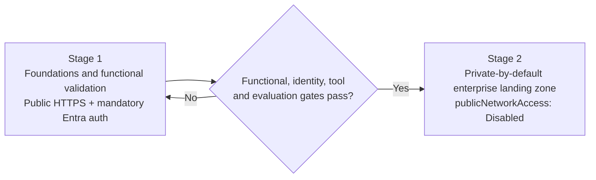

# Secured Microsoft Foundry Landing Zone for Enterprise Agents

A two-stage reference landing zone and set of Bicep templates for platform teams
that host enterprise agents on Microsoft Foundry. Stage 1 is an authenticated
validation profile. It proves the functional, identity and tool contracts on
public HTTPS endpoints. Stage 2 is a private-by-default enterprise foundation
that keeps those contracts and moves every data path behind private endpoints.
The result is one managed platform with shared building blocks, on which
application teams release their own agents and Model Context Protocol (MCP)
tools without holding network, IAM or responsible AI policy authority.

## When to use

- You are moving agents from a pilot to an enterprise platform. Foundry,
  dependencies and tools must not be reachable from the public internet.
- Several application teams will share one Foundry account or project, model
  deployments, a tool-hosting environment and a release process.
- Agents call private, line-of-business MCP servers. The servers must still
  validate the calling principal on every request.
- You need per-user identity passthrough from Foundry or Microsoft 365 Copilot
  and Teams through a Foundry Toolbox to an Entra-protected MCP server.
- Security reviewers require separate identities for bootstrap,
  infrastructure and application release.

## When not to use

- You need a quick, single-developer prototype. Use the Foundry quickstarts and
  come back to Stage 1 when the contracts must be proven.
- Your organization already has an Azure landing zone with a Foundry
  pattern. Reuse its hub, DNS and egress design. Use this asset only for the
  agent-specific parts: Toolbox, private MCP and the release split.
- The agent only calls public SaaS APIs and has no private data path. Stage 1
  may be enough.
- You need a production-ready, turnkey deployment with an egress firewall,
  hub integration and teardown. These templates are reviewed starting points,
  not a managed product.
- You need delivery governance instead of infrastructure. See
  [Agent Path to Production](../../delivery-and-ops/agent-path-to-production/README.md).

## Architecture

The asset follows a **two-stage adoption pattern**. Each stage has its own exit
criteria, and Stage 2 changes the network boundary without changing the
contracts that Stage 1 proved.

### Stage 1 — Foundations and functional validation profile

Stage 1 proves that the agent works and is governed correctly, before network
isolation adds its own failure modes.

- **Public HTTPS, never anonymous.** Foundry runs with `disableLocalAuth: true`,
  so only Entra tokens are accepted. MCP servers require and validate an Entra
  bearer token (issuer, audience, scope) on every request. There is no
  development-mode bypass in deployed environments.
- **No secrets in parameters or code.** Container Apps use Key Vault secret
  references. Services pull images and read secrets through managed
  identities. ACR admin users are disabled.
- **Foundry Toolbox** groups MCP tools into a versioned, reusable tool set.
  Tool names use the `<connection-name>___<tool-name>` namespace, for example
  `crm-mcp___get_account`. Agents and evaluations then pin exact tools and do
  not rely on whatever a server happens to advertise.
- **Prompt Agent and Foundry IQ knowledge base.** A declarative Prompt Agent
  is grounded on a Foundry IQ knowledge base and calls tools through a
  Foundry-managed MCP connection.
- **Hosted Agent with OAuth passthrough.** A containerized Hosted Agent calls
  the Toolbox with a per-user OAuth2 connection (`access_as_user` plus
  `offline_access`). The MCP server sees the signed-in user, not a shared
  service identity.
- **Repeatable evaluation gate.** A fixed dataset (for example
  `sales-guidance-v1`) runs against each candidate agent version. Promotion is
  blocked when quality, groundedness, tool-call accuracy or safety thresholds
  regress.

Exit criteria: both tool routes work end to end, the server audit log shows
the expected principal, unmapped users are refused, and the evaluation gate
passes.

### Stage 2 — Private-by-default enterprise landing zone

Stage 2 keeps every Stage 1 contract and removes public data-plane access.

- **Full network isolation.** The Foundry account has
  `publicNetworkAccess: 'Disabled'`. AI Search, Storage, Cosmos DB, Key Vault
  and ACR are reachable only through private endpoints.
- **Subnet delegation.** One subnet is delegated to `Microsoft.App/environments`
  for the Hosted Agent capability host (agent network injection). A second
  delegated subnet hosts an **internal** Container Apps environment for MCP
  servers. A third subnet holds the private endpoints.
- **Private endpoints and private DNS zones** for every dependency, plus a
  wildcard zone for the internal Container Apps environment domain.
- **Private operator runner VNet.** Deployment and data-plane operations run
  from a separate, peered VNet with explicit private DNS zone links.
- **Split identities.** Bootstrap, foundation and release use separate
  user-assigned managed identities (UAMIs) with GitHub OIDC federation. No
  identity holds standing secrets.
- **Scoped Microsoft 365 ingress exception.** Publishing to Microsoft 365
  Copilot and Teams goes through Azure Bot Service. It uses an
  **Activity-only** public ingress endpoint, while the project's public network
  access stays disabled. This is the only documented exception. Record it, get
  it approved and review it.

Both stages support two tool routes, and each ends at a private MCP server that
validates the principal on the server:

1. Prompt Agent → Foundry-managed MCP connection → private MCP server.
2. Hosted Agent → versioned Foundry Toolbox → private MCP server.

See [docs/architecture.md](docs/architecture.md) for ownership boundaries,
request paths, network and DNS topology, and the Bicep lifecycle split.

## Architecture & Implementation Map

Use this map to find the file that implements, explains or verifies each part
of the landing zone. Paths are relative to this folder.

### Documentation

| Topic | Document | Read it when |
|-------|----------|--------------|
| Ownership, request paths, subnet sizing, four-phase dependency order, environment isolation | [docs/architecture.md](docs/architecture.md) | You are designing or reviewing the landing zone |
| Bootstrap role, identities, self-hosted runner, six-stage runbook, pipelines, rollback | [docs/deployment-and-cicd.md](docs/deployment-and-cicd.md) | You are standing up an environment or a release process |
| OAuth identity passthrough, Bot Service OAuth connection, `webApplicationInfo`, end-to-end token flow, Microsoft 365 handoff | [docs/oauth-passthrough-and-m365-publishing.md](docs/oauth-passthrough-and-m365-publishing.md) | You are wiring per-user access or publishing to Teams |
| Private DNS zones and `groupIds`, split-horizon checks, capability host failures, MCP and Bot reachability | [docs/network-and-dns-troubleshooting.md](docs/network-and-dns-troubleshooting.md) | Something does not resolve, connect or provision |
| Why two stages, and what was rejected | [docs/decisions/0001-two-stage-private-foundry-landing-zone.md](docs/decisions/0001-two-stage-private-foundry-landing-zone.md) | You need the decision record |
| Template catalogue, dependency graph, step-by-step CLI | [infra/README.md](infra/README.md) | You are about to deploy |

### Infrastructure as code

| Layer | File | Implements | Explained in |
|-------|------|------------|--------------|
| Bootstrap | [infra/bootstrap-subscription-role.example.json](infra/bootstrap-subscription-role.example.json) | Least-privilege custom subscription role for the foundation UAMI | [deployment-and-cicd.md](docs/deployment-and-cicd.md#the-bootstrap-subscription-role) |
| Operator network | [infra/private-operator.bicep](infra/private-operator.bicep) | Separate operator VNet, NAT gateway, runner VM with no public IP and no standing roles | [deployment-and-cicd.md](docs/deployment-and-cicd.md#self-hosted-runner-architecture) |
| Operator network | [infra/private-operator-cloud-init.yaml](infra/private-operator-cloud-init.yaml) | Pinned, checksum-verified runner and tool install. No registration | [infra/README.md](infra/README.md#5-register-the-runner-and-prove-private-resolution) |
| Private Foundry | [infra/private-foundry-project.bicep](infra/private-foundry-project.bicep) | Foundation VNet, private Foundry account and project, BYO stores, private endpoints, DNS, capability host, role assignments | [architecture.md](docs/architecture.md#four-phase-dependency-order-in-private-foundry-projectbicep) |
| Tool hosting | [infra/foundation.bicep](infra/foundation.bicep) | ACR, Key Vault, Log Analytics, Application Insights, internal Container Apps environment | [architecture.md](docs/architecture.md#lifecycle-separation-in-bicep) |
| Tool hosting | [infra/modules/environment-dns.bicep](infra/modules/environment-dns.bicep) | Private zone and wildcard record for the environment `defaultDomain` | [network-and-dns-troubleshooting.md](docs/network-and-dns-troubleshooting.md) |
| Operator network | [infra/operator-connectivity.bicep](infra/operator-connectivity.bicep) | Peering and private DNS zone links to the operator VNet | [architecture.md](docs/architecture.md#subnet-sizing-and-delegation) |
| Knowledge | [infra/private-search.bicep](infra/private-search.bicep) | Private AI Search with Entra-only data-plane access | [oauth-passthrough-and-m365-publishing.md](docs/oauth-passthrough-and-m365-publishing.md#end-to-end-token-flow) |
| Tools | [infra/private-mcp-server.bicep](infra/private-mcp-server.bicep) | Internal MCP server with Entra bearer validation and host allow-list | [oauth-passthrough-and-m365-publishing.md](docs/oauth-passthrough-and-m365-publishing.md#end-to-end-token-flow) |
| Microsoft 365 | [infra/managed-m365-bot.bicep](infra/managed-m365-bot.bicep) | Single-tenant Azure Bot pointed at the Activity endpoint | [oauth-passthrough-and-m365-publishing.md](docs/oauth-passthrough-and-m365-publishing.md#bot-service-oauth-connection-step-by-step) |
| Parameters | [infra/parameters.example.json](infra/parameters.example.json) | One fail-closed section per template | [infra/README.md](infra/README.md#parameters-that-matter) |

### Pipelines

| Pipeline | Stages | Explained in |
|----------|--------|--------------|
| [infra/pipelines/foundation-deploy.yml](infra/pipelines/foundation-deploy.yml) | Lint and build all templates → provider, policy, validate and what-if preflight → platform deployment with network checks → private-runner deployment with DNS and private endpoint assertions | [deployment-and-cicd.md](docs/deployment-and-cicd.md#pipeline-to-runbook-mapping) |
| [infra/pipelines/agent-release-and-package.yml](infra/pipelines/agent-release-and-package.yml) | Build and push to private ACR (`dev`) → evaluation, security smoke S1–S8 and isolation gate (`test`) → canary and Microsoft 365 package (`staging`) → approved promotion with rollback hook (`prod`) | [deployment-and-cicd.md](docs/deployment-and-cicd.md#rollback-procedures) |

## Key design decisions

| Decision | Choice | Why | Trade-off |
|----------|--------|-----|-----------|
| Adoption order | Validate contracts on authenticated public HTTPS (Stage 1), then isolate (Stage 2) | Separates functional and identity defects from DNS and routing defects | Stage 1 endpoints need tight authentication and short lifetimes |
| Foundry exposure | `publicNetworkAccess: 'Disabled'`, `disableLocalAuth: true` | No key-based or public data-plane access | Every operator and CI action needs a private-capable runner |
| Tool hosting | Internal Container Apps environment in a delegated subnet | MCP servers have no public ingress and are reachable through Foundry network injection | Needs private DNS for the environment's `defaultDomain` |
| Tool contract | Foundry Toolbox with `<connection-name>___<tool-name>` pinning | Stable, versioned tool surface for agents and evaluations | Toolbox versions must be promoted with the agent |
| Per-user identity | OAuth identity passthrough (`access_as_user` + `offline_access`) | The server authorizes the real user, which enables row-level enforcement | Consent round trip and per-user project roles |
| Bicep lifecycle | `foundation.bicep` separate from application revisions | Deterministic `defaultDomain` on first deploy, which avoids HTTP 421. App redeploys cannot delete shared state | Two deployments to coordinate |
| Operator network | Separate peered VNet with explicit DNS zone links | The foundation template owns its full subnet array, and both app subnets are delegated | Extra peering and zone links to maintain |
| Identities | Bootstrap, foundation and release UAMIs. Release has RG Reader + project `Foundry User` only | App teams cannot change IAM, network or RAI policy | Platform team stays in the loop for those changes |
| Microsoft 365 publishing | Activity-only Bot Service ingress with `BotServiceRbac` | Keeps the project private and invocation authorized | A documented, reviewed exception |

The full rationale is in
[ADR 0001](docs/decisions/0001-two-stage-private-foundry-landing-zone.md).

## Getting started

### Prerequisites

- An Azure subscription where you can create resource groups, managed
  identities and role assignments, or a platform operator who can.
- Azure CLI 2.60+ with Bicep, `jq`, and a GitHub repository with environments.
- Regional availability and quota for the chosen model, Foundry agent network
  injection and Container Apps workload profiles.
- An Entra app registration for each protected MCP API (see
  [OAuth passthrough](docs/oauth-passthrough-and-m365-publishing.md)).

### Shortest path

1. **Stage 1.** Deploy `infra/foundation.bicep` with `secureNetworking: false`.
   Then deploy an MCP server with `infra/private-mcp-server.bicep`. Because
   the environment is not internal, the server is reachable on public HTTPS
   but still requires an Entra bearer token. Register the Toolbox, then create
   the Prompt Agent and Hosted Agent. Pass the evaluation gate.
2. **Stage 2.** Follow the six-stage runbook in
   [docs/deployment-and-cicd.md](docs/deployment-and-cicd.md):
   - Bootstrap the identities.
   - Create the operator runner.
   - Deploy `infra/private-foundry-project.bicep`, then `infra/foundation.bicep`
     with `secureNetworking: true`, then `infra/operator-connectivity.bicep`.
   - Release the MCP server and agents.
   - Hand the Microsoft 365 package to an administrator.
3. Template details, parameters and validation are in
   [infra/README.md](infra/README.md). Every required value in
   `infra/parameters.example.json` is blank, so deployment fails until it is
   populated.

### Clean up

Delete agent versions and Toolbox versions first. Then delete the capability
host, then the Foundry account. Purge it if your policy allows. Delete the
resource group last. Subnets that are delegated to a capability host cannot be
deleted until the capability host is gone. Key Vault purge protection, when
enabled, keeps the vault name reserved for the retention period.

## Security and responsible AI

- **Identity.** Foundry, Search, Storage, Cosmos DB and Key Vault use
  Entra-only authentication. Workloads use managed identities. CI uses GitHub
  OIDC federated credentials scoped to a repository environment. No client
  secrets are stored in pipelines, except the OAuth connection client secret,
  which Foundry stores.
- **Least privilege.** The release identity can deploy agent versions but
  cannot grant roles, change networking or modify RAI policies.
- **Server-side authorization.** Every MCP server validates issuer, audience
  and scope, maps the principal to a business scope and logs the principal's
  object id. A missing mapping returns no data, not someone else's data.
- **Network.** Disabling public network access is not an egress deny. Add an
  egress firewall or network security perimeter for outbound control.
- **Responsible AI.** Keep Foundry guardrails (content filters, prompt shields)
  assigned by the platform team. Gate releases on evaluation results. Tools
  with side effects need a human approval step or must be read-only during
  pilots.
- **Microsoft 365.** Distribution is not authorization. Under `BotServiceRbac`,
  users also need Foundry project access. Do not widen to `BotServiceTenant`
  without explicit approval.

## Limitations

- Foundry Hosted Agents, Toolbox, OAuth identity passthrough, agent network
  injection and private-project publishing to Microsoft 365 are in preview, and
  regional support varies.
- The templates do not include a hub firewall, a Bastion host, runner
  registration, or OIDC bootstrap automation. `private-operator.bicep`
  creates the runner VM; registering it is a manual, token-based step.
- The two workflows in `infra/pipelines/` are reference designs. Their
  evaluation, smoke and isolation scripts live in the consuming repository.
- The first OAuth use needs a client that can show the
  `oauth_consent_request` link. Support depends on the client.
- Provisioning a capability host can take 30–35 minutes. ARM and CI timeouts
  must allow for this.
- MCP Apps (widget) rendering in Microsoft 365 Copilot depends on a
  host-generated renderer origin and is qualified separately.

## References

- [Architecture deep dive](docs/architecture.md)
- [Deployment runbook and CI/CD](docs/deployment-and-cicd.md)
- [OAuth passthrough and Microsoft 365 publishing](docs/oauth-passthrough-and-m365-publishing.md)
- [ADR 0001: Two-stage private Foundry landing zone](docs/decisions/0001-two-stage-private-foundry-landing-zone.md)
- [Infrastructure templates](infra/README.md)
- [Foundry agent networking deep dive](https://learn.microsoft.com/azure/foundry/agents/concepts/agents-networking-deep-dive)
- [Foundry Toolbox](https://learn.microsoft.com/azure/foundry/agents/how-to/tools/toolbox)
- [Toolbox authentication](https://learn.microsoft.com/azure/foundry/agents/how-to/tools/tool-authentication)
- [MCP server authentication](https://learn.microsoft.com/azure/foundry/agents/how-to/mcp-authentication)
- [Foundry IQ knowledge bases](https://learn.microsoft.com/azure/foundry/agents/how-to/foundry-iq-connect)
- [Hosted agent CI/CD quickstart](https://learn.microsoft.com/azure/foundry/agents/quickstarts/set-up-cicd-hosted-agent)
- [Publish agents to Microsoft 365 Copilot and Teams](https://learn.microsoft.com/azure/foundry/agents/how-to/publish-copilot)
- [Publish from a network-isolated project](https://learn.microsoft.com/azure/foundry/agents/how-to/publish-copilot-virtual-network)
- [Foundry sample: network-isolated agent setup with tools behind a VNet](https://github.com/microsoft-foundry/foundry-samples/tree/main/infrastructure/infrastructure-setup-bicep/19-private-network-agent-tools)
- Related assets: [Agent Path to Production](../../delivery-and-ops/agent-path-to-production/README.md), [Enterprise Agent Security and Tool Governance](../../security-and-governance/agent-security-and-governance/README.md), [Microsoft 365 Integration with Azure Custom Engine Agent](../../m365-and-copilot/m365-azure-custom-agent/README.md)
