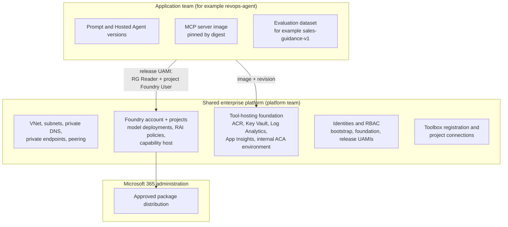
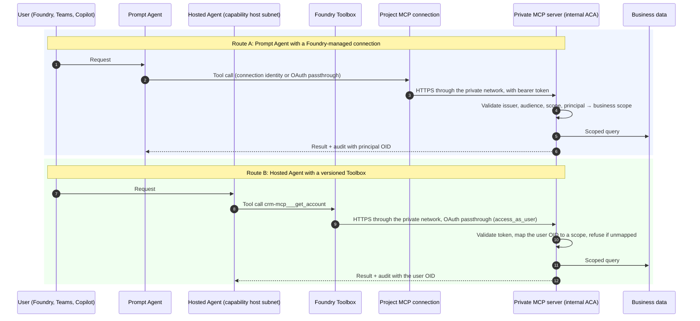
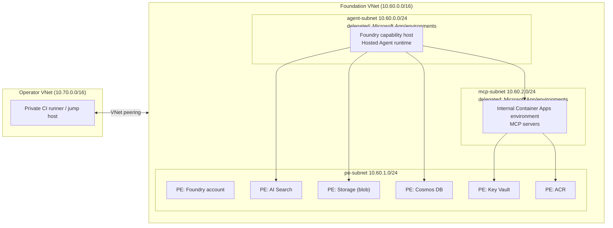
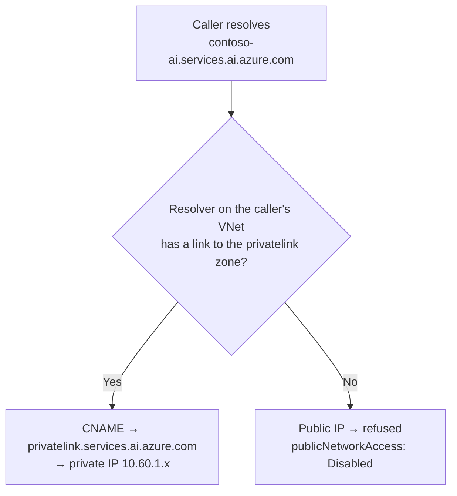
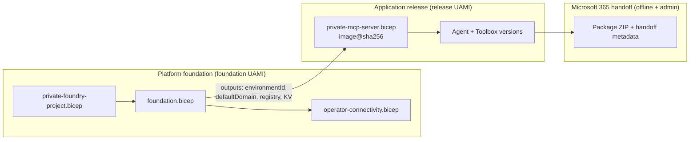
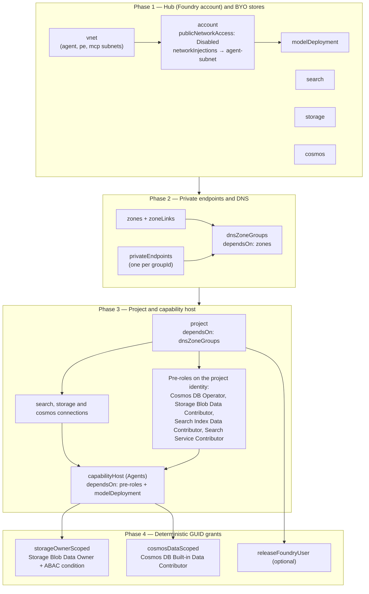
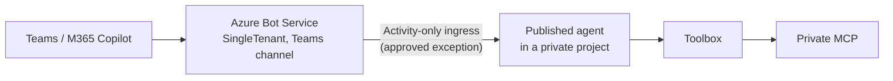
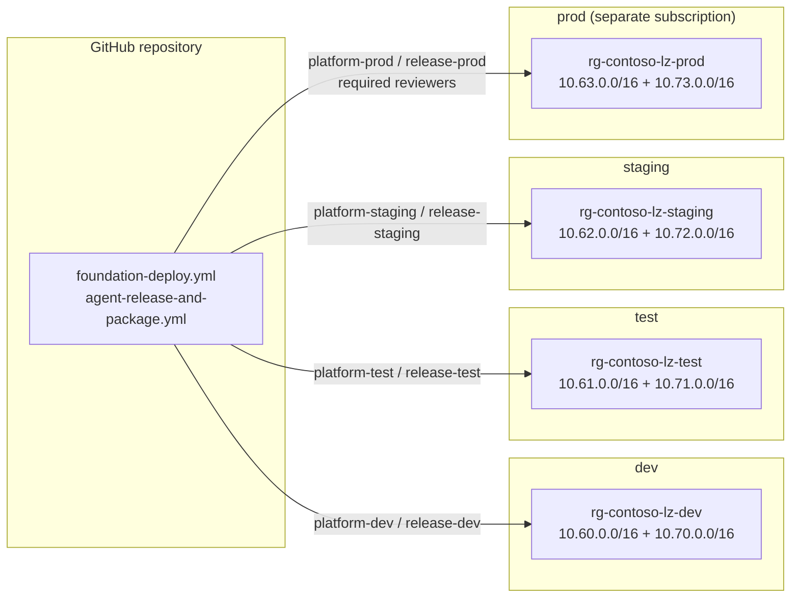

# Architecture

This document describes the Stage 2 private-by-default landing zone in detail.
Stage 1 uses the same components and contracts, but with public HTTPS
endpoints that still require authentication. For the reasons behind the
design, see
[ADR 0001](decisions/0001-two-stage-private-foundry-landing-zone.md).

## Ownership model

The guiding principle is **one managed platform, shared building blocks,
team-owned agents**. A central platform team runs the landing zone. Federated
application teams build and release agents on it, and they do not hold
authority over the network, IAM or responsible AI policy.

| Concern | Platform team | Application team | Microsoft 365 admin |
|---------|---------------|------------------|---------------------|
| Network, DNS, private endpoints | Owns | Consumes | — |
| Foundry account, model deployments, quota | Owns | Requests | — |
| RAI policies and guardrails | Owns and assigns | Proposes changes | — |
| Role assignments | Owns | — | — |
| Toolbox and project connections | Registers and approves | Defines the tool contract | — |
| Agent definitions, prompts, versions | Reviews the release gate | Owns | — |
| MCP server code and business authorization | Sets the hosting baseline | Owns | — |
| Evaluation datasets and thresholds | Sets the minimum bar | Owns the dataset | — |
| Microsoft 365 package distribution and audience | — | Builds the package | Owns |

Shared building blocks are the network, the tool-hosting foundation, the
Toolbox, model deployments and the release pipeline. Each team brings its own
agent, tools and evaluation data, and all of them pass through the same gates.

## Request and tool connectivity paths

Two routes are supported. Both end at a private MCP server that validates the
calling principal on the server. The client and Foundry are not trusted to
have authorized the request.

### Authentication choices for a tool connection

| Method | Identity seen by the MCP server | Use when |
|--------|----------------------------------|----------|
| Key-based | Shared secret | Avoid. Accept only for non-sensitive, read-only public data |
| Project managed identity | The Foundry project | Every caller is allowed the same data |
| Agent identity | The specific agent | Authorization is per agent, not per user |
| OAuth identity passthrough | The signed-in user | Row-level or user-scoped authorization is required |

For OAuth passthrough setup, see
[oauth-passthrough-and-m365-publishing.md](oauth-passthrough-and-m365-publishing.md).

### Server-side validation contract

Every MCP server on the platform must:

1. Reject requests without a valid Entra bearer token. Validate the issuer,
   audience (`api://<api-client-id>`) and the required scope (`access_as_user`).
2. Map the principal (user OID, or an approved application id) to a business
   scope, for example the accounts a user may see such as `ACC-1041`. A
   missing mapping returns **no data**, not an error that leaks other data.
3. Log the principal's object id with the tool name and outcome, for
   two-user isolation evidence.
4. Enforce `ALLOWED_HOSTS` and `ALLOWED_ORIGINS` to reject DNS-rebinding and
   cross-origin requests (see [Lifecycle separation](#lifecycle-separation-in-bicep)).

## Network and DNS topology

### VNet layout

The foundation VNet has three subnets. The operator runner lives in a separate
VNet that is peered to it.

| Subnet | Purpose | Delegation | Notes |
|--------|---------|------------|-------|
| `agent-subnet` | Hosted Agent capability host (agent network injection) | `Microsoft.App/environments` | Sized for platform scale. It can't be shared with other workloads |
| `mcp-subnet` | Internal Container Apps environment for MCP servers | `Microsoft.App/environments` | The environment is `internal: true`, with no public ingress |
| `pe-subnet` | Private endpoints for all dependencies | None | Network policies follow your organization's standard |

### Private DNS zones

| Zone | Resolves |
|------|----------|
| `privatelink.cognitiveservices.azure.com` | Foundry account (Cognitive Services endpoint) |
| `privatelink.openai.azure.com` | Azure OpenAI-compatible endpoint |
| `privatelink.services.ai.azure.com` | Foundry project endpoint |
| `privatelink.search.windows.net` | AI Search |
| `privatelink.blob.<storage-suffix>` | Agent file storage |
| `privatelink.documents.azure.com` | Cosmos DB (thread storage) |
| `privatelink.vaultcore.azure.net` | Key Vault |
| `privatelink.azurecr.io` | ACR |
| `<environment-default-domain>` | Internal ACA environment. A wildcard `*` A record points to the environment's static IP |

### Custom DNS and cold-start considerations

- **Zones must be resolvable from where the caller actually runs.** Linking a
  zone to the foundation VNet does not help a runner in another VNet. A VNet
  that uses custom DNS servers needs those servers to forward
  `privatelink.*` zones and the environment domain to Azure DNS
  (168.63.129.16), or to a DNS Private Resolver that can reach the zones.
- **Cold start.** On the first deployment, the private endpoint, zone group and
  zone link may finish in a different order from the services that call them.
  The capability host can take 30–35 minutes to provision. Allow at least
  75 minutes for the ARM deployment and 90 minutes for a CI job. A client-side
  timeout does not cancel the deployment, so check its state before
  retrying.
- **Verify, don't assume.** Before you run data-plane steps, resolve every
  dependency name **from the runner**. Confirm that each one returns a private
  address in `pe-subnet`, and that TCP 443 is reachable. Do this before
  blaming authentication.
- **Disabling public network access does not restrict egress.** Disabling
  public network access controls inbound access only. Use an egress firewall,
  user-defined routes or a network security perimeter to control outbound
  traffic.

### Why the operator runner has its own peered VNet

- `private-foundry-project.bicep` declares the **whole** subnet array of the
  foundation VNet. A runner subnet added out-of-band would be deleted on the
  next deployment. Adding it to the template would couple runner lifecycle to
  the platform foundation.
- Both application subnets are delegated to `Microsoft.App/environments`, so a
  VM or self-hosted runner can't be placed there.
- A separate VNet keeps operator access easy to audit and revoke: remove the
  peering and access is gone.
- **Peering does not share DNS.** Every private DNS zone used by the platform
  needs an explicit virtual network link to the operator VNet.
  `operator-connectivity.bicep` creates the links from the union of the
  `privateDnsZoneNames` outputs.

### Subnet sizing and delegation

Plan every CIDR before the first deployment. A delegated subnet that a
capability host or a Container Apps environment is using can't be resized,
re-delegated or deleted. Fixing a wrong size means tearing down the capability
host first (see
[the troubleshooting runbook](network-and-dns-troubleshooting.md)).

| Subnet | Default prefix | Treat as minimum | Delegation | Network policies | Consumed by |
|--------|----------------|------------------|------------|------------------|-------------|
| `agent-subnet` | `10.60.0.0/24` | `/24` | `Microsoft.App/environments` | Platform default | Foundry agent network injection (`networkInjections` on the account) and the project capability host |
| `pe-subnet` | `10.60.1.0/24` | `/26` for one environment, `/24` to leave room | None | `privateEndpointNetworkPolicies: 'Disabled'` | Private endpoints for Foundry, Search, Storage, Cosmos DB, Key Vault and ACR |
| `mcp-subnet` | `10.60.2.0/24` | `/27` (workload profiles), `/24` recommended | `Microsoft.App/environments` | Platform default | Internal Container Apps environment that hosts MCP servers |
| `runner-subnet` (operator VNet) | `10.70.0.0/24` | `/28` | None | NSG denies all inbound | Self-hosted runner VM. NAT gateway for egress |

Rules that the templates enforce or assume:

1. **Delegation is exclusive.** A subnet delegated to
   `Microsoft.App/environments` hosts that service and nothing else. VMs,
   private endpoints and other environments can't share it. That's why the
   landing zone has two delegated subnets (agent and MCP) and one plain
   subnet for private endpoints.
2. **One environment per delegated subnet.** The capability host and the MCP
   Container Apps environment can't share `agent-subnet`. Each gets its own
   delegated subnet.
3. **The subnet array is authoritative.** `private-foundry-project.bicep`
   declares all three subnets inline on the VNet resource. Each redeployment
   sends the full array. A subnet added outside the template is either removed
   or makes the deployment fail when it's in use. Add subnets in the template,
   or put them in another VNet as the operator runner does.
4. **Azure reserves five addresses per subnet.** A `/27` has 27 usable
   addresses, not 32. Workload profile environments, capability host scale-out
   and private endpoint NICs all take addresses from the usable pool.
5. **Size the private endpoint subnet for every sub-resource.** Each
   `groupId` gets its own NIC. Some services use more than one address:

   | Private endpoint | Approximate addresses |
   |------------------|-----------------------|
   | Foundry account (`account`) | 1 |
   | AI Search (`searchService`) | 1 |
   | Storage (`blob`, plus one per extra sub-resource) | 1 each |
   | Cosmos DB (`Sql`) | 1 global + 1 per region |
   | Key Vault (`vault`) | 1 |
   | ACR (`registry`) | 1 + 1 per regional data endpoint |

   One environment uses about eight addresses. A `/26` leaves room for
   growth. The default `/24` leaves room for many more data sources.
6. **Prefixes never overlap.** Foundation VNets, operator VNets, hub VNets and
   on-premises ranges must all be disjoint, or peering fails. The
   [cross-environment plan](#cross-environment-isolation) reserves one `/16`
   for each.
7. **Private endpoint network policies are off by default.** With
   `privateEndpointNetworkPolicies: 'Disabled'`, NSGs and user-defined routes
   don't apply to private endpoint traffic. If your organization requires an
   NSG on private endpoints, set the property to `Enabled` and add the rules.

## Lifecycle separation in Bicep

`foundation.bicep` holds the **shared state**: ACR, Key Vault, Log Analytics,
Application Insights and the Container Apps managed environment. Application
revisions live in `private-mcp-server.bicep` and are deployed separately. The
split matters for two reasons:

1. **A deterministic `defaultDomain` on the first deploy.** The MCP server's
   host allow-list (`ALLOWED_HOSTS`) protects against DNS rebinding and has to
   contain the server's real host name:
   `<app-name>.<environment-default-domain>`. When the environment and app are
   deployed in one template, the app's configuration gets evaluated against an
   environment that does not exist yet. A guessed allow-list then rejects
   every legitimate request with **HTTP 421 Misdirected Request**. Deploying
   the foundation first makes `defaultDomain` a concrete output, and the app
   template derives `ALLOWED_HOSTS` from it.
2. **App redeployments cannot delete shared state.** Neither an application
   rollback nor a Complete-mode deployment of an app template can remove the
   registry, vault, workspace or environment that other teams depend on. The
   release identity also has no write access to those resources.

Other properties of the split:

- **No secrets in parameters.** Application Insights writes its connection
  string straight into a Key Vault secret. The app reads it through a Key
  Vault reference using its own managed identity.
- **Pull without passwords.** ACR has `adminUserEnabled: false`. Each app gets
  `AcrPull` through a user-assigned identity.
- **Pinned images.** Revisions reference `image@sha256:<digest>`, so a
  redeployment cannot silently change code.

## Four-phase dependency order in `private-foundry-project.bicep`

The capability host is the most fragile resource in the landing zone. It
fails if a store is unreachable, a role is missing or a DNS record isn't
there yet. A failed capability host can take as long as a successful one to
roll back. The template orders resources into four phases with explicit
`dependsOn` edges so that every precondition holds before the capability host
starts.

| Phase | Resources | Gate before the next phase | What breaks if you skip the gate |
|-------|-----------|----------------------------|----------------------------------|
| 1. Hub and BYO stores | VNet with delegated subnets, the Foundry account (the hub) with `networkInjections`, model deployment, AI Search, Storage, Cosmos DB. All have public network access disabled and local auth off | Every store exists and has a resource ID | Private endpoints have no target |
| 2. Private endpoints and DNS | Private DNS zones, VNet links, one private endpoint per `groupId`, and DNS zone groups. Zone groups depend on the zones, so each A record lands in the right zone | `dnsZoneGroups` finish, so every store name resolves to a `pe-subnet` address | The project is created against names that still resolve publicly. Connections and the capability host fail with access errors |
| 3. Project and capability host | Project with a system-assigned identity, the three BYO connections, the four pre-roles, then the `Agents` capability host | The capability host waits on all four pre-roles **and** the model deployment | The capability host can't create its database, containers or index. It fails after a long wait, and you must delete it before retrying |
| 4. Deterministic GUID grants | Storage Blob Data Owner limited by an ABAC condition to the `<workspace-id>*-azureml-agent` containers. Cosmos DB Built-in Data Contributor on `/dbs/enterpriseMemory`. Optional `Foundry User` for the release identity | None. This is the last phase | The scoped grants target containers and a database that only exist after the capability host provisions them |

Why the role assignment names are deterministic:

- Each name is `guid(<scope id>, project.id, <role id>[, <qualifier>])`. A
  redeployment computes the same name and updates the assignment in place.
  It doesn't create a duplicate or fail with `RoleAssignmentExists`.
- The qualifier (`'agent-containers'`, `'enterpriseMemory'`) separates two
  grants of the same role on the same scope with different conditions.
- Deleting and recreating the project changes `project.id` and the principal.
  The new deployment creates new assignments. Old ones stay orphaned until
  someone removes them, so add an orphaned-assignment check to your audit.

Practical consequences:

- **Allow for the slowest phase.** Phase 3 dominates. Use a 75-minute ARM
  timeout and a 90-minute CI timeout. A cancelled client doesn't cancel the
  deployment. Check `az deployment group show` before you retry.
- **Role propagation is not instant.** Entra role assignments can take
  minutes to apply on the data plane. If the capability host fails with
  `403` on a store right after the pre-roles were created, wait and redeploy.
  The deterministic names make the retry safe.
- **The account has no separate capability host in this template.** Agent
  network injection is set on the account through `networkInjections`. Only
  the project capability host is declared. Environments built from older
  samples may also have an `accountCapHost`. If so, delete it after the
  project capability host and the project. See the
  [deletion order](network-and-dns-troubleshooting.md).
- **Change one phase at a time.** Changing a store and the capability host in
  one deployment combines two slow failure modes. Promote store, network and
  capability host changes in separate pull requests.

## Microsoft 365 ingress exception

Publishing an agent from a network-isolated project to Microsoft 365 Copilot
and Teams needs Azure Bot Service to deliver activities to the agent. The
landing zone allows **one** scoped exception: the Activity-only public
endpoint, enabled through the project's Microsoft 365 publishing setting. It
accepts Bot Framework activities only. The project's `publicNetworkAccess`
stays `Disabled`. All other data-plane access stays private.

The exception needs its own record: an owner, approval, the endpoint
authorization mode (`BotServiceRbac` by default), and a review date.

## Cross-environment isolation

Each environment (`dev`, `test`, `staging`, `prod`) is a complete,
independent copy of the landing zone. Environments share the Git repository
and, optionally, a hub network. They never share a data plane, an identity, a
DNS zone or a runner.

| Boundary | Per environment | Why it matters |
|----------|-----------------|----------------|
| Subscription and resource group | Separate resource groups at minimum. Production in its own subscription | Subscription-level policy, quota and the bootstrap role stay scoped to one blast radius |
| Address space | One foundation `/16` (`10.60`–`10.63`) and one operator `/16` (`10.70`–`10.73`) | Any environment can peer to a shared hub without overlap |
| Private DNS zones | Separate `privatelink.*` zones in each environment's resource group, linked only to that environment's VNets | A `dev` runner can't resolve `prod` private addresses. Two environments can't overwrite each other's A records |
| Managed identities | Separate foundation and release UAMIs in a per-environment identity resource group | A compromised `dev` credential can't deploy to `prod` |
| OIDC federation | Subject `repo:<owner>/<repo>:environment:platform-<env>` or `...:release-<env>` | GitHub issues a token only to jobs bound to that environment, after its protection rules pass |
| Runners | One `private-operator` VM per environment, labels `foundry-private-operator,<env>` | A job can only reach the private endpoints of the environment it targets |
| Registry | One private ACR per environment | Images are promoted by digest, not rebuilt. `prod` never pulls from `dev` |
| Foundry project and stores | One account, project, capability host, Search, Storage and Cosmos DB per environment | Threads, files, memory and indexes never mix test and production data |
| Entra app registrations | Separate MCP API and agent client apps per environment, or at least per `prod` and non-`prod` | A token minted for `dev` has the wrong audience in `prod`, and the MCP server rejects it |
| Microsoft 365 | Separate Bot resource and Teams app ID per environment | Pilot users install `staging`. Production users install `prod` |

How a release moves between environments:

1. The `build` job exports the image as an OCI archive and pushes it to the
   `dev` registry by digest.
2. Each later job copies **the same archive** into its own environment's
   private registry with `skopeo copy --preserve-digests`. Then it rolls the
   MCP revision and creates the agent version against that digest.
3. Only the digest, the agent definition in Git and the Microsoft 365 package
   cross environment boundaries. Credentials, DNS answers and data don't.

Design rules:

- **Don't peer environments to each other.** Peer each one to the hub if you
  need shared egress or on-premises access. Keep the routing table free of
  east-west paths between `dev` and `prod`.
- **Don't link one zone to many environments.** A shared
  `privatelink.services.ai.azure.com` zone means the last deployment's A
  record wins for an account name. Unique account names avoid collisions, but
  a shared zone still lets a `dev` runner resolve `prod` addresses.
- **Keep parameter files per environment.** Store
  `.local/<env>.parameters.json` outside source control, or render it from
  GitHub environment variables at deploy time. Never commit populated
  parameter files.
- **Use the same templates everywhere.** Only parameters change between
  environments. A template change goes through `dev` and `test` before it
  reaches `prod`, just like an agent version does.
- **Protect `prod` at the GitHub environment.** Required reviewers, a wait
  timer and deployment branch rules on `platform-prod` and `release-prod`
  are the human gate. The federated credential subject makes the gate
  mandatory, because no other job can get a `prod` token.
