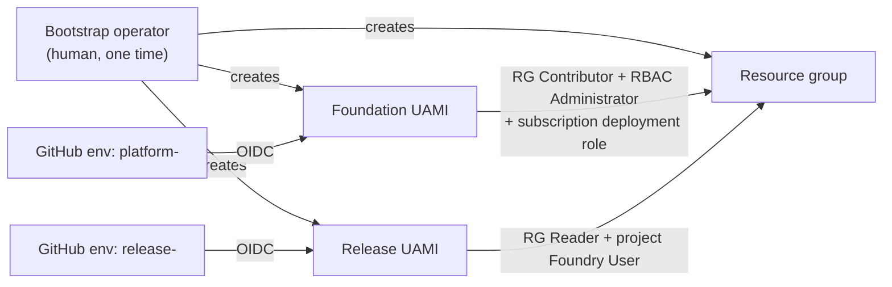
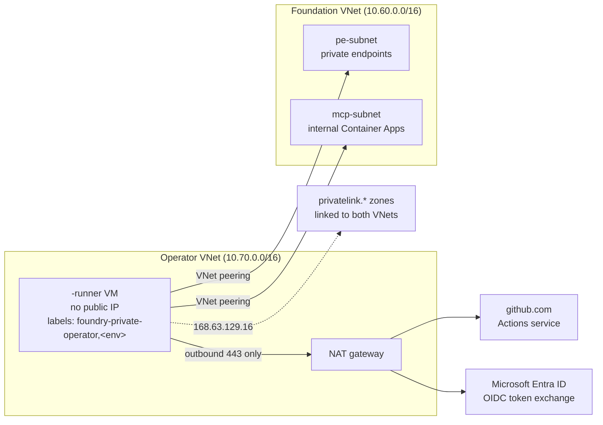
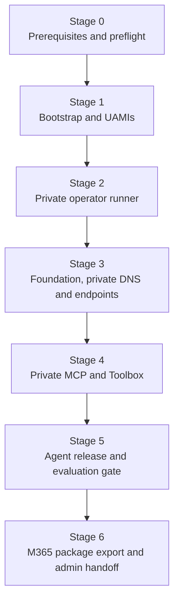

# Deployment and CI/CD

This runbook takes an empty subscription to a private Foundry landing zone
with a released agent and a Microsoft 365 package that is ready for an
administrator. Every stage has an exit check. Don't start a stage until the
previous stage's check passes.

For the templates and their parameters, see [../infra/README.md](../infra/README.md).

## Three decoupled lifecycles

| Lifecycle | Runs | Identity | Changes |
|-----------|------|----------|---------|
| Platform foundation | Rarely, through platform change control | Foundation UAMI | Network, DNS, Foundry account and project, tool-hosting foundation, role assignments |
| Application release | Every agent or tool change | Release UAMI | MCP server revision, Toolbox version, agent version, evaluation |
| Microsoft 365 handoff | Per approved release | None (offline) + M365 administrator | Package overlay, validation, admin distribution |

Keeping these apart means a failed release can't break the platform. It also
means application teams never hold IAM or RAI policy authority, and package
branding can't change identity or endpoint wiring.

## Least-privilege identities



| Identity | Scope and roles | Can't |
|----------|-----------------|-------|
| **Bootstrap operator** | A human with rights to create a resource group, two user-assigned managed identities, federated credentials and the initial role assignments | Used only once. It isn't stored in CI |
| **Foundation UAMI** | Resource group **Contributor**, resource group **Role Based Access Control Administrator** (with a condition that limits which roles it can assign), and the custom [bootstrap subscription role](#the-bootstrap-subscription-role) for deployment orchestration | Change other resource groups, register providers, cancel or delete deployments, or assign subscription-wide roles |
| **Release UAMI** | Resource group **Reader** + **Foundry User** (`53ca6127-db72-4b80-b1b0-d745d6d5456d`) scoped to the **project** + `AcrPush` on the registry + **Contributor** on the one MCP container app it rolls | Create role assignments, change RAI policies, model deployments, networking or any other resource |
| **M365 administrator** | Microsoft 365 admin center (integrated apps / agents) | Change Azure resources |

Federated credentials use the subject
`repo:<owner>/<repo>:environment:<env>`, so only jobs that run in an approved
GitHub environment can get a token. Use separate environments, such as
`platform-dev` and `release-dev`, with required reviewers on production.

> Because the release identity can't assign roles, the platform team
> pre-assigns everything a release needs: the MCP app identity's `AcrPull`
> and Key Vault Secrets User, and the project identity's access to tools.

## The bootstrap subscription role

The foundation UAMI needs a few rights at subscription scope: it has to read
provider registration state, and run `validate` and `what-if` before it
changes anything. The built-in roles that include these rights, Contributor
and Owner, also grant write access to every resource in the subscription.
[`bootstrap-subscription-role.example.json`](../infra/bootstrap-subscription-role.example.json)
is a custom role that grants only the orchestration actions.

| Action | Used for |
|--------|----------|
| `Microsoft.Resources/subscriptions/read` | `azure/login` subscription selection and `az account show` |
| `Microsoft.Resources/subscriptions/providers/read` | The preflight check that every provider shows `Registered` |
| `Microsoft.Resources/subscriptions/locations/read` | Checking the region and availability zones before deployment |
| `Microsoft.Resources/subscriptions/operationresults/read` | Polling long-running operations, such as the capability host |
| `Microsoft.Resources/deployments/read` | Reading deployment state before a retry, so a timed-out client doesn't start a duplicate |
| `Microsoft.Resources/deployments/write` | Creating subscription-scope deployment records, for example an orchestrator that targets the resource group |
| `Microsoft.Resources/deployments/validate/action` | `az deployment sub validate` and template preflight |
| `Microsoft.Resources/deployments/whatIf/action` | The `what-if` preview attached to the platform change request |
| `Microsoft.Resources/deployments/operations/read` | Finding the failing resource when a deployment fails |
| `Microsoft.Resources/deployments/operationstatuses/read` | Polling deployment status |

A deployment record can't create resources by itself. Azure Resource Manager
authorizes every resource inside a deployment against the caller's rights at
the resource's own scope. A subscription-scope deployment that tries to write
outside the landing-zone resource group fails with `AuthorizationFailed`.

What the role leaves out, and why:

| Excluded | Reason |
|----------|--------|
| Resource `*/write` and `*/delete` | Resource changes come only from **Contributor** on one resource group |
| `Microsoft.Resources/subscriptions/resourceGroups/write` | The bootstrap operator creates resource groups. The pipeline can't create a new blast radius |
| `Microsoft.Resources/deployments/delete` and `cancel/action` | A cancelled capability-host deployment can leave a half-provisioned host. A human decides to cancel, after reading the deployment state |
| `*/register/action` | Provider registration changes the whole subscription's surface. It's a one-time Stage 0 step for a human |
| `Microsoft.Authorization/roleAssignments/write` | Role assignments come from **Role Based Access Control Administrator** on the resource group, under a condition |

Create and assign the role once per subscription, as the bootstrap operator.
Custom role names are unique per tenant, so replace `<scope-name>` with
something that identifies the subscription:

```bash
mkdir -p .local
sed -e "s/<scope-name>/contoso-dev/" -e "s#<subscription-id>#$SUBSCRIPTION_ID#" \
  infra/bootstrap-subscription-role.example.json > .local/bootstrap-role.json
az role definition create --role-definition @.local/bootstrap-role.json

az role assignment create \
  --assignee-object-id "$FOUNDATION_PRINCIPAL_ID" \
  --assignee-principal-type ServicePrincipal \
  --role "Landing zone subscription deployment operator (contoso-dev)" \
  --scope "/subscriptions/$SUBSCRIPTION_ID"
```

Constrain the resource-group **Role Based Access Control Administrator**
assignment with a condition, so the foundation UAMI can only assign the roles
the templates need:

```text
(
  (!(ActionMatches{'Microsoft.Authorization/roleAssignments/write'}))
  OR
  (@Request[Microsoft.Authorization/roleAssignments:RoleDefinitionId]
     ForAnyOfAnyValues:GuidEquals {<acr-pull-role-id>, <key-vault-secrets-user-role-id>,
     <foundry-user-role-id>, <storage-blob-data-contributor-role-id>,
     <search-index-data-contributor-role-id>, <search-service-contributor-role-id>})
)
AND
(
  (!(ActionMatches{'Microsoft.Authorization/roleAssignments/delete'}))
  OR
  (@Resource[Microsoft.Authorization/roleAssignments:RoleDefinitionId]
     ForAnyOfAnyValues:GuidEquals {<same-role-id-list>})
)
```

Add the IDs of any other role the templates assign, such as Storage Blob Data
Owner and Cosmos DB Operator. A template change that adds a new role fails
until the platform owner widens the condition. That's the review point.

**Check:** `az role assignment list --assignee "$FOUNDATION_PRINCIPAL_ID" --all -o table`
returns exactly three rows: the custom role at the subscription, Contributor
on the resource group, and the conditional Role Based Access Control
Administrator on the resource group.

## Self-hosted runner architecture

GitHub-hosted runners can't reach a private endpoint. Every job that touches a
data plane runs on a runner inside the operator VNet, created by
[`private-operator.bicep`](../infra/private-operator.bicep) and peered by
[`operator-connectivity.bicep`](../infra/operator-connectivity.bicep).



| Property | Setting | Why |
|----------|---------|-----|
| Inbound | No public IP. The NSG denies inbound from the internet | The runner polls GitHub. Nothing needs to connect to it |
| Outbound | NAT gateway with a static public IP | Stable egress for GitHub, Entra ID and package mirrors. Add Azure Firewall with an FQDN allow list if policy requires it |
| VM identity | System-assigned, with **no role assignments** | A compromised VM has no standing Azure rights |
| Azure access | `azure/login@v2` with OIDC in each job, using the job's environment UAMI | Rights last for one job and are scoped to one environment |
| Runner software | Cloud-init installs a pinned runner version, checks its SHA-256, and runs it as a dedicated `runner` user | No drift between rebuilds, and no root jobs |
| Registration | `az vm run-command invoke` with a one-hour registration token | The token never lands in source control or VM user data |
| Labels | `self-hosted`, `foundry-private-operator`, `<env>` | A job for `prod` can't land on the `dev` runner |
| DNS | Azure-provided DNS, with every private zone linked to the operator VNet | Split-horizon resolution works without custom DNS servers |

Hardening rules:

- Register the runner to **one repository**, not the organization.
- Don't run workflows from forks on self-hosted runners. Require approval for
  all outside contributors.
- Set `permissions: { id-token: write, contents: read }` on every job, and
  nothing more.
- Patch by rebuilding the VM from the template, not by logging in.
- Use one runner per environment. For more throughput, add VMs with the same
  labels, or move to Managed DevOps Pools or GitHub-hosted runners with Azure
  private networking. The principle stays the same: the runner's NIC sits in
  the operator VNet.

For the registration commands and the private resolution proof, see
[the infra guide](../infra/README.md#5-register-the-runner-and-prove-private-resolution).
For resolution failures, see
[Network and DNS troubleshooting](network-and-dns-troubleshooting.md).

## The six-stage runbook



### Stage 0 — Prerequisites and provider registration preflight

- Choose a region that supports Foundry agent network injection, Hosted
  Agents and your model, and confirm model quota there.
- Register resource providers before you deploy anything. Registration can
  take minutes and fails the deployment if it's missing:

  ```bash
  for ns in Microsoft.CognitiveServices Microsoft.App Microsoft.ContainerRegistry \
            Microsoft.KeyVault Microsoft.OperationalInsights Microsoft.Insights \
            Microsoft.Network Microsoft.Search Microsoft.Storage \
            Microsoft.DocumentDB Microsoft.BotService Microsoft.ManagedIdentity; do
    az provider register --namespace "$ns"
  done
  az provider list --query "[?registrationState!='Registered'].namespace" -o tsv
  ```

- Agree on the address space, both for the foundation VNet and the operator
  VNet, and on how DNS works if you use custom DNS servers.
- Agree on the Entra app registrations for the MCP API (`api://<client-id>`,
  scope `access_as_user`).

**Exit check:** every provider shows `Registered`, quota is confirmed, and the
address plan has no overlap with peered networks.

### Stage 1 — Bootstrap and UAMIs

The bootstrap operator:

1. Creates the resource group (for example `rg-contoso-agents-dev`).
2. Creates `id-contoso-foundation-dev` and `id-contoso-release-dev`.
3. Adds a GitHub OIDC federated credential to each identity, with subject
   `repo:<owner>/<repo>:environment:<env>`.
4. Assigns the roles in the identity table above. The release UAMI's project
   role is assigned after Stage 3, through the `releasePrincipalId` parameter.
5. Stores the client IDs, tenant ID and subscription ID as GitHub environment
   **variables**. They aren't secrets, and no client secret is created.

**Exit check:** an `azure/login` step with OIDC in each environment succeeds
and can only list the target resource group.

### Stage 2 — Private operator runner

Data-plane steps such as creating Toolbox and agent versions, running
evaluations and exporting packages have to reach private endpoints, so they
need a runner inside the network.

1. Create the operator VNet and a runner: a self-hosted GitHub runner, a
   managed DevOps pool, or a jump host.
2. After Stage 3, deploy `infra/operator-connectivity.bicep` to peer it and
   link **every** private DNS zone.

**Exit check (after Stage 3):** from the runner, every dependency name
resolves to a private IP in `pe-subnet` and TCP 443 is reachable.

### Stage 3 — Foundation, private DNS and private endpoints

Run with the foundation UAMI:

1. `private-foundry-project.bicep`: VNet, three subnets, Foundry account
   (`publicNetworkAccess: 'Disabled'`, `disableLocalAuth: true`), project,
   model deployment, capability host with subnet injection, and the private
   endpoints and zones for the account, AI Search, Storage and Cosmos DB.
2. `foundation.bicep` with `secureNetworking: true`: ACR, Key Vault, Log
   Analytics, Application Insights, and the internal Container Apps
   environment on `mcp-subnet`, plus its private endpoints and the
   environment-domain zone.
3. `operator-connectivity.bicep` (see Stage 2).

The capability host takes 30–35 minutes. Set the ARM wait to at least 75
minutes and the CI job timeout to 90 minutes. If the client times out, check
the deployment state before you retry.

**Exit check:** `az deployment group show` returns `Succeeded`, the account
shows `publicNetworkAccess: Disabled`, and a request to the project endpoint
from outside the network is refused.

### Stage 4 — Private MCP server and Toolbox registration

Run with the release UAMI from the private runner:

1. Build the MCP image and push it, then record its digest.
2. Deploy `private-mcp-server.bicep` with `image=<registry>/<repo>@sha256:<digest>`
   and the `defaultDomain` output from foundation. `ALLOWED_HOSTS` is
   derived from it.
3. Check that the server rejects anonymous requests (HTTP 401) and accepts a
   token with the right audience and scope.
4. Create or update the project connection for the MCP endpoint, then create a
   Toolbox version that pins the tools, for example `crm-mcp___get_account`.
   The `<connection-name>___<tool-name>` namespace stops a renamed or added
   tool on the server from silently changing what the agent can call.

**Exit check:** a Toolbox `tools/list` from the runner returns exactly the
pinned tool names.

### Stage 5 — Agent release and evaluation gate

1. Create a new **version** of the Prompt Agent or Hosted Agent that
   references the Toolbox version and the knowledge base (Foundry IQ). Never
   edit a version in place.
2. Run the evaluation dataset, for example `sales-guidance-v1`, against the new
   version. Include grounding, tool-call correctness and safety evaluators,
   and test cases for refusal on data the user shouldn't see.
3. **Gate:** promote only when every threshold passes. Store the evaluation
   run ID with the release record.
4. Two-user isolation test: two pilot users each see only their mapped
   accounts (for example `ACC-1041`), and an unmapped user gets no data.

**Exit check:** the release record has the image digest, Toolbox version,
agent version, evaluation run ID and isolation evidence.

### Stage 6 — Microsoft 365 package export and administrator handoff

1. **Export (operator, private runner).** Publish the agent version to
   Microsoft 365 and export the service-generated package ZIP. Record an
   export receipt with the agent version and SHA-256.
2. **Package (offline, no Azure identity).** See
   [The package job](#the-offline-package-job).
3. **Admin handoff.** The administrator uploads the package and distributes
   it to an isolated UAT or pilot audience, then confirms the app shows up in
   **both** Teams and Microsoft 365 Copilot.

**Exit check:** the administrator confirms distribution and a pilot user gets
a correct, scoped answer in both clients.

## The offline package job

The package job is deterministic and has **no Azure credentials**. It may only
change approved presentation metadata.

| Step | What happens | Fails closed when |
|------|--------------|-------------------|
| Inspect | `package-inspect` reads the exported ZIP and the export receipt | The receipt digest doesn't match the ZIP |
| Overlay | `package-build` applies the approved name, descriptions, icons, accent color, developer and legal URLs | Any value is a placeholder, or brand, legal or security approval is missing |
| Preserve | Keeps the app ID, bot ID, endpoints, valid domains and `webApplicationInfo` exactly as exported | Any identity or endpoint field would change |
| Validate | Validates against the Teams app manifest schema (v1.29, pinned by digest) | The schema is invalid or the schema digest doesn't match |
| Zip | Builds a ZIP with a fixed order and timestamps, named by its own SHA-256 | The output isn't byte-for-byte reproducible |
| Metadata | Writes `handoff_sha256`, source digests and approvals, plus `administrator_distribution: not_run` and `client_acceptance: not_run` | — |
| Check | `package-check --expected-sha256 <digest>` | The digest doesn't match |
| Retain | Stores the ZIP and metadata as an immutable build artifact | — |

The two `not_run` fields are updated only from the administrator's and the
pilot users' evidence. CI never marks them as passed.

### Authorization: `BotServiceRbac` vs `BotServiceTenant`

Distribution isn't authorization. When the administrator makes the app
visible, users can see it, but each call is still checked against the
published agent's endpoint authorization.

| Mode | Who can invoke | Use when |
|------|----------------|----------|
| `BotServiceRbac` (default) | Users who also have a role on the Foundry project (for example Foundry Agent Consumer through an Entra group) | Pilots and any agent with scoped data |
| `BotServiceTenant` | Any user in the tenant | Broadly approved agents, after a security review |

If a pilot user sees the app but gets an authorization error, add the user to
the project role group. Don't silently switch to `BotServiceTenant`.

Runtime promotion and administrator distribution are independent. A new
agent version can be promoted behind an already distributed app, and an
administrator can widen the audience without a new release. Track them as
separate approvals.

## Pipeline to runbook mapping

Two reference workflows automate the runbook. They live in
[`infra/pipelines/`](../infra/pipelines/). The scripts they call, such as
`scripts/release_agent.py` and `scripts/security_smoke.py`, belong to the
consuming repository.

| Workflow | Job | Runner | GitHub environment | Identity | Runbook stage | Automated exit check |
|----------|-----|--------|--------------------|----------|---------------|----------------------|
| [`foundation-deploy.yml`](../infra/pipelines/foundation-deploy.yml) | `lint` | GitHub-hosted | None | None | Stage 0 | Every template passes `bicep lint` and `az bicep build`. No populated parameter file or secret is committed |
| | `preflight` | GitHub-hosted | `platform-<env>` | Foundation UAMI | Stage 0 | Providers show `Registered`, policy assignments are listed, ARM `validate` and `what-if` pass |
| | `platform` | GitHub-hosted | `platform-<env>` | Foundation UAMI | Stage 3, then Stage 2 connectivity | CIDRs and delegation match, every private zone exists, peering is `Connected` and `FullyInSync` |
| | `private` | `foundry-private-operator`, `<env>` | `platform-<env>` | Foundation UAMI | Stage 2 and Stage 3 exit checks, Stage 4 infrastructure | Names resolve to private IPs, every private endpoint is `Approved`, A records exist, the MCP server answers `401` |
| [`agent-release-and-package.yml`](../infra/pipelines/agent-release-and-package.yml) | `build` | `foundry-private-operator`, `dev` | `release-dev` | Release UAMI | Stage 4 step 1, Stage 5 step 1 | The image is pushed by digest and a `dev` agent version pins that digest |
| | `evaluate` | `foundry-private-operator`, `test` | `release-test` | Release UAMI | Stage 5 gate | Foundry evaluations, security smoke `S1`–`S8` and OBO row-level isolation all pass |
| | `staging` | `foundry-private-operator`, `staging` | `release-staging` | Release UAMI | Stage 5 canary, Stage 6 package | Canary answers correctly. `app-staging.zip` passes `atk validate` and has a SHA-256 |
| | `prod` | `foundry-private-operator`, `prod` | `release-prod` (required reviewers) | Release UAMI | Stage 5 promotion, Stage 6 export | Bot wiring has no drift, `S1`–`S3` pass, `app-prod.zip` is retained. The rollback hook runs on failure |

Two stages stay with people on purpose:

- **Stage 1** (bootstrap and UAMIs) and the first deployment of
  `private-operator.bicep` run once, by the bootstrap operator. A pipeline
  can't create the identity it signs in with, or the runner it runs on.
- **Stage 6 administrator handoff** happens in the Microsoft 365 admin center.
  The pipeline produces the package and its digest. It never distributes the
  app.

## Rollback procedures

Every release records its rollback targets **before** it changes anything: the
active agent version, the latest ready MCP revision, the Toolbox version and
the SHA-256 of the package in use. A rollback only ever returns to a recorded
target. If there's no recorded target, roll forward with a fix instead.

| Layer | Rollback | Identity | Notes |
|-------|----------|----------|-------|
| Agent | Set the previous agent version active | Release UAMI | The Bot resource and Activity endpoint don't change, so the distributed Microsoft 365 app keeps working |
| Toolbox | Roll back the agent version. It already references the previous Toolbox version | Release UAMI | Agent versions are immutable. Never edit one in place to swap its Toolbox |
| MCP server | Reactivate the previous revision and move 100% of traffic to it, or redeploy the previous digest | Release UAMI | The foundation is unaffected |
| Bot Service | Redeploy `managed-m365-bot.bicep` from the previous commit | Foundation UAMI | Only needed if the endpoint or app ID drifted |
| Package | Rebuild the previous package content with a higher manifest `version`, then hand it to the administrator | None, then M365 administrator | Teams accepts an update only with a higher `version`. Record both digests |
| Foundation | Redeploy the previous template commit through `foundation-deploy.yml`, after a `what-if` review | Foundation UAMI | Platform change control only. Application releases never roll it back |
| Data | No automatic rollback. Restore Cosmos DB from continuous backup to a new account, or rebuild a Search index from its source | Platform owner | Threads, memory and indexes aren't versioned with the agent |

### The automated production hook

The `prod` job of `agent-release-and-package.yml` has a rollback step that
runs only when a later production step fails and the targets were recorded:

1. It sets the recorded agent version active again.
2. It reactivates the recorded MCP revision and routes 100% of ingress
   traffic to it.
3. It reruns the `S1`–`S3` smoke suite against production.
4. It writes a warning with the restored version to the job summary.

The hook never touches the package, the Bot resource or the foundation. Those
need a person.

### Manual rollback commands

Run these from the environment's private runner, signed in as the release
UAMI:

```bash
# Agent: return to the recorded version
python scripts/release_agent.py set-active --endpoint "$ENDPOINT" \
  --agent "$AGENT_NAME" --version "<previous-version>"

# MCP server: find the previous revision and its image digest
az containerapp revision list -g "$RG" -n "$MCP_APP" \
  --query "[].{name:name, active:properties.active, image:properties.template.containers[0].image}" -o table

# Multiple-revision mode: reactivate and shift traffic
az containerapp revision activate -g "$RG" -n "$MCP_APP" --revision "<previous-revision>"
az containerapp ingress traffic set -g "$RG" -n "$MCP_APP" \
  --revision-weight "<previous-revision>=100"

# Single-revision mode: redeploy the previous digest instead
az containerapp update -g "$RG" -n "$MCP_APP" \
  --image "<registry>.azurecr.io/<repo>@sha256:<previous-digest>"
```

### Foundation rollback and the capability host

Don't delete the capability host to "reset" an environment. Deletion takes
as long as creation, and a half-deleted host blocks the next deployment.
Redeploy the previous template commit instead. Bicep is idempotent, so
unchanged resources stay as they are.

If you really must rebuild the agent runtime, delete in this order and wait
for each step to finish before the next one starts:

1. The project capability host.
2. The project.
3. The account capability host, if one exists.
4. The account. Purge it if you plan to reuse its name.

Then redeploy through `foundation-deploy.yml`. See
[Network and DNS troubleshooting](network-and-dns-troubleshooting.md) for
stale capability host symptoms.

### After any rollback

- Rerun the `S1`–`S3` smoke suite and the
  [two-user isolation test](oauth-passthrough-and-m365-publishing.md#two-user-isolation-test).
- Update the release record with the restored versions, digests and the
  reason.
- Keep the failed agent version and image. Don't delete them. They're
  evidence for the post-incident review.
