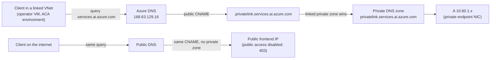

# Network and DNS troubleshooting

This is a field runbook for a private Foundry landing zone built from
[../infra](../infra/README.md). Use it when a deployment stalls, when a
capability host won't provision, or when an agent, tool or client can't
reach a private endpoint.

Work from the bottom of the stack up: name resolution first, then TCP and
TLS, then identity and RBAC, then the application. Most "Foundry is down"
reports in a private landing zone are DNS reports.

## Before you start

- Run every in-network check from the **private operator VM**
  ([../infra/private-operator.bicep](../infra/private-operator.bicep)) or
  another host whose VNet is linked to the private DNS zones. A laptop on the
  internet sees the public answers by design.
- Confirm the operator VNet is peered and linked:
  [../infra/operator-connectivity.bicep](../infra/operator-connectivity.bicep)
  creates both. Without the zone links the operator VM resolves public IPs
  and every check below fails the same way.
- Keep the output. The evidence checklist at the end of this runbook lists
  what support and the platform team need.

## Private DNS zones, FQDNs and private endpoint sub-resources

A private endpoint connects to one **sub-resource** (`groupId`) of a target
resource. Its DNS zone group writes A records into one or more
`privatelink.*` zones. The table lists every zone this landing zone uses, and
the common sub-resources you might add later.

| Service | Client FQDN | PE `groupId` | Private DNS zone | Created by |
|---------|-------------|--------------|------------------|------------|
| Foundry (AI Services account and projects) | `<account>.services.ai.azure.com` | `account` | `privatelink.services.ai.azure.com` | [private-foundry-project.bicep](../infra/private-foundry-project.bicep) |
| Azure OpenAI endpoints on the same account | `<account>.openai.azure.com` | `account` (same PE) | `privatelink.openai.azure.com` | private-foundry-project.bicep |
| Cognitive Services endpoints on the same account | `<account>.cognitiveservices.azure.com` | `account` (same PE) | `privatelink.cognitiveservices.azure.com` | private-foundry-project.bicep |
| Cosmos DB for NoSQL (thread storage) | `<cosmos>.documents.azure.com` and `<cosmos>-<region>.documents.azure.com` | `Sql` | `privatelink.documents.azure.com` | private-foundry-project.bicep |
| Storage blob (agent files) | `<storage>.blob.core.windows.net` | `blob` | `privatelink.blob.core.windows.net` | private-foundry-project.bicep |
| Storage file | `<storage>.file.core.windows.net` | `file` | `privatelink.file.core.windows.net` | Not created. Add if a workload needs it |
| Storage queue | `<storage>.queue.core.windows.net` | `queue` | `privatelink.queue.core.windows.net` | Not created |
| Storage table | `<storage>.table.core.windows.net` | `table` | `privatelink.table.core.windows.net` | Not created |
| AI Search (capability host vector store) | `<search>.search.windows.net` | `searchService` | `privatelink.search.windows.net` | private-foundry-project.bicep |
| AI Search (knowledge index) | `<search-kb>.search.windows.net` | `searchService` | `privatelink.search.windows.net` (reused) | [private-search.bicep](../infra/private-search.bicep) with `useExistingSearchZone: true` |
| Key Vault | `<vault>.vault.azure.net` | `vault` | `privatelink.vaultcore.azure.net` | [foundation.bicep](../infra/foundation.bicep) |
| Container Registry | `<registry>.azurecr.io` and `<registry>.<region>.data.azurecr.io` | `registry` | `privatelink.azurecr.io` | foundation.bicep |
| Container Apps, internal environment (this design) | `<app>.<defaultDomain>`, for example `crm-mcp.<unique>.<region>.azurecontainerapps.io` | None. The environment is VNet-injected | Zone named after `defaultDomain`, wildcard `*` A record to the environment static IP | [modules/environment-dns.bicep](../infra/modules/environment-dns.bicep) |
| Container Apps, public environment behind a PE (alternative) | `<app>.<unique>.<region>.azurecontainerapps.io` | `managedEnvironments` | `privatelink.<region>.azurecontainerapps.io` | Not used. Listed so you can recognize it |

Three details cause most mistakes:

1. **One Foundry PE, three zones.** The `account` sub-resource answers on
   three host names. If only `privatelink.services.ai.azure.com` has a record,
   the portal and agents work but SDK calls to `*.openai.azure.com` leak to the
   public endpoint and fail with `403`.
2. **Cosmos DB has regional names.** The zone group writes the global name and
   one record per region. A client that pins a regional endpoint needs that
   record too.
3. **ACR has a data endpoint.** `docker pull` resolves
   `<registry>.azurecr.io` for the manifest and
   `<registry>.<region>.data.azurecr.io` for layers. If the second name is
   public, pulls fail halfway with a timeout or `403`.

## How split-horizon resolution works here



Every client follows the same public CNAME into the `privatelink.` name. What
differs is the next step. A VNet linked to the private zone gets the private
endpoint IP. Everyone else gets the public frontend, which rejects the call
because `publicNetworkAccess` is `Disabled`.

## Split-horizon verification

### From the private operator VM (Linux)

```bash
ACCOUNT=contoso-ai          # Foundry account name
for h in "$ACCOUNT.services.ai.azure.com" "$ACCOUNT.openai.azure.com" \
         "$ACCOUNT.cognitiveservices.azure.com"; do
  dig +noall +answer "$h"
done
```

Expected output. Each chain ends in an A record in the private endpoint
subnet (`10.60.1.0/24` in the example parameters):

```text
contoso-ai.services.ai.azure.com.             60  IN CNAME contoso-ai.privatelink.services.ai.azure.com.
contoso-ai.privatelink.services.ai.azure.com. 10  IN A     10.60.1.4
```

Quick checks for the other stores:

```bash
getent ahostsv4 contoso-cosmos.documents.azure.com | head -1
getent ahostsv4 contosostore.blob.core.windows.net | head -1
getent ahostsv4 contoso-search.search.windows.net | head -1
getent ahostsv4 contoso-kv.vault.azure.net | head -1
getent ahostsv4 contosoacr.azurecr.io | head -1
getent ahostsv4 contosoacr.eastus2.data.azurecr.io | head -1
nslookup crm-mcp.<unique>.eastus2.azurecontainerapps.io   # wildcard A to the environment static IP
```

Every answer must start with `10.`. Use `getent` rather than `dig` when you
need to know what applications see, because it follows `/etc/hosts` and
`nsswitch.conf` like they do.

### From a Windows jump host or a VPN client

```powershell
$h = 'contoso-ai.services.ai.azure.com'
Resolve-DnsName $h -Type A | Format-Table Name, Type, IPAddress, NameHost
Resolve-DnsName $h -Type A -DnsOnly -NoHostsFile    # rule out a hosts-file override
Test-NetConnection $h -Port 443 | Select-Object RemoteAddress, TcpTestSucceeded
nslookup $h
```

`RemoteAddress` must be the private endpoint IP and `TcpTestSucceeded` must
be `True`. If `Resolve-DnsName` returns a private IP but `-NoHostsFile`
returns a public one, someone pinned the name in the hosts file. Remove the
entry and fix DNS forwarding instead.

### From the public internet (negative test)

```bash
dig @1.1.1.1 +noall +answer contoso-ai.services.ai.azure.com
curl -s -o /dev/null -w '%{http_code}\n' https://contoso-ai.services.ai.azure.com/
```

Expected: the CNAME chain ends in a **public** IP, and the HTTP call returns
`403` (public network access disabled). This proves the service isn't open.
It is not a fault.

### Reading the results

| Seen from inside the VNet | Likely cause | Fix |
|---------------------------|--------------|-----|
| Public IP | The zone isn't linked to this VNet, or the link isn't `Completed` | Deploy or re-run operator-connectivity.bicep. Check `az network private-dns link vnet list -g <rg> -z <zone> --query "[].{n:name,s:virtualNetworkLinkState}"` |
| Public IP, and the zone is linked | The VNet uses a custom DNS server that doesn't forward to `168.63.129.16` | Forward the public zones (for example `services.ai.azure.com`) to Azure DNS or to a DNS Private Resolver inbound endpoint |
| `NXDOMAIN` | The zone is linked but has no record for this name, so the private zone answers authoritatively | Recreate the PE zone group. Or, for zones you don't own, set the link's `resolutionPolicy` to `NxDomainRedirect` |
| Private IP that matches no PE | Stale A record from a deleted and recreated endpoint | Compare with `az network private-endpoint show ... --query "customDnsConfigs"`, then delete the stale record and redeploy |
| Correct IP, TCP fails | NSG, user-defined route or firewall on the path. Peering isn't `Connected` | Check peering state and effective routes on the client NIC |
| Correct IP, TCP works, TLS fails | The client used the `privatelink.` name or the raw IP, so the certificate name doesn't match | Always call the public FQDN. See the MCP TLS section below |

On-premises clients need a conditional forwarder for each **public** zone,
such as `services.ai.azure.com` or `blob.core.windows.net`, that points at a
DNS Private Resolver inbound endpoint in a linked VNet. Don't forward the
`privatelink.` zones alone. The client first asks for the public name.

## Capability host provisioning failures

The Agent Service runs on a **capability host**. In a network-isolated
standard setup there are two levels:

- **Account level** (`accountCapHost`). It binds the account to the
  customer agent subnet. In
  [private-foundry-project.bicep](../infra/private-foundry-project.bicep)
  this is the account's `networkInjections` entry (scenario `agent`,
  `useMicrosoftManagedNetwork: false`). Older samples create an explicit
  account capability host with `customerSubnet` instead.
- **Project level** (`projectCapHost`). The template names it `agents`. It
  binds the project to its BYO stores: `threadStorageConnections` (Cosmos DB),
  `storageConnections` (blob) and `vectorStoreConnections` (AI Search).

Check its state first:

```bash
PROJECT_ID=$(az deployment group show -g "$RG" -n "pfp-dev" --query properties.outputs.projectResourceId.value -o tsv)
az rest --method get \
  --url "https://management.azure.com${PROJECT_ID}/capabilityHosts/agents?api-version=2025-04-01-preview" \
  --query "{state:properties.provisioningState, threads:properties.threadStorageConnections, vector:properties.vectorStoreConnections, storage:properties.storageConnections}"
```

| Symptom or error text | Cause | Fix |
|-----------------------|-------|-----|
| `Subnet ... is not delegated` or `SubnetMissingRequiredDelegation` | The agent subnet isn't delegated to `Microsoft.App/environments` | Fix the subnet in the template and redeploy. Don't patch it in the portal: the subnet array is authoritative and the next deployment reverts manual changes |
| `InsufficientSubnetSize`, or agents fail under load | The delegated subnet is too small | Use a `/24` for the agent subnet. Treat it as the minimum: the platform reserves addresses and scales out inside it |
| `SubnetInUse`, or a service association link blocks delete | Another environment or an earlier account still holds the subnet | Use a dedicated subnet per account. After deleting an account, purge it (`az cognitiveservices account purge`) and wait for the link to clear |
| `Conflict`: a capability host already exists | Capability hosts can't be updated in place. A changed connection list counts as a new host | Delete and recreate, in the order below |
| Stuck in `Creating`, then `Failed` with a `403` from Cosmos DB, Storage or Search | The project identity lacks a role on a BYO store, or the role hasn't propagated yet | Check the role table below, then redeploy. The deterministic role assignment names make the rerun idempotent |
| `Failed` with a name resolution or timeout error | A BYO store's private DNS record is missing in the agent VNet | Run the split-horizon checks above for the Cosmos DB, blob and search names |
| Agent runs fail with `403` on `enterpriseMemory` or on blob containers after the host succeeded | The post-capability-host grants didn't run, or ran before the host existed | Redeploy the template. Phase 4 grants depend on the capability host |

### Deletion order for a stale capability host

Delete from the inside out. Deleting the account first strands the project
capability host and the subnet link:

1. Project capability host (`projectCapHost`, here `agents`).
2. Project.
3. Account capability host (`accountCapHost`), if you created one explicitly.
4. The account, if you're replacing it. Then purge it.

```bash
ACCOUNT_ID=$(az deployment group show -g "$RG" -n "pfp-dev" --query properties.outputs.accountResourceId.value -o tsv)
az rest --method delete --url "https://management.azure.com${PROJECT_ID}/capabilityHosts/agents?api-version=2025-04-01-preview"
# Wait until GET returns 404, then:
az rest --method delete --url "https://management.azure.com${PROJECT_ID}?api-version=2025-04-01-preview"
az rest --method get --url "https://management.azure.com${ACCOUNT_ID}/capabilityHosts?api-version=2025-04-01-preview" --query "value[].name"
```

Each delete is asynchronous. Poll for `404` before you start the next step.

### Required roles for the project identity

| Store | Role | Plane | When the template grants it |
|-------|------|-------|-----------------------------|
| Cosmos DB | Cosmos DB Operator (`230815da-be43-4aae-9cb4-875f7bd000aa`) | Control | Before the capability host |
| Cosmos DB | Cosmos DB Built-in Data Contributor (`00000000-0000-0000-0000-000000000002`), scoped to `/dbs/enterpriseMemory` | Data (SQL role) | After the capability host, which creates the database |
| Storage | Storage Blob Data Contributor | Data | Before the capability host |
| Storage | Storage Blob Data Owner, with an ABAC condition on the `<workspace-id>*-azureml-agent` containers | Data | After the capability host |
| AI Search | Search Index Data Contributor | Data | Before the capability host |
| AI Search | Search Service Contributor | Control | Before the capability host |

```bash
PRINCIPAL=$(az rest --method get --url "https://management.azure.com${PROJECT_ID}?api-version=2025-04-01-preview" --query identity.principalId -o tsv)
az role assignment list --assignee "$PRINCIPAL" --all --query "[].{role:roleDefinitionName, scope:scope}" -o table
az cosmosdb sql role assignment list -g "$RG" -a "<cosmos>" \
  --query "[?principalId=='$PRINCIPAL'].{role:roleDefinitionId, scope:scope}" -o table
```

Cosmos DB data-plane roles don't appear in `az role assignment list`. Use
the `cosmosdb sql role assignment` command for them.

## Private MCP server reachability

The MCP app from [private-mcp-server.bicep](../infra/private-mcp-server.bicep)
runs in an **internal** Container Apps environment. Its ingress is
`external: true`, which means "reachable from the VNet", not "reachable from
the internet". `allowInsecure` is `false`, so plain HTTP isn't served.

Baseline from the operator VM:

```bash
MCP=https://crm-mcp.<unique>.eastus2.azurecontainerapps.io/mcp
getent ahostsv4 "${MCP#https://}" | head -1          # environment static IP, 10.60.2.x
curl -sS -o /dev/null -w '%{http_code}\n' -X POST "$MCP" \
  -H 'content-type: application/json' -d '{}'       # expect 401: auth is required
```

A `401` here is the healthy answer. It proves DNS, routing, TLS and the auth
middleware all work.

| Response | Where it comes from | Likely cause | Fix |
|----------|---------------------|--------------|-----|
| Timeout | Network | The environment-DNS zone isn't linked to the caller's VNet, or the peering is down | Link the `defaultDomain` zone (environment-dns.bicep) and check peering |
| TLS error, `certificate name mismatch` or `SNI` | Envoy ingress | The caller used the static IP or a made-up host name. The environment serves a certificate for `*.<defaultDomain>` and routes by SNI | Call the app FQDN. To test a specific IP, keep SNI with `curl --resolve <fqdn>:443:<ip>` or `openssl s_client -connect <ip>:443 -servername <fqdn>` |
| `404` | Envoy or app | Wrong path (`/mcp` is required) or wrong app name | Use the `mcpEndpoint` output |
| `401` with a valid token | App | Wrong audience or tenant. `MCP_AUDIENCES` accepts `<api-client-id>` and `api://<api-client-id>` only | Request a token for the MCP API, not for Foundry or Graph |
| `403` | App | The token lacks `MCP_REQUIRED_SCOPE`, or the calling app isn't in `MCP_ALLOWED_APP_IDS` | Grant the delegated scope and add the agent's client ID |
| `421` (`Invalid Host header`) | App | The `Host` header isn't in `MCP_ALLOWED_HOSTS` (`<host>:*`). This blocks DNS rebinding | Call the real FQDN. Don't put a proxy in front that rewrites `Host` |
| `502`, `503` or `504` | Envoy | No healthy replica: crash loop, wrong target port, failing probe or an image pull failure | `az containerapp revision list -g "$RG" -n crm-mcp -o table` and `az containerapp logs show -g "$RG" -n crm-mcp --type system` |

Image pull failures mean the environment couldn't reach the registry.
Check the ACR names (including the `data` endpoint) from the environment
subnet, and check that the app's user-assigned identity has `AcrPull`.

## Bot Service and Microsoft 365 ingress

[managed-m365-bot.bicep](../infra/managed-m365-bot.bicep) creates a
single-tenant Azure Bot with the Teams channel. `publicNetworkAccess` is
`Disabled` and `disableLocalAuth` is `true` on the bot resource. These block
key-based Direct Line and Web Chat access, which this design doesn't use.
They don't change how the Teams channel delivers activities. Delivery to the
agent goes through the
[Microsoft 365 ingress exception](architecture.md#microsoft-365-ingress-exception).

```bash
az resource show -g "$RG" -n "<bot>" --resource-type Microsoft.BotService/botServices \
  --query "{endpoint:properties.endpoint, app:properties.msaAppId, type:properties.msaAppType, tenant:properties.msaAppTenantId, pna:properties.publicNetworkAccess}"
```

| Symptom | Check |
|---------|-------|
| No reply in Teams and no trace in Application Insights | The bot `endpoint` must equal the project's Activity endpoint, and the project's Microsoft 365 publishing setting must enable Activity-only ingress |
| Activity endpoint returns `401` | `msaAppId` and tenant must match the agent identity. With `BotServiceRbac`, Bot Service must hold the role the endpoint expects. `BotServiceTenant` needs an approved decision record |
| The app isn't visible to users | The administrator hasn't deployed the package yet. See [Stage 6](deployment-and-cicd.md#stage-6--microsoft-365-package-export-and-administrator-handoff) |
| Sign-in loops or consent prompts never finish | `webApplicationInfo` and the OAuth connection don't match. See [OAuth passthrough](oauth-passthrough-and-m365-publishing.md) |

## Evidence to collect before you escalate

- `dig` or `Resolve-DnsName` output for every failing name, from inside and
  outside the VNet.
- `az network private-endpoint-connection list --id <resource-id>` output
  (state must be `Approved`).
- Zone link states and peering state (`Connected`, `FullyInSync`).
- The deployment operation that failed:
  `az deployment operation group list -g "$RG" -n <deployment> --query "[?properties.provisioningState=='Failed']"`.
- Capability host state, plus the project identity's role list.
- For MCP issues, the HTTP status, `x-ms-request-id` or correlation ID, and
  the container app's system log for the same minute.

The reference pipeline
[foundation-deploy.yml](../infra/pipelines/foundation-deploy.yml) automates
most of these checks: endpoint approval, A-record resolution and the MCP
`401` probe.
