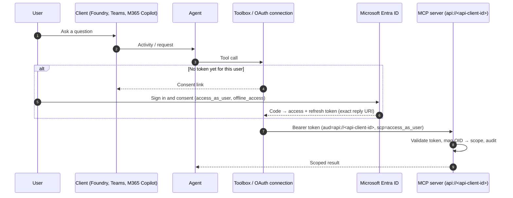

# OAuth identity passthrough and Microsoft 365 publishing

This guide connects a Foundry agent to an Entra-protected MCP server so that
the server sees the **signed-in user**, not a shared identity. The flow goes
from Foundry, Teams or Microsoft 365 Copilot through the Toolbox to the MCP
server. It also covers consent readiness for pilots, two-user isolation
testing, and how to configure MCP App widget rendering in Microsoft 365.



## The seven configuration steps

### 1. Expose the MCP API

On the API app registration (for example `contoso-crm-mcp-api`):

- Set the Application ID URI to `api://<api-client-id>`.
- Add a delegated scope `access_as_user` that admins and users can consent to.
- Configure the MCP server with the tenant ID, the audience
  `api://<api-client-id>` and the required scope `access_as_user`.

### 2. Create the client application and credential

Create a separate client registration (for example `contoso-crm-mcp-client`):

- Add the delegated API permissions `api://<api-client-id>/access_as_user`,
  `offline_access`, `openid` and `profile`.
- Create a client secret or certificate credential and store it in Key Vault.
  **Append** new credentials, and don't replace existing ones. Replacing a
  credential that a live connection uses breaks every user's token refresh.
- Record the credential's expiry date in the platform's rotation calendar.

### 3. Create the OAuth2 connection

In the Foundry project, create an MCP connection with OAuth2 identity
passthrough:

| Field | Value |
|-------|-------|
| MCP endpoint | `https://<mcp-app>.<environment-default-domain>/mcp` |
| Client ID / secret | From step 2 |
| Authorization URL | `https://login.microsoftonline.com/<tenant-id>/oauth2/v2.0/authorize` |
| Token URL | `https://login.microsoftonline.com/<tenant-id>/oauth2/v2.0/token` |
| Refresh URL | Same as the token URL |
| Scopes | `api://<api-client-id>/access_as_user offline_access` |

Without `offline_access`, users have to consent again whenever the access
token expires.

### 4. Register the exact reply URI

The service generates the connection's redirect URI. The reliable way to get
it is to **fail once on purpose**: start a consent flow, read the exact
`redirect_uri` from the Entra error, and add that value as a **Web** redirect
URI on the client registration. Don't guess or normalize it. Trailing
slashes, case and path segments all have to match.

### 5. Grant project roles to groups

Users need a role on the Foundry project to invoke the agent, for example
**Foundry Agent Consumer** (or the role your platform standardizes on).
Assign it to an Entra **group** such as `grp-contoso-revops-pilot`, not to
individuals, so pilots can be added and removed without changing RBAC.

### 6. Do the consent round trip

- Generate consent links per user. Each link is **single use**, so a link
  that has been used or forwarded won't work again.
- Open the link in a private or incognito browser window that is signed in
  as the target user, so an existing session for a different account isn't
  reused.
- Finish consent, then send the original request again.

### 7. Verify from the server audit log

A successful chat answer doesn't prove passthrough. Verify on the server:

- The audit entry for the tool call shows the **user's** object ID (OID),
  not the project or agent identity.
- A user with no business-scope mapping gets **no data**.
- Two users get different, correctly scoped results (see
  [Two-user isolation test](#two-user-isolation-test)).

## Client consent support

| Client | Interactive consent prompt |
|--------|----------------------------|
| Foundry agent playground | Supported |
| Your own custom client (web app or Hosted Agent front end) | Supported if the client shows the consent link to the user |
| Microsoft 365 / Teams declarative package | Not established. Pre-consent pilot users before the demo |

## Presenter and pilot readiness

Before a demo or pilot session:

- [ ] Each presenter and pilot account is in the project role group.
- [ ] Each account has finished consent in the playground or a custom client
      within the refresh-token lifetime.
- [ ] Each account has a business-scope mapping, and one deliberately
      unmapped account exists for the negative test.
- [ ] The client credential won't expire during the pilot.
- [ ] The MCP server audit log is open and filtered to the tool.
- [ ] Fresh consent links are ready to send, and none have been used.

## Two-user isolation test

| Step | User A (mapped to `ACC-1041`) | User B (mapped to a different account) | User C (unmapped) |
|------|-------------------------------|----------------------------------------|-------------------|
| Ask "Summarize my account" | Gets `ACC-1041` only | Gets their own account only | Gets no account data |
| Ask about the other user's account | Refused or no data | Refused or no data | Refused or no data |
| Audit log | User A's OID | User B's OID | User C's OID, outcome `unmapped` |

Run the test in each client the pilot uses. Passing in the playground doesn't
prove Teams or Microsoft 365 Copilot.

## Troubleshooting

| Symptom | Likely cause | Fix |
|---------|--------------|-----|
| `AADSTS50011` reply URL mismatch | The registered redirect URI isn't exactly the one the service uses | Copy the URI from the error (step 4) |
| Consent link fails or loops | The link was reused or opened in a session for another account | Generate a new link and open it in a private window |
| Answer works but has no data | No business-scope mapping for the user's OID | Add the mapping. Don't fall back to a shared identity |
| Works for one user only | The other user lacks the project role or hasn't consented | Add them to the role group and finish consent |
| Stops working after days | `offline_access` is missing, or the client credential expired or was replaced | Add the scope, rotate by appending a credential |
| HTTP 401 from the MCP server | Wrong audience or missing `access_as_user` scope | Check the connection scopes and the server's audience setting |

## Publishing to Microsoft 365

1. Publish the agent version from the private project. The project keeps
   `publicNetworkAccess: 'Disabled'`. Only Azure Bot Service's Activity-only
   ingress is enabled (see [architecture](architecture.md#microsoft-365-ingress-exception)).
2. Keep the endpoint authorization at `BotServiceRbac` for pilots, so only
   members of the project role group can invoke the agent.
3. Export the package and hand it off as described in
   [deployment-and-cicd.md](deployment-and-cicd.md#stage-6--microsoft-365-package-export-and-administrator-handoff).

## Bot Service OAuth connection step by step

[`managed-m365-bot.bicep`](../infra/managed-m365-bot.bicep) creates the Azure
Bot resource and its channels. It doesn't create an OAuth connection setting.
Whether you need one depends on who handles the Teams activity.

| Route | Who handles the activity | Where the MCP user token comes from | Bot Service OAuth connection |
|-------|--------------------------|-------------------------------------|------------------------------|
| A. Foundry-managed (default) | The Foundry Activity Protocol endpoint of the published agent application. `msaAppId` is the published agent identity | The Toolbox OAuth identity passthrough connection ([seven steps](#the-seven-configuration-steps)) | Not needed. Pre-consent pilot users |
| B. Bot Service single sign-on (SSO) | Your hosted agent code (for example built on the Microsoft 365 Agents SDK) handles the `signin/tokenExchange` invoke | The Bot Framework token service exchanges the Teams SSO token on behalf of the user | Required. Configure it as described below |

Choose route B only when both of these are true:

- The bot's `msaAppId` is an app registration you control. You must be able
  to expose an API on it, add a redirect URI and add a credential.
- Your hosted agent code processes the token exchange invoke and calls the
  user token API. Prove this in the target tenant before a pilot.

In route B, one app ID appears in four places: the template's `agentClientId`
(the bot `msaAppId`), the OAuth connection's client ID, the manifest's
`webApplicationInfo.id` and the MCP server's `MCP_ALLOWED_APP_IDS`.

### Step 1. Prepare the bot app registration

On the app registration that `agentClientId` points to (for example
`contoso-crm-agent-bot`):

1. **Supported account types:** single tenant. This matches
   `msaAppType: 'SingleTenant'` in the template.
2. **Expose an API:** set the Application ID URI to `api://botid-<bot-app-id>`.
   Teams uses this form for bot SSO.
3. **Add a scope:** add the delegated scope `access_as_user` that admins and
   users can consent to.
4. **Pre-authorize the Teams clients** for `access_as_user`, so Teams can get
   the SSO token without a prompt:

   | Client | Client ID |
   |--------|-----------|
   | Teams desktop and mobile | `1fec8e78-bce4-4aaf-ab1b-5451cc387264` |
   | Teams web | `5e3ce6c0-2b1f-4285-8d4b-75ee78787346` |

   For Microsoft 365 Copilot, Outlook and the Microsoft 365 app, add the
   client IDs that the Teams SSO documentation lists for those hosts.
5. **API permissions:** add the delegated permissions
   `api://<api-client-id>/access_as_user` (the MCP API), `openid`, `profile`
   and `offline_access`. Grant admin consent for the pilot tenant. Without
   consent, the exchange fails with `AADSTS65001` and the user sees a sign-in
   card instead of SSO.
6. **Authentication:** add the **Web** redirect URI
   `https://token.botframework.com/.auth/web/redirect`. A bot that uses a
   regional token service uses that region's host instead, for example
   `https://europe.token.botframework.com/.auth/web/redirect`.
7. **Credential:** create a client secret, store it in Key Vault and record
   its expiry. As with the MCP client, **append** new credentials and don't
   replace existing ones. If you don't want a secret, use the provider's
   federated credential variant (step 2).

### Step 2. Create the OAuth connection setting

In the portal, open the Bot resource and go to **Settings** >
**Configuration** > **Add OAuth Connection Settings**.

| Field | Value | Notes |
|-------|-------|-------|
| Name | `crm-mcp-sso` | The agent code refers to the connection by this name. Treat it as configuration |
| Service Provider | **Azure Active Directory v2** (`Aadv2`) | Choose the federated credentials variant of this provider to avoid a secret |
| Client id | `<bot-app-id>` | The same app as `msaAppId` and `webApplicationInfo.id` |
| Client secret | From Key Vault | Not used by the federated credentials variant |
| Token Exchange URL | `api://botid-<bot-app-id>` | Must equal the Application ID URI from step 1 exactly. If it's empty, SSO is off and every user gets a sign-in card |
| Tenant ID | `<tenant-id>` | Never `common` for a single-tenant bot |
| Scopes | `api://<api-client-id>/access_as_user offline_access openid profile` | The resulting user token's audience is the MCP API, not the bot |

The same setting from the CLI. List the provider first and use the exact
parameter key names it returns:

```bash
az bot authsetting list-providers --provider-name Aadv2

SECRET=$(az keyvault secret show --vault-name <vault> \
  --name bot-oauth-client-secret --query value -o tsv)

az bot authsetting create \
  --resource-group <rg> --name <bot-name> \
  --setting-name crm-mcp-sso \
  --service Aadv2 \
  --client-id <bot-app-id> \
  --client-secret "$SECRET" \
  --provider-scope-string "api://<api-client-id>/access_as_user offline_access openid profile" \
  --parameters tenantId=<tenant-id> tokenExchangeUrl=api://botid-<bot-app-id>

az bot authsetting show --resource-group <rg> --name <bot-name> \
  --setting-name crm-mcp-sso -o jsonc
```

Run this from a pipeline step that reads the secret from Key Vault. Don't
paste the secret into a terminal history or a parameters file.

### Step 3. Test the connection and read the claims

1. On the connection setting, select **Test Connection** and sign in as a
   pilot user.
2. Copy the token and decode it **locally**. Don't paste production tokens
   into third-party websites.
3. Check the claims:

   | Claim | Expected value |
   |-------|----------------|
   | `aud` | `api://<api-client-id>` or `<api-client-id>`, depending on the API's token version. `MCP_AUDIENCES` lists both |
   | `scp` | Contains `access_as_user` |
   | `tid` | `<tenant-id>`, which is in `MCP_ALLOWED_TENANTS` |
   | `azp` (v2) or `appid` (v1) | `<bot-app-id>`, which must be in `MCP_ALLOWED_APP_IDS` |
   | `oid` | The pilot user's object ID, which the MCP server maps to a business scope |

If `azp` shows the bot app but the MCP server returns HTTP 403, the bot app ID
is missing from `MCP_ALLOWED_APP_IDS`. Add it, and don't disable the check.

### Step 4. Add `webApplicationInfo`, `bots` and `validDomains` to the manifest

The release pipeline builds the Teams package from `manifest.template.json`
and replaces the `${{VAR}}` tokens (see
[agent-release-and-package.yml](../infra/pipelines/agent-release-and-package.yml)).
The SSO-relevant fragment:

```json
{
  "bots": [
    {
      "botId": "${{BOT_APP_ID}}",
      "scopes": ["personal"],
      "supportsFiles": false,
      "isNotificationOnly": false
    }
  ],
  "webApplicationInfo": {
    "id": "${{BOT_APP_ID}}",
    "resource": "api://botid-${{BOT_APP_ID}}"
  },
  "validDomains": ["token.botframework.com"]
}
```

- `webApplicationInfo.id` is the bot app ID. `resource` is the Application
  ID URI, and it must match the connection's **Token Exchange URL** exactly.
- `validDomains` includes `token.botframework.com`, so the sign-in card
  fallback can open. Don't add the MCP host or `*.azurecontainerapps.io`.
  The MCP server is private and Teams never calls it.
- Start with the `personal` scope for pilots. Team and group chat scopes
  bring in other users, and each user still needs their own token.
- `atk validate` checks the schema but not that the values agree. The
  pipeline's Bot verify step checks that `msaAppId` matches `BOT_APP_ID`.

### Step 5. Handle the exchange in the agent code

| Event | What the agent does |
|-------|---------------------|
| First message from a user | Ask the token service for a user token for `crm-mcp-sso`. If there's none, send an OAuth card whose token exchange resource is `api://botid-<bot-app-id>` |
| `signin/tokenExchange` invoke | Exchange the Teams SSO token through the token service. Return HTTP 200 on success, or HTTP 412 so Teams shows the sign-in card |
| Duplicate invoke | Teams can send the same exchange more than once. Deduplicate by the invoke's ID and answer each duplicate once |
| Later turns | Ask the token service again. It caches and refreshes the token, so the agent doesn't store tokens |
| Sign-out | Call the sign-out API for `crm-mcp-sso`. This removes the user's token from the token service |

## MCP App widget renderer origin

When an MCP server returns UI resources (MCP Apps), Microsoft 365 Copilot
renders them in a sandboxed origin of the form
`https://{hashed-mcp-domain}.widget-renderer.usercontent.microsoft.com`. The
widget then calls back to your MCP server from that origin.

- **Treat the origin as configuration, never compute it.** Get the value from
  Microsoft's generator for your **exact** MCP host name. The way it's derived
  isn't documented and may change.
- **Configure exact origins only:** scheme + host + optional port. Reject an
  empty value, `null`, wildcards, paths, query strings, embedded credentials,
  and `http://` for anything other than loopback.
- **Add it in two places.** Add the origin to the MCP transport's allowed
  origins **and** to the CORS allow-list. Both use exact string matching. Add
  loopback development origins to allowed origins only, never to CORS.
- **Symptoms of a wrong value:** HTTP 421, a CORS-blocked response, or a widget
  that renders blank.
- **Readiness check:** the server should warn at startup when widget tools
  are enabled but no renderer origin is configured.

Widgets use the MCP Apps UI-resource and host-bridge contract, not Bot
Framework Adaptive Card activities. Whether a callback is visible to the
widget is only a routing hint. Every callback still goes through the same
token, scope and principal validation as a tool call. Rendering in a local
reference host doesn't prove that the widget will render in a Microsoft 365
tenant, so test in the target tenant with a pilot account.
