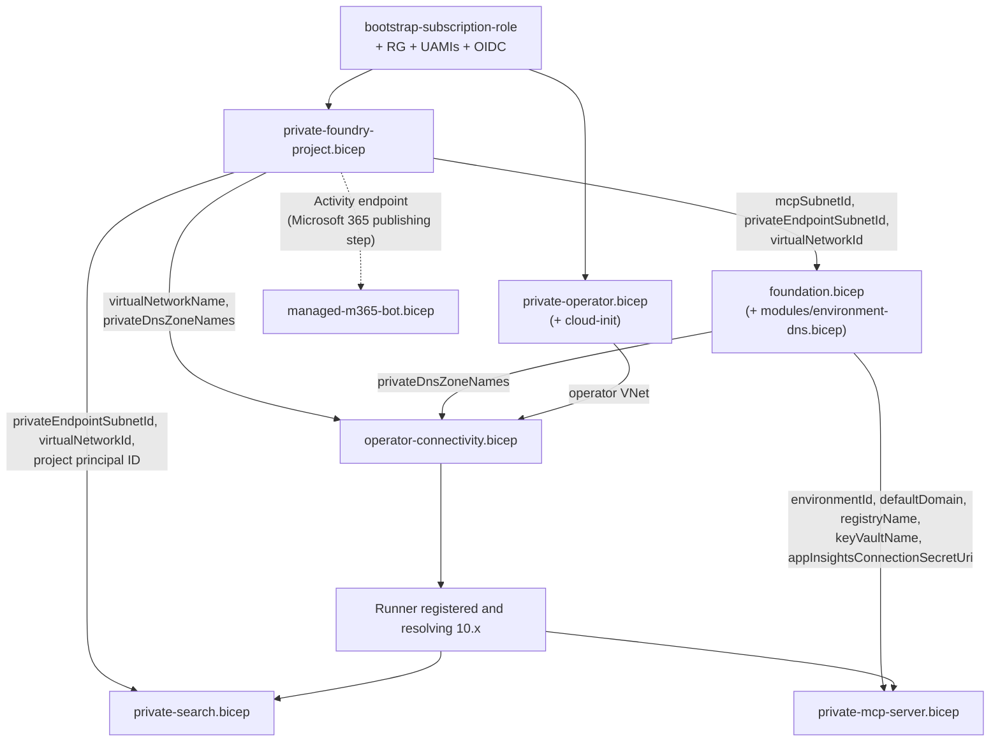

# Infrastructure templates

Sanitized Bicep reference templates for the Stage 2 private-by-default landing
zone. They are **starting points for review**, not a turnkey production
deployment: integrate them with your organization's hub-and-spoke topology,
DNS ownership, egress firewall, and policy assignments before use.

All templates use `targetScope = 'resourceGroup'` and compile with
`az bicep build` with no errors. Every data-plane endpoint is private. The
only public ingress is the scoped Microsoft 365 Activity exception described
in [../docs/architecture.md](../docs/architecture.md#microsoft-365-ingress-exception).

## What's in this folder

| File | Lifecycle | Deployed by | Purpose |
|------|-----------|-------------|---------|
| [`private-foundry-project.bicep`](./private-foundry-project.bicep) | Platform foundation | Foundation UAMI | Foundation VNet (agent, private endpoint and MCP subnets), private Foundry account (`publicNetworkAccess: 'Disabled'`, `disableLocalAuth: true`), project, model deployment, agent subnet injection, BYO AI Search, Storage and Cosmos DB, private endpoints, private DNS zones, project connections, the `agents` capability host, and role assignments for the project identity. It can also grant the release identity a project-scoped `Foundry User` role |
| [`foundation.bicep`](./foundation.bicep) | Platform foundation | Foundation UAMI | Shared tool-hosting state: ACR (`adminUserEnabled: false`), Log Analytics, Application Insights (connection string written straight to Key Vault), RBAC-enabled Key Vault, and a Container Apps environment that outputs a deterministic `defaultDomain`. With `secureNetworking: true` the environment is internal, and Key Vault, ACR and the environment domain resolve privately |
| [`modules/environment-dns.bicep`](./modules/environment-dns.bicep) | Platform foundation | Called by `foundation.bicep` | Private DNS zone named after the environment's `defaultDomain`, with a wildcard A record to the environment's static IP |
| [`operator-connectivity.bicep`](./operator-connectivity.bicep) | Platform foundation | Foundation UAMI | Bidirectional peering between the foundation VNet and the operator VNet, plus explicit private DNS zone links for the operator VNet |
| [`private-operator.bicep`](./private-operator.bicep) | Platform foundation (one time) | Bootstrap operator or foundation UAMI | Separate operator VNet behind a NAT gateway, and a Trusted Launch Linux VM with no public IP, an inbound deny-all NSG and SSH-key-only sign-in. It hosts the self-hosted GitHub runner |
| [`private-operator-cloud-init.yaml`](./private-operator-cloud-init.yaml) | Platform foundation | Loaded by `private-operator.bicep` as `customData` | Installs Docker, Azure CLI and Bicep, and downloads a pinned GitHub runner release that it verifies with `sha256sum -c`. It does **not** register the runner, so no registration token ever sits in a template |
| [`private-search.bicep`](./private-search.bicep) | Platform foundation | Foundation UAMI, from the private runner | Knowledge AI Search service with public access and key auth disabled, a private endpoint in the existing `privatelink.search.windows.net` zone, and `Search Index Data Reader` for the project identity (write roles only with `grantIndexWrite`) |
| [`private-mcp-server.bicep`](./private-mcp-server.bicep) | Platform first, then application release | Foundation UAMI first. Later releases change only the image | Container App MCP server in the internal environment. It pulls with a user-assigned identity, resolves secrets from Key Vault, enforces Entra bearer validation and derives `MCP_ALLOWED_HOSTS` |
| [`managed-m365-bot.bicep`](./managed-m365-bot.bicep) | Microsoft 365 publishing | Foundation UAMI, after the Activity endpoint exists | Single-tenant Azure Bot (`publicNetworkAccess: 'Disabled'`, `disableLocalAuth: true`) with the Teams channel and an optional Microsoft 365 extensions channel, pointed at the project's Activity endpoint |
| [`bootstrap-subscription-role.example.json`](./bootstrap-subscription-role.example.json) | Bootstrap | Bootstrap operator | Custom subscription role for the foundation UAMI: read the subscription, check provider registration, and create, validate and what-if deployments. No resource write, delete or role assignment rights |
| [`parameters.example.json`](./parameters.example.json) | All | Operator | One section per template. Required values are blank so deployment fails closed until someone populates them |
| [`pipelines/foundation-deploy.yml`](./pipelines/foundation-deploy.yml) | Platform foundation | GitHub environments `platform-<env>` | Reference workflow: lint and preflight, platform deployment, then private deployment and in-network assertions |
| [`pipelines/agent-release-and-package.yml`](./pipelines/agent-release-and-package.yml) | Application release and Microsoft 365 handoff | GitHub environments `release-<env>` | Reference workflow: build once, evaluation and security gate, staging canary and package, production approval with a rollback hook |

## Dependency graph



Solid arrows are deployment outputs passed as parameters. The dotted arrow is
a data-plane step: you enable the project's Microsoft 365 publishing setting,
then pass the Activity endpoint it returns to the bot template.

| Output | From | Feeds |
|--------|------|-------|
| `mcpSubnetId` | private-foundry-project | `foundation.containerAppsSubnetId` |
| `privateEndpointSubnetId`, `virtualNetworkId` | private-foundry-project | `foundation`, `private-search` |
| `virtualNetworkName` | private-foundry-project | `operator-connectivity.foundationVnetName` |
| `privateDnsZoneNames` | private-foundry-project and foundation | `operator-connectivity.privateDnsZoneNames` (union of both lists) |
| Project `identity.principalId` (read with `az rest`) | private-foundry-project | `private-search.projectPrincipalId` |
| `environmentId`, `environmentDefaultDomain`, `registryName`, `keyVaultName`, `appInsightsConnectionSecretUri` | foundation | `private-mcp-server` |
| `mcpEndpoint` | private-mcp-server | Project MCP connection or Toolbox registration (data plane) |

## Step-by-step deployment

| Step | Template or action | Runs from | Identity |
|------|--------------------|-----------|----------|
| 0 | Bootstrap role, resource groups, UAMIs, OIDC | Administrator workstation | Subscription Owner (one time) |
| 1 | `private-operator.bicep` | Administrator workstation or hosted runner | Bootstrap operator or foundation UAMI |
| 2 | `private-foundry-project.bicep` | Hosted runner (control plane only) | Foundation UAMI |
| 3 | `foundation.bicep` | Hosted runner | Foundation UAMI |
| 4 | `operator-connectivity.bicep` | Hosted runner | Foundation UAMI |
| 5 | Register the runner, verify private DNS | `az vm run-command` | Bootstrap operator |
| 6 | `private-search.bicep` | Private runner | Foundation UAMI |
| 7 | `private-mcp-server.bicep`, release grants | Private runner | Foundation UAMI |
| 8 | `managed-m365-bot.bicep` | Private runner, after publishing | Foundation UAMI |

[`pipelines/foundation-deploy.yml`](./pipelines/foundation-deploy.yml)
automates steps 2–4 and 6–8. Steps 0, 1 and 5 are deliberately manual. The
commands below show the same sequence by hand. Run `az deployment group
what-if` with the same inputs before every `create`, and review the plan.

### 0. Bootstrap (once per subscription and environment)

Keep the UAMIs in a separate identity resource group. The foundation UAMI
must not hold rights on that resource group, or it could add federated
credentials to itself.

```bash
SUB=<subscription-id>; LOC=<region>; ENV=dev
RG=<workload-resource-group>; RG_ID=<identity-resource-group>
mkdir -p .local
az account set -s "$SUB"
sed -e "s/<subscription-id>/$SUB/" -e "s/<scope-name>/$ENV/" \
  infra/bootstrap-subscription-role.example.json > .local/bootstrap-role.json
az role definition create --role-definition @.local/bootstrap-role.json
az group create -n "$RG" -l "$LOC"; az group create -n "$RG_ID" -l "$LOC"
for u in foundation release; do az identity create -g "$RG_ID" -n "uami-$u-$ENV" -o none; done
FND=$(az identity show -g "$RG_ID" -n "uami-foundation-$ENV" --query principalId -o tsv)
REL=$(az identity show -g "$RG_ID" -n "uami-release-$ENV" --query principalId -o tsv)
RGID=$(az group show -n "$RG" --query id -o tsv)
az role assignment create --assignee-object-id "$FND" --assignee-principal-type ServicePrincipal \
  --role "Landing zone subscription deployment operator ($ENV)" --scope "/subscriptions/$SUB"
for r in Contributor "Role Based Access Control Administrator"; do
  az role assignment create --assignee-object-id "$FND" --assignee-principal-type ServicePrincipal \
    --role "$r" --scope "$RGID"
done
az role assignment create --assignee-object-id "$REL" --assignee-principal-type ServicePrincipal \
  --role Reader --scope "$RGID"
az identity federated-credential create -g "$RG_ID" --identity-name "uami-foundation-$ENV" \
  -n "gh-platform-$ENV" --issuer https://token.actions.githubusercontent.com \
  --subject "repo:<owner>/<repo>:environment:platform-$ENV" --audiences api://AzureADTokenExchange
az identity federated-credential create -g "$RG_ID" --identity-name "uami-release-$ENV" \
  -n "gh-release-$ENV" --issuer https://token.actions.githubusercontent.com \
  --subject "repo:<owner>/<repo>:environment:release-$ENV" --audiences api://AzureADTokenExchange
for s in privateOperator privateFoundryProject foundation operatorConnectivity \
         privateSearch privateMcpServer managedM365Bot; do
  jq ".$s" infra/parameters.example.json > ".local/$s.parameters.json"
done
# Populate every blank value in .local/*.parameters.json. Never commit them.
```

Constrain the `Role Based Access Control Administrator` assignment with a
condition that lists only the roles these templates assign. Register the
providers the preflight job checks (`Microsoft.CognitiveServices`,
`Microsoft.App`, `Microsoft.Network`, `Microsoft.Search`,
`Microsoft.DocumentDB`, `Microsoft.Storage`, `Microsoft.KeyVault`,
`Microsoft.ContainerRegistry`, `Microsoft.BotService`) now; the custom role
cannot register them.

### 1. Operator VNet and runner VM

```bash
az deployment group create -g "$RG" -n "operator-$ENV" -f infra/private-operator.bicep \
  -p @.local/privateOperator.parameters.json adminPublicKey=@"$HOME/.ssh/runner.pub"
OPVNET=$(az deployment group show -g "$RG" -n "operator-$ENV" \
  --query properties.outputs.operatorVnetName.value -o tsv)
```

The VM has a system-assigned identity with **no** roles. The pipeline signs
in with OIDC on every job instead, so a compromised VM holds no standing
Azure rights.

### 2. Private Foundry account and project (30–75 minutes)

```bash
az deployment group create -g "$RG" -n "pfp-$ENV" -f infra/private-foundry-project.bicep \
  -p @.local/privateFoundryProject.parameters.json releasePrincipalId="$REL"
pfp=$(az deployment group show -g "$RG" -n "pfp-$ENV" --query properties.outputs -o json)
```

A client-side timeout does not cancel an ARM deployment. Run
`az deployment group show -g "$RG" -n "pfp-$ENV" --query properties.provisioningState`
before you retry. Most failures here are capability host failures; see
[../docs/network-and-dns-troubleshooting.md](../docs/network-and-dns-troubleshooting.md).

### 3. Tool-hosting foundation

```bash
az deployment group create -g "$RG" -n "foundation-$ENV" -f infra/foundation.bicep \
  -p @.local/foundation.parameters.json \
  containerAppsSubnetId="$(jq -r .mcpSubnetId.value <<<"$pfp")" \
  privateEndpointSubnetId="$(jq -r .privateEndpointSubnetId.value <<<"$pfp")" \
  virtualNetworkId="$(jq -r .virtualNetworkId.value <<<"$pfp")"
fnd=$(az deployment group show -g "$RG" -n "foundation-$ENV" --query properties.outputs -o json)
```

### 4. Operator connectivity

```bash
zones=$(jq -cn --argjson a "$pfp" --argjson b "$fnd" \
  '$a.privateDnsZoneNames.value + $b.privateDnsZoneNames.value | unique')
az deployment group create -g "$RG" -n "connectivity-$ENV" -f infra/operator-connectivity.bicep \
  -p name="lz-$ENV" foundationVnetName="$(jq -r .virtualNetworkName.value <<<"$pfp")" \
  operatorVnetName="$OPVNET" privateDnsZoneNames="$zones"
```

### 5. Register the runner and prove private resolution

The NSG denies all inbound traffic, so use Run Command rather than SSH.
Registration tokens expire after one hour and never appear in a template.

```bash
TOKEN=$(gh api -X POST repos/<owner>/<repo>/actions/runners/registration-token --jq .token)
az vm run-command invoke -g "$RG" -n "<name>-runner" --command-id RunShellScript --scripts "
  cd /home/runner/actions-runner &&
  sudo -u runner ./config.sh --unattended --replace --url https://github.com/<owner>/<repo> \
    --token $TOKEN --name lz-$ENV-runner --labels foundry-private-operator,$ENV &&
  ./svc.sh install runner && ./svc.sh start"
az vm run-command invoke -g "$RG" -n "<name>-runner" --command-id RunShellScript \
  --scripts "getent hosts $(jq -r .accountName.value <<<"$pfp").services.ai.azure.com"
```

The second command must return a `10.60.1.x` address. If it returns a public
address, stop and fix DNS before step 6.

### 6–8. Private data-plane resources (from the private runner)

```bash
principal=$(az rest --method get \
  --url "https://management.azure.com$(jq -r .projectResourceId.value <<<"$pfp")?api-version=2025-04-01-preview" \
  --query identity.principalId -o tsv)
az deployment group create -g "$RG" -n "search-$ENV" -f infra/private-search.bicep \
  -p @.local/privateSearch.parameters.json projectPrincipalId="$principal" \
  privateEndpointSubnetId="$(jq -r .privateEndpointSubnetId.value <<<"$pfp")" \
  virtualNetworkId="$(jq -r .virtualNetworkId.value <<<"$pfp")"

# Push the first image from this runner (the registry is private), then pin its digest.
az deployment group create -g "$RG" -n "mcp-$ENV" -f infra/private-mcp-server.bicep \
  -p @.local/privateMcpServer.parameters.json \
  environmentId="$(jq -r .environmentId.value <<<"$fnd")" \
  environmentDefaultDomain="$(jq -r .environmentDefaultDomain.value <<<"$fnd")" \
  registryName="$(jq -r .registryName.value <<<"$fnd")" \
  keyVaultName="$(jq -r .keyVaultName.value <<<"$fnd")" \
  appInsightsConnectionSecretUri="$(jq -r .appInsightsConnectionSecretUri.value <<<"$fnd")"

# Release identity: push images and update this one container app only.
ACR_ID=$(az acr show -n "$(jq -r .registryName.value <<<"$fnd")" --query id -o tsv)
APP_ID=$(az containerapp show -g "$RG" -n <mcp-app-name> --query id -o tsv)
az role assignment create --assignee-object-id "$REL" --assignee-principal-type ServicePrincipal --role AcrPush --scope "$ACR_ID"
az role assignment create --assignee-object-id "$REL" --assignee-principal-type ServicePrincipal --role Contributor --scope "$APP_ID"

# Only after the agent is published and the Activity endpoint exists.
az deployment group create -g "$RG" -n "bot-$ENV" -f infra/managed-m365-bot.bicep \
  -p @.local/managedM365Bot.parameters.json \
  activityEndpoint="<activity-endpoint>" agentClientId="<agent-client-id>"
```

An unauthenticated `curl` to the `mcpEndpoint` output from the runner must
return `401`. A timeout, a TLS error or `200` is a failure.

## Parameters that matter

| Parameter | Template | Guidance |
|-----------|----------|----------|
| `name` | all | Short lowercase workload prefix (3–12 characters), for example `contoso` |
| `projectName` | private-foundry-project | Foundry project, for example `revops-agent` |
| `modelName`, `modelVersion`, `modelSkuName`, `modelCapacity` | private-foundry-project | Confirm regional availability and quota first; `modelName` is also the deployment name |
| `*Prefix` | private-foundry-project | Check against every peered network; the agent and MCP subnets are delegated to `Microsoft.App/environments` |
| `releasePrincipalId` | private-foundry-project | Principal (object) id of the release UAMI; receives only project-scoped `Foundry User` |
| `secureNetworking` | foundation | `true` for Stage 2. `false` gives the Stage 1 public-HTTPS profile (still Entra-authenticated) |
| `useExistingKeyVaultZone` | foundation | `true` if `privatelink.vaultcore.azure.net` already exists in the resource group |
| `enablePurgeProtection` | foundation | Keep `true` outside disposable labs; it cannot be disabled later |
| `image` | private-mcp-server | Pin by digest (`@sha256:`), never a mutable tag |
| `tenantId`, `apiClientId`, `requiredScope` | private-mcp-server | The Entra app registration that exposes the MCP API and its delegated scope |
| `allowedAppIds` | private-mcp-server | Only for an approved agent/service identity; it must still resolve to a business scope |
| `minReplicas`, `maxReplicas` | private-mcp-server | Keep `minReplicas` at 1 or more so the first agent call does not hit a cold start |
| `operatorVnetPrefix`, `runnerSubnetPrefix` | private-operator | Must not overlap the foundation VNet of **any** environment the runner peers with (default `10.70.0.0/16`) |
| `vmSize`, `zone`, `imageVersion` | private-operator | Pin `imageVersion` in production so a rebuild is reproducible |
| `adminPublicKey` | private-operator | Pass at deploy time with `adminPublicKey=@<file>`; never store it in a parameter file |
| `createVirtualNetwork` | private-operator | `false` reuses an existing operator VNet, for example one shared runner subnet per environment |
| `useExistingSearchZone` | private-search | Keep `true`: `private-foundry-project.bicep` already created `privatelink.search.windows.net` in the resource group |
| `projectPrincipalId` | private-search | The project's system-assigned identity, read after step 2 |
| `grantIndexWrite` | private-search | `true` only if the agent itself writes to the knowledge index; ingestion should normally use a separate identity |
| `sku`, `replicaCount`, `partitionCount`, `semanticSearch` | private-search | Private endpoints need `basic` or higher; use two or more replicas for read availability in production |
| `activityEndpoint` | managed-m365-bot | The Activity endpoint returned when you publish the agent to Microsoft 365 |
| `agentClientId`, `tenantId` | managed-m365-bot | The agent's Entra application (client) ID and your tenant. The bot is single-tenant |
| `enableTeamsChannel`, `enableM365ExtensionChannel` | managed-m365-bot | Turn on only the channels your administrator approved |

The `MCP_*` environment variables in `private-mcp-server.bicep` illustrate the
contract a governed MCP server should honor. Rename them to match your server.

## CI/CD reference pipelines

Both workflows are reference material. Copy them into `.github/workflows/`
of the repository that owns the landing zone or the agent, set the repository
or environment **variables** each header lists, and keep every value out of
secrets except what truly is secret. Neither workflow stores a client secret:
both sign in with `azure/login@v2` and OpenID Connect.

| Workflow | Jobs | Runner | GitHub environment |
|----------|------|--------|--------------------|
| [`foundation-deploy.yml`](./pipelines/foundation-deploy.yml) | `lint` → `preflight` → `platform` → `private` | `ubuntu-latest` for the first three; `[self-hosted, foundry-private-operator]` for `private` | `platform-<env>`, with required reviewers for `test` and `prod` |
| [`agent-release-and-package.yml`](./pipelines/agent-release-and-package.yml) | `build` → `evaluate` → `staging` → `prod` | `[self-hosted, foundry-private-operator, <env>]` for every job | `release-dev`, `release-test`, `release-staging`, `release-prod` (approval gate) |

`foundation-deploy.yml` runs `private-foundry-project`, `foundation` and
`operator-connectivity` on a hosted runner. They only call Azure Resource
Manager, and later templates need their outputs. Only `private-search`,
`private-mcp-server`, `managed-m365-bot` and the private DNS and endpoint
assertions run on the self-hosted runner, because they must resolve
`privatelink` names to `10.x` addresses.

`agent-release-and-package.yml` builds the image once and promotes the same
digest. It never redeploys a Bicep template; it updates the agent version and
the MCP container app revision only. That keeps the release identity
inside the rights listed in step 7.

See [../docs/deployment-and-cicd.md](../docs/deployment-and-cicd.md) for the
identity model, runner architecture and rollback procedures.

## What these templates do not do

- Configure an egress firewall. Private ingress is not closed egress. The
  operator VNet uses a NAT gateway; route it through your hub firewall if
  your policy requires it.
- Create bootstrap identities, OIDC federated credentials or the custom
  role. Step 0 does that by hand, because it needs subscription-level rights
  that no pipeline should hold.
- Register the GitHub runner. `private-operator-cloud-init.yaml` installs
  and verifies the runner binaries only; step 5 registers it.
- Register Foundry Toolbox entries, project MCP connections, RAI policies, or
  publish the agent to Microsoft 365. Those are data-plane steps. The bot
  template only consumes the Activity endpoint that publishing returns.
- Provide automated teardown. Delete in this order: project capability host,
  project, account capability host, account (then purge), and only then the
  subnets. See
  [the deletion order](../docs/network-and-dns-troubleshooting.md).

## Validate locally

```bash
for f in infra/*.bicep infra/modules/*.bicep; do
  az bicep lint --file "$f"
  az bicep build --file "$f" --stdout > /dev/null
done
jq -e . infra/parameters.example.json infra/bootstrap-subscription-role.example.json > /dev/null
```

`foundation-deploy.yml` runs the same checks in its `lint` job. It also fails
on a hard-coded `publicNetworkAccess: 'Enabled'`, a populated identifier in
`parameters.example.json`, or a runner download without a SHA-256 check.
