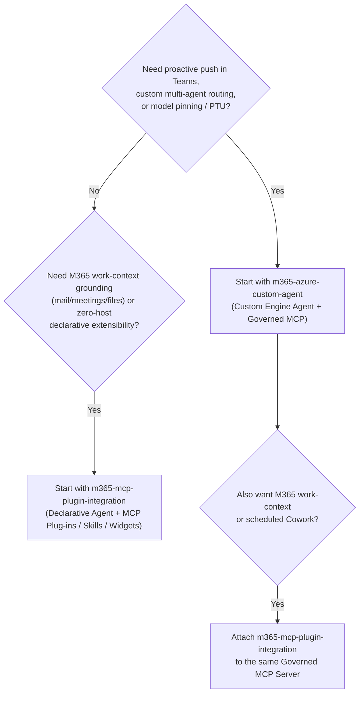

# Microsoft 365 and Copilot Integration (`m365-and-copilot`)

Design patterns and reference architectures for building, authenticating, and publishing enterprise agents into **Microsoft 365 Copilot**, **Microsoft Teams**, and **Cowork**, backed by governed Model Context Protocol (MCP) tool servers and Azure runtimes.

## Choosing between patterns in this category

A recurring architectural decision is whether to integrate with Microsoft 365 Copilot via a **Declarative Agent + MCP Plug-ins** (`m365-mcp-plugin-integration`), build an **Azure-hosted Custom Engine Agent** (`m365-azure-custom-agent`), or **compose both surfaces over a single governed MCP server**.

| Decision Dimension | Declarative Agent + MCP Plug-in (`m365-mcp-plugin-integration`) | Azure Custom Engine Agent (`m365-azure-custom-agent`) | Composed Multi-Surface Pattern (Both over 1 MCP Server) |
|---|---|---|---|
| **Orchestrator & Model** | Microsoft 365 Copilot orchestrator and host model | Your code (Microsoft Agent Framework on Foundry Hosted Agent / ACA) with full model pinning & PTU | DA handles work-context turns; CEA handles custom multi-agent & proactive turns |
| **Native Work IQ / M365 Graph Grounding** | **First-class** (mail, meetings, Teams chats, SharePoint/OneDrive files) | Requires explicit Graph/MCP tool integration | Best of both worlds without duplicating business tools |
| **Proactive Push in Teams** | Not supported (reactive only) | **Supported** via M365 Agents SDK `ContinueConversation` + Cosmos DB conversation references | CEA delivers morning briefings/alerts; DA handles in-context follow-ups |
| **Instruction & Tool Budget** | `~8,000` char instruction cap; `<= 5` MCP plugins recommended; mitigated via `agent_skills` & `worker_agents` | Unlimited code/prompt orchestration; scoped per-specialist token budgets (`<= 1,500` tokens) | Shared MCP server exposes identical `R` / `W1`–`W4` tools to both surfaces |
| **Interactive Rich UI** | MCP Apps (`ui://` sandboxed widgets) + Adaptive Cards | Adaptive Cards + task modules / dialogs | Shared MCP server can serve both structured JSON and `ui://` widget resources |
| **Operational Footprint** | Near-zero runtime hosting (manifest package + MCP server) | Full container runtime, Azure Bot Service bridge, Cosmos DB state, and evaluation pipeline | Incremental: add a thin DA manifest package on top of the existing governed MCP server |

## Assets in this category

<!-- category-catalog:start -->
| Asset | Kind | Maturity | Summary |
|-------|------|----------|---------|
| [Microsoft 365 Integration with Azure Custom Engine Agent](m365-azure-custom-agent/README.md) | `reference-architecture` | preview | Reference architecture for publishing an Azure-hosted custom engine agent (Microsoft Foundry Hosted Agent or Azure Container Apps) to Microsoft Teams and Microsoft 365 Copilot, composed with declarative agents and Cowork over one governed MCP tool layer with OBO identity, durable state, and gated actions. |
| [Microsoft 365 Copilot Integration with MCP via Plug-ins](m365-mcp-plugin-integration/README.md) | `design-pattern` | preview | Integrate one or more remote Model Context Protocol (MCP) servers into Microsoft 365 Copilot using declarative-agent plug-ins, progressive agent skills, and OAuth or Microsoft Entra SSO, with clear guidance on tool discovery modes, action confirmation, and MCP Apps. |
<!-- category-catalog:end -->
