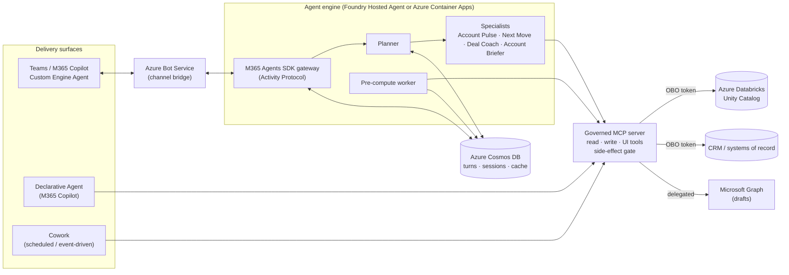
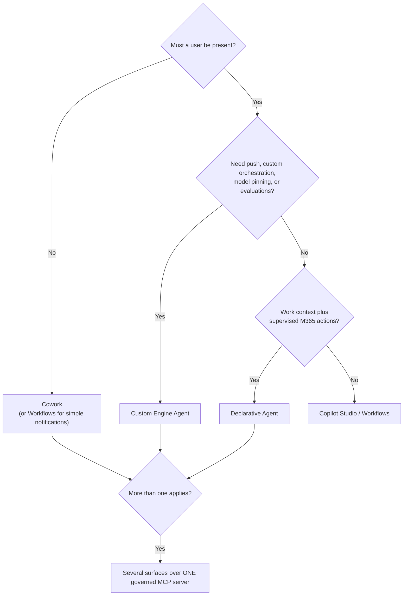

# Microsoft 365 Integration with Azure Custom Engine Agent

> **Maturity:** preview · **Kind:** reference-architecture · **Version:** 0.1.0

This reference architecture covers an enterprise agent that runs on Azure and is delivered to users through Microsoft Teams and Microsoft 365 Copilot. The agent is a **custom engine agent (CEA)** hosted on a Microsoft Foundry Hosted Agent or Azure Container Apps. It shares one governed **Model Context Protocol (MCP)** tool layer with a **declarative agent (DA)** and **Cowork**. The design principle is:

> **One tool layer, multiple delivery surfaces, keep the engine.**

The architecture is **domain-agnostic**: the gateway, planner-and-specialist router, Azure Cosmos DB state/cache layer, On-Behalf-Of (OBO) MCP client, and server-side action safety gate remain identical across business domains. A **Domain Pack** supplies the entity vocabulary, specialist cards, and abstract MCP business tools for a specific workload:

| Domain Pack | Primary Entity | Signal & Context Sources | Specialist Agents | Governed Write Actions (`W2`–`W4`) |
|---|---|---|---|---|
| **ITSM / SecOps** (`secops`) | Service, asset, or incident | SIEM alerts, change logs, runbooks, health metrics | *Status Triage*, *Remediation Planner*, *Incident Briefer*, *Comms Drafter* | Create incident draft note (`W2`), update ticket status (`W3`), dispatch on-call notification (`W4`) |
| **CRM / Enterprise Sales** (`sales`) | Customer account or opportunity | Usage telemetry, CRM pipeline, external news, renewals | *Account Pulse*, *Next Move*, *Deal Coach*, *Account Briefer* | Create outreach email draft (`W2`), log CRM activity (`W3`), send approved multi-recipient outreach (`W4`) |
| **HR / Operations** (`ops`) | Team, site, or case | Capacity metrics, requisition queues, policy knowledge | *Queue Analyst*, *Action Recommender*, *Case Briefer*, *Drafting Assistant* | Draft case update (`W2`), record case milestone (`W3`), publish schedule change (`W4`) |

## Architecture and implementation map

| Layer / Concern | Deep-Dive Documentation | Executable Reference Implementation (`samples/`) |
|---|---|---|
| **Surface Strategy & Multi-Agent Orchestration** | [docs/architecture.md](docs/architecture.md) · [ADR 0001](docs/decisions/0001-surface-and-orchestration-split.md) | [`samples/planner_specialist_router.py`](samples/planner_specialist_router.py) — Domain-pack planner, specialist cards, structured `HandoffEnvelope` protocol, loop/hop guardrails, and OpenTelemetry spans |
| **Identity, Teams SSO, OBO & CAE Claims Challenges** | [docs/authentication-and-identity.md](docs/authentication-and-identity.md) | [`samples/obo_mcp_client.py`](samples/obo_mcp_client.py) — 5-layer identity validator, assertion-hashed MSAL OBO cache, AADSTS error classifier, CAE `cp1` step-up cards, Streamable HTTP MCP client, and two-user isolation harness |
| **Cosmos DB State, Pre-Compute Cache & Proactive Push** | [docs/state-caching-and-proactive-ops.md](docs/state-caching-and-proactive-ops.md) | [`samples/cosmos_state_and_cache.py`](samples/cosmos_state_and_cache.py) — Dual-container Cosmos DB state/cache store, ETag optimistic concurrency (`412` replay), single-turn transactional batching, and DST-safe proactive dispatcher |
| **Server-Side Action Safety Gate (`R` / `W1`–`W4`)** | [docs/architecture.md §6](docs/architecture.md#6-side-effect-classification-and-action-safety-gates) | [`samples/side_effect_gate.py`](samples/side_effect_gate.py) — Fail-closed `R`/`W1`–`W4` enforcement, draft-before-send verification, cryptographic human approval tokens, per-principal daily caps, and kill switch |
| **Evaluation Rubric & Release Gates** | [docs/evaluation-and-routing-quality.md](docs/evaluation-and-routing-quality.md) | [`samples/README.md`](samples/README.md) — Instructions for running all 4 offline verification and routing evaluation suites |

## When to use

Use this pattern when the agent needs any of these:

- **Custom orchestration.** For example, a planner with specialist agents, deterministic tool chains, or multi-step reasoning that you version and evaluate yourself.
- **Model control.** Model pinning, provisioned throughput (PTU), model routing, or a model that is not available inside Microsoft 365 Copilot.
- **Engineering-grade quality controls.** Offline and online evaluations, tracing, regression suites, and CI/CD gates. See the [Agent Production Readiness Guide](../../agentops-and-readiness/agent-production-readiness/README.md).
- **Proactive push.** The agent must start a conversation in Teams, such as a morning briefing or a deal-risk alert.
- **Data-layer authorization.** Row-level or territory permissions must be enforced by downstream systems of record, such as Azure Databricks Unity Catalog or a CRM API, through OBO.
- **The same business capability on several surfaces.** Teams chat, Microsoft 365 Copilot, scheduled or offline work, and supervised Microsoft 365 actions, without re-implementing business logic for each surface.

## When not to use

- **Event notifications or nudges with no conversation**, such as a failed build, a completed test, or a new CVE. Use Teams Workflows or Power Automate.
- **Knowledge Q&A, learning, or self-service** that fits standard topics, connectors, and flows. Start with Copilot Studio and add a custom API only for a gap you have measured.
- **Grounding in the user's mail, meetings, chats, and files** with light supervised actions and no custom orchestration. A declarative agent alone has zero operational overhead.
- **Unattended scheduled or bulk work with per-item approval and no conversation.** Start with Cowork.
- **No team to operate it.** If nobody can own a container runtime, its identities, its evaluations, and on-call support, a CEA adds cost without adding value.

## Architecture

The architecture has four layers:

- **Surfaces** handle presentation, the user's context, and how a request starts. Users interact through the CEA in Teams and Microsoft 365 Copilot, a DA that sees their work context, or Cowork for offline work.
- **The engine** contains the planner and specialists, model pinning, evaluations, tracing, and proactive push. Azure Bot Service connects Teams and Microsoft 365 Copilot to the engine's Activity Protocol endpoint. Foundry one-click publishing provisions this bridge automatically.
- **The governed MCP server** is the single source of business logic and safety. It exposes abstract business tools, enforces side-effect classes, and passes the user's identity downstream. The agents never generate SQL.
- **State** is stored in Azure Cosmos DB, not in process memory, so every replica can serve every turn.

### Surface decision matrix

| Capability | (a) Custom Engine Agent on Foundry / ACA → Teams & M365 Copilot | (b) Declarative Agent in M365 Copilot | (c) Cowork (scheduled / event-driven) | (d) Copilot Studio / Power Automate Workflows |
|---|---|---|---|---|
| **Best for** | Custom orchestration, specialists, proactive briefings, data-platform reasoning | Grounding in mail, meetings, chats, files, and people, plus supervised Microsoft 365 actions | Unattended scheduled, event-triggered, bulk, or long-running work | Notifications, nudges, knowledge assistants, and low-code self-service |
| **Orchestration** | Full control: planner, specialists, deterministic tools | Microsoft 365 Copilot orchestrator; instructions, knowledge, and actions | Cowork task runtime with per-item approval | Topics, generative orchestration, and flows |
| **Model choice / PTU** | Yes: pin versions, use PTU, route between models | No; the platform chooses the model | No | Limited to platform options |
| **Instruction budget** | Unlimited (code and prompts) | About 8,000 characters | Task prompt | Topic and agent instructions |
| **Tools** | Any MCP or SDK tool | MCP / API plugins (about 10 actions per agent); MCP Apps widgets | Extended through `agentConnectors` | Connectors, flows, MCP |
| **Proactive push into Teams** | **Yes.** Agents SDK proactive messaging through Azure Bot Service | **No** | **No.** Reports into its own surface | Copilot Studio: personal chat only. Workflows: channel posts, a separate mechanism |
| **Multi-agent** | Native (Agent Framework, A2A) | `worker_agents` (preview, DA-to-DA only); no A2A | n/a | Connected agents (product-specific) |
| **Evaluation and tracing** | Full: Foundry evaluations, OpenTelemetry tracing | Limited | Limited | Built-in analytics |
| **Operations burden** | High: runtime, identities, on-call | Near zero | Near zero | Low (maker plus platform governance) |
| **Identity to data** | SSO plus OBO to Databricks or CRM | User-delegated through the plugin's OAuth | User context; whether an offline run can use OBO is an open question | Connection identity (user or service) |

#### Decision path

In every case, business logic and safety gating live in the MCP server. This keeps the choice of surface reversible.

Further reading:

- [docs/architecture.md](docs/architecture.md): the full reference architecture, wire contracts, and orchestration schemas.
- [docs/authentication-and-identity.md](docs/authentication-and-identity.md): identity layers, SSO plus OBO, AADSTS error classification, CAE claims challenges, and handover.
- [docs/state-caching-and-proactive-ops.md](docs/state-caching-and-proactive-ops.md): Azure Cosmos DB state/cache containers, ETag concurrency, and DST-safe proactive messaging.
- [docs/evaluation-and-routing-quality.md](docs/evaluation-and-routing-quality.md): 8-dimension evaluation rubric, adversarial datasets, and CI/CD release gates.
- [docs/decisions/0001-surface-and-orchestration-split.md](docs/decisions/0001-surface-and-orchestration-split.md): the ADR.
- [samples/README.md](samples/README.md): runnable Python reference implementations and offline test harnesses.

## Key design decisions

| Decision | Choice | Why | Trade-off |
|---|---|---|---|
| Delivery surfaces | CEA, DA, and Cowork over one MCP server | Each surface does something the others cannot. One tool layer avoids duplicated logic | More surfaces to package, govern, and support |
| Engine host | Foundry Hosted Agent (target); Azure Container Apps (current or alternative) | Managed runtime, one-click publishing to Teams and Microsoft 365, integrated evaluations and tracing | Hosted Agents are in preview. Cold start, idle timeout, and network isolation need validation |
| Agent framework | Microsoft Agent Framework plus Microsoft 365 Agents SDK | Supported path. The Bot Framework SDK is archived | Migration effort for older bot code |
| Orchestration | Planner and specialists. Specialists hand out-of-domain work back to the planner | Avoids peer-to-peer coupling and keeps the internal topology hidden from users | One extra routing hop |
| Tool design | Abstract, semantic business tools; no LLM-generated SQL | Predictable, testable, and authorizable | More tool-design work up front |
| State | Azure Cosmos DB for turns, sessions, and a partitioned pre-compute cache | Survives restarts and scale-out. Pre-compute cuts latency and cost | Cache freshness must be managed with a live-refresh path |
| Authorization | SSO plus OBO. Data-layer policies enforce row-level and territory scope | Permissions cannot be bypassed by a prompt | Requires consent and OBO configuration for each downstream system |
| Actions | Side-effect classes R and W1–W4, enforced in the MCP server; draft before send | The user trusts the gate, not the model | Some extra clicks for confirmation and approval |
| Proactive push | Agents SDK proactive messaging with stored conversation references | Only the CEA surface can start a conversation in Teams | Requires conversation-reference lifecycle management |

## Getting started

1. **Classify the scenarios.** Use the decision matrix to place each requirement on a surface. If nothing needs a CEA, stop here and use the lower-overhead surface.
2. **Design the MCP tool layer first.** Define abstract business tools such as `get_account_pulse`, `rank_accounts`, and `create_outreach_draft`. Give each one a side-effect class (`R`, `W1`–`W4`). Use Streamable HTTP with OAuth. Register the server in the Foundry tool catalog for versioning and RBAC.
3. **Configure identity.** Create the Teams app package, the bot or agent identity, the SSO app registration, and the OAuth connection used for OBO to each downstream system. See [docs/authentication-and-identity.md](docs/authentication-and-identity.md).
4. **Build the engine.** Use Microsoft Agent Framework with a planner and specialists. Store conversation references and session state in Azure Cosmos DB.
5. **Host and publish.** Deploy to a Foundry Hosted Agent and use one-click publishing to Teams and Microsoft 365 Copilot, or deploy to Azure Container Apps behind Azure Bot Service.
6. **Add the declarative agent and Cowork** on the same MCP server for work-context and offline scenarios.
7. **Gate quality and safety.** Apply evaluations, routing regression tests, and side-effect gate tests as described in the [Agent Production Readiness Guide](../../agentops-and-readiness/agent-production-readiness/README.md).

## Security and responsible AI

- **Authorize at the data layer, never in prompts.** The MCP server forwards the user's OBO token. Unity Catalog row filters or CRM permissions decide which rows the user can see.
- **Gate every side effect in the MCP server**, not in the model or the surface:
  - Draft before send.
  - Recipients must be on an allow-list.
  - Per-principal daily caps.
  - Human-minted approval tokens for irreversible or bulk actions.
  - A kill switch read at call time.
  - Unregistered tools fail closed.
- **MCP tool annotations are hints for the UI, not security.** These are `readOnlyHint`, `destructiveHint`, and `idempotentHint`. The gate does not trust them.
- **No secrets in code.** Use managed identity and Azure Key Vault. Restrict ingress to Azure Bot Service traffic, and use private networking for backends where supported.
- **Ground every recommendation and draft** with traceable data claims. Evaluate for groundedness, prompt injection, and unintended tool execution.
- **Accountable ownership.** Each agent needs a named business owner, a named sponsor for its Entra Agent ID, primary and secondary maintainers, and a tested offboarding runbook.

## Limitations

- Microsoft Foundry Hosted Agents are in **preview**. The following still need validation for your workload:
  - Warm or minimum capacity, cold-start latency, and idle billing.
  - Idle-session timeout.
  - Network isolation for Teams Activity hosting.
  - Whether sessions map to a conversation or to a user.
  - Streaming, citations, and feedback in Teams.
  - State TTL and context compaction.
  - Private-network CI/CD.
- Foundry Workflows are being **retired**. Implement orchestration in code with Microsoft Agent Framework.
- Some Foundry built-in tools, such as the SharePoint tool, may not work when the agent is published to Teams. Expose these capabilities through your MCP server or a DA instead.
- Calling a CEA from a DA (through an API plugin or MCP) is **not a documented first-class pattern**. Treat it as an enhancement.
- Foundry agent applications might not appear in the Entra agent registry by default. Microsoft 365 agent-governance coverage might need extra work.
- Whether a Cowork offline run can use OBO to reach downstream data is an open question.
- Work IQ and some Microsoft 365 Copilot extensibility features are in preview and are billed separately, for example in Copilot Credits.

## References

- [Architecture deep dive](docs/architecture.md)
- [Authentication and identity](docs/authentication-and-identity.md)
- [State, caching, and proactive operations](docs/state-caching-and-proactive-ops.md)
- [Evaluation and routing quality](docs/evaluation-and-routing-quality.md)
- [ADR 0001: Surface and orchestration split](docs/decisions/0001-surface-and-orchestration-split.md)
- [Reference Python implementations](samples/README.md)
- [Agent Production Readiness Guide](../../agentops-and-readiness/agent-production-readiness/README.md)
- [Microsoft 365 Copilot Integration with MCP via Plug-ins](../m365-mcp-plugin-integration/README.md)
- [Enterprise Agent Security and Tool Governance](../../security-and-governance/agent-security-and-governance/README.md)
- [Secured Microsoft Foundry Landing Zone for Enterprise Agents](../../landing-zones-and-infra/secured-foundry-landing-zone/README.md)
- [Custom engine agents for Microsoft 365](https://learn.microsoft.com/microsoft-365-copilot/extensibility/overview-custom-engine-agent)
- [Declarative agents for Microsoft 365 Copilot](https://learn.microsoft.com/microsoft-365-copilot/extensibility/overview-declarative-agent)
- [Microsoft 365 Agents SDK](https://learn.microsoft.com/microsoft-365/agents-sdk/)
- [Microsoft Foundry Agent Service](https://learn.microsoft.com/azure/ai-foundry/agents/overview)
- [Microsoft Agent Framework](https://learn.microsoft.com/agent-framework/)
- [Azure Bot Service](https://learn.microsoft.com/azure/bot-service/)
- [Microsoft identity platform on-behalf-of flow](https://learn.microsoft.com/entra/identity-platform/v2-oauth2-on-behalf-of-flow)
- [Model Context Protocol](https://modelcontextprotocol.io/)
