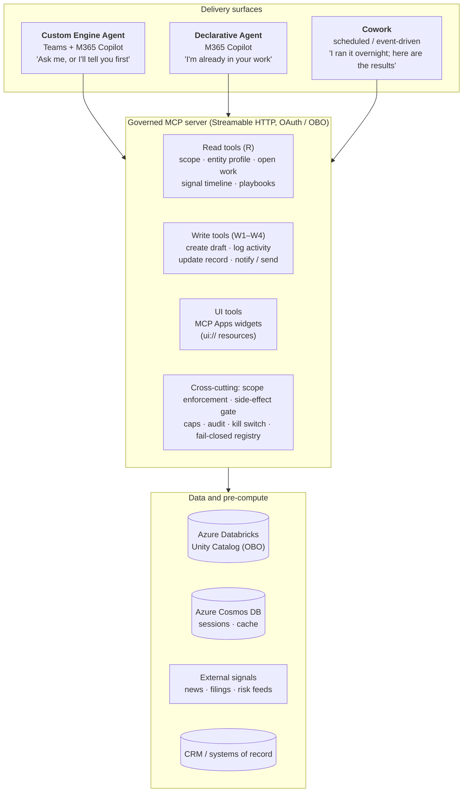
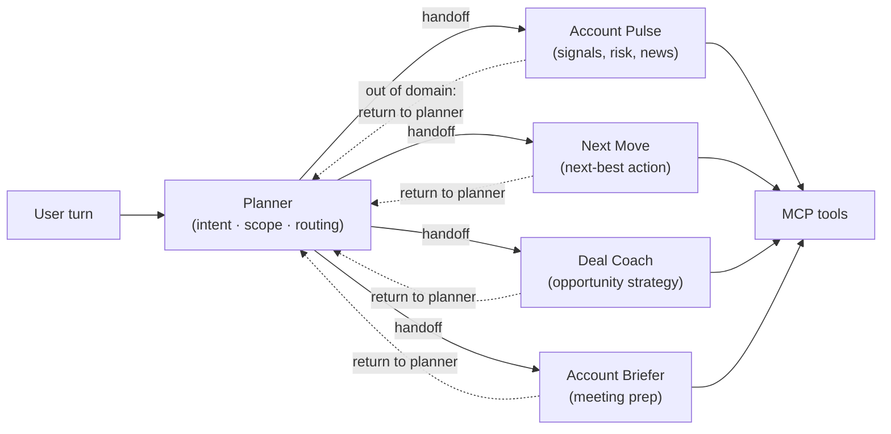
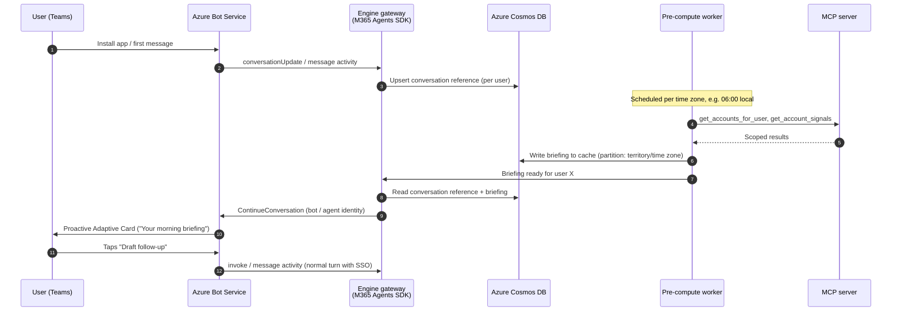
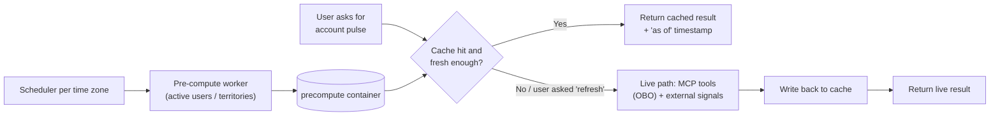
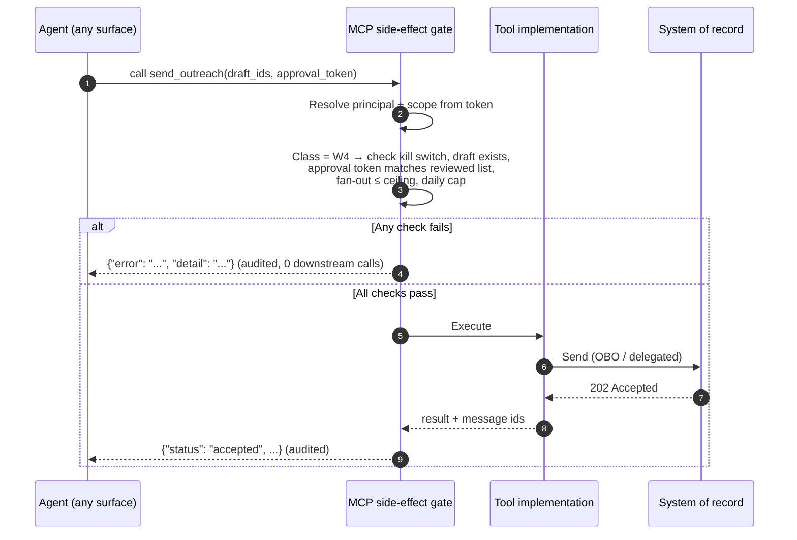

# Architecture

This document describes the components, interfaces, data flows, identity, scaling, and reliability of the reference architecture. The architecture is **domain-agnostic**. The engine, tool layer, state model, and safety gates stay the same, and a **Domain Pack** supplies the vocabulary, entity types, tool implementations, and specialist instructions for one line of business. The same design serves, for example:

| Domain Pack | Entity | Signals | Open work | Typical write |
|---|---|---|---|---|
| ITSM / SecOps | Service, asset, or incident | Alerts, detections, change events | Incidents, problems, changes | Draft an incident update or a change request |
| CRM / Sales | Customer account | Usage, engagement, news, risk | Opportunities, renewals, tasks | Draft a follow-up email or log an activity |
| HR / Operations | Team, site, or case | Attrition risk, survey and capacity signals | Requisitions, onboarding cases | Draft a case note or a manager notification |

Examples in this document use generic names, such as `get_entity_profile` and `get_signal_timeline`, that each Domain Pack implements against its own systems of record.

Related documents:

- [README](../README.md): when to use this asset and the surface decision matrix.
- [Authentication and identity](authentication-and-identity.md): identity layers, SSO plus OBO, CAE claims challenges, and isolation testing.
- [State, caching, and proactive operations](state-caching-and-proactive-ops.md): Azure Cosmos DB state and cache design, ETags, TTLs, and proactive dispatch.
- [Evaluation and routing quality](evaluation-and-routing-quality.md): the scoring rubric, adversarial datasets, and release gates.
- [ADR 0001](decisions/0001-surface-and-orchestration-split.md): the surface and orchestration split.
- [Reference samples](../samples/README.md): runnable, offline-testable Python modules for the router, state, OBO, and side-effect gate.

## 1. Thesis: one tool layer, multiple delivery surfaces, keep the engine

A production agent that started as a single custom bot usually already separates three concerns, even if only implicitly:

1. **The engine.** Orchestration, prompts, model choice, evaluation, and proactive behavior.
2. **The tool layer.** Semantic business tools that hide SQL, APIs, and authorization from the model.
3. **The surface.** Where the user meets the agent.

Keep those concerns separate and make the tool layer a **governed MCP server**. Then changing or adding a surface takes weeks of work rather than a rewrite. The engine survives because nothing else replaces it: custom orchestration, model pinning, evaluations, and proactive push. It moves from self-hosted infrastructure to a managed runtime when that runtime is ready.

> The durable asset is the tool layer and its safety model, not any one surface.

## 2. Three-surface enterprise composition



### Responsibility split

| Component | Owns | Does not own |
|---|---|---|
| **Custom Engine Agent** (Foundry Hosted Agent or Azure Container Apps) | Planner and specialists, deep multi-step reasoning, proactive push, model pinning and PTU, evaluations and tracing, Adaptive Cards | Work-context grounding (prefer the DA). Scheduled bulk runs (prefer Cowork) |
| **Declarative Agent** | Reasoning over the user's mail, meetings, chats, files, and people; supervised Microsoft 365 actions; MCP Apps dashboards | Custom routing, long specialist prompts (about 8,000-character instruction cap), push |
| **Cowork** | Recurring and event-triggered runs, bulk work with per-item approval, long-running offline work | Real-time conversation, push into Teams |
| **MCP server** | All business data access, all write actions, scope enforcement, side-effect gating, audit | User experience, prompting, model choice |
| **Foundry tool catalog** | Tool registration, versioning, RBAC, private catalog | Runtime enforcement (the MCP server does that) |

### Composition guidance

Calling one surface from another is structurally possible. For example, a DA could call the CEA through an API plugin or by wrapping the CEA as an MCP tool. However, this is **not a documented first-class pattern**. Make each surface independently useful, and treat composition as an enhancement you prototype rather than a dependency in the critical path. DA-to-DA `worker_agents` is in preview and does not reach Foundry agents. Agent-to-agent (A2A) interop with other vendors' agents should originate from the CEA.

### Package shape for the Microsoft 365 side

One Microsoft 365 app package can carry the declarative agent and register the MCP server as a connector for Cowork:

```text
appPackage/
├── manifest.json                 # Teams / M365 app manifest
│   ├── bots[] / copilotAgents.customEngineAgents[]   # the CEA (bot ID)
│   ├── copilotAgents.declarativeAgents[]             # the DA
│   └── agentConnectors[]                             # MCP server, for Cowork
├── declarativeAgent.json         # thin instructions; capabilities; one MCP action
└── ai-plugin.json                # RemoteMCPServer runtime; OAuth reference
```

One MCP server counts as **one** DA action, no matter how many tools it exposes. Do not create one action per capability.

## 3. Planner-and-specialist orchestration

### 3.1 Topology



### 3.2 Specialists return control to the planner; they do not cross-route

A common failure appears as the number of specialists grows. Each specialist's prompt is taught about its peers ("if the user asks about deals, say *ask Deal Coach*"). Then specialists start to *name* another specialist in text instead of actually handing off. This causes three problems:

- **Coupling.** Every specialist prompt must change whenever a specialist is added, renamed, or split. The prompts become a hidden N×N routing table.
- **Leaked internals.** Users see internal agent names and are asked to repeat themselves.
- **Misrouting.** Overlapping trigger words in several prompts produce inconsistent routing that is hard to test.

**Rule:** each specialist knows only its own domain. When a request is out of domain, the specialist calls a single *return-to-planner* handoff with a short reason. Only the planner knows the full roster. Routing logic and its regression tests then live in one place, and the user sees one continuous assistant.

### 3.3 Deterministic tools compared with reasoning specialists

| Use a **deterministic tool** when... | Use a **reasoning specialist** when... |
|---|---|
| The steps are known and repeatable, such as resolving territory, listing accounts, or calculating pipeline coverage | The output needs judgement, synthesis, or language, such as prioritizing accounts or drafting a narrative |
| Correctness can be unit-tested | Quality is measured with evaluations, such as groundedness, relevance, and task success |
| The step touches authorization or a system of record | The step combines several tool results into a recommendation |
| Latency and cost must be predictable | You accept extra model calls in exchange for flexibility |

Two related rules:

- Never let a model write SQL against the data platform. Expose **abstract business tools**, such as `get_accounts_for_user` and `get_account_signals`, whose implementations are versioned and testable.
- Keep a specialist as a separate agent only when there is a reason to. Good reasons are **parallel autonomy** (concurrent scans), **context isolation** (noisy research must not pollute the main context), or an **external boundary** (another team's agent over A2A). Otherwise, consider skills loaded on demand inside a single reasoning pass. This avoids a full model call whose only output is a routing choice. Skills reduce *instructions*, not *tool schemas*, so scope the advertised tool set for each skill as well.

### 3.4 Testing the router

- Keep a regression suite of ambiguous prompts with expected routes, and run it in CI.
- Test specialists locally against a mocked or sandbox MCP server. Do not make a deployment to Teams the only way to test behavior.
- Trace each handoff with OpenTelemetry so routing errors appear in the same trace as the user turn.

### 3.5 Wire contracts: `SpecialistCard`, `RoutingDecision`, and `HandoffEnvelope`

To prevent implicit prompt coupling and unstructured string parsing between the planner and specialists, the reference engine in [`samples/planner_specialist_router.py`](../samples/planner_specialist_router.py) enforces three strict wire contracts.

#### 1. `SpecialistCard` (registered in the Domain Pack)

Each specialist declares its capability slug, positive and negative routing boundaries, and explicit tool allow-list. A specialist never receives tool schemas outside its allow-list:

```json
{
  "name": "status_specialist",
  "capability": "status",
  "label": "Status & Signal Analyst",
  "handles": [
    "Current entity health, risk score, and telemetry anomalies",
    "Recent external or internal signal timeline for one entity or a scoped cohort"
  ],
  "does_not_handle": [
    "Recommending next-best remediation or playbooks",
    "Drafting outbound messages or modifying system-of-record state"
  ],
  "allowed_tools": [
    "get_user_scope",
    "list_entities",
    "get_entity_profile",
    "get_signal_timeline"
  ],
  "max_tool_calls": 4,
  "prompt_token_budget": 1500
}
```

#### 2. `RoutingDecision` (structured output from the Planner)

The planner classifies each turn (or residual sub-request after a handoff) into a structured decision with an ordered list of sub-intents, extracted entity hints, or a single clarifying question when the request is ambiguous or out of scope:

```json
{
  "decision": "route",
  "confidence": 0.94,
  "entity_hint": "ENT-1042",
  "sub_intents": [
    {
      "capability": "status",
      "sub_request": "Summarize current health and recent risk signals for ENT-1042",
      "priority": 1
    },
    {
      "capability": "recommend",
      "sub_request": "Recommend the highest-priority next action based on open work",
      "priority": 2
    }
  ],
  "clarifying_question": null
}
```

#### 3. `HandoffEnvelope` (returned by a specialist via `return_to_planner`)

When a specialist completes its in-domain portion of a turn and detects an out-of-domain clause—or hits a tool failure or permission refusal—it invokes the `return_to_planner` control tool with a validated `HandoffEnvelope`:

```json
{
  "from_specialist": "status_specialist",
  "reason": "out_of_domain",
  "completed_work": [
    {
      "summary": "Entity ENT-1042 is at-risk (health score 42/100) due to two open P1 escalations.",
      "evidence_refs": ["ev:get_entity_profile:72df858ca125", "ev:get_signal_timeline:13357c95e029"]
    }
  ],
  "failed_work": [],
  "unresolved_request": "Draft a follow-up note to the primary contact summarizing the remediation plan.",
  "suggested_capability": "draft"
}
```

**Loop-prevention and safety invariants enforced by the orchestrator:**
- **Ping-pong block:** If `specialist_A` hands off to `planner` which routes to `specialist_B`, and `specialist_B` attempts to hand back to `specialist_A` for the same `reason` within the same turn, the router halts and surfaces partial results plus an explicit gap disclosure.
- **Hard hop ceiling:** Every turn enforces `max_hops = 3` and a monotonic wall-clock deadline (`turn_deadline_ms`, e.g., 18,000 ms).
- **Permission refusals never reroute:** When `reason == "insufficient_permissions"`, the planner immediately terminates routing and reports the authorization boundary rather than fishing across other specialists.
- **Cross-specialist output scrubbing:** Before appending a specialist's segment to the user response, `scrub_cross_specialist_references` strips any leaked internal agent names (`status_specialist`, `action_specialist`, "ask the Deal Coach") so the user experiences a single unified assistant.

### 3.6 Four-layer prompt budget and token isolation

Multi-agent systems fail cost and latency SLOs when every specialist receives the full conversation transcript and all 25+ MCP tool schemas. Enforce a strict token budget per specialist invocation (`<= 1,500` input tokens):

| Layer | Contents | Token Ceiling | Isolation Rule |
|---|---|---|---|
| **Layer 1: Specialist instructions** | Role definition, domain rules, citation format, and `return_to_planner` contract | `<= 450` tokens | Contains **zero** descriptions of sibling specialists |
| **Layer 2: Scoped tool schemas** | Only the 3–5 MCP tools listed in `SpecialistCard.allowed_tools` plus `return_to_planner` | `<= 450` tokens | Write tools (`W2`–`W4`) are never advertised to read/analysis specialists |
| **Layer 3: Compacted working memory** | Pinned entity ID/kind, resolved user scope, and a `<= 200`-char ledger of prior specialists' completed work and `evidence_refs` | `<= 350` tokens | Raw tool JSON payloads from earlier specialists are never forwarded verbatim |
| **Layer 4: Active sub-request** | The specific `sub_request` slice extracted by the planner for this specialist | `<= 250` tokens | Scoped to one capability |

## 4. Proactive push messaging

Only the **custom engine agent** can start a conversation in Teams. Declarative agents answer only when invoked inside Microsoft 365 Copilot. Cowork reports into its own surface. Neither can push a morning briefing or an alert into a user's Teams chat.

### 4.1 Mechanism

1. When the user installs the app or first messages it, the engine receives a `conversationUpdate` or `message` activity through Azure Bot Service. It stores a **conversation reference** (user, conversation ID, service URL, tenant) in Azure Cosmos DB.
2. A trigger fires. This might be a scheduled pre-compute completing, an event from a system of record, or an alert threshold being crossed.
3. The engine uses the Microsoft 365 Agents SDK to *continue the conversation* with the stored reference. It authenticates to the Bot Connector as the bot or agent identity.
4. Azure Bot Service delivers the activity, typically an Adaptive Card with actions, to the user's personal chat in Teams.



### 4.2 Design notes

- **Proactive messages do not carry a user token.** Pre-computed content must come from a flow where the user's authorization was already applied, such as a pre-compute that ran under the user's delegated context or a cache keyed by user and scope. Otherwise, the card should contain only non-sensitive prompts that open an authenticated turn.
- Throttle fan-out and respect Bot Connector rate limits. Spread sends across time-zone partitions.
- Handle stale references (uninstalled app, removed user) by deleting them on `403` or `404`.
- With Foundry one-click publishing, Azure Bot Service and the Activity Protocol endpoint are provisioned for you. Validate proactive delivery end to end at your expected morning volume before you depend on it.

## 5. Durable, externalized state in Azure Cosmos DB

### 5.1 Why in-memory state fails

Early builds often keep conversation history and session state in process memory. This works on one replica and fails in production:

- A container restart or new revision loses every in-flight conversation.
- Horizontal scale-out routes the next turn to another replica that has no history. Users see the agent "forget".
- Proactive messaging needs conversation references that survive deployments.

Sticky sessions hide the problem but don't solve it. Externalize the state instead.

### 5.2 Containers and partitioning

| Container | Contents | Partition key | TTL |
|---|---|---|---|
| `conversations` | Conversation references for proactive push | `/userId` | None (delete on uninstall) |
| `sessions` | Session state, planner state, and the active specialist | `/conversationId` | Hours to days |
| `turns` | Turn history and summarized memory | `/conversationId` | Per retention policy |
| `precompute` | Account intelligence per user or territory, with `computedAt` and `sourceVersion` | `/territoryId` (or hierarchical `/timeZone`, `/territoryId`) | For example, 12 hours |
| `audit` | Write-action audit records (or forward them to a SIEM) | `/principalId` | Per compliance policy |

Azure Cosmos DB is preferred over a cache-only store such as Redis here. A single durable service handles conversation history, session state, and the pre-compute cache, and offers global distribution and TTL.

### 5.3 Pre-compute cache with live refresh fallback



- Run expensive intelligence work, such as account signal aggregation and ranking, **ahead of demand**. Partition it by territory and time zone so results are ready before each region's working day.
- Always show an **"as of" timestamp**, and keep an explicit **live refresh** path for requests that need fresh data.
- Pre-compute should only touch data that the target user may see. Run it under that user's delegated context where possible. Otherwise, key the cache by the user's authorized scope and re-check scope when serving results.
- Results: faster first responses, lower inference cost, and more predictable performance during the morning peak.

### 5.4 Scaling the engine

- Run the gateway as a **separate service** from the planner and specialists, and from pre-compute workers, and scale them independently. The gateway is stateless and handles channel and identity. The planner is CPU- and latency-sensitive. Pre-compute is batch.
- Before a large rollout, validate model capacity (PTU or quota), data-platform warehouse sizing, end-to-end throughput, and response-time budgets.
- Set per-turn deadlines, use backoff on tool calls, and degrade gracefully, for example by returning cached results with a notice.

## 6. Side-effect classification and action safety gates

Once an agent goes from advising to acting (drafting email, updating a CRM, booking meetings), the model must not be the safety boundary. Every tool declares a **side-effect class**, and the MCP server enforces it, regardless of which surface or agent called it.

| Class | Meaning | Examples | Gate enforced in the MCP server |
|---|---|---|---|
| **R** | Read-only | Get accounts, signals, pipeline | Scope resolved from the validated user token |
| **W1** | User-scoped and reversible | Save a preference, pin an account | Scope |
| **W2** | Creates content the user still controls | Create an email **draft** in the user's mailbox, create a draft meeting | Scope, confirmation, recipient allow-list (known contacts only) |
| **W3** | Writes to an external system of record | Log activity in the CRM, update the next step on an opportunity | W2 gates, plus a prior draft, explicit confirmation, a per-principal daily cap, and an audit record |
| **W4** | External, irreversible, or bulk | Send email, send outreach to many accounts | W3 gates, plus a human-minted approval token bound to the reviewed recipient list, a hard fan-out ceiling, and a kill switch |

### 6.1 Non-negotiables

- **Draft before send.** The first email capability creates a draft object in the user's own Drafts folder and returns a message ID for the audit record. Sending is a separate, later, separately approved tool. There is no combined compose-and-send path.
- **Acceptance is not delivery.** Report a `202` from the mail API as *accepted*, not *sent*.
- **Guards run before the external call**, and tests prove it. Each refusal path asserts that zero requests reached the downstream API.
- **Grounding before drafting.** Write tools require a grounding claim, which the reviewer sees. "Nothing found" must be stated explicitly, never implied by silence.
- **Recipients must be known contacts** of the account. Refuse invented addresses.
- **For W4, the human selects or confirms the full set** before approval. "Yes, send" and "yes, send to these 40" are different approvals.
- **Caps are counted per principal**, so a new chat, another surface, or a restarted job does not reset them.
- **Audit every write and every refusal.** Record who, what, which tool, which approval, and which payload.
- **Kill switch.** Disable all W3 and W4 tools through configuration, read at call time, without a redeploy.
- **Fail closed.** A tool registered without a policy is an error, not an open path.
- **Refusals are structured payloads** that a model can read, for example `{"error": "draft_required", "detail": "..."}`, not HTTP 500 errors.
- **Prefer governed MCP write tools over native host action capabilities** for anything in a system of record or anything bulk. Native capabilities might not let the author set allow-lists, caps, or scope. If the host and your tool both offer the same action, the orchestrator's choice between them is not deterministic.

### 6.2 Mapping to MCP tool annotations

Map each class to the standard MCP annotations (`readOnlyHint`, `destructiveHint`, `idempotentHint`) so any MCP client can show suitable confirmation UI. **The gate never trusts these hints.** They exist for the UI. Enforcement is server-side.



Users do not need to trust the model. They need to trust the gate in front of it.

## 7. Hosting options for the engine

| Option | When | Notes |
|---|---|---|
| **Microsoft Foundry Hosted Agent** | Target state for new builds and migrations | Managed container runtime, one-click publishing to Teams and Microsoft 365 Copilot (provisions Azure Bot Service), Entra Agent ID, tracing and evaluations. Preview: validate warm capacity, cold start, idle timeout, network isolation, session mapping, streaming, and private CI/CD |
| **Azure Container Apps** | Existing production agents, or when preview gaps block you | You own the gateway, the Azure Bot Service registration, scaling, and OBO middleware. Restrict public ingress (for example, a WAF that only admits Azure Bot Service traffic), keep backends private, and use managed identity and Key Vault |

Migration path: move the runtime but keep the design. The container, Agent Framework code, Activity Protocol handling, Cosmos DB state, and MCP server all carry over. Only the hand-managed hosting and channel plumbing are retired.

## 8. Observability and quality

- **Tracing.** Use OpenTelemetry across the gateway, planner, specialists, and MCP tools, with the turn ID, user hash, route, tool calls, latency, and token use.
- **Evaluations.** Measure routing accuracy, groundedness, task success, and safety (prompt injection, unintended tool execution). Run them offline in CI and sample them online.
- **Operational signals.** Track proactive delivery success, cache hit rate and staleness, OBO failures by downstream system, gate refusals by reason, and cap utilization.
- **Feedback.** Capture thumbs up or down and comments from Teams, and correlate them with traces.

## 9. Cost drivers

- Model inference, which dominates. Reduce it with pre-compute, caching, smaller models for routing, and PTU for predictable peaks.
- Engine compute (hosted agent or Container Apps) and Azure Bot Service.
- Azure Cosmos DB request units (RU/s) for state and cache. Use TTL to bound storage.
- Data-platform warehouse usage driven by tool calls and pre-compute.
- Microsoft 365 Copilot surfaces have no Azure hosting cost, but some capabilities bill separately, for example in Copilot Credits.
