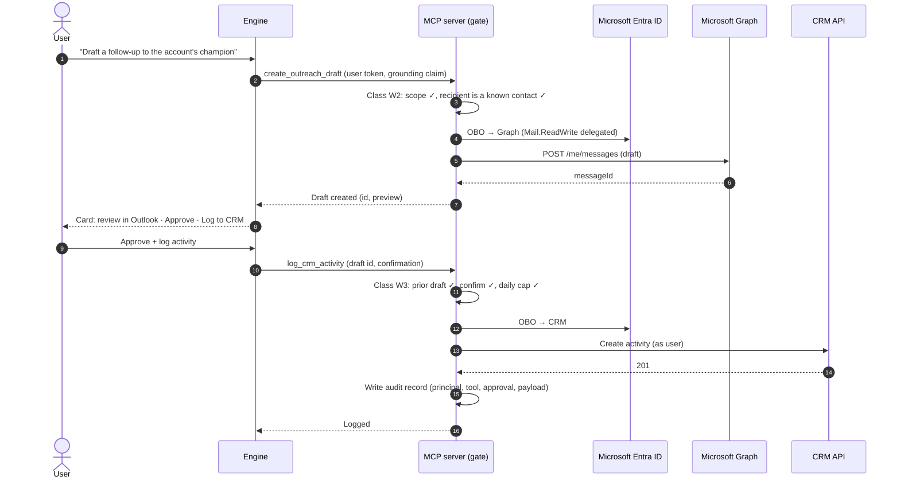

# Authentication and identity

A custom engine agent published to Microsoft Teams and Microsoft 365 Copilot involves **several distinct identities**. Teams often mix them up during design, deployment, and especially offboarding. This guide separates the identities, shows how the user's identity flows to downstream systems of record, and provides an ownership and handover checklist.

Related documents:

- [Architecture](architecture.md)
- [ADR 0001](decisions/0001-surface-and-orchestration-split.md)

## 1. The five identity layers

| # | Layer | What it is | Used for | Common misconception |
|---|---|---|---|---|
| 1 | **Teams / Microsoft 365 app package ID** | The `id` in the app manifest. It identifies the installable app, its version, and its availability | Distribution, admin approval, app policies, installation scope (personal, team, group chat) | "The app ID is the Entra client ID." It is not. The two are separate identifiers |
| 2 | **Bot / agent messaging identity** | The Entra application or **Entra Agent ID** behind the Azure Bot resource (the `botId` in the manifest) | Authenticating the channel bridge: Bot Connector ↔ engine, and proactive `ContinueConversation` | "Owning this registration grants access to data." It does not. It authenticates messaging only |
| 3 | **Signed-in end user** | The user's Entra identity, obtained through Teams or Microsoft 365 single sign-on (SSO) | Knowing *who* is asking, and acting as the subject of delegated access | "The agent identity can stand in for the user." That bypasses user-level authorization |
| 4 | **OAuth connection / OBO token to downstream systems** | An OAuth connection (for example on the Azure Bot resource) and an app registration that exchanges the user's token **on behalf of** the user for a downstream audience | Calling Azure Databricks, CRM, Microsoft Graph, or the MCP server *as the user* | "One broad service principal is simpler." It is, but it moves authorization into the agent, which is fragile and hard to audit |
| 5 | **Human identity sponsor / owner** | Named people accountable for the agent: business owner, Entra Agent ID sponsor, app owners, and maintainers | Accountability, access reviews, offboarding, incident response | "The person who created it owns it forever." Ownership must be recorded and transferable |

Keep these layers separate in diagrams, in infrastructure-as-code, and in the ownership record. A Teams admin approving the app (layer 1) does not grant consent for downstream API permissions (layer 4). An Entra app owner (layer 2 or 4) does not automatically get Azure RBAC on the hosting resources.

### Entra Agent ID compared with classic app registrations

Newer agent platforms, including Microsoft Foundry and Copilot Studio, can automatically provision a **Microsoft Entra Agent ID** for each agent. With an Agent ID, the platform manages the credentials, and the accountable human is an **identity sponsor** rather than a credential administrator. Older agents and self-hosted bots use a classic app registration with a secret, certificate, or federated credential that you manage. Find out which model each agent uses. Don't assume that "rotate the client secret" is a universal offboarding step.

## 2. SSO plus OBO passthrough to systems of record

**Principle:** authorize at the data layer, never in prompts. The model never decides who may see which rows. Downstream systems decide, using the user's own identity:

- Unity Catalog row filters and column masks.
- CRM sharing rules.
- Graph permissions.

### 2.1 Interactive turn in Teams or Microsoft 365 Copilot

```mermaid
sequenceDiagram
    autonumber
    actor U as User
    participant T as Teams / M365 Copilot
    participant BOT as Azure Bot Service
    participant E as Engine (Agents SDK)
    participant ID as Microsoft Entra ID
    participant M as MCP server
    participant D as Azure Databricks<br/>(Unity Catalog)

    U->>T: "Which of my accounts need attention?"
    T->>BOT: Activity (signed with channel token)
    BOT->>E: Activity + Bot Connector JWT
    E->>E: Validate Bot Connector JWT (layer 2)
    E->>T: Request SSO token (OAuth connection)
    T->>ID: Silent SSO for user (layer 3)
    ID-->>T: User token (aud = engine/SSO app)
    T-->>E: Token exchange / invoke
    E->>ID: OBO: exchange user token → aud = MCP server (layer 4)
    ID-->>E: Access token for MCP (user = seller)
    E->>M: Tool call + Bearer token (user)
    M->>M: Validate token; resolve principal + territory scope
    M->>ID: OBO: exchange → aud = Databricks
    ID-->>M: Access token for Databricks (user = seller)
    M->>D: Query via abstract tool (no LLM-written SQL)
    D->>D: Enforce row filters / territory policy for this user
    D-->>M: Only rows the seller may see
    M-->>E: Scoped result
    E-->>BOT: Response activity (Adaptive Card)
    BOT-->>T: Deliver
    T-->>U: Prioritized accounts
```

Key points:

- The engine validates the Bot Connector token (layer 2) **and** obtains a user token (layer 3). The two are different, and the engine needs both.
- Each hop that crosses an audience performs its own **OBO exchange**. Never forward a token to an audience it wasn't issued for.
- The MCP server resolves **scope from the validated token**, never from a parameter the model supplied. A model that passes `territory="EMEA"` does not get EMEA data.
- Downstream policies (layer 4) are the final authority. If the agent is compromised or prompted to misbehave, the data layer still returns only what the user is entitled to.

### 2.2 Writes to a CRM or Microsoft Graph

The same chain applies to write tools. The side-effect gate (see [architecture §6](architecture.md#6-side-effect-classification-and-action-safety-gates)) runs **after** the principal is resolved and **before** any downstream call.



### 2.3 Proactive and offline runs

- **Proactive push** (architecture §4) uses only the bot or agent identity (layer 2) to *deliver*. It carries no user token. Content must already be scoped for that user, or the card must open an authenticated turn before showing sensitive data.
- **Scheduled pre-compute** should run under a delegated context for each user where the platform supports it. Otherwise, use a tightly scoped workload identity, key results by the user's resolved scope, and **re-check scope when serving**.
- **Cowork offline runs**: confirm how the run authenticates to the MCP server and whether OBO is available while the user is offline before you enable bulk W3 or W4 actions.

### 2.4 Configuration checklist

- [ ] SSO app registration with an exposed API scope. Teams and Microsoft 365 client IDs are pre-authorized. `webApplicationInfo` is set in the app manifest.
- [ ] OAuth connection configured (for example on the Azure Bot resource) for the token exchange.
- [ ] MCP server app registration with its own audience. The engine has delegated permission to call it.
- [ ] Downstream delegated permissions (Databricks, CRM, Graph) are granted to the MCP server app, with admin consent where required, and the minimum scopes.
- [ ] Unity Catalog row filters or CRM sharing rules are verified with **one allowed and one denied test user for each path**.
- [ ] No API keys. Use managed identity for Azure resources and Key Vault for any remaining secrets.
- [ ] Ingress to the engine accepts only Azure Bot Service traffic. Backends are on private networking where supported.
- [ ] Token lifetimes, conditional access, and continuous access evaluation behavior are tested for long-running turns.

### 2.5 AADSTS error classification and CAE `cp1` claims challenges

When the engine exchanges the user's SSO assertion for a downstream token (or when the MCP server exchanges its inbound token for a system-of-record token), Microsoft Entra ID returns structured failure codes that require **distinct remediation paths**. Treating every OBO failure as a generic `500` either strands users who simply need incremental consent or triggers infinite retry storms against blocked accounts.

The reference implementation in [`samples/obo_mcp_client.py`](../samples/obo_mcp_client.py) classifies Entra errors into five operational buckets:

| Failure Bucket | Representative `AADSTS` Codes | Root Cause | Engine / MCP Remediation | Interactive Card Behavior |
|---|---|---|---|---|
| **`claims_challenge`** | `AADSTS50076`, `AADSTS50079`, `AADSTS53003`, `AADSTS50158` (or `HTTP 401` `WWW-Authenticate: Bearer error="insufficient_claims", claims="..."`) | Conditional Access policy or Continuous Access Evaluation (CAE) requires MFA or compliant-device step-up | Extract base64-decoded `claims` JSON; pass `claims_challenge` into MSAL `acquire_token_on_behalf_of` or return a step-up OAuth card carrying the challenge | Render an interactive `oauthCard` / `signin` action in Teams; **suppress** in proactive or unattended runs |
| **`consent_required`** | `AADSTS65001`, `AADSTS65004` | User or tenant admin has not consented to the downstream API's exposed scope | Return structured `consent_required` outcome; prompt interactive user via OAuth connection sign-in link | Render one-click consent card; log missing scope for admin pre-consent review |
| **`assertion_expired`** | `AADSTS500133`, `AADSTS700024`, `AADSTS50173` | Inbound SSO assertion has expired or the user's refresh session was revoked | Evict the entry from the assertion-hashed OBO cache (`sha256(assertion)` key) and request a fresh SSO token from the Teams client | Silent token refresh via `token/exchange`; fall back to sign-in card only if silent exchange fails |
| **`principal_blocked`** | `AADSTS50057`, `AADSTS50034`, `AADSTS50072` | User account is disabled, deleted, or locked out in Entra ID | Fail closed immediately; **do not retry**; remove any active proactive `ContinueConversation` schedule for the principal | Return a non-retryable access notice |
| **`configuration_fault`** | `AADSTS700016`, `AADSTS7000215`, `AADSTS50013`, `AADSTS90009` | Misconfigured audience URI, expired client credential, or missing `knownClientApplications` / pre-authorized client | Fail fast; emit high-severity operational alert (`obo_configuration_fault`); never expose internal app GUIDs to the end user | Return a safe correlation ID to the user |

#### Assertion-bound OBO caching and CAE eviction

Never key an in-memory or distributed OBO token cache by `user_oid` alone. If a user's privileges or CAE claims change mid-session, a cache keyed only by `(user_oid, target_scope)` will serve stale tokens across turns or across different inbound assertions. Key the OBO cache by:

```text
cache_key = sha256(tenant_id + ":" + principal_oid + ":" + inbound_assertion + ":" + sorted_scopes + ":" + claims_hash)
```

When a downstream resource server (or MCP server) returns `HTTP 401` with `WWW-Authenticate: Bearer realm="", authorization_uri="...", error="insufficient_claims", claims="eyJhY2Vz..."`, the client:
1. Purges the cached token for that key.
2. Base64-decodes the `claims` parameter (`cp1` capability) and re-invokes `acquire_token_on_behalf_of(..., claims_challenge=decoded_claims)` exactly once.
3. If Entra requires interactive user interaction to satisfy the claim, surfaces a step-up `oauthCard` on interactive turns and aborts gracefully on unattended turns.

### 2.6 Two-user row-level isolation verification harness

Before promoting an agent or MCP tool change to production, automated CI tests must prove that **data-layer authorization holds under adversarial inputs**. As implemented in [`samples/obo_mcp_client.py`](../samples/obo_mcp_client.py) (`verify_two_user_isolation`), run every read and write tool through a four-step verification matrix using two synthetic principals (`User A` in scope `NA-West`, `User B` in scope `EMEA-North`):

1. **Positive entitlement check:** `User A` calls `list_entities` and receives only `NA-West` records; `User B` calls `list_entities` and receives only `EMEA-North` records. Zero record IDs overlap unless explicitly shared.
2. **Direct cross-tenant / cross-territory ID probe:** `User A` calls `get_entity_profile(entity_id="<User B's record ID>")` using `User A`'s valid OBO token. The downstream data layer or MCP scope filter must reject the call with a structured `not_found_or_unauthorized` response (never leaking whether the ID exists).
3. **Parameter-injection override attempt:** The model (or test harness) passes `{"scope_override": "EMEA-North", "principal_oid": "<User B OID>"}` in the tool arguments while authenticating with `User A`'s bearer token. The MCP server ignores the payload identity fields, binds scope strictly from the validated JWT claims, and returns only `User A`'s records.
4. **Log and telemetry redaction audit:** Inspect all emitted log records and OpenTelemetry span attributes from steps 1–3 to verify that raw bearer tokens, OBO assertions, and `Authorization` headers are 100% redacted (`[REDACTED-JWT]`).

## 3. Ownership, co-maintenance, and offboarding

### 3.1 Recommended accountability

| Role | Responsibility |
|---|---|
| **Business owner** | Outcome, scope of use, approval of acceptable actions and risk |
| **Identity sponsor** | Accountable person for each Entra Agent ID (layer 2) |
| **Primary technical maintainer** | Engine, MCP server, deployments, on-call |
| **Secondary technical maintainer** | Has the same product-level access, verified ahead of time |
| **Platform team** | Landing zone, networking, policies, shared tool catalog, guardrails |
| **Support team** | Operational routing and incident response |

Record these roles in your service catalog alongside the **actual resource IDs** for each layer. Don't rely only on a Microsoft 365 group to own every component, because many resource types do not support group ownership in the same way.

### 3.2 Handover and offboarding checklist

| Layer / component | Handover checks |
|---|---|
| **Teams / Microsoft 365 app** (layer 1) | App record and package version; owners in the Teams admin center or Developer Portal; availability and app policies; publisher and support metadata; release-approval contact |
| **Bot / Entra Agent ID** (layer 2) | Identity type (Agent ID or app registration). Sponsor or owners updated. For app registrations: credential inventory, expiry, and rotation plan. Azure Bot resource RBAC |
| **SSO and OBO app registrations** (layers 3–4) | Owners; exposed scopes; pre-authorized clients; API permissions and consent record; redirect URIs; credentials or federated identity credentials |
| **OAuth connections** (layer 4) | Connection settings, the principal each one runs as, and scopes. Run a test exchange as a successor and as a denied user |
| **Downstream grants** | Databricks service principals and groups, Unity Catalog grants and row policies, CRM integration users and permissions. Confirm none are tied to the departing person |
| **Hosting** (Foundry project or Container Apps) | Azure RBAC, managed identities, Key Vault access, deployment pipeline service connections, alert routing |
| **MCP server and tool catalog** | Catalog RBAC, tool versions, side-effect policy registry, kill-switch access |
| **Azure Cosmos DB** | Data-plane RBAC, retention and TTL, audit container access |
| **Observability** | Dashboards, alerts, and evaluation pipelines are owned by the team, not by an individual |

### 3.3 Offboarding runbook

1. **Inventory every dependency** across all five layers, not just the visible Teams app.
2. **Grant the successor product-specific access and verify it** before you remove the departing owner. Co-ownership alone does not prove that connections and credentials will keep working.
3. **Use the supported reassignment mechanism for each product.** There is no single "transfer" action for the whole solution.
4. **Rotate or revoke credentials based on the identity type.** For example, rotate secrets on classic registrations and update the sponsor on Agent IDs.
5. **Retest end to end:** interactive turn, proactive delivery, an allowed read, a denied read, a gated write, and alerting.
6. **Update the service catalog** and the primary and secondary coverage. Keep the audit evidence and rollback steps.
7. **Recertify periodically**, for example every quarter, so ownership never silently lapses.
