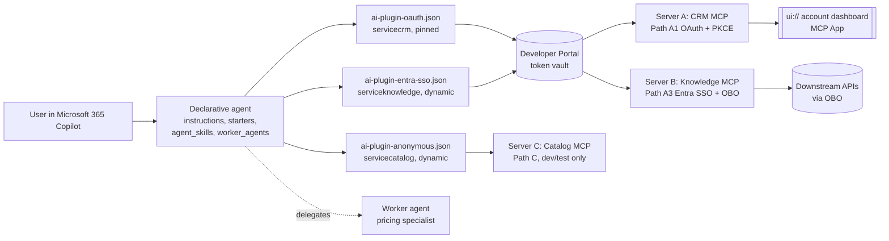
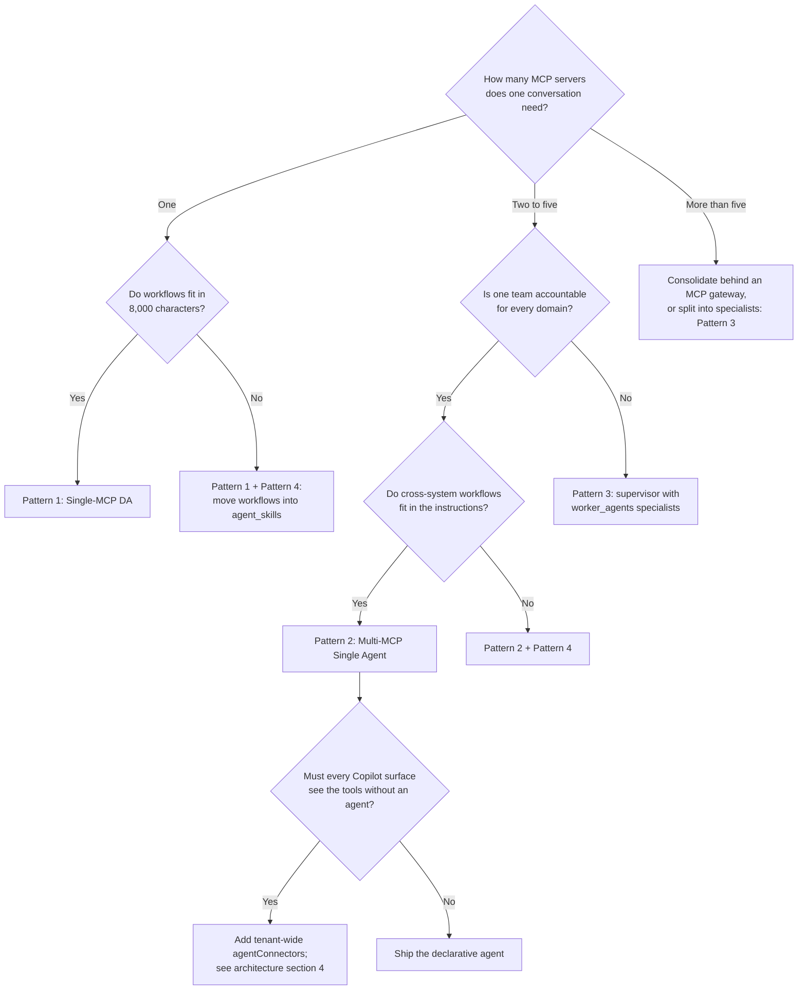

# Microsoft 365 Copilot Declarative Agent & MCP Plugin Integration

> **Maturity:** preview · **Kind:** design-pattern · **Version:** 0.1.0

> **Build the MCP server once. Govern the tool surface in the package. Keep authorization on the server.**

This pattern connects one or more remote [Model Context Protocol (MCP)](https://modelcontextprotocol.io/) servers to Microsoft 365 Copilot through declarative-agent plug-ins (`ai-plugin.json` v2.4, runtime type `RemoteMCPServer`). It covers how to compose agents from MCP servers, how to choose between dynamic and pinned tool discovery, how to stay within the 8,000-character instruction budget with `agent_skills`, how to authenticate each server (OAuth 2.0 + PKCE, dynamic client registration, Microsoft Entra SSO with on-behalf-of, vault-stored keys, or anonymous for development), how to render interactive MCP Apps (`ui://` widgets), and how to keep write actions safe.

Everything in this asset is vendor-neutral and sanitized. The sample organization is Contoso, and every identifier is a placeholder.

## Architecture & implementation map

| Artifact | What it gives you |
|---|---|
| [docs/architecture.md](docs/architecture.md) | The reference architecture: forces, scenarios, registration surfaces, package anatomy, protocol-level discovery, latency, instruction budget, skills, action safety, hosting, security, anti-patterns, and platform limits. |
| [docs/authentication-paths.md](docs/authentication-paths.md) | Paths A1, A2, A3, B, and C with sequence diagrams, token claim tables, Developer Portal vault rules, and the ["Client ID, No Secret" matrix](docs/authentication-paths.md#8-the-client-id-no-secret-classification-matrix). |
| [docs/mcp-apps-and-interactive-widgets.md](docs/mcp-apps-and-interactive-widgets.md) | MCP Apps versus Adaptive Cards, `ui://` resources, the widget bridge, annotated JSON-RPC payloads, CSP, theming, accessibility, and fallback. |
| [docs/troubleshooting-and-diagnostics.md](docs/troubleshooting-and-diagnostics.md) | The six-stage failure localization pipeline, rejected JSON Schema constructs, multi-server sign-in behavior, and the confirmation card test protocol. |
| [docs/decisions/0001-da-plugin-and-discovery-modes.md](docs/decisions/0001-da-plugin-and-discovery-modes.md) | ADR: why declarative-agent plug-ins are the default, and when to pin the tool catalog. |
| [samples/README.md](samples/README.md) | How to package, register, validate, and run the samples. |
| [samples/manifest.json](samples/manifest.json) | App manifest wiring `copilotAgents.declarativeAgents`, `webApplicationInfo`, and `validDomains`. |
| [samples/declarativeAgent.json](samples/declarativeAgent.json) | Declarative agent with budgeted instructions, starters, capabilities, three MCP actions, `worker_agents`, and `agent_skills`. |
| [samples/ai-plugin-oauth.json](samples/ai-plugin-oauth.json) | Server A (CRM): Path A1 OAuth + PKCE, pinned `functions[]`, `states`, and confirmation cards. |
| [samples/ai-plugin-entra-sso.json](samples/ai-plugin-entra-sso.json) | Server B (Knowledge): Path A3 Entra SSO + OBO, dynamic discovery. |
| [samples/ai-plugin-anonymous.json](samples/ai-plugin-anonymous.json) | Server C (Catalog, development endpoint): Path C anonymous, dynamic discovery, read-only. |
| [samples/mcp-tools-catalog.json](samples/mcp-tools-catalog.json) | Pinned `tools/list` snapshot for Server A with flat schemas, annotations, and a widget binding. |
| [samples/sample-skill.md](samples/sample-skill.md) | A portable `SKILL.md` with YAML front matter and a progressive-disclosure workflow. |
| [samples/reference_mcp_server.py](samples/reference_mcp_server.py) | A zero-dependency Streamable HTTP MCP server with a `ui://` dashboard, a bearer-token hook, an R/W1–W4 action gate, and an offline self-test. |

## When to use

- Users already work in Microsoft 365 Copilot and need natural-language access to capabilities behind your HTTP APIs, without a separate chat UI.
- You have, or plan to build, an MCP server and want one implementation to serve Microsoft 365 Copilot and other MCP-capable hosts.
- The experience needs a curated persona, routing instructions, starters, and multi-step workflows that a tenant-wide connector cannot carry.
- One conversation must span several systems (CRM, knowledge, catalog, ticketing) with a different identity model per system.
- Results benefit from an interactive view (a dashboard, a board, a comparison grid) rendered inline as an MCP App.

## When not to use

- You need a fully custom orchestrator, your own model choice, or long-running autonomous jobs. Use a custom engine agent instead; see the related [m365-azure-custom-agent](../m365-azure-custom-agent/README.md) asset.
- The goal is only to index content for Copilot search and grounding. A Copilot connector is simpler than an MCP tool surface.
- The backend cannot enforce per-user authorization and the data is not public. Do not hide that gap behind a shared key or anonymous access.
- Every Copilot surface in the tenant must see the tools without users opening an agent. Use tenant-wide `agentConnectors` (see [Registration surfaces](docs/architecture.md#4-registration-surfaces)).
- The action is high-stakes and irreversible, and you cannot add a server-side draft and approval gate. Keep that action out of Copilot until you can.

## Architecture



The declarative agent owns persona, routing, and workflow knowledge. Each plug-in manifest owns one server's URL, authentication reference, and exposed tool surface. Each MCP server owns authorization, the side-effect gate, and audit. The token vault owns credentials; the package carries only `reference_id` values. See [Reference architecture](docs/architecture.md#3-reference-architecture) for responsibilities per component.

### Enterprise composition taxonomy

This taxonomy describes **how an agent is assembled**. [Architecture section 2](docs/architecture.md#2-pattern-taxonomy) describes **who owns and deploys it** (departmental, workbench, ISV, tenant-wide). Patterns 1 and 2 below coincide with the first two ownership scenarios; Patterns 3 and 4 are composition techniques you can apply inside any scenario.

| | Pattern 1: Single-MCP DA | Pattern 2: Multi-MCP Single Agent | Pattern 3: `worker_agents` Supervisor + Specialists | Pattern 4: `agent_skills` Progressive Disclosure |
|---|---|---|---|---|
| **Shape** | One declarative agent, one MCP plug-in | One declarative agent, two to five MCP plug-ins | A supervisor agent delegates to specialist agents, each with its own plug-ins | One agent whose workflows load on demand from `SKILL.md` folders |
| **Fits when** | One domain, one owning team | One conversation must span systems | Domains need separate instructions, owners, or release cadence | Workflows exceed the instruction budget, or only apply to some turns |
| **Plug-ins** | 1 | `<=5` recommended (platform maximum is 10 actions) | 1–3 per specialist | Any; skills reference tools by namespace |
| **Discovery** | Dynamic | Dynamic for owned servers, pinned for others | Per specialist | Unchanged; skills do not alter discovery |
| **Auth** | One path | Mixed per server (A1, A2, A3, B, C) | Per specialist; each specialist has its own consent | Inherited from the plug-ins the skill calls |
| **Key fields** | `actions[1]` | `actions[2..5]`, namespaced routing table in instructions | `worker_agents[]` in the supervisor | `agent_skills[]` with `folder` entries |
| **Main risk** | Scope creep | Sign-in prompts and per-turn `tools/list` fan-out | Hand-off latency, duplicated context, split audit trails | Silent non-activation of a skill |
| **Read** | [Pattern taxonomy](docs/architecture.md#2-pattern-taxonomy) | [Multi-MCP sign-in](docs/troubleshooting-and-diagnostics.md#5-multi-mcp-sign-in-behavior) | [Instruction budget](docs/architecture.md#8-the-8000-character-instruction-budget) | [Progressive disclosure](docs/architecture.md#9-progressive-disclosure-with-agent_skills) |

The patterns stack. A typical enterprise workbench is Pattern 2 with Pattern 4 for its workflows, and graduates to Pattern 3 when a domain needs its own owner. The sample package demonstrates all four: three plug-ins, one worker agent, and one skill.

### Choosing a pattern



## Key design decisions

1. **Declarative-agent plug-ins are the default registration surface.** They carry instructions, skills, starters, and confirmation text that a tenant-wide connector cannot. See [ADR 0001](docs/decisions/0001-da-plugin-and-discovery-modes.md).
2. **Pin the catalog for servers you do not own or that are under change control; use dynamic discovery for servers you own.** Pinned discovery gives a reviewed, versioned tool surface. See [Tool discovery](docs/architecture.md#6-tool-discovery-at-the-protocol-level).
3. **Authenticate per server, with delegated user identity wherever data is not public.** Prefer A1 or A3. Treat B (vault-stored key) as restricted, and C (anonymous) as development-only or public read-only. See [authentication-paths.md](docs/authentication-paths.md).
4. **Keep instructions to routing and policy; move workflows into skills.** Measure the instruction budget in CI. See [Instruction budget](docs/architecture.md#8-the-8000-character-instruction-budget).
5. **Classify every tool as R, W1, W2, W3, or W4, annotate it, and enforce the class on the server.** Confirmation cards are UX; the server-side gate is the control. See [Action safety](docs/architecture.md#10-action-safety-and-the-confirmation-model).
6. **Keep tool schemas flat.** No `oneOf`, `anyOf`, `allOf`, `$ref`, or recursion. See [Stage 3](docs/troubleshooting-and-diagnostics.md#4-stage-3-toolslist-schema-rejection).
7. **Return structured data first and a widget second.** Every tool that binds a `ui://` resource must also return useful text, so surfaces that do not render widgets still work. See [MCP Apps](docs/mcp-apps-and-interactive-widgets.md).
8. **Use `worker_agents` for ownership boundaries, not for performance.** Each delegation adds a model hop; split only when a domain needs its own owner, instructions, or consent.

## Getting started

Prerequisites: a Microsoft 365 tenant with Copilot licenses and custom app upload enabled, access to the Teams Developer Portal, Python 3.10 or later, and the Microsoft 365 Agents Toolkit (CLI or Visual Studio Code extension).

1. **Run the reference server's self-test.** It needs no packages and no network:

   ```powershell
   python samples/reference_mcp_server.py
   ```

   The self-test exercises `initialize`, `tools/list`, `tools/call`, `resources/list`, `resources/read`, the bearer-token hook, and every gate rule, then prints a summary.
2. **Serve it locally** with `python samples/reference_mcp_server.py --serve --port 8080 --allow-anonymous` and call it with any MCP client. Anonymous mode exposes read tools only.
3. **Expose it over HTTPS.** Microsoft 365 Copilot reaches servers only over public HTTPS. Use a tunnel for the inner loop and Azure Container Apps (or equivalent) behind your gateway for shared environments.
4. **Register authentication** for each authenticated server in the Developer Portal and copy each registration ID into the matching `reference_id`. Follow [authentication-paths.md](docs/authentication-paths.md).
5. **Package and validate** with the Agents Toolkit, then sideload the package. Step-by-step commands are in [samples/README.md](samples/README.md).
6. **Test with the protocols in the docs:** run the six-stage checks and the confirmation card test protocol in [troubleshooting-and-diagnostics.md](docs/troubleshooting-and-diagnostics.md) before sharing the agent.

## Security and responsible AI

- **The server is the authorization boundary.** Validate the bearer token on every request (signature, `iss`, `aud`, expiry, `tid`, scopes), and authorize every tool call against the caller's identity. Never trust the model, the confirmation card, or widget state.
- **No secrets in the package.** Plug-in manifests contain only vault `reference_id` values. Client secrets live in the Developer Portal vault; server-side credentials live in Azure Key Vault behind managed identity.
- **Do not pass the Copilot-issued token through.** Exchange it with on-behalf-of for each downstream audience (Path A3), and keep audiences separate.
- **Gate writes on the server.** Draft before send (W2 before W3), require approval tokens for fan-out (W4), cap writes per user per day, keep a kill switch, and audit every write with a correlation ID.
- **Treat tool output as untrusted input to the model.** Strip or neutralize instructions embedded in records, and keep tool descriptions free of directives that could be abused.
- **Widgets are sandboxed but still your code.** Ship a strict CSP, no inline secrets, no third-party trackers, and accessible markup that respects host themes and high-contrast mode.
- **Tell users what the agent can do.** State in the description and starters which systems the agent reads and writes, and keep human confirmation for every non-read action.

## Limitations

- Copilot extensibility schemas and limits change frequently. Every version, limit, and endpoint in this asset was current for app manifest 1.29, declarative agent v1.8, plug-in manifest v2.4, and MCP protocol `2025-06-18`; re-verify against the toolkit release you ship with.
- `ApiKeyPluginVault` for MCP plug-ins and dynamic client registration in plug-in manifests are not validated in this pattern. See the [classification matrix](docs/authentication-paths.md#8-the-client-id-no-secret-classification-matrix).
- MCP Apps render only on Copilot surfaces that support them. Design every widget-bound tool to degrade to text.
- `worker_agents` delegation and `agent_skills` loading are model-mediated. Neither is a deterministic workflow engine; test activation and hand-off explicitly.
- The reference server is a teaching artifact. It uses an in-memory store, a development-only HMAC token check, and a single process. Replace the token validator, storage, and gate counters before any shared deployment.

## References

- [Model Context Protocol specification (2025-06-18)](https://modelcontextprotocol.io/specification/2025-06-18)
- [MCP Apps extension](https://github.com/modelcontextprotocol/ext-apps)
- [Microsoft 365 Copilot extensibility overview](https://learn.microsoft.com/microsoft-365-copilot/extensibility/)
- [Declarative agents for Microsoft 365 Copilot](https://learn.microsoft.com/microsoft-365-copilot/extensibility/overview-declarative-agent)
- [Authentication for plug-ins in Microsoft 365 Copilot](https://learn.microsoft.com/microsoft-365-copilot/extensibility/api-plugin-authentication)
- [Microsoft identity platform: on-behalf-of flow](https://learn.microsoft.com/entra/identity-platform/v2-oauth2-on-behalf-of-flow)
- [RFC 7636: Proof Key for Code Exchange](https://www.rfc-editor.org/rfc/rfc7636)
- [RFC 7591: OAuth 2.0 Dynamic Client Registration](https://www.rfc-editor.org/rfc/rfc7591)
- [RFC 9728: OAuth 2.0 Protected Resource Metadata](https://www.rfc-editor.org/rfc/rfc9728)
- Related assets: [Agent Production Readiness Guide](../../agentops-and-readiness/agent-production-readiness/README.md), [m365-azure-custom-agent](../m365-azure-custom-agent/README.md), [agent-security-and-governance](../../security-and-governance/agent-security-and-governance/README.md)
