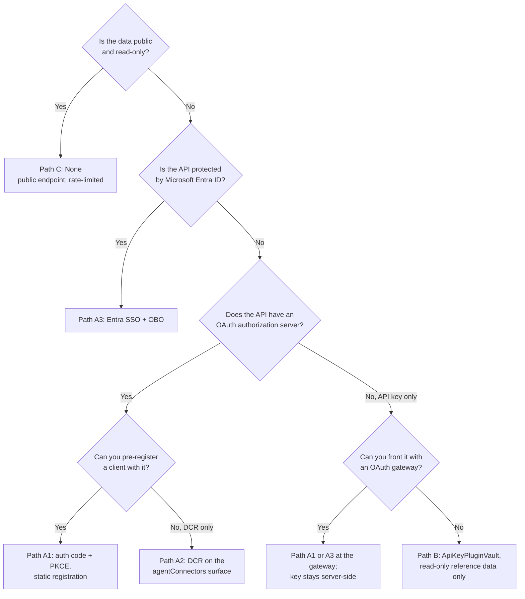
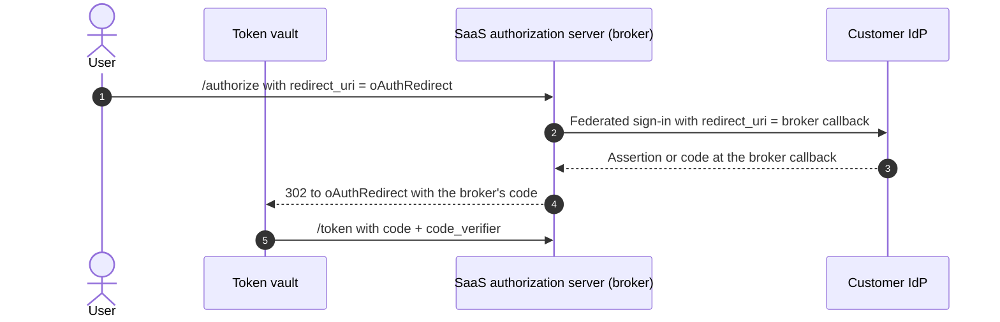
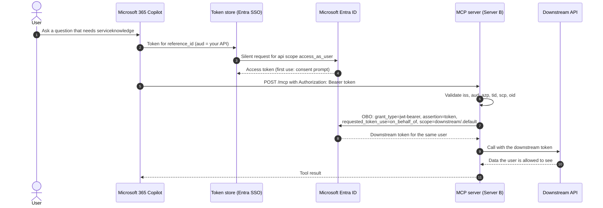

# Authentication paths for MCP plug-ins in Microsoft 365 Copilot

This guide is the protocol-level companion to [architecture.md](architecture.md). It describes the five authentication paths a `RemoteMCPServer` plug-in can use, what each path puts in the bearer token your MCP server receives, how to register each path in the Teams Developer Portal token vault, and how to classify a backend that offers "a client ID but no secret."

> Endpoints, redirect URIs, and vault fields below were current for plug-in manifest v2.4 and MCP protocol `2025-06-18`. Re-verify them against current Microsoft Learn documentation before production use.

## 1. Overview and decision tree

| Path | Mechanism | Identity at the MCP server | Vault `auth.type` | Per-user authorization | Use for |
|---|---|---|---|---|---|
| **A1** | OAuth 2.0 authorization code + PKCE, static client registration | Signed-in user, as known to the provider | `OAuthPluginVault` | Yes | SaaS or line-of-business APIs with their own authorization server |
| **A2** | OAuth 2.0 with dynamic client registration (RFC 7591) | Signed-in user | Connectors surface only (`DynamicClientRegistration`) | Yes | Authorization servers that allow open or token-gated registration |
| **A3** | Microsoft Entra SSO, then on-behalf-of (OBO) at the server | Signed-in Entra user (`oid`, `tid`) | `OAuthPluginVault` (Entra SSO registration) | Yes | Internal APIs and anything protected by Entra ID |
| **B** | API key or service-account bearer token | A shared service identity | `ApiKeyPluginVault` | No | Read-only reference data, behind an OAuth gateway |
| **C** | Anonymous | None | `None` | No | Development inner loop, or genuinely public read-only data |



Rules that apply to every path:

1. The package never contains a secret. Plug-in manifests carry only `auth.type` and, for vault types, `auth.reference_id`.
2. The MCP server validates every request, including `initialize` and `tools/list` when the server requires authentication.
3. An unauthenticated request to an authenticated server returns HTTP `401` with a `WWW-Authenticate: Bearer` header, so the host can start sign-in rather than treat the server as broken.
4. One plug-in has one auth configuration. If two tools on the same server need different identities, split the server.

## 2. Token anatomy

Your server sees only the bearer token. These claims decide whether the request is accepted.

| Claim | Meaning | What the MCP server must check |
|---|---|---|
| `aud` | Audience: the API the token was issued for | Equals your API identifier exactly. For Entra v2 tokens this is the API app's client ID; for v1 tokens it is the Application ID URI. Reject tokens minted for Microsoft Graph or another API. |
| `iss` | Issuer | Equals the expected issuer. Entra v2: `https://login.microsoftonline.com/{tid}/v2.0`; v1: `https://sts.windows.net/{tid}/`. For multitenant APIs, validate against an allow list of tenants rather than accepting any issuer pattern. |
| `scp` | Delegated scopes, space-separated | Contains the scope the tool needs (for example `access_as_user` or `crm.read`). App-only tokens carry `roles` instead; reject them on delegated-only tools. |
| `azp` / `appid` | The client that requested the token (v2 / v1) | Equals an expected client: the OAuth client registered in the vault (A1), or the Microsoft token store client (A3). |
| `tid` | Entra tenant ID | Is in your tenant allow list. Use it to partition data and rate limits. |
| `oid` | Immutable user object ID in that tenant | The key for per-user authorization, caps, and audit. Do not use `upn`, `email`, or `name` as keys; they change and can be reassigned. |
| `exp`, `nbf` | Validity window | Enforce with a small clock-skew allowance (up to five minutes). |

Non-Entra providers (A1, A2) issue their own claim set. Map their equivalents (`sub`, `client_id`, an organization claim) onto the same checks, and document the mapping next to the server's validator.

For an Entra-protected API, set `accessTokenAcceptedVersion` to `2` in the API app registration so `aud`, `iss`, and `azp` are predictable.

## 3. Path A1: OAuth 2.0 authorization code + PKCE (static registration)

Use A1 when the backend has its own OAuth 2.0 authorization server and you can register a client with it ahead of time. This is the default for SaaS systems such as CRM, ticketing, and ERP.

### 3.1 Flow

```mermaid
sequenceDiagram
    autonumber
    actor U as User
    participant C as Microsoft 365 Copilot
    participant V as Token vault
    participant AS as Provider authorization server
    participant M as MCP server (Server A)
    U->>C: Ask a question that needs servicecrm
    C->>V: Get token for reference_id
    V-->>C: No token for this user
    C-->>U: Sign-in card
    U->>AS: GET /authorize?response_type=code&client_id&redirect_uri=oAuthRedirect<br/>&scope&state&code_challenge&code_challenge_method=S256
    AS-->>U: Sign in and consent
    AS->>V: 302 to oAuthRedirect?code&state
    V->>AS: POST /token grant_type=authorization_code, code, code_verifier, client credentials
    AS-->>V: access_token, refresh_token, expires_in
    C->>M: POST /mcp tools/call with Authorization: Bearer access_token
    M->>M: Validate iss, aud, exp, scopes; authorize the user
    M-->>C: Tool result
```

### 3.2 Developer Portal registration

Create an **OAuth client registration** in the Teams Developer Portal (Tools, then OAuth client registration):

| Field | Value for Server A |
|---|---|
| Registration name | `contoso-crm-mcp` |
| Base URL | `https://crm-mcp.contoso.com` (must be a prefix of `spec.url`) |
| Restrict usage by organization | Your organization only, unless you ship to other tenants |
| Restrict usage by app | The Teams app ID from `manifest.json`, so another app cannot reuse the registration |
| Client ID / client secret | From the provider's client registration. Some providers accept a public client with PKCE and no secret; see [section 8](#8-the-client-id-no-secret-classification-matrix). |
| Authorization endpoint | `https://auth.crm.contoso.com/oauth2/authorize` |
| Token endpoint / refresh endpoint | `https://auth.crm.contoso.com/oauth2/token` |
| Scopes | `crm.read crm.write offline_access` |
| Enable PKCE | On |

At the provider, register the redirect URI `https://teams.microsoft.com/api/platform/v1.0/oAuthRedirect`. Saving the registration produces an **OAuth client registration ID**; that ID is the `reference_id`.

### 3.3 Manifest wiring

```json
"runtimes": [
  {
    "type": "RemoteMCPServer",
    "auth": {
      "type": "OAuthPluginVault",
      "reference_id": "${{CRM_OAUTH_REFERENCE_ID}}"
    },
    "spec": {
      "url": "https://crm-mcp.contoso.com/mcp",
      "mcp_tool_description": { "file": "mcp-tools-catalog.json" }
    },
    "run_for_functions": ["get_account_summary", "search_opportunities"]
  }
]
```

The `${{CRM_OAUTH_REFERENCE_ID}}` placeholder is resolved by the Agents Toolkit from an environment file at package time. The complete manifest is [ai-plugin-oauth.json](../samples/ai-plugin-oauth.json).

### 3.4 PKCE parameters

| Parameter | Rule |
|---|---|
| `code_verifier` | High-entropy random string, 43 to 128 characters from `[A-Z a-z 0-9 - . _ ~]`; generated per sign-in by the vault and never sent to the browser |
| `code_challenge` | `BASE64URL(SHA256(code_verifier))` without padding |
| `code_challenge_method` | `S256`. Reject `plain` at the authorization server. |
| `state` | Opaque, single-use, bound to the sign-in session; the vault validates it on the redirect |

PKCE protects the authorization code if it is intercepted. It does not replace client authentication when the provider issues a secret, and it does not replace token validation at the MCP server.

### 3.5 Refresh token behavior

- Request `offline_access` (or the provider's equivalent) so the vault receives a refresh token. Without it, users sign in again every time the access token expires, often hourly.
- The vault refreshes silently when the access token is expired or near expiry. A failed refresh (revoked grant, expired refresh token, password reset, conditional access change) produces a new sign-in card in the next turn that calls the plug-in.
- If the provider rotates refresh tokens, enable a short reuse grace window. Concurrent tool calls in one turn can otherwise race and trigger reuse detection, revoking the whole grant.
- Keep access tokens short (5 to 60 minutes). Revoke at the provider to cut off access; the vault cannot be purged per user from your side.
- Sign-in is per user, per registration. Two plug-ins that share one `reference_id` share one consent, which helps multi-server agents (see [Multi-MCP sign-in behavior](troubleshooting-and-diagnostics.md#5-multi-mcp-sign-in-behavior)).

### 3.6 Token claims at Server A

| Claim | Expected value |
|---|---|
| `iss` | `https://auth.crm.contoso.com` |
| `aud` | `https://crm-mcp.contoso.com` (the provider's resource identifier for the MCP server) |
| `scp` / `scope` | Includes `crm.read`; `crm.write` for W-class tools |
| `azp` / `client_id` | The client ID stored in the vault registration |
| `sub` | The provider's user ID; map it to your authorization model |
| `tid` equivalent | The provider's organization or tenant claim, checked against an allow list |

## 4. Path A2: OAuth 2.0 dynamic client registration (RFC 7591)

With DCR, the client registers itself with the authorization server at run time instead of being pre-registered. The MCP authorization specification describes the discovery chain: the server returns `401` with a `resource_metadata` pointer, the client reads the protected resource metadata (RFC 9728), then the authorization server metadata (RFC 8414), and registers at its `registration_endpoint` (RFC 7591) before running authorization code + PKCE.

### 4.1 Where A2 works

- **Surface:** dynamic client registration is an auth type on the tenant-wide `agentConnectors` surface (see [Registration surfaces](architecture.md#4-registration-surfaces)). It is not validated for declarative-agent plug-in manifests in this pattern. For a plug-in, pre-register a client and use A1.
- **Authorization server:** it must publish `registration_endpoint` and accept registrations from the host, either openly or with an initial access token the administrator supplies.

### 4.2 Where A2 is blocked

| Authorization server | DCR status | What to do |
|---|---|---|
| Microsoft Entra ID | Does not support RFC 7591 | Use A3, or A1 with a pre-registered app |
| Enterprise Okta, Ping, or similar | Often disabled, or requires an initial access token | Ask the IdP team for a static client; use A1 |
| SaaS authorization server with open DCR | Supported | A2 on the connectors surface, or a static client with A1 |
| Policy forbids self-registered clients | Blocked by governance | Use A1 with a reviewed, named client |

Open DCR lets any caller mint clients. Where it is allowed, constrain it: accept only the Microsoft redirect URI, issue public clients with PKCE required, limit scopes, and expire unused clients.

### 4.3 Registration exchange

```json
POST /oauth2/register
{
  "client_name": "Contoso Account Workbench",
  "redirect_uris": ["https://teams.microsoft.com/api/platform/v1.0/oAuthRedirect"],
  "grant_types": ["authorization_code", "refresh_token"],
  "response_types": ["code"],
  "token_endpoint_auth_method": "none",
  "scope": "crm.read offline_access"
}

201 Created
{
  "client_id": "dcr-7f3c2a",
  "client_id_issued_at": 1792540800,
  "redirect_uris": ["https://teams.microsoft.com/api/platform/v1.0/oAuthRedirect"],
  "token_endpoint_auth_method": "none"
}
```

### 4.4 Brokered authorization servers and upstream IdP callbacks

Many SaaS authorization servers broker sign-in to the customer's own IdP. There are then two redirect hops, and each has its own callback:



Register `https://teams.microsoft.com/api/platform/v1.0/oAuthRedirect` **at the broker**, as the client's redirect URI. Keep the broker's own callback registered **at the upstream IdP**. Replacing the upstream callback with `oAuthRedirect` breaks federation for every other client of the broker; see the anti-pattern in [architecture section 13](architecture.md#13-anti-patterns).

## 5. Path A3: Microsoft Entra SSO + on-behalf-of (OBO) passthrough

Use A3 when the MCP server is protected by Microsoft Entra ID. The user is already signed in to Microsoft 365, so the token store obtains a token for your API silently after a one-time consent. The MCP server then exchanges that token with OBO for each downstream API.

### 5.1 Flow



### 5.2 Entra app registration for the MCP API

1. Register a single-tenant app (or multitenant for ISV scenarios) for the MCP server, with `accessTokenAcceptedVersion` set to `2`.
2. In the Developer Portal, create a **Microsoft Entra ID SSO client ID registration** with the server base URL, your organization restriction, the Teams app ID restriction, and the app's client ID. The portal displays an Application ID URI; set it on the app under **Expose an API**.
3. Add the delegated scope `access_as_user` (admins and users can consent).
4. Add the Microsoft enterprise token store as a **pre-authorized client application** for `access_as_user`. Its client ID is documented as `ab3be6b7-f5df-413d-ac2d-abf1e3fd9c0b`; confirm it against the current plug-in authentication documentation.
5. Add the web redirect URI `https://teams.microsoft.com/api/platform/v1.0/oAuthConsentRedirect`.
6. Add a credential for OBO: prefer a federated identity credential bound to the server's managed identity, then a certificate. Avoid client secrets.
7. Grant admin consent for the downstream delegated permissions the server requests through OBO, so users do not hit consent errors mid-conversation.

The SSO registration ID becomes the plug-in's `reference_id`, and `webApplicationInfo` in [manifest.json](../samples/manifest.json) names the same client ID and resource.

```json
"auth": {
  "type": "OAuthPluginVault",
  "reference_id": "${{KNOWLEDGE_SSO_REFERENCE_ID}}"
}
```

### 5.3 Token claims at Server B

| Claim | Expected value |
|---|---|
| `aud` | The MCP API app's client ID (v2 token) |
| `iss` | `https://login.microsoftonline.com/{tid}/v2.0` for an allow-listed `tid` |
| `scp` | Contains `access_as_user` |
| `azp` | The token store client ID from step 4 |
| `tid` | Your tenant, or an allow-listed customer tenant |
| `oid` | The user; key authorization, caps, and audit on `tid` + `oid` |

### 5.4 OBO to downstream systems

The server is a confidential client. It never forwards the incoming token; it exchanges it for a token per downstream audience and caches the result per user and scope until shortly before expiry.

| Downstream | OBO scope | Authorization enforced by |
|---|---|---|
| Microsoft Graph | `https://graph.microsoft.com/.default` (delegated permissions consented on the API app) | Graph, as the user |
| Azure Databricks Unity Catalog | `2ff814a6-3304-4ab8-85cb-cd0e6f879c1d/.default` (the Azure Databricks resource) | Unity Catalog grants for the user |
| Dataverse-based CRM | `https://{org}.crm.dynamics.com/.default` | CRM security roles for the user |
| Your own Entra-protected API | `api://{downstream-app-id}/.default` | That API, which validates `aud` again |

```python
import msal

app = msal.ConfidentialClientApplication(
    client_id=API_CLIENT_ID,
    authority=f"https://login.microsoftonline.com/{tenant_id}",
    client_credential={"client_assertion": federated_assertion_from_managed_identity},
)
result = app.acquire_token_on_behalf_of(
    user_assertion=incoming_bearer_token,
    scopes=["https://graph.microsoft.com/.default"],
)
if "access_token" not in result:
    # AADSTS65001: consent missing. AADSTS50076 / interaction_required: MFA or
    # conditional access. Return a tool error the user can act on; do not retry.
    raise PermissionError(result.get("error_description", "obo_failed"))
```

## 6. Path B: API key or service-account bearer token (vault-stored)

The Developer Portal stores a key in an **API key registration** (base URL, organization and app restrictions, the key). The host sends it as a bearer token on every request.

```json
"auth": {
  "type": "ApiKeyPluginVault",
  "reference_id": "${{CATALOG_APIKEY_REFERENCE_ID}}"
}
```

`ApiKeyPluginVault` for `RemoteMCPServer` runtimes is unvalidated in this pattern; see [Hosting, identity, and observability](architecture.md#11-hosting-identity-and-observability). Prefer an OAuth gateway that holds the key server-side and presents A1 or A3 to Copilot.

**Blast radius.** Every user shares one identity. The server cannot tell users apart, cannot enforce per-user authorization, and cannot attribute writes to a person. A leaked key grants every user's access to anyone who holds it.

If you must use B:

- Expose read-only (R) tools only, over reference data that every user in the tenant may see: price lists, product specifications, public policies.
- No personal data, no customer records, no write tools of any class.
- Issue a key scoped to read-only at the backend, rate-limit it, and rotate it at least every 90 days by updating the registration in place (the `reference_id` does not change).
- Log the Copilot correlation headers with every call so incidents can still be traced to a conversation.

## 7. Path C: anonymous (`None`)

```json
"auth": { "type": "None" }
```

Anonymous is for the development inner loop and for genuinely public, read-only data. Guardrails:

1. Use a separate host name for development (`catalog-mcp-dev.contoso.com` in [ai-plugin-anonymous.json](../samples/ai-plugin-anonymous.json)), with synthetic data only.
2. Expose R tools only. The [reference server](../samples/reference_mcp_server.py) hides every W-class tool when `--allow-anonymous` is set.
3. Apply rate limiting and request size limits; anonymous endpoints are reachable by anyone who finds the URL.
4. Add a release check that fails when a production package contains a `"type": "None"` runtime whose host is not on a public-data allow list.
5. Close development tunnels when the session ends.

## 8. The "Client ID, No Secret" classification matrix

Teams often receive only "a client ID" from a backend owner. The client ID alone does not tell you the path; how the backend uses it does.

| What you were given | How to recognize it | Classification | Vault registration | Notes |
|---|---|---|---|---|
| Client ID + client secret + authorize and token endpoints | Standard confidential OAuth client | **A1** (confidential) | OAuth client registration | Default for SaaS; enable PKCE as well |
| Client ID, PKCE-enabled public client, no secret | Provider docs say "public client" or `token_endpoint_auth_method: none` | **A1** (public + PKCE) | OAuth client registration | If the registration form requires a secret, ask the provider for a confidential client; never invent a value |
| Client ID that is an Entra app ID (a GUID), issuer `login.microsoftonline.com` | Tokens have `tid`, `oid`, `scp` | **A3** | Microsoft Entra ID SSO registration | The most common misclassification: treating an Entra API as generic OAuth (A1) works for one user and then fails consent |
| Client ID + authorization server with `registration_endpoint` | RFC 8414 metadata lists DCR | **A2** on the connectors surface, or A1 with a static client | Connectors DCR, or OAuth client registration | Plug-ins: register a static client and use A1 |
| A "client ID" sent as a header such as `x-client-id`, with no token endpoint | It is an API key or account identifier | **B**, preferably behind an OAuth gateway | API key registration | Read-only reference data only |
| A managed identity or service principal client ID | Used for server-to-server calls | Not a user path; it is the server's outbound identity | None in the package | Combine with A3 at the front door |
| Nothing; the endpoint is open | No auth challenge | **C** | None | Development or public read-only data only |

## 9. Developer Portal vault registration rules

1. One registration per server per environment. Keep `reference_id` values in Agents Toolkit environment files (`env/.env.dev`, `env/.env.prod`), never hard-coded.
2. The registration's base URL must be a prefix of `spec.url`. A mismatch means no token is attached and the server sees an unauthenticated call.
3. Restrict each registration to your organization and to the Teams app ID. For multitenant ISV distribution, allow any organization and review the tenant allow list on the server.
4. Add at least two owners so the registration survives staff changes.
5. Rotate secrets and keys in place; the `reference_id` stays stable, so no package change is needed.
6. Request `offline_access` (A1, A2) and grant admin consent ahead of rollout (A3).
7. Delete registrations for retired servers; an orphaned registration with a valid secret is standing access.

## 10. Server-side validation checklist

- [ ] Reject requests without `Authorization: Bearer` with `401` and `WWW-Authenticate: Bearer resource_metadata="..."`.
- [ ] Validate the signature against the issuer's published keys, and cache keys with rotation support.
- [ ] Check `iss`, `aud`, `exp`, and `nbf`, then `tid` against the allow list.
- [ ] Check `azp` or `appid` against expected clients.
- [ ] Check `scp` per tool; reject app-only tokens on delegated tools.
- [ ] Authorize each `tools/call` against `tid` + `oid` (or the provider subject) and the side-effect class.
- [ ] Use OBO per downstream audience; never forward the incoming token.
- [ ] Log `tid`, `oid`, tool, result, and correlation ID; never log tokens.

The [reference server](../samples/reference_mcp_server.py) shows where each check plugs in (`validate_bearer`).

## 11. Troubleshooting map

| Symptom | Likely cause | Fix |
|---|---|---|
| Sign-in card loops or reports a redirect error | `oAuthRedirect` not registered at the provider, or replaced at the upstream IdP | Register it at the authorization server; keep the broker callback upstream ([4.4](#44-brokered-authorization-servers-and-upstream-idp-callbacks)) |
| `401` from the server right after sign-in | `aud` mismatch (v1 versus v2 token, or Application ID URI typo) | Set `accessTokenAcceptedVersion: 2`; compare `aud` with the validator |
| Server receives no `Authorization` header | Registration base URL does not match `spec.url` | Fix the base URL; repackage only if `spec.url` changed |
| `AADSTS65001` during OBO | Downstream delegated permission not consented | Grant admin consent on the API app |
| `AADSTS50076` or `interaction_required` during OBO | MFA or conditional access on the downstream resource | Align conditional access policies; return a clear tool error |
| Works for the author, fails for colleagues | Registration restricted to the wrong app or organization, or consent granted only for the author | Fix restrictions; grant tenant-wide consent |
| Users re-sign in every hour | No refresh token issued | Add `offline_access`; check refresh token lifetime policy |

For stage-by-stage diagnosis, see [troubleshooting-and-diagnostics.md](troubleshooting-and-diagnostics.md).
