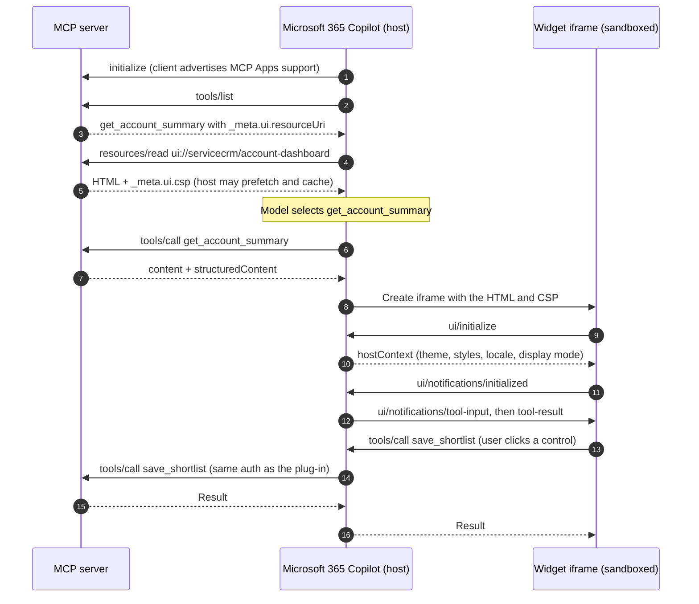

# MCP Apps and interactive widgets in declarative agents

This guide explains how an MCP server returns an interactive view (an **MCP App**, served as a `ui://` resource) to Microsoft 365 Copilot, how that view talks to the host, and how it compares with Adaptive Cards. It extends [Tool discovery](architecture.md#6-tool-discovery-at-the-protocol-level) and the security rules in [Security model](architecture.md#12-security-model).

> Message names and `_meta` fields follow the MCP Apps extension stable v1 (2026-01-26) on MCP protocol `2025-06-18`. Hosts adopt extension revisions at different times; re-verify field names against the extension specification and the Copilot release notes before shipping.

## 1. MCP Apps versus Adaptive Cards

| Concern | Adaptive Cards (plug-in response semantics, confirmation cards) | MCP Apps (`ui://` resources) |
|---|---|---|
| Defined in | Plug-in manifest (`functions[].capabilities`) | The MCP server (`resources/read`), bound by tool `_meta` |
| Rendering | Host-native JSON card renderer | Sandboxed HTML iframe |
| Interactivity | `Action.Submit`, `Action.OpenUrl`; no live code | Full JavaScript; can call server tools through the host |
| Portability | Microsoft 365 hosts | Any MCP host that implements the extension |
| Theming | Automatic | The widget applies host-provided CSS variables |
| Best for | Confirmations, compact result summaries, citations | Dashboards, boards, comparison grids, multi-step pickers |
| Versioning | Ships with the app package | Ships with the server; change without repackaging |
| Failure mode | Card does not render, text remains | Surface without MCP Apps support shows text only |

Use both. Keep **confirmation** on Adaptive Cards (or the host's built-in confirmation) because it is enforced by the host before the call is made. Use MCP Apps for **exploration** views the user interacts with after a read tool returns.

## 2. Architecture of a `ui://` widget

A widget has three parts: a tool that declares which view renders its result, a resource that holds the view's HTML, and a bridge that connects the running view to the host.



Key properties:

- **The binding is declared on the tool.** `_meta.ui.resourceUri` on the tool definition tells the host which resource renders that tool's result. Hosts can prefetch and cache the resource at discovery time, before the tool is ever called.
- **The data arrives separately from the view.** The resource is a static template. Per-call data reaches the view through `ui/notifications/tool-result`, carrying the same `structuredContent` the model sees.
- **The view never talks to the server directly.** Every server call from the view is a JSON-RPC message to the host, which forwards it with the plug-in's own authentication and policy. The view never sees a token.
- **Visibility controls who can call a tool.** `_meta.ui.visibility` of `["model", "app"]` (the default) lets both the model and the view call the tool; `["app"]` hides it from the model, which suits helper tools such as pagination or chart refresh.

## 3. Annotated JSON-RPC payloads

The examples use Server A from the samples. Comments (`//`) are annotations only; strip them from real payloads.

### 3.1 `tools/list` with a widget binding

```jsonc
{
  "jsonrpc": "2.0",
  "id": 2,
  "result": {
    "tools": [
      {
        "name": "get_account_summary",
        "title": "Get account summary",
        "description": "Return the health, pipeline, and recent orders for one customer account. Use when the user names an account or asks how an account is doing.",
        "inputSchema": {
          "type": "object",
          "properties": {
            "account_id": { "type": "string", "description": "Account ID, for example ACC-1001." }
          },
          "required": ["account_id"],
          "additionalProperties": false
        },
        "annotations": { "title": "Get account summary", "readOnlyHint": true, "openWorldHint": false },
        "_meta": {
          "ui": {
            "resourceUri": "ui://servicecrm/account-dashboard", // binds the view
            "visibility": ["model", "app"]                       // model and view may call it
          }
        }
      }
    ]
  }
}
```

### 3.2 `resources/list`

```jsonc
{
  "jsonrpc": "2.0",
  "id": 3,
  "result": {
    "resources": [
      {
        "uri": "ui://servicecrm/account-dashboard",
        "name": "account-dashboard",
        "title": "Account dashboard",
        "description": "Interactive health, pipeline, and orders view for one account.",
        "mimeType": "text/html;profile=mcp-app" // marks the resource as an MCP App view
      }
    ]
  }
}
```

### 3.3 `resources/read`

```jsonc
{
  "jsonrpc": "2.0",
  "id": 4,
  "result": {
    "contents": [
      {
        "uri": "ui://servicecrm/account-dashboard",
        "mimeType": "text/html;profile=mcp-app",
        "text": "<!doctype html><html lang=\"en\"><head><meta charset=\"utf-8\">...</head><body>...</body></html>",
        "_meta": {
          "ui": {
            "csp": {
              "connectDomains": [],                           // no direct network calls from the view
              "resourceDomains": ["https://cdn.contoso.com"]  // fonts and images only
            },
            "prefersBorder": true
          }
        }
      }
    ]
  }
}
```

Keep the HTML self-contained: inline the script and styles, and load only static assets from domains listed in `resourceDomains`. A view that needs data should call a tool through the host, not fetch from your API.

### 3.4 `tools/call` returning structured data for the widget

```jsonc
// Request
{ "jsonrpc": "2.0", "id": 7, "method": "tools/call",
  "params": { "name": "get_account_summary", "arguments": { "account_id": "ACC-1001" } } }

// Response
{
  "jsonrpc": "2.0",
  "id": 7,
  "result": {
    "content": [
      { "type": "text",
        "text": "Fabrikam Retail (ACC-1001): health 82/100, 3 open opportunities worth 410,000 USD, last order 2026-10-14." }
    ],
    "structuredContent": {                  // what the model and the view both receive
      "account_id": "ACC-1001",
      "name": "Fabrikam Retail",
      "health_score": 82,
      "open_opportunities": 3,
      "pipeline_value": 410000,
      "currency": "USD",
      "recent_orders": [
        { "order_id": "ORD-5531", "date": "2026-10-14", "total": 18250 }
      ]
    },
    "_meta": {
      "ui": { "resourceUri": "ui://servicecrm/account-dashboard", "title": "Fabrikam Retail" }
    },
    "isError": false
  }
}
```

The text block is not decoration. It is the answer on every surface that does not render the view, and it is what the model reasons over when composing the reply. The tool definition is the authoritative binding; echoing `resourceUri` and a `title` in the result `_meta` is a convenience some hosts use for the view's header.

## 4. The widget bridge

The view and the host exchange JSON-RPC 2.0 messages over `window.postMessage`. The view is a sandboxed iframe with an opaque origin, so it posts to `window.parent` and accepts only messages whose `source` is `window.parent`.

| Message | Direction | Kind | Purpose |
|---|---|---|---|
| `ui/initialize` | View to host | Request | Handshake; the host returns `hostContext` and its capabilities |
| `ui/notifications/initialized` | View to host | Notification | The view is ready to receive data |
| `ui/notifications/tool-input` | Host to view | Notification | The arguments the tool was called with |
| `ui/notifications/tool-result` | Host to view | Notification | The `CallToolResult`, including `structuredContent` |
| `ui/notifications/host-context-changed` | Host to view | Notification | Theme, locale, or display mode changed |
| `ui/notifications/size-changed` | View to host | Notification | The view's content height changed |
| `tools/call` | View to host to server | Request | A user control invokes a server tool |
| `resources/read` | View to host to server | Request | Load another resource the view needs |
| `ui/open-link` | View to host | Request | Open a URL; the host decides how, and may ask the user |
| `ui/message` | View to host | Request | Post a message into the conversation after an explicit user action |
| `ui/resource-teardown` | Host to view | Request | The view is about to be removed; flush state |

### 4.1 Handshake

```jsonc
// View to host
{ "jsonrpc": "2.0", "id": 1, "method": "ui/initialize",
  "params": { "appInfo": { "name": "account-dashboard", "version": "1.4.0" }, "appCapabilities": {} } }

// Host to view
{ "jsonrpc": "2.0", "id": 1, "result": {
    "hostInfo": { "name": "microsoft-365-copilot" },
    "hostCapabilities": { "serverTools": {}, "openLinks": {} },
    "hostContext": {
      "theme": "dark",
      "displayMode": "inline",
      "locale": "en-US",
      "styles": { "variables": { "--color-background-primary": "#1f1f1f", "--color-text-primary": "#ffffff" } }
    } } }
```

Read capabilities before using them. If `serverTools` is absent, hide controls that would call tools and show a hint to ask the agent instead.

### 4.2 Minimal bridge client

```js
const pending = new Map();
let nextId = 1;

function request(method, params) {
  const id = nextId++;
  window.parent.postMessage({ jsonrpc: "2.0", id, method, params }, "*");
  return new Promise((resolve, reject) => pending.set(id, { resolve, reject }));
}

window.addEventListener("message", (event) => {
  if (event.source !== window.parent) return;            // ignore everything else
  const msg = event.data;
  if (msg && msg.id !== undefined && pending.has(msg.id)) {
    const { resolve, reject } = pending.get(msg.id);
    pending.delete(msg.id);
    msg.error ? reject(msg.error) : resolve(msg.result);
  } else if (msg && msg.method === "ui/notifications/tool-result") {
    render(msg.params.structuredContent);                 // render with textContent, never innerHTML
  } else if (msg && msg.method === "ui/notifications/host-context-changed") {
    applyTheme(msg.params);
  }
});

// A user control calls a W1 tool through the host
async function onSaveShortlist(accountId) {
  const result = await request("tools/call",
    { name: "save_shortlist", arguments: { account_id: accountId, note: "Follow up" } });
  showStatus(result.isError ? "Not saved" : "Saved to your shortlist");
}
```

The `"*"` target origin is required because the sandboxed parent relationship has no stable origin to name; the `event.source` check is what restricts the channel.

### 4.3 State updates

- **The server is the source of truth.** Persist anything the user expects to keep (a shortlist, a filter preset) through a tool such as `save_shortlist`, not in the view.
- **The view has no durable storage.** Opaque-origin iframes get no cookies or `localStorage`. Treat in-view state as disposable and rebuild it from the last tool result.
- **Writes from the view follow the same rules as writes from the model.** The host forwards view-initiated `tools/call` requests with the plug-in's auth, and the server's side-effect gate applies unchanged. Never expose W3 or W4 tools as one-click buttons; route them through a draft (W2) and the confirmation flow.
- **Tell the conversation only on explicit user action.** Use `ui/message` when the user clicks something like "Ask about this order", never automatically.

## 5. Content Security Policy and sandbox isolation

The host renders the view in an iframe sandboxed with `allow-scripts` and without `allow-same-origin`, and applies a CSP built from `_meta.ui.csp`. With no declaration, assume the strictest policy: no network access, inline script and style only, and `data:` images.

| Rule | Why |
|---|---|
| Declare the fewest domains possible; prefer `connectDomains: []` | The view should get data through the host, so every network call is authenticated and audited |
| No secrets, tokens, or tenant identifiers in the HTML | Resources are cached and may be shared across users |
| No third-party analytics, ads, or tag managers | They exfiltrate conversation content |
| No `eval`, `new Function`, or remote script loading | Keeps the view reviewable and CSP-compatible |
| Insert data with `textContent` or a vetted template, never `innerHTML` | `structuredContent` can contain attacker-controlled text from records |
| Keep the resource small (under about 200 KB) and versioned | Hosts prefetch it; large views slow discovery |
| Open links only through `ui/open-link` | Top-level navigation and pop-ups are blocked in the sandbox |

## 6. Theming and accessibility

### 6.1 Theme tokens

Map host variables onto your own semantic tokens, with fallbacks, so the view works whether or not the host sends a variable.

| Semantic token | Light | Dark | High contrast (forced colors) |
|---|---|---|---|
| `--wb-bg` | `#ffffff` | `#1f1f1f` | `Canvas` |
| `--wb-text` | `#242424` | `#ffffff` | `CanvasText` |
| `--wb-text-muted` | `#616161` | `#adadad` | `CanvasText` |
| `--wb-border` | `#d1d1d1` | `#3d3d3d` | `CanvasText` |
| `--wb-accent` | `#0f6cbd` | `#479ef5` | `Highlight` / `LinkText` |
| `--wb-good` / `--wb-risk` | `#107c10` / `#c50f1f` | `#54b054` / `#e37d80` | `CanvasText`, with a text label |

```css
:root {
  --wb-bg: var(--color-background-primary, #ffffff);
  --wb-text: var(--color-text-primary, #242424);
  --wb-accent: var(--color-accent, #0f6cbd);
}
:root[data-theme="dark"] {
  --wb-bg: var(--color-background-primary, #1f1f1f);
  --wb-text: var(--color-text-primary, #ffffff);
  --wb-accent: var(--color-accent, #479ef5);
}
@media (forced-colors: active) {
  :root { --wb-bg: Canvas; --wb-text: CanvasText; --wb-accent: LinkText; }
  .badge { border: 1px solid CanvasText; }
}
@media (prefers-reduced-motion: reduce) { * { animation: none; transition: none; } }
```

Apply `hostContext.theme` as `data-theme` on `<html>` at handshake and again on every `host-context-changed` notification.

### 6.2 Accessibility

- Use semantic HTML: headings, `<table>` with `<th scope>`, `<button>` for actions, labels on every input.
- Make every control keyboard-operable with a visible focus indicator and a logical tab order.
- Announce asynchronous results ("Saved to your shortlist") in an `aria-live="polite"` region.
- Never convey state by color alone: pair the health color with a number and a word ("82, healthy").
- Meet 4.5:1 text contrast in light and dark themes; let forced colors win in high contrast.
- Format numbers and dates with `Intl` and `hostContext.locale`.
- Send `ui/notifications/size-changed` after rendering so the host sizes the frame without inner scroll bars.

## 7. Graceful fallback

Not every Copilot surface renders MCP Apps, and a view can fail to load. Design so that the conversation still works.

1. **Text first.** Every widget-bound tool returns a complete answer in `content[].text`. The view adds interaction; it never holds the only copy of the answer.
2. **No widget-only actions.** Every action a view offers maps to a tool the model can also call, unless it is an app-only helper (`visibility: ["app"]`) with no user-visible effect.
3. **No instructions that assume the view.** Write "summarize the account" in agent instructions, not "show the dashboard".
4. **Bind on the tool, regardless of the client.** Hosts that do not support the extension ignore `_meta.ui`; you do not need a separate tool for them.
5. **Degrade by capability.** If the handshake lacks `serverTools`, render read-only and point the user back to the chat.

| Surface behavior | What the user gets |
|---|---|
| Renders MCP Apps | Text answer plus the interactive dashboard |
| Does not render MCP Apps | Text answer and the model's summary of `structuredContent` |
| Resource fails CSP or load | Text answer; the host omits the frame |
| Narrow or mobile layout | The same view at compact width; design for 320 px |

## 8. Testing checklist

- [ ] `tools/list` shows `_meta.ui.resourceUri` on each widget-bound tool, and the URI appears in `resources/list`.
- [ ] `resources/read` returns `text/html;profile=mcp-app` with a CSP that declares only required domains.
- [ ] The view renders from `ui/notifications/tool-result` alone, with no network calls.
- [ ] Light, dark, and forced-colors modes all pass contrast checks.
- [ ] Keyboard-only and screen reader passes complete every action.
- [ ] A W1 call from the view is audited by the server; W3 and W4 are not reachable as one-click actions.
- [ ] Markup injected in `structuredContent` (for example `` in an account name) renders as text.
- [ ] With the view disabled, the conversation still answers the user's question.

The [reference server](../samples/reference_mcp_server.py) serves a dashboard that follows these rules, and its self-test checks the resource and binding.
