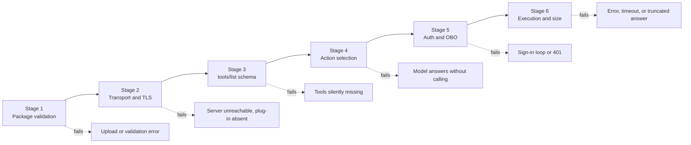

# Troubleshooting and diagnostics for MCP plug-ins

When an MCP-backed declarative agent "does nothing", the failure can sit in any of six places between the package and the tool result. This guide localizes the failure stage by stage, lists the JSON Schema constructs Microsoft 365 Copilot rejects, explains sign-in behavior across multiple servers, and defines the confirmation card test protocol. It assumes the design in [architecture.md](architecture.md) and the identity paths in [authentication-paths.md](authentication-paths.md).

> Limits and behaviors below were observed with plug-in manifest v2.4 and MCP protocol `2025-06-18`. The authoritative limits table is [Platform limits reference](architecture.md#14-platform-limits-reference); re-verify both against current documentation.

## 1. The six-stage failure localization pipeline



Work left to right. A later stage cannot be diagnosed while an earlier one is failing, and symptoms from different stages look alike in the chat ("I can't help with that").

| Stage | Question it answers | Fastest test | Evidence |
|---|---|---|---|
| 1 | Is the package valid and complete? | `atk validate` and a zip listing | Validator output |
| 2 | Can Copilot reach the server over HTTPS? | `curl` an `initialize` from outside your network | HTTP status and headers |
| 3 | Does Copilot accept the tool catalog? | Lint `tools/list` output for rejected constructs | Lint report, missing tools |
| 4 | Does the model choose the tool? | Developer mode debug card in the chat | Matched and executed functions |
| 5 | Is a valid token attached and accepted? | Server logs for `Authorization` and validator result | `401` reasons, `AADSTS` codes |
| 6 | Did the tool run and return a usable result? | Server logs with the correlation ID | Duration, payload size, `isError` |

## 2. Stage 1: Package validation

Run the Agents Toolkit validator against the built package, not the source folder, so environment placeholders are resolved:

```powershell
atk validate --package-file ./appPackage/build/appPackage.dev.zip
```

| Symptom | Cause | Fix |
|---|---|---|
| Schema error on `copilotAgents` | `manifestVersion` too old for the fields used | Use manifest 1.29 (see [manifest.json](../samples/manifest.json)) |
| `agent_skills` or `worker_agents` rejected | Declarative agent `version` too old | Use v1.8 for `agent_skills` (`worker_agents` needs at least v1.6) |
| File not found for an action or skill | Path in `actions[].file` or `agent_skills[].folder` missing from the zip | List the zip; paths are relative to the package root |
| Literal `${{...}}` in the built manifest | Variable missing from the environment file | Add it to `env/.env.<environment>` |
| `run_for_functions` entry not found | Pinned name missing from `functions[]` | Every entry must exist in `functions[]`, and every function in the catalog |
| Instructions too long | Over 8,000 characters | Move workflows into skills ([instruction budget](architecture.md#8-the-8000-character-instruction-budget)) |
| Icon errors | `color.png` not 192×192 or `outline.png` not 32×32 transparent | Regenerate the icons |

A short pre-check catches the pinned-catalog mismatch before upload:

```python
import json, pathlib
pkg = pathlib.Path("appPackage")
plugin = json.loads((pkg / "ai-plugin-oauth.json").read_text())
catalog = {t["name"] for t in json.loads((pkg / "mcp-tools-catalog.json").read_text())["tools"]}
declared = {f["name"] for f in plugin["functions"]}
for rt in plugin["runtimes"]:
    assert set(rt["run_for_functions"]) <= declared, "run_for_functions not in functions[]"
assert declared <= catalog, f"functions missing from catalog: {declared - catalog}"
```

## 3. Stage 2: Transport and TLS

Copilot calls the server from Microsoft's cloud, not from the user's device. Test from outside your corporate network:

```bash
curl -sS -i -X POST https://crm-mcp.contoso.com/mcp \
  -H "Content-Type: application/json" \
  -H "Accept: application/json, text/event-stream" \
  -d '{"jsonrpc":"2.0","id":1,"method":"initialize","params":{"protocolVersion":"2025-06-18","capabilities":{},"clientInfo":{"name":"probe","version":"0.0.1"}}}'
```

Expected: `200` with an `initialize` result (anonymous servers), or `401` with `WWW-Authenticate: Bearer` (authenticated servers). Anything else is a Stage 2 failure.

| Observation | Cause | Fix |
|---|---|---|
| TLS handshake failure | Self-signed or private CA certificate, incomplete chain, TLS below 1.2 | Publicly trusted certificate with the full chain; TLS 1.2 or later |
| `404` | `spec.url` path does not match the route (`/mcp` versus `/`) | Make `spec.url` the exact endpoint, including the path |
| `301`/`302` | HTTP-to-HTTPS or trailing-slash redirect | Use the final URL in `spec.url`; do not rely on redirects |
| `403` from a gateway or WAF | IP allow list, bot protection, or a JSON body rule | Allow Microsoft 365 traffic per your gateway's documented service tags; exempt `/mcp` from HTML-form rules |
| Hangs, then `502`/`504` | Proxy buffering a `text/event-stream` response | Disable response buffering for the route, or return `application/json` |
| `400` on later calls | `Mcp-Session-Id` not honored, or sticky routing missing across replicas | Make sessions stateless or shared; return the same header on `initialize` |
| Works on the tunnel, fails in Azure | Ingress timeout or HTTP/2 settings | Raise idle timeout above the slowest tool; test with `--http1.1` and `--http2` |

## 4. Stage 3: tools/list schema rejection

Copilot converts each MCP tool's `inputSchema` into a function definition for the model. Constructs it cannot convert cause the tool, and sometimes the whole plug-in, to be dropped without a visible error. The model then says it has no way to perform the task.

### 4.1 Rejected or unreliable constructs

| Construct | Problem | Replace with |
|---|---|---|
| `oneOf`, `anyOf`, `allOf` | Unions and intersections are not converted | One flat object with an `enum` discriminator and optional fields, or separate tools |
| `$ref`, `$defs`, `definitions` | References are not resolved | Inline the referenced schema |
| Recursive schemas | Cannot be flattened | An ID-based shape (`parent_id`) or a depth-limited copy |
| `not`, `if`/`then`/`else`, `dependentSchemas` | Conditional logic is ignored or rejected | Validate on the server; describe the rule in `description` |
| Type arrays (`"type": ["string", "null"]`) | Nullable unions are not converted | A single type, and omit the property when empty |
| `patternProperties`, open `additionalProperties` maps | Free-form keys cannot be described to the model | A fixed property list, or an array of `{key, value}` objects |
| Deep nesting | Accuracy drops and conversion can fail | At most three levels; flatten with prefixes |
| Root without `"type": "object"` | Not a valid function signature | Always an object at the root, even with no properties |
| Tool count above the plug-in action limit | Excess tools are not offered | Pin a curated subset with `functions[]`, or split the server |

Design targets this pattern uses for reliable selection: nesting depth of three or less, 15 or fewer properties per object, an `enum` for every closed set, and a `description` on every property.

### 4.2 Bad versus good

**Union of two shapes.** Bad:

```json
{
  "type": "object",
  "properties": {
    "target": {
      "oneOf": [
        { "type": "object", "properties": { "account_id": { "type": "string" } } },
        { "type": "object", "properties": { "opportunity_id": { "type": "string" } } }
      ]
    }
  }
}
```

Good: a flat object with a discriminator, validated on the server.

```json
{
  "type": "object",
  "properties": {
    "target_type": { "type": "string", "enum": ["account", "opportunity"], "description": "What the ID refers to." },
    "target_id": { "type": "string", "description": "ACC-#### for accounts, OPP-#### for opportunities." }
  },
  "required": ["target_type", "target_id"],
  "additionalProperties": false
}
```

**References and nullable types.** Bad:

```json
{
  "type": "object",
  "$defs": { "money": { "type": "object", "properties": { "amount": { "type": "number" }, "currency": { "type": "string" } } } },
  "properties": {
    "budget": { "$ref": "#/$defs/money" },
    "close_date": { "type": ["string", "null"] }
  }
}
```

Good: inlined, flattened, and optional instead of nullable.

```json
{
  "type": "object",
  "properties": {
    "budget_amount": { "type": "number", "minimum": 0, "description": "Budget amount." },
    "budget_currency": { "type": "string", "enum": ["USD", "EUR", "GBP"], "description": "ISO currency code." },
    "close_date": { "type": "string", "format": "date", "description": "Expected close date. Omit if unknown." }
  },
  "required": ["budget_amount", "budget_currency"],
  "additionalProperties": false
}
```

**Recursion.** Bad: `"children": { "type": "array", "items": { "$ref": "#" } }`. Good: return a flat list where each item has `id` and `parent_id`, and accept only the identifier of the node to expand.

### 4.3 Lint before you ship

Run a lint over the live `tools/list` output (or the pinned [mcp-tools-catalog.json](../samples/mcp-tools-catalog.json)) in CI:

```python
BANNED = {"oneOf", "anyOf", "allOf", "$ref", "$defs", "definitions", "not", "if", "patternProperties"}

def lint(schema, path="inputSchema", depth=0):
    problems = [f"{path}: uses {k}" for k in BANNED & schema.keys()]
    if isinstance(schema.get("type"), list):
        problems.append(f"{path}: type array")
    if depth > 3:
        problems.append(f"{path}: nesting deeper than 3")
    for name, sub in schema.get("properties", {}).items():
        problems += lint(sub, f"{path}.{name}", depth + 1)
    if isinstance(schema.get("items"), dict):
        problems += lint(schema["items"], f"{path}[]", depth + 1)
    return problems
```

The [reference server](../samples/reference_mcp_server.py) runs the same check in its self-test.

## 5. Multi-MCP sign-in behavior

Each vault registration (`reference_id`) has its own per-user consent. An agent with three authenticated plug-ins on three registrations can ask a user to sign in three times. The behavior below was observed for plug-in manifest v2.4; verify it against your tenant.

- **Sign-in is lazy.** The sign-in card appears in the turn where the host first needs a token for that registration, not when the agent is installed.
- **Discovery mode changes when that happens.** With a pinned catalog, the orchestrator knows the tools without calling the server, so sign-in waits until a tool is actually selected. With dynamic discovery against an authenticated server, the host needs a token to call `tools/list`, so a card can appear before any tool is chosen.
- **One card per turn.** If a turn needs two servers with separate registrations, the user typically signs in to the first, the turn completes or retries, and the second card appears on a later turn.
- **Entra SSO (Path A3) is usually silent.** After admin consent and pre-authorization, no card is shown. A3 is the best way to reduce prompts for internal servers.
- **A `401` on a valid token causes a sign-in loop.** The host treats any `401` as "token rejected" and asks again. An `aud` mismatch on your server therefore looks like a broken sign-in, not a server bug.

| Agent composition | What a new user sees |
|---|---|
| One A3 plug-in, admin consent granted | No card |
| One A1 plug-in, pinned | One card, on the first turn that selects a tool from it |
| A1 (pinned) + A3 + C | One card for A1; A3 silent; C needs none |
| Two A1 plug-ins on separate registrations | Two cards, usually on different turns |
| Two A1 servers on one registration (same authorization server and audience) | One card; the token is valid at both servers |
| Supervisor plus `worker_agents` specialists | Each specialist's registrations prompt in that specialist's context |

Mitigations, in order of preference:

1. Use A3 for every server protected by Entra ID.
2. Pin catalogs for authenticated servers so sign-in waits for real need.
3. Put servers that share an owner and trust boundary behind one gateway and one registration. Do not share a registration across trust boundaries; a shared audience means a token for one server works at the other.
4. Add a conversation starter such as "Connect my CRM account" that calls a cheap R tool, so sign-in happens at a predictable moment.
5. Keep the total at or below five plug-ins (Pattern 2 in the [README](../README.md)).

## 6. Stage 4: Orchestrator action selection

When the server is reachable and the catalog is accepted but the model answers without calling a tool, the problem is selection. Turn on developer mode by sending `-developer on` in the agent chat; the debug card lists the agent's actions, the functions the orchestrator matched, and those it executed. Confirm availability of developer mode in your tenant.

| Debug card shows | Cause | Fix |
|---|---|---|
| Action listed, no functions matched | Descriptions do not match the user's words | Rewrite descriptions as "Use when ... Do not use for ..."; add the user's vocabulary |
| A function from the wrong server matched | Overlapping tool names or descriptions across servers | Unique verbs per server; a namespace routing table in the instructions |
| Function matched, not executed | Required argument could not be filled | Make the argument optional, or instruct the agent to ask for it |
| Answer from web or knowledge grounding instead | Grounding outranked the tool | Tell the instructions to prefer tools for live data |
| Action not listed at all | Stage 1 or Stage 3 failure | Go back to [Stage 3](#4-stage-3-toolslist-schema-rejection) |

Treat selection as something to evaluate, not something to eyeball. Keep a prompt set with the expected tool per prompt and rerun it on every change to descriptions, instructions, or the catalog:

| Prompt | Expected tool |
|---|---|
| "How is Fabrikam Retail doing?" | `servicecrm.get_account_summary` |
| "Find open deals over 100k closing this quarter" | `servicecrm.search_opportunities` |
| "What is our returns policy for enterprise customers?" | A `serviceknowledge` search tool |
| "Draft an order for 20 units of SKU-778 for ACC-1001" | `servicecrm.draft_order` |

## 7. Stages 5 and 6: token acquisition, tool execution, and response size

### 7.1 Stage 5: token acquisition and validation

Log the validator's decision for every request, with a reason code and never the token:

| Reason code | Meaning | Next step |
|---|---|---|
| `missing` | No `Authorization` header | Registration base URL versus `spec.url` |
| `expired` | `exp` in the past | Refresh token missing or revoked |
| `bad_signature` | Malformed token or signature that does not verify | Signing keys (JWKS) cache; token from a different issuer |
| `bad_aud` | Audience mismatch | v1 versus v2 tokens; Application ID URI |
| `bad_iss` / `bad_tid` | Issuer or tenant not allowed | Tenant allow list; multitenant configuration |
| `scope` | Required scope missing | Scopes in the registration; consent |
| `obo_failed` | OBO exchange error | The `AADSTS` code in the log |

Map each `AADSTS` code with the [authentication troubleshooting map](authentication-paths.md#11-troubleshooting-map).

### 7.2 Stage 6: execution and response size

- **Return tool failures as results.** Use `isError: true` with actionable text for business and authorization failures. Reserve JSON-RPC errors for protocol faults such as an unknown tool or invalid parameters (`-32602`).
- **Stay fast.** Keep the 95th percentile of each tool well under the host's timeout; see [Latency, rate limits, and caching](architecture.md#7-latency-rate-limits-and-caching). For slow work, return a job ID and offer a status tool.
- **Stay small.** Large results are truncated or dropped, and they crowd out reasoning. This pattern targets under 20 KB of text and at most 25 items per result, with a `next_cursor` for more.
- **Keep text and structure consistent.** `content[].text` and `structuredContent` must describe the same data; the model may read either.

A gate refusal is a well-formed result, not a crash:

```json
{
  "content": [{ "type": "text", "text": "Create a draft with draft_order first, then submit that draft." }],
  "structuredContent": { "error": "draft_required", "detail": "submit_order needs a valid draft_id.", "refused_by": "side_effect_gate" },
  "isError": true
}
```

## 8. Confirmation card test protocol

Confirmation cards are user experience; the server-side gate is the control ([Action safety](architecture.md#10-action-safety-and-the-confirmation-model)). This protocol proves both. Run it against the [reference server](../samples/reference_mcp_server.py) or your own server, with server logs open.

### 8.1 Annotation contract

| Class | Example tool | `readOnlyHint` | `destructiveHint` | `idempotentHint` | Expected card | Server gate |
|---|---|---|---|---|---|---|
| R | `get_account_summary` | `true` | n/a | n/a | None | Authorization only |
| W1 | `save_shortlist` | `false` | `false` | `true` | Confirm | Daily cap, audit |
| W2 | `draft_order` | `false` | `false` | `true` | Confirm | Returns `draft_id` |
| W3 | `submit_order` | `false` | `true` | `false` | Confirm, destructive wording | Valid unused `draft_id` |
| W4 | `notify_account_team` | `false` | `true` | `false` | Confirm, destructive wording | Approval token from a separate human step |

For pinned functions, `capabilities.confirmation` in [ai-plugin-oauth.json](../samples/ai-plugin-oauth.json) sets the card's title and body. Write the body so a user can tell exactly what will change.

### 8.2 Test cases

| ID | Action | Expected result | Evidence |
|---|---|---|---|
| T1 | Ask a question that calls an R tool | No card; result returned | One read entry in the server log |
| T2 | Trigger a W1 tool, then **cancel** the card | No request reaches the server | Zero `tools/call` entries for that turn |
| T3 | Trigger a W1 tool and **approve** | Exactly one execution | One audit row with correlation ID |
| T4 | Trigger `draft_order` and approve | `draft_id` returned; nothing leaves the system | Draft stored, no external side effect |
| T5 | Ask to submit an order without a draft, and approve the card | Server refuses with `draft_required` | Proves the gate is independent of the card |
| T6 | Submit with a valid `draft_id` | One receipt | Audit row with the receipt ID |
| T7 | Replay the same `draft_id` | Refused with `draft_already_used` | No second receipt |
| T8 | Call `notify_account_team` without an approval token | Refused with `approval_required` | Audit row with the refusal |
| T9 | Exceed the per-user daily cap | Refused with `daily_cap_exceeded` | Cap counter in the log |
| T10 | Enable the kill switch | Every W-class call refused with `writes_disabled`; R calls still work | Audit rows |
| T11 | In a test build only, set `readOnlyHint: true` on a write tool | Card disappears, server still enforces the gate | Proves hints are not a control; never ship this build |
| T12 | Trigger a W1 tool from the MCP App view | Same card and gate behavior as T2 and T3 | Audit row tagged as view-initiated |

Record a screenshot of each card, the audit row, and the correlation ID for the release evidence pack. The reference server's offline self-test covers T5 through T10 at the protocol level.

## 9. Telemetry and correlation

Emit one structured log record and one trace span per JSON-RPC request:

| Field | Source |
|---|---|
| `correlation_id` | Generated per request; returned in the result `_meta` and logged |
| `mcp_session_id` | `Mcp-Session-Id` header |
| `method`, `tool` | JSON-RPC body |
| `tid`, `oid_hash` | Validated token (hash the user ID in logs) |
| `auth_decision` | Validator reason code from [7.1](#71-stage-5-token-acquisition-and-validation) |
| `gate_decision` | `allowed`, or the refusal code |
| `duration_ms`, `result_bytes`, `is_error` | Measured |

With Application Insights, this query finds slow or oversized tools:

```kusto
customEvents
| where name == "mcp.request" and timestamp > ago(1d)
| extend tool = tostring(customDimensions.tool), ms = todouble(customDimensions.duration_ms), bytes = toint(customDimensions.result_bytes)
| summarize p95_ms = percentile(ms, 95), max_bytes = max(bytes), errors = countif(tostring(customDimensions.is_error) == "true") by tool
| order by p95_ms desc
```

## 10. Symptom index

| Symptom | Stage | Go to |
|---|---|---|
| Package upload fails | 1 | [Stage 1](#2-stage-1-package-validation) |
| Agent never uses any tool from one server | 2 or 3 | [Stage 2](#3-stage-2-transport-and-tls), then [Stage 3](#4-stage-3-toolslist-schema-rejection) |
| Some tools from a server are missing | 3 | [Stage 3](#4-stage-3-toolslist-schema-rejection) |
| Wrong tool chosen, or no tool chosen | 4 | [Stage 4](#6-stage-4-orchestrator-action-selection) |
| Repeated sign-in cards | 5 | [Multi-MCP sign-in behavior](#5-multi-mcp-sign-in-behavior) |
| `401` after a successful sign-in | 5 | [Stage 5](#71-stage-5-token-acquisition-and-validation) |
| Tool runs but the answer is cut off or vague | 6 | [Stage 6](#72-stage-6-execution-and-response-size) |
| Write executed without the expected card | 6 | [Confirmation card test protocol](#8-confirmation-card-test-protocol) |
| Widget does not appear | 3 or 6 | [MCP Apps fallback](mcp-apps-and-interactive-widgets.md#7-graceful-fallback) |
