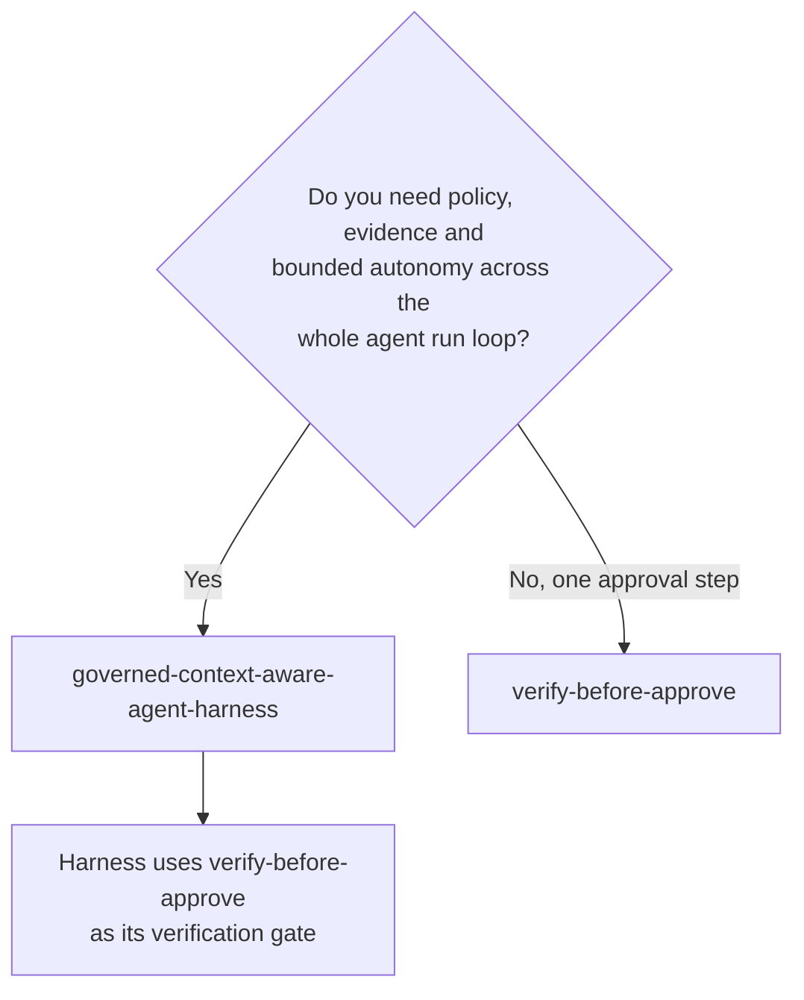

# Orchestration and Workflows (`orchestration-and-workflows`)

Patterns for the **control flow inside and around an agent**: the harness that decides what context the model sees, which tools it may use, when work is verified, and when a human must approve. Browse this category when a single prompt-and-tools loop is no longer enough and you need policy, verification, evidence and bounded autonomy built into the agent's run loop.

## When to browse this category

- You need an agent that can be **trusted with consequential work**: every tool call passes policy, every claimed result is checked, and every run leaves an auditable record.
- Reviewers are being asked to approve outputs that **no automated check has validated** first.
- You are designing **multi-step or multi-agent routing** and need durable state, progress tracking and escalation rules.

## Choosing between patterns in this category

| Decision Dimension | Governed Context-Aware Agent Harness (`governed-context-aware-agent-harness`) | Verify-Before-Approve (`verify-before-approve`) |
|---|---|---|
| **Primary question** | How do I structure the whole agent run loop for governance? | How do I keep correctness checks separate from human approval? |
| **Asset kind** | Reference architecture with runnable sample | Design pattern |
| **Scope** | Context assembly, capability loading, policy, verification, evidence ledger, run certificate, progress budgets | One gate: deterministic verification before a human sees an approval request |
| **Adopt incrementally?** | Module by module | Yes, in any agent or workflow |
| **Combine when** | The harness embeds verify-before-approve as its verification stage | Use standalone when you do not need the full harness |

## Assets in this category

<!-- category-catalog:start -->
| Asset | Kind | Maturity | Summary |
|-------|------|----------|---------|
| [Governed Context-Aware Agent Harness](governed-context-aware-agent-harness/README.md) | `reference-architecture` | preview | A reference architecture for the runtime harness around an LLM agent: mandatory plan-before-act policy, progressive skill disclosure, scoped memory, an independent deterministic verifier, an evidence ledger, separate human approval of the exact verified artifact, and a completion certificate - so a convincing answer is never mistaken for a correctly completed task. |
| [Verify Before Approve: Deterministic Verification Ahead of Human Approval](verify-before-approve/README.md) | `design-pattern` | preview | Separates machine-checkable verification from human approval. A verifier independent of the generating model runs deterministic checks; only verified artifacts reach approvers, and each approval binds to the exact artifact sha256 and verification receipt. Failures drive bounded self-correction, then a labelled unverified preview, never silent approval. Approvers spend their attention on judgement, not arithmetic, and rubber-stamp approvals drop. |
<!-- category-catalog:end -->

## Complementary assets in other categories

- **Planner-and-specialist routing for a custom engine agent:** [`m365-and-copilot/m365-azure-custom-agent/docs/architecture.md`](../m365-and-copilot/m365-azure-custom-agent/docs/architecture.md#3-planner-and-specialist-orchestration) and its runnable [`planner_specialist_router.py`](../m365-and-copilot/m365-azure-custom-agent/samples/planner_specialist_router.py) sample.
- **Durable conversation state and gated actions:** [`m365-and-copilot/m365-azure-custom-agent`](../m365-and-copilot/m365-azure-custom-agent/README.md)
- **Tool-call policy enforcement, approvals and Entra Agent ID:** [`security-and-governance/agent-security-and-governance`](../security-and-governance/agent-security-and-governance/README.md)
- **Where the harness runs in production:** [`agent-runtime/production-hosted-agents-on-foundry`](../agent-runtime/production-hosted-agents-on-foundry/README.md)
- **Pillar 6, proven patterns for agent architectures:** [`agentops-and-readiness/agent-production-readiness/docs/pillars/06-proven-patterns-for-agent-architectures.md`](../agentops-and-readiness/agent-production-readiness/docs/pillars/06-proven-patterns-for-agent-architectures.md)
