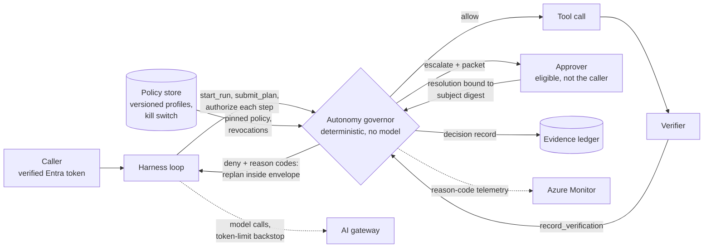

# Bounded Autonomy: Budgets, Action Envelopes and Escalation

> **Maturity:** preview · **Kind:** design-pattern · **Category:** `orchestration-and-workflows` · **Version:** 0.1.0

An agent that can call tools needs to know how far it may go on its own. In many first deployments that limit lives in the system prompt: "make at most three attempts", "ask before changing production", "never send customer data outside". These are requests to the model, not limits. A prompt injection, a confused plan or a long retry loop gets straight past them, and afterwards nobody can prove what the agent was allowed to do or why it stopped.

This pattern moves the limits out of the prompt and into a small, deterministic **autonomy governor** that the harness loop calls before every plan and every tool call. Server-side policy selects an **autonomy profile** (`observe-only`, `propose`, `act-with-approval` or `act`) from the caller's verified identity and the workload, never from the prompt or the model. The profile defines an **allowed-action envelope** and a set of **budgets**:

- **Envelope:** the tool allowlist, a rule for each side-effect class, argument constraints and the data boundary.
- **Budgets:** attempts, tool calls, tokens, active wall-clock time and, optionally, cost.

Inside the envelope and within its budgets, the agent acts without asking. Outside them, the governor denies the step, or it stops the run and escalates to a person. The escalation packet carries everything that person needs to decide and resume. If the policy store or the audit sink is unavailable, the governor fails closed. Every allow, deny and escalate decision produces a structured decision record with reason codes and the policy version.

> **Core thesis:** *Autonomy is a server-side grant, not a model behavior. The harness enforces the envelope and the budgets at every gate, escalates what a person can usefully decide, and stops when it cannot prove what it is allowed to do.*

This asset is for:

- Solution architects
- Agent developers
- Platform and security engineers
- The owners of agent operations

The [Governed Context-Aware Agent Harness](../governed-context-aware-agent-harness/README.md) checks autonomy, budgets and the envelope at each of its gates. This asset is a focused deep dive on that mechanism, and it works with or without the harness. A stdlib-only [governor sample](samples/autonomy_governor.py) makes every rule executable.

## Architecture and implementation map

| Layer / concern | Deep-dive documentation | Executable reference |
|---|---|---|
| **Profiles, budgets, envelope, plan-before-act, stop and escalation conditions, runtime state, wire contracts** | [`docs/architecture.md`](docs/architecture.md) · [ADR 0001](docs/decisions/0001-enforce-budgets-in-harness-not-prompt.md) · [ADR 0002](docs/decisions/0002-fail-closed-on-policy-unavailable.md) · [ADR 0003](docs/decisions/0003-profiles-selected-by-server-policy.md) | [`samples/autonomy_governor.py`](samples/autonomy_governor.py): `AutonomyGovernor`, `resolve_profile`, `envelope_check`, and the policy-store and decision-sink seams |
| **Binding profiles to verified identity, separation of duties for escalations, policy release, kill switch, audit, threat model** | [`docs/authentication-and-governance.md`](docs/authentication-and-governance.md) | Scenarios for server-selected profiles, the kill switch, self-approval, ineligible approvers and stale policy versions |
| **Sizing budgets, escalation quality, telemetry, troubleshooting by reason code, release gates for policy changes** | [`docs/evaluation-and-troubleshooting.md`](docs/evaluation-and-troubleshooting.md) | The `--self-test` suite: 23 scenarios run against each of 4 Domain Packs |

## Domain Packs

The governor code and the policy shape are the same in every industry. Only the tools, scopes, limits and data labels change. The organizations are fictional.

| Domain Pack | Organization | Acts alone under `act` | Escalates under `act` | Denied under every profile in the sample |
|---|---|---|---|---|
| **IT operations** (default) | Contoso | Reads service health; scales a dev or test service by a small instance delta | Scaling outside dev and test or beyond the delta; purging snapshots | Modifying firewall rules; sending regulated data to an external destination |
| **Payments servicing** | Fabrikam | Reads transaction history; applies a small goodwill credit to a retail account | Credits above the limit or outside the segment; card refunds | Changing the account owner; sending cardholder data externally |
| **Healthcare scheduling** | Northwind Health | Searches open slots; holds a few slots in an allowed clinic | Holds in other clinics or above the limit; messages to patients | Updating clinical records; sending protected health information externally |
| **Supply chain** | Northwind Traders | Reads inventory levels; reserves stock in an allowed warehouse | Reservations above the limit or in another warehouse; submitting purchase orders | Changing supplier bank details; sending contract pricing externally |

[Architecture section 15](docs/architecture.md#15-domain-packs) lists the tools, scopes and illustrative limits for each pack. Run any pack with `--domain`.

## When to use

- An agent calls tools that change things: configuration, records, money, messages, orders. Some of those changes are routine, and some must never happen without a person.
- You want the agent to do routine work unattended, but only inside limits you can state, review, version and prove afterwards.
- Different callers or workloads need different levels of autonomy for the same agent. For example, a pilot group might be limited to `propose` while an operations team gets `act` on a restricted workload.
- Runaway loops, retry storms or unbounded token use are a real risk, and you need hard stops that do not depend on the model agreeing to stop.
- Auditors or risk owners ask "what was this agent allowed to do, who allowed it, and why did it stop?" You need to answer that per decision, with the policy version.

## When not to use

- The agent only answers questions and never calls a tool with side effects. Grounding, content safety and evaluation from [Enterprise Agent Security and Tool Governance](../../security-and-governance/agent-security-and-governance/README.md) cover that case. A budget on tokens alone may be enough.
- Every action needs a person anyway, and nothing runs unattended. A plain approval workflow, ideally gated as in [Verify Before Approve](../verify-before-approve/README.md), is simpler.
- You need the whole agent runtime, including context assembly, memory, the verifier, the ledger and the certificate. Start from the [Governed Context-Aware Agent Harness](../governed-context-aware-agent-harness/README.md), and use this pattern as the gate inside it.
- The question is which tools a caller can see at all, or when tools are shown to the model. Those questions belong to the [Entitlement-Aware Tool Catalog](../../ai-gateway/entitlement-aware-tool-catalog/README.md) and [Progressive Tool Loading](../progressive-tool-loading/README.md). This pattern narrows what a run may do with the tools it has.
- You only need coarse protection against noisy neighbors. A gateway token limit is the right tool for that, but it is not bounded autonomy.

## Architecture



- **Harness loop.** Owns the run. It asks the model for a plan, submits the plan to the governor, and calls `authorize` before every tool call. It executes only allowed steps, then reports verifier results and metered token and cost usage. It never decides by itself whether an action is allowed.
- **Autonomy governor.** It resolves the profile and pins the policy version for the run. It checks plans and steps against the envelope and the budgets, records every decision, raises escalations and applies resolutions. It makes no model calls and executes no tools, so the same inputs always produce the same decision.
- **Policy store.** Holds the versioned policy document (tool classes, role grants, workload caps, profiles) and a separate revocation key that acts as a kill switch. The governor re-reads the revocation key at every gate.
- **Decision sink.** Appends every decision record before the state change takes effect. In production this is the [Evidence Ledger and Run Certificate](../evidence-ledger-and-run-certificate/README.md).
- **Approver.** A person with the approver role in the same tenant, who is not the run's principal. They resolve an escalation by naming the escalated subject's digest and the pinned policy version.
- **Gateway and telemetry.** The gateway caps tokens per caller as a backstop. Telemetry feeds dashboards and alerts keyed on reason codes. Neither one is the control or the audit record.

### Profiles at a glance

| Profile | `read` | `reversible_write` | `irreversible_external` |
|---|---|---|---|
| `observe-only` | allow | not in allowlist (deny) | not in allowlist (deny) |
| `propose` | allow | record as a proposal, do not execute | deny |
| `act-with-approval` | allow | escalate | escalate |
| `act` | allow | allow, within argument constraints | escalate |

How the profile is chosen:

1. The profile is the lower of two values: the highest profile granted by the caller's verified app roles, and the cap for the workload.
2. A profile that the prompt or the plan asks for is recorded and ignored.
3. Each tool's side-effect class comes from policy, never from the tool or the model.

For each step, the governor runs the envelope checks in a fixed order, and the first failure decides the outcome:

1. Tool allowlist
2. Data boundary
3. Side-effect rule
4. Argument constraints

Argument violations escalate rather than deny, because a person may judge them legitimate. See [architecture sections 4 to 6](docs/architecture.md#4-autonomy-profiles).

### Stop and escalate, not "be careful"

| Condition | Outcome | Reason code |
|---|---|---|
| Step needs approval under the profile | escalate | `APPROVAL_REQUIRED` |
| Argument outside its scope, target or amount constraint | escalate | `ARG_CONSTRAINT_VIOLATED` |
| Attempts, tool calls, tokens, active wall clock or cost exhausted | escalate | `BUDGET_EXHAUSTED` |
| Consecutive verifier failures reach the profile limit | escalate | `VERIFIER_FAILURES_EXCEEDED` |
| Low plan confidence or ambiguities listed in the plan | escalate | `LOW_CONFIDENCE` |
| Tool not in profile, data boundary crossed, side-effect class denied, step not in the accepted plan | deny | `TOOL_NOT_IN_PROFILE`, `DATA_BOUNDARY_VIOLATED`, `SIDE_EFFECT_EXCEEDS_PROFILE`, `STEP_NOT_IN_PLAN` |
| Policy store or decision sink unreachable | deny, run suspended | `POLICY_UNAVAILABLE`, `AUDIT_UNAVAILABLE` |
| Profile revoked | deny, run stopped | `PROFILE_REVOKED` |

An escalation pauses the run's active wall clock and hands a person a packet. The packet contains:

- The reason codes
- The subject and its digest
- The allowed resolutions
- The remaining budget
- The completed steps
- The verifier findings

The possible resolutions are `approve-step` (a single-use grant bound to the step digest), `clarify-plan`, `retry-with-new-plan`, `continue-in-new-run` (a linked child run with fresh budgets, up to a limit) and `stop`. See [architecture sections 8 and 9](docs/architecture.md#8-stop-and-escalation-conditions).

## Key design decisions

| Decision | Choice | Why | Trade-off |
|---|---|---|---|
| Where budgets are enforced | In the harness, at every gate, from platform usage data | A prompt instruction is a request, not a limit | Gates are discrete, so cap each model call's output to bound overshoot |
| Who selects the profile | Server-side policy from verified roles and the workload cap | Letting the prompt or the model choose turns injection into privilege escalation | Role and workload configuration to maintain |
| What happens when policy or audit is down | Fail closed: suspend runs, refuse new ones, keep no default policy in code | Running with stale or default permissions is unprovable | Store outages pause agents; plan for store availability |
| What an approval unlocks | One step, bound to its digest, single use; or a linked continuation run | Blanket run approvals let the agent do what the approver never saw | More escalations for multi-step changes |
| Denials versus escalations | Deny what the profile forbids outright; escalate only what a person can usefully decide | Escalating everything trains approvers to rubber-stamp | Requires careful profile and constraint design |

Recorded as ADRs:

- [ADR 0001: Budgets are enforced by the harness, not by the prompt](docs/decisions/0001-enforce-budgets-in-harness-not-prompt.md)
- [ADR 0002: Fail closed when the policy store or the decision sink is unavailable](docs/decisions/0002-fail-closed-on-policy-unavailable.md)
- [ADR 0003: The autonomy profile is selected by server-side policy, never by the prompt or the model](docs/decisions/0003-profiles-selected-by-server-policy.md)

## Getting started

1. **Run the sample.** It needs Python 3.10 or later. It uses no packages, no network and no credentials. From the repository root:

   ```powershell
   # 23 scenarios against each of the 4 Domain Packs; exits non-zero if any fails.
   python assets\orchestration-and-workflows\bounded-autonomy\samples\autonomy_governor.py --self-test

   # Readable demo run. It covers a server-selected profile, a plan with an escalation point,
   # an approval bound to the step digest, and a resumed run.
   python assets\orchestration-and-workflows\bounded-autonomy\samples\autonomy_governor.py

   # Same governor, another industry.
   python assets\orchestration-and-workflows\bounded-autonomy\samples\autonomy_governor.py --domain payments-servicing

   # Decision records, escalation packet and final runtime state as JSON.
   python assets\orchestration-and-workflows\bounded-autonomy\samples\autonomy_governor.py --json

   # The policy document the governor enforces for a Domain Pack.
   python assets\orchestration-and-workflows\bounded-autonomy\samples\autonomy_governor.py --policy --domain supply-chain

   # List scenarios, or run selected ones.
   python assets\orchestration-and-workflows\bounded-autonomy\samples\autonomy_governor.py --list
   python assets\orchestration-and-workflows\bounded-autonomy\samples\autonomy_governor.py --self-test --scenario policy-unavailable-fails-closed
   ```

2. **Classify every tool.** In the policy document, give each tool a side-effect class (`read`, `reversible_write` or `irreversible_external`). For writes, add argument constraints for scope, target and amount. Label the data that tools read and send. A tool with no class is denied. See [the allowed-action envelope](docs/architecture.md#6-the-allowed-action-envelope).

3. **Define profiles and bind them to identity.** Map Microsoft Entra app roles to profiles, and set a cap for each workload. Never read the profile from the prompt. See [binding profiles to verified identity](docs/authentication-and-governance.md#2-binding-profiles-to-verified-identity) and [Request Context Is Not Authorization](../../agent-runtime/request-context-is-not-authorization/README.md).

4. **Put the governor in the loop.** In the harness:
   - Call `submit_plan` before the first action.
   - Call `authorize` before every tool call.
   - Execute a step only on `allow`.
   - Report token and cost usage from the platform's usage data with `charge`.
   - Report verifier results with `record_verification`.

   Give every model call an output token limit. See [plan-before-act](docs/architecture.md#7-plan-before-act).

5. **Store policy and decisions.** Keep the policy document in a versioned store and the revocation key under its own key. Send decision records to the evidence ledger before any state change. Fail closed if either the store or the ledger is unreachable. See [implementation on Azure](docs/architecture.md#13-implementation-on-azure) and [ADR 0002](docs/decisions/0002-fail-closed-on-policy-unavailable.md).

6. **Size budgets from evidence.** Start from evaluation runs of your own workload, not from the sample's illustrative values. Then review the budgets against production telemetry. See [sizing budgets from evaluation runs](docs/evaluation-and-troubleshooting.md#sizing-budgets-from-evaluation-runs).

7. **Route escalations.** Deliver the [escalation packet](docs/architecture.md#escalation-packet-contract) to eligible approvers. Gate approvals as described in [Verify Before Approve](../verify-before-approve/README.md). Persist runtime state so a run can resume after a resolution.

8. **Gate the release.** Work through the [production checklist](docs/architecture.md#18-production-checklist) and the [release gates for policy changes](docs/evaluation-and-troubleshooting.md#release-gates-for-policy-changes). Then follow the [Agent Production Readiness Guide](../../agentops-and-readiness/agent-production-readiness/README.md).

## Files

| Path | Purpose |
|---|---|
| [`manifest.yaml`](manifest.yaml) | Catalog metadata for this asset |
| [`CHANGELOG.md`](CHANGELOG.md) | Version history |
| [`docs/architecture.md`](docs/architecture.md) | Covers:<br/>• Problem and forces<br/>• Components<br/>• Profiles, budgets and the envelope<br/>• Plan-before-act<br/>• Stop and escalation conditions<br/>• Runtime state and resumability<br/>• Sequences<br/>• Decision matrix<br/>• Wire contracts<br/>• Azure mapping<br/>• Domain Packs<br/>• Failure modes and anti-patterns<br/>• Production checklist |
| [`docs/authentication-and-governance.md`](docs/authentication-and-governance.md) | Covers:<br/>• Identity inventory<br/>• App roles for profiles and approvers<br/>• Separation of duties<br/>• Policy authoring and release<br/>• Kill switch<br/>• Audit<br/>• Threat model<br/>• Operating model |
| [`docs/evaluation-and-troubleshooting.md`](docs/evaluation-and-troubleshooting.md) | Covers:<br/>• What to evaluate<br/>• Budget sizing<br/>• Escalation quality<br/>• Telemetry and dashboards<br/>• Troubleshooting by reason code<br/>• Release gates for policy changes |
| [`docs/decisions/0001-enforce-budgets-in-harness-not-prompt.md`](docs/decisions/0001-enforce-budgets-in-harness-not-prompt.md) | ADR 0001: budgets are enforced by the harness |
| [`docs/decisions/0002-fail-closed-on-policy-unavailable.md`](docs/decisions/0002-fail-closed-on-policy-unavailable.md) | ADR 0002: fail closed on policy or audit unavailability |
| [`docs/decisions/0003-profiles-selected-by-server-policy.md`](docs/decisions/0003-profiles-selected-by-server-policy.md) | ADR 0003: profiles are selected by server-side policy |
| [`samples/autonomy_governor.py`](samples/autonomy_governor.py) | Single-file, stdlib-only governor. Flags: `--self-test`, `--list`, `--scenario`, `--domain`, `--list-domains`, `--policy` and `--json` |
| [`samples/README.md`](samples/README.md) | How to run, read and extend the sample, and its production seams |

## Related assets

| Asset | Relationship |
|---|---|
| [Governed Context-Aware Agent Harness](../governed-context-aware-agent-harness/README.md) | The reference architecture that composes plan-before-act, progressive disclosure, memory, verifier, ledger, approval and certificate. This asset is the deep dive on the autonomy, budget and envelope mechanism the harness applies at each gate |
| [Verify Before Approve](../verify-before-approve/README.md) | Covers how an approval is gated and bound. Bounded autonomy decides when an escalation or approval is needed, and what a resolution may unlock |
| [Request Context Is Not Authorization](../../agent-runtime/request-context-is-not-authorization/README.md) | Why profiles, workload caps and approver eligibility must bind to server-verified identity rather than prompt or request claims |
| [Evidence Ledger and Run Certificate](../evidence-ledger-and-run-certificate/README.md) | Persists the decision records this governor emits, in a tamper-evident way, and summarizes them for release |
| [Progressive Tool Loading](../progressive-tool-loading/README.md) | Decides when tools are exposed to the model. Exposure is not permission: the envelope still checks every call |
| [Entitlement-Aware Tool Catalog](../../ai-gateway/entitlement-aware-tool-catalog/README.md) | Decides which tools exist for a caller. The envelope then narrows that set for the run's profile |
| [Enterprise Agent Security and Tool Governance](../../security-and-governance/agent-security-and-governance/README.md) | The agent identity, guardrail and governance controls that surround the governor |
| [Agent Production Readiness Guide](../../agentops-and-readiness/agent-production-readiness/README.md) | The release gates and operating model for shipping the agent and its policy |

## Production-readiness pillar mapping

This asset contributes to three pillars of the [Agent Production Readiness Guide](../../agentops-and-readiness/agent-production-readiness/README.md).

| Pillar | How this asset contributes |
|---|---|
| [**Proven patterns for agent architectures**](../../agentops-and-readiness/agent-production-readiness/docs/pillars/06-proven-patterns-for-agent-architectures.md) | The governor as a deterministic gate in the harness loop. Also covers autonomy profiles, plan-before-act, the envelope precedence, and escalation with resumable state |
| [**AI security and observability**](../../agentops-and-readiness/agent-production-readiness/docs/pillars/04-ai-security-and-observability.md) | Profiles bound to verified identity, and side-effect classes assigned by policy. Also covers data-boundary checks, fail-closed behavior, the kill switch, decision records with reason codes, and the threat model |
| [**Agent ops**](../../agentops-and-readiness/agent-production-readiness/docs/pillars/03-agent-ops.md) | Covers:<br/>• Versioned policy with release gates<br/>• Budgets sized from evaluation runs<br/>• Reason-code telemetry and alerts<br/>• Troubleshooting runbooks<br/>• The scenario suite in CI |

## Security and responsible AI

- **Autonomy is never self-granted.** No prompt field, tool argument or "elevate" tool can raise a profile. The governor records a requested profile and ignores it.
- **Treat model output as untrusted input to the governor.** Plans, arguments and confidence values are evaluated against policy. Confidence can only reduce autonomy, never increase it.
- **Fail closed.** No default policy is compiled into code. If the governor cannot read policy or write a decision record, nothing executes.
- **Keep people accountable.** Escalate decisions a person can usefully make, and give them the state they need. Watch escalation rates so that approvers do not start rubber-stamping.
- **Separate duties.** The caller cannot approve their own escalation. Approvers must hold the approver role in the same tenant.
- **Keep sensitive content out of records and telemetry.** Decision records and spans should carry IDs, digests, reason codes and remaining budget. They should not carry prompts, tool payloads or regulated data.
- **Defense in depth.** The governor does not stop a caller that bypasses the harness. Tools must still authorize the harness identity themselves, and the gateway still caps tokens.

## Limitations

- The sample is a simulation:
  - It makes no model calls, executes no tools and uses a fake clock.
  - The policy store and decision sink are in-memory fakes.
  - The production adapters are stubs that raise `NotImplementedError`, and they make no network calls.
- Budget values, limits, thresholds and confidence cut-offs in the sample are illustrative parameters, not recommendations.
- Wire contracts are illustrative. Field names and schema versions are for discussion, not a stable contract.
- Budgets are checked at gates, so a single model call can overshoot between gates. Per-call output limits bound the overshoot; they do not remove it.
- Azure service capabilities change over time, including hosted agents, gateway policies and configuration snapshots. Some of these are in preview. Verify them against current documentation before you rely on a specific capability.
- This asset intentionally contains no latency, throughput, escalation-rate or cost figures. Measure in your own environment.

## References

- [Architecture deep dive](docs/architecture.md)
- [Authentication and governance](docs/authentication-and-governance.md)
- [Evaluation and troubleshooting](docs/evaluation-and-troubleshooting.md)
- [Samples guide](samples/README.md)
- [What is Microsoft Foundry Agent Service?](https://learn.microsoft.com/azure/foundry/agents/overview)
- [Hosted agents in Foundry Agent Service](https://learn.microsoft.com/azure/foundry/agents/concepts/hosted-agents)
- [Limit large language model API token usage (`llm-token-limit` policy)](https://learn.microsoft.com/azure/api-management/llm-token-limit-policy)
- [What is Azure App Configuration?](https://learn.microsoft.com/azure/azure-app-configuration/overview)
- [Add app roles to your application and receive them in the token](https://learn.microsoft.com/entra/identity-platform/howto-add-app-roles-in-apps)
- [Enable Azure Monitor OpenTelemetry](https://learn.microsoft.com/azure/azure-monitor/app/opentelemetry-enable)
- [Contribution and Standardization Guide](../../../docs/contribution-guide.md)
