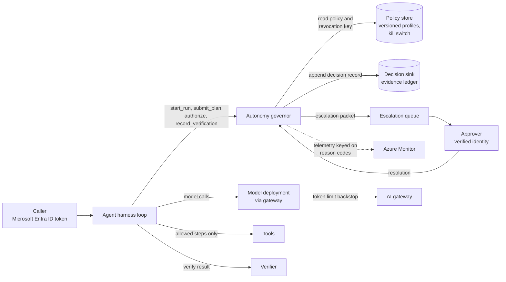
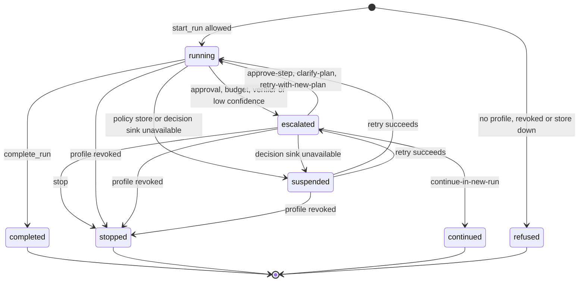
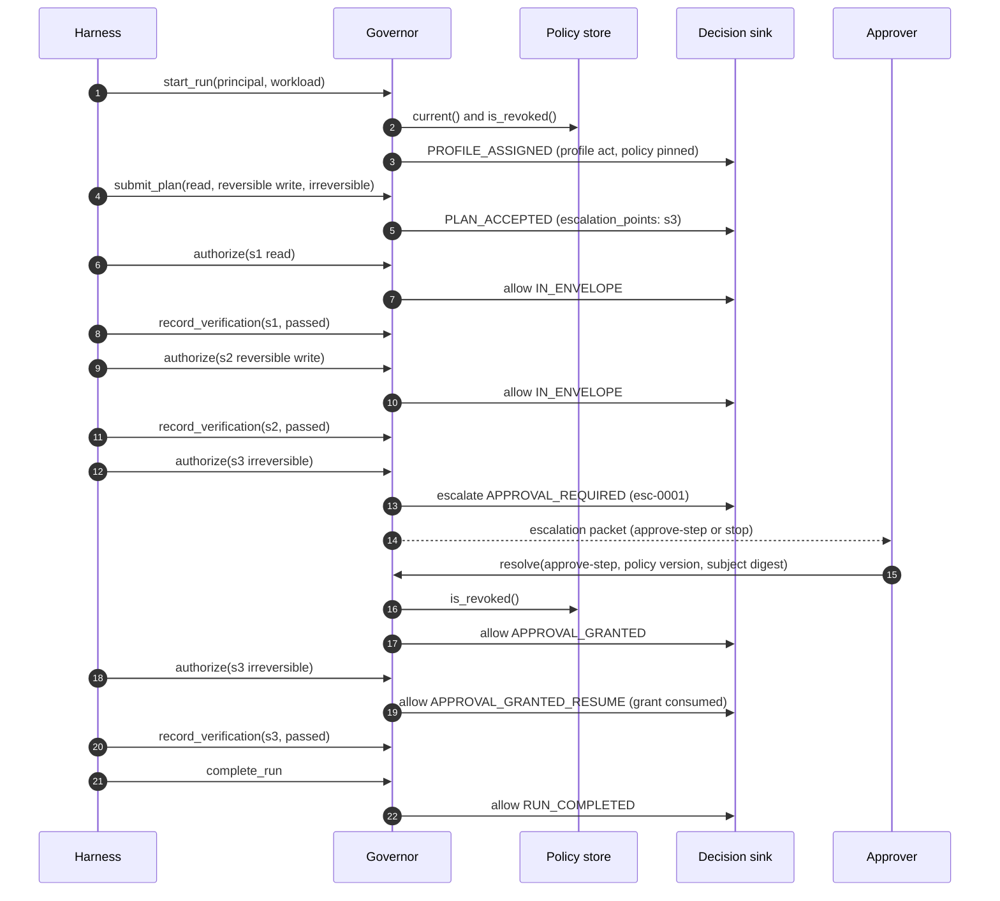
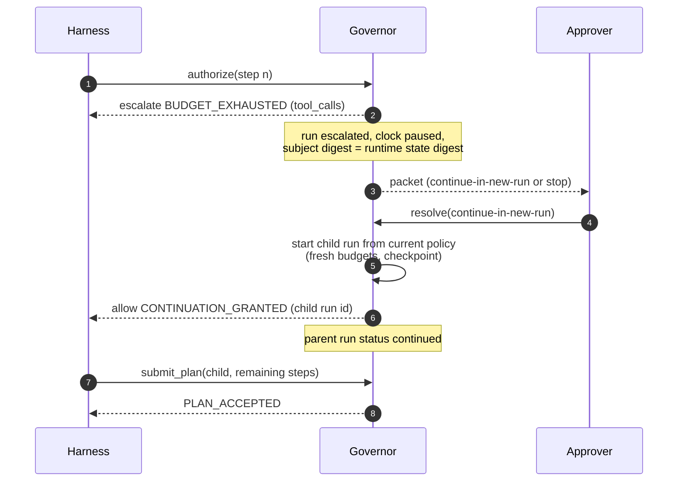
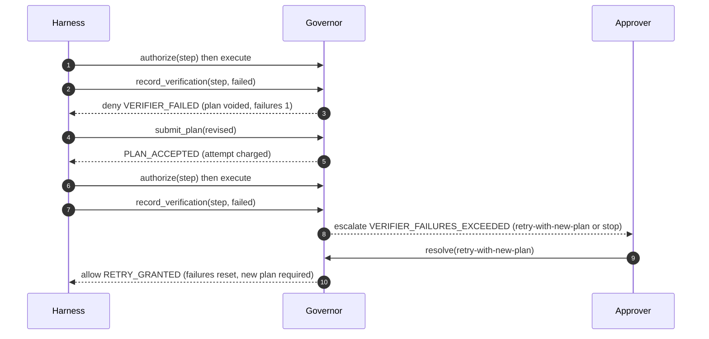
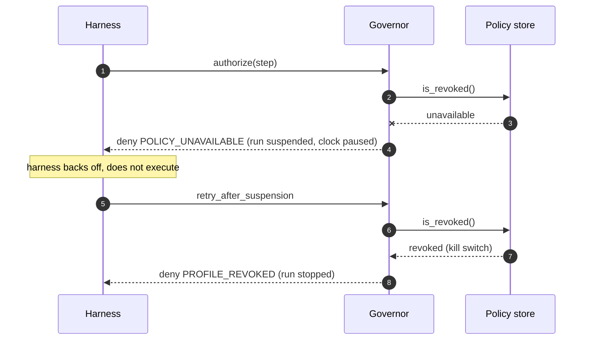

# Bounded autonomy: architecture

This document describes how a harness gives an agent explicit, server-enforced limits so that it acts on its own inside a known envelope and stops or escalates outside it. It goes deeper on the autonomy, budget and envelope mechanism that the [governed context-aware agent harness](../../governed-context-aware-agent-harness/README.md) composes end to end. The runnable sample is [`samples/autonomy_governor.py`](../samples/autonomy_governor.py).

All budget values in this document and the sample are illustrative parameters, not recommendations.

## Contents

1. [Problem and forces](#1-problem-and-forces)
2. [Terminology](#2-terminology)
3. [Components](#3-components)
4. [Autonomy profiles](#4-autonomy-profiles)
5. [Budgets](#5-budgets)
6. [The allowed-action envelope](#6-the-allowed-action-envelope)
7. [Plan-before-act](#7-plan-before-act)
8. [Stop and escalation conditions](#8-stop-and-escalation-conditions)
9. [Runtime state and resumability](#9-runtime-state-and-resumability)
10. [Runtime sequences](#10-runtime-sequences)
11. [Decision matrix](#11-decision-matrix)
12. [Wire contracts](#12-wire-contracts)
13. [Implementation on Azure](#13-implementation-on-azure)
14. [Relationship to the harness and sibling assets](#14-relationship-to-the-harness-and-sibling-assets)
15. [Domain Packs](#15-domain-packs)
16. [Failure modes](#16-failure-modes)
17. [Anti-patterns](#17-anti-patterns)
18. [Production checklist](#18-production-checklist)
19. [References](#19-references)

## 1. Problem and forces

An agent that can call tools can change things: scale a service, hold an appointment slot, apply a credit, submit an order, send a message. Organizations want agents to do useful work without a person approving every read, and they also need certainty that an agent will not take an action nobody sanctioned, spend without limit, or keep going after something has clearly gone wrong.

Two common approaches fail:

- **Full autonomy with prompt guidance.** The system prompt says "only make safe changes" and "stop after three tries". The model is the only enforcement point, and its compliance depends on everything else in its context, including retrieved documents and tool results an attacker may control.
- **Approval for everything.** Every tool call goes to a person. Approvers quickly learn that most requests are routine and start approving without reading. The control exists on paper only, and the agent is too slow to be worth deploying.

The forces this pattern balances:

| Force | Tension |
|---|---|
| Usefulness | The agent should complete routine work without waiting for people. |
| Safety | Irreversible, external or out-of-scope actions need a person, or should not happen at all. |
| Cost and resource control | Loops and retries consume tokens, tool quota, time and money. Someone has to own the limit. |
| Injection resistance | Text the model reads must not be able to raise its own permissions or extend its own budget. |
| Auditability | For every action, an auditor must be able to see who allowed it, under which policy version, and why. |
| Availability | A dependency outage must not silently widen what the agent can do. |
| Human attention | Escalations must be rare enough to be read and detailed enough to decide quickly. |

The pattern's answer: the model proposes, a deterministic governor in the harness decides, and the governor's limits come from versioned server-side policy bound to verified identity.

## 2. Terminology

| Term | Meaning in this pattern |
|---|---|
| **Harness** | The orchestration loop that calls the model, executes tools and calls the governor before each action. It owns the run. |
| **Governor** | The policy decision point inside the harness. It evaluates plans and steps and returns `allow`, `deny` or `escalate`. In the sample, `AutonomyGovernor`. |
| **Policy document** | A versioned document that defines tool classes, role-to-profile mappings, workload caps, profiles, envelopes and budgets. |
| **Policy store** | Where the policy document and the revocation (kill-switch) list live, for example Azure App Configuration. |
| **Autonomy profile** | A named level of autonomy: `observe-only`, `propose`, `act-with-approval` or `act`. Selected by server-side policy. |
| **Budget** | A hard limit on a resource the run consumes: attempts, tool calls, tokens, active wall-clock time and optional cost. |
| **Allowed-action envelope** | The set of actions a profile permits: the tool allowlist, the rule for each side-effect class, argument constraints and the data boundary. |
| **Side-effect class** | `read`, `reversible_write` or `irreversible_external`. Assigned to each tool by policy, not by the tool or the model. |
| **Plan** | An ordered list of planned steps the model proposes before acting. Each step has a tool, arguments, a destination and input data labels. |
| **Step digest** | A canonical SHA-256 digest of a planned step. Approvals and plan membership bind to it. |
| **Decision record** | A structured record of one governor decision: outcome, reason codes, policy version, profile, principal, phase, subject and remaining budget. |
| **Escalation** | A hand-off to a person, with an escalation packet that carries the state needed to decide and a list of allowed resolutions. |
| **Resolution** | The person's decision on an escalation: `approve-step`, `clarify-plan`, `retry-with-new-plan`, `continue-in-new-run` or `stop`. |
| **Suspension** | A paused state entered when the policy store or decision sink is unavailable. Resumable; does not consume budget. |
| **Continuation** | A child run that carries a checkpoint from a parent run whose budget was exhausted, with fresh budgets from current policy. |

## 3. Components



| Component | Responsibility | Does not |
|---|---|---|
| **Harness loop** | Owns the run. Calls the model for a plan, submits it to the governor, calls `authorize` before each step, executes only allowed steps, reports verification results and metered usage. | Decide whether an action is allowed. |
| **Autonomy governor** | Resolves the profile, pins the policy for the run, evaluates plans and steps against the envelope and budgets, records every decision, raises escalations and applies resolutions. | Call the model, execute tools or verify results. |
| **Policy store** | Serves the current policy document and the revocation list. Versioned, change-controlled, readable by the harness identity only. | Hold runtime state. |
| **Decision sink** | Durably appends every decision record. In production, the [evidence ledger](../../evidence-ledger-and-run-certificate/README.md). | Decide anything. |
| **Escalation queue and approval surface** | Delivers escalation packets to eligible approvers and returns resolutions. How approval is gated is covered by [verify before approve](../../verify-before-approve/README.md). | Execute the escalated step itself. |
| **Verifier** | Checks the result of each executed step, independent of the model. | Grant or extend autonomy. |
| **AI gateway** | Applies coarse token limits per caller as a backstop. | Replace the governor's per-run budgets. |
| **Telemetry** | Receives decision outcomes and reason codes for dashboards and alerts. | Serve as the audit record. |

The governor is deliberately small and deterministic. It contains no model call. Given the same policy, state and input, it returns the same decision, which makes it testable with a scenario suite like the sample's `--self-test`.

## 4. Autonomy profiles

A profile is a named point on a scale from "look only" to "act without asking". The sample uses four:

| Profile | Tool allowlist | `read` | `reversible_write` | `irreversible_external` | Typical use |
|---|---|---|---|---|---|
| `observe-only` | Read tools only | allow | deny | deny | Diagnosis, reporting, new users, first deployment of a new agent. |
| `propose` | Read, write and irreversible tools | allow | propose (recorded, not executed) | deny | Agent drafts changes that a person or another system applies. |
| `act-with-approval` | Read, write and irreversible tools | allow | escalate | escalate | Every write needs a person; reads are free. |
| `act` | Read, write and irreversible tools | allow | allow (within constraints) | escalate | Routine reversible changes run unattended; irreversible or external actions still need a person. |

Even the most autonomous profile escalates irreversible or external actions. A policy can define a profile that allows them, but this is an explicit, reviewed decision, not a default.

### Profile resolution

The profile is resolved once, at `start_run`, from verified inputs only (see [ADR 0003](decisions/0003-profiles-selected-by-server-policy.md)):

1. Map each of the caller's verified app roles to a profile (`Autonomy.Observe` to `observe-only`, `Autonomy.Propose` to `propose`, `Autonomy.ActWithApproval` to `act-with-approval`, `Autonomy.Act` to `act`), and take the highest.
2. Look up the cap for the workload (for example `service-operations` capped at `act` and `service-operations-restricted` capped at `act-with-approval`).
3. The profile is the lower of the two.
4. No autonomy role or no workload cap: `deny` with `NO_PROFILE_ASSIGNED`. Revoked profile: `deny` with `PROFILE_REVOKED`. Store unreachable: `deny` with `POLICY_UNAVAILABLE`.

A profile requested in the prompt or plan is written to the decision record with `requested_profile_ignored: true`. It never influences the result.

## 5. Budgets

Budgets are hard limits on what a run may consume. They are defined per profile in the policy document, copied into the run at `start_run` and enforced by the governor (see [ADR 0001](decisions/0001-enforce-budgets-in-harness-not-prompt.md)).

| Budget | Metered by | Charged when | Checked at |
|---|---|---|---|
| `attempts` | Governor | Each plan submission, before evaluation, so denied and escalated plans count | `submit_plan` |
| `tool_calls` | Governor | Each step that is allowed and handed to the harness for execution | `authorize` |
| `tokens` | Harness, from model usage reported by the platform | After each model call, through `charge` | Every gate |
| `wall_clock_seconds` | Governor clock | Continuously while the run is `running`; paused while `escalated` or `suspended` | Every gate |
| `cost` (optional) | Harness, from a price table or billing signal | After each model or paid tool call, through `charge` | Every gate |

Points to note:

- **Budgets are checked at gates, not continuously.** A single model call between gates can overshoot the token or cost budget. Bound each call with a per-call output token limit, so the overshoot is bounded too.
- **The model never reports its own usage.** Token counts come from the model service's usage response, read by the harness.
- **Waiting is free.** Time spent waiting for a human or for a dependency to recover is excluded from active wall-clock time, so an approver taking a long time does not cause a budget escalation on resume.
- **Exhaustion escalates, it does not just stop.** The escalation packet lets a person stop the run or continue in a new, linked run with fresh budgets, up to `max_continuations` per profile.
- **Budgets are pinned.** Publishing a new policy version does not change the budgets of a run already in progress.
- **Size budgets from evidence.** The sample's values (for example 3 attempts and 12 tool calls) exist only so that the scenarios have something to exhaust. See [Evaluation and troubleshooting](evaluation-and-troubleshooting.md#sizing-budgets-from-evaluation-runs).

## 6. The allowed-action envelope

The envelope is what a profile permits. Every planned step is checked against it, first at plan time and again just before execution. The checks run in a fixed order, and the first failing check decides:

| Order | Check | Source of truth | Failure |
|---|---|---|---|
| 1 | **Tool allowlist.** The tool must have a side-effect class in policy and be in the profile's allowlist. | Policy `tool_classes` and the profile's `allowed_tools` | `deny` `TOOL_NOT_IN_PROFILE` |
| 2 | **Data boundary.** The step's data class must be allowed for its destination. | Profile `data_boundary` | `deny` `DATA_BOUNDARY_VIOLATED` |
| 3 | **Side-effect rule.** The profile's rule for the tool's class: `allow`, `propose`, `escalate` or `deny`. | Profile `side_effect_rules` | `deny` `SIDE_EFFECT_EXCEEDS_PROFILE`, `deny` `PROPOSE_ONLY` (recorded as a proposal), or `escalate` `APPROVAL_REQUIRED` |
| 4 | **Argument constraints.** Scope, target and amount limits per tool. | Profile `arg_constraints` | `escalate` `ARG_CONSTRAINT_VIOLATED` |

Design notes:

- **Side-effect classes are assigned by policy.** A tool cannot declare itself read-only. A tool that has no class in the policy document is unknown and is denied, even if a catalog lists it.
- **Argument constraints escalate rather than deny.** An out-of-scope target or an amount above the limit may be legitimate, so a person decides. If the profile's rule for the class is already `escalate`, the violations are added to the same escalation as an extra reason code, so the approver sees them.
- **Argument checks are strict about types.** A missing constrained argument, a value outside the allowed set, a non-numeric or Boolean value where a number is expected, or a number outside `min`/`max` each produce a named violation (`amount:above-max`, `scope:not-allowed`, `scope:missing`).
- **Data classes take the most sensitive label.** A step's data class is the highest-ranked label among its inputs (`public` < `internal` < `confidential` < `regulated`). Unknown or missing labels are treated as `regulated`. In the sample, `internal` destinations accept all classes and `external` destinations accept `public` and `internal` only. An unknown destination accepts nothing.
- **The envelope narrows the catalog, it does not replace it.** Which tools a caller can see at all is decided by the [entitlement-aware tool catalog](../../../ai-gateway/entitlement-aware-tool-catalog/README.md), and when they are exposed to the model by [progressive tool loading](../../progressive-tool-loading/README.md). The envelope then decides what the run may do with them.

## 7. Plan-before-act

Before the first action, the harness asks the model for a plan and submits it to the governor. The plan contains the ordered steps, a confidence signal and any ambiguities the model noticed.

At `submit_plan` the governor:

1. Checks that the run is `running` and that the policy store is reachable and the profile is not revoked.
2. Checks the budgets, including whether one more attempt is available, and then charges the attempt. A denied or escalated plan still uses an attempt, so a model cannot retry plans indefinitely.
3. Runs the envelope check on every step. Any hard denial (tool not in profile, data boundary, side-effect class denied) denies the whole plan with the denied steps' reason codes. Steps that are `propose`-only do not deny the plan; they are listed as proposals.
4. If confidence is below the profile's `min_plan_confidence`, or the plan lists ambiguities, and a person has not already confirmed it, escalates with `LOW_CONFIDENCE` and offers `clarify-plan` or `stop`.
5. Otherwise accepts the plan with `PLAN_ACCEPTED`, records its digest and lists the steps that will need approval (`escalation_points`) and the proposals. The phase moves to `act`.

At `authorize`, before each step, the governor checks that the step's digest is in the accepted plan (`STEP_NOT_IN_PLAN` otherwise) and has not run already (`STEP_ALREADY_EXECUTED`), then re-runs the envelope and budget checks. A model that changes an argument after the plan was accepted produces a different digest and is denied.

Plan-time evaluation gives the approver and the harness early warning: escalation points are known before any action runs, so a harness can ask for approvals up front or decide to stop before doing partial work. Execution-time evaluation remains the enforcement point.

Model-reported confidence is a weak signal. The pattern only ever uses it to reduce autonomy (escalate), never to increase it. A verifier or classifier score can be used in the same way.

## 8. Stop and escalation conditions

The governor stops or escalates on these conditions. None depend on the model agreeing.

| Condition | Outcome | Reason code | Allowed resolutions |
|---|---|---|---|
| Step needs approval under the profile (side-effect rule `escalate`) | `escalate` | `APPROVAL_REQUIRED` (plus `ARG_CONSTRAINT_VIOLATED` if any) | `approve-step`, `stop` |
| Argument outside constraints in an otherwise allowed class | `escalate` | `ARG_CONSTRAINT_VIOLATED` | `approve-step`, `stop` |
| Budget exhausted (attempts, tool calls, tokens, active wall clock or cost) | `escalate` | `BUDGET_EXHAUSTED` | `continue-in-new-run` (while continuations remain), `stop` |
| Consecutive verifier failures reach the profile maximum | `escalate` | `VERIFIER_FAILURES_EXCEEDED` | `retry-with-new-plan`, `stop` |
| Plan confidence low or ambiguities present | `escalate` | `LOW_CONFIDENCE` | `clarify-plan`, `stop` |
| Tool not in profile, data boundary, side-effect class denied, step not in plan | `deny` | `TOOL_NOT_IN_PROFILE`, `DATA_BOUNDARY_VIOLATED`, `SIDE_EFFECT_EXCEEDS_PROFILE`, `STEP_NOT_IN_PLAN` | None. The run continues, and the harness must replan or finish. |
| Policy store unreachable | `deny`, run `suspended` | `POLICY_UNAVAILABLE` | Retry after the store recovers |
| Decision sink unreachable | `deny`, run `suspended` | `AUDIT_UNAVAILABLE` | Retry after the sink recovers |
| Profile revoked (kill switch) | `deny`, run `stopped` | `PROFILE_REVOKED` | None |

Denials are not escalations. Out-of-envelope requests that the profile forbids outright are denied with a reason code, which the harness can feed back to the model so it can replan within the envelope. Escalation is reserved for decisions a person can usefully make.

### Escalation packet

An escalation hands the person everything needed to decide without reading the transcript: the reason codes, the subject (the step, plan or run state), a `subject_digest` that the resolution must echo, the allowed resolutions, the budget remaining and used, the consecutive verifier failures, completed steps and verifier findings. See [the wire contract](#escalation-packet-contract).

### Resolution checks

A resolution is applied only if every check passes, in this order:

1. An escalation is pending for the run and its ID matches (`ESCALATION_NOT_PENDING`).
2. The action is one of the packet's allowed resolutions (`RESOLUTION_NOT_ALLOWED`).
3. The resolution names the policy version the run is pinned to (`POLICY_VERSION_MISMATCH`).
4. The resolution's `subject_digest` matches the packet (`APPROVAL_MISMATCH`). Approving something other than what was escalated is impossible.
5. The approver is not the run's principal (`SELF_APPROVAL`).
6. The approver holds the policy's approver role in the same tenant (`APPROVER_NOT_ELIGIBLE`).

`stop` is applied immediately, even if the policy store is down. Every other resolution re-checks the policy store and the kill switch first, because it widens what the run may do. If the store is unreachable, the resolution is denied with `POLICY_UNAVAILABLE` and the escalation stays pending, so the approver can try again. If the profile has been revoked, the run stops.

| Resolution | Effect |
|---|---|
| `approve-step` | Grants a single-use approval bound to the step digest. The next `authorize` for that step returns `allow` `APPROVAL_GRANTED_RESUME` and consumes the grant. |
| `clarify-plan` | Accepts the pending plan as confirmed by a person (`PLAN_CLARIFIED`). A changed plan should be resubmitted instead. |
| `retry-with-new-plan` | Resets the consecutive verifier failure count and voids the plan (`RETRY_GRANTED`). The harness must submit a new plan, which costs an attempt. |
| `continue-in-new-run` | Marks the run `continued` and starts a linked child run (`CONTINUATION_GRANTED`). |
| `stop` | Stops the run (`STOPPED_BY_APPROVER`). |

How the approval itself is presented, authenticated and recorded is the subject of [verify before approve](../../verify-before-approve/README.md). This pattern decides when one is needed and what it may unlock.

## 9. Runtime state and resumability

The governor keeps runtime state per run and exposes it as a `bounded-autonomy.runtime-state/v1` snapshot. The state includes the pinned policy and profile, budgets and usage, the phase (`plan`, `act`, `verify`, `finalize`), the status, the plan digest, completed steps, proposals, any pending escalation and any checkpoint from a parent run.



Resumability rules:

- **Escalation pauses the clock.** Active wall-clock time stops while a person decides and restarts on resume.
- **Suspension remembers where it came from.** A run suspended because a dependency failed returns to `running` or `escalated` when `retry_after_suspension` succeeds, with a `POLICY_RESTORED` or `AUDIT_RESTORED` record. The retry re-checks the kill switch.
- **Resolutions are bound to state.** Because the resolution echoes the policy version and the subject digest, an approval granted against an older state, or for a different step, is rejected.
- **Continuation is a new run, not a budget increase.** The child run re-resolves its profile and budgets from current policy, links to its parent (`parent_run_id`, `continuation_index`) and carries a checkpoint of completed steps, remaining steps and proposals. Completed steps are not re-executed. The number of continuations is limited by the profile.
- **State belongs to the harness.** In production, persist the runtime state where the harness keeps durable run state, and write every decision record to the evidence ledger before the state changes.

## 10. Runtime sequences

### 10.1 Happy path with one approval

This is the sample's default demo (`python autonomy_governor.py`) on the IT operations Domain Pack under the `act` profile.



Every arrow into the decision sink is a decision record written before the state change it describes.

### 10.2 Budget exhaustion and continuation



If the parent was already a continuation and the profile allows no more, the packet offers only `stop`.

### 10.3 Repeated verifier failure



A failed verification removes the step from the completed list and voids the plan, so the harness has to replan. That costs an attempt, so repeated failure also runs into the attempts budget. Bounded self-correction loops are discussed further in [verify before approve](../../verify-before-approve/README.md).

### 10.4 Policy store unavailable and kill switch



When the store recovers and the profile is not revoked, the retry returns `allow` `POLICY_RESTORED` and the run resumes where it left off. The same suspend-and-retry path applies when the decision sink is unavailable (`AUDIT_UNAVAILABLE` then `AUDIT_RESTORED`). See [ADR 0002](decisions/0002-fail-closed-on-policy-unavailable.md).

## 11. Decision matrix

### 11.1 What the governor decides

| Situation | Outcome | Reason codes | State change | What the harness does next |
|---|---|---|---|---|
| Caller has no autonomy role, or workload has no cap | `deny` | `NO_PROFILE_ASSIGNED` | Run `refused` | Return an error. Do not call the model. |
| Profile requested in the prompt | (ignored) | `requested_profile_ignored: true` in details | None | Nothing. Optionally alert on repeated attempts. |
| Read step in envelope | `allow` | `IN_ENVELOPE` | Tool call charged | Execute, then verify. |
| Reversible write under `propose` | `deny` | `PROPOSE_ONLY` | Proposal recorded | Present the proposal; do not execute. |
| Irreversible step under `propose` or `observe-only` | `deny` | `SIDE_EFFECT_EXCEEDS_PROFILE` | None | Replan without it, or finish. |
| Tool unknown or not in the profile | `deny` | `TOOL_NOT_IN_PROFILE` | None | Replan. |
| Regulated data to an external destination | `deny` | `DATA_BOUNDARY_VIOLATED` | None | Replan with less sensitive inputs, or finish. |
| Argument outside scope or amount limit | `escalate` | `ARG_CONSTRAINT_VIOLATED` | Run `escalated` | Wait for resolution. |
| Irreversible step under `act` | `escalate` | `APPROVAL_REQUIRED` | Run `escalated` | Wait for resolution. |
| Step not in the accepted plan, or plan not yet accepted | `deny` | `STEP_NOT_IN_PLAN`, `PLAN_REQUIRED` | None | Submit a plan that includes the step. |
| Any budget exhausted at a gate | `escalate` | `BUDGET_EXHAUSTED` | Run `escalated` | Wait for resolution. |
| Verifier failures reach the maximum | `escalate` | `VERIFIER_FAILURES_EXCEEDED` | Run `escalated` | Wait for resolution. |
| Low confidence or ambiguous plan | `escalate` | `LOW_CONFIDENCE` | Run `escalated`, plan held | Wait for clarification. |
| Policy store unreachable | `deny` | `POLICY_UNAVAILABLE` | Run `suspended` | Back off and retry. |
| Decision sink unreachable | `deny` | `AUDIT_UNAVAILABLE` | Run `suspended` | Back off and retry. |
| Profile revoked | `deny` | `PROFILE_REVOKED` | Run `stopped` | Stop. |

### 11.2 Choosing a profile for a workload

| Workload characteristics | Suggested workload cap |
|---|---|
| New agent, unproven tools or no verifier yet | `observe-only` |
| Changes must be applied by another system or team | `propose` |
| Writes are reversible but the business wants a person on every change | `act-with-approval` |
| Reversible writes are routine, well constrained and verified; irreversible actions are rare | `act` |
| Every action is irreversible or external | `act-with-approval`, or reconsider whether an agent fits |

Promote a workload cap only with evidence from evaluation runs and production telemetry, through the same change process as any other policy change.

## 12. Wire contracts

The sample emits these shapes. Digests are shortened here for readability.

### Policy document contract

One profile is shown. Values are illustrative.

```json
{
  "schema": "bounded-autonomy.policy/v1",
  "policy_id": "autonomy-it-operations",
  "version": "2026.10.1",
  "tool_classes": {
    "get_service_health": "read",
    "scale_service": "reversible_write",
    "purge_snapshots": "irreversible_external",
    "modify_firewall_rule": "irreversible_external"
  },
  "role_profiles": {
    "Autonomy.Observe": "observe-only",
    "Autonomy.Propose": "propose",
    "Autonomy.ActWithApproval": "act-with-approval",
    "Autonomy.Act": "act"
  },
  "workload_caps": {
    "service-operations": "act",
    "service-operations-restricted": "act-with-approval"
  },
  "approver_role": "Autonomy.Approver",
  "profiles": {
    "act": {
      "allowed_tools": ["get_service_health", "scale_service", "purge_snapshots"],
      "side_effect_rules": {
        "read": "allow",
        "reversible_write": "allow",
        "irreversible_external": "escalate"
      },
      "arg_constraints": {
        "scale_service": {
          "environment": { "allowed": ["dev", "test"] },
          "instance_delta": { "min": 1, "max": 2 }
        }
      },
      "data_boundary": {
        "internal": ["public", "internal", "confidential", "regulated"],
        "external": ["public", "internal"]
      },
      "budgets": {
        "attempts": 3,
        "tool_calls": 12,
        "tokens": 40000,
        "wall_clock_seconds": 900,
        "cost": null
      },
      "max_consecutive_verifier_failures": 2,
      "min_plan_confidence": 0.7,
      "max_continuations": 1
    }
  }
}
```

`modify_firewall_rule` has a side-effect class but is in no profile's allowlist, so any attempt to use it is denied with `TOOL_NOT_IN_PROFILE`.

### Policy decision record contract

Emitted for every decision, including allows. This is the record the [evidence ledger](../../evidence-ledger-and-run-certificate/README.md) persists; how it is chained and certified is covered there.

```json
{
  "schema": "bounded-autonomy.policy-decision/v1",
  "decision_id": "dec-0007",
  "run_id": "run-0001",
  "evaluated_at": "2026-10-21T09:00:00Z",
  "outcome": "escalate",
  "reason_codes": ["APPROVAL_REQUIRED"],
  "policy": { "policy_id": "autonomy-it-operations", "version": "2026.10.1" },
  "profile": "act",
  "principal": { "subject": "user-operator-01", "tenant": "tenant-a" },
  "phase": "act",
  "subject": {
    "type": "step",
    "step_id": "s3",
    "tool": "purge_snapshots",
    "step_digest": "sha256:ae95d7e3…a9f9c1"
  },
  "budget_remaining": {
    "attempts": 2,
    "tool_calls": 10,
    "tokens": 37900,
    "wall_clock_seconds": 900
  },
  "escalation_id": "esc-0001",
  "allowed_resolutions": ["approve-step", "stop"],
  "details": {
    "side_effect_class": "irreversible_external",
    "data_class": "internal",
    "destination": "internal",
    "violations": []
  }
}
```

`subject.type` is one of `run`, `plan`, `step`, `verification` or `resolution`. `budget_remaining.cost` is present only when a cost budget is set. Records never contain tool results, model output or argument values beyond what the policy needs to explain the decision.

### Escalation packet contract

```json
{
  "schema": "bounded-autonomy.escalation/v1",
  "escalation_id": "esc-0001",
  "run_id": "run-0001",
  "profile": "act",
  "policy": { "policy_id": "autonomy-it-operations", "version": "2026.10.1" },
  "phase": "act",
  "reason_codes": ["APPROVAL_REQUIRED"],
  "subject": { "type": "step", "step_id": "s3", "tool": "purge_snapshots", "step_digest": "sha256:ae95d7e3…a9f9c1" },
  "subject_digest": "sha256:ae95d7e3…a9f9c1",
  "allowed_resolutions": ["approve-step", "stop"],
  "budget_remaining": { "attempts": 2, "tool_calls": 10, "tokens": 37900, "wall_clock_seconds": 900 },
  "attempts_used": 1,
  "tool_calls_used": 2,
  "consecutive_verifier_failures": 0,
  "completed_steps": ["s1", "s2"],
  "findings": [],
  "requested_by": "user-operator-01",
  "created_at": "2026-10-21T09:00:00Z"
}
```

`subject_digest` is the step digest for step approvals, the plan digest for low-confidence escalations, and a digest of the runtime state (usage counters, failures, completed steps and plan digest) for budget and verifier escalations. If the state changes, an old resolution no longer matches.

### Resolution contract

Sent by the approval surface on behalf of an authenticated approver. The approver's identity comes from their validated token, not from this body.

```json
{
  "run_id": "run-0001",
  "escalation_id": "esc-0001",
  "action": "approve-step",
  "policy_version": "2026.10.1",
  "subject_digest": "sha256:ae95d7e3…a9f9c1",
  "note": "change window confirmed"
}
```

### Runtime state contract

```json
{
  "schema": "bounded-autonomy.runtime-state/v1",
  "run_id": "run-0001",
  "parent_run_id": null,
  "continuation_index": 0,
  "status": "completed",
  "phase": "finalize",
  "profile": "act",
  "policy": { "policy_id": "autonomy-it-operations", "version": "2026.10.1" },
  "principal": { "subject": "user-operator-01", "tenant": "tenant-a" },
  "workload": "service-operations",
  "budgets": { "attempts": 3, "tool_calls": 12, "tokens": 40000, "wall_clock_seconds": 900, "cost": null },
  "used": { "attempts": 1, "tool_calls": 3, "tokens": 2100, "cost": 0.0, "active_seconds": 0 },
  "budget_remaining": { "attempts": 2, "tool_calls": 9, "tokens": 37900, "wall_clock_seconds": 900 },
  "consecutive_verifier_failures": 0,
  "plan_digest": "sha256:690fe591…2371a9",
  "plan_accepted": true,
  "completed_steps": ["s1", "s2", "s3"],
  "proposals": [],
  "pending_escalation_id": null,
  "suspended_reason": null,
  "checkpoint": null,
  "last_decision_id": "dec-0011",
  "updated_at": "2026-10-21T09:10:00Z"
}
```

A continuation run has `parent_run_id`, `continuation_index` of 1 or more, and a `checkpoint` with `parent_run_id`, `parent_escalation_id`, `completed_steps`, `remaining_steps` and `proposals`.

## 13. Implementation on Azure

The governor runs inside the harness process. Azure services supply identity, policy storage, a coarse gateway backstop, audit persistence and telemetry. The seams in the sample (`PolicyStore`, `DecisionSink`, `Principal`, the clock) are where they plug in.

| Concern | Azure service | How it is used | Notes |
|---|---|---|---|
| Harness and governor runtime | Microsoft Foundry Agent Service, including hosted agents, or your own container host | The harness loop and governor run in-process in the agent's code. Every tool call goes through `authorize` first. | Hosted agents are in preview at the time of writing; check current availability. Built-in tool approval settings in the platform are a useful complement, but they do not track per-run budgets or envelopes. |
| Caller and approver identity | Microsoft Entra ID | App roles (`Autonomy.*`, `Autonomy.Approver`) assigned to users, groups or workload identities. The harness builds `Principal` from validated token claims. | See [Authentication and governance](authentication-and-governance.md). |
| Versioned profiles and kill switch | Azure App Configuration | The policy document is a key-value read by label or from an immutable snapshot. Revocations live under a separate key that is read on every gate. The harness reads with a managed identity that has App Configuration Data Reader. | A policy store outage suspends runs, so consider replicas for the store. Any policy store with versioning and access control fits the same seam. |
| Gateway backstop | Azure API Management | The `llm-token-limit` policy caps token usage per caller or subscription at the gateway, for all traffic. | A backstop for runaway usage and noisy neighbors. It does not know about runs, profiles or envelopes, so it is not the primary control. |
| Decision records and audit | The evidence ledger's storage | `DecisionSink.emit` appends each record before the state change. | See the [evidence ledger](../../evidence-ledger-and-run-certificate/README.md). |
| Runtime state | The harness's durable run store | Persist the runtime state snapshot after each decision so runs survive restarts and can resume after escalation. | Any durable store the harness already uses. |
| Telemetry | Azure Monitor and Application Insights | Emit a span or event per decision with outcome, reason codes, profile, policy version and remaining budget as attributes, through OpenTelemetry. | Telemetry is for dashboards and alerts. The ledger is the audit record. |
| Escalation delivery | Your approval surface | Delivers packets to eligible approvers and returns resolutions. | Channels and approval gating are covered by [verify before approve](../../verify-before-approve/README.md). |

## 14. Relationship to the harness and sibling assets

| Asset | What it covers | How bounded autonomy relates |
|---|---|---|
| [Governed context-aware agent harness](../../governed-context-aware-agent-harness/README.md) | Reference architecture composing plan-before-act, progressive disclosure, memory, verifier, ledger, approval and certificate. | This asset is the deep dive on the autonomy, budget and envelope mechanism the harness uses at each gate. |
| [Verify before approve](../../verify-before-approve/README.md) | How an approval is gated: verification evidence, approver experience, approval channels. | Bounded autonomy decides when an escalation or approval is needed and what a resolution may unlock. |
| [Request context is not authorization](../../../agent-runtime/request-context-is-not-authorization/README.md) | Authorization from server-verified identity, not request content. | Profiles and approver eligibility bind to verified identity, never to prompt claims. |
| [Evidence ledger and run certificate](../../evidence-ledger-and-run-certificate/README.md) | Durable, tamper-evident persistence of run evidence. | Persists the decision records this governor emits. |
| [Progressive tool loading](../../progressive-tool-loading/README.md) | When tools are exposed to the model. | Exposure is not permission; the envelope still checks every call. |
| [Entitlement-aware tool catalog](../../../ai-gateway/entitlement-aware-tool-catalog/README.md) | Which tools exist for a caller. | The envelope narrows the caller's catalog further for this run's profile. |

## 15. Domain Packs

The same governor and policy shape run unchanged across industries. Only the tool names, scopes, limits and labels differ. Run any pack with `--domain`.

| Pack | Organization | Workload | Read tool | Reversible write (scope / amount limit) | Irreversible or external | Registered but not allowlisted | Regulated data example |
|---|---|---|---|---|---|---|---|
| `it-operations` | Contoso | `service-operations` | `get_service_health` | `scale_service` (`environment` in dev, test / `instance_delta` up to 2) | `purge_snapshots` (internal) | `modify_firewall_rule` | Customer personal data in application logs |
| `payments-servicing` | Fabrikam | `dispute-servicing` | `get_transaction_history` | `apply_goodwill_credit` (`segment` retail / `amount` up to 25) | `issue_card_refund` (external) | `change_account_owner` | Cardholder data |
| `healthcare-scheduling` | Northwind Health | `appointment-scheduling` | `search_open_slots` | `hold_appointment_slot` (`clinic` clinic-east, clinic-west / `slots` up to 3) | `send_patient_message` (external) | `update_clinical_record` | Protected health information |
| `supply-chain` | Northwind Traders | `replenishment` | `get_inventory_levels` | `reserve_stock` (`warehouse` wh-01, wh-02 / `quantity` up to 100) | `submit_purchase_order` (external) | `change_supplier_bank_details` | Supplier contract pricing |

Limits are illustrative values used by the scenarios.

## 16. Failure modes

| Failure | Effect without the pattern | Behavior with the pattern | Further mitigation |
|---|---|---|---|
| Policy store unreachable | Agent runs with stale or default permissions. | Runs suspend with `POLICY_UNAVAILABLE`; new runs are refused. | Store replicas; alert on suspension count. |
| Decision sink unreachable | Actions happen with no audit record. | Runs suspend with `AUDIT_UNAVAILABLE`; nothing executes unrecorded. | Durable, highly available sink; alert. |
| Revocation is slow to take effect | A misbehaving profile keeps acting. | The revocation key is read on every gate. | Do not cache the revocation key; rehearse the kill switch. |
| Token overshoot between gates | One long generation exceeds the budget. | Detected at the next gate and escalated. | Per-call output token limits; gateway backstop. |
| Tool misclassified as `read` | A write runs without approval. | The envelope trusts policy classification. | Classify tools in policy review; test each tool's class; unknown tools are denied. |
| Arguments changed after approval | Approved intent differs from executed action. | Approval binds to the step digest; changed arguments do not match. | Keep digests canonical and include every argument. |
| Approval replay | One approval is reused for several actions. | Grants are single use. | None needed beyond the governor. |
| Self-approval or approval from another tenant | Separation of duties broken. | `SELF_APPROVAL` and `APPROVER_NOT_ELIGIBLE`. | Review approver role assignments. |
| Endless continuation | Budgets become meaningless. | `max_continuations` per profile; each continuation needs a person. | Alert on continuation chains. |
| Verifier flaps | Agent loops replanning. | Consecutive failures escalate; replans charge attempts. | Improve the verifier; review findings. |
| Harness bypassed | Tool called directly, without `authorize`. | Not prevented by the governor alone. | Tools accept calls only from the harness identity and authorize independently. |
| Harness restarts mid-run | Budgets reset or state is lost. | Not prevented by the governor alone. | Persist runtime state after each decision. |
| Too many escalations | Approvers rubber-stamp. | Escalation rates are visible per reason code. | Tighten constraints, improve plans or adjust the profile, using evidence. |

## 17. Anti-patterns

- **Budgets in the system prompt.** "Stop after three attempts" is a request, not a limit. See [ADR 0001](decisions/0001-enforce-budgets-in-harness-not-prompt.md).
- **The model picks its profile.** A prompt field, a tool argument or an "elevate" tool that raises autonomy turns injection into privilege escalation. See [ADR 0003](decisions/0003-profiles-selected-by-server-policy.md).
- **Gateway limits as the only budget.** A per-minute token cap does not stop a run that loops slowly, and knows nothing about tool calls or side effects.
- **Failing open.** Falling back to a built-in default profile when the policy store is down. See [ADR 0002](decisions/0002-fail-closed-on-policy-unavailable.md).
- **Approving the run instead of the step.** A blanket "approved" for a run lets the agent do things the approver never saw.
- **Continuation as a budget increase.** Topping up the same run's counters hides the fact that a person extended it.
- **Tools that declare their own side-effect class.** Classification belongs to policy, under change control.
- **Telemetry as audit.** Sampled, mutable telemetry is not an audit trail.
- **One profile for everything.** Without workload caps, the most privileged caller's role decides autonomy for every workload.

## 18. Production checklist

- [ ] Every tool has a side-effect class in the policy document, reviewed by the tool owner.
- [ ] Profiles, workload caps and approver role are defined in a versioned policy store with change control.
- [ ] Profiles are resolved only from validated Entra token claims and server-side workload configuration.
- [ ] The harness calls `submit_plan` before acting and `authorize` before every tool call, with no path around it.
- [ ] Token and cost usage come from platform usage data, and every model call has a per-call output limit.
- [ ] Budget values are sized from evaluation runs and reviewed with production telemetry.
- [ ] Policy store and decision sink failures suspend runs; there is no default policy in code.
- [ ] The kill switch has been exercised in a non-production environment.
- [ ] Resolutions require the approver role, a different principal, the same tenant, the pinned policy version and a matching subject digest.
- [ ] Decision records go to the evidence ledger before state changes; telemetry carries reason codes.
- [ ] Runtime state is persisted so runs survive restarts and can resume after escalation.
- [ ] Alerts exist for suspensions, revocations, escalation rates and continuation chains.
- [ ] The scenario suite (like `--self-test`) runs in CI against every policy change.
- [ ] Tools independently authorize the harness identity, so bypassing the governor does not grant access.

## 19. References

- [What is Microsoft Foundry Agent Service?](https://learn.microsoft.com/azure/foundry/agents/overview)
- [Hosted agents in Foundry Agent Service](https://learn.microsoft.com/azure/foundry/agents/concepts/hosted-agents)
- [Limit large language model API token usage (`llm-token-limit` policy)](https://learn.microsoft.com/azure/api-management/llm-token-limit-policy)
- [What is Azure App Configuration?](https://learn.microsoft.com/azure/azure-app-configuration/overview)
- [Snapshots in Azure App Configuration](https://learn.microsoft.com/azure/azure-app-configuration/concept-snapshots)
- [Geo-replication in Azure App Configuration](https://learn.microsoft.com/azure/azure-app-configuration/concept-geo-replication)
- [Add app roles to your application and receive them in the token](https://learn.microsoft.com/entra/identity-platform/howto-add-app-roles-in-apps)
- [Enable Azure Monitor OpenTelemetry](https://learn.microsoft.com/azure/azure-monitor/app/opentelemetry-enable)
